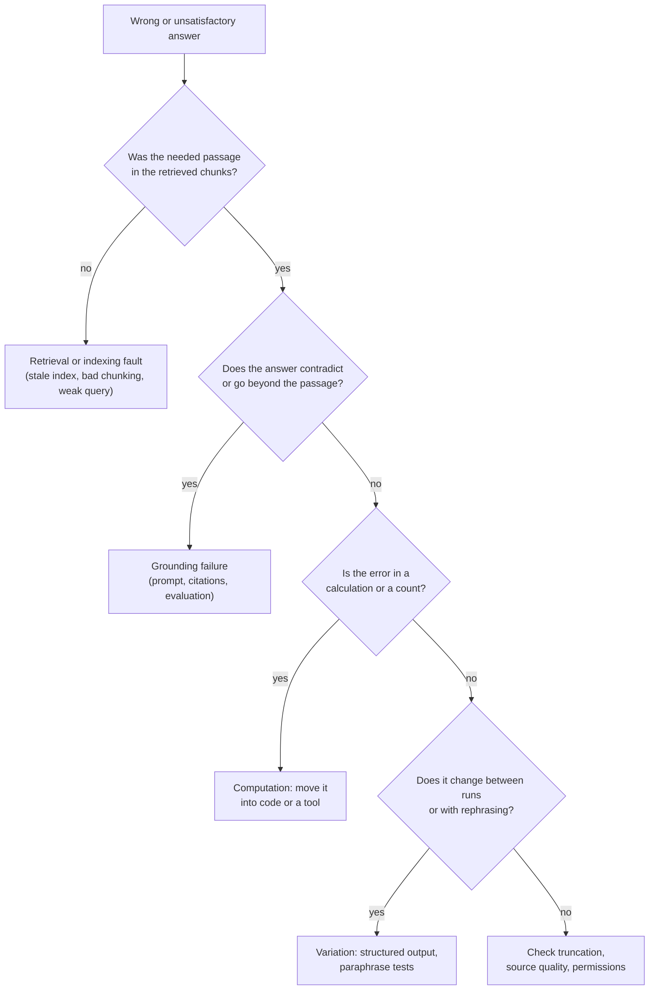

The nine lessons before this one explained how a language model works: tokens, embeddings, attention, the context window, sampling, prompts and inference. Each mechanism has a cost, and those costs show up as limitations you will meet in every system you build. This lesson gathers them into one place.

It is a synthesis, not a repeat. The previous module, [Introduction to RAG](/learn/introduction-to-rag), already covered knowledge cutoffs and hallucination in depth, and this lesson links back to those instead of re-explaining them. What it adds is structure: eight limitations, the mechanism behind each, and a clear answer to the question that matters most for this curriculum, namely which of them RAG addresses and which it does not. Knowing the second list is what stops RAG being treated as a cure for everything.

## Learning objectives

- List eight practical limitations of large language models and name the mechanism behind each.
- Classify each limitation as addressed, partly addressed or not addressed by RAG.
- Choose an appropriate mitigation for the limitations RAG does not address.
- Diagnose which limitation is responsible for a given failure in a RAG system.
- Explain the new failure modes that RAG itself introduces.

## Prerequisites

- [Knowledge limitations of LLMs](/learn/introduction-to-rag/knowledge-limitations-of-llms) and [Hallucinations and factual reliability](/learn/introduction-to-rag/hallucinations-and-factual-reliability).
- [Tokens and tokenisation](/learn/understanding-large-language-models/tokens-and-tokenisation).
- [Context windows](/learn/understanding-large-language-models/context-windows).
- [Temperature and sampling](/learn/understanding-large-language-models/temperature-and-sampling).
- [System prompts and user prompts](/learn/understanding-large-language-models/system-prompts-and-user-prompts).
- [Model inference](/learn/understanding-large-language-models/model-inference).

## Why this matters

Most failed RAG projects do not fail because retrieval is hard. They fail because someone expected retrieval to fix a problem it cannot touch. A team adds a vector index to stop the assistant miscalculating leave balances, and it still miscalculates, because arithmetic was never a knowledge problem. Another team indexes every document they own to stop inconsistent answers, and the answers stay inconsistent, because variation comes from sampling, not from missing documents.

The reverse mistake is as common: blaming "the model" for something that is squarely a retrieval or indexing fault and can be fixed in an afternoon.

A reliable engineer can look at a wrong answer and say which limitation produced it, because each limitation has a different fix. This lesson gives you that map. The rest of the curriculum fills in the fixes.

## The intuition

Imagine hiring a brilliant, very well-read contractor with some peculiar working conditions.

They finished all their reading on a fixed date some time ago and have seen nothing since. They have never been inside your company and have read none of your documents. When they do not know something they tend to answer smoothly anyway. Their desk holds only so many pages at once. They do sums in their head and refuse to use a calculator unless you hand them one. Ask them the same question twice and you may get two phrasings; rephrase the question slightly and you may get a different emphasis. And they bill by the word, both for what they read and for what they write.

Now give them a filing clerk who, for every question, fetches the few most relevant pages from your company's cabinet and lays them on the desk. That clerk is retrieval.

Look at which problems the clerk solves. The contractor can now answer about your company and about events after their reading date, and has less reason to invent things, because the answer is on the desk. But the desk is no larger, the mental arithmetic is no better, the phrasing still varies, the bill has gone *up* because there is more to read, and if the clerk fetches the wrong pages, the contractor will confidently answer from those.

That is the whole shape of this lesson: retrieval changes what the model *knows at answer time*. It does not change how the model *works*.

## How it works

### The eight limitations at a glance

| # | Limitation | Root mechanism | Does RAG address it? | What else is needed |
| --- | --- | --- | --- | --- |
| 1 | Knowledge cutoff | Weights are frozen after training | **Yes**, for facts in the index | Keep the index fresh; date and version documents |
| 2 | No access to private data | Your documents were never in the training set | **Yes**, this is RAG's core purpose | Access control at retrieval time |
| 3 | Hallucination | The model is trained to produce plausible text, not verified text | **Partly**: grounding reduces it | Grounding prompts, citations, refusal behaviour, evaluation |
| 4 | Context limits | Fixed window; attention cost grows with length | **Partly**: RAG selects instead of sending everything | Token budgeting, chunking, context ordering |
| 5 | Cost and latency | Per-token pricing; sequential decoding | **Mixed**: cheaper than sending whole documents, dearer than no context | Budgets, shorter answers, caching, streaming |
| 6 | Non-determinism | Output is sampled; serving infrastructure varies | **No** | Structured outputs, field-level tests, repeated evaluation |
| 7 | Arithmetic and counting | Sub-word tokens; pattern prediction, not calculation | **No** | Do the computation in code or with a tool |
| 8 | Sensitivity to prompt wording | Output is conditioned on every token of the prompt | **No**, and it adds a new surface | Versioned prompts, paraphrase tests, treating retrieved text as untrusted |

The sections below take each in turn.

### 1. Knowledge cutoff: addressed

A model's weights stop changing when training ends, so it has no knowledge of anything after that date. This is covered in [Knowledge limitations of LLMs](/learn/introduction-to-rag/knowledge-limitations-of-llms).

**What RAG does.** It supplies current facts at answer time. If Meridian changes its carry-over rule tomorrow and the handbook is re-indexed, AskMeridian answers correctly without anyone retraining anything.

**What remains.** The limitation moves from the model to the index. A stale index is a knowledge cutoff you created yourself. Freshness becomes an ingestion problem: detecting changed documents, re-indexing them, and retiring superseded versions so the old rule is not retrieved alongside the new one.

### 2. No access to private data: addressed

The model was trained largely on public text. Your handbook, runbooks and tickets were not in it, so the model cannot know them, however capable it is. See [Parametric versus non-parametric knowledge](/learn/introduction-to-rag/parametric-versus-non-parametric-knowledge).

**What RAG does.** This is the problem RAG exists to solve: private text is placed in the prompt for the questions that need it.

**What remains.** A new obligation. A bare model cannot leak your documents because it has never seen them. A RAG system can, to the wrong person. Each user must only be able to retrieve what they are allowed to read, and that has to be enforced in the retrieval layer, not requested in the prompt. See [Access Control and Privacy](/learn/access-control-and-privacy).

### 3. Hallucination: partly addressed

A model produces the most plausible continuation, and a plausible continuation is not always a true one. See [Hallucinations and factual reliability](/learn/introduction-to-rag/hallucinations-and-factual-reliability).

**What RAG does.** It removes the commonest cause, which is the model lacking the fact. With the right passage in front of it and an instruction to answer from that passage, a model has far less need to invent. [How retrieval improves generation](/learn/introduction-to-rag/how-retrieval-improves-generation) explains the effect.

**What remains.** Quite a lot:

- If retrieval misses, the model may still answer from memory or guess.
- The model can misread or over-generalise a passage that *is* present.
- It can blend its own training knowledge with the retrieved text.
- It can attach a real citation to a claim the cited passage does not support.

Grounding is therefore something you instruct, check and measure: explicit rules in the system prompt, required citations, a way to say "I don't know", and faithfulness evaluation ([Generation Evaluation](/learn/generation-evaluation)).

### 4. Context limits: partly addressed

The window is finite, and long contexts are used unevenly. See [Context windows](/learn/understanding-large-language-models/context-windows).

**What RAG does.** RAG is, in one sense, the workaround for this limit: instead of trying to fit a whole knowledge base into the prompt, you select the few passages that matter. A corpus of any size can sit behind a model with a modest window.

**What remains.** RAG lives inside the same limit. Chunks, history and the answer still share one budget; a question that genuinely needs fifty documents at once (summarise every policy change this year) is still hard. And selection can be wrong: the passage left out may be the one that mattered. The comparison with simply using a large window is in [RAG versus long-context prompting](/learn/introduction-to-rag/rag-versus-long-context-prompting).

### 5. Cost and latency: mixed

You pay per token and wait per output token. See [Model inference](/learn/understanding-large-language-models/model-inference).

**What RAG does.** Compared with pasting whole documents into every prompt, RAG is much cheaper and faster, because it sends a few hundred or thousand relevant tokens instead of everything. Compared with asking the bare model, RAG is dearer and slower: it adds retrieved tokens to every request, plus the time of the retrieval step itself, plus the cost of building and hosting an index.

**What remains.** Cost and latency become design parameters you manage: how many chunks, how long an answer, which model, what to cache. See [Cost Engineering](/learn/cost-engineering) and [Performance Optimisation](/learn/performance-optimisation).

### 6. Non-determinism: not addressed

The same request can yield different outputs, because tokens are sampled and because hosted serving is not bit-for-bit repeatable. See [Temperature and sampling](/learn/understanding-large-language-models/temperature-and-sampling).

**What RAG does.** Nothing directly. Retrieval for a given query and index is typically repeatable, but the generation step varies exactly as before. Good context narrows the range of plausible answers, which helps in practice, but it is not a guarantee.

**What is needed.** Structured outputs so that form is validated; tests that compare fields or meaning instead of strings; evaluation repeated across runs. And an expectation, set with users and stakeholders, that wording will vary while facts should not.

### 7. Arithmetic and counting: not addressed

Models are unreliable at exact calculation and at counting characters, words or items. Two mechanisms are responsible. First, the model sees sub-word tokens, not letters or digits, so questions about the characters inside a word concern units it never directly observes ([Tokens and tokenisation](/learn/understanding-large-language-models/tokens-and-tokenisation)). Second, a model predicts a likely next token; it does not execute an algorithm. For small, common sums the likely token is the right one. For long numbers, multi-step calculations or exact counts over a long list, "likely" and "correct" drift apart.

Newer models are considerably better at this than early ones, and many can call a calculator or run code when given the means. That is the point: the reliable fix is computation outside the model.

**What RAG does.** Nothing. Retrieving the rule "up to 5 unused days carry over" gives the model the right *inputs*; it does not make the model a calculator. Retrieving a table of 200 expense claims does not make the model able to total them reliably.

**What is needed.** Let the model extract the quantities and let code do the arithmetic, or give the model a tool to call. Aggregations over many records belong in a database query, not in a prompt.

### 8. Sensitivity to prompt wording: not addressed

A model's output is conditioned on every token in its input, so small changes in wording, ordering or formatting can change the answer. Two phrasings of one question may receive answers of different length, emphasis, or occasionally substance.

**What RAG does.** Nothing to reduce it, and it adds to it in two ways. The user's wording now also drives *retrieval*: a paraphrase may fetch different chunks, and different chunks produce different answers. And the retrieved text becomes part of the prompt, which means its wording influences the model too, including wording written by someone who wants to manipulate it. That is prompt injection, introduced in [System prompts and user prompts](/learn/understanding-large-language-models/system-prompts-and-user-prompts).

**What is needed.** Treat prompts as versioned code and test them. Evaluate with paraphrases of each question, not a single phrasing. Rewrite or normalise queries before retrieval ([Advanced Retrieval](/learn/advanced-retrieval)). Treat retrieved text as untrusted.

### What RAG adds

RAG is not free of limitations of its own. It introduces failure modes a bare model does not have:

- **Retrieval misses.** The answer exists in the corpus but was not retrieved, so the model never sees it.
- **Bad source material.** Outdated, contradictory or badly chunked documents are retrieved faithfully and answered from confidently.
- **Injected instructions.** Text in a document tries to redirect the model.
- **Access leaks.** A user receives content they should not have been able to retrieve.
- **More moving parts.** Parsers, splitters, embedding models, indexes and prompts can each fail, and each needs monitoring.

### From symptom to cause

When an answer is wrong, the first job is to identify which limitation produced it:



1. **Check retrieval first.** Look at the chunks that were actually sent. If the answer was not among them, no change to the prompt or model will fix it.
2. **Check grounding.** If the passage was present but the answer contradicts or exceeds it, the fault is in generation.
3. **Check for computation.** If the wrong part is a number derived from other numbers, or a count, move that work to code.
4. **Check for variation.** Run the same question several times and with paraphrases. Disagreement indicates sampling or wording sensitivity.
5. **Check the rest.** A truncated answer, a wrong source document, or content the user should not have seen each point to a different component.

This is a simplified version of the systematic process in [Failure analysis](/learn/rag-observability/failure-analysis).

## In code

**The problem.** Demonstrate two limitations that RAG does not address, and the engineering patterns that do: computation done in code, and variation measured instead of ignored.

**Dependencies.**

```bash
pip install tiktoken
```

### Why counting and arithmetic are hard: what the model sees

```python
import tiktoken

enc = tiktoken.get_encoding("cl100k_base")

for text in ["strawberry", "How many r's are in strawberry?", "12345678 * 87654321"]:
    ids = enc.encode(text)
    pieces = [enc.decode([i]) for i in ids]
    print(f"{text!r}\n  {len(ids)} tokens: {pieces}")

print("\nletters the model never sees individually:", list("strawberry"))
print("count of 'r' computed in code:", "strawberry".count("r"))
print("product computed in code:", 12345678 * 87654321)
```

```output
'strawberry'
  3 tokens: ['str', 'aw', 'berry']
"How many r's are in strawberry?"
  8 tokens: ['How', ' many', ' r', "'s", ' are', ' in', ' strawberry', '?']
'12345678 * 87654321'
  8 tokens: ['123', '456', '78', ' *', ' ', '876', '543', '21']

letters the model never sees individually: ['s', 't', 'r', 'a', 'w', 'b', 'e', 'r', 'r', 'y']
count of 'r' computed in code: 3
product computed in code: 1082152022374638
```

**What the output means.** This encoding (one of OpenAI's; other models split text differently, but the principle holds) turns the bare word "strawberry" into three pieces, and inside the question it becomes the single token " strawberry". In neither case are there ten letter-sized units for the model to count. To answer "how many r's", the model must have learned facts about the spelling of that token from training text, which works often and fails unpredictably. The two eight-digit numbers are split into arbitrary groups of two and three digits. An exact product requires carrying across those groups, which is an algorithm, and next-token prediction is not obliged to run it. Python does both in one line each and is never wrong.

### The patterns: compute in code, measure variation

```python
from collections import Counter
from datetime import date


def carry_over_days(entitlement: int, taken: int, cap: int = 5) -> int:
    """Deterministic policy arithmetic: never ask the model to do this."""
    unused = max(entitlement - taken, 0)
    return min(unused, cap)


def days_until(deadline: date, today: date) -> int:
    return (deadline - today).days


def agreement_rate(answers: list[str]) -> tuple[str, float]:
    """Share of runs that gave the most common answer (after normalising)."""
    normalised = [a.strip().lower().rstrip(".") for a in answers]
    top, count = Counter(normalised).most_common(1)[0]
    return top, count / len(normalised)


# 1. Arithmetic in code, with the policy numbers supplied by retrieval.
print("carry over, 25 entitlement, 17 taken:", carry_over_days(25, 17))
print("carry over, 25 entitlement, 23 taken:", carry_over_days(25, 23))
print("days left to use them:", days_until(date(2027, 3, 31), date(2027, 1, 12)))

# 2. Consistency across repeated runs. These five strings stand in for five
#    real responses to the same request; in production they come from the model.
runs = ["5 days", "5 days.", "5 Days", "Up to 5 days", "5 days"]
top, rate = agreement_rate(runs)
print(f"most common answer: {top!r}, agreement {rate:.0%}")

# 3. Sensitivity to wording: the same check across paraphrases of one question.
by_paraphrase = {
    "How many leave days carry over?": "5 days",
    "What's the carry-over limit for holiday?": "5 days",
    "Can I roll over unused annual leave?": "yes",
}
top, rate = agreement_rate(list(by_paraphrase.values()))
print(f"across paraphrases: {top!r}, agreement {rate:.0%}")
```

```output
carry over, 25 entitlement, 17 taken: 5
carry over, 25 entitlement, 23 taken: 2
days left to use them: 78
most common answer: '5 days', agreement 80%
across paraphrases: '5 days', agreement 67%
```

**What the important lines do.**

- `carry_over_days` encodes Meridian's rule (25 days, at most 5 carried over) as ordinary code. Retrieval's job is to supply the rule's numbers; the model's job is to work out what the user is asking and extract their figures; the subtraction and the cap happen here.
- `days_until` does date arithmetic, another task that should not be left to token prediction.
- `agreement_rate` normalises answers (case, whitespace, trailing full stop) and reports how often the commonest one occurred. The five strings in `runs` are hard-coded stand-ins so the example runs without an API key.

**What the output means.** The first three lines are exact and will be the same on every run for ever. The fourth shows why string comparison is a poor test: four of the five answers are the same after trivial normalisation, and the fifth ("Up to 5 days") is the same fact in different words, yet it counts as disagreement. That is the argument for structured output, where the comparison would be on a numeric field. The last line shows wording sensitivity: one paraphrase was read as a yes-or-no question and answered "yes". Nothing is factually wrong, but a user wanted a number and did not get one.

**The model's part.** In a real system the model extracts the inputs and code computes with them. This call needs the `anthropic` package and an API key and was not run here:

```python
import anthropic
from pydantic import BaseModel


class LeaveQuery(BaseModel):
    entitlement_days: int   # from the retrieved policy
    carry_over_cap: int     # from the retrieved policy
    days_taken: int         # from the user's message


client = anthropic.Anthropic()  # reads ANTHROPIC_API_KEY from the environment

context = (
    '<document id="hb-leave-01">Annual leave is 25 days per year. Up to 5 unused days '
    "carry over and must be used by 31 March.</document>"
)
question = "I've taken 23 days this year. How many will carry over?"

response = client.messages.parse(
    model="claude-opus-5-5",
    max_tokens=1024,
    system="Extract the requested fields from the documents and the question. Do not calculate anything.",
    messages=[{"role": "user", "content": f"{context}\n\nQuestion: {question}"}],
    output_format=LeaveQuery,
)
q = response.parsed_output
print(q)
print("carry over:", carry_over_days(q.entitlement_days, q.days_taken, q.carry_over_cap))
```

Your output may differ in detail; it looks like this:

```output
entitlement_days=25 carry_over_cap=5 days_taken=23
carry over: 2
```

**Common errors.**

- Asking the model for the final number and trusting it because it was right in testing; it will be wrong on some unusual input.
- Comparing free-text answers with `==` in tests, producing failures on correct answers.
- Measuring agreement on one phrasing only, and missing that paraphrases behave differently.

**How to extend it.** Replace the hard-coded `runs` with real responses and log the agreement rate per question; compare extracted numeric fields instead of strings; add a check that every extracted policy number appears in the retrieved text.

## A real-world example

Meridian's finance team asked for a new AskMeridian feature: staff would paste a list of expense claims and ask whether any needed a receipt and what the total was. The handbook rule was already indexed: expenses must be submitted within 30 days, and anything over £75 needs a receipt.

The first version simply retrieved the rule and asked the model to answer. In testing with short lists it looked perfect. In the first week of use, three problems were reported. A list of forty claims came back with a total that was a few pounds out. A claim for exactly £75.00 was sometimes flagged as needing a receipt and sometimes not. And one user who asked "which of these are late?" received an answer about receipts.

Anjali, the engineer who owned the feature, sorted the reports by limitation instead of patching them one by one. The wrong total was arithmetic over a long list: limitation 7, and no amount of retrieval would help. The £75.00 inconsistency was partly non-determinism and partly a rule the model was applying by judgement ("over £75" means strictly greater) that belonged in code. The misread question was wording sensitivity combined with a prompt that only mentioned receipts.

The redesign followed directly. The model's task shrank to extraction: turn the pasted text into a list of structured claims with an amount and a date, and identify which question was being asked. Code then applied the rules, `amount > 75` for receipts and a date difference for the 30-day limit, and summed the amounts. Retrieval still supplied the rule text so the answer could cite the handbook. The total was now always right, the boundary case always gave the same result, and the test suite gained paraphrases of each question. RAG had been necessary for the feature, and it had never been sufficient.

## Common mistakes

- **Treating RAG as a general accuracy fix.** It addresses missing knowledge. Calculation errors, variation and wording sensitivity are untouched.
- **Assuming retrieved context guarantees a grounded answer.** The model can still ignore, misread or embellish it unless grounding is instructed and measured.
- **Letting the model do arithmetic or counting on retrieved data.** Results are right in demos and wrong on long or unusual inputs.
- **Blaming the model for a retrieval fault.** If the passage was never retrieved, changing the prompt or the model wastes time.
- **Forgetting that the index has its own cutoff.** A stale or duplicated document produces confident, outdated answers.
- **Testing each question with one phrasing.** The system looks reliable until real users word things differently.
- **Ignoring the new risks.** Private data in an index needs access control; retrieved text needs treating as untrusted.

## Best practices

- For every failure, identify the limitation responsible before choosing a fix.
- Inspect the retrieved chunks first; most wrong answers start there.
- Give the model language tasks (understanding, extraction, explanation) and give code the exact tasks (arithmetic, counting, dates, comparisons against thresholds).
- Instruct grounding explicitly, require citations, and allow "I don't know".
- Use structured outputs wherever a downstream step consumes the answer.
- Evaluate with repeated runs and paraphrased questions, and track agreement alongside correctness.
- Keep the index fresh and versioned, and enforce permissions in retrieval.
- Tell stakeholders plainly what the system cannot do.

## Performance considerations

Each mitigation has a price, and it is worth doing the arithmetic before adopting one.

**RAG itself.** If a bare question is 30 input tokens and a RAG request adds a 300-token system prompt and 5 chunks of 350 tokens, input rises to $30 + 300 + 5 \times 350 = 2{,}080$ tokens, roughly seventy times more. Per-request input cost rises in proportion. That is the price of grounded answers, and it is why the number of chunks is a cost decision as well as a quality one.

**Repeated runs.** Measuring agreement over three runs triples generation cost for the questions you test. For an evaluation set of 200 questions with three paraphrases each and three runs per paraphrase, that is $200 \times 3 \times 3 = 1{,}800$ requests per evaluation. Affordable for a nightly job; not something to do on the serving path.

**Extraction plus code.** Splitting a task into "model extracts, code computes" usually *reduces* output tokens, because the model emits a compact structured object instead of a worked explanation, and output tokens are the slow and expensive ones. The code step itself costs microseconds.

**Verification passes.** A second model call that checks whether an answer is supported by its sources roughly doubles the cost and latency of generation. Whether that is worth it depends on the cost of a wrong answer in your application.

## Security considerations

Two of the eight limitations become security matters once RAG is added.

- **Private data.** Solving "the model does not know our documents" by indexing them means the system now holds sensitive text and can disclose it. Permissions must be checked when retrieving, per user, and never delegated to an instruction in the prompt.
- **Prompt sensitivity.** A model that responds to wording will respond to wording planted in documents. Treat retrieved text as untrusted input and limit what the assistant is able to do, as described in [Prompt injection](/learn/rag-security-fundamentals/prompt-injection).

Hallucination has a security aspect too: an invented URL, command or policy stated with confidence can cause real harm if a user acts on it. Requiring citations and validating outputs ([Output validation](/learn/rag-security-fundamentals/output-validation)) reduces the exposure.

## Summary

- LLM limitations follow from mechanisms: frozen weights, plausible-text training, a finite window, sampled output, sub-word tokens, sequential decoding and conditioning on every prompt token.
- RAG directly addresses the two knowledge limitations: the cutoff and the lack of private data.
- RAG partly addresses hallucination and context limits, and has a mixed effect on cost and latency.
- RAG does not address non-determinism, arithmetic and counting, or sensitivity to wording; these need structured outputs, code or tools, and evaluation.
- RAG adds its own failure modes: retrieval misses, bad sources, injected instructions and access leaks.
- Diagnose before fixing: check retrieval, then grounding, then computation, then variation.

## Exercises

**1.** Classify each of the following as *addressed*, *partly addressed* or *not addressed* by adding RAG, and say why in one sentence: (a) the assistant does not know about a policy introduced last month; (b) the assistant gives a different total each time it adds up a list of claims; (c) the assistant states a plausible but invented VPN setting; (d) the assistant words the same correct answer differently on each run.

<details><summary>Show solution</summary>

(a) **Addressed.** This is the knowledge cutoff; once the new policy is indexed it can be retrieved and used.

(b) **Not addressed.** This is arithmetic combined with non-determinism; retrieval supplies inputs, not calculation. Sum in code.

(c) **Partly addressed.** If the correct setting is retrieved and the model is instructed to answer only from it, invention becomes much less likely, but it can still occur when retrieval misses or the model strays from the passage.

(d) **Not addressed.** Variation in wording comes from sampling. It is harmless if facts are stable; test fields or meaning, not strings.

</details>

**2.** A user asks AskMeridian "how many times does the word 'must' appear in the expenses policy?" and receives a wrong number, even though the full policy text was retrieved. Explain why, and describe a design that answers correctly.

<details><summary>Show solution</summary>

The policy was in the context, so this is not a retrieval failure. Counting occurrences is an exact operation over the text, and the model processes sub-word tokens and predicts a plausible number instead of iterating and counting. The longer the text, the less reliable the count.

A correct design does the counting in code. Either the application recognises counting questions and runs something like `policy_text.lower().split().count("must")` (or a regular expression with word boundaries) on the retrieved document, or the model is given a tool that performs the count and is instructed to use it. The model's role is to understand the request and phrase the result; the number comes from code.

</details>

**3.** Write a function `needs_receipt(claims, threshold=75)` that takes a list of `(description, amount)` pairs and returns the descriptions of claims that need a receipt under Meridian's rule (anything over £75), plus the total of all claims. Run it on five claims including one of exactly £75.00.

<details><summary>Show solution</summary>

```python
def needs_receipt(claims, threshold=75):
    flagged = [desc for desc, amount in claims if amount > threshold]
    total = round(sum(amount for _, amount in claims), 2)
    return flagged, total


claims = [
    ("Train to Leeds", 62.40),
    ("Client dinner", 118.00),
    ("Taxi", 75.00),
    ("Hotel", 143.50),
    ("Parking", 9.80),
]
flagged, total = needs_receipt(claims)
print("need a receipt:", flagged)
print("total:", total)
```

```output
need a receipt: ['Client dinner', 'Hotel']
total: 408.7
```

The taxi at exactly £75.00 is not flagged, because the rule says *over* £75 and the code uses `>`. That boundary decision is made once, in a reviewable line of code, and gives the same result every time. For real money, use `decimal.Decimal` instead of floats to avoid rounding surprises.

</details>

**4.** Design decision. A product manager says: "Our assistant sometimes gets things wrong. Let's add more documents to the index and retrieve more chunks; that will make it more accurate." Write a short reply explaining when that is true, when it is not, and what you would do first.

<details><summary>Show solution</summary>

It is true only when the wrong answers are caused by missing knowledge: the fact was not in the index, or was in the index but not among the chunks retrieved. Adding the missing documents, or improving retrieval so the right chunk is found, fixes those.

It is not true when the passage was already retrieved and the answer was still wrong (a grounding failure), when the error is a calculation or a count, when answers vary between runs or with rephrasing, or when the retrieved source was itself outdated or contradictory. In those cases more documents and more chunks add cost and latency, and can lower accuracy by burying the relevant passage among irrelevant ones.

What to do first: collect a sample of the wrong answers and, for each, look at the chunks that were sent. Sort the failures into categories: not retrieved, retrieved but not used correctly, computation, variation, bad source. Count them. Then fix the largest category with the tool that fits it: retrieval and indexing work for the first, prompting and citations for the second, code for the third, structured output and evaluation for the fourth, and document clean-up for the fifth.

</details>

## Check your understanding

```quiz
[
  {
    "q": "Which pair of LLM limitations does RAG address most directly?",
    "options": [
      "Non-determinism and sensitivity to prompt wording",
      "Arithmetic weakness and counting errors",
      "Knowledge cutoff and lack of access to private data",
      "Output token cost and sequential decoding"
    ],
    "answer": 2,
    "why": "RAG supplies knowledge at answer time, which is exactly what is missing in both cases. It does not change how the model samples, calculates or decodes."
  },
  {
    "q": "A RAG assistant retrieves the correct policy chunk but still gives a wrong total when asked to add up a long list of expense claims. What is the best fix?",
    "options": [
      "Have the model extract the amounts and compute the total in code",
      "Retrieve more chunks",
      "Re-embed the documents with a larger embedding model",
      "Increase the context window"
    ],
    "answer": 0,
    "why": "This is a computation failure, not a knowledge failure. Models predict plausible tokens and are unreliable at exact arithmetic over long inputs; code is exact."
  },
  {
    "q": "Why is hallucination only partly addressed by RAG?",
    "options": [
      "Because retrieved chunks are never read by the model",
      "Because the model can still answer when retrieval misses, and can misread or go beyond a passage that is present",
      "Because hallucination is caused by the tokeniser",
      "Because RAG changes the model's weights"
    ],
    "answer": 1,
    "why": "Grounding removes the commonest cause, missing knowledge, but generation is still plausible-text prediction. Retrieval can miss, and the model can stray from what it was given."
  },
  {
    "q": "What does this print?\n```python\ndef carry_over(entitlement, taken, cap=5):\n    unused = max(entitlement - taken, 0)\n    return min(unused, cap)\n\nprint(carry_over(25, 12), carry_over(25, 22), carry_over(25, 27))\n```",
    "options": ["13 3 -2", "5 3 -2", "13 3 0", "5 3 0"],
    "answer": 3,
    "why": "13 unused days are capped at 5; 3 unused days are below the cap; taking 27 gives a negative difference, which max turns into 0."
  },
  {
    "q": "An answer is wrong. According to the diagnostic order in this lesson, what should you check first?",
    "options": [
      "Whether the model version changed",
      "Whether the answer varies between runs",
      "Whether the passage needed to answer was among the retrieved chunks",
      "Whether the system prompt is too long"
    ],
    "answer": 2,
    "why": "If the needed passage was never retrieved, nothing downstream can fix the answer. Inspecting the retrieved chunks separates retrieval faults from generation faults immediately."
  }
]
```

## Further reading

- Lewis, P. et al. (2020). *Retrieval-Augmented Generation for Knowledge-Intensive NLP Tasks*. [arxiv.org/abs/2005.11401](https://arxiv.org/abs/2005.11401). The paper that framed retrieval as a remedy for the limits of parametric knowledge.
- Ji, Z. et al. (2022). *Survey of Hallucination in Natural Language Generation*. [arxiv.org/abs/2202.03629](https://arxiv.org/abs/2202.03629)
- Liu, N. F. et al. (2023). *Lost in the Middle: How Language Models Use Long Contexts*. [arxiv.org/abs/2307.03172](https://arxiv.org/abs/2307.03172)
- Greshake, K. et al. (2023). *Not what you've signed up for: Compromising Real-World LLM-Integrated Applications with Indirect Prompt Injection*. [arxiv.org/abs/2302.12173](https://arxiv.org/abs/2302.12173)
- Jurafsky, D. and Martin, J. H. *Speech and Language Processing* (3rd edition draft), chapters on large language models and on retrieval-based question answering. [web.stanford.edu/~jurafsky/slp3](https://web.stanford.edu/~jurafsky/slp3/)
- Anthropic, *Claude Developer Platform documentation*: guidance on reducing hallucinations, structured outputs and tool use. [platform.claude.com/docs](https://platform.claude.com/docs)
