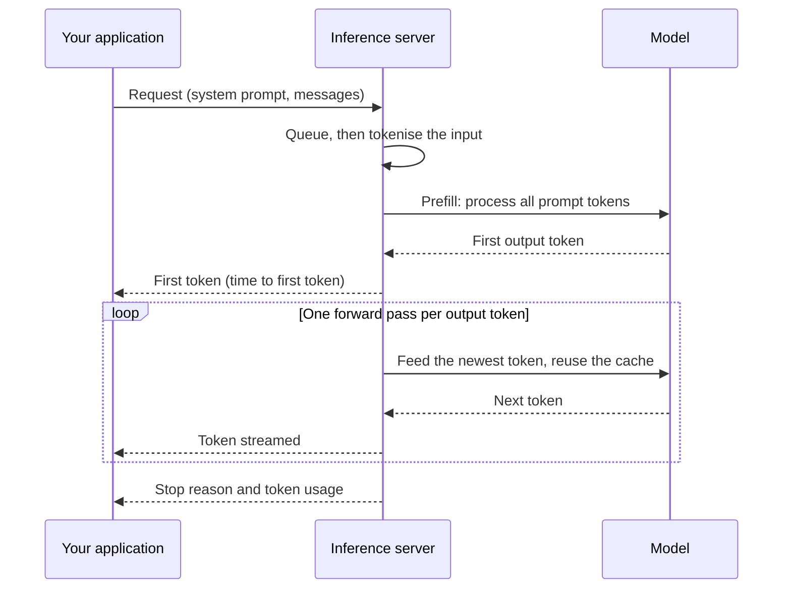

**Inference** is what happens when a trained model is used: you send text, the model computes, tokens come back. No learning takes place; the model's weights do not change. For a RAG engineer, inference is where the user's waiting time and most of the running cost are decided, and both follow from a small number of mechanical facts about how a request is processed.

This lesson follows one request from the moment it leaves your code to the last token of the answer. It explains why the first token takes longer than the rest, what a key-value cache saves, how to estimate latency with one line of arithmetic, and what changes when you batch requests, stream responses, or run the model yourself.

## Learning objectives

- Describe the stages of an inference request, from tokenisation to the final token.
- Explain autoregressive decoding and why output length dominates response time.
- Explain what a key-value (KV) cache stores and why it removes repeated work.
- Estimate response latency from time-to-first-token, output length and generation speed.
- Compare batching, streaming, hosted APIs and self-hosted models in terms of latency, throughput and operational cost.

## Prerequisites

- [How LLMs work](/learn/understanding-large-language-models/how-llms-work), for next-token prediction.
- [Tokens and tokenisation](/learn/understanding-large-language-models/tokens-and-tokenisation), for turning text into token ids.
- [Attention mechanisms](/learn/understanding-large-language-models/attention-mechanisms), for queries, keys and values and the causal mask.
- [Context windows](/learn/understanding-large-language-models/context-windows), for input and output token counts.

## Why this matters

AskMeridian, Meridian's internal assistant, can retrieve the right chunks in a few tens of milliseconds and still feel slow, because the user then waits several seconds for the model to write the answer. If you do not know where those seconds go, you will optimise the wrong thing: shaving retrieval time while the model spends ten times longer generating, or paying for a faster model when the real problem is that answers are three paragraphs longer than anyone needs.

The same gap shows up in capacity planning. "Can we serve 200 staff at once?" and "should we host the model ourselves?" cannot be answered by intuition. They can be answered by arithmetic, once you know the two numbers that characterise inference speed and what each one depends on.

## The intuition

Think of someone answering a question in an exam by reading a long passage and then writing an essay by hand.

First they read the whole passage. Reading is fast, because the eye takes in many words at once, but a longer passage still takes longer. Nothing appears on the answer sheet during this phase.

Then they write, one word at a time. Each new word depends on everything they have read and everything they have written so far. Writing is much slower than reading, and it cannot be parallelised: word ten cannot be written before word nine exists.

Now imagine a careless writer who, before each new word, re-reads the entire passage and their whole essay from the start. They would still produce the same essay, but most of their time would be wasted re-reading. A sensible writer keeps notes on what they have already read and consults the notes. Those notes are the key-value cache.

The time until the first word appears is the reading time. The time after that is the essay length divided by writing speed. Almost everything in this lesson is a refinement of those two statements.

## How it works

### The stages of a request



1. **Transport and queueing.** The request crosses the network and may wait for capacity on the server.
2. **Tokenisation.** The server converts the system prompt and messages into token ids, adding the special tokens that mark roles. This is fast: it is string processing, not neural computation.
3. **Prefill.** The model processes every prompt token in one forward pass. A **forward pass** is one run of the input through all the model's layers. Because all the prompt tokens are known in advance, their positions are computed in parallel on the GPU.
4. **First token.** The output at the last prompt position is a set of logits; the decoding step from [Temperature and sampling](/learn/understanding-large-language-models/temperature-and-sampling) picks a token. This is the first token of the answer.
5. **Decode loop.** The chosen token is appended to the sequence and fed back in. One more forward pass yields the next token. This repeats until the model emits an end-of-sequence token or reaches the output cap.
6. **Detokenise and return.** Token ids are converted back to text, either all at once at the end or incrementally as they are produced.

### Autoregressive decoding

Generation that feeds each output back in as input is called **autoregressive**. Its defining property is that it is sequential: token $t$ cannot be computed until token $t - 1$ has been chosen, because token $t - 1$ is part of the input.

This creates an asymmetry worth memorising. The prompt, however long, is handled in one parallel pass. The answer needs one pass per token. So 3,000 input tokens are processed far more quickly than 3,000 output tokens could ever be produced, and an answer of 300 tokens costs 300 sequential steps. Output length is the main driver of response time.

### KV caching, conceptually

In [Attention mechanisms](/learn/understanding-large-language-models/attention-mechanisms) you saw that each position produces a query, a key and a value, and that a causal mask stops any position from looking at later ones. That mask has a useful consequence: the keys and values of earlier positions do not depend on anything that comes after them. Once computed, they never change.

Without a cache, generating each new token would mean running the whole sequence through the model again and recomputing keys and values that are identical to last time. A **key-value cache** (KV cache) stores, for every layer, the keys and values of all positions processed so far. Each decode step then:

1. computes the query, key and value for the **one new token** only;
2. appends that key and value to the cache;
3. attends from the new query over all cached keys and values.

The answer is identical to recomputing from scratch; the work per step is far smaller. The price is memory: the cache holds two vectors per position per layer for as long as the request is being generated, which is one reason long contexts are expensive to serve.

> [!NOTE]
> The KV cache lives inside one request. It is a different thing from **prompt caching**, a feature some providers offer that keeps the processed state of a prompt prefix between requests so that a repeated system prompt need not be processed again. Prompt caching is covered in [Caching](/learn/performance-optimisation/caching).

### Two numbers: TTFT and tokens per second

Inference speed is described by two measurements.

- **Time to first token (TTFT):** the delay from sending the request to receiving the first output token. It contains network time, queueing, tokenisation and prefill. It grows with prompt length and with server load.
- **Tokens per second (TPS):** the rate at which output tokens arrive once generation has started. It depends on the model's size, the hardware, and how many other requests share that hardware.

They respond to different changes. A shorter prompt, or a cached prefix, improves TTFT. A smaller model or faster hardware improves TPS. A shorter answer improves neither number, yet reduces total time more than almost anything else, because it reduces the count of sequential steps.

> [!NOTE]
> Some models generate hidden reasoning tokens before the visible answer. Those tokens are produced autoregressively like any others, so the delay before the first *visible* text can be much longer than prefill alone would suggest. Measure what your users actually see.

### Batching

A GPU can run many sequences through the model at the same time. **Batching** means grouping several requests into one forward pass. It raises **throughput** (total tokens per second across all requests) because the hardware is used more fully, at the cost of some per-request speed and, with naive batching, some waiting while a batch fills.

Modern inference servers use **continuous batching**: requests join and leave the running batch at token boundaries, so a new request does not wait for others to finish. This is the main reason a shared server can be far more economical than one model per user.

There is also batching at the API level. Several providers offer an asynchronous batch endpoint: you submit many requests, results come back later, and the price is lower. That suits offline work such as evaluating a test set or summarising a document collection, and it does not suit answering a waiting user. See [Batch processing](/learn/performance-optimisation/batch-processing).

### Streaming

With **streaming**, the server sends each token (or small group of tokens) as soon as it is generated, instead of holding the whole answer until the end. Streaming does not make generation faster: total time is unchanged. It changes what the user experiences, because they start reading after TTFT instead of after the full response time. For a six-second answer, that is the difference between a blank screen for six seconds and text appearing in under a second.

Streaming has engineering consequences. You see the answer before it is complete, so anything that needs the whole text (validating citations, parsing JSON, checking for a truncated answer) must either wait for the end or work incrementally. See [Streaming responses](/learn/generation-strategies/streaming-responses).

### Hosted API versus self-hosted

| | Hosted API | Self-hosted model |
| --- | --- | --- |
| What you run | Nothing; you call an endpoint | GPUs, an inference server, the model weights |
| Cost shape | Per token, scales with use | Per GPU-hour, whether busy or idle |
| Speed control | Choice of model and tier | Hardware, batch size, quantisation, server settings |
| Capacity limits | Provider rate limits | Your hardware |
| Data location | Sent to the provider | Stays in your infrastructure |
| Model choice | The provider's models | Open-weight models you can obtain |
| Operations | Minimal | Deployment, monitoring, scaling, upgrades |

Neither is better in general. Hosted APIs suit most teams starting out, because the cost follows usage and there is nothing to operate. Self-hosting becomes attractive with steady high volume, strict data-residency requirements, or a need for a specific open model. The mechanics in this lesson are the same in both cases; self-hosting only makes them your responsibility. GPU serving is covered in [GPU acceleration](/learn/performance-optimisation/gpu-acceleration).

## The mathematics

### Response latency

**Intuition.** You wait for the first token, then you wait for the rest at a steady rate.

$$
\text{latency} \approx \text{TTFT} + \frac{n_{\text{out}}}{\text{TPS}}
$$

- $\text{TTFT}$: time to first token, in seconds.
- $n_{\text{out}}$: number of output tokens generated.
- $\text{TPS}$: output tokens per second during generation.

It is an approximation: generation speed is not perfectly constant, and the first token is counted in both terms, which is negligible for answers of more than a few tokens.

**Worked by hand.** The numbers here are **assumed for illustration**; they are not measurements of any model. Suppose TTFT is 0.6 s and generation runs at 50 tokens per second. For a 300-token answer:

$$
\text{latency} \approx 0.6 + \frac{300}{50} = 0.6 + 6.0 = 6.6 \text{ s}
$$

Generation accounts for $6.0 / 6.6 = 91\%$ of the wait. Halving TTFT to 0.3 s gives 6.3 s. Cutting the answer to 120 tokens gives $0.6 + 2.4 = 3.0$ s.

### Work with and without a KV cache

**Intuition.** Without a cache, every step reprocesses the whole sequence so far. With one, the prompt is processed once and each later step processes one new token.

Let $p$ be the number of prompt tokens and $n$ the number of output tokens. Count the token positions that must be run through the model.

Without a cache, step $i$ (counting from 0) processes $p + i$ positions:

$$
\text{work}_{\text{no cache}} = \sum_{i=0}^{n-1} (p + i) = np + \frac{n(n-1)}{2}
$$

With a cache, the prompt is processed once and each of the remaining $n - 1$ steps processes one position:

$$
\text{work}_{\text{cache}} = p + (n - 1)
$$

**Worked by hand** for $p = 6$ and $n = 5$:

$$
\text{work}_{\text{no cache}} = 5 \times 6 + \frac{5 \times 4}{2} = 30 + 10 = 40, \qquad \text{work}_{\text{cache}} = 6 + 4 = 10
$$

For a realistic RAG request, $p = 3{,}000$ and $n = 300$: without a cache, $300 \times 3{,}000 + \frac{300 \times 299}{2} = 900{,}000 + 44{,}850 = 944{,}850$ positions; with a cache, $3{,}299$. That is a factor of about 286, which is why every practical inference system uses a KV cache.

**In Python**, both formulas together:

```python
def latency_seconds(ttft: float, output_tokens: int, tokens_per_second: float) -> float:
    """Total time for one streamed response."""
    return ttft + output_tokens / tokens_per_second


# ASSUMED, illustrative numbers. Measure your own model and provider.
TTFT = 0.6            # seconds until the first token arrives
TPS = 50.0            # output tokens per second once generation starts

print("output tokens   total seconds   share spent generating")
for n in (20, 100, 300, 1000):
    total = latency_seconds(TTFT, n, TPS)
    print(f"{n:>13}   {total:>13.1f}   {(n / TPS) / total:>21.0%}")

# What each optimisation buys for a 300-token answer
base = latency_seconds(TTFT, 300, TPS)
print(f"\nbaseline (300 tokens):          {base:.1f} s")
print(f"halve TTFT to 0.3 s:            {latency_seconds(0.3, 300, TPS):.1f} s")
print(f"cap the answer at 120 tokens:   {latency_seconds(TTFT, 120, TPS):.1f} s")
print(f"model twice as fast (100 tok/s): {latency_seconds(TTFT, 300, 100.0):.1f} s")

# Work without and with a KV cache: token positions processed
def positions_without_cache(p, n):
    return sum(p + i for i in range(n))

def positions_with_cache(p, n):
    return p + (n - 1)

for p, n in ((6, 5), (3000, 300)):
    a, b = positions_without_cache(p, n), positions_with_cache(p, n)
    print(f"\nprompt {p}, output {n}: without cache {a:,} positions, with cache {b:,} ({a / b:.0f}x)")

# batching arithmetic (assumed)
single_tps = 50.0
batch = 8
per_stream = 40.0     # assumed: each stream slows a little when sharing the GPU
print(f"\none request at a time: {single_tps:.0f} tok/s total")
print(f"batch of {batch}: {batch * per_stream:.0f} tok/s total, {per_stream:.0f} tok/s per user")
print(f"300-token answer per user: {300/single_tps:.1f} s alone, {300/per_stream:.1f} s in the batch")
```

```output
output tokens   total seconds   share spent generating
           20             1.0                     40%
          100             2.6                     77%
          300             6.6                     91%
         1000            20.6                     97%

baseline (300 tokens):          6.6 s
halve TTFT to 0.3 s:            6.3 s
cap the answer at 120 tokens:   3.0 s
model twice as fast (100 tok/s): 3.6 s

prompt 6, output 5: without cache 40 positions, with cache 10 (4x)

prompt 3000, output 300: without cache 944,850 positions, with cache 3,299 (286x)

one request at a time: 50 tok/s total
batch of 8: 320 tok/s total, 40 tok/s per user
300-token answer per user: 6.0 s alone, 7.5 s in the batch
```

The first table shows the pattern to remember: the longer the answer, the less TTFT matters. The last block shows the batching trade in its simplest form: under the assumed slowdown, eight users sharing the hardware each wait a little longer (7.5 s of generation instead of 6.0 s), while the server produces more than six times as many tokens per second in total.

## In code

**The problem.** Show, with real arithmetic, that a KV cache gives exactly the same attention output as recomputing everything, while doing a fraction of the work.

**Dependencies.**

```bash
pip install numpy
```

The example uses one attention layer with random weights and random stand-in token vectors. That is enough: the point is the bookkeeping, not the quality of the model.

```python
import numpy as np

rng = np.random.default_rng(0)
d = 8                                   # width of each token vector
Wq, Wk, Wv = (rng.normal(size=(d, d)) for _ in range(3))


def softmax(z):
    e = np.exp(z - z.max())
    return e / e.sum()


def attend_full(X):
    """Recompute everything: output for the LAST position of sequence X."""
    K, V = X @ Wk, X @ Wv               # keys and values for every position
    q = X[-1] @ Wq                      # query for the newest position
    weights = softmax(K @ q / np.sqrt(d))
    return weights @ V, len(X)          # second value: key/value rows computed


class CachedAttention:
    """Same computation, but keys and values of earlier positions are kept."""

    def __init__(self):
        self.K = np.empty((0, d))
        self.V = np.empty((0, d))

    def step(self, x):
        self.K = np.vstack([self.K, x @ Wk])    # one new key row
        self.V = np.vstack([self.V, x @ Wv])    # one new value row
        q = x @ Wq
        weights = softmax(self.K @ q / np.sqrt(d))
        return weights @ self.V, 1              # only one row was computed


prompt_len, new_tokens = 6, 5
X = rng.normal(size=(prompt_len + new_tokens - 1, d))   # stand-in token vectors

cache = CachedAttention()
for x in X[:prompt_len - 1]:            # "prefill": process the prompt once
    cache.step(x)
cached_rows = prompt_len - 1

full_rows = 0
print("step  seq_len  rows(full)  rows(cached)  outputs match")
for t in range(prompt_len, prompt_len + new_tokens):
    out_full, n_full = attend_full(X[:t])
    out_cached, n_cached = cache.step(X[t - 1])
    full_rows += n_full
    cached_rows += n_cached
    print(f"{t - prompt_len + 1:>4}  {t:>7}  {n_full:>10}  {n_cached:>12}  "
          f"{np.allclose(out_full, out_cached)}")

print(f"\nkey/value rows computed without a cache: {full_rows}")
print(f"key/value rows computed with a cache:    {cached_rows}")
```

```output
step  seq_len  rows(full)  rows(cached)  outputs match
   1        6           6             1  True
   2        7           7             1  True
   3        8           8             1  True
   4        9           9             1  True
   5       10          10             1  True

key/value rows computed without a cache: 40
key/value rows computed with a cache:    10
```

**What the important lines do.**

- `attend_full` computes keys and values for every position in the sequence each time it is called, then attends from the last position. This is generation without a cache.
- `CachedAttention.step` computes one key row and one value row for the new token, stacks them onto what is stored, and attends over the stored rows.
- The causal mask does not appear explicitly because only the last position's output is computed, and the last position is allowed to see everything before it.
- `np.allclose(out_full, out_cached)` compares the two outputs at every step.

**What the output means.** Every row says `True`: the cached computation is not an approximation. The totals, 40 and 10, are the same numbers the formula gave for $p = 6$ and $n = 5$. A real model repeats this in every layer and for every attention head, so the saving applies throughout.

**Measuring a real request.** The code below needs the `anthropic` package and an API key and was not run here. It streams a response and records the two numbers from this lesson:

```python
import time
import anthropic

client = anthropic.Anthropic()  # reads ANTHROPIC_API_KEY from the environment

prompt = (
    "<documents>\n"
    '<document id="hb-leave-01">Annual leave is 25 days per year. Up to 5 unused days '
    "carry over and must be used by 31 March.</document>\n"
    "</documents>\n\n"
    "Question: How many unused leave days can I carry over?"
)

start = time.perf_counter()
first_token_at = None

with client.messages.stream(
    model="claude-opus-5-5",
    max_tokens=1024,
    system="Answer only from the provided context. If the answer is not there, say you don't know.",
    messages=[{"role": "user", "content": prompt}],
) as stream:
    for text in stream.text_stream:
        if first_token_at is None:
            first_token_at = time.perf_counter()
        print(text, end="", flush=True)
    final = stream.get_final_message()

end = time.perf_counter()
ttft = first_token_at - start
output_tokens = final.usage.output_tokens
print(f"\nTTFT: {ttft:.2f} s")
print(f"output tokens: {output_tokens}")
print(f"generation speed: {output_tokens / (end - first_token_at):.1f} tokens/s")
print(f"total: {end - start:.2f} s")
```

Your numbers will differ from run to run and from model to model; the output looks like this:

```output
You can carry over up to 5 unused leave days, and they must be used by 31 March.

TTFT: 0.84 s
output tokens: 24
generation speed: 41.3 tokens/s
total: 1.42 s
```

`first_token_at` is set when the first *visible* text arrives, so it includes any hidden reasoning the model did first. The usage count likewise includes every output token generated, so the computed speed is an overall figure, not a pure decoding rate.

**Common errors.**

- Measuring TTFT on a non-streaming call: without streaming, the first thing you receive is the whole answer, so "TTFT" equals total latency.
- Timing one request and treating it as the answer: latency varies with load. Collect many measurements and look at the median and the slow tail.
- Counting words instead of tokens when computing speed: use the usage figures the API returns.
- A timeout on a long non-streamed response: the connection sat idle for the whole generation. Stream long outputs.

**How to extend it.** Log TTFT, output tokens and total time for every production request; compute the median and 95th percentile per day; plot TTFT against input tokens to see how prompt length affects it for your model ([Latency optimisation](/learn/performance-optimisation/latency-optimisation)).

## A real-world example

Staff at Meridian complained that AskMeridian was "slow". The platform team's first instinct was to speed up retrieval, and they spent a sprint moving the vector index into memory. Retrieval time fell by tens of milliseconds. The complaints did not change.

Tamsin, a backend engineer, added three timings to the request log: retrieval time, time to first token and total time, along with the token counts the API returned. A day of data told a different story from the one the team had assumed. Retrieval was a small sliver of each request. Time to first token was under a second. The bulk of every request was generation, and the logged output lengths showed why: answers averaged several hundred tokens, because the system prompt asked the assistant to "explain thoroughly and include relevant background".

Two changes followed, neither involving a new model. The system prompt was rewritten to ask for a direct answer in a few sentences with a citation, and the answer reserve was lowered to match. And the web client was switched to streaming, so text began appearing as soon as the first token arrived. Total time per answer fell roughly in proportion to answer length, exactly as the latency formula predicts, and perceived wait fell further because users were reading within a second. The in-memory index stayed, but it had never been the problem.

## Common mistakes

- **Optimising retrieval when generation dominates.** Without per-stage timings, effort goes to the stage that is already fast.
- **Ignoring output length.** Output tokens are produced one sequential step at a time; a verbose prompt style costs seconds on every request.
- **Reporting a single latency number.** An average hides both TTFT and the slow tail, which is what users remember.
- **Assuming streaming makes the model faster.** It changes perceived latency only; total time and cost are unchanged.
- **Confusing the KV cache with prompt caching.** One works inside a request automatically; the other works across requests and usually has to be arranged.
- **Using a batch endpoint for interactive traffic.** Asynchronous batches trade latency for price and can take a long time to return.
- **Comparing self-hosting to an API on token price alone.** A GPU costs the same when idle, and operating it takes engineering time.

## Best practices

- Log time to first token, total time, input tokens and output tokens for every request.
- Estimate latency with $\text{TTFT} + n_{\text{out}} / \text{TPS}$ before building, and check the estimate against measurements after.
- Control answer length in the prompt, and set the output cap as a backstop.
- Stream responses to interactive users; validate or parse once the stream completes.
- Keep prompts as short as the task allows, with the unchanging part first so it can be cached.
- Send offline workloads (evaluation runs, bulk summarisation) through batch endpoints.
- Measure medians and high percentiles over many requests and at realistic load.

## Performance considerations

**Prompt length and TTFT.** Prefill is fast per token but not free. With an assumed 0.4 s of network and queue time and an assumed prefill rate of 5,000 tokens per second, a 3,000-token prompt gives a TTFT of $0.4 + 3{,}000 / 5{,}000 = 1.0$ s, and a 30,000-token prompt gives $0.4 + 6.0 = 6.4$ s. These rates are illustrative, but the shape is real: stuffing the context window delays every answer before a single word appears.

**Throughput and capacity.** Required capacity is a rate of output tokens. If AskMeridian must handle 5 requests per second at 300 output tokens each, it needs $5 \times 300 = 1{,}500$ output tokens per second. If one self-hosted server delivers an assumed 320 tokens per second in total with batching, that is $1{,}500 / 320 = 4.7$, so 5 servers, before any allowance for peaks.

**Memory when self-hosting.** Model weights occupy the parameter count times the bytes per parameter: a model with 7 billion parameters stored as 16-bit numbers needs $7 \times 10^9 \times 2 = 14$ GB. The KV cache adds two vectors per token per layer. For an assumed architecture with 32 layers and vectors of width 4,096 at 2 bytes per number, that is $2 \times 32 \times 4{,}096 \times 2 \approx 0.5$ MB per token, so one 4,000-token sequence holds about 2.1 GB of cache. Multiply by the number of concurrent requests and it is clear why long contexts and high concurrency compete for the same GPU memory. Real models use techniques that reduce this figure, but the proportionality to tokens, layers and concurrency holds.

**Cost.** On a hosted API, cost is input tokens times the input price plus output tokens times the output price, with output usually priced several times higher. A shorter answer is therefore cheaper as well as faster. Self-hosted cost is GPU-hours regardless of traffic, so the cost per token depends on how busy you keep the hardware.

## Summary

- An inference request is tokenised, the prompt is processed in one parallel pass (prefill), and the answer is produced by one forward pass per output token.
- Decoding is autoregressive and sequential, so output length dominates response time.
- A KV cache stores each layer's keys and values for earlier tokens, so each step processes only the new token; results are identical and the work falls from roughly $np + n^2/2$ positions to $p + n$.
- Latency is approximately $\text{TTFT} + n_{\text{out}} / \text{TPS}$. Prompt length and load affect TTFT; model and hardware affect TPS.
- Batching raises total throughput at some cost in per-request speed; streaming improves perceived latency without changing total time.
- Hosted APIs charge per token and need no operations; self-hosting charges per GPU-hour and makes capacity, memory and uptime your job.

## Exercises

**1.** With assumed figures of TTFT = 0.5 s and 40 tokens per second, estimate the latency of a 200-token answer. What fraction of the wait is generation? If the answer is streamed, after how long does the user see the first text?

<details><summary>Show solution</summary>

$\text{latency} \approx 0.5 + 200 / 40 = 0.5 + 5.0 = 5.5$ s.

Generation is $5.0 / 5.5 = 91\%$ of the wait.

With streaming the user sees the first text after TTFT, about 0.5 s, and the remaining text arrives over the following 5 seconds. Total time is unchanged.

</details>

**2.** A prompt has 2,000 tokens and the model generates 100 tokens. How many token positions are processed without a KV cache, and how many with one?

<details><summary>Show solution</summary>

Without a cache: $np + \frac{n(n-1)}{2} = 100 \times 2{,}000 + \frac{100 \times 99}{2} = 200{,}000 + 4{,}950 = 204{,}950$.

With a cache: $p + (n - 1) = 2{,}000 + 99 = 2{,}099$.

The cache reduces the work by a factor of about 98.

</details>

**3.** You have logged five requests as `(ttft_seconds, total_seconds, output_tokens)`. Write code that computes each request's generation speed, the median TTFT and median speed, and predicts the latency of a 500-token answer.

<details><summary>Show solution</summary>

Generation time is total minus TTFT, so speed is output tokens divided by that difference.

```python
import numpy as np

# (ttft_seconds, total_seconds, output_tokens) for five logged requests
logs = [
    (0.52, 3.10, 120),
    (0.61, 6.45, 280),
    (0.58, 2.02, 70),
    (0.95, 9.40, 410),
    (0.55, 4.60, 195),
]

ttft = np.array([r[0] for r in logs])
total = np.array([r[1] for r in logs])
tokens = np.array([r[2] for r in logs])

tps = tokens / (total - ttft)            # generation speed per request
print("tokens per second:", np.round(tps, 1))
print(f"median TTFT: {np.median(ttft):.2f} s")
print(f"median speed: {np.median(tps):.1f} tok/s")

predicted = np.median(ttft) + 500 / np.median(tps)
print(f"predicted latency for 500 tokens: {predicted:.1f} s")
```

```output
tokens per second: [46.5 47.9 48.6 48.5 48.1]
median TTFT: 0.58 s
median speed: 48.1 tok/s
predicted latency for 500 tokens: 11.0 s
```

The median is used instead of the mean because one slow request (the fourth has a TTFT of 0.95 s) should not distort the typical figure. Note that generation speed is nearly constant across requests while TTFT varies: they are separate quantities with separate causes.

</details>

**4.** Design decision. Meridian is deciding whether AskMeridian should keep using a hosted API or move to a self-hosted open model. Usage is about 3,000 questions a day, concentrated in UK working hours, and the handbook contains nothing more sensitive than HR policy. What would you recommend, and what facts would change your recommendation?

<details><summary>Show solution</summary>

Recommend staying on a hosted API.

Reasoning:

- **Volume is low and bursty.** 3,000 questions a day is on average about one every ten seconds during working hours, and almost nothing overnight. A GPU server would sit idle most of the time while costing the same every hour. Per-token pricing follows the actual usage.
- **Operations.** Self-hosting needs deployment, monitoring, scaling, security patching and model upgrades. For a small platform team that is a standing cost in engineering time that the hosted option avoids.
- **Quality.** The team would be limited to open-weight models they can run on the hardware they can afford, which may or may not match the hosted model on their questions; that would need evaluating.
- **Data.** HR policy text is not highly sensitive, so there is no strong residency argument, subject to the company's own review of the provider's data terms.

Facts that would change the recommendation: much higher and steadier volume (so that GPUs are busy most of the time); a legal or contractual requirement that data must not leave Meridian's infrastructure; a need for very low, predictable latency that provider rate limits or shared capacity cannot give; or a requirement for a specific fine-tuned open model. In any of those cases, compare total cost (GPU-hours plus engineering time) against the API bill for measured token volumes, not the per-token price alone.

</details>

## Check your understanding

```quiz
[
  {
    "q": "Why does a 300-token answer usually take far longer to generate than a 3,000-token prompt takes to process?",
    "options": [
      "Output tokens are larger than input tokens",
      "The prompt is skipped entirely once it has been tokenised",
      "All prompt positions are processed in one parallel pass, while each output token needs its own sequential forward pass",
      "The network is slower in the return direction"
    ],
    "answer": 2,
    "why": "Prompt tokens are all known in advance and are computed together. Output is autoregressive: each token depends on the previous one, so the steps cannot be parallelised."
  },
  {
    "q": "What does a KV cache store during generation?",
    "options": [
      "The keys and values each attention layer computed for earlier token positions, so they are not recomputed at every step",
      "The answers to previous users' questions",
      "The API key and its value",
      "The retrieved chunks, so the retriever is not called twice"
    ],
    "answer": 0,
    "why": "Because of the causal mask, the keys and values of earlier positions never change. Storing them lets each decoding step process only the newest token."
  },
  {
    "q": "What does this print?\n```python\ndef latency(ttft, n, tps):\n    return ttft + n / tps\n\nprint(latency(0.4, 150, 50))\n```",
    "options": ["3.0", "3.4", "7.9", "0.4"],
    "answer": 1,
    "why": "150 tokens at 50 tokens per second is 3.0 seconds of generation, plus 0.4 seconds to the first token, giving 3.4."
  },
  {
    "q": "A team turns on streaming for their RAG assistant. Which statement is correct?",
    "options": [
      "Total generation time is roughly halved",
      "The model now generates all tokens in parallel",
      "Cost per request falls because fewer tokens are produced",
      "Total time and cost are about the same, but users begin reading after the time to first token instead of after the whole answer"
    ],
    "answer": 3,
    "why": "Streaming changes when tokens are delivered, not how fast they are generated. Its benefit is perceived latency."
  },
  {
    "q": "A team measures a time to first token of 0.5 seconds and a total response time of 12 seconds for typical answers. Which change would reduce total response time the most?",
    "options": [
      "Moving the vector index into memory to speed up retrieval",
      "Asking for shorter answers, since nearly all the time is spent generating output tokens",
      "Shortening the system prompt by 50 tokens",
      "Switching the HTTP client library"
    ],
    "answer": 1,
    "why": "With 0.5 s before the first token and 11.5 s after it, generation dominates. Reducing the number of output tokens reduces the count of sequential steps directly."
  }
]
```

## Further reading

- Vaswani, A. et al. (2017). *Attention Is All You Need*. [arxiv.org/abs/1706.03762](https://arxiv.org/abs/1706.03762). The architecture whose decoding loop this lesson describes.
- Kwon, W. et al. (2023). *Efficient Memory Management for Large Language Model Serving with PagedAttention*. [arxiv.org/abs/2309.06180](https://arxiv.org/abs/2309.06180). The vLLM paper; a clear account of KV-cache memory and batching in serving systems.
- Hugging Face, *Transformers documentation* (see the guides on text generation and on caching during generation). [huggingface.co/docs/transformers](https://huggingface.co/docs/transformers)
- vLLM project documentation, for a widely used open-source inference server. [docs.vllm.ai](https://docs.vllm.ai)
- Anthropic, *Claude Developer Platform documentation*: streaming, message batches and usage reporting. [platform.claude.com/docs](https://platform.claude.com/docs)
