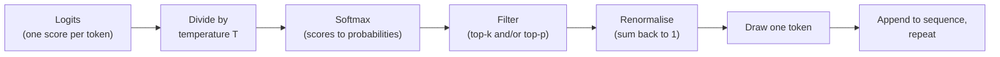

A language model does not output a word. It outputs a score for every token in its vocabulary, and something else has to turn those scores into one chosen token. That "something else" is the **decoding** or **sampling** step, and its settings (temperature, top-k, top-p) decide whether the same prompt gives the same answer twice.

This lesson works through the step with real numbers: scores to probabilities, how temperature reshapes them, how top-k and top-p cut off the unlikely tail, and what "greedy" means. It ends with a point that matters for RAG in practice: you cannot always set these controls, and you should not depend on them for correctness even when you can.

## Learning objectives

- Convert a vector of logits into probabilities with softmax, by hand and in NumPy.
- Explain how temperature sharpens or flattens a distribution, and compute the effect.
- Apply top-k and top-p (nucleus) filtering to a distribution and renormalise the result.
- Distinguish greedy decoding from sampling and say when each gives repeatable output.
- Explain why a RAG system should get reliability from prompts, structured outputs and evaluation, not from a temperature setting.

## Prerequisites

- [How LLMs work](/learn/understanding-large-language-models/how-llms-work), for next-token prediction and softmax.
- [Tokens and tokenisation](/learn/understanding-large-language-models/tokens-and-tokenisation), for the vocabulary the scores range over.
- [Hallucinations and factual reliability](/learn/introduction-to-rag/hallucinations-and-factual-reliability), for why fluent output is not the same as correct output.

## Why this matters

Ask AskMeridian, Meridian's internal assistant, the same question twice and you may get two differently worded answers. Usually that is harmless. Sometimes it is not: a test that passed yesterday fails today, an answer cites a document on one run and omits the citation on the next, or a JSON response parses nine times and breaks on the tenth.

Engineers who do not understand the sampling step tend to reach for one of two wrong conclusions. The first is "the model is random, nothing can be done". The second is "set temperature to zero and the system is deterministic and factual". Neither is true. Sampling settings control *how the next token is picked from the model's distribution*. They do not change what the model knows, they do not make a wrong distribution right, and on several current hosted models they are not yours to change at all. Knowing exactly what the controls do tells you which problems they can solve and which need a different tool.

## The intuition

Imagine a bag of 100 coloured marbles representing the model's opinion about the next token after "Annual leave at Meridian is": 68 are labelled "25", 15 are "20", 9 are "30", and the remaining few are oddities such as "unlimited" and "banana".

- **Greedy decoding** looks in the bag and always takes the most common colour. Same bag, same answer, every time.
- **Sampling** draws one marble without looking. Usually you get "25", but about one draw in three you get something else.
- **Temperature** changes the mix before you draw. A low temperature swaps most of the rare marbles for copies of the commonest one. A high temperature evens the colours out, so rare marbles come up more often.
- **Top-k** removes every colour except the k most common, then draws.
- **Top-p** removes the rarest colours until what remains accounts for a chosen share of the bag, then draws.

None of these operations puts a marble in the bag that was not there, and none can tell you whether "25" is actually true. They only change the odds of drawing what the model already proposed.

## How it works

### From logits to a chosen token

At each step the model produces one number per vocabulary token. These raw scores are called **logits**. They can be any real number, positive or negative, and they do not sum to anything in particular. The decoding step then runs a short pipeline:



1. **Scale.** Divide every logit by the temperature $T$.
2. **Softmax.** Turn the scaled logits into probabilities that are positive and sum to 1.
3. **Filter.** Optionally discard low-probability tokens with top-k, top-p, or both.
4. **Renormalise.** Divide the surviving probabilities by their total so they sum to 1 again.
5. **Draw.** Pick one token at random according to those probabilities.
6. **Repeat.** Append the token to the sequence and run the model again for the next position.

### Greedy decoding

**Greedy decoding** skips the randomness: it always takes the token with the highest logit (the *argmax*). It is equivalent to the limit of temperature approaching zero, which is why "temperature 0" and "greedy" are used interchangeably in API documentation. Greedy output is repeatable in principle, and for short factual answers it is often what you want. Its weakness is that the locally most probable token at every step does not always give the best whole sequence, and in long free-form text greedy decoding is known to produce flat, repetitive output.

### Temperature

Temperature rescales the logits before softmax. With $T < 1$ the gaps between logits grow, so the leading token takes a larger share. With $T > 1$ the gaps shrink and probability spreads towards the tail. $T = 1$ leaves the model's distribution untouched. Temperature never changes the *order* of the tokens: the most probable token stays the most probable at every positive temperature.

### Top-k

**Top-k sampling** keeps only the $k$ highest-probability tokens and discards the rest. It is a blunt guard against the tail: with $k = 40$, the model can never emit its 41st choice, however the probabilities fall. The bluntness is also its flaw. When the model is very confident, 40 tokens is far too many; when many continuations are reasonable, 40 may be too few.

### Top-p (nucleus sampling)

**Top-p sampling**, also called **nucleus sampling**, adapts the cut-off to the shape of the distribution. Sort tokens from most to least probable, and keep the smallest set whose probabilities add up to at least $p$. If the model is confident, that set might be one or two tokens. If it is uncertain, the set is larger. Holtzman and colleagues (2019) introduced it for exactly this reason.

### How the controls interact

| Control | Changes | Typical effect of lowering it |
| --- | --- | --- |
| Temperature $T$ | The shape of the whole distribution | More weight on the leading token |
| Top-k | How many tokens can ever be chosen | Hard cap on the candidate list |
| Top-p | How much probability mass can be chosen from | Tail removed, size adapts to confidence |
| Greedy | Removes randomness entirely | Always the single most probable token |

Where several are set, they are applied in sequence, and the exact order is defined by the library or provider. Adjusting one at a time keeps the behaviour understandable.

### Sampling controls are provider- and model-dependent

It is tempting to treat `temperature`, `top_p` and `top_k` as universal API parameters. They are not.

- **Self-hosted open models** expose the whole pipeline. You hold the logits, so you can use any decoding method you like.
- **Hosted APIs vary.** Some accept all three parameters, some accept a subset, and the valid range of temperature differs between providers.
- **Some current hosted models fix the sampling settings.** Current Claude models reject the `temperature`, `top_p` and `top_k` request parameters: the provider chooses the sampling configuration and the request must not include them. Other providers impose similar restrictions on some of their models.

> [!WARNING]
> Do not design a RAG system whose correctness depends on setting temperature to zero. On some models you cannot set it. On models where you can, it does not guarantee identical output, and it does nothing for factual accuracy.

Three reasons the "temperature 0" plan fails even where the parameter is accepted:

1. **Repeatability is not guaranteed.** Hosted inference runs on shared hardware with batching and floating-point arithmetic whose results can differ in the last digit. Two near-tied tokens can swap places, and once one token differs, everything after it can differ. Model versions also change underneath a stable name.
2. **Deterministic is not the same as grounded.** If the retrieved chunks do not contain the answer and the model's most probable continuation is a plausible invention, greedy decoding returns that invention every time. You have made the error reproducible, not removed it.
3. **It couples your design to one vendor's parameter list.** A system that needs a parameter is harder to move to a model that does not offer it.

### Where reliability comes from instead

For a RAG system, the dependable levers are elsewhere:

- **Prompts that constrain the task.** Instruct the model to answer only from the supplied documents, to cite them, and to say when the answer is absent ([System prompts and user prompts](/learn/understanding-large-language-models/system-prompts-and-user-prompts)).
- **Structured outputs.** Ask for a response that must match a schema, so that the *form* of the answer is validated instead of hoped for ([Structured outputs](/learn/generation-strategies/structured-outputs)).
- **Evaluation.** Measure faithfulness and correctness over a fixed set of questions, and run it more than once so that variation is something you observe, not something you assume away ([Generation Evaluation](/learn/generation-evaluation)).
- **Design for variation.** Compare answers by meaning or by extracted fields, not by exact string equality.

## The mathematics

### Softmax with temperature

**Intuition.** Exponentiate each score so that it is positive and larger scores win by a wide margin, then divide by the total so the results sum to 1. Dividing the scores by $T$ first stretches or squeezes the gaps between them.

$$
p_i = \frac{\exp(z_i / T)}{\sum_{j=1}^{V} \exp(z_j / T)}
$$

- $z_i$: the logit for token $i$.
- $T$: the temperature, a positive number.
- $V$: the vocabulary size (the number of tokens the model can emit).
- $p_i$: the probability of choosing token $i$.

**Worked by hand.** Take three tokens with logits $z = [2.0,\ 1.0,\ 0.0]$.

At $T = 1$: $e^{2} = 7.389$, $e^{1} = 2.718$, $e^{0} = 1$. The sum is $11.107$.

$$
p = \left[\tfrac{7.389}{11.107},\ \tfrac{2.718}{11.107},\ \tfrac{1}{11.107}\right] = [0.665,\ 0.245,\ 0.090]
$$

At $T = 0.5$ the scaled logits are $[4, 2, 0]$: $e^{4} = 54.598$, $e^{2} = 7.389$, $e^{0} = 1$, sum $62.987$.

$$
p = [0.867,\ 0.117,\ 0.016]
$$

At $T = 2$ the scaled logits are $[1, 0.5, 0]$: $e^{1} = 2.718$, $e^{0.5} = 1.649$, $e^{0} = 1$, sum $5.367$.

$$
p = [0.506,\ 0.307,\ 0.186]
$$

Halving the temperature raised the leader from 0.665 to 0.867; doubling it lowered the leader to 0.506 and doubled the share of the last token. The ranking never changed.

**In Python.**

```python
import numpy as np

def softmax(z, T=1.0):
    z = np.asarray(z, dtype=float) / T
    z = z - z.max()              # stability: does not change the result
    e = np.exp(z)
    return e / e.sum()

z = [2.0, 1.0, 0.0]
for T in (0.5, 1.0, 2.0):
    print(f"T={T}: {np.round(softmax(z, T), 3)}")
```

```output
T=0.5: [0.867 0.117 0.016]
T=1.0: [0.665 0.245 0.09 ]
T=2.0: [0.506 0.307 0.186]
```

Subtracting the maximum before exponentiating avoids overflow when logits are large. It multiplies the numerator and the denominator by the same constant, so the probabilities are identical.

### Top-k

**Intuition.** Keep the $k$ best, drop the rest, and rescale so the kept probabilities sum to 1.

$$
p'_i = \begin{cases} \dfrac{p_i}{\sum_{j \in K} p_j} & \text{if } i \in K \\[2ex] 0 & \text{otherwise} \end{cases}
$$

where $K$ is the set of the $k$ tokens with the highest probability.

**By hand**, with $p = [0.665, 0.245, 0.090]$ and $k = 2$: keep the first two, whose total is $0.910$. The new distribution is $[0.665/0.910,\ 0.245/0.910,\ 0] = [0.731,\ 0.269,\ 0]$.

### Top-p

**Intuition.** Sort from most to least probable and keep adding tokens until their total reaches $p$. The kept set is called the nucleus.

$$
N = \text{the smallest set of top-ranked tokens such that } \sum_{j \in N} p_j \ge p
$$

and the kept probabilities are renormalised exactly as for top-k.

**By hand**, with the same distribution and $p = 0.9$: the running totals are $0.665$, then $0.910$. The first total that reaches $0.9$ is after two tokens, so the nucleus is the first two tokens and the result is again $[0.731,\ 0.269,\ 0]$. With $p = 0.6$ the first token alone ($0.665 \ge 0.6$) would be the whole nucleus, and sampling would be deterministic for this step.

## In code

**The problem.** See all four controls act on one distribution, then confirm by drawing samples that the probabilities mean what they say.

**Dependencies.**

```bash
pip install numpy
```

The toy vocabulary has six candidate next tokens for the prompt "Annual leave at Meridian is ... days". The logits are made up for the demonstration; a real model has tens of thousands of them per step.

```python
import numpy as np

tokens = ["25", "20", "30", "28", "unlimited", "banana"]
logits = np.array([4.0, 2.5, 2.0, 1.5, 0.5, -1.0])


def softmax(z, temperature=1.0):
    z = np.asarray(z, dtype=float) / temperature
    z = z - z.max()                      # avoids overflow; result unchanged
    e = np.exp(z)
    return e / e.sum()


def top_k_filter(p, k):
    """Keep the k most probable tokens, zero the rest, renormalise."""
    keep = np.argsort(-p)[:k]
    out = np.zeros_like(p)
    out[keep] = p[keep]
    return out / out.sum()


def top_p_filter(p, top_p):
    """Keep the smallest set of tokens whose probabilities sum to at least top_p."""
    order = np.argsort(-p)
    cumulative = np.cumsum(p[order])
    cutoff = np.searchsorted(cumulative, top_p) + 1   # tokens to keep
    out = np.zeros_like(p)
    out[order[:cutoff]] = p[order[:cutoff]]
    return out / out.sum()


def show(label, p):
    print(f"{label:<22}" + "".join(f"{x:>10.3f}" for x in p))


print(f"{'':<22}" + "".join(f"{t:>10}" for t in tokens))
show("logits", logits)
for T in (0.2, 0.7, 1.0, 1.5):
    show(f"probabilities T={T}", softmax(logits, T))

p = softmax(logits)
show("top-k, k=2", top_k_filter(p, 2))
show("top-p, p=0.9", top_p_filter(p, 0.9))

print("\ngreedy choice:", tokens[int(np.argmax(logits))])

rng = np.random.default_rng(42)
print("\ncounts from 1,000 samples at each setting")
print(f"{'':<22}" + "".join(f"{t:>10}" for t in tokens))
settings = {
    "T=0.2": softmax(logits, 0.2),
    "T=1.0": softmax(logits, 1.0),
    "T=1.5": softmax(logits, 1.5),
    "T=1.5 then top-p 0.9": top_p_filter(softmax(logits, 1.5), 0.9),
}
for label, dist in settings.items():
    draws = rng.choice(len(tokens), size=1000, p=dist)
    counts = np.bincount(draws, minlength=len(tokens))
    print(f"{label:<22}" + "".join(f"{c:>10d}" for c in counts))
```

```output
                              25        20        30        28 unlimited    banana
logits                     4.000     2.500     2.000     1.500     0.500    -1.000
probabilities T=0.2        0.999     0.001     0.000     0.000     0.000     0.000
probabilities T=0.7        0.826     0.097     0.047     0.023     0.006     0.001
probabilities T=1.0        0.677     0.151     0.092     0.056     0.020     0.005
probabilities T=1.5        0.512     0.188     0.135     0.097     0.050     0.018
top-k, k=2                 0.818     0.182     0.000     0.000     0.000     0.000
top-p, p=0.9               0.736     0.164     0.100     0.000     0.000     0.000

greedy choice: 25

counts from 1,000 samples at each setting
                              25        20        30        28 unlimited    banana
T=0.2                       1000         0         0         0         0         0
T=1.0                        671       141        95        60        28         5
T=1.5                        521       194       122        97        43        23
T=1.5 then top-p 0.9         555       203       138       104         0         0
```

**What the important lines do.**

- `np.argsort(-p)` sorts indices from most to least probable; negating the array reverses NumPy's ascending order.
- In `top_p_filter`, `np.cumsum` builds the running total and `np.searchsorted` finds the first position where it reaches `top_p`. Adding 1 converts that position into a count of tokens to keep.
- `rng.choice(..., p=dist)` is the actual sampling step: one weighted random draw per call. `np.random.default_rng(42)` fixes the seed so the counts are reproducible.

**What the output means.**

- At $T = 0.2$ the distribution is so sharp that 1,000 draws out of 1,000 are "25". This is sampling behaving like greedy decoding.
- At $T = 1.0$ the model's own distribution gives "25" about two times in three. In the 1,000 draws, 28 were "unlimited" and 5 were "banana": rare, but at scale, rare things happen daily.
- At $T = 1.5$ the tail grows: 66 draws landed on the two nonsense tokens.
- Applying top-p 0.9 after $T = 1.5$ removes the two least likely tokens completely. Their counts are exactly zero, not merely small. The cumulative probabilities at $T = 1.5$ are 0.512, 0.700, 0.835 and 0.932, so four tokens are needed to reach 0.9.
- Top-k with $k = 2$ and top-p with $p = 0.9$ at $T = 1$ keep different numbers of tokens (two and three) from the same distribution.

Most important: in every row, "25" is the leading token. Sampling settings changed how often the alternatives appeared. They did not, and cannot, change which answer the model favours. If the model favoured "20", every setting here would faithfully reproduce the wrong answer.

**A real request.** The call below needs the `anthropic` package and an API key, so it was not run here. Note what is absent: there is no `temperature`, `top_p` or `top_k` argument, because current Claude models reject them. Consistency of *form* comes from a schema instead.

```python
import anthropic
from pydantic import BaseModel


class LeaveAnswer(BaseModel):
    days: int | None          # None when the documents do not say
    source_id: str | None
    answer_found: bool


client = anthropic.Anthropic()  # reads ANTHROPIC_API_KEY from the environment

context = '<document id="hb-leave-01">Annual leave is 25 days per year.</document>'

response = client.messages.parse(
    model="claude-opus-5-5",
    max_tokens=1024,
    system="Answer only from the provided documents. If the answer is not there, set answer_found to false.",
    messages=[{"role": "user", "content": f"{context}\n\nHow many days of annual leave do I get?"}],
    output_format=LeaveAnswer,
)
result = response.parsed_output
print(result)
```

Your output will differ in detail; it looks like this:

```output
days=25 source_id='hb-leave-01' answer_found=True
```

The wording of a free-text answer may vary between runs, but a field such as `days` either equals 25 or it does not, which is something a test can check.

**Common errors.**

- `ValueError: probabilities do not sum to 1` from `rng.choice`: you filtered and forgot to renormalise.
- Division by zero or `nan` at `temperature=0`: the formula is undefined there. Treat zero as a special case and take the argmax.
- A `400` error from a hosted API mentioning `temperature`, `top_p` or `top_k`: that model does not accept the parameter. Remove it.

**How to extend it.** Add a `greedy` branch for $T = 0$; apply top-k and top-p in sequence and compare with either alone; compute the entropy of each distribution to put a number on "spread" (exercise 3).

## A real-world example

The search team at Meridian had a regression test for AskMeridian: twenty questions, each with an expected answer string, compared with `==`. On the model they first used, they set the temperature to zero and the test was stable enough that nobody thought about it.

When they moved to a newer model, the first request failed with a validation error: the model did not accept a temperature parameter. Removing the parameter made the requests succeed, and then the test suite began failing intermittently. One run returned "You get 25 days of annual leave." and the next "Annual leave is 25 days per year." Both were correct; neither matched the stored string.

Kofi, who owned the test suite, resisted the suggestion to find a model that still allowed temperature zero. The tests had been asserting the wrong thing. He changed three things. The assistant's answer became a structured object with fields for the value, the cited document id and a flag for "not found". The tests compared those fields, and checked that the cited id was among the retrieved documents. And each question ran three times, with the suite reporting agreement across runs alongside correctness. Wording could now vary freely, and the suite failed only when a fact or a citation changed, which is what it had been meant to catch all along.

## Common mistakes

- **Believing temperature 0 makes answers true.** It makes the most probable continuation certain to be chosen, including when that continuation is an invention.
- **Assuming temperature 0 means bit-identical output.** Hardware, batching and model updates can still change a token, and one changed token changes everything after it.
- **Sending sampling parameters to a model that rejects them.** The request fails outright; pin your knowledge to the model's documentation, not to habit.
- **Tuning temperature to fix a retrieval problem.** If the right chunk was not retrieved, no decoding setting will supply the missing fact.
- **Changing temperature and top-p together.** The effects compound and you can no longer attribute a change in behaviour to either.
- **Testing with exact string equality.** Correct answers fail the test whenever the phrasing shifts.
- **Forgetting to renormalise after filtering.** The remaining probabilities no longer sum to 1 and the draw is wrong or raises an error.

## Best practices

- Read which sampling parameters your model accepts, and treat that as a property of the model version.
- Get grounding from the prompt and the retrieved context, and get consistent form from structured outputs.
- Evaluate on a fixed question set and repeat runs to measure variation directly.
- Compare outputs by extracted fields or by meaning, not by string.
- Where you do control sampling, change one parameter at a time and record it alongside the model version.
- Design so that the system still works if the parameter is removed.

## Performance considerations

The sampling step itself is negligible. For each generated token it is one softmax and, for top-p, one sort over the vocabulary: on the order of $V \log V$ operations with $V$ in the tens of thousands or low hundreds of thousands, against billions of operations for the forward pass that produced the logits. Decoding settings do not make a model meaningfully faster or slower per token.

They can change cost indirectly, through output length. A setting that makes the model more verbose produces more output tokens, and output tokens are both the slowest and usually the most expensive part of a request.

Repeated runs are where the real cost lies. Asking the same question three times to measure agreement triples the bill for that question. If a test suite has 200 questions and each request costs $c$, three repetitions cost $600c$ per run of the suite instead of $200c$. Budget for it in evaluation, where it buys information, and avoid it in the serving path unless a decision genuinely depends on agreement.

## Summary

- The model emits logits; softmax turns them into probabilities; the decoding step picks one token.
- Temperature divides the logits before softmax: below 1 sharpens the distribution, above 1 flattens it, and the ranking never changes.
- Top-k keeps a fixed number of candidates; top-p keeps a fixed share of probability mass and adapts to the model's confidence. Both renormalise afterwards.
- Greedy decoding always takes the most probable token and corresponds to the limit of temperature approaching zero.
- Sampling controls are provider- and model-dependent, and some current models, including current Claude models, do not accept them.
- Sampling settings never add knowledge. Reliability in RAG comes from retrieval, prompts, structured outputs and evaluation.

## Exercises

**1.** Three tokens have logits $[3.0,\ 1.0,\ 0.0]$. Compute the probabilities at $T = 1$ by hand, then apply top-k with $k = 2$.

<details><summary>Show solution</summary>

$e^{3} = 20.086$, $e^{1} = 2.718$, $e^{0} = 1$. Sum: $23.804$.

$p = [20.086/23.804,\ 2.718/23.804,\ 1/23.804] = [0.844,\ 0.114,\ 0.042]$.

Top-k with $k = 2$ keeps the first two, total $0.958$:

$p' = [0.844/0.958,\ 0.114/0.958,\ 0] = [0.881,\ 0.119,\ 0]$.

</details>

**2.** A distribution over five tokens is $[0.50,\ 0.25,\ 0.15,\ 0.07,\ 0.03]$. Which tokens survive top-p with $p = 0.8$? With $p = 0.5$? What are the renormalised probabilities in the first case?

<details><summary>Show solution</summary>

Running totals: $0.50,\ 0.75,\ 0.90,\ 0.97,\ 1.00$.

For $p = 0.8$, the first total that is at least $0.8$ is $0.90$, reached after three tokens. Three tokens survive. Renormalised: $[0.50/0.90,\ 0.25/0.90,\ 0.15/0.90] = [0.556,\ 0.278,\ 0.167]$.

For $p = 0.5$, the first total, $0.50$, already meets the threshold, so only the first token survives and the step is deterministic.

</details>

**3.** Entropy, $H = -\sum_i p_i \log_2 p_i$, measures how spread out a distribution is, in bits. Write code that prints the entropy and the highest probability for the lesson's six logits at $T = 0.2,\ 1.0,\ 1.5$ and $5.0$. What is the largest entropy six tokens can have?

<details><summary>Show solution</summary>

```python
import numpy as np

def softmax(z, T=1.0):
    z = np.asarray(z, float) / T
    z -= z.max()
    e = np.exp(z)
    return e / e.sum()

logits = np.array([4.0, 2.5, 2.0, 1.5, 0.5, -1.0])
for T in (0.2, 1.0, 1.5, 5.0):
    p = softmax(logits, T)
    H = -(p * np.log2(p + 1e-300)).sum()
    print(f"T={T}: entropy {H:.3f} bits, max prob {p.max():.3f}")
print("uniform entropy:", round(np.log2(6), 3))
```

```output
T=0.2: entropy 0.008 bits, max prob 0.999
T=1.0: entropy 1.491 bits, max prob 0.677
T=1.5: entropy 1.985 bits, max prob 0.512
T=5.0: entropy 2.518 bits, max prob 0.258
uniform entropy: 2.585
```

Entropy rises with temperature. The maximum for six tokens is $\log_2 6 = 2.585$ bits, reached when all six are equally likely, which is what the distribution approaches as $T$ grows. The tiny `1e-300` avoids `log2(0)` for probabilities that underflow to zero.

</details>

**4.** Design decision. You are writing the regression tests for AskMeridian on a model that does not accept sampling parameters. Describe how you would make the tests meaningful and stable. Then explain why a 200-token answer is unlikely to be word-for-word identical across runs even if the model picks its most probable token 99% of the time at every step.

<details><summary>Show solution</summary>

**Test design.**

- Make the answer a structured object (value, cited document id, an "answer found" flag) and assert on fields, not strings.
- Assert properties that must hold regardless of wording: the cited id is among the retrieved chunks; when the corpus lacks the answer, the flag is false.
- For free-text quality, score against a rubric with an evaluator and set a threshold, instead of matching text.
- Run each question several times and report the agreement rate; investigate questions whose answers disagree, because they are usually ambiguous questions or weak retrieval.
- Record the model version with each run so that a change in results can be attributed.

**Why wording varies.** If each of 200 steps independently yields the most probable token with probability 0.99, the chance that all 200 do is $0.99^{200} \approx 0.134$, about 13%. So even a very confident model reproduces the same full text only about one run in seven. With 0.95 per step the chance is about $0.00004$. And the steps are not independent in a way that helps: one different token changes the context for every later token.

</details>

## Check your understanding

```quiz
[
  {
    "q": "Logits are divided by a temperature of 0.5 before softmax. What happens to the resulting distribution compared with temperature 1?",
    "options": [
      "It becomes flatter, so unlikely tokens are chosen more often",
      "The order of the tokens by probability is reversed",
      "It becomes sharper: the most probable token gains probability and the tail loses it",
      "Nothing changes, because softmax ignores scaling"
    ],
    "answer": 2,
    "why": "Dividing by a number below 1 widens the gaps between logits, and softmax turns wider gaps into a more peaked distribution. The ranking is unchanged."
  },
  {
    "q": "What does this print?\n```python\nimport numpy as np\np = np.array([0.6, 0.3, 0.1])\nkeep = np.argsort(-p)[:2]\nout = np.zeros_like(p)\nout[keep] = p[keep]\nprint(np.round(out / out.sum(), 3))\n```",
    "options": [
      "[0.6 0.3 0. ]",
      "[0.667 0.333 0.   ]",
      "[0.5 0.5 0. ]",
      "[0.6 0.3 0.1]"
    ],
    "answer": 1,
    "why": "This is top-k with k = 2. The kept probabilities 0.6 and 0.3 sum to 0.9, and dividing by 0.9 gives 0.667 and 0.333."
  },
  {
    "q": "A distribution is [0.70, 0.20, 0.06, 0.04]. How many tokens does top-p keep with p = 0.9?",
    "options": ["1", "3", "4", "2"],
    "answer": 3,
    "why": "The running totals are 0.70 then 0.90. The smallest set whose total is at least 0.9 is the first two tokens."
  },
  {
    "q": "A team sets temperature to 0 on a model that accepts it, and their RAG assistant still states a wrong carry-over limit on every run. What is the most accurate explanation?",
    "options": [
      "Greedy decoding reliably returns the model's most probable continuation, and here that continuation is wrong; the fix lies in retrieval and prompting",
      "Temperature 0 is too low; a value of 0.1 would be factual",
      "Top-p must also be set to 0 for answers to be correct",
      "The tokeniser is sampling randomly"
    ],
    "answer": 0,
    "why": "Sampling settings choose among what the model proposes; they add no knowledge. A consistently wrong answer points to missing or misleading context, or a prompt that does not enforce grounding."
  },
  {
    "q": "You are moving a RAG system to a hosted model that rejects the temperature, top_p and top_k parameters. Which approach best preserves reliable behaviour?",
    "options": [
      "Send the parameters anyway and catch the error",
      "Ask the model in the prompt to set its own temperature to zero",
      "Give up on testing, because output is now random",
      "Constrain the task in the prompt, request schema-validated structured output, and evaluate over repeated runs"
    ],
    "answer": 3,
    "why": "Grounding instructions, structured outputs and evaluation work on every model. A model cannot change its own decoding settings because a prompt asks it to."
  }
]
```

## Further reading

- Holtzman, A., Buys, J., Du, L., Forbes, M. and Choi, Y. (2019). *The Curious Case of Neural Text Degeneration*. [arxiv.org/abs/1904.09751](https://arxiv.org/abs/1904.09751). Introduces nucleus (top-p) sampling.
- Fan, A., Lewis, M. and Dauphin, Y. (2018). *Hierarchical Neural Story Generation*. [arxiv.org/abs/1805.04833](https://arxiv.org/abs/1805.04833). An early, widely cited use of top-k sampling.
- Hinton, G., Vinyals, O. and Dean, J. (2015). *Distilling the Knowledge in a Neural Network*. [arxiv.org/abs/1503.02531](https://arxiv.org/abs/1503.02531). A clear statement of softmax with temperature.
- Hugging Face, *Transformers documentation: Generation strategies*. [huggingface.co/docs/transformers/generation_strategies](https://huggingface.co/docs/transformers/generation_strategies). The decoding methods as exposed when you run a model yourself.
- Anthropic, *Claude Developer Platform documentation*: the Messages API reference lists which request parameters each model accepts. [platform.claude.com/docs](https://platform.claude.com/docs)
- Jurafsky, D. and Martin, J. H. *Speech and Language Processing* (3rd edition draft), the sections on sampling for text generation. [web.stanford.edu/~jurafsky/slp3](https://web.stanford.edu/~jurafsky/slp3/)
