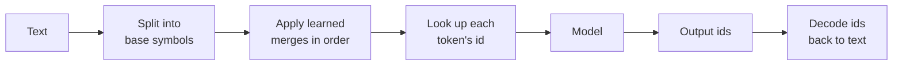

[How LLMs work](/learn/understanding-large-language-models/how-llms-work) said that a model reads and writes tokens, and asked you to think of a token as "roughly a word". This lesson replaces that approximation with the real thing. You will build a tokeniser by hand and in Python using byte-pair encoding, the algorithm behind most LLM tokenisers, and then count real tokens with a production tokeniser.

Tokens are the unit in which every limit and every price in a RAG system is expressed: how much text an embedding model will accept, how large a chunk is, how many chunks fit in a prompt, and what a query costs. An engineer who measures in characters or words will get all four wrong.

## Learning objectives

- Explain why models use subword tokens instead of characters or whole words.
- Run byte-pair encoding by hand on a small corpus and implement its training and encoding steps in Python.
- Count tokens with `tiktoken` and explain why counts differ between tokenisers and vendors.
- Calculate how many chunks a document yields and what a query costs from token counts.
- Choose the correct way to count tokens for a given embedding model or generator.

## Prerequisites

- [How LLMs work](/learn/understanding-large-language-models/how-llms-work)
- [What is RAG?](/learn/introduction-to-rag/what-is-rag)

## Why this matters

Suppose Meridian's team splits the employee handbook into chunks of 1,000 characters and embeds them with a model that accepts at most 256 tokens. For ordinary English prose 1,000 characters is around 250 tokens, so most chunks squeeze in. A chunk full of request ids, URLs or Japanese text can be three times that. The embedding model does not raise an error: many simply cut the input off at the limit and embed what is left. The end of the chunk is now invisible to search, and nobody is told.

The same mismatch appears at the other end of the pipeline. Prompts are billed per token, context limits are counted in tokens, and `max_tokens` caps the answer in tokens. If you cannot count tokens, you cannot budget a prompt, predict a bill or explain why an answer stopped mid-sentence.

## The intuition

There are two obvious ways to turn text into a sequence of symbols, and both are poor.

**One symbol per character.** The vocabulary is tiny, a few hundred symbols, and any text can be represented. But "password" becomes eight symbols, sequences get very long, and the model must spend effort learning that p-a-s-s-w-o-r-d is a unit.

**One symbol per word.** Sequences are short, but the vocabulary has to list every word in advance. The first time a user types "reauthenticate" or a product name or a typo, the model meets a word with no symbol. It also treats "reset", "resets" and "resetting" as three unrelated entries.

**Subword tokens** sit in between. Common words get a token of their own. Rarer words are spelled out from smaller, reusable pieces: "tokenisation" becomes "Token" and "isation". Nothing is ever out of vocabulary, because in the worst case a word falls back to single characters or bytes, and frequent text stays compact.

How do you decide which pieces deserve a token? Let the data decide: start from characters and repeatedly glue together the pair that occurs most often. That is byte-pair encoding.

## How it works

### The tokenisation pipeline

A tokeniser has two jobs. **Encoding** turns a string into a list of integer ids. **Decoding** turns ids back into a string. The model sees only the ids.



The merges and the id table are fixed when the tokeniser is trained, before the model is trained, and never change afterwards. A model and its tokeniser are a matched pair: the model's weights only make sense for the ids its own tokeniser produces.

### Byte-pair encoding, by hand

**Byte-pair encoding (BPE)** learns a vocabulary from a corpus as follows.

1. Split every word into single characters. The starting vocabulary is the set of characters.
2. Count every pair of adjacent symbols across the corpus.
3. Take the most frequent pair and merge it into one new symbol. Add that symbol to the vocabulary and record the merge.
4. Replace every occurrence of the pair in the corpus with the new symbol.
5. Repeat from step 2 until the vocabulary reaches the size you want.

Take a corpus of five words with these counts, as might come from Meridian's IT runbooks:

| Word | Count | Symbols at the start |
| --- | --- | --- |
| reset | 5 | r e s e t |
| resets | 2 | r e s e t s |
| rest | 3 | r e s t |
| test | 4 | t e s t |
| tests | 2 | t e s t s |

The starting vocabulary is {e, r, s, t}.

**Round 1.** Count adjacent pairs, weighting each word by its count. The pair (e, s) appears once in every word: $5 + 2 + 3 + 4 + 2 = 16$. The others: (r, e) $= 5 + 2 + 3 = 10$; (s, t) $= 3 + 4 + 2 = 9$; (e, t) $= 5 + 2 = 7$; (s, e) $= 7$; (t, e) $= 6$; (t, s) $= 4$. The winner is (e, s). Merge it into a new symbol `es`:

r es e t (5), r es e t s (2), r es t (3), t es t (4), t es t s (2)

**Round 2.** Recount on the new corpus: (r, es) $= 10$; (es, t) $= 3 + 4 + 2 = 9$; (es, e) $= 7$; (e, t) $= 7$; (t, es) $= 6$; (t, s) $= 4$. Merge (r, es) into `res`:

res e t (5), res e t s (2), res t (3), t es t (4), t es t s (2)

**Round 3.** Now (res, e) $= 7$ and (e, t) $= 7$ tie, ahead of (es, t) $= 6$, (t, es) $= 6$, (t, s) $= 4$ and (res, t) $= 3$. A tie needs a fixed rule so that training is reproducible; here we take the alphabetically first pair, (e, t), giving `et`.

Two more rounds merge (res, et) into `reset` and (es, t) into `est`. After five merges the vocabulary is {e, r, s, t, es, res, et, reset, est}, and the corpus reads:

| Word | Tokens |
| --- | --- |
| reset | `reset` |
| resets | `reset` `s` |
| rest | `res` `t` |
| test | `t` `est` |
| tests | `t` `est` `s` |

The most frequent word has become a single token, and the plural is that token plus `s`. No one told the algorithm about plurals; frequency was enough.

### Encoding new text

To tokenise a word the tokeniser has never seen, split it into characters and replay the recorded merges in the order they were learned. "retest" becomes `r` `et` `est`: unseen as a word, but built entirely from known pieces. "tester" becomes `t` `est` `e` `r`, because no merge ever produced `er`. Words unlike the training corpus cost more tokens.

### What production tokenisers add

- **Bytes, not characters.** Modern BPE tokenisers start from the 256 possible byte values of UTF-8 text, so every string in every language, including emoji, can be encoded. A character outside the common vocabulary is spelled as several byte tokens.
- **Spaces belong to tokens.** A leading space is usually attached to the following word, so "leave" at the start of a text and " leave" in the middle are different tokens with different ids. Capitalisation also changes the token.
- **Scale.** Real vocabularies come from tens or hundreds of thousands of merges over a very large corpus.
- **Special tokens.** A few reserved ids mark things that are not text, such as the end of a sequence or the boundary between conversation turns. Step 5 of the generation loop in the previous lesson stops on one of these.
- **Other algorithms.** WordPiece (used by BERT and by many embedding models built on it) and the Unigram method in SentencePiece make the merge decisions differently, but share the idea of a learned subword vocabulary.

> [!WARNING]
> Token counts are specific to one tokeniser. `tiktoken` implements OpenAI's tokenisers. Claude, Gemini, Llama and every embedding model have their own, and the same text will produce a different count in each. Use a tokeniser's count as exact only for the model it belongs to.

## The mathematics

### Vocabulary size

Each merge adds exactly one token, so after $m$ merges on a base alphabet of $b$ symbols:

$$
V = b + m
$$

- $V$ is the vocabulary size.
- $b$ is the number of base symbols (4 in the hand example; 256 for a byte-level tokeniser).
- $m$ is the number of merges performed.

In the hand example, $V = 4 + 5 = 9$, matching the vocabulary listed above. $V$ is a design choice: a larger vocabulary means fewer tokens per text, at the price of a larger embedding table in the model (the next lesson explains that table).

### How many chunks a document produces

If you cut a document of $N$ tokens into windows of $s$ tokens, where each window repeats the last $o$ tokens of the one before (the overlap), each new window advances by $s - o$ tokens. The number of chunks is:

$$
C = \left\lceil \frac{N - o}{s - o} \right\rceil
$$

- $N$ is the document length in tokens.
- $s$ is the chunk size in tokens.
- $o$ is the overlap in tokens, with $o < s$.
- $\lceil \cdot \rceil$ means round up to the next whole number.

**Worked example.** A handbook extract of $N = 83$ tokens, chunk size $s = 30$, overlap $o = 5$: $C = \lceil (83 - 5) / (30 - 5) \rceil = \lceil 78 / 25 \rceil = \lceil 3.12 \rceil = 4$ chunks. The code in the next section produces exactly these four.

### What a query costs

Providers charge separately for the tokens a model reads and the tokens it writes, quoting prices per million tokens:

$$
\text{cost} = \frac{N_\text{in} \, p_\text{in} + N_\text{out} \, p_\text{out}}{1{,}000{,}000}
$$

- $N_\text{in}$ is the number of input tokens: instructions, retrieved chunks and the question.
- $N_\text{out}$ is the number of output tokens in the answer.
- $p_\text{in}$ and $p_\text{out}$ are the prices per million input and output tokens.

**Worked example.** Take placeholder prices of 3 and 15 dollars per million tokens (illustrative round numbers; read your provider's current price list). A query sends five 400-token chunks plus 150 tokens of instructions and question, so $N_\text{in} = 5 \times 400 + 150 = 2{,}150$, and receives $N_\text{out} = 120$. The cost is $(2{,}150 \times 3 + 120 \times 15) / 1{,}000{,}000 = (6{,}450 + 1{,}800) / 1{,}000{,}000 = 0.00825$ dollars. At 20,000 queries a day for 30 days that is $600{,}000 \times 0.00825 = 4{,}950$ dollars a month.

```python
import math

# How many chunks does a document produce?
n_tokens, size, overlap = 83, 30, 5
print("chunks:", math.ceil((n_tokens - overlap) / (size - overlap)))

# What does a month of queries cost? Prices are placeholders, in dollars per million tokens.
price_in, price_out = 3.00, 15.00
input_tokens = 5 * 400 + 150          # five 400-token chunks plus instructions and question
output_tokens = 120
per_query = (input_tokens * price_in + output_tokens * price_out) / 1_000_000
queries = 20_000 * 30
print(f"input tokens per query: {input_tokens}")
print(f"cost per query: {per_query:.5f}")
print(f"cost per month: {per_query * queries:,.0f}")
print(f"share of cost that is input: {input_tokens * price_in / (input_tokens * price_in + output_tokens * price_out):.0%}")
```

```output
chunks: 4
input tokens per query: 2150
cost per query: 0.00825
cost per month: 4,950
share of cost that is input: 78%
```

Even with output priced five times higher per token, the retrieved context is 78% of the bill here. In RAG, the number and size of the chunks you send is the main cost lever.

## In code

### BPE from scratch

**The problem.** Implement the hand procedure so that you can train on any word list and tokenise unseen words. It needs only the standard library.

```python
from collections import Counter

def get_pair_counts(words):
    """Count every adjacent pair of symbols, weighted by word frequency."""
    pairs = Counter()
    for symbols, freq in words.items():
        for a, b in zip(symbols, symbols[1:]):
            pairs[(a, b)] += freq
    return pairs

def merge_pair(symbols, pair):
    """Replace each occurrence of `pair` in a tuple of symbols with the joined symbol."""
    out, i = [], 0
    while i < len(symbols):
        if i + 1 < len(symbols) and (symbols[i], symbols[i + 1]) == pair:
            out.append(symbols[i] + symbols[i + 1])
            i += 2
        else:
            out.append(symbols[i])
            i += 1
    return tuple(out)

def train_bpe(word_freqs, num_merges):
    words = {tuple(w): f for w, f in word_freqs.items()}   # start from characters
    merges = []
    for step in range(1, num_merges + 1):
        pairs = get_pair_counts(words)
        if not pairs:
            break
        # most frequent pair; ties broken alphabetically so the result is reproducible
        best = min(pairs, key=lambda p: (-pairs[p], p))
        merges.append(best)
        words = {merge_pair(s, best): f for s, f in words.items()}
        print(f"merge {step}: {best[0]!r} + {best[1]!r} -> {best[0] + best[1]!r}  (count {pairs[best]})")
    return merges, words

def encode(word, merges):
    """Tokenise a new word by replaying the learned merges in the order they were learned."""
    symbols = tuple(word)
    for pair in merges:
        symbols = merge_pair(symbols, pair)
    return list(symbols)

corpus = {"reset": 5, "resets": 2, "rest": 3, "test": 4, "tests": 2}
merges, words = train_bpe(corpus, num_merges=5)

print()
for symbols, freq in words.items():
    print(f"{''.join(symbols):<7} x{freq}  ->  {list(symbols)}")

vocab = sorted({ch for w in corpus for ch in w}) + [a + b for a, b in merges]
print("\nvocabulary:", vocab)

print()
for word in ["resets", "retest", "tester", "sets"]:
    print(f"{word:<7} -> {encode(word, merges)}")
```

```output
merge 1: 'e' + 's' -> 'es'  (count 16)
merge 2: 'r' + 'es' -> 'res'  (count 10)
merge 3: 'e' + 't' -> 'et'  (count 7)
merge 4: 'res' + 'et' -> 'reset'  (count 7)
merge 5: 'es' + 't' -> 'est'  (count 6)

reset   x5  ->  ['reset']
resets  x2  ->  ['reset', 's']
rest    x3  ->  ['res', 't']
test    x4  ->  ['t', 'est']
tests   x2  ->  ['t', 'est', 's']

vocabulary: ['e', 'r', 's', 't', 'es', 'res', 'et', 'reset', 'est']

resets  -> ['reset', 's']
retest  -> ['r', 'et', 'est']
tester  -> ['t', 'est', 'e', 'r']
sets    -> ['s', 'et', 's']
```

The merges and counts match the hand calculation. The important lines: `get_pair_counts` is step 2 of the algorithm; the `min(..., key=...)` line is step 3 with the tie rule; `merge_pair` is step 4, and the same function is reused by `encode`, which is why encoding must replay merges in training order. This version rescans the corpus on every merge, which is fine for a lesson and far too slow for real training; production implementations update the counts incrementally. A character that never appeared in training (try `encode("reboot", merges)`) simply stays as a single-character symbol with no id, which is the gap byte-level BPE closes by starting from all 256 bytes.

### Counting real tokens with tiktoken

**The problem.** See how a production tokeniser splits real text and how counts vary with the kind of text and the encoding.

```bash
pip install tiktoken
```

The first call to `get_encoding` downloads the vocabulary file and caches it, so it needs network access once.

```python
import tiktoken

enc = tiktoken.get_encoding("cl100k_base")
print("vocabulary size:", enc.n_vocab)

text = "Annual leave is 25 days; up to 5 unused days carry over."
ids = enc.encode(text)
print(ids)
print([enc.decode([i]) for i in ids])
print(f"{len(text)} characters, {len(text.split())} words, {len(ids)} tokens")
print("round trip ok:", enc.decode(ids) == text)

print()
samples = {
    "plain English": "Expenses must be submitted within 30 days.",
    "rare word": "Tokenisation is counterintuitive.",
    "identifier": "req_7f3a9c2e-41bd-4c8e-9a57-0d2f6b1e8c44",
    "German": "Spesen müssen innerhalb von 30 Tagen eingereicht werden.",
    "Japanese": "経費は30日以内に提出してください。",
    "code": "def carry_over(days): return min(days, 5)",
}
encodings = {name: tiktoken.get_encoding(name) for name in ["r50k_base", "cl100k_base", "o200k_base"]}
print(f"{'kind':<14}{'chars':>6}" + "".join(f"{name:>13}" for name in encodings))
for kind, s in samples.items():
    counts = "".join(f"{len(e.encode(s)):>13}" for e in encodings.values())
    print(f"{kind:<14}{len(s):>6}{counts}")

print()
print([enc.decode([i]) for i in enc.encode(samples["rare word"])])
print("'leave' ->", enc.encode("leave"), "  ' leave' ->", enc.encode(" leave"), "  'Leave' ->", enc.encode("Leave"))
```

```output
vocabulary size: 100277
[81596, 5387, 374, 220, 914, 2919, 26, 709, 311, 220, 20, 20604, 2919, 6920, 927, 13]
['Annual', ' leave', ' is', ' ', '25', ' days', ';', ' up', ' to', ' ', '5', ' unused', ' days', ' carry', ' over', '.']
56 characters, 12 words, 16 tokens
round trip ok: True

kind           chars    r50k_base  cl100k_base   o200k_base
plain English     42            9           10            9
rare word         33            6            7            7
identifier        40           34           34           34
German            56           22           15           13
Japanese          18           27           15           10
code              41           14           12           12

['Token', 'isation', ' is', ' counter', 'int', 'uitive', '.']
'leave' -> [22233]   ' leave' -> [5387]   'Leave' -> [22586]
```

**What the output means.**

- The 12-word sentence is 16 tokens. Words carry their leading space (`' leave'`, `' days'`), numbers and punctuation are separate tokens, and decoding the ids returns the original string exactly.
- `' days'` has the same id, 2919, both times it appears. A token id identifies the piece of text, not its position or meaning in context.
- Plain English runs at roughly four characters per token. The 40-character request id costs 34 tokens: random hexadecimal has no frequent pairs to merge. The 18-character Japanese sentence costs between 10 and 27 tokens depending on the encoding.
- The three encodings are three generations of OpenAI tokeniser with vocabularies of about 50,000, 100,000 and 200,000 tokens. They disagree on almost every row. Counting with the wrong one gives a wrong answer, most of all for text that is not English.
- "Tokenisation" is not in the vocabulary as a whole word; it is assembled from `Token` and `isation`. "leave", " leave" and "Leave" are three unrelated ids.

**Common errors.** `enc.encode` raises a `ValueError` if the text contains the literal spelling of a special token such as `<|endoftext|>`; see the security section below. Decoding an arbitrary slice of ids can produce the replacement character `�` when the slice cuts a multi-byte character in half, which matters for the chunker below when the text is not plain ASCII.

### Chunking by tokens

**The problem.** Cut a document into pieces that are guaranteed to fit a token limit.

```python
import tiktoken

enc = tiktoken.get_encoding("cl100k_base")

handbook = (
    "Annual leave is 25 days a year. Up to 5 unused days carry over and must be used by 31 March. "
    "Staff may work remotely up to 3 days a week. The home-office equipment budget is £400. "
    "Expenses must be submitted within 30 days, and anything over £75 needs a receipt. "
    "Passwords rotate every 90 days, and the VPN is required on public Wi-Fi."
)

def chunk_by_tokens(text, max_tokens, overlap=0):
    ids = enc.encode(text)
    step = max_tokens - overlap
    last_start = max(len(ids) - overlap, 1)          # stop once only the overlap is left
    return [enc.decode(ids[start:start + max_tokens]) for start in range(0, last_start, step)]

print("total tokens:", len(enc.encode(handbook)))
for i, chunk in enumerate(chunk_by_tokens(handbook, max_tokens=30, overlap=5)):
    print(f"[{i}] {len(enc.encode(chunk)):>2} tokens | {chunk!r}")
```

```output
total tokens: 83
[0] 30 tokens | 'Annual leave is 25 days a year. Up to 5 unused days carry over and must be used by 31 March. Staff may work remotely'
[1] 30 tokens | '. Staff may work remotely up to 3 days a week. The home-office equipment budget is £400. Expenses must be submitted within 30 days'
[2] 30 tokens | ' submitted within 30 days, and anything over £75 needs a receipt. Passwords rotate every 90 days, and the VPN is required on public'
[3]  8 tokens | ' VPN is required on public Wi-Fi.'
```

Encode once, slice the list of ids, decode each slice. Every chunk is at most 30 tokens, there are four of them as the formula predicted, and each begins with the last five tokens of the one before. The chunks also cut sentences in half, which is bad for retrieval; [Token-based chunking](/learn/chunking-fundamentals/token-based-chunking) and the lessons after it deal with respecting boundaries. The point here is that the *size* is measured in the unit the model uses.

### Counting tokens for Claude

Anthropic does not publish a local tokeniser for current Claude models. The count comes from the API, which tokenises your request exactly as the model would without generating anything:

```python
import anthropic

client = anthropic.Anthropic()  # reads ANTHROPIC_API_KEY from the environment

count = client.messages.count_tokens(
    model="claude-opus-5-5",
    messages=[{"role": "user", "content": "Annual leave is 25 days; up to 5 unused days carry over."}],
)
print(count.input_tokens)
```

This needs an API key and was not run here. It prints a single integer, and that integer will not be 16: it comes from a different tokeniser and includes the few tokens used to format the message. After any real request, `response.usage.input_tokens` and `response.usage.output_tokens` report what was actually consumed.

For local embedding models, count with the model's own tokeniser. With `sentence-transformers`, `model.tokenizer` gives the tokeniser and `model.max_seq_length` gives the limit beyond which input is truncated.

## A real-world example

Meridian's search team indexes IT runbooks for AskMeridian. Their splitter targets 1,000 characters per chunk, chosen because "about 250 tokens" fits the 256-token limit of the embedding model. Retrieval works well for policy questions. For questions about specific error codes it is poor: staff paste an error string that they can see in a runbook, and the runbook is not found.

Farah, the engineer investigating, tokenises a sample of chunks with the embedding model's own tokeniser instead of estimating. Prose chunks come out near the expected length. Chunks from troubleshooting pages, dense with log lines, hostnames and hexadecimal ids, come out at two to three times the limit. The embedding model had been silently dropping everything past its limit, and the error codes sat mostly in the dropped part.

The team switches the splitter to measure in tokens with the embedding model's tokeniser, sets the chunk size comfortably under the limit, and adds a check to the ingestion job that fails loudly if any chunk exceeds it. Nothing about the model or the search algorithm changed; the unit of measurement did.

## Common mistakes

- **Sizing chunks in characters or words.** The token count of a fixed number of characters varies several-fold with content and language, so some chunks overflow model limits and are truncated without warning.
- **Counting with the wrong tokeniser.** Using `tiktoken` to size inputs for a non-OpenAI embedding model or for Claude gives numbers that can be off by a wide margin, especially outside English.
- **Applying "one token is about four characters" as a limit.** The rule is an average for English prose. It is fine for a rough estimate and wrong for code, identifiers, tables and most other languages.
- **Forgetting the overhead.** A prompt's token count includes the system prompt, message formatting and any tool definitions, not only your text. Budgets computed from the chunks alone come up short.
- **Assuming one word is one token when setting `max_tokens`.** Answers get cut off mid-sentence because the limit was reached sooner than expected.
- **Slicing token ids without thinking about boundaries.** A cut can fall mid-word or mid-character, producing fragments that embed poorly and may decode to `�`.

## Best practices

- Measure in tokens, with the tokeniser of the model that will consume the text: the embedding model's for chunks, the generator's for prompts.
- Leave headroom under every limit. Aim chunks at a fraction of the embedding model's maximum, not at the maximum itself.
- Add a hard check in ingestion that rejects or re-splits any chunk over the limit, so truncation can never be silent.
- Store each chunk's token count as metadata at indexing time. Prompt assembly can then add up counts without re-tokenising.
- Use estimates such as characters divided by four only for capacity planning, and label them as estimates.
- Record real usage from API responses and compare it with your estimates.

## Performance considerations

Tokenising is cheap next to running a model, but it is not free at scale, and its results drive the two largest costs in the system.

**Index size.** From the chunk formula, a corpus of $N$ tokens at chunk size $s$ and overlap $o$ yields about $N / (s - o)$ chunks. Ten million tokens at $s = 400$, $o = 50$ is about $10{,}000{,}000 / 350 \approx 28{,}600$ chunks; at $s = 200$, $o = 50$ it is about $66{,}700$. Halving the chunk size more than doubles the number of vectors to embed, store and search. Overlap is paid for twice: those tokens are embedded in both neighbouring chunks.

**Prompt cost.** As computed above, retrieved context is usually most of the input and most of the bill. Sending ten chunks instead of five nearly doubles input tokens. [Token budgets](/learn/cost-engineering/token-budgets) turns this into a planning method.

**Latency.** Counting Claude tokens through the API is a network round trip. Do it when you need precision, such as checking a prompt against a hard limit, and rely on stored per-chunk counts for routine assembly.

## Security considerations

Special tokens are control signals to the model. If user-supplied or document text containing the literal spelling of a special token were encoded as that special token, a document could forge the end of a message. `tiktoken` guards against this by default: `enc.encode("... <|endoftext|> ...")` raises a `ValueError`. Passing `disallowed_special=()` encodes the string as ordinary text, which is the right choice for untrusted input. Do not pass `allowed_special="all"` for text you did not write.

Token counts are also a resource limit. A user or a poisoned document can submit text built to tokenise badly, such as long runs of random characters, to inflate cost. Enforce input limits in tokens, not characters, before any text reaches a paid API.

## Summary

- Models read integer token ids produced by a tokeniser. Tokens are subword pieces: common words are one token, rare words are several.
- Byte-pair encoding learns the vocabulary by repeatedly merging the most frequent adjacent pair; encoding new text replays those merges in order.
- English prose averages about four characters per token, but identifiers, code and many languages cost far more tokens per character.
- Every tokeniser gives different counts. Count with the tokeniser of the model in question: `tiktoken` for OpenAI models, the API's `count_tokens` for Claude, the model's own tokeniser for local embedding models.
- Chunk sizes, context limits and prices are all in tokens, so chunking and budgeting must be done in tokens too.

## Exercises

**1.** Continue the hand example for two more rounds. Which pairs are merged in rounds 6 and 7, and how is each of the five corpus words tokenised afterwards?

<details><summary>Show solution</summary>

After round 5 the corpus is: `reset` (5), `reset` `s` (2), `res` `t` (3), `t` `est` (4), `t` `est` `s` (2).

Pair counts: (t, est) $= 4 + 2 = 6$; (res, t) $= 3$; (reset, s) $= 2$; (est, s) $= 2$. Round 6 merges (t, est) into `test`.

The corpus is now `reset` (5), `reset` `s` (2), `res` `t` (3), `test` (4), `test` `s` (2). Counts: (res, t) $= 3$; (reset, s) $= 2$; (test, s) $= 2$. Round 7 merges (res, t) into `rest`.

Final tokenisation: reset → `reset`; resets → `reset` `s`; rest → `rest`; test → `test`; tests → `test` `s`. Running `train_bpe(corpus, num_merges=7)` prints `merge 6: 't' + 'est' -> 'test'  (count 6)` and `merge 7: 'res' + 't' -> 'rest'  (count 3)`, confirming it. Every word is now a whole-word token or a whole word plus `s`.

</details>

**2.** Write `truncate_to_tokens(text, max_tokens)` that returns the text unchanged if it fits and otherwise cuts it to exactly `max_tokens` tokens. Test it on a sentence with limits of 12 and 100.

<details><summary>Show solution</summary>

```python
import tiktoken

enc = tiktoken.get_encoding("cl100k_base")

def truncate_to_tokens(text, max_tokens):
    ids = enc.encode(text)
    if len(ids) <= max_tokens:
        return text
    return enc.decode(ids[:max_tokens])

doc = "Laptops are refreshed every 3 years. The support desk is open from 08:00 to 18:00 UK time."
print(len(enc.encode(doc)))
print(repr(truncate_to_tokens(doc, 12)))
print(repr(truncate_to_tokens(doc, 100)))
```

```output
27
'Laptops are refreshed every 3 years. The support desk'
'Laptops are refreshed every 3 years. The support desk is open from 08:00 to 18:00 UK time.'
```

The sentence is 27 tokens. With a limit of 12 the support desk hours are gone, which is exactly what an embedding model's silent truncation does to an oversized chunk. A production version would cut at a sentence boundary at or before the limit instead of mid-sentence.

</details>

**3.** A colleague says: "Our embedding model takes 256 tokens, and a token is four characters, so 1,000-character chunks are safe." Test the claim on one prose sentence and one log line, and say what you would do instead.

<details><summary>Show solution</summary>

```python
import tiktoken

enc = tiktoken.get_encoding("cl100k_base")
texts = {
    "policy sentence": "Expenses must be submitted within 30 days, and anything over £75 needs a receipt.",
    "log line": "2026-03-31T08:00:14Z req_7f3a9c2e-41bd-4c8e-9a57-0d2f6b1e8c44 status=200",
}
for name, t in texts.items():
    n = len(enc.encode(t))
    print(f"{name:<16}{len(t):>4} chars{n:>4} tokens  1,000 chars is about {1000 * n / len(t):.0f} tokens")
```

```output
policy sentence   81 chars  19 tokens  1,000 chars is about 235 tokens
log line          72 chars  50 tokens  1,000 chars is about 694 tokens
```

Prose at this density would just fit (235 tokens, with almost no headroom). Log-like text would be about 694 tokens, so roughly the last two thirds of each such chunk would be discarded by the embedding model. These numbers come from an OpenAI tokeniser, so they show the size of the effect, not the exact count for the embedding model in question; its own tokeniser must be used for the real check. The fix is to split by tokens with that tokeniser, target a size well under 256, and fail ingestion on any chunk that exceeds the limit.

</details>

**4.** AskMeridian sends five 400-token chunks per query. Product asks to send fifteen "to be safe". Using the cost formula and the placeholder prices from this lesson (3 and 15 dollars per million input and output tokens, 150 tokens of instructions and question, 120-token answers, 600,000 queries a month), compute the monthly cost before and after, and state one non-financial risk.

<details><summary>Show solution</summary>

Before: $N_\text{in} = 5 \times 400 + 150 = 2{,}150$. Cost per query $= (2{,}150 \times 3 + 120 \times 15) / 10^6 = 0.00825$. Monthly: $600{,}000 \times 0.00825 = 4{,}950$ dollars.

After: $N_\text{in} = 15 \times 400 + 150 = 6{,}150$. Cost per query $= (6{,}150 \times 3 + 1{,}800) / 10^6 = (18{,}450 + 1{,}800) / 10^6 = 0.02025$. Monthly: $600{,}000 \times 0.02025 = 12{,}150$ dollars.

Tripling the chunks multiplies the bill by about 2.5, because input dominates. Non-financial risks: longer prompts take longer to process, so latency rises; and ten extra lower-ranked chunks add text that is less relevant, which can distract the model from the passage that holds the answer (see [Context windows](/learn/understanding-large-language-models/context-windows)). A better proposal is to measure whether answers improve with more chunks before paying for them.

</details>

## Check your understanding

```quiz
[
  {
    "q": "Why do LLMs use subword tokens instead of whole words?",
    "options": [
      "Subword tokens make every text exactly four characters per token",
      "Whole words cannot be converted to integers",
      "A fixed subword vocabulary can represent any word, including unseen ones, while keeping common text compact",
      "Subword tokens remove the need for a vocabulary"
    ],
    "answer": 2,
    "why": "Rare or new words are built from smaller known pieces, so nothing is out of vocabulary, and frequent words still get a single token."
  },
  {
    "q": "In one round of BPE training, which pair of symbols is merged?",
    "options": [
      "The adjacent pair that occurs most often in the corpus",
      "The longest pair of symbols",
      "A randomly chosen adjacent pair",
      "The pair that occurs least often, to save space"
    ],
    "answer": 0,
    "why": "BPE counts all adjacent pairs, weighted by word frequency, and merges the most frequent one into a new vocabulary entry."
  },
  {
    "q": "What does this print?\n```python\nimport tiktoken\nenc = tiktoken.get_encoding(\"cl100k_base\")\nprint(enc.encode(\"leave\") == enc.encode(\" leave\"))\n```",
    "options": [
      "True, because whitespace is ignored by tokenisers",
      "An error, because a string cannot start with a space",
      "True, because both strings contain the same word",
      "False, because the leading space is part of the token"
    ],
    "answer": 3,
    "why": "In this encoding 'leave' is id 22233 and ' leave' is id 5387. A leading space is attached to the token that follows it."
  },
  {
    "q": "You need the exact number of input tokens a prompt will use with a Claude model. What should you use?",
    "options": [
      "`tiktoken` with the `cl100k_base` encoding",
      "The API's `client.messages.count_tokens(...)`, reading `.input_tokens`",
      "The number of characters divided by four",
      "The number of words multiplied by two"
    ],
    "answer": 1,
    "why": "`tiktoken` implements OpenAI's tokenisers and gives a different count. For Claude the count comes from the API's token counting endpoint, or from `response.usage` after a request."
  },
  {
    "q": "A 90-token document is split into chunks of 40 tokens with an overlap of 10. How many chunks are produced?",
    "options": [
      "2",
      "4",
      "3",
      "9"
    ],
    "answer": 2,
    "why": "Each chunk advances by 40 - 10 = 30 tokens. The number of chunks is the ceiling of (90 - 10) / 30 = 2.67, which is 3: tokens 0 to 39, 30 to 69 and 60 to 89."
  }
]
```

## Further reading

- Rico Sennrich, Barry Haddow and Alexandra Birch (2016), "Neural Machine Translation of Rare Words with Subword Units": [arxiv.org/abs/1508.07909](https://arxiv.org/abs/1508.07909). The paper that brought BPE to neural language models.
- `tiktoken`, OpenAI's open-source tokeniser library: [github.com/openai/tiktoken](https://github.com/openai/tiktoken)
- Anthropic documentation, the token counting guide: [docs.anthropic.com](https://docs.anthropic.com/)
- Hugging Face `tokenizers` library documentation, for BPE, WordPiece and Unigram implementations: [huggingface.co/docs/tokenizers](https://huggingface.co/docs/tokenizers)
- Daniel Jurafsky and James H. Martin, *Speech and Language Processing* (3rd edition draft), the chapter on words and tokens: [web.stanford.edu/~jurafsky/slp3](https://web.stanford.edu/~jurafsky/slp3/)
