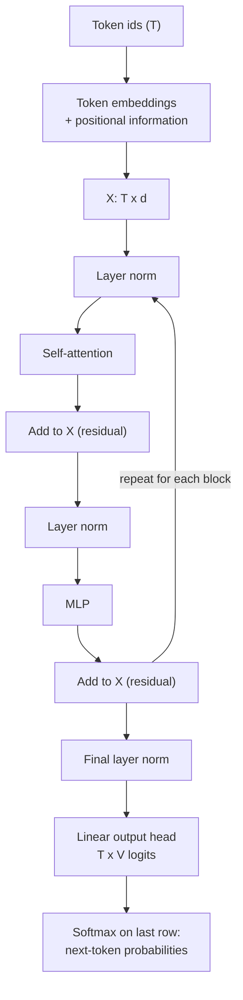

The last three lessons described a language model from the outside: tokens go in, pass through an embedding table, and a probability distribution over the next token comes out. In between sat a box labelled "model". This lesson opens it. The box is a **Transformer**: a stack of identical blocks, each of which lets the token vectors exchange information and then processes each one separately.

The same block, arranged in three slightly different ways, gives the three kinds of model a RAG system uses: the embedding model that indexes your chunks, the reranker that re-scores them, and the generator that writes the answer. Knowing the block and the three arrangements tells you which model can do which job, and why.

## Learning objectives

- Name the components of a Transformer block and say what each contributes.
- Trace the shape of the data from token ids to next-token probabilities.
- Compute layer normalisation and a sinusoidal positional encoding by hand.
- Count the parameters of a small Transformer from its configuration.
- Distinguish encoder-only, decoder-only and encoder-decoder models and match each to its role in RAG.

## Prerequisites

- [How LLMs work](/learn/understanding-large-language-models/how-llms-work)
- [Tokens and tokenisation](/learn/understanding-large-language-models/tokens-and-tokenisation)
- [Embeddings](/learn/understanding-large-language-models/embeddings)
- Matrix multiplication and NumPy array shapes.

## Why this matters

A team that sees every model as "an AI" makes category errors. They ask why the embedding model cannot write a summary, or try to rank two million chunks by asking a chat model about each one, or are surprised when a model rejects an input longer than a fixed limit. Each of these follows directly from the architecture.

- An embedding model is built to read a whole text at once and return vectors. It has no machinery for producing text.
- A generator is built to predict the next token from the tokens to its left. Asking it for a relevance judgement means running its full generation loop.
- Every model has a fixed width, a fixed depth and a maximum number of positions, and those three numbers decide its cost, its speed and the longest input it accepts.

You will not implement a Transformer at work. You will choose between them, size hardware for them, read their model cards and debug their limits, and all of that is easier when the parts have names.

## The intuition

Picture the tokens of a prompt as people sitting in a row, each holding a notepad. At the start, each notepad holds only what that person knows alone: which token they are and which seat they are in.

The group then works in rounds. Each round has two steps:

1. **Consult.** Everyone looks at the other notepads, decides which are relevant to them, and adds a summary of what they found to their own notepad. The token "it" might copy information from "the laptop" three seats away.
2. **Think.** Everyone works alone on their own notepad, combining what they gathered into something more useful, and adds the result.

Notes are always added, never erased, so what a person started with is still on the page at the end. After a dozen or more rounds each notepad holds a rich, context-aware description of its token. To predict the next word, you read the notepad of the last person in the row.

The consult step is **self-attention**, the think step is a small neural network called an **MLP**, "added, never erased" is a **residual connection**, and one round is a **Transformer block**.

## How it works

### The data: a T × d matrix

A Transformer operates on a matrix with one row per token. If the prompt has $T$ tokens and the model's width is $d$ (also written $d_\text{model}$), the matrix has shape $T \times d$. Every block takes a $T \times d$ matrix and returns a $T \times d$ matrix. That constancy of shape is what allows blocks to be stacked.

### The components

**Token embeddings.** The lookup from [Embeddings](/learn/understanding-large-language-models/embeddings): each token id selects a row of a $V \times d$ table.

**Positional information.** Attention, as the next lesson shows, treats its input as an unordered set. Without extra information the model could not tell "the manager approved the request" from "the request approved the manager". So each position is given its own vector, which is added to the token embedding. The original Transformer computed these vectors from sine and cosine waves. GPT-2 and BERT learn a table with one row per position, which is why they have a hard maximum length. Many recent models instead encode relative position inside the attention computation. The purpose is the same in every case: make order visible.

**Self-attention.** Each position gathers information from other positions, weighted by relevance. It is the only component in which token vectors interact. [Attention mechanisms](/learn/understanding-large-language-models/attention-mechanisms) derives it; here it is a function from $T \times d$ to $T \times d$.

**The MLP** (multi-layer perceptron, also called the feed-forward network). Two linear layers with a non-linear function between them, applied to each position independently. It widens each vector, typically to $4d$, transforms it, and narrows it back to $d$. Most of a block's parameters live here.

**Residual connections.** Each sub-layer's output is *added* to its input instead of replacing it: $\mathbf{x} \leftarrow \mathbf{x} + f(\mathbf{x})$. A block therefore only has to compute an adjustment. Information from early layers passes straight through to late ones, and during training the gradient has a direct path back to the first layer, which is what makes very deep stacks trainable.

**Layer normalisation.** Rescales each token vector to mean 0 and variance 1 across its $d$ coordinates, then applies a learned scale and shift. It keeps the numbers in a stable range as they pass through many layers.

**The output head.** After the last block, a final layer norm and one linear layer map each $d$-wide vector to $V$ logits, one per vocabulary entry. Softmax over the logits of the last position gives the next-token distribution from [How LLMs work](/learn/understanding-large-language-models/how-llms-work).

### One forward pass, step by step

For a GPT-style model, the arrangement used by today's generators:

1. Look up the token embedding for each of the $T$ token ids.
2. Add the positional vector for each position, giving the block input $X$ of shape $T \times d$.
3. In each block: normalise $X$, apply self-attention, add the result to $X$.
4. Still in the block: normalise $X$, apply the MLP, add the result to $X$.
5. Repeat steps 3 and 4 for every block in the stack.
6. Apply the final layer norm.
7. Multiply by the output matrix to obtain logits of shape $T \times V$.
8. Apply softmax to the last row to get the distribution over the next token.



Normalising *before* each sub-layer, as drawn, is called pre-norm and is the usual choice in modern models. The original 2017 design normalised after the addition (post-norm). The components are the same.

### Three arrangements of the same block

The 2017 Transformer was built for translation and had two stacks. Later models kept one stack or the other.

| | Encoder-only | Decoder-only | Encoder-decoder |
| --- | --- | --- | --- |
| Attention sees | Every position, left and right | Only positions to the left (causal) | Encoder: everything. Decoder: leftward, plus the encoder's output |
| Trained to | Reconstruct masked tokens, then often fine-tuned for similarity or classification | Predict the next token | Generate an output sequence from an input sequence |
| Produces | One contextual vector per token | Next-token distribution | Next-token distribution for the output sequence |
| Examples | BERT, MiniLM | GPT family, Claude, Llama | The original Transformer, T5, BART |
| Role in RAG | Embedding models and most rerankers | The generator | Less common now; BART was the generator in the original RAG paper |

**Encoder-only** models let every token attend to every other token in both directions. Each output vector reflects the whole text, which is what you want when the goal is to *represent* text. Pool the output vectors and you have a text embedding; that is how `all-MiniLM-L6-v2` works. Feed in a query and a passage together and put a small scoring layer on top, and you have a cross-encoder reranker (see [Cross-encoders](/learn/reranking-fundamentals/cross-encoders)). An encoder has no generation loop: it runs once over the whole input.

**Decoder-only** models apply a **causal mask** so that each position can attend only to itself and earlier positions. That restriction is what makes next-token training possible, since the model cannot peek at the answer, and what makes the autoregressive loop consistent. Today's general-purpose LLMs are, almost without exception, decoder-only.

**Encoder-decoder** models encode the input with a bidirectional stack and generate with a causal stack whose blocks have an extra attention layer looking at the encoder's output.

> [!NOTE]
> The mapping is a strong tendency, not a law. Some recent embedding models are adapted from decoder-only LLMs. What defines an embedding model is that it outputs a vector trained for similarity, whatever stack is underneath.

## The mathematics

### Positional encoding

We need a distinct vector of width $d$ for each position, built so that nearby positions get similar vectors. The original Transformer uses sine and cosine waves of different wavelengths, like the hands of several clocks turning at different speeds: fast coordinates separate neighbouring positions, slow coordinates separate distant ones.

$$
PE_{(pos,\,2i)} = \sin\!\left(\frac{pos}{10000^{2i/d}}\right), \qquad PE_{(pos,\,2i+1)} = \cos\!\left(\frac{pos}{10000^{2i/d}}\right)
$$

- $pos$ is the position in the sequence, starting at 0.
- $i$ indexes pairs of coordinates, from 0 to $d/2 - 1$; coordinate $2i$ gets the sine and $2i+1$ the cosine.
- $d$ is the model width.
- $10000^{2i/d}$ sets the wavelength, which grows with $i$.

**Worked example.** For $pos = 1$ and $d = 4$ there are two pairs. For $i = 0$ the divisor is $10000^{0} = 1$, giving $\sin(1) = 0.8415$ and $\cos(1) = 0.5403$. For $i = 1$ the divisor is $10000^{2/4} = 100$, giving $\sin(0.01) = 0.0100$ and $\cos(0.01) = 1.0000$. So $PE_1 = [0.8415, 0.5403, 0.0100, 1.0000]$. Position 0 is $[0, 1, 0, 1]$, since $\sin 0 = 0$ and $\cos 0 = 1$.

### Layer normalisation

For a single token vector $\mathbf{x}$ of width $d$, subtract its mean, divide by its standard deviation, then apply a learned scale and shift:

$$
\text{LN}(\mathbf{x}) = \boldsymbol{\gamma} \odot \frac{\mathbf{x} - \mu}{\sqrt{\sigma^2 + \epsilon}} + \boldsymbol{\beta}, \qquad \mu = \frac{1}{d}\sum_{i=1}^{d} x_i, \qquad \sigma^2 = \frac{1}{d}\sum_{i=1}^{d} (x_i - \mu)^2
$$

- $\mu$ and $\sigma^2$ are the mean and variance of the $d$ coordinates of this one vector.
- $\epsilon$ is a tiny constant (such as $10^{-5}$) that prevents division by zero.
- $\boldsymbol{\gamma}$ and $\boldsymbol{\beta}$ are learned vectors of width $d$, initialised to ones and zeros; $\odot$ is coordinate-wise multiplication.

**Worked example.** $\mathbf{x} = [2, 4, 6, 8]$ with $\boldsymbol{\gamma} = \mathbf{1}$, $\boldsymbol{\beta} = \mathbf{0}$. Mean: $\mu = 20/4 = 5$. Variance: $\sigma^2 = (9 + 1 + 1 + 9)/4 = 5$, so $\sigma = 2.236$. Result: $[(2-5)/2.236,\, (4-5)/2.236,\, (6-5)/2.236,\, (8-5)/2.236] = [-1.342, -0.447, 0.447, 1.342]$. Had the input been $[200, 400, 600, 800]$, the output would be identical: the scale is removed.

### The block

With $X$ the $T \times d$ input, one pre-norm block computes:

$$
X' = X + \text{Attention}(\text{LN}_1(X)), \qquad X'' = X' + \text{MLP}(\text{LN}_2(X'))
$$

and the MLP, applied to each row $\mathbf{x}$ separately, is:

$$
\text{MLP}(\mathbf{x}) = W_2 \, g(W_1 \mathbf{x} + \mathbf{b}_1) + \mathbf{b}_2
$$

- $W_1$ maps width $d$ to the hidden width $d_\text{ff}$ (usually $4d$); $W_2$ maps back to $d$; $\mathbf{b}_1$, $\mathbf{b}_2$ are bias vectors.
- $g$ is a non-linear function applied to each coordinate. GPT-2 and BERT use GELU, a smooth curve that passes positive values almost unchanged and squashes negative values towards zero. Without $g$, two linear layers would collapse into one.
- The plus signs outside the sub-layers are the residual connections.

### Counting parameters

Each component's parameter count follows from its shape. For vocabulary $V$, maximum length $T_\text{max}$, width $d$, MLP width $d_\text{ff}$ and $L$ blocks:

$$
\underbrace{Vd + T_\text{max}d}_{\text{embeddings}} \;+\; L\big(\underbrace{4(d^2 + d)}_{\text{attention}} + \underbrace{2\,d\,d_\text{ff} + d_\text{ff} + d}_{\text{MLP}} + \underbrace{4d}_{\text{two layer norms}}\big) \;+\; \underbrace{2d + dV + V}_{\text{final norm and head}}
$$

Attention has four $d \times d$ matrices with biases, which the next lesson names.

**Worked example.** The tiny model in the code below has $V = 12$, $T_\text{max} = 16$, $d = 8$, $d_\text{ff} = 32$, $L = 2$.

- Embeddings: $12 \times 8 + 16 \times 8 = 96 + 128 = 224$.
- Attention per block: $4 \times (64 + 8) = 288$.
- MLP per block: $2 \times 8 \times 32 + 32 + 8 = 552$.
- Layer norms per block: $4 \times 8 = 32$.
- One block: $288 + 552 + 32 = 872$.
- Head: $16 + 96 + 12 = 124$.
- Total: $224 + 2 \times 872 + 124 = 2{,}092$.

The same three calculations in NumPy:

```python
import numpy as np

# Layer normalisation of one vector
x = np.array([2.0, 4.0, 6.0, 8.0])
mu, var = x.mean(), x.var()
print("mean", mu, " variance", var, " std", round(float(np.sqrt(var)), 4))
print("layer norm:", ((x - mu) / np.sqrt(var + 1e-5)).round(4))

# Sinusoidal positional encoding, d_model = 4
def positional_encoding(n_positions, d_model):
    pos = np.arange(n_positions)[:, None]            # (T, 1)
    i = np.arange(d_model // 2)[None, :]             # (1, d/2)
    angle = pos / (10000 ** (2 * i / d_model))
    pe = np.zeros((n_positions, d_model))
    pe[:, 0::2] = np.sin(angle)
    pe[:, 1::2] = np.cos(angle)
    return pe

print(positional_encoding(3, 4).round(4))

# Parameter count of the tiny model used below
V, T_max, d, d_ff, L = 12, 16, 8, 32, 2
embeddings = V * d + T_max * d
attention = 4 * (d * d + d)                 # W_Q, W_K, W_V, W_O with biases
mlp = (d * d_ff + d_ff) + (d_ff * d + d)
norms = 2 * (2 * d)
block = attention + mlp + norms
head = 2 * d + (d * V + V)                  # final layer norm + unembedding
print("embeddings", embeddings, "| one block", block, "| head", head, "| total", embeddings + L * block + head)
```

```output
mean 5.0  variance 5.0  std 2.2361
layer norm: [-1.3416 -0.4472  0.4472  1.3416]
[[ 0.      1.      0.      1.    ]
 [ 0.8415  0.5403  0.01    1.    ]
 [ 0.9093 -0.4161  0.02    0.9998]]
embeddings 224 | one block 872 | head 124 | total 2092
```

The middle row of the positional matrix is the vector worked out by hand.

## In code

### A complete decoder-only forward pass

**The problem.** Follow a five-token input through a real, if tiny, GPT-style Transformer and watch the shape at every stage. The weights are random, so the predictions are meaningless; the structure and the shapes are exactly those of a full-size model. The model learns its positional vectors as a table, as GPT-2 does.

```bash
pip install numpy
```

```python
import numpy as np

rng = np.random.default_rng(0)
V, T_MAX, D, N_HEADS, D_FF, N_LAYERS = 12, 16, 8, 2, 32, 2   # vocab, max length, width, heads, MLP width, depth

def init(*shape):
    return rng.normal(0, 0.02, size=shape)

params = {
    "tok_emb": init(V, D),
    "pos_emb": init(T_MAX, D),
    "blocks": [
        {
            "ln1_g": np.ones(D), "ln1_b": np.zeros(D),
            "W_q": init(D, D), "b_q": np.zeros(D),
            "W_k": init(D, D), "b_k": np.zeros(D),
            "W_v": init(D, D), "b_v": np.zeros(D),
            "W_o": init(D, D), "b_o": np.zeros(D),
            "ln2_g": np.ones(D), "ln2_b": np.zeros(D),
            "W_1": init(D, D_FF), "b_1": np.zeros(D_FF),
            "W_2": init(D_FF, D), "b_2": np.zeros(D),
        }
        for _ in range(N_LAYERS)
    ],
    "lnf_g": np.ones(D), "lnf_b": np.zeros(D),
    "W_out": init(D, V), "b_out": np.zeros(V),
}

def softmax(z):
    z = z - z.max(axis=-1, keepdims=True)
    e = np.exp(z)
    return e / e.sum(axis=-1, keepdims=True)

def layer_norm(x, g, b, eps=1e-5):
    mu = x.mean(axis=-1, keepdims=True)
    var = x.var(axis=-1, keepdims=True)
    return g * (x - mu) / np.sqrt(var + eps) + b

def gelu(x):
    return 0.5 * x * (1 + np.tanh(np.sqrt(2 / np.pi) * (x + 0.044715 * x**3)))

def self_attention(x, p):
    T, _ = x.shape
    d_head = D // N_HEADS
    split = lambda m: m.reshape(T, N_HEADS, d_head).transpose(1, 0, 2)   # (T, D) -> (heads, T, d_head)
    q, k, v = split(x @ p["W_q"] + p["b_q"]), split(x @ p["W_k"] + p["b_k"]), split(x @ p["W_v"] + p["b_v"])
    scores = q @ k.transpose(0, 2, 1) / np.sqrt(d_head)                  # (heads, T, T)
    scores = np.where(np.tril(np.ones((T, T))) == 1, scores, -np.inf)    # causal mask: no looking ahead
    out = softmax(scores) @ v                                            # (heads, T, d_head)
    out = out.transpose(1, 0, 2).reshape(T, D)                           # back to (T, D)
    return out @ p["W_o"] + p["b_o"]

def mlp(x, p, log=None):
    h = gelu(x @ p["W_1"] + p["b_1"])
    if log:
        log("  MLP hidden layer", h)
    return h @ p["W_2"] + p["b_2"]

def forward(ids, verbose=False):
    def log(name, a):
        if verbose:
            print(f"{name:<28}{str(a.shape):>9}")
    T = len(ids)
    log("token ids", ids)
    tok = params["tok_emb"][ids]
    pos = params["pos_emb"][np.arange(T)]
    log("token embeddings", tok)
    log("position embeddings", pos)
    x = tok + pos
    log("block input x", x)
    for n, p in enumerate(params["blocks"], start=1):
        a = self_attention(layer_norm(x, p["ln1_g"], p["ln1_b"]), p)
        log(f"block {n}: attention output", a)
        x = x + a                                                        # residual connection
        m = mlp(layer_norm(x, p["ln2_g"], p["ln2_b"]), p, log if verbose else None)
        log(f"block {n}: MLP output", m)
        x = x + m                                                        # residual connection
        log(f"block {n}: output x", x)
    x = layer_norm(x, params["lnf_g"], params["lnf_b"])
    logits = x @ params["W_out"] + params["b_out"]
    log("logits", logits)
    return logits

ids = np.array([3, 7, 1, 9, 4])
logits = forward(ids, verbose=True)

probs = softmax(logits[-1])                     # prediction for the token after the last one
print("\nnext-token distribution: shape", probs.shape, "sum", round(float(probs.sum()), 6))
print("most probable next token id:", int(probs.argmax()), "with probability", round(float(probs.max()), 4))

def count(obj):
    if isinstance(obj, np.ndarray):
        return obj.size
    if isinstance(obj, dict):
        return sum(count(v) for v in obj.values())
    return sum(count(v) for v in obj)
print("parameters:", count(params))

changed = ids.copy()
changed[-1] = 0                                 # alter only the last token
same = np.allclose(forward(changed)[:-1], logits[:-1])
print("earlier positions unaffected by a later token:", same)
```

```output
token ids                        (5,)
token embeddings               (5, 8)
position embeddings            (5, 8)
block input x                  (5, 8)
block 1: attention output      (5, 8)
  MLP hidden layer            (5, 32)
block 1: MLP output            (5, 8)
block 1: output x              (5, 8)
block 2: attention output      (5, 8)
  MLP hidden layer            (5, 32)
block 2: MLP output            (5, 8)
block 2: output x              (5, 8)
logits                        (5, 12)

next-token distribution: shape (12,) sum 1.0
most probable next token id: 11 with probability 0.0889
parameters: 2092
earlier positions unaffected by a later token: True
```

**The important lines.**

- `x = tok + pos` is step 2: token identity and position are combined by addition, and from here on the shape is `(5, 8)`.
- `x = x + a` and `x = x + m` are the residual connections. The sub-layer's output is added to the running matrix, never assigned over it.
- `layer_norm(x, ...)` is called on the *input* of each sub-layer: the pre-norm arrangement.
- In `mlp`, the hidden layer is `(5, 32)`: each of the five rows is widened to $4d$, passed through GELU and narrowed back. No row sees any other row.
- In `self_attention`, `np.tril` builds the causal mask. The rest of that function is the subject of the next lesson.
- `logits[-1]` is the last row, the only one used to choose the next token during generation.

**What the output means.** Five token ids became a `(5, 8)` matrix, kept that shape through both blocks, and ended as `(5, 12)` logits: for every position, a score for each of the 12 vocabulary entries. Row $t$ of the logits is the model's prediction for the token that follows position $t$, so a single pass yields $T$ predictions. Training uses all of them at once; generation needs only the last.

The top probability is 0.0889, barely above the uniform $1/12 = 0.083$. An untrained model knows nothing, as the cross-entropy discussion in [How LLMs work](/learn/understanding-large-language-models/how-llms-work) predicted. The parameter count, 2,092, matches the hand calculation.

The last line is the causal property. Changing the final token left the outputs at the first four positions exactly as they were, because the mask stops information flowing from right to left. Delete the masking line and the stack behaves like an encoder: every position sees every other, and that check prints `False` (Exercise 3).

**Common errors.** A shape mismatch in `reshape` means the width is not divisible by the number of heads. An `IndexError` on `pos_emb` means the input is longer than `T_MAX` (Exercise 4). If every output row is identical, the positional vectors were probably left out.

**Extending it.** Set `N_LAYERS` to 12, `D` to 768, `N_HEADS` to 12, `D_FF` to 3072, `V` to 50257 and `T_MAX` to 1024, and you have the dimensions of GPT-2 small. To make it an embedding model, remove the mask, drop the output head and average the rows of the final `x`.

## A real-world example

Meridian's search team wants AskMeridian to rank passages more accurately. An engineer, Ines, proposes the most direct idea: for every question, ask the generator, a large decoder-only model, "Is this passage relevant to the question?" for each chunk in the index.

Her colleague Dmitri works through what the architecture implies. The index has 40,000 chunks. A decoder-only model judges a passage by reading question and passage together and then generating an answer token by token, and the 40,000 passages cannot share work with each other, because each judgement is a separate forward pass over a different input. That is 40,000 passes through a very deep stack for every question.

They assign each job to the arrangement built for it. An encoder-only embedding model turns every chunk into a vector once, offline, and each question into a vector at query time; first-stage search is then vector arithmetic. A second, small encoder-only cross-encoder reads the question together with each of the top 50 candidates, which is affordable because 50 is not 40,000 and an encoder runs once per input with no generation loop. The decoder-only generator sees only the best five chunks and does the one thing only it can do: write the answer. Phase 8 builds this two-stage design.

## Common mistakes

- **Expecting an encoder-only model to generate text.** It has no next-token head and no causal training. Embedding models and rerankers return vectors and scores, never prose.
- **Using a generator where an encoder would do.** Scoring or classifying many texts with a decoder-only LLM pays for deep stacks and a generation loop on every item. The system is slow and costly for a task a small encoder handles in one pass each.
- **Ignoring the maximum sequence length.** Models with learned position tables cannot process inputs longer than the table. Depending on the library the result is an error or silent truncation.
- **Assuming more attention heads means a bigger model.** Heads divide the width between them. The parameter count depends on width, depth, MLP width and vocabulary.
- **Believing a decoder revises earlier tokens as it reads later ones.** With a causal mask, the representation at position $t$ never depends on positions after $t$. Information flows left to right only.
- **Comparing models by parameter count across architectures.** A 100-million-parameter encoder and a 100-million-parameter decoder do different jobs; the count says something about cost and nothing about suitability.

## Best practices

- Match the architecture to the job: encoder-style models to represent and score text, decoder-only models to write it.
- Read the model card for four numbers before adopting a model: width (for embeddings, the output dimension), number of layers, maximum sequence length and parameter count.
- Enforce the maximum sequence length yourself, in tokens, so that truncation is a decision and not an accident.
- When estimating hardware, start from parameter count times bytes per parameter, then add working memory.
- When debugging any model code, print shapes. Nearly every Transformer bug shows up as a shape that is not $T \times d$ where it should be.

## Performance considerations

**Parameters and memory.** For large models the per-block terms dominate, and with $d_\text{ff} = 4d$ a block holds about $4d^2 + 8d^2 = 12d^2$ parameters, two thirds of them in the MLP. For GPT-2 small, $12 \times 768^2 \approx 7.1$ million per block and about 85 million across 12 blocks; with the embeddings the total is about 124 million (Exercise 2 computes it exactly). At 4 bytes per parameter that is roughly 0.5 GB. A model with 7 billion parameters needs about 28 GB at 4 bytes each, or 14 GB at 2 bytes: the weights alone decide what hardware it fits on.

**Depth is sequential.** Block 2 needs the output of block 1, so $L$ blocks cost $L$ steps that cannot run in parallel. Doubling depth roughly doubles the time per token.

**Width is quadratic.** The matrices are $d \times d$ or $d \times 4d$, so doubling the width roughly quadruples both parameters and arithmetic per token.

**Encoders run once; decoders loop.** Embedding a 300-token chunk is one pass through a small stack, and many chunks can be batched together. Generating a 300-token answer is 300 passes through a far larger stack. This asymmetry is why indexing millions of chunks is practical while generation dominates the latency of each request. [Model inference](/learn/understanding-large-language-models/model-inference) covers how the per-token cost of generation is reduced in practice.

**Sequence length.** Everything outside attention scales linearly with $T$. Attention compares every position with every other, which grows with $T^2$; the next lesson explains what that means for long prompts.

## Summary

- A Transformer turns $T$ token ids into a $T \times d$ matrix and passes it through a stack of identical blocks that preserve that shape.
- Each block has two sub-layers: self-attention, where positions exchange information, and an MLP, where each position is processed alone. Each is wrapped in a residual connection and preceded by layer normalisation.
- Positional information must be added because attention alone has no sense of order.
- A final linear head maps each vector to $V$ logits; softmax over the last position gives the next-token distribution.
- Encoder-only models see in both directions and produce vectors, which suits embedding and reranking. Decoder-only models see leftwards only and generate, which suits answering.
- Parameter count, and so memory and cost, is set by width, depth, MLP width and vocabulary, at about $12d^2$ per block.

## Exercises

**1.** A model has $V = 100$, $T_\text{max} = 32$, $d = 16$, $d_\text{ff} = 64$, three blocks and four attention heads. Count its parameters by hand using the formula. Would the count change with eight heads?

<details><summary>Show solution</summary>

- Embeddings: $100 \times 16 + 32 \times 16 = 1{,}600 + 512 = 2{,}112$.
- Attention per block: $4 \times (16^2 + 16) = 4 \times 272 = 1{,}088$.
- MLP per block: $2 \times 16 \times 64 + 64 + 16 = 2{,}128$.
- Layer norms per block: $4 \times 16 = 64$.
- One block: $1{,}088 + 2{,}128 + 64 = 3{,}280$; three blocks: $9{,}840$.
- Head: $2 \times 16 + 16 \times 100 + 100 = 1{,}732$.
- Total: $2{,}112 + 9{,}840 + 1{,}732 = 13{,}684$.

Setting the first line of the lesson's script to `V, T_MAX, D, N_HEADS, D_FF, N_LAYERS = 100, 32, 16, 4, 64, 3` and running it prints `parameters: 13684`.

The number of heads does not appear in the formula. Heads split the same $d \times d$ matrices into groups of columns, so eight heads would give the same count, with each head working in 2 dimensions instead of 4.

</details>

**2.** GPT-2 small has $V = 50{,}257$, $T_\text{max} = 1{,}024$, $d = 768$, $d_\text{ff} = 3{,}072$ and 12 blocks. Its output head reuses the token embedding matrix (weight tying), so the head adds only the final layer norm. Compute the parameter count in Python.

<details><summary>Show solution</summary>

```python
V, T_max, d, d_ff, L = 50257, 1024, 768, 3072, 12
emb = V * d + T_max * d
block = 4 * (d * d + d) + (d * d_ff + d_ff) + (d_ff * d + d) + 2 * (2 * d)
print(emb, block, L * block, emb + L * block + 2 * d)
```

```output
39383808 7087872 85054464 124439808
```

About 39.4 million parameters in the embeddings, 7.1 million per block, 85.1 million across the blocks, and 124,439,808 in total, the "124M" usually quoted for this model. Weight tying saves a second $50{,}257 \times 768$ matrix of about 38.6 million parameters.

</details>

**3.** In the lesson's script, delete the line that applies the causal mask and run it again. What does the final check print, and which model family does the network now resemble?

<details><summary>Show solution</summary>

Remove this line from `self_attention`:

```python
scores = np.where(np.tril(np.ones((T, T))) == 1, scores, -np.inf)    # causal mask: no looking ahead
```

The last two lines of output become:

```output
parameters: 2092
earlier positions unaffected by a later token: False
```

Without the mask every position attends to every other, so changing the last token changes the vectors at all earlier positions. The parameter count is unchanged, because the mask has no weights. The network now has the information flow of an encoder-only model such as BERT: each output vector reflects the whole input, which is what you want for an embedding. It could no longer be trained by next-token prediction, because each position could simply look at the token it is supposed to predict.

</details>

**4.** The tiny model has `T_MAX = 16`. What happens if you call `forward` with 20 token ids? Relate the result to the 256-token limit of the `all-MiniLM-L6-v2` embedding model.

<details><summary>Show solution</summary>

```python
too_long = np.arange(20) % V          # 20 token ids, but pos_emb has only 16 rows
try:
    forward(too_long)
except IndexError as e:
    print("IndexError:", e)
```

```output
IndexError: index 16 is out of bounds for axis 0 with size 16
```

The position table has rows 0 to 15. There is no vector for position 16, so the lookup fails. A model with a learned position table has no way to process a position it was never given a vector for.

Embedding models have the same kind of limit. Libraries usually avoid the crash by truncating the input to the maximum length before the forward pass, which is friendlier and more dangerous: the tail of an over-long chunk is dropped without any error, and its content never reaches the vector. This is the architectural reason behind the advice in [Tokens and tokenisation](/learn/understanding-large-language-models/tokens-and-tokenisation) to size chunks in tokens, under the embedding model's limit.

</details>

## Check your understanding

```quiz
[
  {
    "q": "A Transformer block receives a matrix of shape (T, d). What shape does it return?",
    "options": [
      "(T, V), one score per vocabulary entry",
      "(T, d), the same shape it received",
      "(d, d), a square matrix",
      "(1, d), a single pooled vector"
    ],
    "answer": 1,
    "why": "Attention and the MLP both map (T, d) to (T, d), and the residual additions preserve it. That is why blocks can be stacked. Only the output head changes the last dimension to V."
  },
  {
    "q": "What does a residual connection do?",
    "options": [
      "It removes the mean from each vector",
      "It prevents a position from attending to later positions",
      "It reduces the number of parameters in the block",
      "It adds a sub-layer's output to its input, so the sub-layer computes an adjustment and earlier information passes through"
    ],
    "answer": 3,
    "why": "The update is x = x + f(x). Information and gradients have a direct path through the stack, which is what makes deep models trainable."
  },
  {
    "q": "Why must positional information be added to the token embeddings?",
    "options": [
      "Attention on its own treats the input as an unordered set, so without it the model could not tell word order",
      "Token embeddings would otherwise be too small in magnitude",
      "It is needed to convert token ids into vectors",
      "It replaces the need for layer normalisation"
    ],
    "answer": 0,
    "why": "Self-attention computes weighted sums that do not depend on where a token sits. Positional vectors make each position distinguishable."
  },
  {
    "q": "Which architecture is the natural fit for an embedding model that turns each chunk into one vector?",
    "options": [
      "Decoder-only, because it predicts the next token",
      "Encoder-decoder, because it has two stacks",
      "Encoder-only, because every token can attend to the whole text and the output vectors can be pooled",
      "None; embedding models do not use Transformers"
    ],
    "answer": 2,
    "why": "Bidirectional attention gives each output vector a view of the whole passage, and pooling those vectors yields one text embedding. No generation loop is needed."
  },
  {
    "q": "In a decoder-only model, you change the last token of a 10-token prompt. Which positions' output vectors change?",
    "options": [
      "All ten",
      "Only the last one",
      "The first nine but not the last",
      "None of them"
    ],
    "answer": 1,
    "why": "The causal mask lets each position attend only to itself and earlier positions, so positions 1 to 9 never see the changed token. The lesson's final check demonstrates this."
  }
]
```

## Further reading

- Ashish Vaswani et al. (2017), "Attention Is All You Need": [arxiv.org/abs/1706.03762](https://arxiv.org/abs/1706.03762). The original encoder-decoder Transformer.
- Jacob Devlin, Ming-Wei Chang, Kenton Lee and Kristina Toutanova (2018), "BERT: Pre-training of Deep Bidirectional Transformers for Language Understanding": [arxiv.org/abs/1810.04805](https://arxiv.org/abs/1810.04805). The encoder-only line.
- Alec Radford et al. (2019), "Language Models are Unsupervised Multitask Learners" (GPT-2). The decoder-only line; a minimal readable implementation is at [github.com/karpathy/nanoGPT](https://github.com/karpathy/nanoGPT).
- Jimmy Lei Ba, Jamie Ryan Kiros and Geoffrey Hinton (2016), "Layer Normalization": [arxiv.org/abs/1607.06450](https://arxiv.org/abs/1607.06450)
- Kaiming He, Xiangyu Zhang, Shaoqing Ren and Jian Sun (2015), "Deep Residual Learning for Image Recognition": [arxiv.org/abs/1512.03385](https://arxiv.org/abs/1512.03385). The origin of residual connections.
- Jay Alammar, "The Illustrated Transformer": [jalammar.github.io/illustrated-transformer](https://jalammar.github.io/illustrated-transformer/)
