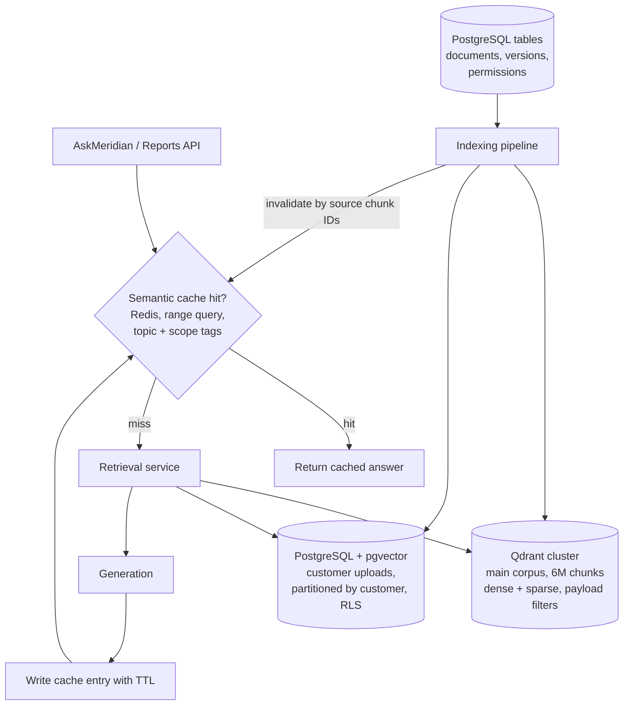

This assessment covers the whole Vector Database Ecosystem module: the FAISS library, the embedded and dedicated databases (ChromaDB, Qdrant, Weaviate, Milvus), the managed service (Pinecone) and the vector features of databases you may already run (PostgreSQL with pgvector, Elasticsearch, OpenSearch and Redis). It tests whether you can predict how each system behaves, read and write code against it, and choose between them for a real workload. The pass mark is 70% on the quiz; the written sections have model answers to compare against, and the coding solutions were run and their output is shown.

```quiz
[
  {
    "q": "What does this FAISS code print?\n```python\nimport numpy as np, faiss\nindex = faiss.IndexFlatL2(2)\nindex.add(np.array([[0, 0], [3, 4]], dtype='float32'))\nD, I = index.search(np.array([[0, 0]], dtype='float32'), 2)\nprint(D, I)\n```",
    "options": [
      "[[0. 5.]] [[0 1]]",
      "[[0. 25.]] [[0 1]]",
      "[[25. 0.]] [[1 0]]",
      "[[1. 0.]] [[0 1]]"
    ],
    "answer": 1,
    "why": "IndexFlatL2 returns squared Euclidean distances: 3 squared plus 4 squared is 25, not 5. Results are sorted nearest first."
  },
  {
    "q": "Which responsibility does FAISS leave entirely to you?",
    "options": [
      "Building an HNSW graph",
      "Searching with inner product",
      "Storing metadata and enforcing permissions alongside each vector",
      "Training IVF centroids"
    ],
    "answer": 2,
    "why": "FAISS is a library of indexes keyed by 64-bit integer ids. Payloads, durability, concurrency and access control are the application's job."
  },
  {
    "q": "A Chroma collection was created without specifying a distance space. A query returns 0.31 for the best match. What is that number?",
    "options": [
      "A squared L2 distance, where smaller is closer",
      "A cosine similarity, where larger is closer",
      "A probability of relevance",
      "A BM25 score"
    ],
    "answer": 0,
    "why": "Chroma's default space is l2 and it always returns distances, so smaller values are closer."
  },
  {
    "q": "Four worker processes behind a web server each open the same embedded Chroma directory and write to it. What is the right fix?",
    "options": [
      "Give each worker a different collection name",
      "Switch the distance space to cosine",
      "Add a file lock around every query",
      "Run Chroma as a server (or use another client-server database) and connect all workers to it"
    ],
    "answer": 3,
    "why": "Embedded mode is designed for a single process. Multiple writers need a server that owns the data."
  },
  {
    "q": "Why should Qdrant payload indexes for filter fields be created before a bulk load rather than after?",
    "options": [
      "Qdrant rejects writes to fields without an index",
      "The HNSW graph can then be built with filter-aware links for those fields",
      "Payload indexes cannot be created on non-empty collections",
      "It halves the memory used by vectors"
    ],
    "answer": 1,
    "why": "Qdrant can add extra graph links that keep filtered subgraphs connected, but only for payload indexes that exist when the graph is built."
  },
  {
    "q": "In Weaviate's hybrid search with the default relative score fusion, what does alpha = 1 mean?",
    "options": [
      "Pure vector search",
      "Pure BM25 search",
      "Equal weight to both sides",
      "Reciprocal Rank Fusion with constant 1"
    ],
    "answer": 0,
    "why": "alpha weights the vector side: 1 is vector only, 0 is keyword only, values between blend the min-max normalised scores."
  },
  {
    "q": "A Milvus RAG service inserts a chunk and immediately searches for it, but it is not found. The collection is loaded. What is the most likely explanation?",
    "options": [
      "Milvus only searches sealed segments",
      "The primary key was duplicated",
      "The search ran at the default Bounded consistency level, which may not yet include the most recent writes",
      "The index type does not support inserts"
    ],
    "answer": 2,
    "why": "Bounded consistency trades a short staleness window for speed. Request Strong (or Session for the writing client) when a search must see a write just made."
  },
  {
    "q": "A pipeline re-ingests a document into Milvus with insert, using the same primary keys as before. What happens?",
    "options": [
      "The old entities are overwritten",
      "The insert fails with a duplicate-key error",
      "Milvus merges the vectors by averaging",
      "Duplicate entities with the same key can exist; upsert should have been used"
    ],
    "answer": 3,
    "why": "Milvus insert does not enforce primary-key uniqueness. Re-ingestion must use upsert or delete first."
  },
  {
    "q": "A Pinecone hybrid query uses alpha = 0.5. A chunk has cosine 0.5 and sparse (BM25-style) score 4.5. What fraction of its hybrid score comes from the dense side?",
    "options": [
      "10%",
      "50%",
      "90%",
      "25%"
    ],
    "answer": 0,
    "why": "Dense part 0.5 x 0.5 = 0.25; sparse part 0.5 x 4.5 = 2.25; total 2.5. The dense side contributes 0.25 / 2.5 = 10%."
  },
  {
    "q": "A SaaS product stores each customer's chunks in one Pinecone namespace with a customer_id metadata filter. What is the main argument for one namespace per customer instead?",
    "options": [
      "Metadata filters are not supported on serverless indexes",
      "Each query is confined to one customer's data structurally, and query cost tracks that customer's data size",
      "Namespaces allow different dimensions per customer",
      "Namespaces make writes strongly consistent"
    ],
    "answer": 1,
    "why": "A namespace partitions the index, so a filter bug cannot leak data and each query only pays to search one tenant."
  },
  {
    "q": "Which pgvector query can use an HNSW index built with vector_cosine_ops?",
    "options": [
      "SELECT id FROM chunks ORDER BY 1 - (embedding <=> $1) DESC LIMIT 5",
      "SELECT id FROM chunks ORDER BY embedding <-> $1 LIMIT 5",
      "SELECT id FROM chunks ORDER BY embedding <=> $1 LIMIT 5",
      "SELECT id FROM chunks WHERE embedding <=> $1 < 0.3"
    ],
    "answer": 2,
    "why": "The index serves ORDER BY on the matching operator, ascending, with a LIMIT. The other forms use a different operator, an expression, or no ordering."
  },
  {
    "q": "pgvector 0.7, hnsw.ef_search = 40, no iterative scans. A WHERE clause keeps 10% of rows. Roughly how many rows does ORDER BY ... LIMIT 10 return on average?",
    "options": [
      "10",
      "About 4",
      "About 1",
      "0, always"
    ],
    "answer": 1,
    "why": "The index scan offers about 40 candidates and about 10% pass the filter: roughly 4 rows. Iterative scans in pgvector 0.8 fix this."
  },
  {
    "q": "In an Elasticsearch kNN search, which parameter should you raise to improve recall without changing how many hits are returned?",
    "options": [
      "k",
      "size",
      "rank_constant",
      "num_candidates"
    ],
    "answer": 3,
    "why": "num_candidates is the search breadth of each segment's HNSW search; k is the number of results."
  },
  {
    "q": "An Elasticsearch request contains a BM25 match query and a knn clause with default boosts. Evaluation shows the result is nearly identical to BM25 alone. Why?",
    "options": [
      "The two scores are summed, and BM25 scores span a much wider range than kNN scores in 0 to 1",
      "Elasticsearch ignores knn when a query is present",
      "The kNN clause runs as a post_filter",
      "BM25 is applied after kNN and replaces its scores"
    ],
    "answer": 0,
    "why": "Score addition mixes scales. The kNN contribution varies by a fraction of a point; BM25 by several points. RRF or tuned boosts are needed."
  },
  {
    "q": "An OpenSearch k-NN query on a 4-shard index sets k = 5 and size = 100. What is the maximum number of hits?",
    "options": [
      "5",
      "100",
      "20",
      "4"
    ],
    "answer": 2,
    "why": "In OpenSearch, k is per graph search; each shard can contribute up to 5, giving up to 20, within size 100."
  },
  {
    "q": "What does this Python fusion code print?\n```python\ndef rrf(*lists, k=60):\n    s = {}\n    for l in lists:\n        for r, d in enumerate(l, 1):\n            s[d] = s.get(d, 0) + 1 / (k + r)\n    return sorted(s, key=s.get, reverse=True)\nprint(rrf(['a', 'b', 'c'], ['c', 'b', 'd']))\n```",
    "options": [
      "['a', 'c', 'b', 'd']",
      "['b', 'c', 'a', 'd']",
      "['a', 'b', 'c', 'd']",
      "['c', 'b', 'a', 'd']"
    ],
    "answer": 3,
    "why": "c scores 1/63 + 1/61, b scores 1/62 + 1/62, a 1/61, d 1/63. c narrowly beats b (0.03227 against 0.03226), then a, then d."
  },
  {
    "q": "After loading 50,000 hashes into Redis, FT.INFO reports 1,200 hash indexing failures. What is the most likely cause?",
    "options": [
      "The HNSW M parameter is too small",
      "Some vectors were written as float64 bytes or with the wrong dimension for the FLOAT32 field",
      "DIALECT 2 was not set on the queries",
      "The keys have TTLs"
    ],
    "answer": 1,
    "why": "Hash vector fields must hold raw bytes of the declared type and size. Mismatched values are not indexed and are counted as failures."
  },
  {
    "q": "A team already runs PostgreSQL, has 1.5 million chunks, needs document permissions enforced in the database, and has no one to operate a new service. Which store is the most reasonable starting point?",
    "options": [
      "pgvector in the existing PostgreSQL, with row-level security and iterative scans",
      "A self-hosted Milvus Distributed cluster",
      "FAISS loaded from a file in each web worker",
      "Redis, because it is fastest"
    ],
    "answer": 0,
    "why": "The corpus is well within pgvector's comfortable range, permissions live beside the data, and no new system needs operating."
  },
  {
    "q": "Which statement about these systems' cosine scores is correct?",
    "options": [
      "All of them return cosine similarity, larger is better",
      "Chroma, Redis and pgvector's <=> report cosine distance, while Qdrant reports cosine similarity",
      "Elasticsearch reports raw cosine similarity in -1 to 1",
      "Pinecone reports cosine distance"
    ],
    "answer": 1,
    "why": "Conventions differ: distances (1 - cos) in Chroma, Redis and pgvector; similarity in Qdrant and Pinecone; (1 + cos) / 2 in Elasticsearch and OpenSearch."
  }
]
```

## Conceptual questions

**1.** The module grouped products into libraries, dedicated databases, managed services and extensions to existing databases. Explain, with one example each, what responsibilities you take on in each category.

<details><summary>Show model answer</summary>

A **library** (FAISS) gives you index structures and search. You own everything else: storing metadata beside the integer ids, translating filters into id selectors, persisting files safely, handling concurrent writes, serving over a network, and access control. It is ideal for offline evaluation and static indexes.

A **dedicated database** (Qdrant, Weaviate, Milvus; Chroma for smaller deployments) stores vectors with payloads, filters during search, accepts updates while serving, persists with a write-ahead log and offers replication or sharding. You operate it: capacity, upgrades, backups, monitoring.

A **managed service** (Pinecone) removes operation. You still own the data model (indexes, namespaces, IDs), consistency assumptions (eventual visibility), cost design and the vendor and data-residency decision.

An **extension** (pgvector, Elasticsearch, OpenSearch, Redis) puts vectors inside a system you already run, inheriting its persistence, security and operations, and its constraints: pgvector's post-filtering without iterative scans, Elasticsearch's per-segment search, Redis's RAM cost.

</details>

**2.** Several systems in this module filter "inside" the vector search, and pgvector before 0.8 effectively filtered "after" it. Explain the difference and why a database might still switch to exact search for a very selective filter.

<details><summary>Show model answer</summary>

Post-filtering takes a fixed number of approximate nearest candidates, then removes those that fail the filter; with selectivity $p$ and $e$ candidates, about $pe$ survive, so selective filters return fewer than $k$ results, or none. In-search filtering (Qdrant, Weaviate, Lucene in Elasticsearch and OpenSearch, Redis, Pinecone) only collects matching points while walking the index, so it returns $k$ when $k$ matches exist.

But walking an HNSW graph while skipping most nodes is inefficient when few nodes match: the search visits many non-matching nodes, and the matching ones may be poorly connected among themselves. When the matching set is small, computing exact distances for just those points is cheaper and perfectly accurate. That is why Qdrant's planner, Lucene and Redis's ad hoc brute-force policy switch to exact scoring below a selectivity threshold. Coding exercise 2 measures this.

</details>

**3.** Three systems in the module normalise hybrid scores by min-max (Weaviate's relative score fusion, OpenSearch's normalisation processor) and others use RRF or raw sums. What property of min-max makes rankings depend on retrieval depth, and how would you guard against it in production?

<details><summary>Show model answer</summary>

Min-max maps each list's lowest returned score to 0 and highest to 1. The lowest returned score depends on how many results each sub-query returned, so changing the depth (a page size, `k`, a limit) shifts every normalised score and can reorder documents whose raw scores did not change. Guards: fix the retrieval depth for fusion independently of what is displayed (retrieve 20 or 50, show 5); tune weights or `alpha` at that depth on a labelled query set; and compare against RRF, which depends only on ranks and so does not change existing scores when lists get deeper.

</details>

**4.** Elasticsearch and Milvus both store data in segments. Explain one way segments affect search quality or cost in each, and one operational action that addresses it.

<details><summary>Show model answer</summary>

In **Elasticsearch**, each segment has its own HNSW graph and a kNN search runs one graph search per segment with breadth `num_candidates`. Many small segments raise recall per search but multiply work; for the same total work a single large graph is more efficient. Action: force-merge indexes that no longer change, and raise the refresh interval during bulk loads.

In **Milvus**, inserts land in growing segments that are searched without the final index until they are sealed and indexed, and deletes are logical until compaction. Fresh data is therefore searched less efficiently, and deleted entities still cost space and work. Action: let sealing and index building complete after bulk loads (or flush explicitly where appropriate) and monitor compaction; choose the consistency level deliberately.

</details>

**5.** When is Redis the right place for vectors in a RAG system, and when is it the wrong one? Use the memory arithmetic from the Redis lesson.

<details><summary>Show model answer</summary>

Redis keeps everything in RAM, holding a copy of each vector in the hash and another in the index, plus graph links and document data. One million 384-dimension chunks need around 4 GB per copy of the dataset, and a million 1,536-dimension chunks around 13 GB, before replicas and snapshot headroom. That is expensive for a large, slowly changing corpus that a disk-friendly store would hold more cheaply.

Redis is right for small, hot, short-lived vector sets: a semantic cache (tens of thousands of entries, a fraction of a gigabyte), session documents and conversation memory with TTLs, or small routing indexes, where sub-millisecond server time and automatic expiry matter and losing the data is harmless or recoverable.

</details>

## Coding exercises

**1. One similarity, seven conventions.** Write `to_cosine_similarity(engine, value)` that converts the value each system reports for a cosine-configured index into cosine similarity, for Qdrant, Pinecone, Chroma, Redis, pgvector (`<=>`), Elasticsearch and OpenSearch. Then express the rule "similarity at least 0.7" in Qdrant's, Chroma's and Elasticsearch's own units.

<details><summary>Show solution</summary>

```python
def to_cosine_similarity(engine, value):
    """Convert one engine's reported value for a cosine-configured index to cosine similarity."""
    if engine in ("qdrant", "pinecone"):           # report the similarity itself
        return value
    if engine in ("chroma", "redis", "pgvector"):  # report cosine distance, 1 - cos
        return 1 - value
    if engine in ("elasticsearch", "opensearch"):  # report (1 + cos) / 2
        return 2 * value - 1
    raise ValueError(f"unknown engine: {engine}")

reported = [("qdrant", 0.74), ("pinecone", 0.74), ("chroma", 0.26), ("redis", 0.26),
            ("pgvector", 0.26), ("elasticsearch", 0.87), ("opensearch", 0.87)]
for engine, value in reported:
    print(f"{engine:<14} reports {value:.2f} -> cosine similarity {to_cosine_similarity(engine, value):.2f}")

threshold = 0.7
print("\nA 'similarity >= 0.7' rule written in each engine's own units:")
for engine in ("qdrant", "chroma", "elasticsearch"):
    if engine == "qdrant":
        rule = f"score >= {threshold:.2f}"
    elif engine == "chroma":
        rule = f"distance <= {1 - threshold:.2f}"
    else:
        rule = f"_score >= {(1 + threshold) / 2:.2f}"
    print(f"  {engine:<14} {rule}")
```

```output
qdrant         reports 0.74 -> cosine similarity 0.74
pinecone       reports 0.74 -> cosine similarity 0.74
chroma         reports 0.26 -> cosine similarity 0.74
redis          reports 0.26 -> cosine similarity 0.74
pgvector       reports 0.26 -> cosine similarity 0.74
elasticsearch  reports 0.87 -> cosine similarity 0.74
opensearch     reports 0.87 -> cosine similarity 0.74

A 'similarity >= 0.7' rule written in each engine's own units:
  qdrant         score >= 0.70
  chroma         distance <= 0.30
  elasticsearch  _score >= 0.85
```

The same match is reported as 0.74, 0.26 or 0.87 depending on the engine. A threshold copied between systems without conversion is wrong in magnitude, and for distances wrong in direction. Put this conversion in one place when an application talks to more than one store or migrates between them.

</details>

**2. Post-filter, in-search filter or exact?** Using FAISS, build an HNSW index over 50,000 normalised vectors where each vector belongs to one of 50 tenants (about 2% each). For queries restricted to the querying user's tenant, compare: post-filtering 64 candidates; FAISS's in-search filter (`IDSelectorBatch` with `SearchParametersHNSW`) at `efSearch` 64 and 512; and exact scoring of only the tenant's rows. Report rows returned, recall@10 and distance computations per query.

<details><summary>Show solution</summary>

```python
import numpy as np
import faiss

faiss.omp_set_num_threads(1)
rng = np.random.default_rng(3)
N, DIM, K = 50_000, 64, 10
X = rng.normal(size=(N, DIM)).astype("float32")
X += np.repeat(rng.normal(size=(500, DIM)), N // 500, axis=0).astype("float32") * 2
faiss.normalize_L2(X)
tenant = rng.integers(0, 50, N)                  # 50 tenants, about 2% of rows each

index = faiss.IndexHNSWFlat(DIM, 32, faiss.METRIC_INNER_PRODUCT)
index.hnsw.efConstruction = 64
index.add(X)

def post_filter(q, t, ef=64):
    index.hnsw.efSearch = ef
    _, I = index.search(q[None, :], ef)          # ef candidates, then filter
    return [i for i in I[0] if tenant[i] == t][:K]

def in_search_filter(q, t, ef=64):
    sel = faiss.IDSelectorBatch(np.where(tenant == t)[0].astype("int64"))
    params = faiss.SearchParametersHNSW(sel=sel, efSearch=ef)
    _, I = index.search(q[None, :], K, params=params)
    return [i for i in I[0] if i >= 0]

def exact(q, t):
    rows = np.where(tenant == t)[0]              # the planner's fallback: score only matching rows
    return rows[np.argsort(-(X[rows] @ q))][:K]

qs = rng.choice(N, 300, replace=False)
methods = [("post-filter, ef=64", lambda q, t: post_filter(q, t, 64)),
           ("in-search, ef=64", lambda q, t: in_search_filter(q, t, 64)),
           ("in-search, ef=512", lambda q, t: in_search_filter(q, t, 512)),
           ("exact on subset", exact)]
for name, fn in methods:
    got, rec = [], []
    faiss.cvar.hnsw_stats.reset()
    for qi in qs:
        t = tenant[qi]                           # the user's own tenant
        res, truth = fn(X[qi], t), set(exact(X[qi], t))
        got.append(len(res)); rec.append(len(truth & set(res)) / K)
    ndis = faiss.cvar.hnsw_stats.ndis / len(qs)
    work = f"{ndis:7.0f}" if ndis else f"{(tenant == 0).sum():7d}*"
    print(f"{name:<20} rows {np.mean(got):5.2f}   recall@10 {np.mean(rec):.3f}   distances/query {work}")
print("* about one tenant's row count: exact scoring touches only matching rows")
```

```output
post-filter, ef=64   rows  2.13   recall@10 0.213   distances/query     522
in-search, ef=64     rows  8.54   recall@10 0.468   distances/query     522
in-search, ef=512    rows 10.00   recall@10 0.932   distances/query    3925
exact on subset      rows 10.00   recall@10 1.000   distances/query     969*
* about one tenant's row count: exact scoring touches only matching rows
```

Reading the results:

- **Post-filtering starves.** About 2% of 64 candidates match, plus the query's own point (each query is a stored vector in its own tenant), so about 2 rows come back.
- **In-search filtering returns more, but HNSW still struggles at 2%.** With the same 522 distance computations, FAISS keeps only matching results, but the search ends before it has found ten good matches; recall is 0.468. Raising `efSearch` to 512 recovers 0.932 recall at about 7.5 times the work.
- **Exact scoring of the subset wins here.** Scoring the roughly 1,000 rows of one tenant is exact and needs fewer distance computations than the wide graph search. This is the decision the query planners in Qdrant, Lucene and Redis make automatically, and the reason that per-tenant partitions (namespaces, partitions, tenant shards) are so effective.

`faiss.cvar.hnsw_stats.ndis` counts distance computations inside FAISS's HNSW search; the exact method's cost is the tenant's row count.

</details>

## Architecture design challenge

Meridian now wants three vector workloads, and the Platform team (four engineers) must choose where each lives:

1. **AskMeridian's main corpus**: the employee handbook, IT runbooks and product documentation, about 6 million chunks after adding the product docs, updated daily, with permissions by department and confidentiality. Currently on a Qdrant cluster.
2. **Customer document Q&A in Meridian Reports**: each of 400 customers uploads documents (from a few hundred to 300,000 chunks per customer); strict isolation between customers; some customers in regulated sectors.
3. **A semantic cache** in front of AskMeridian, to answer repeated questions (for example about the expenses deadline) without retrieval and generation.

Existing infrastructure: PostgreSQL (application data, including the document and permission tables), Redis (sessions), OpenSearch on a managed service (logs, run by the Security team), and the Qdrant cluster. Propose a design, with a diagram, and state the trade-offs.

<details><summary>Show reference design</summary>



**Main corpus: stay on Qdrant.** Six million chunks with daily updates and permission filters is the workload a dedicated database is built for: filter-aware HNSW with payload indexes for `department` and `confidentiality` created before loads, quantisation with rescoring to control memory, and hybrid dense-sparse retrieval. The team already operates it. Moving to pgvector would put 6 million vectors (about 9 GB at 384 dimensions in float32, more at larger dimensions) on the transactional database; moving to OpenSearch would mean depending on another team's cluster.

**Customer uploads: pgvector, partitioned by customer.** Isolation is the dominant requirement. Partitioning the chunk table by customer gives each partition its own HNSW index, every query names the partition key, and row-level security keyed on the authenticated customer is a database-enforced backstop. Data stays in Meridian's own PostgreSQL, which answers the regulated customers' residency questions without a new sub-processor. Deleting a customer's data is dropping a partition. Iterative scans cover any extra filters. Trade-off: very large customers (300,000 chunks) and growth in total volume will load the database; route retrieval to a read replica, and revisit if index memory or vacuum load becomes a problem. Alternatives: Qdrant collections or tenant-keyed shards (more operational coupling to the main cluster), or a managed service with a namespace per customer (operationally simplest, but adds a vendor and data-residency review for regulated customers).

**Semantic cache: Redis.** Tens of thousands of entries at 384 dimensions is a fraction of a gigabyte. Each entry is a hash with the question embedding, answer, source chunk IDs, a topic tag and the user's permission scope, with a TTL of hours. Lookups are range queries with a radius from a similarity threshold (for example 0.08 for similarity 0.92) plus required tags for topic and permission scope, so answers never cross permission boundaries. The indexing pipeline deletes entries whose source chunks change.

**What was rejected.** OpenSearch for any of the three: capable, but run by another team for a different purpose, and the main corpus's hybrid needs are already met. FAISS: no filtering, updates or access control for live workloads; keep it for offline evaluation and recall measurement.

**Trade-offs to state.** Three stores is more than one; the retrieval service must hide them behind one interface with one score convention (the cosine conversion from coding exercise 1). Costs to monitor: Qdrant memory as the corpus grows, PostgreSQL replica load from customer retrieval, and Redis memory and cache hit rate. Measure recall on labelled queries per workload, against exact search, before and after every major change.

</details>

## Troubleshooting scenarios

**1.** After a weekend bulk re-index of AskMeridian's main corpus into a new Qdrant collection, filtered queries for the small Legal department are much slower than before and sometimes return poor results, while unfiltered queries are fine. The new ingestion script creates the collection, uploads all points, then creates payload indexes for `department` and `confidentiality`.

<details><summary>Show diagnosis and fix</summary>

The payload indexes were created after the vectors were indexed, so the HNSW graph was built without the extra filter-aware links for those fields. Restrictive filters such as `department = legal` then walk a graph in which matching points are poorly connected, which is slow and loses recall; before the change, the indexes existed when the graph was built.

Fix: change the ingestion script to create payload indexes immediately after creating the collection and before uploading points, then rebuild the new collection (or trigger re-indexing per the Qdrant documentation for your version). Add a test that runs filtered evaluation queries for each department and checks latency and recall against exact search.

</details>

**2.** The Finance assistant on PostgreSQL with pgvector works for finance managers, but procurement staff frequently get "I don't know". Logs show their retrieval query returns 0 to 3 rows instead of the requested 8. Procurement can see about 3% of chunks. The database runs pgvector 0.8.

<details><summary>Show diagnosis and fix</summary>

This is post-filtering starvation. The HNSW index scan supplies `hnsw.ef_search` candidates (default 40), and the permission predicate (a `WHERE` clause or a row-level security policy) removes about 97% of them: $0.03 \times 40 = 1.2$ rows expected, with a high chance of none. Finance managers see most rows, so they are unaffected.

Fix: enable iterative scans for this query, `SET LOCAL hnsw.iterative_scan = relaxed_order` (or `strict_order`), with `hnsw.max_scan_tuples` bounding the worst case, and re-sort in an outer query if using relaxed order. If procurement's slice is fixed and heavily used, a partial index on it is another option. Add a test that runs the evaluation queries as a user from each role and asserts that every query returns the full `LIMIT`.

</details>

**3.** A new semantic cache in Redis has a 0% hit rate in production, although testers repeatedly ask identical questions. `FT.SEARCH` returns no errors. `FT.INFO` shows `num_docs: 0` and a growing `hash_indexing_failures`. The cache writer builds embeddings with `np.array(embedding_list)` and stores them with `.tobytes()`.

<details><summary>Show diagnosis and fix</summary>

`np.array` on a Python list of floats creates a `float64` array, so `.tobytes()` produces 8 bytes per dimension: 3,072 bytes for 384 dimensions, while the index declares `TYPE FLOAT32 DIM 384` and expects 1,536. Redis cannot index those hashes, records them as indexing failures, and the index stays empty, so every range query correctly finds nothing.

Fix: encode with one helper, `np.asarray(v, dtype=np.float32).tobytes()`, for both stored entries and query vectors (a wrongly sized query vector would make the query fail outright), and re-write the existing entries or let them expire. Add a startup or deployment check that writes a probe entry and asserts it appears in `num_docs`, and alert on any increase in `hash_indexing_failures`.

</details>
