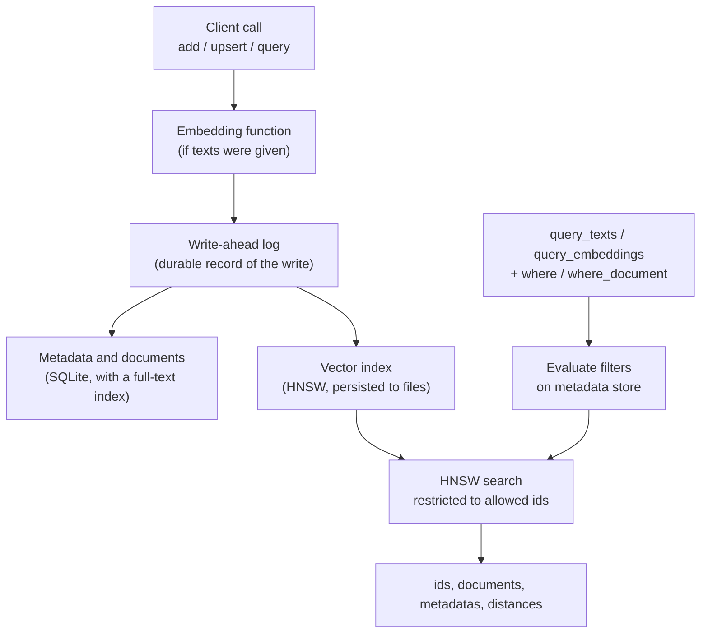

Chroma (the Python package is `chromadb`) is an open-source vector database designed around one goal: make the first working retrieval system take minutes, not days. You hand it text, it embeds the text for you, stores the vectors, the original documents and their metadata together, and answers similarity queries with optional filters. It runs inside your Python process, as a small server, or as a hosted service, with the same API in each case.

That convenience is the reason Chroma appears in so many tutorials and prototypes, and it is also where its traps lie. This lesson explains Chroma's data model and client modes, what happens on a write and a query, how its distance values should be read, and the decisions you must make deliberately (embedding function, distance space, deployment mode) instead of accepting defaults. It assumes you have read the [FAISS](/learn/vector-database-ecosystem/faiss) lesson, which covered the bare index; Chroma is what you get when the bookkeeping FAISS leaves to you is built in.

## Learning objectives

- Choose between Chroma's in-memory, persistent, client-server and hosted modes for a given deployment, and explain what each guarantees.
- Create a collection with an explicit embedding function and distance space, and add, upsert, query, update and delete records with string ids.
- Write `where` and `where_document` filters, including combined conditions with `$and` and `$or`.
- Convert Chroma's `l2`, `ip` and `cosine` distances into similarities, and predict how each behaves on unnormalised vectors.
- Identify the conditions under which a team should move from Chroma to a different database.

## Prerequisites

- [What is a vector database?](/learn/vector-database-fundamentals/what-is-a-vector-database): collections, points and payloads.
- [Metadata](/learn/vector-database-fundamentals/metadata) and [Filtering](/learn/vector-database-fundamentals/filtering): why records carry structured fields and how filters combine with search.
- [FAISS](/learn/vector-database-ecosystem/faiss): the index layer, and the jobs a library leaves to you.
- [Euclidean distance](/learn/embedding-mathematics/euclidean-distance) and [Cosine similarity](/learn/embedding-mathematics/cosine-similarity).

## Why this matters

Most RAG projects start with a question like "can we answer questions over these documents at all?". At that stage the fastest path to an answer wins, and Chroma is built to be that path: `pip install chromadb`, three calls, and you are retrieving. Teams that start with heavyweight infrastructure often spend their first fortnight on deployment rather than on chunking and evaluation, which is where the quality comes from.

The danger is that convenient defaults make decisions on your behalf. A collection created without an embedding function silently uses Chroma's default model. A collection created without a distance setting uses squared Euclidean distance, and the numbers it returns are distances (smaller is better), which code written for similarities ranks backwards. A persistent client opened by four web-server worker processes against the same directory is not a supported deployment. None of these produce an error on day one. They produce subtly wrong retrieval, or corruption, weeks later.

Understanding what Chroma does underneath lets you keep the speed of the prototype while making the few decisions that matter explicitly, and lets you recognise when the workload has outgrown it.

## The intuition

Picture a filing cabinet that comes with its own librarian. With FAISS you bring pre-measured coordinates for every card and keep the meaning of each card in your own notebook. With Chroma you hand the librarian the actual pages. She reads each one (embeds it), files the page, its coordinates and a label with any tags you supplied, all in the same drawer, under the name you chose for it.

When you ask a question, she reads the question the same way she read the pages, finds the closest pages, and hands back the pages themselves, their tags and how far each was from the question. You never touch a coordinate unless you want to.

The catch is in "the same way". If one day you hire a different librarian who measures differently, and nobody tells you, every distance she reports compares her measurement of your question with the old librarian's measurement of the pages. The answers still arrive, neatly formatted, and they are nonsense. Most of the care Chroma requires is about keeping the librarian, and the ruler she uses, the same.

## How it works

### The data model

A Chroma **collection** is a named set of **records**. Each record has:

| Field | Type | Notes |
| --- | --- | --- |
| `id` | string | Required, unique within the collection. Unlike Qdrant or FAISS, any string works, so `handbook#leave#0` is a valid id. |
| `embedding` | list of floats | Supplied by you, or computed by the collection's embedding function. |
| `document` | string | Optional original text, stored alongside the vector. |
| `metadata` | dict | Optional flat key-value pairs. Values are strings, numbers or booleans; nested objects are not supported. |

Every operation is batch-shaped: you pass parallel lists (`ids=[...]`, `documents=[...]`, `metadatas=[...]`), and results come back as lists. Query results add one more level, one list per query text, which is why code reads `results["documents"][0]`.

String ids matter more than they look. A stable id derived from the source (document id plus chunk position) is what makes re-ingestion safe, and Chroma lets you use that id directly instead of maintaining a separate mapping, as you had to with FAISS's integer ids.

### Embedding functions

A collection can be created with an **embedding function**: an object that turns a list of strings into a list of vectors. When you call `add(documents=...)` without `embeddings`, or `query(query_texts=...)`, Chroma calls it for you. Chroma ships wrappers for local Sentence Transformers models and for several hosted embedding APIs. If you specify none, it uses a default: `all-MiniLM-L6-v2`, run through ONNX Runtime and downloaded on first use.

You can also skip embedding functions entirely and pass `embeddings=` on writes and `query_embeddings=` on queries. That is the right choice when embedding happens in a separate pipeline stage, such as a batch job on a GPU.

> [!WARNING]
> The embedding function used for queries must be the one that produced the stored vectors. Recent Chroma versions persist the embedding function's configuration with the collection and warn about conflicts, but older versions did not: `get_collection("x")` without an `embedding_function` argument silently fell back to the default model. Always pass the function explicitly, and name collections after the model (`handbook_minilm_v1`).

### Client modes

The same `Collection` API sits behind four ways of running Chroma:

| Mode | How to create it | Data lives | Use it for |
| --- | --- | --- | --- |
| In-memory | `chromadb.EphemeralClient()` | Process memory; gone on exit | Tests, notebooks |
| Persistent (embedded) | `chromadb.PersistentClient(path="./db")` | A local directory | Single-process apps, prototypes |
| Client-server | `chroma run --path ./db`, then `chromadb.HttpClient(host=..., port=8000)` | The server's directory | Several processes or machines sharing one store |
| Hosted | Chroma Cloud, via `chromadb.CloudClient(...)` | The vendor's infrastructure | Teams that do not want to operate it |

The important boundary is between the embedded modes and the rest. An embedded client runs the database inside your process. It is designed for **one process** using a directory; several processes (for example several Gunicorn or Uvicorn workers) each opening a `PersistentClient` on the same path is not a supported pattern. As soon as more than one process needs the data, run the server and connect with `HttpClient`. The application code barely changes, because the collection methods are identical.

### Inside a single-node Chroma



The exact storage engine has changed between major versions (Chroma 1.0 moved much of the core from Python to Rust), so treat the details below as the shape of the design rather than a specification:

1. **Write.** If you passed texts, the embedding function turns them into vectors. The write is appended to a **write-ahead log** (a durable record of the operation) before it is acknowledged, so a crash after acknowledgement does not lose it.
2. **Metadata and documents** go into a SQLite database, including a full-text index over the documents that serves `where_document` conditions.
3. **Vectors** are added to an **HNSW** graph index. New vectors may first sit in a small brute-force buffer and be added to the graph in batches; the batch and sync sizes are configurable in the HNSW settings.
4. **Query.** If you passed texts, they are embedded. Any `where` or `where_document` filter is evaluated against the metadata store to produce allowed ids.
5. The HNSW index is searched for the nearest neighbours among allowed ids, and the matching documents, metadata and distances are fetched and returned.

Because filters are evaluated first and the search then respects them, you get the top `n_results` among matching records rather than a post-filtered shortlist. The trade-off is the one [Filtering](/learn/vector-database-fundamentals/filtering) describes for any graph index: very selective filters make the graph walk work harder.

### Distance spaces

Each collection has one **distance space**, chosen at creation and fixed afterwards:

- `l2` (the default): **squared** Euclidean distance.
- `ip`: one minus the inner product.
- `cosine`: one minus the cosine similarity.

All three are distances: **smaller means closer**. The mathematics section computes each on real embeddings and shows how they differ when vectors are not unit length. For text embeddings, `cosine` is the safe choice unless you know your model's vectors are normalised and you specifically want `ip`.

### Filters

`where` filters on metadata; `where_document` filters on the document text. The operators:

| Kind | Operators |
| --- | --- |
| Comparison (metadata) | `$eq`, `$ne`, `$gt`, `$gte`, `$lt`, `$lte` |
| Membership (metadata) | `$in`, `$nin` |
| Logical | `$and`, `$or` (each takes a list of conditions) |
| Document text | `$contains`, `$not_contains` (newer versions add regular-expression matching) |

`{"source": "handbook"}` is shorthand for `{"source": {"$eq": "handbook"}}`. A `where` dictionary must contain **one** top-level condition: to require two, wrap them in `$and`. `where_document={"$contains": "E-4021"}` is a literal substring match on the stored text, which is exactly the kind of exact-token condition that embeddings handle poorly, as [Query-document matching](/learn/rag-architecture-fundamentals/query-document-matching) showed. It is a filter, not a ranking: matching documents are still ordered by vector distance.

## The mathematics

Chroma reports distances, and the three spaces turn the same pair of vectors into different numbers. Knowing the formulas lets you convert them into similarities for logging, thresholds or fusion, and predict when the spaces disagree.

**Intuition.** Squared Euclidean distance cares about both direction and length. Inner product rewards vectors that point the same way *and* are long. Cosine cares only about direction.

$$
d_{\text{l2}}(\mathbf{q}, \mathbf{x}) = \sum_{i=1}^{n} (q_i - x_i)^2, \qquad
d_{\text{ip}}(\mathbf{q}, \mathbf{x}) = 1 - \mathbf{q}\cdot\mathbf{x}, \qquad
d_{\text{cos}}(\mathbf{q}, \mathbf{x}) = 1 - \frac{\mathbf{q}\cdot\mathbf{x}}{\lVert\mathbf{q}\rVert\,\lVert\mathbf{x}\rVert}
$$

Here $\mathbf{q}$ is the query vector, $\mathbf{x}$ a stored vector, $n$ the number of dimensions, $q_i$ and $x_i$ their components, $\mathbf{q}\cdot\mathbf{x}$ the inner product and $\lVert\cdot\rVert$ the Euclidean length. When both vectors have length 1, $d_{\text{ip}} = d_{\text{cos}}$ and $d_{\text{l2}} = 2\,d_{\text{cos}}$, so all three rank identically; the similarity is $1 - d_{\text{cos}}$, or $1 - d_{\text{l2}}/2$.

**Worked example.** Let $\mathbf{q} = (0.6, 0.8)$ and $\mathbf{x} = (0.8, 0.6)$, both of length 1. The inner product is $0.48 + 0.48 = 0.96$. So $d_{\text{ip}} = d_{\text{cos}} = 0.04$, and $d_{\text{l2}} = (0.6-0.8)^2 + (0.8-0.6)^2 = 0.04 + 0.04 = 0.08 = 2 \times 0.04$. Now double $\mathbf{x}$ to $(1.6, 1.2)$. The cosine is unchanged, so $d_{\text{cos}} = 0.04$. But $d_{\text{ip}} = 1 - 1.92 = -0.92$, now "closer than identical", and $d_{\text{l2}} = 1^2 + 0.4^2 = 1.16$, much further away. Length changed nothing about meaning, yet two of the three spaces changed their verdict sharply.

The script below computes all three distances, exactly as Chroma defines them, for a Meridian query against three real MiniLM embeddings, and then repeats the experiment after artificially lengthening one stored vector.

```python
import numpy as np
from sentence_transformers import SentenceTransformer

docs = [
    "Employees receive 25 days of annual leave per year.",
    "Passwords must be rotated every 90 days.",
    "Always connect to the VPN when using public Wi-Fi.",
]
model = SentenceTransformer("sentence-transformers/all-MiniLM-L6-v2")
D = model.encode(docs)                       # NOT normalised, to show the difference
q = model.encode(["how many holiday days do I get?"])[0]
print("vector lengths:", np.round(np.linalg.norm(D, axis=1), 3), "query:", round(float(np.linalg.norm(q)), 3))

def chroma_distances(space, q, D):
    if space == "l2":       # squared Euclidean distance
        return ((D - q) ** 2).sum(axis=1)
    if space == "ip":       # 1 - inner product
        return 1 - D @ q
    if space == "cosine":   # 1 - cosine similarity
        return 1 - (D @ q) / (np.linalg.norm(D, axis=1) * np.linalg.norm(q))

for space in ("l2", "ip", "cosine"):
    dist = chroma_distances(space, q, D)
    order = np.argsort(dist)
    print(f"{space:6s}", "  ".join(f"[{i}] {dist[i]:.3f}" for i in order))

# MiniLM happens to output unit-length vectors; scale one to see what each space does.
D_scaled = D.copy()
D_scaled[1] *= 3                              # pretend one vector came out 3x longer
print("\nafter making doc [1] three times longer:")
for space in ("l2", "ip", "cosine"):
    dist = chroma_distances(space, q, D_scaled)
    order = np.argsort(dist)
    print(f"{space:6s}", "  ".join(f"[{i}] {dist[i]:.3f}" for i in order))
```

```output
vector lengths: [1. 1. 1.] query: 1.0
l2     [0] 1.103  [1] 1.494  [2] 2.150
ip     [0] 0.551  [1] 0.747  [2] 1.075
cosine [0] 0.551  [1] 0.747  [2] 1.075

after making doc [1] three times longer:
l2     [0] 1.103  [2] 2.150  [1] 8.482
ip     [1] 0.241  [0] 0.551  [2] 1.075
cosine [0] 0.551  [1] 0.747  [2] 1.075
```

**Reading it.** This MiniLM checkpoint already outputs unit-length vectors (its pipeline ends in a normalisation layer), so in the first block the three spaces agree on the order, and `l2` is exactly twice `cosine` up to rounding: $2 \times 0.551 = 1.102$. The best match has cosine similarity $1 - 0.551 = 0.449$. After lengthening the password chunk, `ip` ranks it *first* for a holiday question, `l2` pushes it to last, and `cosine` is unmoved. Not every embedding model normalises its output, and vectors from older pipelines or other sources may not be unit length, which is why `cosine` is the robust default for text.

## In code

### A Meridian collection in Chroma

**The problem.** Build a persistent Chroma collection for a slice of AskMeridian's content, with an explicit embedding model and distance space, stable string ids and filterable metadata; then query it with metadata and document filters and keep it up to date.

**Dependencies.**

```bash
pip install chromadb sentence-transformers
```

> [!NOTE]
> This example was **not executed** for this lesson: the Chroma package available in the course sandbox is an old release that fails to import. It is written against the current documented `chromadb` API (1.x). The output shown is illustrative, and your distances will differ slightly. The runnable script in the mathematics section reproduces the distance arithmetic Chroma performs.

```python
import chromadb
from chromadb.utils import embedding_functions

client = chromadb.PersistentClient(path="./chroma_meridian")

minilm = embedding_functions.SentenceTransformerEmbeddingFunction(
    model_name="sentence-transformers/all-MiniLM-L6-v2"
)

collection = client.get_or_create_collection(
    name="askmeridian_minilm_v1",
    embedding_function=minilm,
    configuration={"hnsw": {"space": "cosine"}},   # Chroma 1.x; see the note below
)

chunks = [
    ("handbook#leave#0", "Employees receive 25 days of annual leave per year.",
     {"source": "handbook", "owner": "HR", "year": 2025}),
    ("handbook#leave#1", "Up to 5 unused leave days carry over and must be used by 31 March.",
     {"source": "handbook", "owner": "HR", "year": 2025}),
    ("handbook#remote#0", "Staff may work remotely up to 3 days a week; the home-office budget is 400 pounds.",
     {"source": "handbook", "owner": "HR", "year": 2025}),
    ("runbook#vpn#0", "Always connect to the VPN when using public Wi-Fi.",
     {"source": "it-runbook", "owner": "IT", "year": 2025}),
    ("runbook#atlas#0", "Atlas error E-4021 means the VPN client is out of date; update it from the IT portal.",
     {"source": "it-runbook", "owner": "IT", "year": 2025}),
    ("runbook#laptop#0", "Report a lost laptop to the support desk at once.",
     {"source": "it-runbook", "owner": "IT", "year": 2025}),
]

collection.upsert(                      # upsert: safe to re-run with the same ids
    ids=[c[0] for c in chunks],
    documents=[c[1] for c in chunks],
    metadatas=[c[2] for c in chunks],
)
print("records:", collection.count())

def ask(question, n=2, **filters):
    res = collection.query(query_texts=[question], n_results=n,
                           include=["documents", "metadatas", "distances"], **filters)
    print(f"\n{question}  {filters if filters else ''}")
    for i, doc, meta, dist in zip(res["ids"][0], res["documents"][0],
                                  res["metadatas"][0], res["distances"][0]):
        print(f"  {1 - dist:.3f}  {i:18s} [{meta['source']}] {doc}")

ask("how many holiday days do I get?")
ask("is cafe wifi safe to use?", where={"source": "it-runbook"})
ask("what does E-4021 mean?", where_document={"$contains": "E-4021"})
ask("remote work", where={"$and": [{"owner": "HR"}, {"year": {"$gte": 2025}}]})

# Keep it current: change one chunk's text, delete another.
collection.update(ids=["runbook#laptop#0"],
                  documents=["Report a lost laptop to the support desk at once, then change your password."])
collection.delete(ids=["handbook#leave#1"])
print("\nrecords after delete:", collection.count())
print(collection.get(ids=["runbook#laptop#0"], include=["documents"])["documents"])
```

Your exact numbers will differ; the output looks like this:

```output
records: 6

how many holiday days do I get?  
  0.47  handbook#leave#0   [handbook] Employees receive 25 days of annual leave per year.
  0.39  handbook#leave#1   [handbook] Up to 5 unused leave days carry over and must be used by 31 March.

is cafe wifi safe to use?  {'where': {'source': 'it-runbook'}}
  0.52  runbook#vpn#0      [it-runbook] Always connect to the VPN when using public Wi-Fi.
  0.12  runbook#atlas#0    [it-runbook] Atlas error E-4021 means the VPN client is out of date; update it from the IT portal.

what does E-4021 mean?  {'where_document': {'$contains': 'E-4021'}}
  0.40  runbook#atlas#0    [it-runbook] Atlas error E-4021 means the VPN client is out of date; update it from the IT portal.

remote work  {'where': {'$and': [{'owner': 'HR'}, {'year': {'$gte': 2025}}]}}
  0.58  handbook#remote#0  [handbook] Staff may work remotely up to 3 days a week; the home-office budget is 400 pounds.
  0.12  handbook#leave#0   [handbook] Employees receive 25 days of annual leave per year.

records after delete: 5
['Report a lost laptop to the support desk at once, then change your password.']
```

**The important lines.**

- `PersistentClient(path=...)` stores everything in that directory; re-running the script reopens the same data. For tests, `EphemeralClient()` gives the same API with nothing written.
- `embedding_function=minilm` pins the model explicitly instead of relying on the default. Because it is a Sentence Transformers wrapper, documents and queries are embedded in-process with the model you named.
- `configuration={"hnsw": {"space": "cosine"}}` sets the distance space. Releases before 1.0 set it through collection metadata instead, `metadata={"hnsw:space": "cosine"}`; check which form your installed version documents. Either way, the space cannot be changed after creation.
- `upsert` inserts new ids and overwrites existing ones, so re-running ingestion is idempotent. Plain `add` does not overwrite an existing id, so a corrected chunk added with `add` can leave the old text in place.
- `1 - dist` converts a cosine distance into a similarity for display. In the default `l2` space this conversion would be wrong.
- The `where_document={"$contains": "E-4021"}` query restricts candidates to records whose text contains that exact string, so a vector search for a code is guaranteed not to drift to a neighbouring code.
- `update` with new `documents` re-embeds them with the collection's embedding function; `delete` accepts ids, or a `where` filter to delete by metadata (for example every chunk of a withdrawn document).

**What the output means.** The holiday query finds the leave chunks with no shared keyword. The Wi-Fi query, restricted to the runbooks, finds the VPN rule first. The error-code query returns one record, because only one document contains the string; without the document filter, a semantic search for a code can return a chunk about a similar code. The `$and` filter combines an exact owner match with a numeric range. After the update and delete, `get` returns the new text, which shows that the old embedding was replaced, not merely the document string.

**Errors people commonly hit.**

- `ValueError` mentioning that `where` should have exactly one operator: `where={"owner": "HR", "year": 2025}` has two top-level keys. Wrap them in `$and`.
- A dimension-mismatch error on `add` or `query`: the collection was created with one embedding model and is being written or queried with another. Create a new collection; never mix.
- Rankings that look reversed: code sorts Chroma's distances descending as though they were similarities.
- Metadata rejected because a value is a nested dictionary or `None`. Flatten it, and omit absent fields rather than storing nulls.
- Very large `add` calls failing: the client enforces a maximum batch size. Split ingestion into batches of a few thousand records.

**Extending it.** Point the same code at a server by replacing the client line with `chromadb.HttpClient(host="localhost", port=8000)` after starting `chroma run --path ./chroma_meridian`. Add a `doc_id` metadata field and use `collection.delete(where={"doc_id": ...})` to remove all chunks of a document when it is withdrawn.

## A real-world example

Meridian's Developer Relations team wanted an assistant that answers customer questions about Meridian Reports (PDF and CSV export, SAML single sign-on on the Enterprise plan) from the public product documentation. AskMeridian's Qdrant cluster belongs to the Platform team and indexes internal content, so the DevRel engineers prototyped separately, with Chroma's `PersistentClient` inside a FastAPI app. In two days they had a working demo and, more importantly, an evaluation set of real customer questions, which let them spend the next week on chunking rather than infrastructure.

Their first production deployment went wrong in a way that took a week to understand. The app ran under four Uvicorn worker processes, each of which opened its own `PersistentClient` on the same directory. Reads mostly worked, but the nightly documentation sync, triggered through one worker, wrote to the store while the other processes held their own in-memory view of it. Some workers answered from stale data; after one restart the HNSW files and the metadata store disagreed and the collection had to be rebuilt. Nothing in the API had prevented any of it, because embedded mode assumes one process.

The fix was the one the documentation recommends: run `chroma run` as its own service with a persistent volume, and switch the app to `HttpClient`. The application diff was one line. They also renamed the collection to include the embedding model, and added `upsert` with ids of the form `reports-docs/<page>#<chunk>` so that the nightly sync replaced changed chunks instead of appending duplicates. Six months later, with a few hundred thousand chunks and one replica, Chroma is still the right size of tool for this workload. The team wrote down the conditions under which they would revisit: a need for high availability across zones, multi-tenant isolation between customers, or hybrid keyword and vector ranking in one query.

## Common mistakes

- **Relying on the default embedding function.** A collection silently embedded with the default model, then queried from another service that embeds with a different model, returns confident nonsense. Pass the function explicitly everywhere.
- **Leaving the distance space at the default and treating results as similarities.** The default is squared L2, and every space returns distances where smaller is better.
- **Sharing a `PersistentClient` directory across processes.** Embedded mode is single-process. Use the server.
- **Using `add` to correct chunks.** It does not overwrite existing ids; use `upsert` or `update`.
- **Generating random ids (UUIDs) per ingestion run.** Every re-run duplicates the corpus. Derive ids from source and position.
- **Two top-level keys in `where`.** Combine conditions with `$and` or `$or`.
- **Treating `where_document` as keyword ranking.** It is a filter; it does not rank by term importance the way [BM25](/learn/sparse-retrieval/bm25) does.

## Best practices

- Decide the embedding model and distance space before the first write, and encode the model in the collection name.
- Use `upsert` with deterministic ids for all ingestion, and delete by a `doc_id` metadata field when a source document is removed.
- Keep metadata flat and typed consistently (a `year` that is sometimes `2025` and sometimes `"2025"` will not match range filters reliably).
- Use `EphemeralClient` in unit tests and the same collection code against `HttpClient` in staging and production.
- Pin the `chromadb` version in your dependencies; on-disk formats and configuration options have changed between major versions, so upgrade deliberately and test migration on a copy.
- Back up the persistent directory by stopping writes and copying it, or by rebuilding from source documents, and test the restore.

## Performance considerations

**Memory.** Chroma's HNSW index serves queries from memory, so the vectors and graph for each loaded collection must fit in RAM: about $4d$ bytes per vector for the float32 data, plus the graph's neighbour lists. At 384 dimensions, one million chunks need roughly 1.5 GB for vectors before the graph, documents and SQLite caches. Documents stored alongside the vectors add their text size on disk.

**Embedding cost dominates ingestion.** When Chroma embeds documents for you, ingestion speed is the embedding model's speed. A CPU-bound Sentence Transformers model embeds perhaps hundreds of short chunks per second, so a million chunks is hours on a laptop CPU regardless of how fast the database is. For large corpora, embed in a separate batch job (on a GPU if possible) and pass `embeddings=` directly.

**Batching writes.** Each `add` or `upsert` call has fixed overhead (a transaction, a log append). Writing records one at a time is far slower than batches of hundreds to a few thousand.

**Scale ceiling.** A single-node Chroma is one machine: its RAM bounds the collection size and its CPUs bound query throughput. For a few million vectors and modest query rates it is comfortable. Beyond that, or when you need replicas for availability, compare Chroma's hosted offering with the databases in the following lessons, and measure with your own data.

**Query latency.** Query time is the embedding of the query text (typically a few milliseconds to tens of milliseconds on CPU for a small model) plus the HNSW search and the fetch of documents and metadata. Requesting `include=["embeddings"]` returns hundreds of floats per result over the wire; leave it out unless you need it.

## Security considerations

The embedded modes have no authentication: anyone who can read the directory can read every document. Never expose a Chroma server's port publicly; keep it on a private network and put authentication in front of it, using the server's own options where your version provides them or an authenticating proxy. Because Chroma stores the full text of every chunk, the store is as sensitive as the documents, and the same applies to backups. Chroma has no per-record access control: enforce permissions by adding an access field to metadata and applying it as a `where` condition on every query, built from the caller's verified identity and never from user-supplied input, or by using separate collections per access group.

## Summary

- Chroma stores ids, vectors, documents and flat metadata together, and can embed text for you through a collection's embedding function.
- The same API runs in-memory, embedded with a local directory, as a server, or hosted; embedded mode is for one process only.
- Each collection has a fixed distance space (`l2` by default, `ip` or `cosine`), and Chroma always returns distances, where smaller is closer.
- `where` filters metadata with comparison, membership and logical operators; `where_document` filters on text, which is useful for exact codes.
- Use explicit embedding functions, deterministic string ids and `upsert` to make ingestion repeatable and safe.
- Chroma is an excellent fit for prototypes and single-node workloads; plan the move to a server, the hosted offering or another database when you need many processes, high availability or multi-tenancy.

## Exercises

**1.** A colleague's code sorts `results["distances"][0]` in descending order and keeps the first three. The collection was created with default settings. What goes wrong, and what are the two fixes?

<details><summary>Show solution</summary>

The default space is squared L2 and Chroma returns distances, so descending order puts the *least* similar results first. Chroma already returns results sorted nearest-first, so the first fix is not to re-sort at all. The second is to convert explicitly when a similarity is needed: for a `cosine` collection, similarity is `1 - distance`; for an `l2` collection of unit vectors, it is `1 - distance / 2`.

</details>

**2.** Using the formulas from the mathematics section, compute by hand the three Chroma distances between $\mathbf{q} = (1, 0)$ and $\mathbf{x} = (0.6, 0.8)$. Then compute them for $\mathbf{x}' = (1.2, 1.6)$ and say which space changed.

<details><summary>Show solution</summary>

For $\mathbf{x}$: inner product $0.6$; $d_{\text{ip}} = d_{\text{cos}} = 0.4$; $d_{\text{l2}} = 0.4^2 + 0.8^2 = 0.8$.

For $\mathbf{x}'$ (twice as long): inner product $1.2$, so $d_{\text{ip}} = -0.2$; the cosine is still $0.6$, so $d_{\text{cos}} = 0.4$; $d_{\text{l2}} = 0.2^2 + 1.6^2 = 0.04 + 2.56 = 2.6$. Both `ip` and `l2` changed, in opposite directions; `cosine` did not.

</details>

**3.** Write the Chroma calls (no need to run them) that remove every chunk of the document `handbook-2023` from `askmeridian_minilm_v1`, then re-ingest the replacement document's chunks so that re-running the job twice leaves no duplicates.

<details><summary>Show solution</summary>

```python
collection.delete(where={"doc_id": "handbook-2023"})

new_chunks = chunk_document(new_handbook)          # your chunker: list of strings
collection.upsert(
    ids=[f"handbook-2025#{i}" for i in range(len(new_chunks))],
    documents=new_chunks,
    metadatas=[{"doc_id": "handbook-2025", "source": "handbook", "owner": "HR"}] * len(new_chunks),
)
```

The delete needs a `doc_id` metadata field written at ingestion time. The ids are deterministic (document plus position), so a second run upserts the same ids and overwrites them. One gap remains: if the new document has fewer chunks than a previous run of itself, the trailing old chunks survive. Deleting by `doc_id` before upserting the new version's chunks closes that gap too.

</details>

**4.** Design: Meridian's DevRel assistant now needs to serve three enterprise customers, each of which must never see another's private documentation, alongside the shared public docs. Propose a Chroma layout, and state the condition under which you would recommend a different database.

<details><summary>Show solution</summary>

One option is a collection per customer for private documents plus one shared public collection, querying both and merging by distance (valid because all collections use the same model and space). Isolation then comes from which collections the server-side code opens for a verified customer, not from a filter that a bug could omit. With three customers this is simple. Alternatively, a single collection with a `tenant` metadata field and a mandatory `where` condition is easier to operate but makes isolation depend on every query being written correctly.

Recommend a database with first-class multi-tenancy (such as Qdrant, Weaviate or Milvus, covered in the next lessons) when the number of tenants grows to hundreds or thousands, when tenants need separate resource limits, or when isolation must be enforced by the database rather than by application code.

</details>

## Check your understanding

```quiz
[
  {"q": "A collection is created with no distance setting. A query returns `distances` of `[0.62, 0.95, 1.40]`. Which result is the best match?", "options": ["The one at 1.40", "The one at 0.95", "The one at 0.62", "It cannot be told without knowing the embedding model"], "answer": 2, "why": "Chroma returns distances in every space, and the default is squared L2: smaller means closer, and results are already sorted nearest first."},
  {"q": "Four Uvicorn workers each open `chromadb.PersistentClient(path=\"./db\")`. What is the recommended fix?", "options": ["Give each worker its own copy of the directory", "Run `chroma run --path ./db` as a server and connect with `HttpClient`", "Switch to `EphemeralClient`", "Call `persist()` after every write"], "answer": 1, "why": "Embedded mode is designed for a single process; multi-process access should go through the client-server mode."},
  {"q": "Which `where` filter is valid for requiring both owner HR and year 2025 or later?", "options": ["`{\"owner\": \"HR\", \"year\": {\"$gte\": 2025}}`", "`{\"$and\": [{\"owner\": \"HR\"}, {\"year\": {\"$gte\": 2025}}]}`", "`{\"owner\": \"HR\" and \"year\" >= 2025}`", "`{\"$all\": {\"owner\": \"HR\", \"year\": 2025}}`"], "answer": 1, "why": "A where clause holds one top-level condition; combine several with `$and` or `$or`."},
  {"q": "Why might `where_document={\"$contains\": \"E-4021\"}` improve answers to error-code questions?", "options": ["It re-ranks results by BM25", "It makes the embedding model aware of codes", "It restricts candidates to records whose text contains that exact string, so similar codes cannot be returned", "It boosts the score of matching records"], "answer": 2, "why": "It is an exact substring filter applied before ranking by vector distance; embeddings alone tend to blur near-identical codes."},
  {"q": "An ingestion job uses `collection.add` with ids derived from document and position. A chunk's text is corrected and the job re-runs. What happens to that chunk?", "options": ["Nothing changes: add does not overwrite an existing id", "The new text replaces the old", "A duplicate record is created with the same id", "The collection is reset"], "answer": 0, "why": "add does not overwrite existing ids; use upsert (or update) so that re-ingestion replaces changed chunks."}
]
```

## Further reading

- Chroma documentation: getting started, client modes, collection configuration and filtering. [docs.trychroma.com](https://docs.trychroma.com/)
- Chroma source repository, including the server and release notes for configuration changes between versions. [github.com/chroma-core/chroma](https://github.com/chroma-core/chroma)
- Malkov and Yashunin (2016), *Efficient and robust approximate nearest neighbor search using Hierarchical Navigable Small World graphs*, the index Chroma uses. [arXiv:1603.09320](https://arxiv.org/abs/1603.09320)
- Sentence Transformers documentation, for the embedding models Chroma's default and wrapper functions use. [sbert.net](https://www.sbert.net/)
