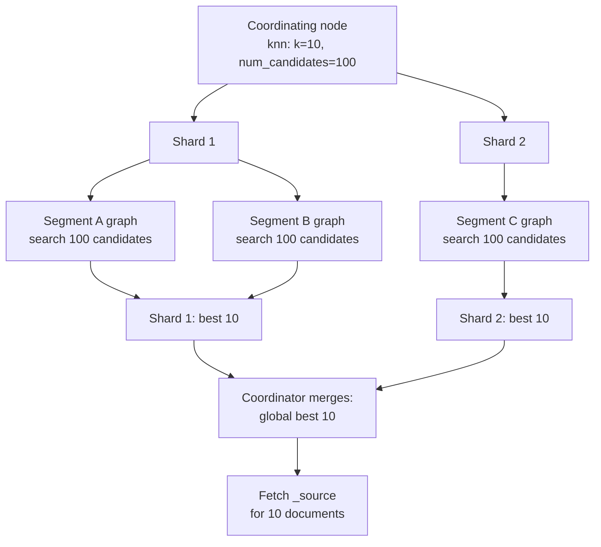

**Elasticsearch** was the default engine for keyword search for a decade before embeddings were common. Many organisations already run it for site search, logs or product catalogues, and it has grown a full set of vector features: a `dense_vector` field type, approximate kNN search on HNSW graphs, quantisation, sparse-vector fields for learned sparse models, and rank fusion. For a RAG team, the attraction is that lexical and semantic retrieval can live in one index, one query and one operational system.

This lesson explains how Elasticsearch stores and searches vectors: the mapping, how kNN search runs across shards and segments, what `k` and `num_candidates` really control, how filters and hybrid queries combine with BM25, and how scores are produced. You will simulate the shard-and-segment search locally to see why recall and cost depend on the index's physical layout, then see the same ideas written against the Elasticsearch Python client. The sibling lesson [OpenSearch](/learn/vector-database-ecosystem/opensearch) covers the open-source fork, which shares this history but has diverged in its vector features.

## Learning objectives

- Write a `dense_vector` mapping with an appropriate similarity and index type, and explain the trade-offs of quantised index types.
- Explain how an approximate kNN search runs across shards and segments, and what `k` and `num_candidates` each control.
- Predict how segment count affects kNN recall and cost, and choose when to force-merge.
- Combine BM25 and kNN results correctly, either by score addition with boosts or with the RRF retriever, and explain why raw score addition is fragile.
- Apply filters inside the kNN search rather than after it.

## Prerequisites

- [What is a vector database?](/learn/vector-database-fundamentals/what-is-a-vector-database): extensions to existing databases as one kind of product.
- [HNSW](/learn/vector-indexing-algorithms/hnsw): the graph index Elasticsearch uses, and the meaning of `m` and `ef_construction`.
- [Inverted indexes](/learn/sparse-retrieval/inverted-indexes) and [BM25](/learn/sparse-retrieval/bm25): the lexical engine Elasticsearch is built on.
- [Filtering](/learn/vector-database-fundamentals/filtering): pre-filtering versus post-filtering.

## Why this matters

If your organisation already runs Elasticsearch for keyword search, adding a separate vector database for RAG doubles the systems: two clusters to secure, two ingestion pipelines to keep consistent, and hybrid retrieval stitched together in application code from two services with different latencies and failure modes. Keeping vectors in Elasticsearch avoids all of that, and hybrid search becomes one request.

But Elasticsearch's vector search inherits the engine's architecture, and that architecture was designed for inverted indexes. Data is split into **shards**, each shard into immutable **segments**, and each segment gets its own HNSW graph. A kNN query therefore searches many graphs and merges the results. Teams who do not know this see puzzling behaviour: recall that changes after a merge, latency that grows during heavy indexing, `num_candidates` settings copied from a blog post that are too low for their shard count, or a hybrid query whose BM25 scores swamp the vector scores so completely that the embedding makes no difference. All of these are predictable once the layout is understood.

## The intuition

Imagine a library that never rewrites its catalogue. Every evening the day's new books get a small catalogue of their own. Finding the ten books nearest to a subject means looking in every catalogue, taking the best few from each, and merging. Many small catalogues are slower to consult than one big one, though looking in each thoroughly makes you unlikely to miss anything. Occasionally, the staff merge several small catalogues into one larger one; afterwards, searches are faster.

Elasticsearch's segments are those daily catalogues, and the merging is what Lucene, the search library underneath Elasticsearch, does in the background. On top of that, a large library is split across several buildings (shards), each with its own set of catalogues, and a coordinator merges the buildings' answers.

## How it works

### The mapping

A vector field is declared in the index mapping.

```json
{
  "mappings": {
    "properties": {
      "content":    { "type": "text" },
      "department": { "type": "keyword" },
      "embedding": {
        "type": "dense_vector",
        "dims": 384,
        "index": true,
        "similarity": "cosine",
        "index_options": { "type": "int8_hnsw", "m": 16, "ef_construction": 100 }
      }
    }
  }
}
```

- `dims` is the vector length. `similarity` is one of `cosine`, `dot_product` (vectors must be unit length), `l2_norm` or `max_inner_product`.
- `index: true` builds an HNSW graph so the field can be searched approximately. With `index: false`, vectors are stored only for exact scoring in scripts.
- `index_options.type` selects the storage and search structure. `hnsw` stores full 32-bit floats in the graph search; `int8_hnsw` and `int4_hnsw` quantise each dimension to 8 or 4 bits for search (keeping the raw floats on disk for rescoring); `bbq_hnsw` uses **better binary quantisation**, about one bit per dimension. `flat` variants (`flat`, `int8_flat` and others) skip the graph and scan, which is reasonable for small or heavily filtered indexes. Recent versions default to a quantised HNSW type for float vectors (the exact default depends on version and dimension count; check the mapping documentation for yours).
- `m` and `ef_construction` are the HNSW build parameters from the [HNSW](/learn/vector-indexing-algorithms/hnsw) lesson; Elasticsearch's defaults are 16 and 100.

Quantisation is the main memory lever. [Scalar quantisation](/learn/vector-indexing-algorithms/scalar-quantisation) explains the mechanism; the practical point is that `int8_hnsw` needs roughly a quarter of the memory of `hnsw` for the vectors searched, with a small recall loss that rescoring against the stored floats can recover.

### How a kNN search runs

A kNN search names the field, the query vector, the number of results `k` and a search breadth `num_candidates`.

```json
{
  "knn": {
    "field": "embedding",
    "query_vector": [0.012, -0.044, "..."],
    "k": 10,
    "num_candidates": 100,
    "filter": { "term": { "department": "it" } }
  },
  "_source": ["content", "department"]
}
```

The execution has these steps.

1. The **coordinating node** that received the request forwards it to one copy of every shard of the index.
2. On each shard, Lucene searches **each segment's HNSW graph** with a candidate list of size `num_candidates`, applying the `filter` during the graph traversal so that only matching documents are collected.
3. The shard merges its segments' candidates and keeps its best `k`.
4. Each shard returns its `k` results; the coordinating node merges them and keeps the global best `k`.
5. Only then are the `_source` fields of those `k` documents fetched.



So `k` is how many results you get back, and `num_candidates` is how hard each segment searches. `num_candidates` must be at least `k` and at most 10,000; raising it increases recall and latency. Recent versions make both optional with defaults derived from the request size, but setting them explicitly keeps behaviour predictable. Each segment search is independent, which is why the number of segments matters, as the simulation below shows.

Two operational facts follow from segments. First, new documents become searchable at the next **refresh**, which creates a new segment (by default about once per second on actively searched indexes), so Elasticsearch is near-real-time rather than immediately consistent. Second, background **merges** combine segments and must rebuild HNSW graphs for the merged data, which costs CPU during heavy indexing. For an index that has stopped changing, a **force merge** down to one or a few segments makes kNN search cheaper.

### Filters: inside, not after

The `filter` inside the `knn` object is applied *during* the graph search, so the search keeps going until it has collected `num_candidates` matching documents per segment, or exhausted the graph. You get `k` results whenever `k` matching documents exist. Lucene switches to an exact scan of the matching documents when the filter is so selective that a graph search would be wasteful. This is the behaviour that the [pgvector lesson](/learn/vector-database-ecosystem/postgresql-with-pgvector) had to add with iterative scans.

A `post_filter`, by contrast, is applied to the final results and can leave you with fewer than `k`. Permissions and tenant restrictions belong in the kNN `filter`.

### Hybrid search: two ways

**Score addition.** If a request contains both a `query` (say, a BM25 `match` on `content`) and a `knn` clause, Elasticsearch takes the union of the documents each finds and gives each document the sum of its scores, each multiplied by an optional `boost`. A document found only by one side gets only that side's score. This is simple and fast, and the scales problem from the [Pinecone](/learn/vector-database-ecosystem/pinecone) lesson applies in full: BM25 scores are unbounded while kNN scores lie between 0 and 1, so the boosts must be tuned per corpus.

**Retrievers and RRF.** Recent versions add a **retriever** abstraction: a tree of retrieval steps in the search request. A `standard` retriever wraps a normal query, a `knn` retriever wraps a vector search, and an `rrf` retriever fuses its children with [Reciprocal Rank Fusion](/learn/hybrid-search/reciprocal-rank-fusion), which uses ranks rather than scores and so needs no scale tuning. Retrievers can also include a reranking step backed by an inference endpoint. Retrievers and RRF have changed across 8.x and 9.x releases and their availability may depend on your subscription level, so check the documentation for your version.

### Sparse vectors and semantic_text

Elasticsearch also has a `sparse_vector` field for learned sparse representations, notably Elastic's own ELSER model, which expands text into weighted terms and is searched through the inverted index. The `semantic_text` field type goes one step further: it calls a configured **inference endpoint** at index and query time, chunking and embedding text for you. Like Pinecone's hosted embeddings, this is convenient and couples your embedding model to your search engine; weigh that coupling deliberately.

### Licensing

Elastic moved Elasticsearch from the Apache 2.0 licence to dual source-available licences in 2021, which prompted AWS to fork it as OpenSearch, and in 2024 added the AGPL as an open-source licence option. Some vector and ranking features are tied to paid subscription tiers for self-managed clusters. Check the current subscription matrix before designing around a specific feature.

## The mathematics

### From similarity to _score

**Intuition.** Elasticsearch must turn every similarity into a non-negative `_score` where larger is better, so that kNN results can be sorted and combined with other queries. Each similarity has its own transformation.

$$
\text{cosine: } \; s = \frac{1 + \cos\theta}{2}, \qquad
\text{l2\_norm: } \; s = \frac{1}{1 + \lVert \mathbf{q} - \mathbf{d} \rVert^2}
$$

Here $\cos\theta$ is the cosine similarity of the query vector $\mathbf{q}$ and document vector $\mathbf{d}$, and $\lVert \mathbf{q} - \mathbf{d} \rVert$ their Euclidean distance. The cosine form maps $[-1, 1]$ onto $[0, 1]$; `dot_product` uses the same form on unit vectors. These transformations preserve order, so they do not change kNN rankings, but they do change what happens when kNN scores are *added* to BM25 scores.

**By hand.** A query's best chunk has cosine 0.60, so its kNN score is $(1 + 0.60)/2 = 0.80$. The worst chunk in the top 10 has cosine 0.30, scoring 0.65. The whole top 10 therefore spans only 0.15 of score. Suppose BM25 scores for the same query range from 2.1 to 9.4. In a summed hybrid with boosts of 1, a document's BM25 score can swing the total by 7.3, and its kNN score by at most 0.15. The vector side is almost irrelevant to the ranking. To give the two sides comparable influence, the kNN boost would need to be roughly $7.3 / 0.15 \approx 49$ times the BM25 boost, and that ratio changes from query to query.

```python
cos_best, cos_worst = 0.60, 0.30
knn = lambda c: (1 + c) / 2
knn_spread = knn(cos_best) - knn(cos_worst)
bm25_spread = 9.4 - 2.1
print(f"kNN scores {knn(cos_best):.2f}..{knn(cos_worst):.2f}, spread {knn_spread:.2f}")
print(f"BM25 spread {bm25_spread:.1f}; boost ratio for equal influence ~ {bm25_spread / knn_spread:.0f}")
```

```output
kNN scores 0.80..0.65, spread 0.15
BM25 spread 7.3; boost ratio for equal influence ~ 49
```

This is the strongest argument for rank-based fusion: RRF ignores the scales and uses only positions.

## In code

**The problem.** See how the number of shards and segments, and the value of `num_candidates`, change kNN recall and the total work done, by reproducing Elasticsearch's search layout with real HNSW graphs.

**Dependencies.** NumPy and hnswlib. No cluster needed for this part.

```bash
pip install numpy hnswlib
```

This is a **simulation** of the layout, not Elasticsearch: each "segment" is an hnswlib graph built with Elasticsearch's default `m = 16` and `ef_construction = 100`, each segment is searched with `num_candidates` as its candidate-list size, and shard and coordinator merges follow the steps above. Lucene's exact strategy for dividing work across segments has evolved between versions, so treat the numbers as showing the shape of the effect.

```python
import numpy as np
import hnswlib

rng = np.random.default_rng(0)
N, DIM, K = 40_000, 64, 10
centres = rng.normal(size=(100, DIM))
X = centres[rng.integers(0, 100, N)] + 1.5 * rng.normal(size=(N, DIM))
X = (X / np.linalg.norm(X, axis=1, keepdims=True)).astype(np.float32)
queries = X[rng.choice(N, 300, replace=False)] + 0.05 * rng.normal(size=(300, DIM)).astype(np.float32)

def build_graph(ids):
    g = hnswlib.Index(space="cosine", dim=DIM)
    g.init_index(max_elements=len(ids), M=16, ef_construction=100, random_seed=1)
    g.add_items(X[ids], ids, num_threads=1)
    return g

def build_layout(n_shards, segments_per_shard):
    """Documents are routed to shards; each shard's data sits in several segments,
    and every segment has its own HNSW graph."""
    shard_of = np.arange(N) % n_shards
    layout = []
    for s in range(n_shards):
        ids = np.where(shard_of == s)[0]
        layout.append([build_graph(part) for part in np.array_split(ids, segments_per_shard)])
    return layout

def knn_search(layout, q, k, num_candidates):
    shard_results = []
    for segments in layout:                       # runs in parallel across shards
        cands = []
        for g in segments:                        # one graph search per segment
            g.set_ef(num_candidates)
            labels, dists = g.knn_query(q, k=min(num_candidates, g.get_current_count()))
            cands += list(zip(dists[0], labels[0]))
        cands.sort()
        shard_results += cands[:k]                # each shard returns its local top k
    shard_results.sort()                          # the coordinating node merges
    return [int(i) for _, i in shard_results[:k]]

truth = [set(np.argsort(-(X @ q))[:K]) for q in queries]
layouts = {"1 shard x 1 segment": build_layout(1, 1),
           "1 shard x 8 segments": build_layout(1, 8),
           "4 shards x 8 segments": build_layout(4, 8)}

print("recall@10 (total candidate slots = graph searches x num_candidates)")
print(f"{'num_candidates':<16}" + "".join(f"{name:>23}" for name in layouts))
for nc in (10, 20, 40, 80, 160):
    row = []
    for name, layout in layouts.items():
        rec = np.mean([len(t & set(knn_search(layout, q, K, nc))) / K for q, t in zip(queries, truth)])
        graphs = sum(len(seg) for seg in layout)
        row.append(f"{rec:.3f} ({graphs * nc:>5,})")
    print(f"{nc:<16}" + "".join(f"{r:>23}" for r in row))
```

```output
recall@10 (total candidate slots = graph searches x num_candidates)
num_candidates      1 shard x 1 segment   1 shard x 8 segments  4 shards x 8 segments
10                        0.861 (   10)          0.904 (   80)          0.960 (  320)
20                        0.918 (   20)          0.957 (  160)          0.991 (  640)
40                        0.949 (   40)          0.988 (  320)          0.999 (1,280)
80                        0.965 (   80)          0.999 (  640)          1.000 (2,560)
160                       0.980 (  160)          1.000 (1,280)          1.000 (5,120)
```

**The important lines.**

- `build_layout` routes documents to shards round-robin (Elasticsearch routes by a hash of the document ID, which has the same effect of spreading documents evenly) and splits each shard's documents into segments, each with its own graph.
- In `knn_search`, the inner loop is one graph search per segment with a candidate list of `num_candidates`; `cands[:k]` is the shard's local top `k`; the final sort is the coordinator's merge.
- `truth` is the exact top 10 by brute force, so recall is measured against perfect answers.
- The figure in brackets, graph searches × `num_candidates`, is a rough proxy for work: it counts candidate-list slots, not distance computations.

**What the output means.**

- **For a fixed `num_candidates`, more segments give higher recall.** Eight searches of 10 candidates find more true neighbours than one search of 10, because each smaller graph is searched with the same breadth.
- **For a fixed amount of work, fewer segments give higher recall.** Compare equal totals: with 160 slots, one segment at `num_candidates = 160` reaches 0.980, while eight segments at 20 reach 0.957. With 320 slots, eight segments at 40 reach 0.988, while 32 graphs at 10 reach 0.960. Searching one large graph is more efficient than searching many small ones, which is why force-merging a read-only index helps.
- **Shards are not free, but they run in parallel.** The 4-shard layout does four times the work of the 1-shard layout with the same segments per shard, but the shards search simultaneously on different nodes, so latency grows much less than total CPU. Shards buy throughput and capacity; segments mostly cost work.
- **`num_candidates` advice depends on layout.** A value that gives 0.95 recall on a freshly force-merged index may give more on a fragmented one, at several times the cost. Tune it on the index as it will look in production.

**Errors people commonly hit.** Expecting a just-indexed document to be found immediately (it appears after the next refresh); setting `num_candidates` equal to `k`, which starves each segment search; benchmarking on a force-merged copy and deploying to an index with dozens of live segments.

### The real thing

The code below was **not executed** for this lesson: it needs a running Elasticsearch 8.14 or later (for retrievers) and the official Python client. It indexes Meridian chunks with embeddings, then runs a filtered kNN search and an RRF hybrid.

```bash
pip install "elasticsearch>=8.14" sentence-transformers
export ES_URL=https://localhost:9200 ES_API_KEY=...
```

```python
import os
from elasticsearch import Elasticsearch, helpers
from sentence_transformers import SentenceTransformer

es = Elasticsearch(os.environ["ES_URL"], api_key=os.environ["ES_API_KEY"])
model = SentenceTransformer("sentence-transformers/all-MiniLM-L6-v2")
INDEX = "askmeridian-chunks"

es.indices.create(index=INDEX, mappings={
    "properties": {
        "content": {"type": "text"},
        "department": {"type": "keyword"},
        "embedding": {"type": "dense_vector", "dims": 384, "index": True,
                      "similarity": "cosine", "index_options": {"type": "int8_hnsw"}},
    }
})

chunks = {
    "it-e4012#0": ("it", "Error E-4012: the VPN certificate has expired. Reinstall it from the IT portal."),
    "it-e4021#0": ("it", "Error E-4021: the VPN client is out of date. Update it from the IT portal."),
    "hb-leave#0": ("all", "Annual leave is 25 days. Up to 5 unused days carry over until 31 March."),
}
helpers.bulk(es, (
    {"_index": INDEX, "_id": cid, "content": text, "department": dept,
     "embedding": model.encode(text, normalize_embeddings=True).tolist()}
    for cid, (dept, text) in chunks.items()
), refresh="wait_for")   # block until searchable: fine for tests, too slow for bulk loads

question = "What does error E-4021 mean?"
qvec = model.encode(question, normalize_embeddings=True).tolist()
allowed = {"terms": {"department": ["it", "all"]}}    # from the authenticated user

resp = es.search(index=INDEX, retriever={
    "rrf": {
        "retrievers": [
            {"standard": {"query": {"bool": {"must": {"match": {"content": question}},
                                             "filter": allowed}}}},
            {"knn": {"field": "embedding", "query_vector": qvec, "k": 10,
                     "num_candidates": 100, "filter": allowed}},
        ],
        "rank_window_size": 50,
        "rank_constant": 60,
    }
}, source=["content"], size=3)

for hit in resp["hits"]["hits"]:
    print(hit["_id"], round(hit["_score"], 4), hit["_source"]["content"][:45])
```

Your exact numbers will differ; the output looks like this, with the E-4021 chunk first because both retrievers rank it first ($2/61 \approx 0.0328$), and the leave chunk last because only the kNN side finds it, in third place ($1/63$):

```text
it-e4021#0 0.0328 Error E-4021: the VPN client is out of date.
it-e4012#0 0.0323 Error E-4012: the VPN certificate has expired
hb-leave#0 0.0159 Annual leave is 25 days. Up to 5 unused days
```

The permission filter appears in **both** retrievers. Forgetting it on one side is a classic leak: the BM25 side would happily return a restricted document that the kNN side excluded.

**Extending it.** Replace the RRF retriever with a plain `query` plus `knn` request and print the scores, to see the scale problem from the mathematics section on your own data.

## A real-world example

Meridian's Product team runs Elasticsearch for the public documentation site of Meridian Sync, Meridian Relay and Meridian Reports. When they built a documentation assistant, Lena, the search engineer, added a `dense_vector` field to the existing index rather than introducing a new system, and wrote the first hybrid as a `query` plus `knn` request with default boosts.

Offline evaluation was disappointing: the hybrid was barely better than BM25 alone, and on paraphrased questions it was no better at all. Logging the per-clause scores showed why. BM25 scores for top results ran from about 5 to 15; kNN scores sat between 0.7 and 0.85. The vector side was contributing a near-constant to every document. Raising the kNN boost helped on some queries and hurt on others, because the BM25 range varied with query length.

Lena switched to the RRF retriever, which removed the scale dependence, and the paraphrase queries improved without losing the exact-match queries (error codes such as E-4021 and plan names). A second problem surfaced in production: p95 latency rose every weekday afternoon, when the docs team published changes and the index accumulated small segments. The fix was operational, not algorithmic: a larger refresh interval for the bulk publishing job, and a nightly force merge of the stable product-version indices, which were read-only once a release shipped.

## Common mistakes

- **Summing BM25 and kNN scores with default boosts.** The vector side becomes a rounding error; use RRF or tune boosts on labelled queries.
- **Putting permission filters in `post_filter` or only on one retriever.** Results shrink below `k`, or restricted documents leak through the other side.
- **`num_candidates` equal to `k`.** Each segment searches with almost no breadth; recall drops, especially on fragmented indexes.
- **Using `dot_product` similarity with unnormalised vectors.** It requires unit-length vectors; use `cosine` or normalise first.
- **Benchmarking on a force-merged index and deploying to a live one.** Segment count changes recall and latency; benchmark the real layout.
- **Returning the vector in `_source`.** Every hit then ships hundreds of floats over the network; exclude the embedding from returned fields.
- **Too many shards for the data.** Each shard adds a search and per-shard overhead; small indexes rarely need more than one primary shard.

## Best practices

- Keep lexical and vector fields in the same index so hybrid search is one request, and fuse with RRF unless you have tuned score weights on data.
- Put every access restriction inside the kNN `filter` and inside every other retriever or query clause.
- Choose a quantised index type (`int8_hnsw` or `bbq_hnsw`) for large indexes, and measure recall against an exact `script_score` baseline on a sample.
- Size `num_candidates` on the production layout, and revisit it when shard or segment counts change.
- Raise `refresh_interval` during bulk loads, then restore it; force-merge indices that no longer change.
- Exclude vectors from `_source` responses, and request only the fields the prompt needs.

## Performance considerations

**Memory for HNSW.** Graph search reads vectors constantly, so they need to sit in the operating system's page cache on data nodes, outside the JVM heap. For one million 384-dimension float vectors that is about 1.5 GB; `int8_hnsw` brings the searched copy to roughly a quarter of that (about 0.4 GB), and one-bit quantisation to around a thirty-second plus overhead. Multiply by the number of replicas, since each copy is searched independently.

**Work per query.** From the simulation: work is roughly shards × segments per shard × `num_candidates`. Ten shards with twenty segments each at `num_candidates = 100` means 200 graph searches of breadth 100 per query, spread over the nodes holding those shards. Fewer, larger segments and only as many shards as capacity needs keep this down.

**Indexing cost.** Building HNSW graphs is expensive, and merges rebuild them. Bulk ingestion of millions of vectors is CPU-bound on data nodes and slows concurrent searches; schedule large loads, raise the refresh interval, and consider a separate index that is swapped in with an alias when complete.

**Exact search when it is enough.** For a small filtered subset (one user's documents), a `script_score` query computing exact cosine over the filtered documents can be both exact and fast, and a `flat` index type does the same within kNN search.

## Security considerations

- Enable security (TLS and authentication are on by default in recent versions) and give the retrieval service an API key restricted to read access on the chunk indices.
- Enforce document permissions with filters built server-side, or with Elasticsearch's **document-level security** in role definitions, which restricts what a role can see regardless of the query sent.
- Treat indexed text as untrusted input to the language model: a document crafted to rank highly for common queries can carry prompt-injection text. See [Retrieval manipulation](/learn/rag-security-fundamentals/retrieval-manipulation).
- Embeddings stored in `_source` are retrievable by anyone who can read the index; protect them as you would the text.

## Summary

- Elasticsearch stores vectors in `dense_vector` fields with a chosen similarity and index type; quantised types (`int8_hnsw`, `int4_hnsw`, `bbq_hnsw`) cut memory at a small recall cost.
- A kNN search runs one HNSW search per segment on every shard, each with breadth `num_candidates`; shards return their top `k` and the coordinator merges. More segments raise recall per search but cost more work; force-merging read-only indexes helps.
- Filters inside `knn` are applied during the graph search, so you get `k` results when enough matching documents exist; `post_filter` can leave you with fewer.
- Summing BM25 and kNN scores is fragile because their scales differ; RRF through the retriever API fuses ranks instead.
- New documents are searchable after a refresh, not on write; segment merges and refreshes shape both freshness and latency.

## Exercises

**1.** An index has 3 primary shards, each with 12 segments, and a query uses `num_candidates = 150`. How many graph searches does one query perform, and how many candidate-list slots in total? What would force-merging each shard to 2 segments change?

<details><summary>Show solution</summary>

$3 \times 12 = 36$ graph searches, $36 \times 150 = 5{,}400$ candidate slots. After force-merging to 2 segments per shard: $3 \times 2 = 6$ searches and 900 slots, about a sixth of the work. Recall at the same `num_candidates` may fall slightly (each search now covers a larger graph), so you might raise `num_candidates` a little and still do far less work.

</details>

**2.** Using the cosine score transformation, compute the kNN `_score` for cosines of 0.82 and 0.41. A BM25 query gives the same two documents 3.0 and 11.0. Which ranks first under plain score addition with boosts of 1, and under RRF if each side ranks its own top document first?

<details><summary>Show solution</summary>

kNN scores: $(1 + 0.82)/2 = 0.91$ and $(1 + 0.41)/2 = 0.705$. Sums: document 1 is $0.91 + 3.0 = 3.91$; document 2 is $0.705 + 11.0 = 11.705$. Document 2 wins on BM25 alone. Under RRF with $k = 60$, each document is first on one list and second on the other, so both score $1/61 + 1/62$, a tie, broken by the engine's tie-breaking rules. Rank fusion gives the two retrievers equal say; score addition gave BM25 nearly all of it.

</details>

**3.** Change the simulation so that one layout has 1 shard × 32 segments, and find the smallest `num_candidates` at which its recall reaches 0.99. Compare its total candidate slots with the 1 × 1 layout at its best recall.

<details><summary>Show solution</summary>

Set `layouts = {"1 shard x 32 segments": build_layout(1, 32)}` and try `num_candidates` of 10, 20, 30 and 40 (it may not go below `k = 10`). Our run gave recall 0.962 at 10 (320 slots), 0.988 at 20 (640) and 0.996 at 30 (960), so 0.99 first appears at 30, with six times the 160 slots the single graph used to reach 0.980. Fragmentation buys recall with work; one large graph is the most work-efficient layout.

</details>

**4.** Design decision. Meridian's documentation index holds one index per product version; old versions never change, and the current version is edited daily. Queries usually target the current version but sometimes all versions. Propose an index, alias and merge strategy, and say where the permission and version filters go.

<details><summary>Show solution</summary>

Keep one index per released version and force-merge each to one segment when its release ships, since it is then read-only and kNN on it becomes cheapest. Keep the current version in its own index with a modest refresh interval and normal background merging. Create two aliases: `docs-current` pointing at the current index, and `docs-all` covering every version index, so queries choose scope by alias rather than by filter. Within a query, put any remaining filters (product, audience permissions) inside the kNN `filter` and inside the BM25 query's `bool.filter`. When a new version ships, create its index, load it, force-merge it, and move the aliases atomically.

</details>

## Check your understanding

```quiz
[
  {
    "q": "In an Elasticsearch kNN search, what does num_candidates control?",
    "options": [
      "How many results are returned to the client",
      "How many shards are searched",
      "The size of the candidate list each segment's HNSW search uses",
      "How many documents are re-scored with BM25"
    ],
    "answer": 2,
    "why": "k is the number of results; num_candidates is the search breadth per segment. More candidates improve recall and cost latency."
  },
  {
    "q": "A document indexed a moment ago does not appear in kNN results. What is the most likely reason?",
    "options": [
      "The index has not refreshed since the document was written, so it is not yet in a searchable segment",
      "HNSW graphs are rebuilt only once a day",
      "kNN search only covers force-merged segments",
      "The document's vector was quantised to zero"
    ],
    "answer": 0,
    "why": "Elasticsearch is near-real-time: writes become searchable after a refresh creates a new segment, by default about every second on active indexes."
  },
  {
    "q": "Why does a hybrid request that simply sums BM25 and kNN scores often behave almost like BM25 alone?",
    "options": [
      "kNN results are discarded when a query clause is present",
      "BM25 scores are unbounded and spread widely, while kNN scores lie in a narrow band between 0 and 1",
      "The kNN clause is applied as a post_filter",
      "Elasticsearch normalises BM25 scores to 0 to 1 before adding"
    ],
    "answer": 1,
    "why": "Score addition mixes different scales. The kNN contribution varies by only a fraction of a point while BM25 varies by several."
  },
  {
    "q": "Where should a user's department restriction go in an RRF retriever combining a BM25 query and a kNN search?",
    "options": [
      "Only in the kNN filter, since BM25 is lexical",
      "In a post_filter applied after fusion",
      "In the rrf retriever's rank_constant",
      "In both the BM25 query's filter and the kNN filter"
    ],
    "answer": 3,
    "why": "Each child retriever finds documents independently. A restriction missing from either can let restricted documents into the fused results."
  },
  {
    "q": "In the simulation, eight segments searched at num_candidates = 20 reached lower recall than one segment searched at 160. What does this show?",
    "options": [
      "For the same total work, one large graph finds neighbours more efficiently than many small ones",
      "Segments always lower recall",
      "num_candidates has no effect on fragmented indexes",
      "Shards should be avoided"
    ],
    "answer": 0,
    "why": "Both cases use 160 candidate slots. The single larger graph spends that budget better, which is why force-merging read-only indexes helps kNN."
  }
]
```

## Further reading

- Elasticsearch documentation, [kNN search](https://www.elastic.co/guide/en/elasticsearch/reference/current/knn-search.html) and the `dense_vector` field type reference: mappings, index types, filtering and tuning.
- Elasticsearch documentation, retrievers and Reciprocal Rank Fusion (in the Search API reference for your version).
- Elasticsearch Python client, [elasticsearch-py on GitHub](https://github.com/elastic/elasticsearch-py).
- Malkov and Yashunin (2018), "Efficient and robust approximate nearest neighbor search using Hierarchical Navigable Small World graphs", [arXiv:1603.09320](https://arxiv.org/abs/1603.09320).
- Cormack, Clarke and Büttcher (2009), "Reciprocal Rank Fusion outperforms Condorcet and individual Rank Learning Methods", SIGIR.
