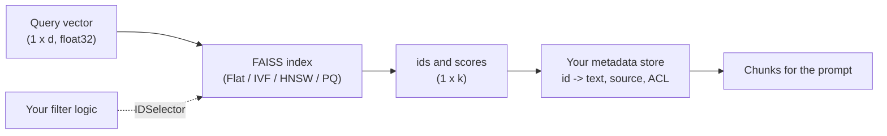

FAISS (Facebook AI Similarity Search) is the library that much of the vector search world is built on. It is not a database: it has no server, no payloads, no query language and no write-ahead log. What it has is an unusually complete and fast set of nearest-neighbour **indexes**, exposed through one small interface, and that makes it the standard tool for experiments, for offline batch jobs and for the search core inside other systems.

This lesson teaches FAISS as an engineer meets it: the index interface, the factory strings that name index types, the identifier and filtering mechanics, persistence, and the jobs FAISS leaves to you. It also runs a small benchmark that makes the recall, speed and memory trade-off concrete. The algorithms themselves (IVF, HNSW, product quantisation) each get a full lesson in [Vector Indexing Algorithms](/learn/vector-indexing-algorithms); here you meet them only as far as you need to choose and configure them.

## Learning objectives

- Build, search, persist and reload a FAISS index over real sentence embeddings, using your own 64-bit identifiers.
- Read and write FAISS index factory strings such as `IVF1024,Flat`, `HNSW32,Flat` and `IVF1024,PQ48`, and say which need training.
- Restrict a FAISS search to a subset of identifiers with an `IDSelector`, and explain why payload filtering is the application's job.
- Measure recall@10, per-query latency and bytes per vector for several index types, and choose one for a stated workload.
- List the database responsibilities FAISS does not provide and describe how a production service fills each gap.

## Prerequisites

- [What is a vector database?](/learn/vector-database-fundamentals/what-is-a-vector-database): the five responsibilities, and the library versus database distinction.
- [Indexing](/learn/vector-database-fundamentals/indexing): why approximate indexes exist and what recall means.
- [Similarity search](/learn/vector-database-fundamentals/similarity-search): inner product, cosine and Euclidean distance as search metrics.
- [Dot product](/learn/embedding-mathematics/dot-product): why the inner product of unit vectors is their cosine.

## Why this matters

Sooner or later every RAG engineer needs to answer a question like "if we switch to HNSW with these settings, how much recall do we lose?" or "will 20 million vectors fit in memory on one machine if we compress them?". Answering with a hosted database means provisioning a cluster, loading data over a network and untangling the database's own overheads from the index's behaviour. Answering with FAISS takes a script and a few minutes, because the library exposes the index directly, lets you swap one index type for another by changing a string, and gives you exact search as a built-in ground truth.

FAISS also turns up in production, mostly in batch pipelines (deduplicating a corpus, clustering embeddings, mining hard negatives for [fine-tuning embeddings](/learn/embedding-optimisation/fine-tuning-embeddings)) that need raw speed and no service.

The opposite failure is shipping the FAISS prototype: a process with no durable writes, nowhere to record which document a vector came from, no access control and no safe way to update while serving. Knowing where the library stops matters as much as knowing how to use it.

## The intuition

Think of FAISS as a very fast card index whose numbered cards carry nothing but coordinates. Hand it coordinates and it tells you the numbers of the closest cards and how close they are. What a card *means* (its text, its source document, who may see it) is written in a separate ledger that you keep yourself, keyed by card number.

Different FAISS indexes are different ways of arranging the cards:

- **Flat** keeps them in one long row and checks every one. Slow for big piles, always right.
- **IVF** sorts them into labelled drawers by rough position, and only opens the few drawers nearest your query.
- **HNSW** links each card to its neighbours and walks the links towards your query.
- **PQ** shrinks each card to a short code so far more fit in memory, at the price of approximate distances.

Choosing an index is choosing a filing system; the card numbers and the ledger stay the same.

## How it works

### The index interface

Every FAISS index implements the same small set of operations on `float32` matrices:

| Method | What it does |
| --- | --- |
| `index.train(x)` | Learns structure from sample vectors (cluster centres, codebooks). Only some index types need it; `index.is_trained` tells you. |
| `index.add(x)` | Appends vectors; they receive sequential ids 0, 1, 2, … |
| `index.add_with_ids(x, ids)` | Appends vectors with your own 64-bit integer ids (only on index types that store ids). |
| `index.search(q, k)` | Returns two arrays of shape `(nq, k)`: scores or distances, and ids. |
| `index.remove_ids(ids)` | Deletes by id, where the index type supports it. |
| `index.reconstruct(id)` | Returns the stored (possibly decompressed) vector, where supported. |
| `index.ntotal`, `index.d` | Number of stored vectors and their dimension. |

A query goes through these steps:

1. You pass a `(nq, d)` float32 matrix of query vectors, usually with `nq = 1` in a RAG service.
2. The index decides which stored vectors to compare against. Flat compares all; IVF compares those in the `nprobe` nearest clusters; HNSW compares those it visits on its graph walk.
3. It computes the metric (inner product or squared Euclidean distance) for each candidate, possibly from compressed codes.
4. It keeps the best `k` per query in a heap and returns them sorted. If fewer than `k` candidates were found, the remaining slots hold id `-1`.



Ids come out of FAISS; everything a RAG system needs to know about them lives elsewhere.

### Metrics: inner product and L2

FAISS supports several metrics, but two matter for RAG: `METRIC_INNER_PRODUCT` (higher is better) and `METRIC_L2` (lower is better). There is no separate cosine metric. To get cosine similarity you **normalise every vector to unit length** (with `faiss.normalize_L2`, or by asking the embedding model for normalised output) and use inner product. On unit vectors, inner product *is* cosine, and squared L2 distance is a fixed function of it, so both metrics give the same ranking (the mathematics section shows why).

Two details catch people. `IndexFlatL2` returns **squared** Euclidean distances, not distances. And forgetting to normalise when using inner product silently turns cosine search into "prefer longer vectors" search, with no error.

### The index factory

FAISS indexes compose: a coarse partitioning, an encoding for the vectors, an optional re-ranking stage, an id wrapper. Rather than constructing each layer by hand, you usually describe the stack as a string and let `faiss.index_factory(d, "…", metric)` build it. The strings worth recognising:

| Factory string | Structure | Needs `train`? | Removal |
| --- | --- | --- | --- |
| `Flat` | Every vector stored in full; exact search | No | Yes |
| `IVF1024,Flat` | 1,024 clusters; full vectors inside each | Yes (k-means) | Yes |
| `HNSW32,Flat` | Graph with 32 links per node; full vectors | No | No |
| `IVF1024,PQ48` | 1,024 clusters; each vector compressed to 48 one-byte codes | Yes | Yes |
| `IVF1024,PQ48,RFlat` | As above, then re-scores the shortlist with full vectors | Yes | |
| `IDMap2,HNSW32,Flat` | HNSW wrapped so it accepts your own ids | No | No |

The search-time knobs are separate from the build: `nprobe` (how many IVF clusters to open, default 1) and `efSearch` (how wide the HNSW walk is, default 16). Raising either buys recall with latency, with no rebuild. You will see both in action in the benchmark. Their internals are covered in [IVF](/learn/vector-indexing-algorithms/ivf), [HNSW](/learn/vector-indexing-algorithms/hnsw) and [Product quantisation](/learn/vector-indexing-algorithms/product-quantisation); here it is enough to know which way each knob turns.

### Identifiers

FAISS ids are signed 64-bit integers, and that is the only link between a vector and anything else. Sequential ids from `add` are fragile: delete a vector from a flat index and the ids of everything after it shift. For any index you will update, assign your own stable ids with `add_with_ids`. IVF indexes store ids natively. Flat and HNSW indexes do not, so you wrap them in `IndexIDMap` (maps ids on output) or `IndexIDMap2` (also supports `reconstruct` by your id). Since your chunk identifiers are probably strings such as `handbook#12`, keep a mapping table from string to integer, or derive the integer from a hash and check for collisions.

### Filtering

FAISS has no idea that a vector came from the IT runbooks. What it can do, since version 1.7.3, is restrict a search to a set of ids through a **selector** passed in search parameters: `IDSelectorBatch` (an explicit set), `IDSelectorRange` (a numeric range), `IDSelectorBitmap`, and combinators such as `IDSelectorAnd` and `IDSelectorNot`. The index skips any id the selector rejects, so you get the top `k` among allowed vectors rather than top `k` overall followed by discarding.

So filtering becomes your problem: the application evaluates the metadata condition against its own store and hands FAISS the allowed ids. That is cheap for a few thousand ids and expensive for millions, and with graph indexes a very selective filter can leave the walk with too few allowed neighbours to reach good results. Dedicated databases handle this with payload indexes and filter-aware graph construction, which [Filtering](/learn/vector-database-fundamentals/filtering) explains.

### What FAISS leaves to you

| Responsibility | FAISS provides | You provide |
| --- | --- | --- |
| Search | Many index types, CPU and GPU | Choice of index and parameters |
| Metadata and text | Nothing | A key-value store or SQL table keyed by id |
| Filtering | Id selectors | Turning conditions into id sets |
| Updates | `add`, `remove_ids` on some types | Locking: concurrent searches are safe, but writes during searches are not |
| Persistence | `write_index`, `read_index` to a file | Snapshots, atomic file replacement, keeping the file and metadata in step |
| Serving | Nothing | An API process, replication, health checks |

The FAISS documentation states the concurrency rule explicitly: CPU indexes are safe for concurrent searches, but code that modifies an index while other threads use it must add its own mutual exclusion. Most production FAISS deployments therefore build a new index offline and swap the serving process over to it.

## The mathematics

### Inner product, cosine and L2 on unit vectors

**Intuition.** On vectors of length 1, being close in angle and being close in space are the same thing, so all three common measures rank neighbours identically.

$$
\lVert \mathbf{q} - \mathbf{x} \rVert^2 = \lVert \mathbf{q} \rVert^2 + \lVert \mathbf{x} \rVert^2 - 2\,\mathbf{q}\cdot\mathbf{x} = 2 - 2\,\mathbf{q}\cdot\mathbf{x}
$$

Here $\mathbf{q}$ is the query vector, $\mathbf{x}$ a stored vector, $\lVert\cdot\rVert$ the Euclidean length and $\mathbf{q}\cdot\mathbf{x}$ the inner product, which equals the cosine when both lengths are 1. The last step uses $\lVert \mathbf{q} \rVert = \lVert \mathbf{x} \rVert = 1$.

**Worked example.** Take $\mathbf{q} = (0.6, 0.8)$ and $\mathbf{x} = (1, 0)$. The inner product is $0.6$. The squared distance is $(0.6-1)^2 + 0.8^2 = 0.16 + 0.64 = 0.80$, and $2 - 2(0.6) = 0.80$. A larger inner product always means a smaller squared distance, so `IndexFlatIP` and `IndexFlatL2` return the same order on normalised data.

```python
import numpy as np
q, x = np.array([0.6, 0.8]), np.array([1.0, 0.0])
print(q @ x, np.sum((q - x) ** 2), 2 - 2 * (q @ x))
```

```output
0.6 0.8000000000000002 0.8
```

### How much work IVF saves

**Intuition.** An IVF query first compares the query to every cluster centre, then scans only the clusters it opens. If the clusters are roughly equal in size, each holds $N / n_{\text{list}}$ vectors.

$$
C_{\text{IVF}} \approx n_{\text{list}} + n_{\text{probe}} \cdot \frac{N}{n_{\text{list}}}
$$

$C_{\text{IVF}}$ is the number of $d$-dimensional comparisons per query, $N$ the number of stored vectors, $n_{\text{list}}$ the number of clusters and $n_{\text{probe}}$ the number opened. Exact search costs $C_{\text{Flat}} = N$.

**Worked example.** With $N = 100{,}000$, $n_{\text{list}} = 1{,}024$ and $n_{\text{probe}} = 8$: $1{,}024 + 8 \times 100{,}000 / 1{,}024 \approx 1{,}024 + 781 = 1{,}805$ comparisons, about 55 times fewer than 100,000. The formula also shows the classic rule of thumb: the total is smallest when the two terms are balanced, which is why $n_{\text{list}}$ is often chosen around $\sqrt{N}$ or a few multiples of it.

```python
N, nlist, nprobe = 100_000, 1_024, 8
c_ivf = nlist + nprobe * N / nlist
print(round(c_ivf), round(N / c_ivf, 1))
```

```output
1805 55.4
```

The saving is in comparisons, not guaranteed in wall-clock time: exact search is a tight, cache-friendly matrix product, while IVF jumps between lists. The benchmark below measures both.

## In code

### A Meridian index with real embeddings

**The problem.** Build a semantic index over Meridian chunks with stable ids, restrict searches by source, delete a chunk, and save and reload the index, so that you see every responsibility FAISS covers and the ones it hands back to you.

**Dependencies.**

```bash
pip install faiss-cpu sentence-transformers numpy
```

`faiss-cpu` is the community-maintained PyPI package; GPU builds come through conda (see the FAISS repository's install page). This was run with FAISS 1.16.

```python
import faiss
import numpy as np
from sentence_transformers import SentenceTransformer

# A tiny Meridian corpus. Each chunk has a stable 64-bit integer id and metadata.
chunks = {
    1001: ("Employees receive 25 days of annual leave per year.", "handbook"),
    1002: ("Up to 5 unused leave days carry over and must be used by 31 March.", "handbook"),
    1003: ("Staff may work remotely up to 3 days a week.", "handbook"),
    1004: ("The home-office equipment budget is 400 pounds; contractors are not eligible.", "handbook"),
    2001: ("Passwords must be rotated every 90 days.", "it-runbook"),
    2002: ("Always connect to the VPN when using public Wi-Fi.", "it-runbook"),
    2003: ("Report a lost laptop to the support desk at once.", "it-runbook"),
    2004: ("Laptops are refreshed on a 3-year cycle.", "it-runbook"),
}
ids = np.array(list(chunks.keys()), dtype="int64")
texts = [text for text, _ in chunks.values()]

model = SentenceTransformer("sentence-transformers/all-MiniLM-L6-v2")
vectors = model.encode(texts, normalize_embeddings=True).astype("float32")
d = vectors.shape[1]

# Exact inner-product index, wrapped so that we can use our own ids.
index = faiss.IndexIDMap2(faiss.IndexFlatIP(d))
index.add_with_ids(vectors, ids)
print(f"dimension={d}  ntotal={index.ntotal}  trained={index.is_trained}")

def search(query, k=3, allowed_ids=None):
    q = model.encode([query], normalize_embeddings=True).astype("float32")
    params = None
    if allowed_ids is not None:
        params = faiss.SearchParameters(sel=faiss.IDSelectorBatch(np.array(allowed_ids, dtype="int64")))
    scores, found = index.search(q, k, params=params)
    return [(int(i), float(s)) for i, s in zip(found[0], scores[0])]

def show(title, hits):
    print(f"\n{title}")
    for i, s in hits:
        if i == -1:
            print("  (empty slot: id -1)")
        else:
            print(f"  {i}  {s:.3f}  [{chunks[i][1]}] {chunks[i][0]}")

show("Query: how much holiday do I get?", search("how much holiday do I get?"))

# Metadata filtering is the application's job: translate the condition into ids.
it_ids = [i for i, (_, src) in chunks.items() if src == "it-runbook"]
show("Same query, restricted to IT runbooks:", search("how much holiday do I get?", allowed_ids=it_ids))

show("k=3 but only 2 ids allowed:", search("laptop", k=3, allowed_ids=[2003, 2004]))

# Delete a chunk, then persist and reload the index.
removed = index.remove_ids(np.array([1001], dtype="int64"))
print(f"\nremoved={removed}  ntotal={index.ntotal}")
faiss.write_index(index, "meridian.faiss")
reloaded = faiss.read_index("meridian.faiss")
print(f"reloaded ntotal={reloaded.ntotal}  first vector id 1002 present: "
      f"{np.allclose(reloaded.reconstruct(1002), vectors[1])}")
```

```output
dimension=384  ntotal=8  trained=True

Query: how much holiday do I get?
  1001  0.358  [handbook] Employees receive 25 days of annual leave per year.
  1002  0.319  [handbook] Up to 5 unused leave days carry over and must be used by 31 March.
  1004  0.224  [handbook] The home-office equipment budget is 400 pounds; contractors are not eligible.

Same query, restricted to IT runbooks:
  2004  0.061  [it-runbook] Laptops are refreshed on a 3-year cycle.
  2001  0.051  [it-runbook] Passwords must be rotated every 90 days.
  2003  -0.039  [it-runbook] Report a lost laptop to the support desk at once.

k=3 but only 2 ids allowed:
  2004  0.525  [it-runbook] Laptops are refreshed on a 3-year cycle.
  2003  0.509  [it-runbook] Report a lost laptop to the support desk at once.
  (empty slot: id -1)

removed=1  ntotal=7
reloaded ntotal=7  first vector id 1002 present: True
```

**The important lines.**

- `normalize_embeddings=True` plus `IndexFlatIP` gives cosine similarity. The `.astype("float32")` matters: FAISS's array functions are typed for float32, and `faiss.normalize_L2` raises a `TypeError` on a float64 array.
- `IndexIDMap2(IndexFlatIP(d))` lets the flat index carry your ids. Calling `add_with_ids` on a bare `IndexFlatIP` raises `add_with_ids not implemented for this type of index`.
- The `chunks` dict is the "ledger": FAISS returns `1001`, and only your own dictionary knows that means the annual leave chunk from the handbook.
- `faiss.SearchParameters(sel=faiss.IDSelectorBatch(...))` restricts the search. The source condition was evaluated in Python, not in FAISS.
- `remove_ids` returns how many vectors were removed; `write_index` and `read_index` serialise the whole index, including the id map, to one file.

**What the output means.** The holiday question finds the annual leave chunks although it never uses the word "leave", which is the embedding at work. Restricted to the IT runbooks, FAISS dutifully returns the three best runbook chunks, with scores near zero and one negative. Nothing in FAISS says "none of these is relevant"; if you filter, you must also decide whether to apply a minimum score. The third search asks for three results when only two ids are allowed, and the empty slot comes back as id `-1` with a placeholder score. Code that indexes a Python list with `-1` silently picks the last element, a classic bug.

**Errors people commonly hit.**

- `AssertionError` on `add` or `search`: the vector width does not match `index.d`, typically after changing embedding model.
- `RuntimeError: ... remove_ids not implemented` on an HNSW index. HNSW cannot delete; you rebuild, or keep a "deleted" id set and pass it to the search as an `IDSelectorNot` filter until the next rebuild.
- `'ntotal' is 0` after training an IVF index: `train` learns clusters, it does not add vectors. You still need `add`.

**Extending it.** Swap in `faiss.index_factory(d, "IDMap2,HNSW32,Flat", faiss.METRIC_INNER_PRODUCT)` and everything but `remove_ids` still works. Move the ledger into SQLite so that filters become `WHERE` clauses returning id lists.

### Measuring the trade-off

The Meridian corpus is far too small for index choice to matter. The second script builds six indexes over 100,000 synthetic 384-dimension unit vectors, drawn around 2,000 random cluster centres so that the data has some structure, and measures what each costs. Recall@10 is measured against the flat index's exact results, which is the standard way to evaluate an approximate index (see [Recall versus latency](/learn/vector-indexing-algorithms/recall-versus-latency)).

```python
import time
import faiss
import numpy as np

rng = np.random.default_rng(42)
n, d, nq, k = 100_000, 384, 200, 10

# Clustered synthetic data: 2,000 loose clusters, unit-normalised like real embeddings.
centres = rng.standard_normal((2_000, d)).astype("float32")
noise = 1.5
xb = centres[rng.integers(0, 2_000, n)] + noise * rng.standard_normal((n, d)).astype("float32")
xq = centres[rng.integers(0, 2_000, nq)] + noise * rng.standard_normal((nq, d)).astype("float32")
faiss.normalize_L2(xb)
faiss.normalize_L2(xq)

def build(spec):
    index = faiss.index_factory(d, spec, faiss.METRIC_INNER_PRODUCT)
    t0 = time.perf_counter()
    if not index.is_trained:
        index.train(xb[:30_000])          # train on a sample, as you would in practice
    index.add(xb)
    return index, time.perf_counter() - t0

def timed_search(index):
    faiss.omp_set_num_threads(1)       # one query at a time, one thread: the RAG case
    found = np.empty((nq, k), dtype="int64")
    t0 = time.perf_counter()
    for i in range(nq):
        _, found[i] = index.search(xq[i:i + 1], k)
    ms = (time.perf_counter() - t0) / nq * 1000
    faiss.omp_set_num_threads(4)
    return ms, found

faiss.omp_set_num_threads(4)
flat, flat_build = build("Flat")
flat_ms, truth = timed_search(flat)

def recall(found):
    return np.mean([len(set(f) & set(t)) / k for f, t in zip(found, truth)])

rows = [("Flat", flat_build, flat_ms, 1.0, flat)]
ivf, ivf_build = build("IVF1024,Flat")
for nprobe in (1, 8, 64):
    ivf.nprobe = nprobe
    ms, found = timed_search(ivf)
    rows.append((f"IVF1024,Flat nprobe={nprobe}", ivf_build, ms, recall(found), ivf))
hnsw, hnsw_build = build("HNSW32,Flat")
for ef in (16, 128):
    hnsw.hnsw.efSearch = ef
    ms, found = timed_search(hnsw)
    rows.append((f"HNSW32,Flat efSearch={ef}", hnsw_build, ms, recall(found), hnsw))
pq, pq_build = build("IVF1024,PQ48")
pq.nprobe = 64
ms, found = timed_search(pq)
rows.append(("IVF1024,PQ48 nprobe=64", pq_build, ms, recall(found), pq))

print(f"{'index':26s} {'build s':>8s} {'ms/query':>9s} {'recall@10':>10s} {'bytes/vector':>13s}")
for name, b, ms, r, idx in rows:
    size = faiss.serialize_index(idx).size / n
    print(f"{name:26s} {b:8.1f} {ms:9.3f} {r:10.3f} {size:13.0f}")
```

```output
WARNING clustering 30000 points to 1024 centroids: please provide at least 39936 training points
WARNING clustering 30000 points to 1024 centroids: please provide at least 39936 training points
index                       build s  ms/query  recall@10  bytes/vector
Flat                            0.0     2.191      1.000          1536
IVF1024,Flat nprobe=1           0.4     0.024      0.682          1560
IVF1024,Flat nprobe=8           0.4     0.043      0.748          1560
IVF1024,Flat nprobe=64          0.4     0.172      0.849          1560
HNSW32,Flat efSearch=16         5.6     0.066      0.802          1808
HNSW32,Flat efSearch=128        5.6     0.406      0.992          1808
IVF1024,PQ48 nprobe=64         27.3     0.144      0.512            76
```

These timings come from one laptop CPU; yours will differ, and so will the recall figures on real embeddings, which usually cluster more tightly than this deliberately hard synthetic data. The *shape* of the table is what generalises.

**Reading the table.**

- **Flat** is the baseline: perfect recall, no build, about 2 ms per query at 100,000 vectors, growing linearly with $N$.
- **IVF** builds in under a second and is very fast, but on this deliberately spread-out data its recall climbs slowly with `nprobe`, because the learned clusters do not line up well with true neighbourhoods. Real embeddings usually suit IVF better, which is exactly why you measure on your own data.
- **HNSW** costs more to build and about 18 per cent more memory (the graph's links), and reaches 0.992 recall at `efSearch=128` while still being about five times faster than flat. The default `efSearch=16` gives only 0.802: defaults are not tuned for your recall target.
- **IVF-PQ** shrinks each vector from 1,536 bytes to about 76 (48 bytes of code, 8 bytes of id, plus the cluster centres and codebooks shared across all vectors), a 20-fold saving, but recall falls to 0.512 because distances are computed from lossy codes. Adding `,RFlat` to the factory string re-scores a shortlist with the full vectors, which recovers much of the recall but brings back the full-vector memory, usually on disk or in cheaper storage.

**Errors and extensions.** The two warnings at the top come from k-means training: FAISS asks for at least 39 training points per cluster (39,936 for 1,024 clusters) and the script gave it 30,000. Training still succeeds, with somewhat noisier centres; in production, train on a larger random sample. Extend the script with `IVF1024,PQ48,RFlat` and set `index.k_factor` to compare recall, or replace the synthetic data with your own embedded corpus.

## A real-world example

Meridian's Platform team runs AskMeridian on Qdrant, but its Search Quality group (two engineers) uses FAISS every week. When the team considered switching the production collection to scalar or product quantisation to cut memory, the question was how much recall it would cost on Meridian's real data, not on a benchmark.

They exported the production vectors and a labelled set of staff questions, built `Flat`, `HNSW32,Flat` and two compressed indexes in a notebook, and measured recall@10 against the flat results. It took an afternoon and no infrastructure. Compression alone lost too many correct chunks for error-code queries, whose embeddings sit very close together; re-scoring a larger shortlist with full vectors brought recall back. They then enabled the equivalent quantisation-with-rescoring option in Qdrant and checked that production recall matched the notebook.

The same group also made the classic mistake once. A small "similar tickets" service wrapped a FAISS index, with ticket metadata in a Python dictionary, and a background thread appended new tickets while users searched. The unprotected concurrent writes made the service crash intermittently. The fix was the standard pattern: build a fresh index and metadata file offline each night, write both to a new directory, and have the service load the pair and swap a reference atomically.

## Common mistakes

- **Using inner product on unnormalised vectors.** Longer vectors win regardless of direction, and nothing warns you. Normalise both stored and query vectors, or use a model that outputs unit vectors.
- **Relying on sequential ids from `add`.** After a removal on a flat index, or a rebuild, the ids shift and your metadata points at the wrong chunks. Use `add_with_ids` with stable ids.
- **Indexing a Python list with an id of `-1`.** When fewer than `k` results exist, FAISS pads with `-1`, and `texts[-1]` silently returns the last chunk.
- **Writing to an index while serving searches from it.** FAISS does not lock. Concurrent searches are safe; concurrent modification is not.
- **Accepting default search parameters.** `nprobe=1` and `efSearch=16` are starting points, not tuned values. Measure recall and set them for your target.

## Best practices

- Start every evaluation with a `Flat` index as ground truth, then measure each candidate's recall@k against it on real queries.
- Keep the index, the id-to-metadata table and the embedding model name together as one versioned artefact; load and swap them as a unit.
- Prefer **build offline, swap atomically** over in-place updates in a serving process; if you must update in place, guard writes with a lock that excludes searches.
- For deletions on indexes that cannot delete (HNSW), filter deleted ids at query time and rebuild on a schedule.
- Set the thread count deliberately (`faiss.omp_set_num_threads`): one thread per query is usually right for a web service handling many concurrent requests, many threads for batch jobs.

## Performance considerations

**Memory.** Flat and HNSW store full float32 vectors: $4d$ bytes each, so 1,536 bytes at 384 dimensions. Ten million chunks need about 15.4 GB for vectors alone, plus about 18 per cent more for an HNSW32 graph on the benchmark above. PQ48 needs about 56 bytes per vector plus small shared tables, so the same ten million fit in well under 1 GB, if the recall loss is acceptable or re-scoring is added.

**Latency.** Flat search reads every vector, so latency grows linearly with $N$. From the benchmark's 2.2 ms at 100,000 vectors, extrapolate to around 220 ms at 10 million on one thread: too slow for a chat assistant's retrieval budget. HNSW latency grows much more slowly with $N$, roughly logarithmically, and is controlled by `efSearch`.

**Build time.** HNSW took 5.6 seconds for 100,000 vectors on four threads here and grows somewhat faster than linearly, so plan for hours at hundreds of millions. IVF adds vectors quickly once trained.

**Batching and GPUs.** Batched queries are much faster per query, because the comparisons become matrix multiplications, and the GPU build accelerates batched search and k-means training dramatically. Neither helps a one-query-at-a-time service much.

## Security considerations

A FAISS file is a binary blob deserialised by native code. Load index files only from locations you control; a tampered file is untrusted input to a C++ parser. FAISS has no access control, so a FAISS-backed service must build the allowed-id selector from the caller's identity on every query rather than filtering results afterwards. And protect the index file like the documents it was built from.

## Summary

- FAISS is a library of nearest-neighbour indexes behind one interface (`train`, `add`, `add_with_ids`, `search`, `remove_ids`), not a database.
- Cosine search is inner product on normalised float32 vectors; `IndexFlatL2` returns squared distances.
- Factory strings such as `IVF1024,Flat`, `HNSW32,Flat` and `IVF1024,PQ48` name an index stack; `nprobe` and `efSearch` trade recall for latency at query time without rebuilding.
- Ids are 64-bit integers and the only link to your metadata; filtering means turning metadata conditions into an `IDSelector`.
- Persistence is a single file; durability, concurrency control, metadata and serving are yours to provide, most safely by building offline and swapping.
- FAISS is the right tool for evaluation, batch jobs and small static services, and a poor substitute for a database when data changes continuously or needs filtering and access control.

## Exercises

**1.** In the Meridian example, the runbook-restricted holiday query returned three chunks with scores at or below 0.061. Modify `search` so that it drops results below a minimum score and never returns id `-1`. Why is choosing that minimum hard?

<details><summary>Show solution</summary>

```python
def search(query, k=3, allowed_ids=None, min_score=0.2):
    q = model.encode([query], normalize_embeddings=True).astype("float32")
    params = None
    if allowed_ids is not None:
        params = faiss.SearchParameters(sel=faiss.IDSelectorBatch(np.array(allowed_ids, dtype="int64")))
    scores, found = index.search(q, k, params=params)
    return [(int(i), float(s)) for i, s in zip(found[0], scores[0]) if i != -1 and s >= min_score]
```

The threshold is model-specific and query-specific: cosine values for genuinely relevant pairs vary with the embedding model, the query length and the domain. A value must be set from a labelled set of queries for this model, and rechecked whenever the model changes.

</details>

**2.** Extend the benchmark with `HNSW32,Flat` at `efSearch` values 32 and 64, and `IVF1024,PQ48,RFlat` with `k_factor = 4`. Which configuration gives the lowest latency with recall@10 of at least 0.95 on this data?

<details><summary>Show solution</summary>

Add to the script:

```python
for ef in (32, 64):
    hnsw.hnsw.efSearch = ef
    ms, found = timed_search(hnsw)
    rows.append((f"HNSW32,Flat efSearch={ef}", hnsw_build, ms, recall(found), hnsw))
rf, rf_build = build("IVF1024,PQ48,RFlat")
faiss.extract_index_ivf(rf).nprobe = 64
rf.k_factor = 4
ms, found = timed_search(rf)
rows.append(("IVF1024,PQ48,RFlat kf=4", rf_build, ms, recall(found), rf))
```

On a run on the same machine (timings vary between runs), the new rows were:

```output
HNSW32,Flat efSearch=32         6.9     0.115      0.932
HNSW32,Flat efSearch=64         6.9     0.211      0.980
IVF1024,PQ48,RFlat kf=4        34.3     0.200      0.839
```

`HNSW32,Flat` at `efSearch=64` is the cheapest configuration above 0.95. Re-scoring lifts IVF-PQ from 0.512 to 0.839, but it cannot exceed the 0.849 ceiling set by the clustering at `nprobe=64`: re-scoring fixes distance errors, not candidates that were never in the opened clusters. The method matters more than the answer: fix a recall target, then minimise latency subject to it.

</details>

**3.** Design: a team wants a "related documents" feature over 3 million chunks that change once a day, served from one API process, with results restricted to the user's department. Sketch a FAISS-based design and say when you would abandon it for a vector database.

<details><summary>Show solution</summary>

Nightly, build `IDMap2,HNSW32,Flat` over all 3 million chunks (about 4.6 GB of vectors at 384 dimensions, plus the graph) and a SQLite table mapping id to text, document and department; write both to a new versioned directory, and have the API process load the pair and swap a reference atomically, keeping the old pair for rollback. At query time, pass the user's department's ids (cached per department) as an `IDSelectorBatch`, and raise `efSearch` for small departments, because restrictive filters reduce graph-walk recall.

Abandon it when updates must appear within minutes, when filters become arbitrary combinations that cannot be cached as id sets, when you need replicas, or when the index outgrows one machine's memory: each is a database feature you would otherwise build yourself.

</details>

## Check your understanding

```quiz
[
  {"q": "You store normalised embeddings in an `IndexFlatL2` and in an `IndexFlatIP`. How do their rankings compare?", "options": ["They differ, because L2 ignores direction", "They are identical, because squared L2 equals 2 minus 2 times the inner product on unit vectors", "IP gives the reverse order of L2", "They are identical only when k = 1"], "answer": 1, "why": "On unit vectors, squared distance is a decreasing function of the inner product, so both indexes return the same neighbours in the same order."},
  {"q": "Which index type must be trained before vectors can be added?", "options": ["`Flat`", "`HNSW32,Flat`", "`IDMap2,Flat`", "`IVF1024,PQ48`"], "answer": 3, "why": "IVF learns cluster centres and PQ learns codebooks, both from sample data; Flat and HNSW need no training."},
  {"q": "A search with k = 5 returns ids `[2004, 2003, -1, -1, -1]`. What happened?", "options": ["Only two vectors were eligible under the selector or present in the index", "The index is corrupted", "Three results had negative scores", "The query vector had the wrong dimension"], "answer": 0, "why": "FAISS pads with -1 when fewer than k candidates are found, which happens with small indexes or restrictive id selectors."},
  {"q": "Why does an `IVF1024,PQ48` index use about 76 bytes per 384-dimension vector instead of 1,536?", "options": ["It stores vectors as float16", "It discards most of the vectors", "Each vector is stored as 48 one-byte codes plus an 8-byte id, with small shared tables", "It stores only the cluster centre for each vector"], "answer": 2, "why": "Product quantisation replaces each vector with short codes; ids and shared centroids and codebooks make up the rest."},
  {"q": "A FAISS-backed service appends vectors from a background thread while user requests search the same index. What is the risk?", "options": ["None: FAISS indexes are fully thread-safe", "Searches become exact instead of approximate", "Modifying an index concurrently with searches is unsafe without your own locking, and can crash or corrupt results", "New vectors are ignored until restart"], "answer": 2, "why": "FAISS CPU indexes are safe for concurrent reads, but the documentation requires the caller to add mutual exclusion around modifications."}
]
```

## Further reading

- Johnson, Douze and Jégou (2017), *Billion-scale similarity search with GPUs*, the paper that introduced FAISS's GPU design. [arXiv:1702.08734](https://arxiv.org/abs/1702.08734)
- Douze and colleagues (2024), *The Faiss library*, an overview of the library's design and index families by its authors. [arXiv:2401.08281](https://arxiv.org/abs/2401.08281)
- FAISS repository and wiki, including "Guidelines to choose an index", "The index factory" and "Threads and asynchronous calls". [github.com/facebookresearch/faiss](https://github.com/facebookresearch/faiss)
- Jégou, Douze and Schmid (2011), *Product quantization for nearest neighbor search*, IEEE Transactions on Pattern Analysis and Machine Intelligence.
- Malkov and Yashunin (2016), *Efficient and robust approximate nearest neighbor search using Hierarchical Navigable Small World graphs*. [arXiv:1603.09320](https://arxiv.org/abs/1603.09320)
