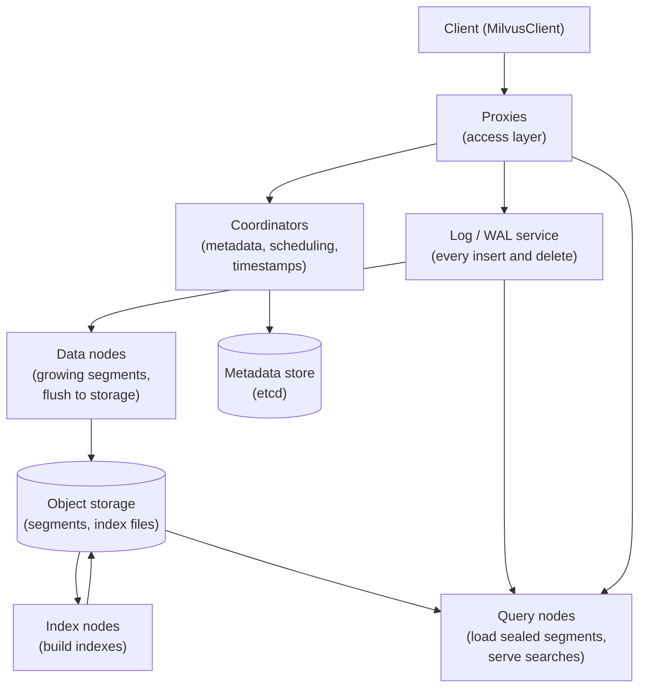

Milvus is an open-source vector database built for very large collections: hundreds of millions to billions of vectors, spread across a cluster whose parts scale independently. Where Chroma is a library-sized database and Qdrant and Weaviate are single services that can also form clusters, Milvus in its distributed form is a set of cooperating services on Kubernetes, with object storage holding the data and a log service carrying every write. The same API also runs as a single container, and as a small embedded library for development.

This lesson explains why Milvus is designed that way and what that design means for you as a RAG engineer: schemas with typed fields, segments that grow and are sealed, indexes built asynchronously, collections that must be loaded before they can be searched, and consistency levels that decide whether a search sees a write made a moment ago. You will write a Milvus collection with the `MilvusClient` API, and run a small simulation of Milvus's segment model to see how inserts, sealing, deletes and the merge of per-segment results fit together.

## Learning objectives

- Describe Milvus's distributed architecture (access layer, coordination, worker nodes, storage) and explain why storage and compute are separated.
- Explain the life of a segment from growing to sealed to indexed to compacted, and how deletes are applied.
- Define a Milvus collection schema with a primary key, a vector field and scalar fields, add vector and scalar indexes, and run filtered searches with boolean expressions.
- Choose a consistency level for a RAG workload and predict whether a search will see a recent write.
- Choose among Milvus Lite, Standalone, Distributed and a managed service for a stated scale and team.

## Prerequisites

- [What is a vector database?](/learn/vector-database-fundamentals/what-is-a-vector-database) and [Persistence](/learn/vector-database-fundamentals/persistence).
- [Qdrant](/learn/vector-database-ecosystem/qdrant): segments, the write-ahead log and the optimiser, which Milvus generalises across a cluster.
- [FAISS](/learn/vector-database-ecosystem/faiss): the index families (flat, IVF, HNSW, PQ) whose names reappear as Milvus index types.
- [Indexing](/learn/vector-database-fundamentals/indexing): why approximate indexes exist and what recall means.

## Why this matters

At a few million vectors, almost any vector database on one well-provisioned machine is fine. At a billion vectors of 768 dimensions, the raw float32 vectors alone are about 3 TB; no single machine holds that in memory, building an index over it takes many machine-hours, and a constant stream of writes has to be absorbed without disturbing queries. Corpora this large appear in RAG for web-scale or enterprise-wide search, large e-commerce catalogues, and systems that index every message, ticket and document an organisation produces.

At that scale three needs pull against each other. Ingestion needs write throughput. Index building needs bursts of heavy CPU (or GPU). Query serving needs memory and steady low latency. In a single-process database all three compete for the same machine. Milvus's answer is to give each its own kind of node, scaled separately, with durable data kept in cheap object storage rather than on any one node's disk.

That separation has costs you will meet even on a laptop: data is not searchable until it is loaded, a fresh write may not be visible to the next search unless you ask for strong consistency, and the system has more moving parts to operate. Understanding the design lets you use Milvus at the scale it was built for, and choose something simpler when your workload is not that large.

## The intuition

Think of a large newspaper archive. Reporters file new articles at the front desk all day. The desk does not file each article into the main archive immediately; it stacks them in an in-tray, and anyone searching today's news simply leafs through the in-tray. When the tray is full, it is sealed into a box and sent to the indexing room, where clerks build a proper catalogue for that box, and then the box and its catalogue go to the warehouse. Reading rooms fetch whichever boxes and catalogues they are responsible for and answer questions from them.

A request to remove an article does not send someone into the warehouse; the removal is written on a list that every reading room checks, and the article is physically removed later, when old boxes are repacked.

The front desk, the indexing room, the reading rooms and the warehouse are separate, so the archive can hire more indexing clerks during a big intake without building more reading rooms. That is Milvus: proxies take requests, data nodes handle the in-tray and sealing, index nodes build catalogues, query nodes answer searches, and object storage is the warehouse.

## How it works

### Architecture



Milvus 2.x has four layers:

1. **Access layer.** Stateless **proxies** validate requests, route them, and merge partial results from query nodes into the final answer.
2. **Coordination.** Coordinator services manage collection metadata, decide which segments each query node serves, schedule flushes, compactions and index builds, and issue the **timestamps** that order every operation. Metadata is kept in etcd.
3. **Worker nodes.** **Data nodes** consume the write log, maintain growing segments and flush sealed ones to storage. **Index nodes** build vector and scalar indexes for sealed segments. **Query nodes** load segments and their indexes into memory and execute searches.
4. **Storage.** **Object storage** (MinIO, Amazon S3 or another S3-compatible service) holds segment data and index files durably. A **log service** acts as the write-ahead log for the whole cluster: historically Apache Pulsar or Kafka.

The exact process layout has changed between releases: recent versions consolidate several coordinators and node roles to reduce the number of components, and Milvus 2.6 introduced its own write-ahead-log service as an alternative to an external message queue. The *responsibilities* above are stable; check the architecture page of the documentation for the version you deploy.

### Collections, schemas and partitions

A Milvus **collection** has a declared **schema**, closer to a relational table than to Qdrant's free-form payloads:

- one **primary key** field, `INT64` or `VARCHAR`, either supplied by you or generated (`auto_id`);
- one or more **vector fields**: dense float vectors (also float16 and bfloat16), binary vectors, and **sparse** vectors for keyword-style signals;
- **scalar fields**: integers, floats, booleans, `VARCHAR` with a maximum length, `JSON`, and `ARRAY` fields of a declared element type;
- optionally a **dynamic field**, which stores keys not declared in the schema in a hidden JSON field.

Each vector field gets an index with a **metric type** (`L2`, `IP` or `COSINE` for dense vectors). For `IP` and `COSINE`, search results report a `distance` that is actually a similarity: larger is better.

A collection can be divided into **partitions**, and a field can be declared the **partition key**, so that Milvus routes each entity to a partition by hashing that field and can skip irrelevant partitions when a query filters on it. A partition key on a tenant or customer id is a standard way to host many small tenants in one collection.

Two behaviours differ from other databases and cause real bugs. **`insert` does not enforce primary-key uniqueness**: inserting the same key twice can leave two entities with that key. Use `upsert` when re-ingesting. And a collection must be **loaded** (its segments placed in query-node memory) before it can be searched; `release` frees that memory.

### The life of a segment

Data is stored in **segments**, and their life cycle is the heart of the system:

1. An insert or delete arrives at a proxy, receives a timestamp, and is written to the log. Once it is in the log it is durable.
2. Data nodes and query nodes consume the log. New entities accumulate in a **growing segment**, which query nodes can search directly (by brute force, or with a lightweight interim index in recent versions).
3. When a growing segment reaches a size threshold, or after a period of inactivity, it is **sealed**: it accepts no more inserts and is flushed to object storage as binary log files.
4. An index node builds the configured index (HNSW, IVF, DiskANN and others) for the sealed segment and writes the index files to object storage.
5. Query nodes load the sealed segment's index and serve searches from it.
6. **Deletes** are recorded, not applied in place: searches skip deleted primary keys, and **compaction** later rewrites segments without them and merges small segments into larger ones.
7. A search fans out to every relevant segment, each returns its own top `k`, and the results are merged (reduced) into the global top `k` on query nodes and the proxy.

Steps 2 and 6 explain two production observations. Right after a large bulk insert, searches are slower than usual, because a lot of data sits in growing or not-yet-indexed segments. And after mass deletions, memory and disk use do not drop until compaction runs.

### Consistency levels

Because writes travel through a log and query nodes consume it asynchronously, a search might run before a query node has caught up with a recent write. Milvus makes this explicit with four **consistency levels**, set per collection and overridable per request:

| Level | A search waits until query nodes have consumed writes up to… | Typical use |
| --- | --- | --- |
| `Strong` | the latest timestamp at the moment of the search | Tests; workflows that must read their own writes |
| `Bounded` (default) | a timestamp slightly in the past (a small staleness window) | Most search workloads |
| `Session` | the latest write made by this client | A user who just uploaded a document and asks about it |
| `Eventually` | nothing; searches what is there | Highest throughput, staleness tolerated |

Mechanically, each search carries a **guarantee timestamp**, and a query node will not execute it until it has consumed the log up to that timestamp. Stronger levels mean waiting longer. For RAG, `Bounded` is usually right: documents indexed a second ago being invisible for a moment rarely matters. Integration tests that insert and immediately search need `Strong`, or they will fail intermittently.

### Search features

- **Filtered search** with a boolean expression string: `doc_id == "runbook-vpn"`, `year >= 2025 and source in ["handbook", "policy"]`, `ARRAY_CONTAINS_ANY(groups, ["all", "it-staff"])`, and conditions on JSON keys. Scalar indexes (for example `INVERTED` or `BITMAP`) speed up filters on large collections.
- **Grouping search**, returning the best results per value of a field, such as one chunk per document.
- **Multi-vector hybrid search** (`hybrid_search`): several searches over different vector fields (for example dense and sparse) combined by a reranker such as RRF or a weighted sum. Recent versions can also generate sparse BM25 vectors from text inside Milvus, enabling keyword search. Fusion is covered in [Hybrid search](/learn/hybrid-search).
- **Index variety**: in-memory (`FLAT`, `IVF_FLAT`, `IVF_SQ8`, `IVF_PQ`, `HNSW`, `SCANN`), on-disk (`DISKANN`, which keeps the graph and full vectors on SSD and compressed vectors in memory) and GPU index types. [Vector Indexing Algorithms](/learn/vector-indexing-algorithms) explains the families.

### Deployment options

| Option | What it is | Fits |
| --- | --- | --- |
| Milvus Lite | A Python library storing data in a local file | Notebooks, tests, small prototypes |
| Standalone | One container with all components (plus etcd and MinIO) | Development and modest single-server workloads |
| Distributed | Separate services on Kubernetes, usually via the Milvus Operator or Helm | Very large collections, high throughput, independent scaling |
| Managed | Zilliz Cloud, from the company that created Milvus | Teams that want the scale without operating it |

All four use the same client API, so code written against Milvus Lite runs against a cluster by changing the connection URI. Milvus Lite supports only a subset of features and index types, so, as with Qdrant's local mode, measure performance only on a real deployment.

## In code

### Simulating the segment model

**The problem.** Make the segment life cycle concrete: inserts going into a growing segment, sealing at a threshold with an index built per sealed segment, logical deletes, and the per-segment search followed by a global merge. The toy below uses FAISS HNSW as each sealed segment's index and checks its answers against exact search.

**Dependencies.**

```bash
pip install faiss-cpu numpy
```

```python
import heapq
import faiss
import numpy as np

class Segment:
    """A toy Milvus segment: vectors + primary keys; indexed once sealed."""
    def __init__(self, d):
        self.d, self.keys, self.vecs, self.index, self.sealed = d, [], [], None, False

    def seal(self):
        # Sealing freezes the segment and builds an ANN index for it (an index node's job).
        self.sealed = True
        self.index = faiss.IndexHNSWFlat(self.d, 16, faiss.METRIC_INNER_PRODUCT)
        self.index.hnsw.efSearch = 64
        self.index.add(np.array(self.vecs, dtype="float32"))

    def search(self, q, k, deleted):
        if self.sealed:   # indexed search
            scores, rows = self.index.search(q[None, :], k + len(deleted))
            pairs = zip(scores[0], rows[0])
        else:             # growing segment: brute force over a small buffer
            sims = np.array(self.vecs, dtype="float32") @ q
            pairs = zip(sims, range(len(sims)))
        # Deletes are logical: skip keys found in the delete log.
        hits = [(float(s), self.keys[r]) for s, r in pairs if r != -1 and self.keys[r] not in deleted]
        return heapq.nlargest(k, hits)

class ToyCollection:
    def __init__(self, d, seal_at):
        self.d, self.seal_at, self.segments, self.deleted = d, seal_at, [Segment(d)], set()

    def insert(self, key, vec):
        growing = self.segments[-1]
        growing.keys.append(key)
        growing.vecs.append(vec)
        if len(growing.keys) >= self.seal_at:      # threshold reached: seal, open a new one
            growing.seal()
            self.segments.append(Segment(self.d))

    def delete(self, key):
        self.deleted.add(key)                      # recorded now, purged later by compaction

    def search(self, q, k):
        per_segment = [s.search(q, k, self.deleted) for s in self.segments if s.keys]
        return heapq.nlargest(k, (h for hits in per_segment for h in hits))   # reduce step

rng = np.random.default_rng(7)
d, n = 64, 2_350
X = rng.standard_normal((n, d)).astype("float32")
X /= np.linalg.norm(X, axis=1, keepdims=True)

coll = ToyCollection(d, seal_at=1_000)
for i in range(n):
    coll.insert(f"chunk-{i}", X[i])
print("segments:", [("sealed" if s.sealed else "growing", len(s.keys)) for s in coll.segments])

q = X[1_234] + 0.1 * rng.standard_normal(d).astype("float32")
q /= np.linalg.norm(q)
print("top-3:", [(key, round(score, 3)) for score, key in coll.search(q, 3)])

coll.delete("chunk-1234")
print("after delete:", [(key, round(score, 3)) for score, key in coll.search(q, 3)])

# Check against exact search over all live vectors.
live = [i for i in range(n) if f"chunk-{i}" not in coll.deleted]
exact = sorted(live, key=lambda i: -float(X[i] @ q))[:3]
print("exact:       ", [f"chunk-{i}" for i in exact])
```

```output
segments: [('sealed', 1000), ('sealed', 1000), ('growing', 350)]
top-3: [('chunk-1234', 0.761), ('chunk-1826', 0.439), ('chunk-1777', 0.401)]
after delete: [('chunk-1826', 0.439), ('chunk-1777', 0.401), ('chunk-1806', 0.385)]
exact:        ['chunk-1826', 'chunk-1777', 'chunk-1806']
```

**The important lines.**

- `insert` appends to the last (growing) segment and seals it at `seal_at` entities. Real Milvus seals by size in bytes and by time, configured on the server.
- `seal` builds an index for one segment only. Index building is per segment, which is what lets Milvus distribute it across index nodes and build it in the background.
- The growing segment is searched by brute force; it is small, so that is cheap.
- `delete` only records the key. Each segment's search over-fetches (`k + len(deleted)`) and skips deleted keys, a simple version of how deletions are filtered at query time until compaction removes them.
- `ToyCollection.search` is the **reduce** step: each segment's top `k` is merged into a global top `k`. The global answer is correct as long as each segment's local top `k` is.

**What the output means.** Of 2,350 inserts, 2,000 are in two sealed, indexed segments and 350 in the growing segment. The query, a noisy copy of `chunk-1234`, finds it first. After the delete, it disappears from results immediately, although its vector is still physically present in the sealed segment's index, and the merged top three match exact search. In real Milvus the same pattern repeats across many query nodes, with the proxy performing the final merge.

**Errors and extensions.** The toy grows its delete set forever; add a `compact()` that rebuilds segments without deleted keys and clears the set, and observe that search results do not change. Make a sealed segment's index HNSW with a low `efSearch` and watch the merged results drift from exact search: the global answer is only as good as each segment's local recall.

### The same operations with `MilvusClient`

**The problem.** Create AskMeridian-style chunks in Milvus with a declared schema, an HNSW cosine index and a scalar index, upsert them, search with a permission filter, and delete a withdrawn document.

```bash
pip install "pymilvus[milvus_lite]" sentence-transformers
```

> [!NOTE]
> This example was **not executed** for this lesson: `pymilvus` and Milvus Lite are not available in the course sandbox. It is written against the documented `MilvusClient` API of pymilvus 2.5 and later. The output shown is illustrative. With Milvus Lite, the requested index type may be replaced by a simpler one, which does not change the results at this size.

```python
from pymilvus import DataType, MilvusClient
from sentence_transformers import SentenceTransformer

model = SentenceTransformer("sentence-transformers/all-MiniLM-L6-v2")
client = MilvusClient("./askmeridian_milvus.db")   # Milvus Lite; for a server: MilvusClient(uri="http://localhost:19530")
NAME = "askmeridian_minilm_v1"

schema = MilvusClient.create_schema(auto_id=False, enable_dynamic_field=False)
schema.add_field(field_name="chunk_id", datatype=DataType.VARCHAR, is_primary=True, max_length=128)
schema.add_field(field_name="embedding", datatype=DataType.FLOAT_VECTOR, dim=384)
schema.add_field(field_name="text", datatype=DataType.VARCHAR, max_length=4096)
schema.add_field(field_name="doc_id", datatype=DataType.VARCHAR, max_length=128)
schema.add_field(field_name="groups", datatype=DataType.ARRAY, element_type=DataType.VARCHAR,
                 max_capacity=16, max_length=64)

index_params = client.prepare_index_params()
index_params.add_index(field_name="embedding", index_type="HNSW", metric_type="COSINE",
                       params={"M": 16, "efConstruction": 200})
index_params.add_index(field_name="doc_id", index_type="INVERTED")

if client.has_collection(NAME):
    client.drop_collection(NAME)
client.create_collection(collection_name=NAME, schema=schema, index_params=index_params,
                         consistency_level="Bounded")      # created with an index, so it is loaded

chunks = [
    ("handbook-2025#0", "handbook-2025", "Employees receive 25 days of annual leave per year.", ["all"]),
    ("runbook-vpn#0", "runbook-vpn", "Always connect to the VPN when using public Wi-Fi.", ["all"]),
    ("runbook-vpn#1", "runbook-vpn", "VPN gateway credentials are rotated by the IT on-call engineer.", ["it-staff"]),
    ("runbook-atlas#0", "runbook-atlas", "Atlas error E-4021 means the VPN client is out of date; update it from the IT portal.", ["all"]),
]
vectors = model.encode([c[2] for c in chunks], normalize_embeddings=True)
client.upsert(collection_name=NAME, data=[
    {"chunk_id": cid, "doc_id": doc, "text": text, "groups": groups, "embedding": vec.tolist()}
    for (cid, doc, text, groups), vec in zip(chunks, vectors)
])

def ask(question, user_groups):
    qvec = model.encode(question, normalize_embeddings=True).tolist()
    groups_list = ", ".join(f'"{g}"' for g in user_groups)
    res = client.search(collection_name=NAME, data=[qvec], anns_field="embedding", limit=2,
                        filter=f"ARRAY_CONTAINS_ANY(groups, [{groups_list}])",
                        search_params={"params": {"ef": 64}},
                        output_fields=["doc_id", "text"],
                        consistency_level="Strong")       # this script searches right after writing
    print(f"\n{question}  groups={user_groups}")
    for hit in res[0]:
        print(f"  {hit['distance']:.3f}  {hit['id']:16s} {hit['entity']['text']}")

ask("who rotates the VPN credentials?", ["all"])
ask("who rotates the VPN credentials?", ["all", "it-staff"])

client.delete(collection_name=NAME, filter='doc_id == "runbook-atlas"')
left = client.query(collection_name=NAME, filter='doc_id != ""', output_fields=["chunk_id"],
                    consistency_level="Strong")
print("\nremaining:", sorted(r["chunk_id"] for r in left))
```

Your exact numbers will differ; the output looks like this:

```output
who rotates the VPN credentials?  groups=['all']
  0.501  runbook-vpn#0    Always connect to the VPN when using public Wi-Fi.
  0.303  runbook-atlas#0  Atlas error E-4021 means the VPN client is out of date; update it from the IT portal.

who rotates the VPN credentials?  groups=['all', 'it-staff']
  0.785  runbook-vpn#1    VPN gateway credentials are rotated by the IT on-call engineer.
  0.501  runbook-vpn#0    Always connect to the VPN when using public Wi-Fi.

remaining: ['handbook-2025#0', 'runbook-vpn#0', 'runbook-vpn#1']
```

**The important lines.**

- The schema declares every field with a type and, for strings and arrays, a maximum size. Entities that violate it are rejected at insert time, unlike schema-less payloads.
- A `VARCHAR` primary key lets you use readable, deterministic ids such as `runbook-vpn#1`; `auto_id=False` means you supply them.
- `add_index(... "HNSW", metric_type="COSINE" ...)` configures the vector index; the `INVERTED` index on `doc_id` speeds up filters and deletes by document.
- Creating the collection with `index_params` both builds the index definition and loads the collection; a collection created without an index must be indexed and `load_collection`-ed before searching.
- `upsert` replaces entities with existing primary keys. `insert` would have created duplicates on a re-run.
- `ARRAY_CONTAINS_ANY(groups, [...])` is the permission filter. Building the expression from strings means you must control the values that go into it (see the security section).
- With `COSINE`, `hit["distance"]` is a similarity: larger is better.
- `consistency_level="Strong"` on the search and query makes this script read its own writes; a production query path would usually keep the collection's `Bounded` default.

**Errors people commonly hit.**

- "collection not loaded" when searching: the collection was created without an index or was released. Create the index and call `client.load_collection(NAME)`.
- Searches that do not see entities inserted a moment ago: a consistency level weaker than `Strong`, working as designed.
- Duplicate results for one chunk after re-ingestion: `insert` used where `upsert` was needed.
- Insert errors because a string exceeds its `max_length` or an array its `max_capacity`: size the schema for real data and validate before writing.
- A dimension mismatch between the schema's `dim` and the embedding model.

## A real-world example

Meridian's Data Platform team was asked to build a search assistant over the company's entire history of support tickets, chat transcripts and engineering documents for internal analytics: about 600 million chunks, growing by a few million a day. AskMeridian's Qdrant cluster, sized for the handbook and runbooks, was not the right home for a corpus three orders of magnitude larger with a different access pattern.

The team evaluated Milvus Distributed on the company's Kubernetes platform. The deciding factors were architectural. Index building for hundreds of millions of vectors could run on separately scaled index nodes during the initial backfill, then be scaled down. Query nodes could be sized for the steady query load. Durable data sat in the object storage the company already operated. They chose `DISKANN` for the largest collection, accepting slightly higher query latency in exchange for keeping full vectors on SSD rather than in RAM, and a partition key on business unit, since nearly every query filtered by it.

Two problems surfaced in the first month. An integration test that inserted a ticket and immediately searched for it failed perhaps one run in ten: the collection used `Bounded` consistency, and the test sometimes searched before the query node had caught up. The test was changed to request `Strong` consistency for that search, and the production path left at `Bounded`. Later, after a data-retention job deleted tens of millions of old chat chunks, the operations team noticed that memory and storage did not fall. Deletes in Milvus are logical until compaction; the cluster's compaction settings were tuned, and the retention job was changed to drop whole time-based partitions instead of deleting entities one by one, which frees space immediately.

## Common mistakes

- **Choosing a distributed Milvus cluster for a small corpus.** Etcd, object storage, a log service and several node types are significant operational weight for a few million vectors that one server handles comfortably.
- **Using `insert` for re-ingestion.** Primary keys are not deduplicated on insert; repeated runs create duplicate entities.
- **Expecting reads to see writes immediately under the default consistency.** Under `Bounded`, a just-written entity can be briefly invisible. Use `Strong` or `Session` where read-your-writes matters.
- **Forgetting to load a collection, or loading every collection.** Unloaded collections cannot be searched; loaded ones occupy query-node memory whether used or not.
- **Mass-deleting entities to enforce retention.** Space is reclaimed only by compaction; partition by time and drop partitions where retention is the goal.
- **Building filter expressions from raw user input.** It invites malformed queries and injection of extra conditions.
- **Benchmarking on Milvus Lite.** It is for development; index and performance behaviour differ from a server.

## Best practices

- Design the schema deliberately: primary key type, vector fields, sized `VARCHAR` and `ARRAY` fields, and scalar fields for every common filter, with scalar indexes on the busy ones.
- Use deterministic primary keys and `upsert`; delete by document id when a source is withdrawn.
- Use a partition key for tenant or business-unit filters on large multi-tenant collections, and time-based partitions where data expires.
- Set the consistency level per collection and override it per request only where read-your-writes is needed.
- Bulk-load large backfills with the bulk import tooling rather than millions of small inserts, then let indexing finish before benchmarking.
- Start with Milvus Lite or Standalone for development, and test against the deployment type you will run in production.
- Monitor segment counts, index build progress, compaction and query-node memory; they are the early warnings of most Milvus incidents.

## Performance considerations

**Memory on query nodes.** For in-memory indexes, a loaded collection's vectors must fit in query-node RAM. At 768 dimensions, float32 vectors take $768 \times 4 = 3{,}072$ bytes each, so 600 million chunks need about 1.84 TB before index overhead. `IVF_SQ8` reduces that to about 0.46 TB (one byte per dimension); `IVF_PQ` or `DISKANN` reduce the in-memory footprint further, at a cost in recall or in SSD reads per query. Use the memory sizing guidance in the Milvus documentation for your index type, and treat any rule of thumb as an assumption to verify.

**Fan-out and merge.** A search touches every loaded segment of the targeted partitions. Many small segments mean more per-segment overhead; compaction merging them into larger ones improves latency. Partition keys that let a query skip most partitions reduce fan-out directly.

**Ingestion versus visibility.** Throughput is high because writes only need to reach the log, but data becomes efficiently searchable only once segments are sealed and indexed. After a large backfill, expect a period of higher latency until index nodes catch up.

**Consistency costs latency.** `Strong` searches wait for query nodes to consume the log up to the current timestamp, which can add noticeable delay under heavy write load. `Bounded` caps that wait at a small staleness window.

**Independent scaling.** Add query nodes (or replicas of a collection across query nodes) for query throughput, index nodes for build speed, and data nodes for ingestion; each can be scaled without touching the others, which is the main economic reason to accept the architecture's complexity.

## Security considerations

Enable authentication on Milvus (it is off by default in some deployments) and use its role-based access control to separate ingestion, query and administration privileges; change any default administrator credentials immediately. Keep the gRPC and HTTP ports private and use TLS. The cluster's dependencies (etcd, object storage, the log service) hold all your data and metadata, so they need the same access control and encryption as Milvus itself. Filter expressions are strings: build permission filters on the server from verified identity, and never interpolate raw user text into an expression. Partition keys and partitions organise data but are not a security boundary on their own; enforce tenant access in the query path, or use separate collections or databases where strict isolation is required.

## Summary

- Milvus separates access (proxies), coordination, worker roles (data, index and query nodes) and storage (object storage plus a log), so ingestion, indexing and serving scale independently.
- Data lives in segments: growing segments take inserts and are searched directly; sealed segments are flushed, indexed and loaded by query nodes; deletes are logical until compaction.
- Collections have typed schemas with a primary key, vector fields and scalar fields; `insert` does not deduplicate keys, so re-ingestion uses `upsert`.
- Collections must be loaded to be searched, and filters are boolean expression strings, helped by scalar indexes and partition keys.
- Consistency levels (`Strong`, `Bounded`, `Session`, `Eventually`) decide whether a search waits to see recent writes; `Bounded` is the default.
- Milvus Lite, Standalone, Distributed and a managed service share one API; the distributed form earns its complexity only at very large scale.

## Exercises

**1.** A test inserts a chunk and searches for it immediately; it fails intermittently. The collection was created with default settings. Explain the failure and give two fixes.

<details><summary>Show solution</summary>

The default consistency level is `Bounded`, so the search may run against query nodes that have not yet consumed the insert from the log; whether it does depends on timing, hence the intermittent failure. Fix it by passing `consistency_level="Strong"` on the test's search (the search waits until the insert is visible), or by using `Session` consistency, which guarantees that a client sees its own writes. Do not fix it with a `sleep`, which only makes the race rarer.

</details>

**2.** Add a `compact()` method to the toy collection that removes deleted keys from every segment (rebuilding the index of each sealed segment) and clears the delete set. Show that search results are unchanged after compaction.

<details><summary>Show solution</summary>

```python
def compact(self):
    for seg in self.segments:
        keep = [i for i, k in enumerate(seg.keys) if k not in self.deleted]
        seg.keys = [seg.keys[i] for i in keep]
        seg.vecs = [seg.vecs[i] for i in keep]
        if seg.sealed:
            seg.seal()                    # rebuild the index without the deleted rows
    self.deleted.clear()

ToyCollection.compact = compact
before = coll.search(q, 3)
coll.compact()
print(before == coll.search(q, 3), [len(s.keys) for s in coll.segments])
```

Running this after the lesson's script prints `True [1000, 999, 350]` in the sandbox: the same three results, and the second sealed segment now holds 999 entities. Real compaction also merges small segments, which this sketch does not.

</details>

**3.** A collection of 200 million 1,024-dimension vectors must be searchable. Estimate the raw vector memory for float32 HNSW, for `IVF_SQ8` and for `IVF_PQ` with 64 one-byte codes per vector, ignoring index overhead.

<details><summary>Show solution</summary>

Float32: $200{,}000{,}000 \times 1{,}024 \times 4 = 819.2$ GB. `IVF_SQ8`: one byte per dimension, $204.8$ GB. `IVF_PQ` with 64 bytes per vector: $200{,}000{,}000 \times 64 = 12.8$ GB, plus codebooks and centroids. The choice depends on the recall target, measured on labelled queries, and on whether `DISKANN` (full vectors on SSD, compressed in memory) gives better recall per gigabyte of RAM for this data.

</details>

**4.** Design: Meridian wants one vector store for 40 business units, each with between 50,000 and 30 million chunks, where every query is restricted to the user's business unit and some units' data must be deleted entirely when they are divested. Propose a Milvus layout and justify it against two alternatives.

<details><summary>Show solution</summary>

One collection with `business_unit` as the **partition key**: Milvus routes each unit's data into hashed partitions, a filter on the unit lets searches skip unrelated partitions, and one schema and index configuration serves all units. Divestment then deletes by filter, followed by compaction. If divestments are frequent and must free space immediately, use one **partition per business unit** instead (40 is a manageable number), because dropping a partition removes its data at once; the cost is managing partitions by hand.

Alternatives: one collection per unit gives the strongest isolation and easy deletion, but 40 schemas, index configurations and loads to manage, and many small collections waste query-node memory. A single collection with an unindexed `business_unit` field and no partitioning is simplest but forces every search to touch every segment. Whichever is chosen, permission enforcement belongs in the query service, since partitions are not a security boundary.

</details>

## Check your understanding

```quiz
[
  {"q": "In Milvus, which component builds vector indexes for sealed segments?", "options": ["Proxies", "Index nodes", "Query nodes", "etcd"], "answer": 1, "why": "Index nodes read sealed segments from object storage, build the configured index and write the index files back; query nodes then load them."},
  {"q": "An ingestion job inserts the same 10,000 chunks twice with `insert` and the same primary keys. What is the likely result?", "options": ["The second insert is rejected", "The second insert overwrites the first", "The collection can contain two entities per key, producing duplicate results", "Milvus merges the two automatically at search time"], "answer": 2, "why": "insert does not enforce primary-key uniqueness; upsert is the operation that replaces existing entities."},
  {"q": "Under the default `Bounded` consistency level, what can happen to a search issued immediately after an insert?", "options": ["It may not yet see the inserted entity", "It always sees the inserted entity", "It returns an error until the segment is sealed", "It blocks until the next compaction"], "answer": 0, "why": "Bounded consistency tolerates a small staleness window, so query nodes may not have consumed the latest writes yet."},
  {"q": "After deleting 30 per cent of a collection's entities, memory use on query nodes barely changes. Why?", "options": ["Deletes are ignored in distributed mode", "Deletes are logical and space is reclaimed by compaction later", "Milvus caches deleted entities for undo", "Deleted entities move to a separate partition"], "answer": 1, "why": "Deleted keys are filtered at query time until compaction rewrites segments without them."},
  {"q": "Which deployment is most appropriate for a notebook prototype over 20,000 chunks?", "options": ["Milvus Distributed on Kubernetes", "Milvus Standalone with an external Pulsar cluster", "Milvus Lite", "A managed cluster with GPU index nodes"], "answer": 2, "why": "Milvus Lite runs inside Python with a local file and the same client API, which suits small prototypes; the other options add operational weight for no benefit at this size."}
]
```

## Further reading

- Milvus documentation: architecture overview, data processing, consistency levels, index types, schema design and `MilvusClient` reference. [milvus.io/docs](https://milvus.io/docs)
- Milvus source repository and release notes. [github.com/milvus-io/milvus](https://github.com/milvus-io/milvus)
- Wang and colleagues (2021), *Milvus: A Purpose-Built Vector Data Management System*, SIGMOD, the paper describing Milvus's original design.
- Subramanya and colleagues (2019), *DiskANN: Fast Accurate Billion-point Nearest Neighbor Search on a Single Node*, NeurIPS, the algorithm behind the `DISKANN` index type.
