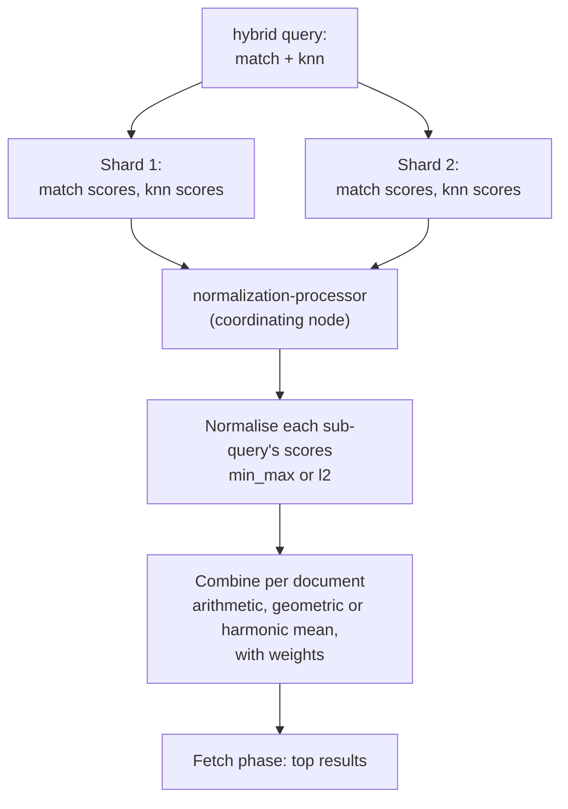

**OpenSearch** began in 2021 as a fork of Elasticsearch 7.10, created by AWS after Elastic changed Elasticsearch's licence. It is Apache 2.0 licensed, and since 2024 it has been governed by the OpenSearch Software Foundation under the Linux Foundation. The two engines share a foundation (Lucene, shards, segments, the query DSL, BM25), but their vector features were built separately and differ in ways that matter: OpenSearch's k-NN plugin lets you choose between vector **engines** (Lucene and Faiss), supports trained index types such as IVF with product quantisation, and does hybrid search through a **search pipeline** that normalises and combines scores.

This lesson assumes you have read [Elasticsearch](/learn/vector-database-ecosystem/elasticsearch), which explains the shard-and-segment search layout that both engines share; it is not repeated here. Instead, it focuses on what is specific to OpenSearch: the `knn_vector` field and its engines, how `k` behaves differently, the score translation, and the normalisation processor that combines lexical and vector scores. You will implement that processor's arithmetic locally and see where score normalisation is fragile.

## Learning objectives

- Write a `knn_vector` mapping, choosing an engine, method and space type, and explain when Faiss IVF or PQ needs a training step.
- Explain how `k` and `size` interact in an OpenSearch k-NN query and how filters are applied.
- Convert a raw distance into an OpenSearch score for the cosine and inner-product spaces.
- Configure a hybrid query with a normalisation processor, compute min-max and L2 normalisation by hand, and explain why the result depends on how many results each sub-query returns.
- Compare OpenSearch and Elasticsearch on vector features, licensing and operations for a given team.

## Prerequisites

- [Elasticsearch](/learn/vector-database-ecosystem/elasticsearch): shards, segments, refresh and per-segment HNSW search.
- [FAISS](/learn/vector-database-ecosystem/faiss): the library behind OpenSearch's Faiss engine.
- [Reciprocal Rank Fusion](/learn/hybrid-search/reciprocal-rank-fusion): rank-based fusion, to compare with score normalisation.
- [Query-document matching](/learn/rag-architecture-fundamentals/query-document-matching): why lexical and semantic scores live on different scales.

## Why this matters

OpenSearch is often already present: Amazon OpenSearch Service is common on AWS, and many teams run it for logs. The question is whether its vector search is good enough to avoid another database, and how to configure it without treating it as "Elasticsearch with a different name".

The mistakes are specific: a ported Elasticsearch query that returns more results than `k`; a deprecated engine that cannot filter during search; a min-max hybrid with good offline numbers whose rankings shift when the page size changes. Each follows from a design choice this lesson explains.

## The intuition

Two judges score a baking competition. One scores out of 100 and is generous; the other scores out of 10 and is harsh. Adding their raw marks lets the generous judge decide everything. A fair organiser first rescales each judge's marks, for example so that each judge's best cake gets 1 and their worst gets 0, and then averages.

That is score normalisation, and it is what OpenSearch's hybrid search does. It works well, with one catch the organiser may not notice: "each judge's worst cake" depends on which cakes were entered. Add or remove one weak entry and every rescaled mark shifts. Rank fusion avoids the problem by asking each judge only for an order, never a mark, at the cost of discarding how much better one cake was than the next.

## How it works

### The k-NN plugin and the knn_vector field

Vector search in OpenSearch is provided by the **k-NN plugin**, bundled with the standard distribution. An index that holds vectors enables it in its settings and declares a `knn_vector` field.

```json
{
  "settings": { "index.knn": true },
  "mappings": {
    "properties": {
      "content":    { "type": "text" },
      "department": { "type": "keyword" },
      "embedding": {
        "type": "knn_vector",
        "dimension": 384,
        "space_type": "cosinesimil",
        "method": {
          "name": "hnsw",
          "engine": "faiss",
          "parameters": { "m": 16, "ef_construction": 128 }
        }
      }
    }
  }
}
```

- `space_type` is the distance: `l2`, `cosinesimil`, `innerproduct`, `l1` or `linf` (engine support varies).
- `method.name` is the algorithm: `hnsw` for all engines, and `ivf` for Faiss.
- `method.engine` chooses the library that builds and searches the native index:
  - **Lucene**: HNSW implemented in Lucene itself, the same code Elasticsearch uses. Simple, Java-native, supports efficient filtering, and suits small to medium indexes.
  - **Faiss**: Meta's library, called from native code. Supports HNSW and IVF, product quantisation and other encoders, and efficient filtering. It is the usual choice for large indexes and is the default engine in recent versions.
  - **NMSLIB**: the original engine; deprecated in recent releases. Avoid it for new indexes, not least because it applies filters only after the search.
- Recent versions also offer a disk-oriented mode (`"mode": "on_disk"` with a `compression_level`), which keeps a heavily compressed copy of the vectors in memory for the graph search and rescores candidates against full-precision vectors on disk. Check your version's documentation; these options are newer than the rest of the plugin.

The Faiss engine has a feature with no Elasticsearch counterpart: **trained methods**. An IVF index or a product-quantisation encoder must learn its clusters or codebooks from sample data before it can index anything. OpenSearch handles this with a **Train API**: you point it at an index of training vectors, it trains a **model** and stores it, and new indexes refer to that model by ID in their mapping. The [IVF](/learn/vector-indexing-algorithms/ivf) and [Product quantisation](/learn/vector-indexing-algorithms/product-quantisation) lessons explain why training is needed; the operational point is that the model is fitted to your data's distribution, so a drastic change in content or embedding model means retraining.

### Querying: k, size and filters

A k-NN query looks like this:

```json
{
  "size": 5,
  "query": {
    "knn": {
      "embedding": {
        "vector": [0.012, -0.044, "..."],
        "k": 10,
        "filter": { "terms": { "department": ["it", "all"] } }
      }
    }
  }
}
```

Here the semantics differ from Elasticsearch. In OpenSearch, `k` is the number of neighbours **each graph search** returns: each segment's native index returns up to `k` candidates, each shard therefore passes up to `k` results onward, and the overall response is cut to `size`. Elasticsearch's `k` is the number of results in the final answer. So with 3 shards, an OpenSearch query with `k: 10` and a large `size` can return up to 30 hits. Set `size` to the number of results you want, and treat `k` as a search-breadth setting closer to Elasticsearch's `num_candidates`. Recent versions also accept a query-time `method_parameters` object (for example `ef_search` for HNSW, `nprobes` for IVF) to set search breadth directly.

The `filter` clause inside `knn` gives **efficient filtering** with the Lucene and Faiss engines: the engine decides, based on how many documents match, whether to search the graph while skipping non-matching documents or to compute exact distances for the matching documents only. Either way you get up to `k` matching results when they exist. A filter placed outside the `knn` clause (for example as a `post_filter`, or in a surrounding `bool` that the k-NN results must also satisfy) is applied after the vector search and can shrink results, exactly as in the [pgvector lesson](/learn/vector-database-ecosystem/postgresql-with-pgvector).

The plugin also offers **exact search** through a `script_score` query with the `knn_score` script, computing the true distance for every document matching an inner query: right for "search only this user's 200 documents" and for ground truth when measuring recall.

### Neural search: embedding inside the cluster

The **neural search** plugin, with **ML Commons**, lets OpenSearch compute embeddings itself: you register a model (deployed to the cluster or reached through a connector to an external API), an **ingest pipeline** with a `text_embedding` processor fills the vector field, and a `neural` query takes `query_text` instead of a vector. This removes an embedding service and ties your embedding model to your search cluster. This lesson passes vectors from the application, keeping the two decoupled.

### Hybrid search with a search pipeline

OpenSearch combines lexical and vector retrieval with two pieces.

1. A **`hybrid` query** holds a list of sub-queries, for example a `match` on `content` and a `knn` (or `neural`) on `embedding`. Each sub-query is executed independently on every shard, producing its own scored list.
2. A **search pipeline** with a **normalisation processor** runs on the coordinating node after the query phase. For each sub-query, it gathers that sub-query's scores from all shards, rescales them with a normalisation technique, and then combines each document's rescaled scores into one with a combination technique.



The normalisation techniques are `min_max` and `l2`, and the combination techniques are `arithmetic_mean`, `geometric_mean` and `harmonic_mean`, each with optional per-sub-query `weights`. Because the processor runs after the query phase on the coordinating node, the normalisation uses each sub-query's results from all shards together, which avoids the inconsistency of normalising each shard separately. Newer releases also add rank-based fusion (RRF) as a pipeline option; check your version.

A pipeline is attached either per request (a `search_pipeline` URL parameter) or as the index's default with the `index.search.default_pipeline` setting.

### OpenSearch and Elasticsearch side by side

| Aspect | OpenSearch | Elasticsearch |
| --- | --- | --- |
| Licence | Apache 2.0 | Source-available licences, with AGPL as an option since 2024 |
| Vector engines | Lucene, Faiss (NMSLIB deprecated) | Lucene |
| Trained indexes (IVF, PQ) | Yes, via the Train API (Faiss) | No; quantised HNSW and flat types instead |
| Meaning of `k` | Results per graph search | Results in the final answer |
| Hybrid fusion | Search pipeline: score normalisation and combination; RRF in newer versions | Score addition with boosts, or RRF retriever |
| Managed options | Amazon OpenSearch Service and Serverless, others | Elastic Cloud, others |

The table is a starting point; both projects release frequently, and features move between versions.

## The mathematics

### Score translation

**Intuition.** Like Elasticsearch, OpenSearch reports a score where larger is better, so each space type maps its distance to a score.

$$
\text{cosinesimil: } \; s = \frac{2 - d}{2} = \frac{1 + \cos\theta}{2}, \quad d = 1 - \cos\theta
\qquad
\text{innerproduct: } \; s = \begin{cases} 1 + \mathbf{q}\cdot\mathbf{x} & \mathbf{q}\cdot\mathbf{x} \ge 0 \\[2pt] \dfrac{1}{1 - \mathbf{q}\cdot\mathbf{x}} & \mathbf{q}\cdot\mathbf{x} < 0 \end{cases}
$$

Here $\theta$ is the angle between query and document vectors, $d$ the cosine distance, and $\mathbf{q}\cdot\mathbf{x}$ the inner product. For `l2`, the score is $1/(1 + d)$ with $d$ the squared Euclidean distance. These keep scores positive and order-preserving. The OpenSearch documentation lists the formula for each engine and space; check it if you depend on absolute values.

### Min-max normalisation and the weighted mean

**Intuition.** Rescale each sub-query's scores so its best result is 1 and its lowest *returned* result is 0, then take a weighted average per document.

$$
\hat{s}_{i}(d) = \frac{s_i(d) - \min_i}{\max_i - \min_i}, \qquad
S(d) = \frac{\sum_i w_i\,\hat{s}_i(d)}{\sum_i w_i}
$$

Here $s_i(d)$ is document $d$'s raw score in sub-query $i$; $\min_i$ and $\max_i$ are the lowest and highest scores among the results sub-query $i$ returned; $w_i$ is that sub-query's weight; and $S(d)$ is the combined score. The `l2` technique instead divides each score by $\sqrt{\sum s_i^2}$ over the sub-query's results.

**By hand.** A BM25 sub-query returns three documents with scores A 6.0, B 4.0, C 2.0. A k-NN sub-query returns A 0.80, B 0.90, C 0.70. Weights are 0.3 for BM25 and 0.7 for k-NN.

- BM25 normalised: A $= (6-2)/(6-2) = 1$, B $= (4-2)/4 = 0.5$, C $= 0$.
- k-NN normalised: A $= (0.80-0.70)/(0.90-0.70) = 0.5$, B $= 1$, C $= 0$.
- Combined: A $= 0.3 \times 1 + 0.7 \times 0.5 = 0.65$; B $= 0.3 \times 0.5 + 0.7 \times 1 = 0.85$; C $= 0$.

B wins. Now suppose the k-NN sub-query had returned a fourth, weaker document D with score 0.50. The k-NN minimum becomes 0.50, so A $= 0.30/0.40 = 0.75$, B $= 1$, C $= 0.5$; and C, which was 0 before, now receives $0.7 \times 0.5 = 0.35$ from k-NN. The combined scores of A, B and C all change, though nothing about A, B or C did. The minimum, and therefore every normalised score, depends on how deep each sub-query went.

```python
def min_max(r):
    lo, hi = min(r.values()), max(r.values())
    return {d: (s - lo) / (hi - lo) for d, s in r.items()}

bm25 = {"A": 6.0, "B": 4.0, "C": 2.0}
for knn in ({"A": 0.80, "B": 0.90, "C": 0.70}, {"A": 0.80, "B": 0.90, "C": 0.70, "D": 0.50}):
    nb, nk = min_max(bm25), min_max(knn)
    combined = {d: 0.3 * nb.get(d, 0) + 0.7 * nk.get(d, 0) for d in sorted(set(nb) | set(nk))}
    print({d: round(s, 3) for d, s in combined.items()})
```

```output
{'A': 0.65, 'B': 0.85, 'C': 0.0}
{'A': 0.825, 'B': 0.85, 'C': 0.35, 'D': 0.0}
```

A moved from 0.20 behind B to 0.025 behind it. With slightly different numbers, it would overtake.

## In code

**The problem.** Implement the normalisation processor's arithmetic on real BM25 and embedding scores for Meridian documents, compare min-max, L2 and RRF fusion, and measure how sensitive min-max is to sub-query depth.

**Dependencies.** NumPy, rank-bm25 and Sentence Transformers (downloads `all-MiniLM-L6-v2` on first use). No cluster.

```bash
pip install numpy rank-bm25 sentence-transformers
```

The k-NN scores use the `cosinesimil` translation $(1 + \cos\theta)/2$. One simplification: a document that a sub-query did not return contributes 0 for that sub-query, which is a reasonable model of the processor; check the documentation for how your version treats missing scores.

```python
import re
import numpy as np
from rank_bm25 import BM25Okapi
from sentence_transformers import SentenceTransformer

docs = {
    "hb-leave":    "Annual leave is 25 days per year. Up to 5 unused days carry over and must be used by 31 March.",
    "hb-remote":   "Staff may work remotely up to 3 days a week. The home-office equipment budget is £400.",
    "hb-contract": "Contractors are not eligible for the home-office equipment budget.",
    "hb-expenses": "Expenses must be submitted within 30 days. Anything over £75 needs a receipt.",
    "it-password": "Passwords must be rotated every 90 days. VPN is required on public Wi-Fi.",
    "it-laptop":   "Laptops are refreshed every 3 years. Report a lost laptop to the support desk at once.",
    "it-e4012":    "Error E-4012: the VPN certificate has expired. Reinstall it from the IT portal.",
    "it-e4021":    "Error E-4021: the VPN client is out of date. Update it from the IT portal.",
}
ids = list(docs)
tok = lambda t: re.findall(r"[a-z0-9]+", t.lower())
bm25 = BM25Okapi([tok(t) for t in docs.values()])
model = SentenceTransformer("sentence-transformers/all-MiniLM-L6-v2")
D = model.encode(list(docs.values()), normalize_embeddings=True)

def subquery_results(query, size):
    """What each sub-query of a hybrid query hands to the normalisation processor."""
    lex = bm25.get_scores(tok(query))
    sem = (1 + D @ model.encode(query, normalize_embeddings=True)) / 2  # cosinesimil score
    top = lambda s: {ids[i]: float(s[i]) for i in np.argsort(-s)[:size] if s[i] > 0}
    return top(lex), top(sem)

def min_max(r):
    lo, hi = min(r.values()), max(r.values())
    return {d: (s - lo) / (hi - lo) if hi > lo else 1.0 for d, s in r.items()}

def l2(r):
    norm = np.sqrt(sum(s * s for s in r.values()))
    return {d: s / norm for d, s in r.items()}

def arithmetic_mean(lists, weights):
    # simplification: a document missing from a sub-query contributes 0 for it
    docs_ = set().union(*lists)
    return {d: sum(w * l.get(d, 0.0) for l, w in zip(lists, weights)) / sum(weights) for d in docs_}

def rrf(lists, k=60):
    docs_ = set().union(*lists)
    ranks = [{d: i + 1 for i, d in enumerate(sorted(l, key=l.get, reverse=True))} for l in lists]
    return {d: sum(1 / (k + r[d]) for r in ranks if d in r) for d in docs_}

def show(name, scores, n=3):
    top = sorted(scores.items(), key=lambda x: -x[1])[:n]
    print(f"  {name:<22}" + "  ".join(f"{d} {s:.3f}" for d, s in top))

for query in ["What does error E-4021 mean?", "Can contractors claim the equipment budget?",
              "How much holiday am I entitled to?"]:
    lex, sem = subquery_results(query, size=5)
    print(f"\n{query}")
    show("BM25 only", lex); show("k-NN only", sem)
    show("min_max, w=[0.3,0.7]", arithmetic_mean([min_max(lex), min_max(sem)], [0.3, 0.7]))
    show("l2, w=[0.3,0.7]", arithmetic_mean([l2(lex), l2(sem)], [0.3, 0.7]))
    show("RRF", rrf([lex, sem]))

print("\nSame query, different sub-query depth (min_max, w=[0.3,0.7]):")
q = "How much holiday am I entitled to?"
for size in (3, 5, 8):
    lex, sem = subquery_results(q, size)
    show(f"size={size}", arithmetic_mean([min_max(lex), min_max(sem)], [0.3, 0.7]))
```

```output

What does error E-4021 mean?
  BM25 only             it-e4021 3.431  it-e4012 1.977
  k-NN only             it-e4021 0.798  it-e4012 0.711  it-laptop 0.604
  min_max, w=[0.3,0.7]  it-e4021 1.000  it-e4012 0.433  it-laptop 0.101
  l2, w=[0.3,0.7]       it-e4021 0.639  it-e4012 0.487  it-laptop 0.286
  RRF                   it-e4021 0.033  it-e4012 0.032  it-laptop 0.016

Can contractors claim the equipment budget?
  BM25 only             hb-contract 4.556  hb-remote 2.133  it-e4012 0.499
  k-NN only             hb-contract 0.794  hb-expenses 0.686  hb-remote 0.648
  min_max, w=[0.3,0.7]  hb-contract 1.000  hb-remote 0.395  hb-expenses 0.380
  l2, w=[0.3,0.7]       hb-contract 0.648  hb-remote 0.435  hb-expenses 0.328
  RRF                   hb-contract 0.033  hb-remote 0.032  it-laptop 0.031

How much holiday am I entitled to?
  BM25 only             it-laptop 0.441  hb-remote 0.428  hb-leave 0.385
  k-NN only             hb-expenses 0.723  hb-leave 0.712  hb-remote 0.663
  min_max, w=[0.3,0.7]  hb-remote 0.721  hb-expenses 0.700  hb-leave 0.660
  l2, w=[0.3,0.7]       hb-leave 0.502  hb-remote 0.496  hb-expenses 0.348
  RRF                   hb-leave 0.032  hb-remote 0.032  it-laptop 0.016

Same query, different sub-query depth (min_max, w=[0.3,0.7]):
  size=3                hb-expenses 0.700  hb-leave 0.567  it-laptop 0.300
  size=5                hb-remote 0.721  hb-expenses 0.700  hb-leave 0.660
  size=8                hb-remote 0.738  hb-expenses 0.700  hb-leave 0.663
```

**The important lines.**

- `subquery_results` returns, for each sub-query, the top `size` documents with positive scores, as a match query and a k-NN query would hand them to the processor. BM25 only returns documents sharing a term with the query.
- `min_max` and `l2` normalise one sub-query's list; `arithmetic_mean` applies the weights; `rrf` ignores scores and uses positions.
- The final loop changes only the depth of each sub-query and re-fuses.

**What the output means.**

- **Easy queries agree.** For the error code and the contractor question, every method puts the right chunk first.
- **Hard queries expose the method.** For "holiday", BM25's best matches are noise (the word "to"), and the small embedding model prefers *expenses* to *leave*. Min-max ranks *remote* first; L2 and RRF put *leave* first, narrowly. No method is "correct" in general; this is one query, and the right choice is the one that wins on your labelled set.
- **Min-max depends on depth.** Changing nothing but how many results each sub-query returns moves the top result from *expenses* (size 3) to *remote* (size 5 and 8). The minimum each list is normalised against changed, and with it every score. In OpenSearch the depth is set by `k` on the k-NN side and by `size` (and pagination) on the hybrid query, so tuning those changes rankings, not just how many results you see.

**Errors people commonly hit.** Tuning weights on one page size and serving another; assuming weights express importance directly (they act on normalised scores, whose spread depends on the result set); forgetting to attach the search pipeline, so the hybrid results are not normalised and combined as you intended.

### The real thing

The following was **not executed**: it needs a running OpenSearch cluster (2.x with the k-NN and neural-search plugins, as in the standard distribution) and the `opensearch-py` client. It creates the pipeline and index, indexes vectors computed in the application, and runs a filtered hybrid query.

```bash
pip install opensearch-py sentence-transformers
export OPENSEARCH_HOST=localhost OPENSEARCH_USER=askmeridian OPENSEARCH_PASSWORD=...
```

```python
import os
from opensearchpy import OpenSearch, helpers
from sentence_transformers import SentenceTransformer

client = OpenSearch(
    hosts=[{"host": os.environ["OPENSEARCH_HOST"], "port": 9200}],
    http_auth=(os.environ["OPENSEARCH_USER"], os.environ["OPENSEARCH_PASSWORD"]),
    use_ssl=True, verify_certs=True,
)
model = SentenceTransformer("sentence-transformers/all-MiniLM-L6-v2")
INDEX, PIPELINE = "askmeridian-chunks", "hybrid-minmax"

client.transport.perform_request("PUT", f"/_search/pipeline/{PIPELINE}", body={
    "phase_results_processors": [{"normalization-processor": {
        "normalization": {"technique": "min_max"},
        "combination": {"technique": "arithmetic_mean", "parameters": {"weights": [0.3, 0.7]}},
    }}]
})

client.indices.create(index=INDEX, body={
    "settings": {"index.knn": True, "index.search.default_pipeline": PIPELINE},
    "mappings": {"properties": {
        "content": {"type": "text"},
        "department": {"type": "keyword"},
        "embedding": {"type": "knn_vector", "dimension": 384, "space_type": "cosinesimil",
                      "method": {"name": "hnsw", "engine": "faiss",
                                 "parameters": {"m": 16, "ef_construction": 128}}},
    }},
})

chunks = {"it-e4021#0": ("it", "Error E-4021: the VPN client is out of date. Update it from the IT portal."),
          "hb-leave#0": ("all", "Annual leave is 25 days. Up to 5 unused days carry over until 31 March.")}
helpers.bulk(client, (
    {"_index": INDEX, "_id": cid, "content": text, "department": dept,
     "embedding": model.encode(text, normalize_embeddings=True).tolist()}
    for cid, (dept, text) in chunks.items()
), refresh=True)

question = "What does error E-4021 mean?"
allowed = {"terms": {"department": ["it", "all"]}}    # from the authenticated user
resp = client.search(index=INDEX, body={
    "size": 5,
    "_source": {"excludes": ["embedding"]},
    "query": {"hybrid": {"queries": [
        {"bool": {"must": {"match": {"content": question}}, "filter": allowed}},
        {"knn": {"embedding": {"vector": model.encode(question, normalize_embeddings=True).tolist(),
                               "k": 20, "filter": allowed}}},
    ]}},
})
for hit in resp["hits"]["hits"]:
    print(hit["_id"], round(hit["_score"], 3), hit["_source"]["content"][:45])
```

Your exact numbers will differ. With only two documents, the error chunk is best on both sides and scores 1.0; the leave chunk is the lowest k-NN result and is not matched lexically, so it ends at or near zero (implementations may floor a zero normalised score at a tiny positive value). The output looks like this:

```text
it-e4021#0 1.0 Error E-4021: the VPN client is out of date.
hb-leave#0 0.0 Annual leave is 25 days. Up to 5 unused days
```

That 0.0 is the depth effect in its starkest form: the lowest result of each list is always normalised to zero, however relevant it is.

**Extending it.** Create a second pipeline with `"technique": "l2"` and run your labelled queries through both, at the page size you will actually serve.

## A real-world example

Meridian's Platform team keeps AskMeridian on Qdrant, but the Security team runs OpenSearch on Amazon OpenSearch Service for log analysis, and wanted an assistant over its incident runbooks and past incident reports. Their engineer, Kofi, reused the existing domain rather than adding a vector database to a team with no one to run it.

He built a Faiss `knn_vector` field, a hybrid `match` plus `knn` query and a min-max pipeline weighted 0.4 to 0.6, and offline evaluation on labelled questions looked good. In production, analysts complained that the assistant's sources changed between the chat widget, which retrieved 5 results, and the "show more sources" view, which retrieved 20. The top result itself sometimes differed.

Kofi traced it to min-max depth: the two views ran the hybrid query with different `size` values, so each sub-query's lowest returned score, and therefore every normalised score, differed. He made three changes: both views now ran one retrieval with a fixed depth of 20 and the widget displayed the first 5; the weights were re-tuned at that depth; and he compared min-max against RRF on the labelled set, keeping min-max because it scored slightly better on queries that named specific hostnames, where the BM25 score margin carried useful information. The lesson he recorded: a normalised hybrid score is a property of the whole result list, so fix the list's depth before tuning anything else.

## Common mistakes

- **Treating `k` as the number of results.** In OpenSearch it is per graph search; the number of hits is governed by `size`, and can exceed `k` across shards.
- **Choosing the NMSLIB engine for a new index.** It is deprecated and filters only after the search; use Faiss or Lucene.
- **Filtering outside the `knn` clause.** Results are cut after retrieval and can fall below what you need. Put restrictions in the `knn` `filter` and in every other hybrid sub-query.
- **Tuning hybrid weights at one depth and serving another.** Min-max scores depend on each sub-query's lowest returned score; change the depth and the ranking moves.
- **Indexing into a Faiss IVF or PQ field without a trained model, or with a model trained on unrepresentative data.** Indexing fails, or recall is poor.
- **Assuming Elasticsearch documentation applies.** Vector syntax and semantics diverged after 2021.

## Best practices

- Use the Faiss engine with HNSW for large indexes and Lucene for small ones; reserve IVF and PQ for memory-constrained scale, with training data that represents the corpus.
- Set `size` to the number of results you need and tune `k` (or `ef_search`) as search breadth.
- Fix the retrieval depth for hybrid queries, then tune normalisation, combination and weights on a labelled set at that depth; compare against RRF.
- Attach the hybrid pipeline as the index default so no client forgets it.
- Exclude vector fields from `_source` in responses.
- Keep embedding in the application unless you deliberately want the cluster to own the model.

## Performance considerations

**Native memory.** The Faiss engine's graphs live in native memory outside the JVM heap, managed by the k-NN plugin's cache, which is bounded by a cluster setting (a percentage of node memory). If the graphs do not fit, they are evicted and reloaded, and latency climbs sharply. One million 384-dimension float vectors are about 1.5 GB, plus graph links of roughly $m \times 2 \times 4$ bytes per vector on the bottom layer (about 128 bytes at $m = 16$); replicas multiply the total. Product quantisation shrinks the stored codes dramatically (for example, 48 one-byte codes instead of 1,536 bytes per vector) at a recall cost; disk-based mode trades memory for extra disk reads during rescoring.

**Warm-up.** Native indexes load lazily on first search, so the first queries after a restart or a new segment are slow. The plugin offers a warm-up API to load them in advance; use it after deployments.

**Hybrid cost.** A hybrid query runs every sub-query on every shard, so it costs roughly the sum of its sub-queries, plus a small amount of coordinator work for normalisation.

**Managed and serverless.** Amazon OpenSearch Serverless offers vector search collections billed by capacity units; its features and limits differ from self-managed OpenSearch, so check before relying on a specific plugin feature.

## Security considerations

- Use the security plugin (or the managed service's equivalent): TLS, authentication, and roles that give the retrieval service read-only access to chunk indexes.
- **Document-level security** in a role definition can restrict which documents a role sees whatever query it sends, which is a strong backstop for permission filters built in the application.
- Remote model connectors in ML Commons send document and query text to an external embedding API; that is a data flow your privacy review must cover, and its credentials must be stored securely.
- Retrieved text is untrusted input to the language model; see [Retrieval manipulation](/learn/rag-security-fundamentals/retrieval-manipulation).

## Summary

- OpenSearch is an Apache 2.0 fork of Elasticsearch 7.10; it shares the shard and segment architecture, but its vector search comes from the k-NN plugin with selectable engines (Lucene, Faiss; NMSLIB deprecated).
- The Faiss engine adds IVF and product quantisation, which require a model trained on sample vectors through the Train API.
- `k` is per graph search and `size` limits the response; filters inside the `knn` clause are applied during the search with Lucene and Faiss.
- Hybrid search uses a `hybrid` query plus a search pipeline whose normalisation processor rescales each sub-query's scores (`min_max` or `l2`) and combines them with weights.
- Min-max normalisation depends on each list's lowest returned score, so rankings change with retrieval depth; fix the depth before tuning, and compare against RRF.

## Exercises

**1.** A BM25 sub-query returns X 12.0, Y 8.0, Z 4.0, and a k-NN sub-query returns X 0.70, Y 0.85, Z 0.75. With min-max normalisation and weights 0.5 and 0.5, compute the combined scores and the ranking.

<details><summary>Show solution</summary>

BM25: X $= (12-4)/8 = 1$, Y $= 0.5$, Z $= 0$. k-NN: min 0.70, max 0.85, so X $= 0$, Y $= 1$, Z $= 0.05/0.15 \approx 0.333$. Combined: X $= 0.5$, Y $= 0.75$, Z $\approx 0.167$. Ranking Y, X, Z. Note that X, the best BM25 result, receives nothing from k-NN because it happened to be that list's minimum.

</details>

**2.** An index has 4 shards. A k-NN query sets `k: 10` and `size: 50`, with no filter. What is the maximum number of hits returned, and how would you get exactly the 10 best?

<details><summary>Show solution</summary>

Each shard can contribute up to 10 results (more precisely, up to `k` per graph search, then the shard's top results), so up to $4 \times 10 = 40$ hits can come back, all within the `size` of 50. To get the 10 best overall, set `size: 10`; keep `k` at 10 or higher as search breadth.

</details>

**3.** In the local script, add `size` values of 2 and 4 to the depth loop for the "holiday" query and record the top result for each. Then make the same change for the RRF ranking. Which method's top result is more stable across depths, and why?

<details><summary>Show solution</summary>

Change the loop to `for size in (2, 3, 4, 5, 8)` and add `show(f"RRF size={size}", rrf([lex, sem]))` inside it. In our run, min-max's top result was *expenses* at sizes 2 to 4 and *remote* at 5 and 8, with genuinely different scores, because each list's minimum moved. RRF behaved differently: from size 3 upwards, *leave* and *remote* both scored exactly $1/62 + 1/63$ (each is second on one list and third on the other), so their order flipped only through tie-breaking. A document's RRF score depends only on its ranks, and its rank does not depend on how many weaker documents follow it, so deeper lists add new documents but never change existing scores. At size 2 no document was in both lists, so RRF had almost nothing to work with. The trade-off: RRF ignores the score margins that min-max uses, and exact ties need a deterministic tie-breaker.

</details>

**4.** Design decision. Your company runs Amazon OpenSearch Service for logs and Elasticsearch on Elastic Cloud for its public site search. A new RAG assistant must search internal documents (3 million chunks) and needs hybrid retrieval and document-level permissions. Which would you build on, and what would you check first?

<details><summary>Show solution</summary>

Either can work; the decision rests on operational fit more than on vector features. Arguments for OpenSearch: the documents are internal, as are the logs, so the same team and network boundary may apply; Faiss with PQ offers a memory-saving path at 3 million chunks; Apache licensing avoids subscription questions. Arguments for Elasticsearch: the site-search team already has search-relevance expertise there, and the RRF retriever and quantised HNSW types are mature. Check first: which team will own and be on call for it; whether document-level security is available and practical on the chosen deployment and plan; memory for 3 million vectors (about 4.6 GB at 384 dimensions in float32 per copy before quantisation); and recall and latency of a pilot on a sample with your real filters, measured against exact search.

</details>

## Check your understanding

```quiz
[
  {
    "q": "In an OpenSearch k-NN query on a 3-shard index, k is 10 and size is 100. How many hits can come back?",
    "options": [
      "Exactly 10",
      "Up to 30, because k applies per graph search and each shard contributes its results",
      "Exactly 100",
      "Up to 3"
    ],
    "answer": 1,
    "why": "In OpenSearch, k is the number of neighbours each graph search returns; the response is limited by size, not by k."
  },
  {
    "q": "Which k-NN engine should you avoid for a new index that needs filtering during the vector search?",
    "options": [
      "Lucene",
      "Faiss with HNSW",
      "NMSLIB",
      "Faiss with IVF"
    ],
    "answer": 2,
    "why": "NMSLIB is deprecated and applies filters after the search. Lucene and Faiss support efficient filtering."
  },
  {
    "q": "Why does a Faiss IVF field need a training step before indexing?",
    "options": [
      "IVF must learn its cluster centroids from sample vectors",
      "Faiss cannot store float32 values without training",
      "Training builds the BM25 statistics",
      "Training is required for any index that uses cosine similarity"
    ],
    "answer": 0,
    "why": "IVF assigns vectors to clusters learned by k-means, and product quantisation learns codebooks; both need representative data first."
  },
  {
    "q": "A hybrid query with min-max normalisation returns different top results when size changes from 5 to 20. What is the cause?",
    "options": [
      "The search pipeline is applied only when size is at least 10",
      "BM25 scores are recomputed with a different IDF",
      "The kNN graph is rebuilt for larger requests",
      "Each sub-query's lowest returned score changes, so every normalised score changes"
    ],
    "answer": 3,
    "why": "Min-max maps each list's minimum to 0 and maximum to 1. A deeper list has a lower minimum, which shifts all normalised scores and can reorder documents."
  },
  {
    "q": "With space_type cosinesimil, a document has cosine similarity 0.6 with the query. What score does OpenSearch report?",
    "options": [
      "0.6",
      "0.4",
      "0.8",
      "1.6"
    ],
    "answer": 2,
    "why": "The cosine distance is 1 - 0.6 = 0.4, and the score is (2 - 0.4) / 2 = 0.8, which equals (1 + cos) / 2."
  }
]
```

## Further reading

- OpenSearch documentation, [opensearch.org/docs](https://opensearch.org/docs/latest/): k-NN plugin (methods, engines, spaces, filtering, Train API), neural search, hybrid search and the normalisation processor.
- opensearch-py, [github.com/opensearch-project/opensearch-py](https://github.com/opensearch-project/opensearch-py).
- Johnson, Douze and Jégou (2017), "Billion-scale similarity search with GPUs", [arXiv:1702.08734](https://arxiv.org/abs/1702.08734): the paper behind Faiss.
- Jégou, Douze and Schmid (2011), "Product Quantization for Nearest Neighbor Search", IEEE Transactions on Pattern Analysis and Machine Intelligence 33(1).
- Bruch, Gai and Ingber (2023), "An Analysis of Fusion Functions for Hybrid Retrieval", [arXiv:2210.11934](https://arxiv.org/abs/2210.11934): compares normalisation-based fusion with RRF.
