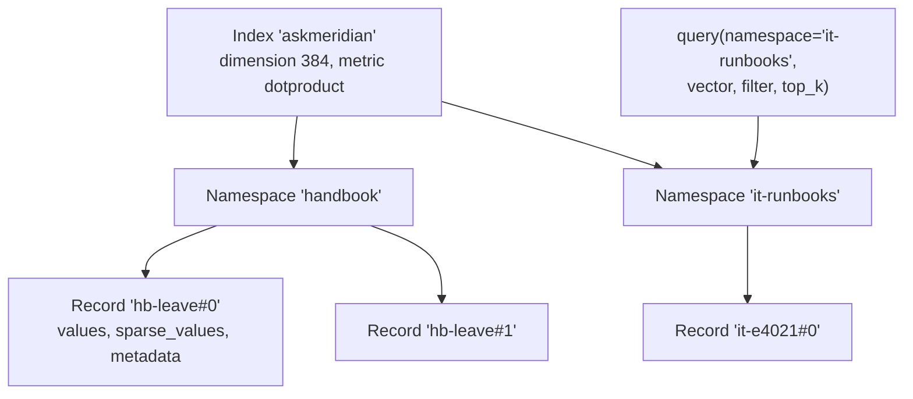
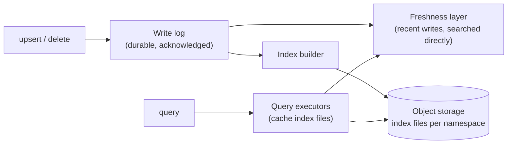

The first five lessons of this module covered software you run yourself: a library ([FAISS](/learn/vector-database-ecosystem/faiss)), an embedded database ([ChromaDB](/learn/vector-database-ecosystem/chromadb)) and three servers ([Qdrant](/learn/vector-database-ecosystem/qdrant), [Weaviate](/learn/vector-database-ecosystem/weaviate), [Milvus](/learn/vector-database-ecosystem/milvus)). **Pinecone** is different in kind. There is no binary to download and no cluster to size. You create an index through an API, send vectors over HTTPS, and pay for what you store and query. Everything else (replicas, disks, upgrades, rebalancing) is the vendor's problem.

This lesson explains Pinecone's data model, how its serverless architecture shapes the behaviour you can expect (eventual consistency, per-namespace cost), how it does hybrid dense-sparse search with a single dot product, and what you give up by not running the database yourself.

## Learning objectives

- Describe Pinecone's data model (index, namespace, record, metadata) and map a RAG corpus onto it.
- Explain the consequences of a serverless, eventually consistent design for ingestion, testing and deletes.
- Compute a sparse-dense hybrid score by hand and explain why the weighting parameter alpha is not a percentage.
- Write upsert and filtered query code against the Pinecone Python SDK, using namespaces for tenant separation.
- Decide, for a given team and workload, whether a managed service like Pinecone is a better fit than a self-hosted database.

## Prerequisites

- [What is a vector database?](/learn/vector-database-fundamentals/what-is-a-vector-database): the five responsibilities and the three kinds of product.
- [Metadata](/learn/vector-database-fundamentals/metadata) and [Filtering](/learn/vector-database-fundamentals/filtering): payload fields and why the order of filter and search matters.
- [Query-document matching](/learn/rag-architecture-fundamentals/query-document-matching): lexical and semantic scoring and why they fail on different queries.
- [Qdrant](/learn/vector-database-ecosystem/qdrant): a self-hosted database to compare against.

## Why this matters

Running a stateful service well is a job: capacity planning, replicas, backups, upgrades, monitoring, and someone woken at three in the morning when a node runs out of disk. For a small team that job can cost more than the rest of the project. A managed service removes it.

It does not remove the need to understand the service's behaviour. Teams who treat it as a black box hit the same surprises: a test that upserts a record and immediately queries for it, then fails intermittently; a bill that grows faster than the corpus because every query searches one enormous namespace; a deletion request from a data-protection officer that nobody can fulfil because chunk identifiers were random; a hybrid search whose weighting knob seems to do nothing between 0.3 and 0.9. Each of these follows directly from how Pinecone is built. Once you know the design, none of them is surprising.

There is also a strategic question: your data sits in someone else's infrastructure and your architecture depends on one vendor's API. Sometimes that is exactly right; sometimes it is a compliance blocker.

## The intuition

Think of the difference between owning a car and using a taxi firm.

Owning a car (self-hosting Qdrant or Milvus) means you choose the model, keep it serviced, insure it, and park it somewhere. It is always there, it does exactly what you configure, and its cost is mostly fixed whether you drive or not.

A taxi firm (Pinecone) means you ring up and say where you want to go. You do not know which car arrives, and you pay per journey. You also accept the firm's rules: the car arrives in a few minutes rather than instantly, you cannot fit a roof rack, and if prices change you pay them. Those rules are what this lesson is about.

## How it works

### The data model

Pinecone organises data in four levels.

- An **index** is the top-level container, created once with a fixed **dimension** (for example 384 for `all-MiniLM-L6-v2`) and a fixed **metric**: `cosine`, `euclidean` or `dotproduct`. Both are permanent; changing either means creating a new index and re-upserting everything.
- A **namespace** is a partition inside an index. Every write and every query targets exactly one namespace, and a query never sees records from another. Namespaces are created implicitly by writing to them.
- A **record** is one vector with a string **ID**, its dense `values`, optionally `sparse_values` (for hybrid search, below), and optionally **metadata**.
- **Metadata** is a flat JSON object of strings, numbers, booleans and lists of strings. It is what you filter on and what you return for citations. Pinecone limits metadata size per record (40 KB at the time of writing; check the current limits page), so long chunk texts are often stored elsewhere and referenced by ID.

Filters use a MongoDB-style language: `{"doc_type": {"$eq": "policy"}}`, `{"version": {"$gte": 2024}}`, `{"groups": {"$in": ["it", "all-staff"]}}`, combined with `$and` and `$or`. The supported operators are `$eq`, `$ne`, `$gt`, `$gte`, `$lt`, `$lte`, `$in`, `$nin` and `$exists`. Pinecone indexes metadata fields for filtering automatically, and applies the filter during the vector search rather than after it, so a selective filter still returns `top_k` results when enough matching records exist. (If that distinction is hazy, [Filtering](/learn/vector-database-fundamentals/filtering) explains why it matters.)



### Mapping a RAG corpus onto it

A good mapping follows three rules.

1. **One index per embedding model.** Vectors from different models are not comparable, so a model upgrade means a new index, populated in parallel, then a cut-over.
2. **Namespaces for hard partitions you never search across.** The classic case is tenants: one namespace per customer in a multi-tenant product. A query is confined to its namespace by construction, which is both a safety property and, as we will see, a cost property. Do not use namespaces for soft categories you sometimes want to combine (handbook versus runbooks, say), because a single query cannot span two namespaces; you would have to query each and merge the results yourself. Soft categories belong in metadata.
3. **Structured, deterministic IDs.** Use `"<document-id>#<chunk-number>"`, such as `hb-leave#0`. Re-upserting the same ID overwrites the record, so re-indexing a changed document is idempotent. On serverless indexes the SDK's `list(prefix="hb-leave#")` returns every chunk ID of one document, which is how you delete or replace a whole document cleanly. Random UUIDs make that impossible.

### Serverless: what the architecture implies

Older **pod-based** indexes ran on provisioned machines you sized. The current default, **serverless**, separates storage from compute: records live in cloud object storage, and stateless query executors fetch and cache the index files they need. Pinecone's engineering writing describes the paths roughly as follows.



Four practical consequences follow, and they are the "rules of the firm".

1. **Writes are eventually consistent.** An upsert is acknowledged once it is durably logged, not once it is searchable. There is a short delay (usually seconds, with no hard guarantee) before a query sees it, and `describe_index_stats()` counts can lag too. Integration tests that upsert and immediately query will fail intermittently; poll with a timeout instead. The same applies to deletes, which matters for "right to be forgotten" requests: the delete is accepted at once and takes effect shortly after.
2. **Cost follows the namespace you search.** Serverless pricing has storage, write units and read units, and Pinecone's documentation ties a query's read-unit cost to the size of the namespace it searches. A thousand tenants in one namespace, separated by a `tenant_id` filter, means every query pays to search everyone's data. A thousand namespaces means each query pays only for its own tenant. Check the current pricing page for the exact formula; the direction of the effect is the design point.
3. **Rarely used data can be slower the first time.** Because executors cache index files, the first query to a namespace that has not been touched recently may need to fetch from object storage. Latency-sensitive applications should test cold-namespace behaviour, not just warm benchmarks.
4. **You tune less, and can tune less.** There is no `ef_search`, no `M`, no choice of algorithm; Pinecone manages the index, which removes both a class of mistakes and your recall-latency levers.

### Hybrid search with sparse-dense vectors

[Query-document matching](/learn/rag-architecture-fundamentals/query-document-matching) showed that lexical and semantic scoring fail on different queries. Most databases combine them by running two searches and fusing the ranked lists. Pinecone supports another approach in a single index: each record carries both a dense vector and a **sparse vector**, a list of `(index, value)` pairs in which each index stands for a vocabulary term. At query time it computes one dot product over both parts:

$$
\text{score} = \mathbf{q}_{\text{dense}} \cdot \mathbf{d}_{\text{dense}} + \mathbf{q}_{\text{sparse}} \cdot \mathbf{d}_{\text{sparse}}
$$

This is why a hybrid index must use the `dotproduct` metric: cosine or Euclidean distance would mix the two parts' lengths meaninglessly.

The sparse vectors can come from any term-weighting scheme. A common choice is BM25 split into two halves: the document side stores each term's saturated, length-normalised term frequency, and the query side sends each term's inverse document frequency. Their dot product then reproduces the BM25 score, because BM25 is a sum over shared terms of (IDF × TF-part). Pinecone's companion `pinecone-text` library provides an encoder that works this way, and learned sparse models such as SPLADE produce sparse vectors directly. [BM25](/learn/sparse-retrieval/bm25) covers the formula itself.

To control the balance, you scale the **query**, not the stored records, with a weight $\alpha$ between 0 and 1: multiply the dense query by $\alpha$ and the sparse query values by $1-\alpha$. With $\alpha = 1$ the search is purely semantic; with $\alpha = 0$, purely lexical. Because only the query is scaled, you can change the balance per request without re-indexing.

Pinecone's documentation also describes keeping dense and sparse vectors in **separate indexes** (it supports sparse-only indexes) and merging the two result lists. That costs two queries but lets each side be tuned and reranked independently; [Hybrid retrieval architecture](/learn/hybrid-search/hybrid-retrieval-architecture) discusses the trade-off.

Pinecone also offers hosted embedding models and rerankers. They are convenient, but if the database also embeds your text, changing database means changing how you embed; treat them as a separate decision.

## The mathematics

### The hybrid score

**Intuition.** The hybrid score is a weighted sum of a semantic score and a lexical score. The weight decides how much each family's opinion counts. The catch is that the two scores live on different scales, so "equal weight" does not mean "equal influence".

$$
s_\alpha(q, d) = \alpha \,(\mathbf{q}_{\text{dense}} \cdot \mathbf{d}_{\text{dense}}) + (1 - \alpha)\,(\mathbf{q}_{\text{sparse}} \cdot \mathbf{d}_{\text{sparse}})
$$

Here $\mathbf{q}_{\text{dense}}$ and $\mathbf{d}_{\text{dense}}$ are the query and chunk embeddings (unit length, so their dot product is the cosine, at most 1); $\mathbf{q}_{\text{sparse}}$ holds the query's term weights (IDFs); $\mathbf{d}_{\text{sparse}}$ holds the chunk's term-frequency weights; and $\alpha \in [0, 1]$ is the weight you choose. The sparse dot product only has non-zero terms where query and chunk share a term.

**By hand.** Suppose for one chunk the cosine is 0.60 and the BM25-style sparse score is 3.6, and for a second chunk the cosine is 0.42 and the sparse score is 2.2. At $\alpha = 0.7$:

- Chunk 1: $0.7 \times 0.60 + 0.3 \times 3.6 = 0.42 + 1.08 = 1.50$.
- Chunk 2: $0.7 \times 0.42 + 0.3 \times 2.2 = 0.294 + 0.66 = 0.954$.

With 70% of the weight on the dense side, chunk 1's dense part is still only 0.42 against 1.08 sparse, because BM25 values are unbounded and here about six times larger than cosines. The effective balance depends on the corpus and the query, not just on $\alpha$. That is why tuning $\alpha$ by intuition ("70% semantic sounds right") goes wrong: tune it on labelled queries, and expect useful values to sit closer to 1 than intuition suggests when sparse scores are large.

The Python below reproduces the hand calculation.

```python
alpha = 0.7
for name, cos, sparse in [("chunk 1", 0.60, 3.6), ("chunk 2", 0.42, 2.2)]:
    dense_part, sparse_part = alpha * cos, (1 - alpha) * sparse
    print(f"{name}: dense part {dense_part:.3f} + sparse part {sparse_part:.3f} = {dense_part + sparse_part:.3f}")
```

```output
chunk 1: dense part 0.420 + sparse part 1.080 = 1.500
chunk 2: dense part 0.294 + sparse part 0.660 = 0.954
```

These numbers are not invented: they are rounded from the real run in the next section.

### Why one dot product is enough

If you concatenate the dense and sparse parts into one long vector for the chunk, $\mathbf{d} = [\mathbf{d}_{\text{dense}} ; \mathbf{d}_{\text{sparse}}]$, and do the same for the scaled query, $\mathbf{q} = [\alpha\,\mathbf{q}_{\text{dense}} ; (1-\alpha)\,\mathbf{q}_{\text{sparse}}]$, then

$$
\mathbf{q} \cdot \mathbf{d} = \alpha\,(\mathbf{q}_{\text{dense}} \cdot \mathbf{d}_{\text{dense}}) + (1-\alpha)\,(\mathbf{q}_{\text{sparse}} \cdot \mathbf{d}_{\text{sparse}}) = s_\alpha(q, d)
$$

because a dot product is a sum over positions and the two parts occupy disjoint positions. The database needs only one scoring function; the weighting lives entirely in the query.

## In code

**The problem.** Score Meridian chunks with dense, sparse and hybrid scoring as a Pinecone hybrid index would, see how the ranking moves with $\alpha$, then write the same thing against the real service.

**Dependencies.** The local part needs NumPy and Sentence Transformers (it downloads `all-MiniLM-L6-v2` on first use). No API key.

```bash
pip install numpy sentence-transformers
```

The script builds BM25 sparse vectors by hand, split into the half Pinecone stores and the half it receives.

```python
import math, re
from collections import Counter
import numpy as np
from sentence_transformers import SentenceTransformer

docs = {
    "hb-leave":    "Annual leave is 25 days per year. Up to 5 unused days carry over and must be used by 31 March.",
    "hb-remote":   "Staff may work remotely up to 3 days a week. The home-office equipment budget is £400.",
    "hb-expenses": "Expenses must be submitted within 30 days. Anything over £75 needs a receipt.",
    "it-password": "Passwords must be rotated every 90 days. VPN is required on public Wi-Fi.",
    "it-e4012":    "Error E-4012: the VPN certificate has expired. Reinstall it from the IT portal.",
    "it-e4021":    "Error E-4021: the VPN client is out of date. Update it from the IT portal.",
}
ids = list(docs)

# ---- Sparse side: BM25 split into a document part and a query part -------
def tokens(text):
    return re.findall(r"[a-z0-9]+", text.lower())

doc_tokens = [tokens(t) for t in docs.values()]
vocab = {t: i for i, t in enumerate(sorted({t for d in doc_tokens for t in d}))}
N, avgdl = len(doc_tokens), sum(map(len, doc_tokens)) / len(doc_tokens)
df = Counter(t for d in doc_tokens for t in set(d))
K1, B = 1.2, 0.75

def encode_document(toks):
    """BM25 term-frequency part: what gets stored as the record's sparse_values."""
    tf = Counter(toks)
    idx = [vocab[t] for t in tf]
    val = [tf[t] * (K1 + 1) / (tf[t] + K1 * (1 - B + B * len(toks) / avgdl)) for t in tf]
    return {"indices": idx, "values": val}

def encode_query(toks):
    """BM25 IDF part: what gets sent as the query's sparse_vector."""
    known = [t for t in set(toks) if t in vocab]
    idf = {t: math.log((N - df[t] + 0.5) / (df[t] + 0.5) + 1) for t in known}
    return {"indices": [vocab[t] for t in idf], "values": list(idf.values())}

def to_dense(sparse, size):
    v = np.zeros(size)
    v[sparse["indices"]] = sparse["values"]
    return v

# ---- Dense side: a real embedding model, unit-length vectors ------------
model = SentenceTransformer("sentence-transformers/all-MiniLM-L6-v2")
D_dense = model.encode(list(docs.values()), normalize_embeddings=True)
D_sparse = np.stack([to_dense(encode_document(t), len(vocab)) for t in doc_tokens])

def hybrid_query(dense_q, sparse_q, alpha):
    """Scale the query, never the stored records: alpha * dense, (1 - alpha) * sparse."""
    return alpha * dense_q, {"indices": sparse_q["indices"],
                             "values": [(1 - alpha) * v for v in sparse_q["values"]]}

def search(query, alpha, k=3):
    dq = model.encode([query], normalize_embeddings=True)[0]
    sq = encode_query(tokens(query))
    hd, hs = hybrid_query(dq, sq, alpha)
    # The index computes ONE dot product over the concatenated [dense | sparse] vector
    scores = D_dense @ hd + D_sparse @ to_dense(hs, len(vocab))
    order = np.argsort(-scores)[:k]
    return [(ids[i], round(float(scores[i]), 3)) for i in order]

for q in ["What does error E-4021 mean?", "How much holiday am I entitled to?"]:
    print(f"\n{q}")
    for alpha in (1.0, 0.7, 0.3, 0.0):
        print(f"  alpha={alpha:.1f}  {search(q, alpha)}")

dq = model.encode(["What does error E-4021 mean?"], normalize_embeddings=True)[0]
sq = to_dense(encode_query(tokens("What does error E-4021 mean?")), len(vocab))
print("\nraw dense scores :", np.round(D_dense @ dq, 3))
print("raw sparse scores:", np.round(D_sparse @ sq, 3))
```

```output

What does error E-4021 mean?
  alpha=1.0  [('it-e4021', 0.596), ('it-e4012', 0.423), ('hb-expenses', 0.142)]
  alpha=0.7  [('it-e4021', 1.493), ('it-e4012', 0.945), ('hb-expenses', 0.099)]
  alpha=0.3  [('it-e4021', 2.688), ('it-e4012', 1.64), ('hb-expenses', 0.042)]
  alpha=0.0  [('it-e4021', 3.584), ('it-e4012', 2.162), ('hb-leave', 0.0)]

How much holiday am I entitled to?
  alpha=1.0  [('hb-expenses', 0.447), ('hb-leave', 0.424), ('hb-remote', 0.325)]
  alpha=0.7  [('hb-leave', 0.569), ('hb-remote', 0.528), ('hb-expenses', 0.313)]
  alpha=0.3  [('hb-remote', 0.797), ('hb-leave', 0.763), ('hb-expenses', 0.134)]
  alpha=0.0  [('hb-remote', 0.999), ('hb-leave', 0.908), ('hb-expenses', 0.0)]

raw dense scores : [0.013 0.076 0.142 0.053 0.423 0.596]
raw sparse scores: [0.    0.    0.    0.    2.162 3.584]
```

**The important lines.**

- `encode_document` stores BM25's term-frequency factor, $\text{tf}(k_1+1)/(\text{tf} + k_1(1 - b + b \cdot |d|/\text{avgdl}))$. `encode_query` sends each known term's IDF. Their dot product over shared terms is the BM25 score.
- `known = ...` drops query terms the corpus never contained: "holiday" has no index position.
- `hybrid_query` scales only the query. The stored `D_dense` and `D_sparse` never change, which is what lets you vary $\alpha$ per request.
- `scores = D_dense @ hd + D_sparse @ ...` is the single dot product over both parts.

**What the output means.**

- **The identifier query.** Here MiniLM does rank E-4021 first (0.596 against 0.423), so the model did keep some of the digits; a less lucky model or a larger corpus of similar codes would not. The sparse side is decisive: "4021" occurs in one chunk only and carries a large IDF, giving 3.584 against 2.162. Every $\alpha$ agrees.
- **The paraphrase query.** Pure dense ($\alpha = 1$) ranks *expenses* above *leave*: a small model confusing two HR topics. Pure sparse ($\alpha = 0$) ranks *remote* first, because the only term it shares with any chunk is "to" (from "up to", in both the remote and leave chunks), and the shorter remote chunk gets the higher length-normalised weight; "holiday" scores nothing. At $\alpha = 0.7$ the leave chunk wins, because it is second on both lists while each rival is first on only one. Neither family alone got this right; the blend did.
- **The scales.** Cosines stay below 0.6 while sparse scores exceed 3, so at $\alpha = 0.3$ the "holiday" query is already sparse-dominated and the leave chunk falls back to second.

**Errors people commonly hit.**

- Creating the hybrid index with `metric="cosine"`. Sparse values are only accepted on a `dotproduct` index; the upsert or query is rejected.
- Scaling the stored vectors by $\alpha$ at ingestion. It works until you want a different $\alpha$, then requires a full re-upsert.

### The same thing against Pinecone

The code below was **not executed** for this lesson: it needs a Pinecone account and an API key. It is written against the current `pinecone` Python package (the older package name was `pinecone-client`). It reuses `model`, `docs`, `doc_tokens`, `encode_document`, `encode_query` and `hybrid_query` from the script above.

```bash
pip install pinecone
export PINECONE_API_KEY=...   # from the Pinecone console; never commit it
```

```python
import os
from pinecone import Pinecone, ServerlessSpec

pc = Pinecone(api_key=os.environ["PINECONE_API_KEY"])
INDEX = "askmeridian-minilm"   # one index per embedding model

if INDEX not in pc.list_indexes().names():
    pc.create_index(
        name=INDEX,
        dimension=384,                 # all-MiniLM-L6-v2
        metric="dotproduct",           # required for sparse-dense hybrid
        spec=ServerlessSpec(cloud="aws", region="us-east-1"),
    )
index = pc.Index(INDEX)  # in production, pass host=... from describe_index to skip a lookup

records = []
for (doc_id, text), toks in zip(docs.items(), doc_tokens):
    records.append({
        "id": f"{doc_id}#0",                              # <document>#<chunk>
        "values": model.encode(text, normalize_embeddings=True).tolist(),
        "sparse_values": encode_document(toks),
        "metadata": {"doc_id": doc_id, "text": text,
                     "source": "handbook" if doc_id.startswith("hb-") else "it-runbook"},
    })
index.upsert(vectors=records, namespace="meridian-staff")

query = "What does error E-4021 mean?"
dense_q, sparse_q = hybrid_query(
    model.encode(query, normalize_embeddings=True), encode_query(tokens(query)), alpha=0.7
)
result = index.query(
    namespace="meridian-staff",
    vector=dense_q.tolist(),
    sparse_vector=sparse_q,
    top_k=3,
    filter={"source": {"$eq": "it-runbook"}},
    include_metadata=True,
)
for match in result.matches:
    print(match.id, round(match.score, 3), match.metadata["text"][:50])

# Replace or remove a whole document: list its chunk IDs by prefix, then delete them.
for id_batch in index.list(prefix="it-e4012#", namespace="meridian-staff"):
    index.delete(ids=id_batch, namespace="meridian-staff")
```

Run straight after the upsert, the query may return fewer results (eventual consistency). With the filter restricting results to runbooks, scores should resemble the $\alpha = 0.7$ line above, with E-4021 first; exact values can differ slightly because Pinecone stores vectors in its own internal format. The output looks like this:

```text
it-e4021#0 1.493 Error E-4021: the VPN client is out of date. Updat
it-e4012#0 0.945 Error E-4012: the VPN certificate has expired. Rei
it-password#0 0.037 Passwords must be rotated every 90 days. VPN is re
```

**Extending it.** Run dense and sparse as separate indexes and fuse them with [Reciprocal Rank Fusion](/learn/hybrid-search/reciprocal-rank-fusion), and compare against the single-index blend on labelled queries.

## A real-world example

Meridian's Platform team runs AskMeridian on a self-hosted Qdrant cluster. In the spring, the Customer Success team asked for something different: a support assistant embedded in Meridian Reports, answering each customer's questions from that customer's own uploaded documents. Several hundred customers, most with a few thousand chunks, a handful with hundreds of thousands, and usage that was heavy in office hours and near zero at night.

Tomás and Aisha compared a second Qdrant cluster, with its own on-call rota and sized for peak, against a Pinecone serverless index. They chose Pinecone, and the design decisions were the interesting part. Namespaces per customer, not a `customer_id` filter, because isolation was then structural (a bug in filter construction could not leak one customer's chunks to another) and because query cost tracked each customer's own data size. IDs of the form `<customer>/<document>#<chunk>`, so that a customer deleting a file mapped to one `list(prefix=...)` and one delete. A small wrapper that waited for a document's chunks to become queryable before telling the user "your file is ready", because the first version reported success on the upsert acknowledgement and users who asked a question straight away got "I don't know".

The decision they documented as a risk was the dependency. The embedding model ran in their own service, not Pinecone's hosted inference, and the chunk text and metadata were also kept in their own PostgreSQL database, so leaving Pinecone would mean re-upserting vectors, not re-processing every customer's documents.

## Common mistakes

- **Querying immediately after upserting in tests.** Writes are eventually consistent; the test passes on a quiet afternoon and fails in CI. Poll with a timeout or fetch by ID before querying.
- **One giant namespace with a tenant filter.** It works, but every query pays to search all tenants, and a single bug in the filter leaks data across customers.
- **Random record IDs.** Without a document prefix you cannot find a document's chunks to update or delete them, and re-indexing creates duplicates instead of overwrites.
- **Putting whole chunk texts in metadata without checking the size limit.** Upserts start failing on the longest chunks, often in production rather than in tests.
- **Treating alpha as a percentage.** The scales differ, so "0.5" is rarely an even split.

## Best practices

- Create one index per embedding model and name it after the model, so a migration is a new index plus a cut-over.
- Use namespaces for hard partitions (tenants, environments); use metadata filters for everything you might combine.
- Design IDs as `<document>#<chunk>` from day one, and keep a mapping from documents to chunk counts in your own store.
- Keep the source of truth (text, versions, permissions) in your own database; treat Pinecone as a rebuildable index.
- Tune hybrid $\alpha$ and `top_k` on a labelled query set, per query type if your traffic is mixed.
- Load-test with realistic namespaces, including cold ones.

## Performance considerations

**Network round trip is part of every query.** Every query is an HTTPS call, and a cross-region call adds tens of milliseconds however fast the search is. Create the index in the application's cloud and region; an agent that retrieves ten times pays the round trip ten times.

**Batch writes.** Upserting one record per request makes ingestion latency-bound. Pinecone caps request size (check the current limits), so batch up to the cap: 2 million chunks at 100 records per request is 20,000 requests; at 1,000, it is 2,000. Parallelise across a few workers and retry on rate limits.

**Cost arithmetic.** You pay for storage, writes and reads. Storage is roughly vectors plus metadata: 2 million 384-dimension float32 vectors are $2{,}000{,}000 \times 384 \times 4 \approx 3.1$ GB before metadata, and 3 KB of chunk text in each record's metadata would add about 6 GB more. That is why many teams keep text out of metadata. Reads scale with query volume and namespace size. Use the current price list for your plan; prices and units change.

**What you cannot tune.** You cannot raise a search-breadth parameter to buy recall, so measure recall against an exact baseline on your own data ([Recall versus latency](/learn/vector-indexing-algorithms/recall-versus-latency)).

## Security considerations

- **API keys are the whole perimeter.** Anyone with the key can read, overwrite or delete every namespace in the project. Keep keys server-side only, never in a browser or mobile app, and use the narrowest key permissions your plan offers.
- **Namespaces are a routing decision made by your code.** If the namespace name comes from user input, a user can ask for another tenant's namespace. Derive it from the authenticated identity on the server.
- **Metadata filters for permissions must be built server-side.** A filter such as `{"groups": {"$in": user_groups}}` is only as trustworthy as the code that computes `user_groups`. See [Document-level permissions](/learn/access-control-and-privacy/document-level-permissions).
- **Data residency.** Chunk text and embeddings are stored by a third party in the region you choose, and embeddings can leak information about their source text. Check your compliance obligations, and whether private networking or customer-managed keys are available on your plan.
- **Deletes are eventual.** For erasure requests, delete by ID prefix and verify later with a fetch.

## Summary

- Pinecone is a fully managed vector database: an index has a fixed dimension and metric, namespaces partition it, and records carry dense values, optional sparse values and flat metadata.
- The serverless design separates storage from compute. Writes are eventually consistent, query cost grows with the namespace searched, and rarely used namespaces may be slower on first access.
- Namespaces suit hard partitions such as tenants; metadata filters suit categories you combine. Structured `<document>#<chunk>` IDs make updates and deletes tractable.
- Sparse-dense hybrid search is one dot product over concatenated vectors, weighted by scaling the query with $\alpha$ and $1-\alpha$. Because sparse and dense scores differ in scale, $\alpha$ must be tuned on data.
- You trade operational work and tuning control for convenience and a vendor dependency; keep your source of truth outside the index so the choice stays reversible.

## Exercises

**1.** A chunk has cosine 0.30 and sparse score 4.0 for some query; a second chunk has cosine 0.80 and sparse score 0.5. For which values of $\alpha$ does the first chunk rank above the second?

<details><summary>Show solution</summary>

Chunk 1 scores $0.30\alpha + 4.0(1-\alpha) = 4.0 - 3.7\alpha$. Chunk 2 scores $0.80\alpha + 0.5(1-\alpha) = 0.5 + 0.3\alpha$. Chunk 1 is ahead when $4.0 - 3.7\alpha > 0.5 + 0.3\alpha$, that is $3.5 > 4.0\alpha$, so $\alpha < 0.875$. The strongly lexical chunk wins for every $\alpha$ up to 0.875, which shows again how the larger sparse scale pushes useful $\alpha$ values towards 1.

</details>

**2.** In the local script, change the query to "Can I carry over unused holiday?" and print the rankings for $\alpha \in \{1.0, 0.7, 0.0\}$. Before running it, predict which side will find the leave chunk and why.

<details><summary>Show solution</summary>

Call `search("Can I carry over unused holiday?", alpha)` for each value. Now "carry", "over" and "unused" occur only in the leave chunk, so even $\alpha = 0$ ranks it first although "holiday" still has no vocabulary entry, and the dense side should agree. Vocabulary mismatch is a property of each query: a missing word matters only when the query has no other distinctive terms.

</details>

**3.** Meridian wants AskMeridian's IT runbooks visible only to the IT group, while the handbook is visible to everyone. Should the runbooks go in a separate namespace or carry a metadata field? Justify your answer with the queries IT staff will run.

<details><summary>Show solution</summary>

Use **metadata**, for example `"groups": ["it"]` on runbook chunks and `"groups": ["all-staff"]` on handbook chunks, and query with `{"groups": {"$in": user_groups}}` built on the server from the authenticated user. IT staff need to search both sources in one query ("VPN on public Wi-Fi" is answered by the handbook-style password chunk and by runbooks); with separate namespaces every IT query would become two queries and a merge. Namespaces suit partitions you never combine, such as separate customers. The filter must be constructed server-side, never from request parameters.

</details>

**4.** Design decision. A three-person team is building a RAG feature for a product with 40 enterprise customers. Two customers' contracts require that their data never leaves the company's own cloud account. Propose an architecture and say what you would measure before committing.

<details><summary>Show solution</summary>

A plain serverless managed index fails the two customers' requirement as stated, because data is stored in the vendor's infrastructure. Options: (a) self-host a vector database (Qdrant, Milvus, or pgvector if PostgreSQL is already run) for everyone, accepting the operational load; (b) a split design, with the managed service for the 38 customers and a self-hosted store for the two, behind one internal retrieval interface; (c) check whether the vendor offers a deployment inside the customer's or company's own cloud account on a suitable plan, and whether it satisfies the contract wording (a legal question, not only a technical one).

For three people, (b) doubles the systems to operate; (a) may be simpler if the corpus fits one modest cluster or PostgreSQL. Before committing, measure vectors and growth, peak queries per second, required p95 latency, recall on a labelled query set, and the real monthly hours self-hosting costs. Hide the store behind one retrieval interface either way.

</details>

## Check your understanding

```quiz
[
  {
    "q": "Your integration test upserts a record into a Pinecone serverless index and queries for it on the next line. It fails about one run in five. What is the most likely cause?",
    "options": [
      "The metric is wrong for the embedding model",
      "Writes are eventually consistent, so the record is not always searchable yet",
      "The namespace was not created before the upsert",
      "Pinecone rejects queries within one second of a write"
    ],
    "answer": 1,
    "why": "An upsert is acknowledged once it is durably logged; it becomes searchable shortly afterwards. Tests should poll with a timeout."
  },
  {
    "q": "Why must a Pinecone index that stores sparse values for hybrid search use the dotproduct metric?",
    "options": [
      "Cosine indexes cannot store more than 384 dimensions",
      "Dot product is the only metric that works with unit-length vectors",
      "The hybrid score is defined as a sum of dense and sparse dot products, which other metrics would distort",
      "Sparse vectors are always negative"
    ],
    "answer": 2,
    "why": "The dense and sparse parts occupy disjoint positions, so one dot product equals the sum of the two dot products. Cosine or Euclidean distance would mix the lengths of the parts."
  },
  {
    "q": "A SaaS product has 2,000 customers, each with their own documents, and never searches across customers. Which design fits Pinecone best?",
    "options": [
      "One namespace per customer",
      "One index per customer",
      "One namespace for everyone with a customer_id metadata filter",
      "One index with no metadata, and post-filtering in the application"
    ],
    "answer": 0,
    "why": "Namespaces isolate partitions that are never combined, confine each query structurally, and keep per-query cost proportional to that customer's data."
  },
  {
    "q": "At alpha = 0.5, a chunk has cosine 0.6 and BM25 sparse score 5.0. What share of its hybrid score comes from the dense side?",
    "options": [
      "50%",
      "About 89%",
      "About 61%",
      "About 11%"
    ],
    "answer": 3,
    "why": "Dense part 0.5 x 0.6 = 0.3, sparse part 0.5 x 5.0 = 2.5, total 2.8; 0.3 / 2.8 is about 11%. Equal weights do not give equal influence when scales differ."
  },
  {
    "q": "Why do Pinecone's guides recommend record IDs such as 'doc-42#3' rather than random UUIDs?",
    "options": [
      "Random UUIDs are rejected by the API",
      "A document prefix lets you list and delete all of a document's chunks, and re-upserts overwrite instead of duplicating",
      "Prefixed IDs are searched faster",
      "IDs are used as part of the similarity score"
    ],
    "answer": 1,
    "why": "Deterministic, prefixed IDs make re-indexing idempotent and make document-level updates and deletions possible with list(prefix=...)."
  }
]
```

## Further reading

- Pinecone documentation, [docs.pinecone.io](https://docs.pinecone.io/): indexes, namespaces, metadata filtering, hybrid search and the current limits and pricing pages.
- Pinecone Python SDK, [github.com/pinecone-io/pinecone-python-client](https://github.com/pinecone-io/pinecone-python-client).
- Robertson and Zaragoza (2009), "The Probabilistic Relevance Framework: BM25 and Beyond", *Foundations and Trends in Information Retrieval* 3(4).
- Formal, Piwowarski and Clinchant (2021), "SPLADE: Sparse Lexical and Expansion Model for First Stage Ranking", [arXiv:2107.05720](https://arxiv.org/abs/2107.05720).
- Bruch, Gai and Ingber (2023), "An Analysis of Fusion Functions for Hybrid Retrieval", ACM Transactions on Information Systems, [arXiv:2210.11934](https://arxiv.org/abs/2210.11934).
