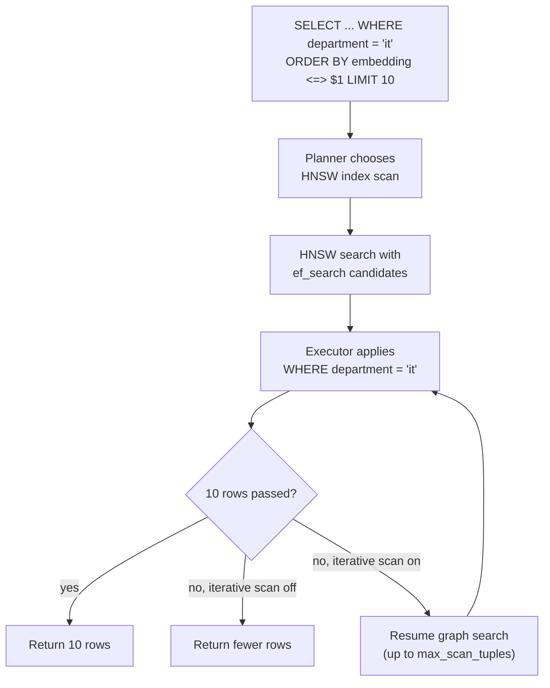

Most companies that build a RAG system already run PostgreSQL. It holds their users, their permissions, their documents' metadata and probably their audit logs. **pgvector** is an open-source extension that adds a vector column type, distance operators and approximate nearest-neighbour indexes to PostgreSQL, so that embeddings can live in the same database, in the same rows, under the same transactions and backups as everything else.

This lesson explains what pgvector adds to PostgreSQL and how the query planner uses it, how its two index types (HNSW and IVFFlat) are created and tuned, and the one behaviour that catches nearly every team: what happens when a vector search has a `WHERE` clause. You will reproduce that behaviour in a local simulation, measure how badly it shrinks results, and see the fix that pgvector 0.8 introduced.

## Learning objectives

- Create a table with a `vector` column, choose the matching distance operator and operator class, and write a query that the HNSW index can serve.
- Tune `m`, `ef_construction` and `hnsw.ef_search` (and `lists` and `ivfflat.probes` for IVFFlat), explaining what each trades.
- Predict, with a formula, how many rows a filtered approximate query returns without iterative scans, and fix it with iterative scans, partial indexes or partitioning.
- Write hybrid keyword-plus-vector retrieval in one SQL statement with Reciprocal Rank Fusion.
- Decide when pgvector is the right store and when a dedicated vector database is.

## Prerequisites

- [What is a vector database?](/learn/vector-database-fundamentals/what-is-a-vector-database): the five responsibilities and where extensions fit.
- [Filtering](/learn/vector-database-fundamentals/filtering): pre-filtering, post-filtering and why the order matters.
- [Indexing](/learn/vector-database-fundamentals/indexing): what an approximate index is and why it trades recall for speed.
- Basic SQL: `CREATE TABLE`, `SELECT ... WHERE ... ORDER BY ... LIMIT`, and the idea of an index.

## Why this matters

A dedicated vector database is a second system of record. Every chunk's metadata, permissions and version must be copied into it and kept in step with the primary database, and every bug in that synchronisation is a RAG bug: a deleted document still answering questions, a permission change that has not propagated, a chunk whose text no longer matches its vector. With pgvector there is nothing to synchronise. The chunk row, its embedding, its document's access list and its version sit in tables joined by foreign keys, and a single transaction updates them together.

You also inherit PostgreSQL's maturity: write-ahead logging, point-in-time recovery, replication, row-level security, and staff who already run it. For corpora up to a few million chunks this often makes pgvector the cheapest correct choice.

The cost is that vector search is a guest in an engine designed for other things. The planner, the executor and the index access method interface were built for B-trees and exact answers, and some of the consequences are surprising. The most important one: an approximate vector index returns a fixed-size batch of candidates, and PostgreSQL applies your `WHERE` clause afterwards. A query for "the 10 nearest runbook chunks the user may see" can return 2, or none, with no error. Teams discover this in production when the assistant starts saying "I don't know" for one department and not another.

## The intuition

Imagine asking a librarian for the ten books nearest in subject to the one you are holding, but only books in Welsh. A careful librarian walks the shelves outward from your book, checking each one's language, until she has ten Welsh books. A hurried librarian grabs the forty nearest books, whatever the language, then hands you the Welsh ones among them. If one book in twenty is in Welsh, you get two. If one in a hundred, you probably get none, and she tells you, quite truthfully, that those were the only matching books she found.

Before version 0.8, pgvector's index scans behaved like the hurried librarian: the index produced its batch of nearest candidates, and PostgreSQL's executor applied the filter to that batch. Iterative scans turn it into the careful librarian, who keeps walking until the request is satisfied or a limit is reached.

## How it works

### What the extension adds

`CREATE EXTENSION vector;` installs four things into a database:

1. **Types.** `vector(n)` stores `n` single-precision floats (up to 16,000 dimensions; indexes support up to 2,000). `halfvec(n)` stores half-precision floats (indexes up to 4,000 dimensions), `bit(n)` binary vectors and `sparsevec(n)` sparse vectors.
2. **Distance operators.** `<->` is Euclidean (L2) distance, `<=>` is cosine distance ($1 - \cos\theta$), `<#>` is the *negative* inner product (negated so that smaller is better, like the others), and `<+>` is L1 distance. Binary vectors add `<~>` (Hamming) and `<%>` (Jaccard).
3. **Index access methods.** `hnsw` and `ivfflat`, each with an **operator class** per distance: `vector_l2_ops`, `vector_cosine_ops`, `vector_ip_ops` and so on.
4. **Functions** such as `cosine_distance()`, `l2_normalize()` and `vector_dims()`.

Each vector value takes $4d + 8$ bytes: four per dimension plus a small header. A 384-dimension embedding is 1,544 bytes.

### How a query uses the index

The index is used only for a query of a specific shape: `ORDER BY embedding <op> constant LIMIT k`, where `<op>` matches the operator class the index was built with. The planner then chooses an **index scan**, in which the HNSW or IVFFlat access method hands rows to the executor in approximately nearest-first order.

1. The planner sees `ORDER BY embedding <=> $1 LIMIT 5` and an HNSW index built with `vector_cosine_ops` on `embedding`, and estimates that the index scan is cheaper than reading every row and sorting.
2. The access method searches the graph with a candidate list of size `hnsw.ef_search` (default 40) and starts returning rows nearest-first.
3. The executor applies any `WHERE` conditions to each returned row and discards those that fail.
4. `LIMIT` stops the scan once enough rows have passed. Without iterative scans, the access method has no more than its `ef_search` candidates to give; if fewer than `k` survive the filter, the query simply returns fewer rows.

Three rules fall out of this. Order **ascending** by the distance operator (for cosine *similarity*, select `1 - (embedding <=> $1)` but order by the distance). Use the operator that **matches the operator class**: an index built with `vector_cosine_ops` is ignored by a query ordering by `<->`. And check with `EXPLAIN` that the plan shows an index scan on your vector index, because a planner that decides a sequential scan is cheaper will give exact results slowly, without telling you.



### HNSW and IVFFlat in pgvector

[HNSW](/learn/vector-indexing-algorithms/hnsw) and [IVF](/learn/vector-indexing-algorithms/ivf) have their own lessons; here is what pgvector exposes.

**HNSW** is the usual choice. It can be built on an empty table and maintained as rows arrive, and its query-time recall is good with default settings.

```sql
CREATE INDEX ON chunks USING hnsw (embedding vector_cosine_ops)
    WITH (m = 16, ef_construction = 64);      -- the defaults
SET hnsw.ef_search = 100;                     -- per session or per transaction
```

`m` is the number of graph links per node per layer, and `ef_construction` the candidate list size while building; raising either improves recall at the cost of build time and index size. `hnsw.ef_search` is the candidate list size at query time and also caps how many rows one scan can return without iterative scans, so it must be at least your `LIMIT`. Build time is dominated by memory: the build is far faster when the graph fits in `maintenance_work_mem` (PostgreSQL logs a notice when it no longer does), and `max_parallel_maintenance_workers` allows parallel builds.

**IVFFlat** partitions vectors into `lists` clusters by k-means, and a query searches the `ivfflat.probes` nearest clusters (default 1). It builds faster and uses less memory than HNSW, but its clusters are learned from the rows present at build time, so it must be created **after** loading representative data, and recall drifts as the data changes. The pgvector documentation suggests starting with `lists` at rows / 1,000 up to a million rows and $\sqrt{\text{rows}}$ beyond, and `probes` near $\sqrt{\text{lists}}$.

### Filtering, properly

With the mechanism above, a filter that matches a fraction $p$ of rows leaves, on average, about $p \times \text{ef\_search}$ of the candidates. pgvector's documentation lists the remedies, and each has its place.

1. **Iterative index scans (pgvector 0.8.0 and later).** `SET hnsw.iterative_scan = strict_order;` (or `relaxed_order`) lets the access method resume the graph search when the executor needs more rows, until `LIMIT` is satisfied or `hnsw.max_scan_tuples` (default 20,000) is reached. `strict_order` guarantees results come out in exact distance order; `relaxed_order` is faster and may return slightly out-of-order rows, which you can re-sort in an outer query. IVFFlat has `ivfflat.iterative_scan = relaxed_order` and `ivfflat.max_probes`.
2. **A B-tree index on the filter column.** When very few rows match (a single document, one small team), the planner may prefer to fetch the matching rows through the B-tree and compute exact distances for them. This is exact and fast when the matching set is small.
3. **Partial indexes.** `CREATE INDEX ... USING hnsw (embedding vector_cosine_ops) WHERE department = 'legal';` builds a graph containing only those rows. Excellent for a handful of fixed, frequently filtered values; impractical for thousands.
4. **Partitioning.** Declarative partitioning by tenant or department gives each partition its own index. Queries that name the partition key search only that partition.

### Hybrid search in one statement

PostgreSQL has had full-text search for many years: a `tsvector` column holds the processed terms of a document, a GIN index makes `@@` matches fast, and `ts_rank_cd` scores them. That means hybrid retrieval can be one SQL statement: rank by vector distance, rank by text match, and fuse the two rankings with [Reciprocal Rank Fusion](/learn/hybrid-search/reciprocal-rank-fusion). The query is in the code section below. PostgreSQL's built-in `ts_rank_cd` is not BM25; it is a simpler proximity-aware score. For many RAG corpora that is good enough as the lexical half of a hybrid; extensions that add BM25 ranking to PostgreSQL exist if you need it.

## The mathematics

### How many rows a filtered query returns

**Intuition.** Without iterative scans, the index offers a fixed batch of $e$ candidates, and each one passes the filter with probability about $p$, the fraction of rows that match. The number that pass is then like counting heads in $e$ coin flips with a biased coin.

$$
\mathbb{E}[\text{rows returned}] \approx \min\!\left(k,\; p\,e\right), \qquad
P(\text{no rows}) \approx (1-p)^{e}
$$

Here $k$ is the `LIMIT`, $e$ is `hnsw.ef_search`, and $p$ is the filter's **selectivity** (the fraction of rows it keeps). The approximation assumes the filter is independent of vector similarity. When it is not (for example, IT chunks cluster together and IT users ask IT questions), reality is better than the formula; when the filter is anti-correlated with the query, it is worse.

**By hand.** With $e = 40$, $k = 10$ and $p = 0.05$: expected rows $= \min(10, 0.05 \times 40) = 2$. The chance of no rows at all is $0.95^{40}$. Using logarithms, $40 \ln 0.95 = 40 \times (-0.0513) = -2.05$, and $e^{-2.05} \approx 0.13$. One query in eight returns nothing. To expect 10 matching rows you need $e \approx k / p = 200$.

```python
k, e = 10, 40
for p in (0.94, 0.051, 0.009):
    print(f"p={p:<6} expected rows={min(k, p * e):5.2f}  P(no rows)={(1 - p) ** e:.3f}  ef needed~{k / p:,.0f}")
```

```output
p=0.94   expected rows=10.00  P(no rows)=0.000  ef needed~11
p=0.051  expected rows= 2.04  P(no rows)=0.123  ef needed~196
p=0.009  expected rows= 0.36  P(no rows)=0.697  ef needed~1,111
```

The three selectivities are the ones measured in the simulation below.

### Distances and their relationships

For unit-length vectors, the three distances order results identically: $\lVert \mathbf{a} - \mathbf{b} \rVert^2 = 2 - 2\cos\theta$, and the inner product equals $\cos\theta$. If your embeddings are normalised, `<#>` with `vector_ip_ops` is the cheapest of the three to compute and gives the same ranking as cosine. If they are not normalised, the choice changes the results, so use the metric the embedding model was trained for, as [Similarity search](/learn/vector-database-fundamentals/similarity-search) explains.

## In code

**The problem.** Measure how many rows a filtered `ORDER BY ... LIMIT 10` query returns under pgvector's default HNSW behaviour, for filters of different selectivity, and compare it with iterative scans and with exact results.

**Dependencies.** NumPy and hnswlib, which implements the same HNSW algorithm. No database is needed for this part.

```bash
pip install numpy hnswlib
```

This is a **simulation** of pgvector's executor behaviour, not pgvector itself: the index scan is modelled as "the first `n` nearest candidates from HNSW", the `WHERE` clause as a Python filter, and the iterative scan as a doubling search. pgvector resumes its graph search incrementally rather than restarting with a larger list, so its scanned counts differ, but the shape of the results is the same.

```python
import numpy as np
import hnswlib

rng = np.random.default_rng(42)
N, DIM, K = 20_000, 64, 10

# Clustered synthetic "chunk embeddings": 50 topics, unit length
centres = rng.normal(size=(50, DIM))
X = centres[rng.integers(0, 50, N)] + 0.6 * rng.normal(size=(N, DIM))
X = (X / np.linalg.norm(X, axis=1, keepdims=True)).astype(np.float32)

# A filter column with three selectivities, assigned independently of the vectors
r = rng.random(N)
department = np.where(r < 0.01, "legal", np.where(r < 0.06, "it", "general"))

# pgvector's defaults: m = 16, ef_construction = 64, hnsw.ef_search = 40
index = hnswlib.Index(space="cosine", dim=DIM)
index.init_index(max_elements=N, M=16, ef_construction=64, random_seed=7)
index.add_items(X, np.arange(N), num_threads=1)

def index_scan(q, n_candidates):
    """The first n_candidates rows the HNSW index scan hands to the executor."""
    index.set_ef(max(n_candidates, 40))
    labels, _ = index.knn_query(q, k=n_candidates, num_threads=1)
    return labels[0]

def plain_query(q, dept, ef_search=40):
    """ORDER BY embedding <=> q LIMIT 10 with WHERE department = dept, no iterative scan:
    the scan stops after ef_search candidates; the WHERE clause filters what is left."""
    cand = index_scan(q, ef_search)
    return [i for i in cand if department[i] == dept][:K]

def iterative_query(q, dept, max_scan_tuples=20_000):
    """hnsw.iterative_scan: keep scanning further until LIMIT is met or the cap is hit."""
    n = 40
    while True:
        hits = [i for i in index_scan(q, n) if department[i] == dept]
        if len(hits) >= K or n >= max_scan_tuples:
            return hits[:K], n
        n = min(n * 2, max_scan_tuples)

def exact(q, dept):
    """Ground truth: a sequential scan of the matching rows."""
    rows = np.where(department == dept)[0]
    return rows[np.argsort(-(X[rows] @ q))][:K]

queries = X[rng.choice(N, 1000, replace=False)]
print(f"{'':<20}{'':>7}{'--- ef_search only ---':>29}{'--- iterative scan ---':>31}")
print(f"{'filter':<20}{'share':>7}{'rows':>7}{'empty':>8}{'recall':>8}{'rows':>9}{'recall':>8}{'scanned':>9}")
for dept in ("general", "it", "legal"):
    share = (department == dept).mean()
    got, zero, rec, it_got, it_rec, scanned = [], 0, [], [], [], []
    for q in queries:
        truth = set(exact(q, dept))
        res = plain_query(q, dept)
        got.append(len(res)); zero += len(res) == 0
        rec.append(len(truth & set(res)) / K)
        res2, n = iterative_query(q, dept)
        it_got.append(len(res2)); it_rec.append(len(truth & set(res2)) / K); scanned.append(n)
    print(f"department = {dept:<7}{share:>7.1%}{np.mean(got):>7.1f}{zero:>8d}{np.mean(rec):>8.2f}"
          f"{np.mean(it_got):>9.1f}{np.mean(it_rec):>8.2f}{np.mean(scanned):>9.0f}")
```

```output
                                  --- ef_search only ---         --- iterative scan ---
filter                share   rows   empty  recall     rows  recall  scanned
department = general  94.0%   10.0       0    0.99     10.0    0.99       40
department = it        5.1%    2.1     121    0.20     10.0    1.00      277
department = legal     0.9%    0.4     696    0.04     10.0    0.97     1566
```

**The important lines.**

- `init_index(..., M=16, ef_construction=64)` and the 40-candidate scan reproduce pgvector's defaults, so the numbers describe what an untuned installation does.
- `plain_query` takes the first `ef_search` candidates and only then filters: this is the post-filtering that the index scan and executor perform together.
- `iterative_query` keeps asking for more candidates until ten rows pass or the 20,000-row cap (pgvector's default `hnsw.max_scan_tuples`) is hit.
- `exact` is the ground truth: the true ten nearest rows among those that match, as a sequential scan would compute.

**What the output means.**

- **Unselective filters are harmless.** At 94% both methods return ten correct rows.
- **Selective filters starve the query.** At 5% selectivity the plain query returns 2.1 rows on average (the formula predicted 2.04) and returns nothing for 121 of 1,000 queries (predicted 123). At 0.9% it returns nothing 696 times (predicted 697). Recall collapses not because the HNSW graph is bad but because there are too few rows.
- **Iterative scans fix it at a measurable cost.** They always return ten rows with near-perfect recall, but scanned about 277 candidates for the 5% filter and about 1,566 for the 0.9% filter, against 40. Latency grows roughly with that count, which is why `hnsw.max_scan_tuples` exists: a filter matching almost nothing could otherwise walk most of the graph.

**Errors people commonly hit.** Setting `hnsw.ef_search` below the `LIMIT`; forgetting that `SET` lasts only for the session (use `SET LOCAL` in a transaction); running a pgvector older than 0.8 and assuming iterative scans exist.

### The real thing in PostgreSQL

The following was **not executed** for this lesson: it needs a running PostgreSQL server with the pgvector extension (0.8.0 or later for iterative scans). The schema keeps chunks, their embeddings and their full-text vectors in one table.

```sql
CREATE EXTENSION IF NOT EXISTS vector;

CREATE TABLE chunks (
    id          bigserial PRIMARY KEY,
    doc_id      text NOT NULL,
    department  text NOT NULL,
    content     text NOT NULL,
    embedding   vector(384) NOT NULL,                      -- all-MiniLM-L6-v2
    tsv         tsvector GENERATED ALWAYS AS (to_tsvector('english', content)) STORED
);

CREATE INDEX chunks_embedding_hnsw ON chunks USING hnsw (embedding vector_cosine_ops);
CREATE INDEX chunks_tsv_gin ON chunks USING gin (tsv);
CREATE INDEX chunks_department ON chunks (department);
```

The Python side uses psycopg 3 and the `pgvector` adapter, which lets you pass NumPy arrays as `vector` values. The hybrid query ranks the top 20 by each method and fuses them with RRF ($k = 60$).

```bash
pip install "psycopg[binary]" pgvector sentence-transformers
export DATABASE_URL=postgresql://askmeridian@localhost/askmeridian
```

```python
import os
import psycopg
from pgvector.psycopg import register_vector
from sentence_transformers import SentenceTransformer

model = SentenceTransformer("sentence-transformers/all-MiniLM-L6-v2")
conn = psycopg.connect(os.environ["DATABASE_URL"], autocommit=True)
register_vector(conn)  # adapts numpy arrays to and from the vector type

docs = [
    ("hb-leave", "general", "Annual leave is 25 days. Up to 5 unused days carry over until 31 March."),
    ("it-e4021", "it", "Error E-4021: the VPN client is out of date. Update it from the IT portal."),
]
with conn.cursor() as cur:
    for doc_id, dept, text in docs:
        cur.execute(
            "INSERT INTO chunks (doc_id, department, content, embedding) VALUES (%s, %s, %s, %s)",
            (doc_id, dept, text, model.encode(text, normalize_embeddings=True)),
        )

HYBRID = """
WITH semantic AS (
    SELECT id, RANK() OVER (ORDER BY embedding <=> %(vec)s) AS r
    FROM chunks WHERE department = ANY(%(depts)s)
    ORDER BY embedding <=> %(vec)s LIMIT 20
), keyword AS (
    SELECT id, RANK() OVER (ORDER BY ts_rank_cd(tsv, q) DESC) AS r
    FROM chunks, websearch_to_tsquery('english', %(text)s) AS q
    WHERE tsv @@ q AND department = ANY(%(depts)s)
    ORDER BY ts_rank_cd(tsv, q) DESC LIMIT 20
)
SELECT c.doc_id, c.content,
       COALESCE(1.0 / (60 + s.r), 0) + COALESCE(1.0 / (60 + k.r), 0) AS rrf
FROM semantic s FULL OUTER JOIN keyword k ON s.id = k.id
JOIN chunks c ON c.id = COALESCE(s.id, k.id)
ORDER BY rrf DESC LIMIT 5
"""

question = "What does error E-4021 mean?"
with conn.transaction():
    conn.execute("SET LOCAL hnsw.iterative_scan = strict_order")
    conn.execute("SET LOCAL hnsw.ef_search = 100")
    rows = conn.execute(HYBRID, {
        "vec": model.encode(question, normalize_embeddings=True),
        "text": question,
        "depts": ["general", "it"],   # computed from the authenticated user, never from input
    }).fetchall()
for doc_id, content, score in rows:
    print(f"{score:.4f}  {doc_id}  {content[:50]}")
```

With only these two rows inserted, the output looks like this:

```text
0.0164  it-e4021  Error E-4021: the VPN client is out of date. Upd
0.0161  hb-leave  Annual leave is 25 days. Up to 5 unused days carr
```

Both scores come from the semantic side alone ($1/61$ and $1/62$). The keyword side matched nothing, because `websearch_to_tsquery` joins terms with AND, and "mean" is not in the chunk. For question-shaped queries, build an OR query, for example `replace(plainto_tsquery('english', %(text)s)::text, '&', '|')::tsquery`, or the lexical half will silently contribute nothing. `SET LOCAL` inside `conn.transaction()` scopes the settings to this query. For bulk loading, insert without the HNSW index and create it afterwards, or use binary `COPY` (the pgvector-python README shows how); building the graph once is much faster than maintaining it row by row.

**Extending it.** Run `EXPLAIN (ANALYZE, BUFFERS)` on the semantic CTE's query to confirm the HNSW index is used.

## A real-world example

Meridian's Platform team runs AskMeridian on Qdrant, but the Finance department built its own small assistant over expense policies and supplier contracts, and its engineer, Gareth, used pgvector because Finance's application already ran on PostgreSQL. Contract chunks carried a `confidentiality` column, and most users could see only `public` and `internal` rows.

The complaint arrived from the procurement team: questions about supplier contracts got "I don't know" about a third of the time, while the same questions asked by a finance manager worked. Gareth's first suspicion was the embedding model. The logs showed otherwise: for procurement users, the retrieval query returned between zero and three rows, never the five requested. Procurement could see only the `internal` contracts, about 4% of all chunks, and the query used the default `ef_search` of 40. By the formula, that is about 1.6 rows on average and no rows roughly one time in five.

The database was on pgvector 0.7, so the immediate fix was to raise `hnsw.ef_search` to 400 for this query with `SET LOCAL`, which brought the expected candidate count to about 16. The lasting fix, after upgrading, was `hnsw.iterative_scan = relaxed_order` with an outer re-sort, plus a test that ran the evaluation queries as a user from each role and asserted that every query returned the full `LIMIT`. The team's post-incident note made one point: the database had never returned an error; "fewer rows than asked for" is a valid SQL result, so it had to be tested for explicitly.

## Common mistakes

- **Ordering by similarity descending.** `ORDER BY 1 - (embedding <=> $1) DESC` is mathematically equivalent, but it does not match the index's operator, so PostgreSQL falls back to a sequential scan and a sort.
- **Mismatched operator and operator class.** An index built with `vector_cosine_ops` is not used by a query ordering by `<->`; the query works, slowly.
- **Assuming `LIMIT 10` returns 10 rows.** With a selective `WHERE` clause and no iterative scan, it may return far fewer, silently.
- **Creating an IVFFlat index on an empty or unrepresentative table.** Its clusters are fitted to the rows present at build time; recall is poor until you rebuild.
- **Plain `SET` behind a connection pool.** It affects one connection and persists for whoever borrows it next. Prefer `SET LOCAL` in a transaction.
- **Indexing more than 2,000 dimensions as `vector`.** The index creation fails; use `halfvec` (up to 4,000) or reduce dimensions.

## Best practices

- Keep chunks, embeddings and their metadata in the same table or joined tables, and update them in one transaction.
- Normalise embeddings at write time and pick one operator; document which in the schema.
- Run `EXPLAIN` on every retrieval query shape in CI, and fail the build if the vector index is not used.
- Enable iterative scans (0.8+) for any filtered vector query, and set `hnsw.max_scan_tuples` to bound worst-case latency.
- Test filtered retrieval as each real role or tenant, asserting the number of rows returned.
- For a few fixed, heavily filtered values, use partial indexes; for tenants, consider partitioning.
- Bulk-load first and build the index afterwards, with enough `maintenance_work_mem` for the graph.

## Performance considerations

**Memory.** HNSW performs best when the index stays in PostgreSQL's shared buffers or the operating system's page cache. One million 384-dimension vectors are $10^6 \times 1{,}544 \approx 1.5$ GB of vector data, and the graph adds links (roughly $2m$ neighbour pointers per node on the bottom layer). With 1,536-dimension embeddings the vectors alone are about 6.1 GB. `halfvec` halves the vector storage at a small recall cost, and an expression index such as `USING hnsw ((embedding::halfvec(1536)) halfvec_cosine_ops)` keeps full precision in the table while indexing at half precision (queries must then order by the same cast expression).

**Shared resources.** Vector search competes with your transactional workload for CPU, memory and I/O on the same server. A burst of RAG traffic can slow the checkout page. Many teams route retrieval to a read replica, which keeps the operational simplicity while isolating the load.

**Build and write costs.** Inserting into an HNSW index means searching the graph to place the new node, so write throughput is lower than for a plain table. Bulk loads should build the index once at the end. Deleted rows leave dead tuples, which `VACUUM` cleans from the index as well; heavy churn makes vacuum work heavier.

**Scale.** pgvector on one well-provisioned server comfortably serves corpora in the low millions of chunks for many teams. Beyond that, or with very high query rates, the absence of built-in sharding for vectors becomes the limit; partitioning, replicas or a distributed PostgreSQL variant help, and a dedicated vector database becomes worth evaluating. Measure with your data; published benchmarks vary widely with settings.

## Security considerations

PostgreSQL's access control applies to vectors like any other column, which is one of pgvector's strongest arguments. Use roles and grants so that the retrieval service can read chunks but not modify them. **Row-level security** (RLS) can enforce document permissions inside the database: a policy such as `USING (department = ANY (current_setting('app.departments')::text[]))` hides rows the session may not see, so an application bug cannot return them.

Be aware that an RLS policy behaves like a `WHERE` clause for the index scan: it is applied to the candidates the HNSW scan returns, so restrictive policies cause exactly the row shortfall measured above. Enable iterative scans when you use RLS with vector search. Set the session variable from the authenticated identity on the server, never from request parameters, and always pass query text and vectors as bound parameters, never by string formatting, to avoid SQL injection. [Document-level permissions](/learn/access-control-and-privacy/document-level-permissions) develops the permission model.

## Summary

- pgvector adds `vector`, `halfvec`, `bit` and `sparsevec` types, distance operators (`<->`, `<=>`, `<#>`, `<+>`) and HNSW and IVFFlat indexes to PostgreSQL, so embeddings share rows, transactions, backups and permissions with the rest of your data.
- The index is used only for `ORDER BY embedding <op> $1 LIMIT k` with the operator matching the operator class; check with `EXPLAIN`.
- HNSW (`m`, `ef_construction`, `hnsw.ef_search`) is the default choice; IVFFlat (`lists`, `ivfflat.probes`) builds faster but must be created after loading data.
- Without iterative scans, a filter keeping a fraction $p$ of rows leaves about $p \times$ `ef_search` candidates, and returns nothing with probability about $(1-p)^{\text{ef\_search}}$. Iterative scans (0.8+), partial indexes and partitioning are the fixes.
- Hybrid search fits in one SQL statement by fusing vector and full-text rankings with RRF.

## Exercises

**1.** A tenant's rows are 2% of a table. With `hnsw.ef_search = 40`, `LIMIT 5` and no iterative scans, estimate the average number of rows returned and the probability of an empty result. What `ef_search` would you need to expect 5 rows?

<details><summary>Show solution</summary>

Expected rows $\approx \min(5, 0.02 \times 40) = 0.8$. $P(\text{empty}) \approx 0.98^{40} = e^{40 \ln 0.98} = e^{-0.808} \approx 0.45$, so nearly half of queries return nothing. To expect 5 rows, $e \approx 5 / 0.02 = 250$. In practice use iterative scans rather than a fixed large `ef_search`, which slows every query including unfiltered ones.

</details>

**2.** Explain why each of these queries does or does not use an HNSW index built with `vector_cosine_ops`: (a) `ORDER BY embedding <=> $1 LIMIT 5`; (b) `ORDER BY embedding <-> $1 LIMIT 5`; (c) `ORDER BY 1 - (embedding <=> $1) DESC LIMIT 5`; (d) `ORDER BY embedding <=> $1` with no `LIMIT`.

<details><summary>Show solution</summary>

(a) Uses the index: ascending order by the matching operator, with a limit. (b) Does not: `<->` is L2 distance, which needs a `vector_l2_ops` index. (c) Does not: the planner matches the expression `embedding <=> $1` in ascending order, not an arithmetic expression of it. (d) Does not, in general: without a `LIMIT` the query asks for every row in exact order, which an approximate index cannot promise, so the planner sorts all rows.

</details>

**3.** Modify the simulation so that the `it` department's rows are concentrated in a few of the 50 topic clusters (for example, assign `it` to rows whose cluster index is below 3), and run IT-flavoured queries drawn from those clusters. Does the plain query return more or fewer rows than the formula predicts, and why?

<details><summary>Show solution</summary>

Record each row's cluster (`labels = rng.integers(0, 50, N)` before building `X`) and set `department[labels < 3] = "it"`, which gives about 6% of rows. Draw queries from rows with `labels < 3`. The plain query then returns many more rows than $0.06 \times 40 = 2.4$, typically close to the full ten, because the query's nearest neighbours are mostly IT rows: the filter is positively correlated with similarity. The formula assumes independence; real RAG filters are often correlated (positively for "my department's documents", negatively for "documents I may see" when the query is about something restricted), so measure with real queries rather than trusting it.

</details>

**4.** Design decision. Meridian Reports wants per-customer retrieval over each customer's uploaded documents: 300 customers, from 1,000 to 400,000 chunks each, 15 million chunks in total, all in an existing PostgreSQL cluster. Propose a pgvector schema and indexing strategy, and say when you would move to a dedicated vector database.

<details><summary>Show solution</summary>

One reasonable design: a `chunks` table partitioned by `customer_id` (hash partitioning into, say, 32 partitions, or list partitions for the few very large customers), each partition with its own HNSW index, plus a B-tree on `customer_id`. Every query includes `customer_id = $1`, so the planner prunes to one partition, and iterative scans handle the remaining filter on co-located small customers. RLS on `customer_id` guards against application bugs. Route retrieval to a read replica.

15 million 384-dimension vectors are about $15 \times 10^6 \times 1{,}544 \approx 23$ GB plus graphs, so memory on the replica matters; `halfvec` indexes halve that. Move to a dedicated database when measurements show that index memory no longer fits a single affordable server, that write churn makes vacuum and index maintenance a bottleneck, or that p95 latency targets are missed under realistic load despite tuning.

</details>

## Check your understanding

```quiz
[
  {
    "q": "What does the pgvector operator <#> return?",
    "options": [
      "The cosine similarity",
      "The negative inner product, so that smaller means more similar",
      "The L1 distance",
      "The Euclidean distance squared"
    ],
    "answer": 1,
    "why": "pgvector negates the inner product so that all operators sort ascending, which lets ORDER BY ... LIMIT use the index."
  },
  {
    "q": "A query has WHERE tenant_id = 7 ORDER BY embedding <=> $1 LIMIT 10, hnsw.ef_search = 40, iterative scans off, and tenant 7 owns 1% of rows. What is the most likely result?",
    "options": [
      "Ten rows, slightly less accurate",
      "An error saying the filter is too selective",
      "Usually zero rows, sometimes one or two",
      "Ten rows, but the query switches to a sequential scan automatically"
    ],
    "answer": 2,
    "why": "About 0.01 x 40 = 0.4 matching candidates survive on average, and 0.99^40 is about 0.67, so most queries return nothing. The database reports no error."
  },
  {
    "q": "When must an IVFFlat index be created?",
    "options": [
      "After loading representative data, because its clusters are learned from existing rows",
      "Before inserting any rows, so that every row is indexed",
      "Only on tables of fewer than 100,000 rows",
      "Only when the vectors are normalised"
    ],
    "answer": 0,
    "why": "IVFFlat runs k-means on the rows present at build time. Built on an empty or unrepresentative table, its lists are poor and recall suffers."
  },
  {
    "q": "Your table stores 3,072-dimension embeddings as vector(3072), and CREATE INDEX ... USING hnsw fails. What is a valid fix?",
    "options": [
      "Raise maintenance_work_mem",
      "Switch the index to ivfflat, which has no limit",
      "Use vector_ip_ops instead of vector_cosine_ops",
      "Index an expression cast to halfvec(3072), which indexes support up to 4,000 dimensions"
    ],
    "answer": 3,
    "why": "vector indexes support up to 2,000 dimensions and halfvec up to 4,000. An expression index on embedding::halfvec(3072) keeps full precision in the table."
  },
  {
    "q": "Why can row-level security reduce the number of rows a vector query returns?",
    "options": [
      "RLS disables the HNSW index entirely",
      "The policy is applied to the candidates the index scan returns, like a WHERE clause",
      "RLS re-ranks rows by permission level",
      "RLS policies are evaluated before the embedding is computed"
    ],
    "answer": 1,
    "why": "Policies filter the rows the scan produces. Without iterative scans, a restrictive policy leaves few of the ef_search candidates."
  }
]
```

## Further reading

- pgvector README and changelog, [github.com/pgvector/pgvector](https://github.com/pgvector/pgvector): types, operators, index options, iterative scans and filtering advice.
- pgvector-python, [github.com/pgvector/pgvector-python](https://github.com/pgvector/pgvector-python): adapters for psycopg, SQLAlchemy and others, with hybrid search examples.
- PostgreSQL documentation, [Full Text Search](https://www.postgresql.org/docs/current/textsearch.html) and [Row Security Policies](https://www.postgresql.org/docs/current/ddl-rowsecurity.html).
- Malkov and Yashunin (2018), "Efficient and robust approximate nearest neighbor search using Hierarchical Navigable Small World graphs", [arXiv:1603.09320](https://arxiv.org/abs/1603.09320).
- Cormack, Clarke and Büttcher (2009), "Reciprocal Rank Fusion outperforms Condorcet and individual Rank Learning Methods", SIGIR.
