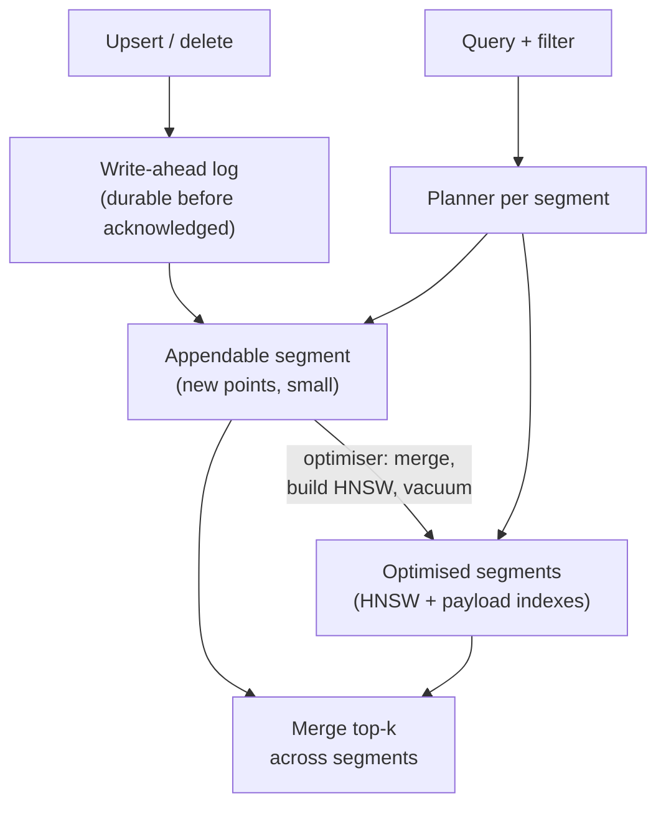

Qdrant is an open-source vector database written in Rust, built around one idea that matters a great deal for RAG: vector search and structured filtering should be a single operation, not a search followed by a clean-up. It stores points (an id, one or more vectors and a JSON payload), indexes both the vectors and selected payload fields, and plans each filtered query according to how selective the filter is. It runs as a single binary or container, as a distributed cluster, as a managed cloud service, or, for development, inside your Python process.

AskMeridian runs on a Qdrant cluster, so this lesson is also a tour of the system the course's running example depends on. You will learn Qdrant's storage architecture, how filtered search works and why payload indexes must exist before data arrives, the client API for the operations a RAG system performs every day, and the configuration levers (quantisation, on-disk storage, sharding and replication) that control cost at scale.

## Learning objectives

- Describe how a Qdrant collection is organised into shards and segments, and what the write-ahead log and the optimiser do.
- Write Qdrant filters with `must`, `should` and `must_not`, and explain how payload indexes and the query planner make filtered search fast and accurate.
- Use the Python client to create a collection, upsert points with stable UUID ids, run filtered and grouped queries, delete by filter and switch collections atomically with an alias.
- Choose quantisation, on-disk and replication settings for a stated memory budget and availability requirement.
- Explain the difference between Qdrant's local mode and a Qdrant server, and what local mode does not exercise.

## Prerequisites

- [What is a vector database?](/learn/vector-database-fundamentals/what-is-a-vector-database): the point model of id, vector and payload.
- [Filtering](/learn/vector-database-fundamentals/filtering): pre-filtering, post-filtering and why filters interact with graph indexes.
- [CRUD operations](/learn/vector-database-fundamentals/crud-operations) and [Persistence](/learn/vector-database-fundamentals/persistence).
- [FAISS](/learn/vector-database-ecosystem/faiss) and [ChromaDB](/learn/vector-database-ecosystem/chromadb): the library view and the embedded-database view, which this lesson contrasts with.

## Why this matters

In a real RAG system almost every query carries conditions. A Meridian employee may only see documents their groups are allowed to see. A question about the current handbook should not retrieve the superseded 2023 edition. A support assistant for one customer must never retrieve another customer's tickets. Each of these is a filter, and how a database combines filters with vector search decides whether retrieval is correct, fast, or neither.

The naive approaches both fail. **Post-filtering** (search for the top 10, then drop the ones the user may not see) returns too few results, sometimes none, whenever the allowed set is small. **Pre-filtering by brute force** (find every allowed point, then compare the query with each) is exact but slow when the allowed set is large. And an approximate graph index searched with a filter applied during the walk can lose recall badly when the filter removes most of the graph, because the walk runs out of allowed neighbours to follow.

Qdrant's design is a direct answer to this problem: payload indexes that know how many points match a condition, a planner that chooses a strategy per query, and a graph index built with extra links so that it stays navigable under filters. Understanding that design tells you which settings matter (and when they must be set), and it explains failure modes, such as a filtered query that is slow or misses obvious results, that otherwise look like mysteries.

## The intuition

Imagine a large library where books are shelved by topic so that similar books sit together, and each book also has a coloured sticker for which staff groups may borrow it. A reader asks for "books like this one, but only green stickers".

A careless librarian walks to the right part of the topic shelves, picks the ten nearest books, then removes the non-green ones and hands over three. A slow librarian ignores the shelving, gathers every green book in the building and compares each with the request. A good librarian first asks how many green books exist. If there are only a few dozen, she fetches them all from the sticker catalogue and compares each: fast and exact. If there are thousands, she walks the topic shelves but steps over non-green books as she goes, and because the shelves were arranged with extra signposts between green books, she never gets stranded in a section with no green books in reach.

Qdrant is the good librarian. The sticker catalogue is a **payload index**, the decision is the **query planner**, and the extra signposts are the additional graph links Qdrant builds for indexed payload values.

## How it works

### The data model

A **collection** holds **points**. Each point has:

- an **id**: an unsigned 64-bit integer or a UUID (strings such as `handbook#3` are rejected, so derive a UUID from them);
- one or more **vectors**: a single unnamed vector, or several **named vectors** (for example `dense` and `title`), plus optional **sparse vectors** for keyword-style signals and **multivectors** for late-interaction models;
- a **payload**: a JSON object with arbitrary fields, including lists and nested objects.

The collection fixes each vector's size and distance (`Cosine`, `Dot`, `Euclid` or `Manhattan`). For `Cosine`, Qdrant normalises vectors when they are stored and then uses the dot product, so the scores it returns are similarities: **higher is better**, the opposite convention to Chroma's distances.

### Storage: shards, segments and the optimiser



A collection is split into one or more **shards** (on a cluster, these are spread across nodes), and each shard into **segments**. A segment is a self-contained mini-index: vector storage, payload storage, payload indexes and, once it is large enough, an HNSW graph. The write and maintenance cycle is:

1. Every write is appended to the shard's **write-ahead log (WAL)** first. Once it is in the WAL it survives a crash, because on restart Qdrant replays the log. With `wait=True` (the Python client's default for `upsert`) the call returns only after the operation has been applied.
2. New points go into a small **appendable segment**, which is searched without a graph index (brute force over a small set is fast).
3. A background **optimiser** periodically rebuilds segments: it merges small segments, builds an HNSW index once a segment exceeds the configured indexing threshold, and **vacuums** points that were deleted. Deletes and updates are first recorded as marks, and space is reclaimed by this step.
4. A query runs against every segment in parallel, and the per-segment top results are merged into the final top `k`.

This structure is why Qdrant can accept writes continuously while serving queries, and why a collection that has just received a large bulk load may be slower for a while: until the optimiser finishes, many points sit in unindexed segments. The collection's status reports whether optimisation is in progress.

### Filtering and the query planner

A Qdrant filter is a tree of clauses:

- `must`: every condition must hold (logical AND);
- `should`: at least one must hold (logical OR);
- `must_not`: none may hold.

Conditions include exact matches (`MatchValue`), membership (`MatchAny`, `MatchExcept`), numeric and datetime ranges (`Range`, `DatetimeRange`), full-text matches on text-indexed fields, geographic conditions, `IsEmpty` and `HasId`. Clauses nest, so "visible to the user's groups AND (source is the handbook OR source is a runbook) AND NOT superseded" is one filter.

When a query arrives with a filter, each segment's planner estimates the filter's **cardinality** (how many points match) from the payload indexes:

1. If few points match (below a configurable `full_scan_threshold`), it retrieves them from the payload index and scores each exactly. Exact and fast because the set is small.
2. If many points match, it walks the HNSW graph and skips points that fail the filter.
3. To keep step 2 accurate, Qdrant's **filterable HNSW** adds extra graph links among points that share an indexed payload value when it builds the index, so the subgraph of allowed points stays connected.

Step 3 has a practical consequence that surprises people: **those extra links are built only for fields that had a payload index when the graph was built.** Create payload indexes for every field you filter on *before* bulk-loading data. Adding an index later helps the planner's estimates, but the graph will not have the extra links until segments are rebuilt.

For multi-tenant collections (one collection, many customers, every query filtered by tenant), a keyword index can be marked as a **tenant** index (`is_tenant=True`), which lets Qdrant organise storage so that each tenant's points sit together. [Multi-tenancy](/learn/advanced-vector-database-engineering/multi-tenancy) compares this with a collection per tenant.

### Search features a RAG system uses

- **Query API** (`query_points`): nearest-neighbour search with a filter, a score threshold, and paging, plus multi-stage queries where `prefetch` gathers candidates (for example from a sparse and a dense vector) and a final stage fuses or re-scores them. Fusion itself is the subject of [Hybrid search](/learn/hybrid-search).
- **Grouping** (`query_points_groups`): return the best `group_size` points per value of a payload field, typically one or two chunks per source document, so that one long document cannot fill the whole context.
- **Scroll**: page through points matching a filter without a query vector, used for audits and re-indexing.
- **Aliases**: a stable name that points to a collection and can be switched atomically, which makes [embedding model migrations](/learn/advanced-vector-database-engineering/index-updates) safe.

### Memory, quantisation and disk

By default vectors and the HNSW graph are kept in memory. Three levers trade memory for speed or accuracy:

- **Quantisation.** Scalar quantisation stores each float32 component as one byte (4 times smaller); binary quantisation stores one bit per component (32 times smaller); product quantisation compresses further. Searches use the compressed vectors to find candidates, then, with **rescoring** enabled, recompute the top candidates' scores from the original vectors. **Oversampling** fetches extra candidates (for example twice `limit`) before rescoring to recover recall. The algorithms are covered in [Scalar quantisation](/learn/vector-indexing-algorithms/scalar-quantisation) and [Product quantisation](/learn/vector-indexing-algorithms/product-quantisation).
- **On-disk vectors** (`on_disk=True`): the original vectors are memory-mapped from disk, so the operating system keeps the frequently used parts in RAM. Combined with quantised vectors kept in RAM (`always_ram=True`), the common pattern is "compressed vectors in memory for the search, originals on disk for rescoring".
- **On-disk payload**: payloads stored on disk and read only for returned points and indexed fields.

### Distribution

On a cluster, a collection has a fixed number of **shards** and a **replication factor**. Points are routed to shards by id hash (or by a user-defined shard key, which suits per-tenant placement). Each shard has replicas on different nodes; a write is acknowledged according to the collection's write consistency setting, and reads can request a consistency level. Cluster metadata, such as which collections exist and where shard replicas live, is agreed through the Raft consensus protocol; point writes are replicated directly between shard replicas rather than through Raft. [Sharding](/learn/advanced-vector-database-engineering/sharding) and [Replication](/learn/advanced-vector-database-engineering/replication) develop these ideas.

### Local mode

`QdrantClient(":memory:")` or `QdrantClient(path="./qdrant_data")` runs a pure-Python implementation of the API inside your process. It is excellent for tests and examples, and the client code is identical to server code. But it is not the Rust engine: it searches by brute force, ignores HNSW and quantisation settings, and payload indexes have no effect. Measure performance and filtered-search behaviour only against a real server (`docker run -p 6333:6333 qdrant/qdrant` is enough for a laptop).

## In code

### AskMeridian's collection, end to end

**The problem.** Create AskMeridian's collection the way production does: explicit vector size and distance, HNSW and quantisation settings, payload indexes created before any data, stable ids derived from document keys. Then run the queries a RAG service runs: permission-filtered search, one-result-per-document search, deletion of a withdrawn document, and an alias the application can query by a stable name.

**Dependencies.**

```bash
pip install qdrant-client sentence-transformers
```

This was run with `qdrant-client` 1.20 in local mode and the local `all-MiniLM-L6-v2` model. The same code runs unchanged against a server if you replace the client line with `QdrantClient(url="http://localhost:6333")`.

```python
import uuid
from qdrant_client import QdrantClient, models
from sentence_transformers import SentenceTransformer

model = SentenceTransformer("sentence-transformers/all-MiniLM-L6-v2")
client = QdrantClient(":memory:")      # local mode; use QdrantClient(url="http://localhost:6333") for a server

COLLECTION = "askmeridian_minilm_v1"
client.create_collection(
    collection_name=COLLECTION,
    vectors_config=models.VectorParams(size=384, distance=models.Distance.COSINE),
    hnsw_config=models.HnswConfigDiff(m=16, ef_construct=128),
    quantization_config=models.ScalarQuantization(
        scalar=models.ScalarQuantizationConfig(type=models.ScalarType.INT8, always_ram=True)
    ),
)
# Index the payload fields we filter on (a no-op in local mode, essential on a server).
client.create_payload_index(COLLECTION, "groups", models.PayloadSchemaType.KEYWORD)
client.create_payload_index(COLLECTION, "doc_id", models.PayloadSchemaType.KEYWORD)

chunks = [
    ("handbook-2025", 0, "Employees receive 25 days of annual leave per year.", ["all"]),
    ("handbook-2025", 1, "Up to 5 unused leave days carry over and must be used by 31 March.", ["all"]),
    ("handbook-2025", 2, "Staff may work remotely up to 3 days a week.", ["all"]),
    ("runbook-vpn", 0, "Always connect to the VPN when using public Wi-Fi.", ["all"]),
    ("runbook-vpn", 1, "VPN gateway credentials are rotated by the IT on-call engineer.", ["it-staff"]),
    ("runbook-atlas", 0, "Atlas error E-4021 means the VPN client is out of date; update it from the IT portal.", ["all"]),
]

def point_id(doc_id: str, n: int) -> str:
    # Qdrant ids are unsigned integers or UUIDs: derive a stable UUID from our string key.
    return str(uuid.uuid5(uuid.NAMESPACE_URL, f"meridian/{doc_id}#{n}"))

vectors = model.encode([c[2] for c in chunks], normalize_embeddings=True)
client.upsert(
    collection_name=COLLECTION,
    points=[
        models.PointStruct(
            id=point_id(doc, n),
            vector=vec.tolist(),
            payload={"doc_id": doc, "chunk": n, "text": text, "groups": groups},
        )
        for (doc, n, text, groups), vec in zip(chunks, vectors)
    ],
    wait=True,
)
print("points:", client.count(COLLECTION).count)

def visible_to(user_groups):
    # Permission filter: the point's "groups" list must share a value with the user's groups.
    return models.Filter(must=[models.FieldCondition(key="groups", match=models.MatchAny(any=user_groups))])

def ask(question, user_groups, limit=3):
    q = model.encode(question, normalize_embeddings=True).tolist()
    hits = client.query_points(COLLECTION, query=q, query_filter=visible_to(user_groups),
                               limit=limit, with_payload=["doc_id", "text"]).points
    print(f"\n{question}  (groups={user_groups})")
    for h in hits:
        print(f"  {h.score:.3f}  {h.payload['doc_id']:14s} {h.payload['text']}")

ask("who rotates the VPN credentials?", ["all"])
ask("who rotates the VPN credentials?", ["all", "it-staff"])

# One result per source document: group by doc_id.
q = model.encode("VPN problems", normalize_embeddings=True).tolist()
groups = client.query_points_groups(COLLECTION, query=q, group_by="doc_id", limit=3, group_size=1,
                                    query_filter=visible_to(["all", "it-staff"])).groups
print("\nGrouped by document:")
for g in groups:
    print(f"  {g.id:14s} best={g.hits[0].score:.3f}  {g.hits[0].payload['text']}")

# Withdraw a whole document by filter, then check what is left.
client.delete(COLLECTION, points_selector=models.FilterSelector(filter=models.Filter(
    must=[models.FieldCondition(key="doc_id", match=models.MatchValue(value="runbook-atlas"))])), wait=True)
print("\npoints after deleting runbook-atlas:", client.count(COLLECTION).count)

# Aliases: the application queries "askmeridian"; switching models is one atomic alias change.
client.update_collection_aliases(change_aliases_operations=[
    models.CreateAliasOperation(create_alias=models.CreateAlias(collection_name=COLLECTION, alias_name="askmeridian"))
])
print("alias points to:", [(a.alias_name, a.collection_name) for a in client.get_aliases().aliases])
print("count via alias:", client.count("askmeridian").count)
```

```output
qdrant_main.py:18: UserWarning: Payload indexes have no effect in the local Qdrant, except text indexes with `scoring`, which enable text queries. Please use server Qdrant if you need payload indexes.
  client.create_payload_index(COLLECTION, "groups", models.PayloadSchemaType.KEYWORD)
points: 6

who rotates the VPN credentials?  (groups=['all'])
  0.501  runbook-vpn    Always connect to the VPN when using public Wi-Fi.
  0.303  runbook-atlas  Atlas error E-4021 means the VPN client is out of date; update it from the IT portal.
  0.294  handbook-2025  Staff may work remotely up to 3 days a week.

who rotates the VPN credentials?  (groups=['all', 'it-staff'])
  0.785  runbook-vpn    VPN gateway credentials are rotated by the IT on-call engineer.
  0.501  runbook-vpn    Always connect to the VPN when using public Wi-Fi.
  0.303  runbook-atlas  Atlas error E-4021 means the VPN client is out of date; update it from the IT portal.

Grouped by document:
  runbook-vpn    best=0.553  Always connect to the VPN when using public Wi-Fi.
  runbook-atlas  best=0.508  Atlas error E-4021 means the VPN client is out of date; update it from the IT portal.
  handbook-2025  best=0.099  Staff may work remotely up to 3 days a week.

points after deleting runbook-atlas: 5
alias points to: [('askmeridian', 'askmeridian_minilm_v1')]
count via alias: 5
```

**The important lines.**

- `VectorParams(size=384, distance=Distance.COSINE)` fixes the vector contract. Upserting a vector of another length is rejected, which protects you from silently mixing models.
- `HnswConfigDiff(m=16, ef_construct=128)` sets graph degree and build effort; `ScalarQuantization(... INT8, always_ram=True)` keeps one-byte copies of the vectors in RAM for candidate search. Local mode accepts and ignores both, which is why they are safe to keep in test code.
- The two `create_payload_index` calls come **before** the upsert, so that on a server the HNSW graph is built with filter-aware links for `groups` and `doc_id`. Local mode warns that they have no effect, which is the warning at the top of the output.
- `point_id` uses `uuid5`, a deterministic UUID derived from a name. The same document and chunk number always produce the same id, so re-ingestion overwrites rather than duplicates.
- `MatchAny(any=user_groups)` matches when the point's `groups` list shares at least one value with the user's groups: the standard way to express "visible to any of my groups".
- `with_payload=["doc_id", "text"]` returns only the fields needed, which matters when payloads are large.
- `query_points_groups(..., group_by="doc_id", group_size=1)` returns the best chunk from each of up to three documents.
- `FilterSelector` deletes every point of a document in one call, without knowing their ids.
- The alias `askmeridian` lets the application query a stable name; a future model migration creates `askmeridian_<newmodel>_v1` and swaps the alias in one atomic operation.

**What the output means.** The same question gives different answers to different users. Without `it-staff`, the chunk that actually answers "who rotates the VPN credentials?" is invisible, and the best visible chunk scores 0.501; with `it-staff`, the answer appears first at 0.785. The filter was applied inside the search, so the non-IT user still received three results rather than a post-filtered two. Whether the system should answer at all from a 0.501 chunk that does not contain the answer is a question for your prompt and thresholds; the database has done its job. The grouped query returns one chunk per document; note how weak the handbook's best match is (0.099), a sign that `limit=3` groups was more than this query deserved.

**Errors people commonly hit.**

- `Unable to parse UUID` or a similar 400 error: using a string such as `"handbook-2025#0"` as a point id. Derive a UUID as above.
- `Wrong input: Vector dimension error`: the embedding model changed but the collection did not.
- Filters on a field that matches nothing because the payload stored `"Groups"` or a single string where a list was expected. Qdrant does not enforce a payload schema, so validate payloads in your ingestion code.
- Slow or low-recall filtered searches on a server because the filtered field has no payload index, or the index was added after the data.
- Surprises in production after testing in local mode, which has no HNSW, no quantisation and no payload indexes.

**Extending it.** Add a `superseded` boolean and a `must_not` clause so the 2023 handbook never surfaces; run the script against Docker Qdrant and inspect `client.get_collection(COLLECTION)` for status, segment count and indexed vectors; add a sparse vector and a `prefetch` stage once you reach [Hybrid search](/learn/hybrid-search).

## A real-world example

When the Platform team moved AskMeridian from a pickled NumPy array to Qdrant, they loaded the employee handbook and IT runbooks, a few tens of thousands of chunks at the time, into a collection created with default settings. Each payload carried a `groups` list so that some runbooks could be restricted to IT staff, and every query carried a `MatchAny` filter on it. Nobody created a payload index; at that size, nobody needed one.

It worked, until Meridian connected its product documentation and incident archive, taking the collection to several million chunks. Queries from IT staff were fine. Queries from everyone else, filtered to the `all` group, were fine. But a new restricted group, `security`, had only a few hundred chunks, and its members reported that the assistant "couldn't find" documents they knew existed, while also being noticeably slower.

The diagnosis took an afternoon. The `groups` field had no payload index, because nobody had created one. Without it, the planner could not tell that the `security` filter matched only a few hundred points, so instead of fetching them directly and scoring them exactly, it walked the HNSW graph, skipping almost every node; the graph, built without filter-aware links for `groups`, left the walk stranded far from the few allowed points. The fix had two parts: create a keyword payload index on `groups`, and rebuild the collection (into a new collection, switched over with an alias) so that the HNSW graph was constructed with the index in place. Restricted-group queries became both fast and complete. The team's ingestion runbook now creates every filterable field's payload index as part of collection creation, before the first point is written, and their test suite checks recall separately for the smallest group.

## Common mistakes

- **Filtering on unindexed payload fields.** The planner cannot estimate cardinality and the graph has no filter-aware links, so selective filters become slow, inaccurate or both.
- **Creating payload indexes after the bulk load.** The graph was already built without the extra links; rebuild or re-optimise.
- **Post-filtering in application code.** Searching without the permission filter and discarding results afterwards returns too few results and risks leaking restricted content through logs or bugs.
- **Benchmarking in local mode.** It is a brute-force Python implementation with none of the server's index structures.
- **Generating random UUIDs on each ingestion run.** Every run duplicates the corpus. Use `uuid5` over a stable key, or stable integers.
- **Quantising without rescoring.** Compressed vectors alone lose recall; enable rescoring (and oversampling) and measure.
- **Querying a collection by its concrete name from application code.** A model migration then needs a code deployment; query through an alias.

## Best practices

- Write a collection specification (vector size, distance, HNSW, quantisation, payload indexes, shards, replicas) and create collections from it in code, so every environment matches.
- Create payload indexes for every field you filter or group on, before ingesting.
- Keep payloads small and purposeful: ids, text for citation, filter fields, version and access fields. Exclude large fields from responses with `with_payload`.
- Use deterministic ids, `upsert`, and delete by `doc_id` filter when a document is withdrawn or replaced.
- Version collections by embedding model and serve through aliases; keep the previous collection until the new one is verified.
- Take snapshots on a schedule and practise restoring one; also keep the ability to rebuild from source documents.
- Measure recall on a labelled query set per filter class (large groups and small groups behave differently).

## Performance considerations

**Memory budget.** Full-precision vectors cost $4d$ bytes each: for AskMeridian's 384 dimensions, 1,536 bytes, so 5 million chunks need about 7.7 GB before the graph and payloads. The HNSW graph with `m = 16` stores up to 32 neighbour links at its base layer, about 128 bytes per point at 4 bytes per link, roughly another 0.6 GB. Scalar int8 quantisation needs 384 bytes per vector, about 1.9 GB for 5 million; with originals on disk, the in-memory footprint drops to roughly a third. Binary quantisation would need 48 bytes per vector, but recall depends heavily on the embedding model and must be measured with rescoring on.

**Latency.** On a server, a filtered query costs either a payload-index lookup plus exact scoring of the matching points (cheap when few match) or an HNSW walk whose cost grows with `ef` (the search-time breadth parameter, settable per query) and with how much of the graph the filter excludes. Rescoring with originals on disk adds disk reads for `limit × oversampling` vectors per query; on SSDs this is usually small, on network storage it can dominate.

**Ingestion.** Upload in batches (hundreds to a few thousand points per request) and, for very large initial loads, consider raising the indexing threshold or disabling indexing until the load finishes, then letting the optimiser build the graph once; check the current documentation for the exact settings. Watch collection status: while the optimiser works, queries search more unindexed points.

**Scaling out.** Shards spread data and query work across nodes; replicas add read throughput and availability, each multiplying storage. The shard count is set at creation, so choose it with growth in mind (a few shards per node allows rebalancing later).

## Security considerations

A Qdrant server out of the box has no authentication. Configure an API key (and read-only keys for query services), enable TLS, and keep the REST (6333) and gRPC (6334) ports off the public internet; publicly exposed, unauthenticated vector databases have been found by internet scans. Payload-based permissions are only as good as the code that builds the filter: derive the user's groups from a verified identity on the server side, never from request parameters, and add tests that assert a restricted chunk is never returned to an unprivileged user. Qdrant also supports JWT-based access control scoped to collections, useful when different services or tenants should not see each other's collections; check the documentation for your version. Snapshots contain all payloads, so protect them like the source documents.

## Summary

- Qdrant stores points with an integer or UUID id, one or more vectors and a JSON payload, and returns similarity scores where higher is better.
- Writes go through a write-ahead log into segments; a background optimiser merges segments, builds HNSW indexes and reclaims deleted space.
- Filters are trees of `must`, `should` and `must_not` conditions; payload indexes let the planner choose exact scoring for selective filters and a filter-aware HNSW walk otherwise.
- Payload indexes must exist before bulk loading so that the graph is built with filter-aware links.
- Quantisation with rescoring, on-disk originals, sharding and replication are the levers for memory, cost and availability.
- Local mode runs the same client API but none of the server's index structures; test behaviour and performance against a real server.

## Exercises

**1.** Write a Qdrant filter for: visible to any of the groups `["all", "finance"]`, document type is either `handbook` or `policy`, and not marked `superseded`.

<details><summary>Show solution</summary>

```python
flt = models.Filter(
    must=[
        models.FieldCondition(key="groups", match=models.MatchAny(any=["all", "finance"])),
        models.FieldCondition(key="doc_type", match=models.MatchAny(any=["handbook", "policy"])),
    ],
    must_not=[models.FieldCondition(key="superseded", match=models.MatchValue(value=True))],
)
```

`MatchAny` on `doc_type` expresses the OR more compactly than a `should` clause with two `MatchValue` conditions; both are correct. All three fields should have payload indexes (keyword, keyword, bool).

</details>

**2.** A collection will hold 20 million chunks of 768-dimension vectors. Estimate the RAM needed for full-precision vectors, for int8 scalar-quantised vectors, and for binary-quantised vectors, ignoring the graph and payloads.

<details><summary>Show solution</summary>

Full precision: $20{,}000{,}000 \times 768 \times 4 = 61.44$ GB. Int8: $20{,}000{,}000 \times 768 = 15.36$ GB. Binary: $20{,}000{,}000 \times 768 / 8 = 1.92$ GB. With originals on disk and only the quantised copy in RAM, the int8 configuration needs about a quarter of the memory of full precision, and binary about a thirty-second, provided recall with rescoring meets the target on labelled queries.

</details>

**3.** Extend the lesson's script so that the two handbook editions coexist: add a 2023 chunk "Laptops are refreshed every 4 years." with `superseded: True`, a 2025 chunk "Laptops are refreshed every 3 years." with `superseded: False`, and show that the query "how often are laptops replaced?" returns the 2025 chunk only when the filter excludes superseded points.

<details><summary>Show solution</summary>

```python
extra = [("handbook-2023", 7, "Laptops are refreshed every 4 years.", True),
         ("handbook-2025", 7, "Laptops are refreshed every 3 years.", False)]
vecs = model.encode([e[2] for e in extra], normalize_embeddings=True)
client.upsert(COLLECTION, points=[
    models.PointStruct(id=point_id(d, n), vector=v.tolist(),
                       payload={"doc_id": d, "chunk": n, "text": t, "groups": ["all"], "superseded": s})
    for (d, n, t, s), v in zip(extra, vecs)])

q = model.encode("how often are laptops replaced?", normalize_embeddings=True).tolist()
current = models.Filter(must=[models.FieldCondition(key="groups", match=models.MatchAny(any=["all"]))],
                        must_not=[models.FieldCondition(key="superseded", match=models.MatchValue(value=True))])
for name, f in [("no filter", None), ("current only", current)]:
    hits = client.query_points(COLLECTION, query=q, query_filter=f, limit=2).points
    print(name, [h.payload["text"] for h in hits])
```

```output
no filter ['Laptops are refreshed every 3 years.', 'Laptops are refreshed every 4 years.']
current only ['Laptops are refreshed every 3 years.', 'Up to 5 unused leave days carry over and must be used by 31 March.']
```

Without the filter, both laptop chunks come back and their scores are nearly identical, because the texts differ only by one digit; which ranks first is close to arbitrary. With the filter, only the 3-year chunk can be returned. The second "current only" result is a leave chunk with no `superseded` field at all: `must_not` with `MatchValue(True)` does not exclude points that lack the field, which is the behaviour you want here, whereas a `must` clause requiring `superseded == False` would have excluded them.

</details>

**4.** Design: AskMeridian must move from MiniLM (384 dimensions) to a 1,024-dimension model, on a three-node cluster, with no downtime. List the Qdrant-specific steps.

<details><summary>Show solution</summary>

1. Create `askmeridian_<newmodel>_v1` from the collection specification with `size=1024`, the same payload indexes (created first), and the same shard and replication settings.
2. Re-embed all chunks from source and upsert them in batches with the same deterministic ids and payloads; send ongoing ingestion to both collections during the backfill.
3. Wait for the new collection's status to show optimisation complete, then compare recall on the labelled set, including per-group recall for small groups.
4. Swap the `askmeridian` alias to the new collection in one `update_collection_aliases` call (delete the old alias assignment and create the new one in the same request), and deploy the query service's new embedding model in the same release window, so that query embeddings and the collection always match.
5. Keep the old collection and a snapshot until the new one has served without regressions, then delete it.

</details>

## Check your understanding

```quiz
[
  {"q": "Which of these is a valid Qdrant point id?", "options": ["`\"handbook#3\"`", "`\"5f0c7a1e-2f7e-5a8b-9c1d-1b2e3f4a5b6c\"`", "`-42`", "`3.5`"], "answer": 1, "why": "Qdrant ids are unsigned integers or UUIDs; arbitrary strings, negative numbers and floats are rejected."},
  {"q": "Why should payload indexes be created before bulk-loading a collection?", "options": ["Qdrant refuses to create them on non-empty collections", "They encrypt the payload at rest", "The HNSW graph is built with extra filter-aware links only for fields indexed at build time", "They make upserts faster"], "answer": 2, "why": "Filterable HNSW adds links for indexed payload values when the graph is built; an index added later helps planning but not the existing graph."},
  {"q": "A filter matches only 300 of 5 million points. What does Qdrant's planner typically do?", "options": ["Fetch the 300 matching points via the payload index and score them exactly", "Walk the full HNSW graph and post-filter the top 10", "Return an error because the filter is too selective", "Scan all 5 million vectors"], "answer": 0, "why": "With a payload index, the planner sees the low cardinality and chooses exact scoring over the small matching set, which is both fast and complete."},
  {"q": "What does enabling rescoring do when scalar quantisation is on?", "options": ["Rebuilds the HNSW graph after each query", "Recomputes the top candidates' scores using the original vectors", "Normalises the query vector", "Converts cosine scores to distances"], "answer": 1, "why": "Candidates are found with compressed vectors, then their scores are recomputed from the originals to recover accuracy."},
  {"q": "Your tests pass against `QdrantClient(\":memory:\")`, but filtered queries are slow in production. Why might the tests have missed it?", "options": ["Local mode uses a different distance function", "Local mode is a brute-force Python implementation with no HNSW, quantisation or payload indexes", "Local mode caches all queries", "Local mode does not support filters"], "answer": 1, "why": "Local mode implements the API, not the engine, so index-dependent performance and recall behaviour only appear on a server."}
]
```

## Further reading

- Qdrant documentation: concepts (collections, points, payload, indexing, filtering, optimiser, storage), quantisation and distributed deployment. [qdrant.tech/documentation](https://qdrant.tech/documentation/)
- Qdrant source repository, including configuration reference and release notes. [github.com/qdrant/qdrant](https://github.com/qdrant/qdrant)
- Qdrant Python client repository and API reference. [github.com/qdrant/qdrant-client](https://github.com/qdrant/qdrant-client)
- Malkov and Yashunin (2016), *Efficient and robust approximate nearest neighbor search using Hierarchical Navigable Small World graphs*. [arXiv:1603.09320](https://arxiv.org/abs/1603.09320)
- Ongaro and Ousterhout (2014), *In Search of an Understandable Consensus Algorithm*, the Raft paper, for the protocol Qdrant uses for cluster metadata.
