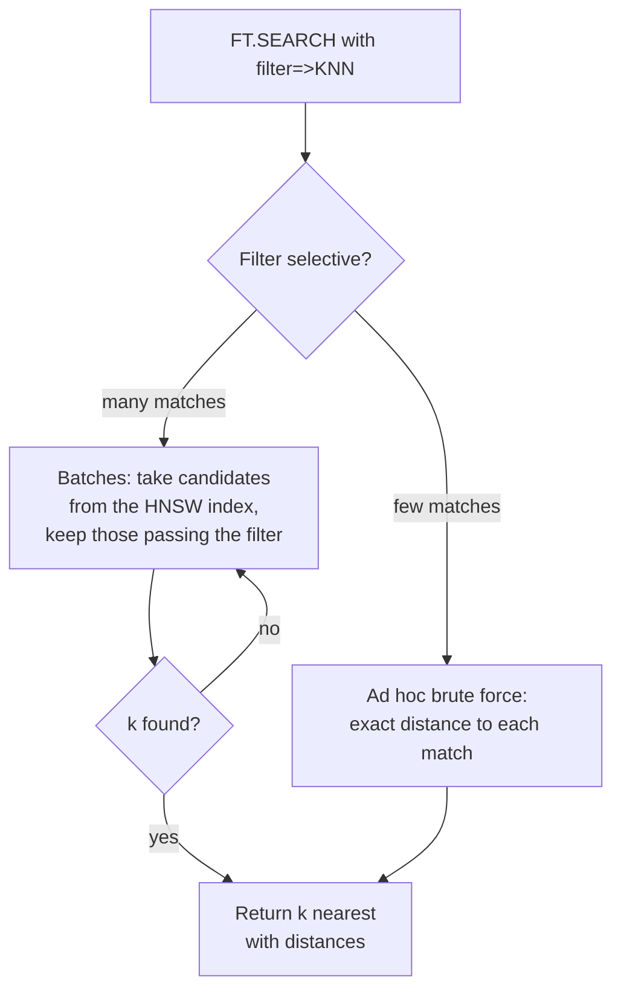

**Redis** is an in-memory data store best known as a cache: values live in RAM, reads and writes take well under a millisecond on the server, and keys can expire on their own. Its search and query engine (once the separate RediSearch module, now built into Redis 8 and later) adds secondary indexes over hashes and JSON documents, including **vector fields** with flat and HNSW indexes, so the same server that caches your sessions can answer nearest-neighbour queries.

That makes Redis a distinctive member of this module. It is rarely the main store for a large document corpus, because RAM is expensive. It is very often the right home for the *small, hot, short-lived* vectors a RAG system produces: a semantic cache of previous answers, a user's recent conversation turns, per-session uploaded documents, or a modest corpus where latency matters most. This lesson explains how vector indexing works in Redis, the exact shape of its commands (where a surprising number of bugs live), how filters combine with KNN, and how to reason about memory and expiry.

## Learning objectives

- Create a Redis vector index over hashes or JSON documents with `FT.CREATE`, choosing algorithm, type, dimension and distance metric.
- Write KNN and range queries with filters in the query dialect, and encode query vectors correctly as bytes.
- Convert between Redis's cosine distance and cosine similarity, and choose a range radius from a similarity threshold.
- Estimate the RAM a Redis vector index needs and decide when that cost rules Redis out.
- Use key expiry to build short-lived vector data such as caches and session memory.

## Prerequisites

- [What is a vector database?](/learn/vector-database-fundamentals/what-is-a-vector-database): the five responsibilities, including persistence.
- [Persistence](/learn/vector-database-fundamentals/persistence): durability, snapshots and logs.
- [Filtering](/learn/vector-database-fundamentals/filtering): how filters and vector search interact.
- [HNSW](/learn/vector-indexing-algorithms/hnsw): the graph index and its `M`, `ef_construction` and `ef` parameters.

## Why this matters

RAG systems have more than one kind of vector data. The main corpus is large, changes slowly and must be durable; that is what most of this module's databases are for. Around it sit smaller collections with very different needs:

- A **semantic cache** that maps recent questions to their generated answers, so a near-duplicate question can be answered without another retrieval and generation. It must be fast (it sits in front of everything), it must expire entries when source documents change, and losing it is harmless.
- **Session or conversation memory**: embeddings of a user's recent turns or uploaded files, needed for minutes or hours, then irrelevant.
- **Small, latency-critical indexes**, such as a product catalogue or a list of intents used to route queries.

Putting these in the main vector database works, but each wants expiry, tiny latency and cheap writes more than it wants durability and scale. Redis offers exactly that profile, and many teams already run it. The flip side is that teams who put a multi-million-chunk corpus in Redis because "it's fast" discover that every vector, and its index, lives in RAM, and that RAM is the most expensive storage they own.

Redis's vector API also has sharp edges. Vectors in hashes are raw bytes with no type information, query syntax requires a specific dialect, and the score it returns is a distance where smaller is better. Each of these produces silent failures: documents that are never indexed, queries that error only in production, and thresholds applied in the wrong direction.

## The intuition

Think of the difference between the reference desk and the archive in a library. The archive (your main vector database) holds everything, carefully catalogued and preserved, and takes a little longer to consult. The reference desk holds a small pile of things people are asking about today: this morning's newspaper, a few popular books, and a stack of sticky notes with answers to questions that came up an hour ago. Things at the desk are thrown away at the end of the day; if the desk is cleared by mistake, nothing important is lost.

Redis is the reference desk. It is wonderful for what is hot and temporary, and a costly place to keep the whole archive.

## How it works

### Data model: keys, hashes and JSON

Redis stores **keys**, each holding a value of some type. Two types can be indexed for search:

- **Hashes**: flat maps of field names to string values. A vector is stored as a field whose value is the vector's raw bytes, for example 384 little-endian 32-bit floats packed into 1,536 bytes.
- **JSON documents** (the JSON data type): nested documents where a vector is an ordinary array of numbers. More readable, a little more memory and CPU per document.

An index is defined over a **key prefix**: every key whose name starts with, say, `chunk:` is indexed automatically when written, re-indexed when modified, and removed from the index when deleted or expired. There is no separate "insert into index" call; writing the hash is the insert.

### Creating an index

```text
FT.CREATE idx:chunks ON HASH PREFIX 1 chunk:
  SCHEMA content TEXT
         department TAG
         embedding VECTOR HNSW 10 TYPE FLOAT32 DIM 384 DISTANCE_METRIC COSINE M 16 EF_CONSTRUCTION 200
```

- `ON HASH PREFIX 1 chunk:` says which keys to index (one prefix, `chunk:`).
- `TEXT` fields get full-text indexing (Redis's own BM25-style scoring), `TAG` fields exact-match filtering, and `NUMERIC` fields range filtering.
- `VECTOR HNSW 10 ...` declares a vector field. The number after the algorithm is how many attribute tokens follow (here 10: five name-value pairs). The required attributes are `TYPE` (`FLOAT32` or `FLOAT64`; newer versions add half-precision types), `DIM` and `DISTANCE_METRIC` (`L2`, `IP` or `COSINE`). HNSW accepts optional `M`, `EF_CONSTRUCTION` and `EF_RUNTIME` (the default search breadth), among others.
- The algorithm is `FLAT` (exact, brute force) or `HNSW` (approximate). Recent releases have added further algorithms; check the documentation for your version.

`FLAT` is a sensible default for small indexes, say tens of thousands of vectors, because it is exact and needs no tuning. HNSW pays off as the index grows.

### Querying

Vector search uses `FT.SEARCH` with a **KNN clause** attached to a filter expression:

```text
FT.SEARCH idx:chunks "(@department:{it|all})=>[KNN 3 @embedding $vec AS distance]"
  PARAMS 2 vec <1,536 bytes>  SORTBY distance  RETURN 2 content distance  DIALECT 2
```

1. The part before `=>` is a filter in Redis's query language: `@department:{it|all}` matches the tag values `it` or `all`; `*` means "no filter".
2. `[KNN 3 @embedding $vec AS distance]` asks for the 3 nearest neighbours in the `embedding` field to the parameter `vec`, and returns each one's distance in a field named `distance`.
3. `PARAMS 2 vec <bytes>` supplies the query vector as raw bytes in the same type and dimension as the index. Vectors cannot be written inline in the query string.
4. `DIALECT 2` (or later) is required for vector queries and parameters.
5. Results come back with the requested fields. For `COSINE`, the distance is $1 - \cos\theta$, so **smaller is better**; sort ascending.



When a filter is present, Redis chooses between two **hybrid policies**: computing exact distances for every document that passes the filter (ad hoc brute force, good when few match) or repeatedly pulling batches of candidates from the vector index and keeping those that pass (good when many match). It estimates the filter's selectivity to choose, and a query can force a policy with the `HYBRID_POLICY` attribute. Either way, unlike the post-filtering trap in the [pgvector lesson](/learn/vector-database-ecosystem/postgresql-with-pgvector), you get `k` results when enough matching documents exist.

Two other query forms are worth knowing. A **range query**, `@embedding:[VECTOR_RANGE 0.2 $vec]`, returns every document within a distance radius rather than a fixed count, which is natural for "anything similar enough" lookups such as a semantic cache. And the same `FT.SEARCH` can combine full-text conditions with vectors, for example requiring the word "VPN" in `content` before the KNN step.

### Expiry: the feature other databases lack

Any Redis key can carry a **time to live** (TTL): `EXPIRE chunk:session-42:3 3600` deletes the key after an hour, and the index drops it automatically. That gives vector data a lifecycle with no clean-up job: cache entries expire, session documents vanish when the session ends, and the index never grows without bound. A semantic cache built this way stores each question's embedding and answer in a hash with a TTL, and looks up new questions with a range query; [Semantic caching](/learn/performance-optimisation/semantic-caching) covers the design, including how to invalidate entries when source documents change.

### Persistence and the Redis family

Redis keeps data in memory and persists it with **RDB** snapshots (periodic point-in-time dumps) and the **AOF** (append-only file, a log of writes replayed on restart). With AOF and `fsync` every second, a crash can lose up to about a second of writes. That is fine for caches and session data and needs careful thought for a primary corpus. Restarts also take time: data is loaded from disk, and large vector indexes may need to be rebuilt as the data loads, so measure restart time for big indexes.

The family has become crowded. Redis changed its licence in 2024 (to dual source-available licences), which led to **Valkey**, a Linux Foundation fork of the last open-source version; Redis 8 then added the AGPL as an open-source option and bundled the query engine into the main distribution. Redis 8 also introduced **vector sets**, a native data type with its own commands (`VADD`, `VSIM`), separate from the query engine, released as a beta at the time. Valkey has its own search module. Managed offerings exist from Redis Ltd and the major clouds. Feature availability differs across these, so confirm that the vector features you rely on exist in the exact product and version you deploy.

In Python, the official client `redis-py` includes the search commands used below. **RedisVL**, a higher-level library from Redis, adds schema files, query builders and ready-made semantic cache and message history classes.

## The mathematics

### Distance, similarity and range radius

**Intuition.** Redis reports cosine *distance*. Thresholds people reason about ("treat questions with similarity above 0.9 as duplicates") are usually in cosine *similarity*. Converting between them is a subtraction, and getting it wrong inverts the meaning of a threshold.

$$
d_{\cos}(\mathbf{q}, \mathbf{x}) = 1 - \cos\theta = 1 - \frac{\mathbf{q}\cdot\mathbf{x}}{\lVert\mathbf{q}\rVert\,\lVert\mathbf{x}\rVert}, \qquad
\cos\theta \ge \tau \iff d_{\cos} \le 1 - \tau
$$

Here $\mathbf{q}$ is the query vector, $\mathbf{x}$ a stored vector, $\theta$ the angle between them, and $\tau$ a similarity threshold. Cosine distance ranges from 0 (same direction) to 2 (opposite). A `VECTOR_RANGE` radius $r$ on a `COSINE` field therefore keeps documents with similarity at least $1 - r$.

**By hand.** A semantic cache should reuse an answer only when the new question's similarity to a cached question is at least $\tau = 0.92$. The radius is $r = 1 - 0.92 = 0.08$. A cached question at distance 0.0612 has similarity $1 - 0.0612 = 0.9388$ and is a hit; one at distance 0.1104 has similarity 0.8896 and is a miss. Setting the radius to 0.92 by mistake would accept almost anything (similarity above 0.08).

### Memory

**Intuition.** Everything Redis serves lives in RAM, so the cost of a vector index is easy to estimate and hard to escape.

$$
M \approx N \times \left(c \cdot 4d + g + t\right)
$$

$N$ is the number of vectors, $d$ the dimension (4 bytes per `FLOAT32` component), $c$ the number of copies of each vector held in memory, $g$ the graph overhead per vector for HNSW, and $t$ the rest of the document (text, tags, key name, Redis's per-key overhead). The vector index keeps its own copy of vector data in addition to the hash field, so for hash documents $c$ is about 2; check with `INFO memory` and `FT.INFO` on your version. HNSW stores links per node, around $2M$ neighbour IDs on the bottom layer.

**By hand.** One million 384-dimension chunks: $4d = 1{,}536$ bytes, so two copies are 3,072 bytes. Allow $g \approx 200$ bytes for an HNSW graph with $M = 16$, and $t \approx 1{,}000$ bytes for a short chunk text and metadata. That is about $10^6 \times 4{,}272 \approx 4.3$ GB, before replicas. At 1,536 dimensions the vectors alone become $2 \times 6{,}144 = 12{,}288$ bytes per chunk, about 12.3 GB per million chunks and 13.5 GB with graph and text. These are estimates to plan with, not measurements.

```python
def redis_memory_gb(n, dim, copies=2, graph=200, rest=1000):
    return n * (copies * 4 * dim + graph + rest) / 1e9

print(f"cache threshold 0.92 -> radius {1 - 0.92:.2f}")
for n, dim in [(1_000_000, 384), (1_000_000, 1536), (50_000, 384)]:
    print(f"{n:>9,} x {dim:>4}-d: about {redis_memory_gb(n, dim):.1f} GB")
```

```output
cache threshold 0.92 -> radius 0.08
1,000,000 x  384-d: about 4.3 GB
1,000,000 x 1536-d: about 13.5 GB
   50,000 x  384-d: about 0.2 GB
```

Fifty thousand cache entries cost a fifth of a gigabyte; a large corpus costs many gigabytes per replica. That asymmetry is the whole argument for using Redis for small, hot vector sets.

## In code

**The problem.** See exactly what redis-py sends to Redis for index creation and a filtered KNN query, how vectors must be encoded, and what result Redis should return, so that you can recognise each of the common failures.

**Dependencies.** `redis` (redis-py 5 or later), NumPy and Sentence Transformers. This part needs **no Redis server**: it builds the commands with redis-py's own classes and computes the expected answer with NumPy, as a reference for what the server would return.

```bash
pip install redis numpy sentence-transformers
```

```python
import numpy as np
from redis.commands.search.field import TagField, TextField, VectorField
from redis.commands.search.index_definition import IndexDefinition, IndexType
from redis.commands.search.query import Query
from sentence_transformers import SentenceTransformer

# 1. The schema, as redis-py will send it (FT.CREATE)
fields = [
    TextField("content"),
    TagField("department"),
    VectorField("embedding", "HNSW",
                {"TYPE": "FLOAT32", "DIM": 384, "DISTANCE_METRIC": "COSINE", "M": 16, "EF_CONSTRUCTION": 200}),
]
definition = IndexDefinition(prefix=["chunk:"], index_type=IndexType.HASH)
create = ["FT.CREATE", "idx:chunks", *definition.args, "SCHEMA"]
for f in fields:
    create += f.redis_args()
print(" ".join(map(str, create)))

# 2. The documents: hashes whose embedding field is raw float32 bytes
chunks = {
    "chunk:hb-leave#0":    ("all", "Annual leave is 25 days. Up to 5 unused days carry over until 31 March."),
    "chunk:hb-remote#0":   ("all", "Staff may work remotely up to 3 days a week. The equipment budget is £400."),
    "chunk:it-password#0": ("it",  "Passwords must be rotated every 90 days. VPN is required on public Wi-Fi."),
    "chunk:it-e4012#0":    ("it",  "Error E-4012: the VPN certificate has expired. Reinstall it from the IT portal."),
    "chunk:it-e4021#0":    ("it",  "Error E-4021: the VPN client is out of date. Update it from the IT portal."),
    "chunk:fin-audit#0":   ("finance", "Finance audit: our VPN client licences are out of date and overpriced."),
}
model = SentenceTransformer("sentence-transformers/all-MiniLM-L6-v2")
emb = model.encode([t for _, t in chunks.values()], normalize_embeddings=True)
hashes = {key: {"department": dept, "content": text, "embedding": e.astype(np.float32).tobytes()}
          for (key, (dept, text)), e in zip(chunks.items(), emb)}
print("\nbytes per stored vector:", len(hashes["chunk:hb-leave#0"]["embedding"]))
print("bytes if you forget astype(float32):", len(emb[0].astype(np.float64).tobytes()))

# 3. The query, as redis-py will send it (FT.SEARCH)
q = (Query("(@department:{it|all})=>[KNN 3 @embedding $vec AS distance]")
     .sort_by("distance").return_fields("content", "distance").paging(0, 3).dialect(2))
print("\nFT.SEARCH idx:chunks", " ".join(map(str, q.get_args())))

# 4. What Redis computes: filter by tag, then nearest by cosine distance (1 - cos)
question = "My VPN says the client is out of date"
vec = model.encode(question, normalize_embeddings=True).astype(np.float32).tobytes()
qv = np.frombuffer(vec, dtype=np.float32)
allowed = {"it", "all"}
results = []
for key, h in hashes.items():
    if h["department"] in allowed:
        v = np.frombuffer(h["embedding"], dtype=np.float32)
        results.append((1 - float(qv @ v), key))
print(f"\nQuery: {question}")
for dist, key in sorted(results)[:3]:
    print(f"  distance={dist:.4f}  similarity={1 - dist:.4f}  {key}")

everything = sorted((1 - float(qv @ np.frombuffer(h["embedding"], dtype=np.float32)), k) for k, h in hashes.items())
print("Without the department filter:")
for dist, key in everything[:3]:
    print(f"  distance={dist:.4f}  {key}")
```

```output
FT.CREATE idx:chunks ON HASH PREFIX 1 chunk: SCORE 1.0 SCHEMA content TEXT WEIGHT 1.0 department TAG SEPARATOR , embedding VECTOR HNSW 10 TYPE FLOAT32 DIM 384 DISTANCE_METRIC COSINE M 16 EF_CONSTRUCTION 200

bytes per stored vector: 1536
bytes if you forget astype(float32): 3072

FT.SEARCH idx:chunks (@department:{it|all})=>[KNN 3 @embedding $vec AS distance] RETURN 2 content distance SORTBY distance ASC DIALECT 2 LIMIT 0 3

Query: My VPN says the client is out of date
  distance=0.3215  similarity=0.6785  chunk:it-e4021#0
  distance=0.4044  similarity=0.5956  chunk:it-e4012#0
  distance=0.5399  similarity=0.4601  chunk:it-password#0
Without the department filter:
  distance=0.3215  chunk:it-e4021#0
  distance=0.3789  chunk:fin-audit#0
  distance=0.4044  chunk:it-e4012#0
```

**The important lines.**

- `VectorField("embedding", "HNSW", {...})` produces `VECTOR HNSW 10 ...`: redis-py counts the attribute tokens for you (five pairs, ten tokens), one of the details people get wrong when writing raw commands.
- `IndexDefinition(prefix=["chunk:"], ...)` ties the index to keys starting with `chunk:`; keys with other names are invisible to it.
- `e.astype(np.float32).tobytes()` is the encoding Redis expects for a `FLOAT32` field in a hash: 384 × 4 = 1,536 bytes, little-endian, no header.
- `.dialect(2)` and `$vec` are both required; the query vector travels separately as a parameter.
- The NumPy section is a reference implementation of the query's semantics: filter by tag, compute $1 - \cos\theta$, sort ascending.

**What the output means.**

- The `FT.CREATE` and `FT.SEARCH` lines are exactly what redis-py sends; when a raw command from documentation and your client disagree, compare against these.
- The 3,072-byte line is the most common Redis vector bug. NumPy arrays built from Python lists default to `float64`, and `float64` bytes are twice as long. Redis cannot index that value as a 384-dimension `FLOAT32` vector; for hashes, the document is simply left out of the index (it shows up as an indexing failure in `FT.INFO`), and a query vector of the wrong size makes the query fail.
- The filtered result returns the two VPN error runbooks and the password chunk. The unfiltered result shows what the filter prevented: a finance audit note about VPN licences is the second nearest chunk, and an IT user without finance access must not see it. The filter is inside the query, so Redis still returns three results.
- Distances are ascending. A threshold such as "similarity at least 0.6" becomes "distance at most 0.4"; only the first result passes.

**Errors people commonly hit.** Forgetting `DIALECT 2` (the parameter is not recognised); writing keys with a prefix the index does not cover (`chunks:` instead of `chunk:`); sorting by distance descending; storing a TAG value with spaces or commas without escaping in the query; and using `FLOAT64` vectors against a `FLOAT32` index.

### Against a real Redis server

The following was **not executed** for this lesson: it needs a Redis 8 server (or Redis Stack, or a managed Redis with the query engine). It reuses `fields`, `definition`, `hashes`, `q` and `vec` from above.

```bash
docker run -d --name redis -p 6379:6379 redis:8   # Redis 8 includes the query engine
export REDIS_URL=redis://localhost:6379
```

```python
import os
import redis
from redis.exceptions import ResponseError

r = redis.Redis.from_url(os.environ["REDIS_URL"])
try:
    r.ft("idx:chunks").create_index(fields, definition=definition)
except ResponseError as e:
    if "already exists" not in str(e):
        raise

pipe = r.pipeline(transaction=False)
for key, mapping in hashes.items():
    pipe.hset(key, mapping=mapping)
pipe.execute()

res = r.ft("idx:chunks").search(q, query_params={"vec": vec})
for doc in res.docs:
    print(doc.id, doc.distance, doc.content[:40])

info = r.ft("idx:chunks").info()
print("indexed:", info["num_docs"], "failures:", info["hash_indexing_failures"])
```

The output looks like this, with distances very close to the reference values (Redis computes them in single precision and returns them as strings):

```text
chunk:it-e4021#0 0.321473538876 Error E-4021: the VPN client is out of d
chunk:it-e4012#0 0.404382705688 Error E-4012: the VPN certificate has ex
chunk:it-password#0 0.539876341820 Passwords must be rotated every 90 da
indexed: 6 failures: 0
```

Checking `hash_indexing_failures` after a load is a cheap guard against the encoding bug. For a session or cache entry, add `pipe.expire(key, 3600)` after the `hset` so the entry and its index record disappear after an hour.

**Extending it.** Replace the KNN clause with a range query, `@embedding:[VECTOR_RANGE 0.4 $vec]=>{$YIELD_DISTANCE_AS: distance}`, to return every chunk with similarity of at least 0.6.

## A real-world example

AskMeridian's corpus lives in Qdrant, but its traffic has a pattern the Platform team noticed in the logs: on the first working day of each month, hundreds of staff ask almost the same questions about expenses ("what's the deadline for expenses?", "when do I need to submit my claims?"). Each one triggered a full retrieval and a generation call.

Femi, on the Platform team, added a semantic cache in the team's existing Redis. Each answered question was stored as a hash under `cache:` with its embedding, the answer, the IDs of the source chunks and a 24-hour TTL. A new question first ran a range query against the cache with a radius of 0.08 (similarity at least 0.92); a hit returned the cached answer at once.

Two problems surfaced in testing. First, the cache returned "25 days" for "how many days of leave can I carry over?", because that question sat close to a cached "how many days of annual leave do I get?". A similarity threshold alone cannot tell apart questions that differ in one decisive word. Femi tightened the radius for the HR handbook category and, more usefully, stored the question's detected topic as a TAG and required it to match. Second, when HR updated the expenses policy, the cache kept serving the old answer until the TTL ran out. The fix was to record source chunk IDs in each cache entry and delete matching entries when the indexing pipeline re-indexed those chunks. Neither problem was a Redis problem; both were cache-design problems that Redis's TTLs and filters made straightforward to solve.

## Common mistakes

- **Encoding vectors as float64 or as text.** The hash field must hold raw bytes of the declared type and dimension. Wrongly sized values are silently left out of the index.
- **Reading the score as a similarity.** For `COSINE`, Redis returns a distance; smaller is better, and thresholds must be converted.
- **Omitting `DIALECT 2`.** Vector queries and parameters need it; set it on every query or as the server default.
- **Key prefix mismatch.** Keys outside the index's prefix are never indexed, with no error.
- **Storing a large, durable corpus in Redis by default.** RAM costs more than disk-backed alternatives, and restart and persistence behaviour need careful planning.
- **Semantic-cache thresholds without guards.** Similar questions can need different answers; a threshold alone serves wrong answers confidently.
- **Using `KEYS` or `FLUSHALL` in production scripts.** `KEYS` blocks the server while it scans; `FLUSHALL` deletes everything, including other applications' data on a shared instance.

## Best practices

- Use Redis for vector data that is small, hot or short-lived: caches, session memory, routing indexes. Keep the main corpus in a store designed for durable scale.
- Encode vectors in exactly one helper function (`np.asarray(v, dtype=np.float32).tobytes()`), and check `hash_indexing_failures` after loads.
- Prefer `FLAT` for indexes up to tens of thousands of vectors; switch to HNSW when brute-force latency becomes noticeable.
- Give every cache or session key a TTL, and store the source document IDs so you can invalidate on update.
- Use separate Redis databases or instances, or at least distinct prefixes and ACLs, for different applications.
- Put filters inside the KNN query, and write tags for permissions and topics at ingestion.

## Performance considerations

**Latency.** Data in RAM and a simple protocol make a FLAT search over a few thousand cache entries a matter of milliseconds or less on the server, and HNSW keeps larger indexes fast. Network round trips usually dominate; co-locate Redis with the application and pipeline writes.

**Memory is the budget.** Use the estimate above, multiply by replicas, and leave headroom: Redis needs spare memory for copy-on-write during RDB snapshots and for AOF rewrites. When the estimate for a corpus exceeds what you would comfortably pay for in RAM, choose a disk-friendly store instead. Redis's eviction policies (such as `allkeys-lru`) can bound a cache's size, but evicting keys that hold vectors also removes them from the index, which is fine for a cache and wrong for a corpus.

**Write cost.** Each write to an HNSW-indexed key updates the graph synchronously. For bulk loads, use pipelining and batches; for very high write rates with short-lived data, FLAT avoids graph maintenance entirely.

**Search breadth.** `EF_RUNTIME` (per index, or per query) trades latency for recall in HNSW, as in the [HNSW lesson](/learn/vector-indexing-algorithms/hnsw). Measure recall against a FLAT index on a sample.

## Security considerations

- Never expose Redis to the internet. Bind it to private interfaces, enable TLS, require authentication, and use **ACLs** to give the RAG service only the commands and key patterns it needs.
- A shared Redis instance means shared risk: a cache keyed by question text and holding generated answers may contain personal data. Apply the same retention and access rules as for the source documents, and set TTLs accordingly.
- A semantic cache can leak answers across users. If answers depend on permissions, include the user's permission scope in the cache key or as a required TAG filter, so a question answered for HR is never served to someone outside HR. See [Document-level permissions](/learn/access-control-and-privacy/document-level-permissions).
- Cached answers that were influenced by a poisoned document stay poisoned until they expire or are invalidated; source-ID invalidation limits the blast radius.

## Summary

- Redis indexes hashes or JSON documents under a key prefix; writing, changing, deleting or expiring a key updates the index automatically.
- Vector fields are `FLAT` or `HNSW`, with a declared type, dimension and metric; in hashes, vectors are raw bytes, and a type or size mismatch silently drops the document from the index.
- Queries use `filter=>[KNN k @field $vec AS distance]` with `DIALECT 2`; filters are applied inside the search, and range queries return everything within a radius. For cosine, scores are distances, and a similarity threshold $\tau$ becomes a radius $1 - \tau$.
- Everything lives in RAM, so memory is roughly $N$ times (vector copies plus graph plus document). That suits small, hot, short-lived vector data and makes large corpora expensive.
- TTLs give vector data a lifecycle, which makes Redis a natural home for semantic caches and session memory.

## Exercises

**1.** A team wants cache hits only when cosine similarity is at least 0.95. What `VECTOR_RANGE` radius should they use on a `COSINE` field? A cached entry is returned with distance 0.043; what is its similarity, and is it a hit?

<details><summary>Show solution</summary>

Radius $r = 1 - 0.95 = 0.05$. Similarity $= 1 - 0.043 = 0.957$, which is at least 0.95, so it is a hit (and its distance 0.043 is within the radius 0.05).

</details>

**2.** Estimate the RAM for a Redis HNSW index of 3 million 768-dimension FLOAT32 vectors with two vector copies, 200 bytes of graph and 800 bytes of other data per document, with one replica. Would you put this corpus in Redis?

<details><summary>Show solution</summary>

Per document: $2 \times 4 \times 768 = 6{,}144$ bytes of vectors, plus 200 and 800, giving 7,144 bytes. Times 3 million is about 21.4 GB, doubled for the replica to about 43 GB, before headroom for snapshots. It can be done, but the same corpus on a disk-friendly store (pgvector, Qdrant with on-disk vectors, or a quantised index elsewhere) would cost much less. Unless the latency requirement is extreme, keep this corpus out of Redis and use Redis for the cache in front of it.

</details>

**3.** Modify the local script so that the query vector is built with `np.array(model.encode(question).tolist())` (no dtype) and print the byte length. Then explain what a real Redis server would do with that vector as a query parameter and as a stored hash field.

<details><summary>Show solution</summary>

`np.array(list_of_floats)` creates a `float64` array, so `.tobytes()` gives 3,072 bytes. As a query parameter, Redis rejects the query because the blob size does not match the index's expected 1,536 bytes. As a stored hash field, the document is not indexed and appears as an indexing failure in `FT.INFO`, so it is silently missing from search results. The fix is to encode in one helper with an explicit `dtype=np.float32`. Note also that `model.encode(question)` without `normalize_embeddings=True` is fine for `COSINE` (which normalises) but not for `IP`.

</details>

**4.** Design decision. Meridian Reports lets customers upload a document and ask questions about it for the rest of their session (typically under an hour). Documents average 40 chunks. Peak concurrency is 2,000 sessions. Design the vector storage for this feature, covering index layout, isolation between customers, and clean-up.

<details><summary>Show solution</summary>

At peak, 2,000 sessions × 40 chunks is 80,000 vectors, which at 384 dimensions is around a third of a gigabyte by the estimate above: a good fit for Redis. Store each chunk as a hash `sess:{session_id}:{chunk_no}` with a TTL slightly longer than the session timeout, refreshed on activity. Use one index over the `sess:` prefix with a TAG field `session_id`, and always query with `@session_id:{...}` in the filter, taken from the server-side session, never the request; with only 40 matching documents per session, Redis will compute exact distances over them, so a FLAT index is entirely adequate. Expiry handles clean-up with no batch job. For stronger isolation in a regulated deployment, use ACLs restricting the service to the `sess:` pattern, and consider separate instances per region for data residency.

</details>

## Check your understanding

```quiz
[
  {
    "q": "A KNN query on a COSINE vector field returns a document with score 0.12. What is its cosine similarity to the query?",
    "options": [
      "0.12",
      "0.88",
      "1.12",
      "It cannot be determined from the score"
    ],
    "answer": 1,
    "why": "For COSINE, Redis returns the distance 1 - cos. A distance of 0.12 means similarity 0.88; smaller distances are better."
  },
  {
    "q": "After loading 10,000 hashes, FT.INFO shows 9,400 indexed documents and 600 hash indexing failures. What is the most likely cause?",
    "options": [
      "The HNSW graph is full",
      "DIALECT 2 was not set on the queries",
      "Some embedding fields were encoded with the wrong type or size, such as float64",
      "The TTL expired before indexing"
    ],
    "answer": 2,
    "why": "A hash whose vector field does not match the declared type and dimension cannot be indexed, and is counted as a failure rather than raising an error at write time."
  },
  {
    "q": "Which use of Redis vector search is the best fit?",
    "options": [
      "A semantic cache of recent questions and answers with a 24-hour TTL",
      "The primary, durable index for 50 million document chunks",
      "Archiving embeddings of documents that are rarely queried",
      "Storing training data for an embedding model"
    ],
    "answer": 0,
    "why": "Redis keeps everything in RAM and supports expiry, which suits small, hot, short-lived vector data. Large or cold corpora are cheaper elsewhere."
  },
  {
    "q": "A semantic cache should reuse answers when cosine similarity is at least 0.9. Which VECTOR_RANGE radius is correct on a COSINE field?",
    "options": [
      "0.9",
      "1.9",
      "0.81",
      "0.1"
    ],
    "answer": 3,
    "why": "Similarity at least 0.9 means distance at most 1 - 0.9 = 0.1."
  },
  {
    "q": "What happens to a hash's entry in a Redis vector index when the key's TTL expires?",
    "options": [
      "It stays in the index until FT.DROPINDEX is called",
      "It is removed from the index automatically along with the key",
      "It is moved to a FLAT index",
      "It is kept but its vector is zeroed"
    ],
    "answer": 1,
    "why": "Indexes follow their keys: creating, updating, deleting or expiring a key updates the index, so TTLs give vector data an automatic lifecycle."
  }
]
```

## Further reading

- Redis documentation, [Vector search concepts](https://redis.io/docs/latest/develop/interact/search-and-query/advanced-concepts/vectors/) and the `FT.CREATE` and `FT.SEARCH` command references at [redis.io/docs](https://redis.io/docs/latest/).
- redis-py, [github.com/redis/redis-py](https://github.com/redis/redis-py): the Python client, including the search commands.
- RedisVL, [github.com/redis/redis-vl-python](https://github.com/redis/redis-vl-python): schemas, vector queries, semantic cache and message history.
- Malkov and Yashunin (2018), "Efficient and robust approximate nearest neighbor search using Hierarchical Navigable Small World graphs", [arXiv:1603.09320](https://arxiv.org/abs/1603.09320).
- Redis documentation on persistence (RDB and AOF), at [redis.io/docs](https://redis.io/docs/latest/).
