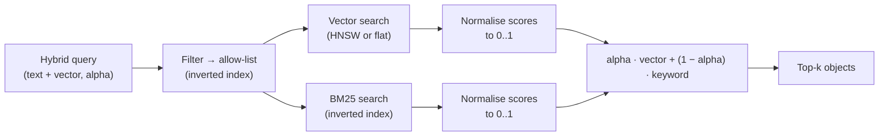

Weaviate is an open-source vector database, written in Go, that treats a vector database as a search engine first. Every collection has a typed schema, every text property can be indexed for keyword search as well as filtering, and a single query can combine vector similarity with BM25 keyword scoring. Optional modules let the database call embedding models, rerankers and even generative models for you, so that a whole retrieval-and-answer step can be one request.

This lesson explains what makes Weaviate distinctive: its schema and storage design, how it filters, how its hybrid search fuses two kinds of score, its native multi-tenancy, and the module system. You will write a Meridian collection with the version 4 Python client, and run a faithful re-implementation of Weaviate's hybrid score fusion to see exactly what its `alpha` parameter does. [Qdrant](/learn/vector-database-ecosystem/qdrant) covered segments, payload indexes and filtered HNSW in depth; this lesson concentrates on where Weaviate differs.

## Learning objectives

- Define a Weaviate collection with typed properties, an appropriate tokenisation for each text field, and a self-provided or module-generated vector.
- Write vector, keyword and hybrid queries with the v4 Python client, with filters and returned metadata.
- Compute relative-score hybrid fusion by hand and predict how `alpha` changes rankings for exact-code and paraphrased queries.
- Explain how Weaviate's inverted index, allow-list filtering and flat-search cutoff combine to make filtered search fast.
- Decide when to use native multi-tenancy, vectoriser modules and in-database generation, and what each costs in coupling and control.

## Prerequisites

- [What is a vector database?](/learn/vector-database-fundamentals/what-is-a-vector-database) and [Filtering](/learn/vector-database-fundamentals/filtering).
- [Qdrant](/learn/vector-database-ecosystem/qdrant): segments, the write-ahead log and filtered HNSW, which this lesson builds on.
- [BM25](/learn/sparse-retrieval/bm25) at the level of "a keyword score that rewards rare matching terms"; the full treatment is in Phase 7.
- [Query-document matching](/learn/rag-architecture-fundamentals/query-document-matching): why lexical and semantic matching fail on different queries.

## Why this matters

Pure vector search has a well-known blind spot: exact tokens. A Meridian engineer who asks about error `E-4021` needs the chunk containing exactly that code, and an embedding model may place `E-4012` just as close. Keyword search has the mirror blind spot: "how much holiday do I get?" shares no words with "25 days of annual leave". Production retrieval systems therefore often run both and combine the results, which is called **hybrid search**.

Assembling hybrid search yourself means running a vector database and a keyword engine, keeping two indexes in sync as documents change, issuing two queries, and fusing the scores. Weaviate's design puts both indexes inside the same database, maintained by the same writes, and exposes the fusion as a single query with one tuning parameter. That removes a whole class of synchronisation bugs. It also means the fusion method and its parameter become a retrieval-quality setting you must understand rather than a default you can ignore: an `alpha` chosen for paraphrased questions can make exact-code questions worse, and vice versa.

Weaviate is also designed for SaaS-style workloads with many tenants, and for teams who want the database to call embedding and generative models for them. Both features are powerful and both create coupling you should choose deliberately.

## The intuition

Think of a reference librarian with two skills. She can find books *about* your question even when you use different words, and she can find books containing *the exact phrase* you said. Ask her about "E-4021" and she checks the exact-phrase catalogue; ask her about "holiday" and she uses her sense of subject. For most questions she uses both and weighs them.

`alpha` is how much she trusts her sense of subject against the exact-phrase catalogue. At `alpha = 1` she ignores the catalogue; at `alpha = 0` she ignores meaning; in between she blends. Before blending she has to put the two judgements on the same scale, because "very relevant by subject" and "contains the phrase twice" are measured in different units. How she rescales them is the **fusion method**, and the next sections show it is a small calculation with large consequences.

## How it works

### The data model

Weaviate organises data into **collections** (called *classes* in older versions and in the GraphQL API). A collection has a **schema** of typed **properties**: `text`, `text[]`, `int`, `number`, `boolean`, `date`, `uuid`, `geoCoordinates`, `object` and others. Each **object** has:

- a **UUID** (you supply one, ideally deterministic, or Weaviate generates one);
- its properties;
- one or more vectors (a single vector, or several **named vectors** such as `body` and `title`, each with its own index and its own vectoriser);
- optional **cross-references** to objects in other collections.

The schema matters more than in schema-less systems like Qdrant. Text properties are **tokenised** for the inverted index, and the tokenisation chosen per property decides how filters and keyword search behave:

| Tokenisation | `"Meridian Sync E-4021"` becomes | Use for |
| --- | --- | --- |
| `word` (default) | `meridian`, `sync`, `e`, `4021` | Prose for keyword search |
| `lowercase` | `meridian`, `sync`, `e-4021` | Text where symbols inside tokens matter |
| `whitespace` | `Meridian`, `Sync`, `E-4021` | Case-sensitive tokens |
| `field` | the whole value, trimmed | Identifiers, document ids, enumerations |

A `doc_id` such as `runbook-vpn` stored with `word` tokenisation is split at the hyphen, so an equality filter on it can match more than you intended. Store identifiers with `field` tokenisation. The same consideration explains why error codes deserve care: under `word` tokenisation, `E-4021` becomes two tokens, `e` and `4021`. Keyword search still finds `4021`, but a property that will be searched for codes may be better tokenised with `lowercase`.

### Storage and indexes

Each collection is divided into **shards**, and each shard keeps three structures, updated together on every write:

1. An **object store**, holding properties and vectors, built on a log-structured merge tree (LSM tree: writes are appended in memory and flushed to sorted files on disk, then compacted in the background). Writes are also recorded in a write-ahead log for crash safety.
2. An **inverted index** per property: for filtering (which objects have `groups` containing `it-staff`?) and, for searchable text properties, for BM25 scoring.
3. A **vector index** per vector: HNSW by default; **flat** (exact search, no graph, very low memory, suits small collections and small tenants); or **dynamic**, which starts flat and switches to HNSW once the shard passes a configured size. Vector indexes support compression (product, scalar and binary quantisation, with rescoring), as covered in [Product quantisation](/learn/vector-indexing-algorithms/product-quantisation).

### Filtered search

Weaviate filters before it searches. The steps:

1. The filter is evaluated against the inverted index, producing an **allow-list** of matching object ids.
2. If the allow-list is small (below the collection's flat-search cutoff, 40,000 objects by default at the time of writing), Weaviate skips the graph and compares the query with each allowed vector exactly.
3. Otherwise it walks the HNSW graph, considering only allowed ids as results.
4. Results come back with the requested metadata (distance, score, explanation).

Step 3 has the familiar weakness of filtered graph search: when most of the graph is excluded, the walk visits many disallowed nodes. Recent Weaviate versions offer an alternative filter strategy based on the ACORN method, designed to keep the walk effective under restrictive filters; check the documentation for your version's options and defaults.

### Hybrid search and score fusion

A hybrid query runs a vector search and a BM25 search, and then fuses them. Weaviate offers two fusion methods:

- **Relative score fusion** (the default in current versions): each result list's scores are min-max normalised, so the best result in each list scores 1 and the worst 0, then combined as a weighted sum with `alpha` on the vector side.
- **Ranked fusion**: each result contributes according to its rank in each list, in the style of [Reciprocal Rank Fusion](/learn/hybrid-search/reciprocal-rank-fusion), ignoring the raw scores.

`alpha = 1` is pure vector search, `alpha = 0` pure keyword search. The trade-offs between fusion methods are the subject of [Weighted score fusion](/learn/hybrid-search/weighted-score-fusion); here, the point is to see Weaviate's specific calculation, which the mathematics section does by hand and in code.



### Modules

Weaviate's functionality beyond storage comes through **modules** enabled in the server configuration:

- **Vectorisers** (for example modules for OpenAI, Cohere, Hugging Face or a self-hosted transformers container) embed objects on insert and query text at search time, so the client sends text only.
- **Rerankers** re-score the top results with a cross-encoder model, as described in [Reranking fundamentals](/learn/reranking-fundamentals).
- **Generative modules** (including ones for Anthropic and OpenAI models) send retrieved objects to an LLM with your prompt and return the generated text alongside the results: retrieval-augmented generation inside the database.

Modules trade control for convenience. A vectoriser module means the embedding model is configured in the database, which keeps query and document embeddings consistent automatically; but the database now holds API keys, calls an external service on every insert and query, and couples your ingestion throughput to that service's rate limits. In-database generation makes demos short, but most production RAG systems keep generation in the application, where prompts, guardrails, citations and evaluation live. AskMeridian-style systems usually bring their own vectors (`vectorizer: none`) and call the LLM themselves.

### Multi-tenancy and replication

With **multi-tenancy** enabled on a collection, each tenant gets its own shard: its own object store, inverted index and vector index. A query must name its tenant and can only see that tenant's data, so isolation is structural rather than a filter that a bug could omit. Tenants can be set **active** (loaded and served), **inactive** (kept on local disk, not in memory) or, with an offload module, **offloaded** to object storage, which makes it practical to host very many tenants of whom only some are busy. This is the main reason SaaS teams choose Weaviate; [Multi-tenancy](/learn/advanced-vector-database-engineering/multi-tenancy) compares the approaches across databases.

On a cluster, the schema is kept consistent with the Raft consensus protocol, while object data is replicated **leaderless**: each write goes to every replica, and the client chooses a consistency level (`ONE`, `QUORUM` or `ALL`) for reads and writes. Weaker levels give lower latency and higher availability; stronger ones read their own writes reliably.

## The mathematics

**Intuition.** A cosine of 0.40 and a BM25 score of 0.86 are not in the same units, so adding them is meaningless. Relative score fusion first rescales each list so that its best result scores 1 and its worst 0, then blends.

$$
\hat{s}_i = \frac{s_i - s_{\min}}{s_{\max} - s_{\min}}, \qquad
\text{fused}_i = \alpha\,\hat{v}_i + (1 - \alpha)\,\hat{k}_i
$$

Here $s_i$ is document $i$'s raw score in one result list, $s_{\min}$ and $s_{\max}$ the smallest and largest scores in that list, and $\hat{s}_i$ the normalised score. $\hat{v}_i$ and $\hat{k}_i$ are the normalised vector and keyword scores, and $\alpha \in [0, 1]$ is the weight on the vector side. A document missing from one list contributes 0 from that side. In Weaviate the lists are the candidates each search retrieved, not the whole collection.

**Worked example.** For the query "what does E-4021 mean?" over five Meridian chunks, the vector search gives cosines $0.40$ (the E-4021 chunk), $0.32$ (the E-4012 chunk) and a minimum of $0.09$. Normalised, the E-4012 chunk scores $(0.32 - 0.09)/(0.40 - 0.09) = 0.23/0.31 \approx 0.74$. BM25 gives the E-4021 chunk $0.86$ and every other chunk 0, so the keyword side normalises to 1 and 0. At $\alpha = 0.5$, the E-4021 chunk scores $0.5 \times 1 + 0.5 \times 1 = 1.0$ and the E-4012 chunk $0.5 \times 0.74 + 0.5 \times 0 \approx 0.37$. The vector side alone separated them by $1 - 0.74 = 0.26$; with the keyword side the gap grows to $0.63$.

The script below implements this fusion over all five chunks, using `rank_bm25` for the keyword side and MiniLM for the vector side. It is a teaching re-implementation, not Weaviate's code: Weaviate's BM25 uses its own tokenisation and parameters, so its raw keyword scores will differ, but the fusion arithmetic is the same.

```python
import numpy as np
from rank_bm25 import BM25Okapi
from sentence_transformers import SentenceTransformer

docs = [
    "Atlas error E-4021 means the VPN client is out of date; update it from the IT portal.",
    "Atlas error E-4012 means the VPN certificate expired.",
    "Always connect to the VPN when using public Wi-Fi.",
    "Employees receive 25 days of annual leave per year.",
    "Report a lost laptop to the support desk at once.",
]
model = SentenceTransformer("sentence-transformers/all-MiniLM-L6-v2")
doc_vecs = model.encode(docs, normalize_embeddings=True)
bm25 = BM25Okapi([d.lower().replace(";", "").replace(".", "").split() for d in docs])

def relative_score_fusion(query, alpha):
    """Weaviate-style: min-max normalise each score list to [0, 1], then weight."""
    vec = doc_vecs @ model.encode(query, normalize_embeddings=True)
    kw = bm25.get_scores(query.lower().replace("?", "").split())
    def norm(x):
        span = x.max() - x.min()
        return (x - x.min()) / span if span > 0 else np.zeros_like(x)
    fused = alpha * norm(vec) + (1 - alpha) * norm(kw)
    return fused, vec, kw

for query in ("what does E-4021 mean?", "how much holiday do I get?"):
    print(f"\nQuery: {query}")
    _, vec, kw = relative_score_fusion(query, 0.5)
    print("  raw cosine:", np.round(vec, 2), " raw BM25:", np.round(kw, 2))
    for alpha in (0.0, 0.5, 0.75, 1.0):
        fused, _, _ = relative_score_fusion(query, alpha)
        top = np.argsort(-fused)[:2]
        print(f"  alpha={alpha:4}: " + " | ".join(f"{fused[i]:.2f} {docs[i][:38]}" for i in top))
```

```output

Query: what does E-4021 mean?
  raw cosine: [0.4  0.32 0.09 0.09 0.13]  raw BM25: [0.86 0.   0.   0.   0.  ]
  alpha= 0.0: 1.00 Atlas error E-4021 means the VPN clien | 0.00 Atlas error E-4012 means the VPN certi
  alpha= 0.5: 1.00 Atlas error E-4021 means the VPN clien | 0.37 Atlas error E-4012 means the VPN certi
  alpha=0.75: 1.00 Atlas error E-4021 means the VPN clien | 0.55 Atlas error E-4012 means the VPN certi
  alpha= 1.0: 1.00 Atlas error E-4021 means the VPN clien | 0.74 Atlas error E-4012 means the VPN certi

Query: how much holiday do I get?
  raw cosine: [-0.04 -0.01 -0.09  0.36 -0.04]  raw BM25: [0. 0. 0. 0. 0.]
  alpha= 0.0: 0.00 Atlas error E-4021 means the VPN clien | 0.00 Atlas error E-4012 means the VPN certi
  alpha= 0.5: 0.50 Employees receive 25 days of annual le | 0.10 Atlas error E-4012 means the VPN certi
  alpha=0.75: 0.75 Employees receive 25 days of annual le | 0.15 Atlas error E-4012 means the VPN certi
  alpha= 1.0: 1.00 Employees receive 25 days of annual le | 0.19 Atlas error E-4012 means the VPN certi
```

**Reading it.** For the error-code query, the vector search alone already ranks E-4021 first, but its lead over E-4012 is thin (0.74 normalised); a slightly different model or phrasing could flip them. The keyword side is decisive, and every `alpha` below 1 widens the gap. For the holiday query the keyword side has nothing to say (every BM25 score is 0), so at `alpha = 0` everything ties at 0 and the "top" results are simply the first documents in the list, which is exactly the failure pure keyword search has on paraphrases. Any `alpha` above 0 recovers the leave chunk. A middle `alpha` serves both queries. Note one quirk of min-max normalisation: with only five candidates, the leave chunk at `alpha = 0.5` scores exactly 0.5 because its keyword side contributes nothing; normalised scores depend on what else is in the list, so they are not comparable across queries.

## In code

### A Meridian collection with the v4 client

**The problem.** Create a Weaviate collection for AskMeridian-style chunks with your own vectors, correctly tokenised identifier fields and a cosine HNSW index; import chunks in a batch with deterministic UUIDs; then run filtered vector, keyword and hybrid queries and delete a withdrawn document.

**Dependencies.** A Weaviate server and the v4 Python client, which talks to the server over HTTP and gRPC:

```bash
docker run -p 8080:8080 -p 50051:50051 cr.weaviate.io/semitechnologies/weaviate:<version>
pip install weaviate-client sentence-transformers
```

Replace `<version>` with a current release from the Weaviate documentation.

> [!NOTE]
> This example was **not executed** for this lesson: it needs a running Weaviate server, which the course sandbox does not have. It is written against the v4 Python client's documented API. The output shown is illustrative. Recent v4 releases have been introducing a newer `vector_config` style for collection creation alongside `vectorizer_config`; if your client warns about deprecation, follow its message or the client documentation.

```python
import weaviate
from weaviate.classes.config import Configure, DataType, Property, Tokenization, VectorDistances
from weaviate.classes.query import Filter, HybridFusion, MetadataQuery
from weaviate.util import generate_uuid5
from sentence_transformers import SentenceTransformer

model = SentenceTransformer("sentence-transformers/all-MiniLM-L6-v2")
client = weaviate.connect_to_local()          # localhost:8080 (HTTP) and 50051 (gRPC)

try:
    if client.collections.exists("MeridianChunk"):
        client.collections.delete("MeridianChunk")
    chunks = client.collections.create(
        name="MeridianChunk",
        vectorizer_config=Configure.Vectorizer.none(),            # we bring our own vectors
        vector_index_config=Configure.VectorIndex.hnsw(distance_metric=VectorDistances.COSINE),
        properties=[
            Property(name="text", data_type=DataType.TEXT, tokenization=Tokenization.LOWERCASE),
            Property(name="doc_id", data_type=DataType.TEXT, tokenization=Tokenization.FIELD),
            Property(name="groups", data_type=DataType.TEXT_ARRAY, tokenization=Tokenization.FIELD),
        ],
    )

    data = [
        ("handbook-2025", 0, "Employees receive 25 days of annual leave per year.", ["all"]),
        ("runbook-vpn", 0, "Always connect to the VPN when using public Wi-Fi.", ["all"]),
        ("runbook-vpn", 1, "VPN gateway credentials are rotated by the IT on-call engineer.", ["it-staff"]),
        ("runbook-atlas", 0, "Atlas error E-4021 means the VPN client is out of date; update it from the IT portal.", ["all"]),
        ("runbook-atlas", 1, "Atlas error E-4012 means the VPN certificate expired.", ["all"]),
    ]
    vectors = model.encode([d[2] for d in data], normalize_embeddings=True)
    with chunks.batch.dynamic() as batch:
        for (doc_id, n, text, groups), vec in zip(data, vectors):
            batch.add_object(
                properties={"text": text, "doc_id": doc_id, "groups": groups},
                uuid=generate_uuid5(f"{doc_id}#{n}"),          # deterministic: re-import overwrites
                vector=vec.tolist(),
            )
    if chunks.batch.failed_objects:
        raise RuntimeError(chunks.batch.failed_objects[:3])

    visible = Filter.by_property("groups").contains_any(["all"])

    q = "what does E-4021 mean?"
    qvec = model.encode(q, normalize_embeddings=True).tolist()

    res = chunks.query.near_vector(near_vector=qvec, limit=2, filters=visible,
                                   return_metadata=MetadataQuery(distance=True))
    print("vector:", [(o.properties["text"][:30], round(o.metadata.distance, 3)) for o in res.objects])

    res = chunks.query.bm25(query=q, limit=2, filters=visible, return_metadata=MetadataQuery(score=True))
    print("bm25:  ", [(o.properties["text"][:30], round(o.metadata.score, 3)) for o in res.objects])

    res = chunks.query.hybrid(query=q, vector=qvec, alpha=0.5, limit=2, filters=visible,
                              fusion_type=HybridFusion.RELATIVE_SCORE,
                              return_metadata=MetadataQuery(score=True))
    print("hybrid:", [(o.properties["text"][:30], round(o.metadata.score, 3)) for o in res.objects])

    result = chunks.data.delete_many(where=Filter.by_property("doc_id").equal("runbook-atlas"))
    print("deleted:", result.successful, "remaining:", chunks.aggregate.over_all(total_count=True).total_count)
finally:
    client.close()
```

Your exact numbers will differ; the output looks like this:

```output
vector: [('Atlas error E-4021 means the VP', 0.6), ('Atlas error E-4012 means the VP', 0.68)]
bm25:   [('Atlas error E-4021 means the VP', 1.4), ('Atlas error E-4012 means the VP', 0.3)]
hybrid: [('Atlas error E-4021 means the VP', 1.0), ('Atlas error E-4012 means the VP', 0.42)]
deleted: 2 remaining: 3
```

**The important lines.**

- `Configure.Vectorizer.none()` says vectors come from the client; no module is called on insert or query. The query side must then pass `near_vector` or `vector=` itself.
- `tokenization=Tokenization.FIELD` on `doc_id` and `groups` makes filters match whole values: `runbook-atlas` is one token, not three.
- `tokenization=Tokenization.LOWERCASE` on `text` keeps `e-4021` as a single searchable token for BM25, while still lower-casing.
- `generate_uuid5(f"{doc_id}#{n}")` gives a deterministic UUID, so re-running the import replaces objects instead of duplicating them.
- `batch.dynamic()` sizes batches automatically. Batch errors do not raise by default; checking `failed_objects` is the step people forget.
- `Filter.by_property("groups").contains_any([...])` is the permission filter; it is applied to the vector, BM25 and hybrid searches alike.
- Vector results carry `distance` (cosine distance: smaller is closer); BM25 and hybrid results carry `score` (larger is better). Do not compare them with each other.
- `delete_many(where=...)` removes a document's chunks by filter.

**Errors people commonly hit.**

- A gRPC connection error on `connect_to_local()`: the v4 client needs port 50051 exposed as well as 8080.
- Equality filters on ids matching unexpected objects: the property used `word` tokenisation.
- Silent partial imports: some objects failed validation (a property of the wrong type), and nobody checked `failed_objects`.
- Hybrid queries that ignore the vector you passed and try to call a vectoriser module, failing because none is configured: pass `vector=` explicitly when the collection uses `none`.
- Forgetting `client.close()`, which leaks connections in long-running processes; use `try`/`finally` or a `with` block.

**Extending it.** Enable `Configure.multi_tenancy(enabled=True)` and repeat the import per tenant with `chunks.with_tenant("acme")`; try `HybridFusion.RANKED` and compare the scores; add a second named vector for chunk titles.

## A real-world example

Meridian's Platform team was asked to help a sister team building a support assistant for customers of Meridian Relay. Every customer organisation has its own private configuration notes and support history, plus access to the shared product documentation. There are a few hundred customer organisations, most of whom use the assistant rarely.

The first design put everything into one Qdrant collection with a `tenant` payload field. It worked, but a security review flagged that isolation depended on every query in every code path including the tenant filter, and the team wanted inactive customers' data out of memory. They evaluated Weaviate with native multi-tenancy: one tenant per customer organisation in a `CustomerNotes` collection, plus a shared `ProductDocs` collection without multi-tenancy. A query for customer X opens `CustomerNotes.with_tenant(X)` and physically cannot reach another tenant's shard, and tenants with no activity for 30 days are set inactive so they stop consuming memory.

Retrieval quality raised the second decision. Support questions mix paraphrase ("the sync keeps stopping overnight") with exact identifiers (error codes from the Atlas catalogue, configuration keys). The team built a labelled set of 300 real questions, ran hybrid search at several `alpha` values, and found that pure vector search missed exact-code questions while low `alpha` hurt paraphrased ones; they settled on a middle value after measuring both classes separately, and recorded the decision with the evaluation script so it could be re-run whenever the embedding model changed. They kept embedding and generation in the application rather than in Weaviate modules, because the support assistant's prompts, citation formatting and refusal rules were already tested there, and they wanted one place to rotate API keys.

## Common mistakes

- **Leaving identifier properties with `word` tokenisation.** Filters on ids, groups and enumerations match fragments and return the wrong objects.
- **Assuming the default `alpha` is right for your queries.** It was not tuned on your data. Measure exact-identifier and paraphrased queries separately.
- **Comparing hybrid scores across queries.** Relative scores are normalised within each query's candidate lists; a 0.8 in one query and 0.8 in another mean different things.
- **Not checking batch errors.** Batch imports report failures in a list rather than raising, so a schema mismatch can silently drop objects.
- **Enabling a vectoriser module without planning for its limits.** Every insert and query now depends on an external API's latency and rate limits.
- **One collection per customer instead of native tenants.** Thousands of collections strain schema management; multi-tenancy exists for this case.
- **Mixing `distance` and `score`.** Vector queries return distances (smaller is better), keyword and hybrid queries return scores (larger is better).

## Best practices

- Define the schema explicitly, including data types and tokenisation for every property; do not rely on auto-schema in production.
- Use deterministic UUIDs and check `failed_objects` after every batch.
- Keep vectors client-side (`vectorizer none`) when you need tight control over the embedding model, batching and cost; use vectoriser modules when consistency and simplicity matter more.
- Choose `alpha` and the fusion method from a labelled evaluation that includes exact-identifier queries; revisit when the embedding model or corpus changes.
- Use native multi-tenancy for per-customer isolation, and deactivate idle tenants to save memory.
- Pin the server and client versions together and read release notes before upgrading; the v4 client and server evolve together.

## Performance considerations

**Memory.** HNSW vectors live in memory unless compressed: at 384 dimensions, about 1.5 KB per object for float32 vectors plus graph links. Product, scalar or binary quantisation cut the in-memory vector size by roughly 4 to 32 times, with rescoring to recover accuracy. The flat index uses almost no extra memory and suits small tenants, which is why the dynamic index (flat until a tenant grows) suits multi-tenant workloads.

**Hybrid cost.** A hybrid query runs two searches, so its latency is at least the slower of the two plus fusion. BM25 over a large inverted index can be slower than a well-tuned HNSW search for queries with very common terms, because long posting lists must be scored.

**Filters.** Small allow-lists switch to exact search over the allowed vectors, which is fast and complete. Large, restrictive-but-not-tiny filters are the hard case for graph search; measure recall for them specifically.

**Imports.** Throughput depends on batch size and, with a vectoriser module, on the embedding service. Bringing your own vectors from a GPU batch job decouples import speed from external APIs. Index construction cost also grows with HNSW `efConstruction` and `maxConnections`.

**Tenants.** Each active tenant has its own indexes in memory. With a thousand tenants averaging 10,000 chunks at 384 dimensions, vectors alone are about $1{,}000 \times 10{,}000 \times 1{,}536 \approx 15.4$ GB if all are active; if only a tenth are active at any time, about 1.5 GB.

## Security considerations

Enable authentication (API keys or OIDC) and authorisation on the server; Weaviate's newer versions include role-based access control, which you should configure rather than running anonymous access. Keep the HTTP and gRPC ports private. Vectoriser and generative modules store third-party API keys in server configuration or receive them in request headers; treat the Weaviate deployment as holding those secrets. Native multi-tenancy gives structural isolation, but the application still decides which tenant name to use: derive it from the authenticated identity, never from a request parameter. In-database generation sends retrieved text to an external model, so the same data-handling review applies as for any LLM call.

## Summary

- Weaviate stores objects with typed properties, UUIDs and one or more vectors, with an object store, an inverted index and a vector index per shard.
- Tokenisation is set per text property and decides how filters and BM25 behave; use `field` for identifiers.
- Filters produce an allow-list from the inverted index; small allow-lists use exact search, larger ones a filtered HNSW walk.
- Hybrid search fuses BM25 and vector scores, by default with relative score fusion: min-max normalise each list, then weight by `alpha`.
- Native multi-tenancy gives each tenant its own shard with active and inactive states, suiting many-customer workloads.
- Modules can embed, rerank and generate inside the database; they add convenience at the cost of coupling and external dependencies.

## Exercises

**1.** A vector search returns cosines `0.70, 0.55, 0.40` for documents A, B, C, and BM25 returns `0, 6.0, 2.0` for the same documents. Compute relative-score fusion at `alpha = 0.75` and `alpha = 0.25`. Which document wins in each case?

<details><summary>Show solution</summary>

Normalised vector scores: A $= 1$, B $= 0.15/0.30 = 0.5$, C $= 0$. Normalised BM25: A $= 0$, B $= 1$, C $= 2/6 \approx 0.33$.

At $\alpha = 0.75$: A $= 0.75$, B $= 0.375 + 0.25 = 0.625$, C $= 0.083$. A wins.
At $\alpha = 0.25$: A $= 0.25$, B $= 0.125 + 0.75 = 0.875$, C $= 0.25$. B wins.

</details>

**2.** A `sku` property holds values like `MR-200-EU` and `MR-200-US` with default tokenisation, and the filter `Filter.by_property("sku").equal("MR-200")` returns both, although no product has the SKU `MR-200`. Explain and fix.

<details><summary>Show solution</summary>

With `word` tokenisation each value is split into tokens (`mr`, `200`, `eu`), and filters on tokenised text compare tokens, not whole values, so the filter's tokens `mr` and `200` are found in both objects. Recreate the property with `tokenization=Tokenization.FIELD` so the whole trimmed value is one token, and re-import the data (tokenisation cannot be changed on an existing property).

</details>

**3.** Modify the lesson's fusion script to implement ranked fusion: each document scores `alpha / (60 + vector_rank) + (1 - alpha) / (60 + keyword_rank)`, with ranks starting at 1. Run it on both queries at `alpha = 0.5` and compare the top two with relative score fusion.

<details><summary>Show solution</summary>

```python
def ranked_fusion(query, alpha, k=60):
    vec = doc_vecs @ model.encode(query, normalize_embeddings=True)
    kw = bm25.get_scores(query.lower().replace("?", "").split())
    vrank = np.empty(len(docs)); vrank[np.argsort(-vec)] = np.arange(1, len(docs) + 1)
    krank = np.empty(len(docs)); krank[np.argsort(-kw, kind="stable")] = np.arange(1, len(docs) + 1)
    return alpha / (k + vrank) + (1 - alpha) / (k + krank)

for query in ("what does E-4021 mean?", "how much holiday do I get?"):
    fused = ranked_fusion(query, 0.5)
    top = np.argsort(-fused)[:2]
    print(query, [(docs[i][:30], round(float(fused[i]), 5)) for i in top])
```

```output
what does E-4021 mean? [('Atlas error E-4021 means the V', 0.01639), ('Atlas error E-4012 means the V', 0.01613)]
how much holiday do I get? [('Atlas error E-4012 means the V', 0.01613), ('Atlas error E-4021 means the V', 0.01601)]
```

The code query is fine, though the margin is tiny. The holiday query is wrong: the leave chunk is first on the vector side, but every BM25 score is 0 and this naive version still turns the tie into ranks 1 to 5 in list order, handing the E-4012 chunk keyword rank 2 and the leave chunk rank 4. Ranks ignore *how much* better one result is, so a meaningless keyword ordering outweighs a clear vector win. The bug is ranking documents the keyword search did not actually match; a correct implementation (and Weaviate) fuses only the results each search returned, so the leave chunk would get no keyword contribution and the other documents none either.

</details>

**4.** Design: you host a documentation assistant for 2,000 customer organisations; 150 are active on a typical day; each has 2,000 to 50,000 chunks. Choose between one collection with a tenant filter and native multi-tenancy, pick a vector index type, and estimate active memory for vectors at 384 dimensions.

<details><summary>Show solution</summary>

Native multi-tenancy: isolation is structural, and idle tenants can be deactivated so that only about 150 tenants' indexes are in memory. Use the dynamic index so small tenants stay on a flat index (exact, almost no extra memory) and large ones switch to HNSW automatically.

Memory: if active tenants average, say, 20,000 chunks (an assumption to be replaced with real figures), vectors take $150 \times 20{,}000 \times 1{,}536 \approx 4.6$ GB, plus graph links for HNSW tenants. With all 2,000 tenants active it would be about 61 GB at the same average, which is the saving deactivation buys. Activation on first request adds latency for a dormant tenant's first query, so keep the activation policy aligned with usage patterns.

</details>

## Check your understanding

```quiz
[
  {"q": "In a Weaviate hybrid query, what does `alpha = 0` mean?", "options": ["Pure vector search", "Pure BM25 keyword search", "Equal weighting of vector and keyword", "Hybrid search is disabled and an error is returned"], "answer": 1, "why": "alpha weights the vector side: 1 is pure vector, 0 is pure keyword."},
  {"q": "Relative score fusion normalises scores in which way?", "options": ["Divides each score by the sum of scores", "Uses reciprocal ranks with a constant of 60", "Min-max scales each result list so its best result is 1 and its worst is 0", "Converts all scores to cosine distances"], "answer": 2, "why": "Each list is rescaled to 0..1 by its own minimum and maximum, then the two are combined with weights alpha and 1 - alpha."},
  {"q": "Which tokenisation should a `doc_id` property such as `runbook-vpn` use so that equality filters match whole values?", "options": ["`word`", "`lowercase`", "`whitespace`", "`field`"], "answer": 3, "why": "field tokenisation treats the whole trimmed value as one token, so filters match exactly."},
  {"q": "A filter in Weaviate matches only 500 objects in a 10-million-object shard. What does Weaviate typically do?", "options": ["Compare the query with the 500 allowed vectors exactly, skipping the graph", "Walk the full HNSW graph and post-filter", "Reject the query as too selective", "Rebuild the HNSW index for the filtered subset"], "answer": 0, "why": "Below the flat-search cutoff, Weaviate searches the allow-list exactly, which is fast and complete for small sets."},
  {"q": "Why might a team keep `vectorizer none` and embed in the application, even though Weaviate can embed for them?", "options": ["Weaviate cannot store externally computed vectors", "Vectoriser modules only support images", "To control model choice, batching and cost, and avoid making every insert and query depend on an external API from inside the database", "Because hybrid search requires client-side vectors"], "answer": 2, "why": "Modules add convenience but couple the database to external services and their limits; bringing your own vectors keeps that control in the application."}
]
```

## Further reading

- Weaviate documentation: concepts (data structure, indexing, filtering, hybrid search, multi-tenancy, replication) and the Python client v4 reference. [weaviate.io/developers/weaviate](https://weaviate.io/developers/weaviate)
- Weaviate source repository and release notes. [github.com/weaviate/weaviate](https://github.com/weaviate/weaviate)
- Robertson and Zaragoza (2009), *The Probabilistic Relevance Framework: BM25 and Beyond*, Foundations and Trends in Information Retrieval, for the keyword side of hybrid search.
- Cormack, Clarke and Büttcher (2009), *Reciprocal Rank Fusion outperforms Condorcet and individual Rank Learning Methods*, SIGIR, for the idea behind ranked fusion.
- Patel and colleagues (2024), *ACORN: Performant and Predicate-Agnostic Search Over Vector Embeddings and Structured Data*, SIGMOD, for the filtered-graph-search method.
