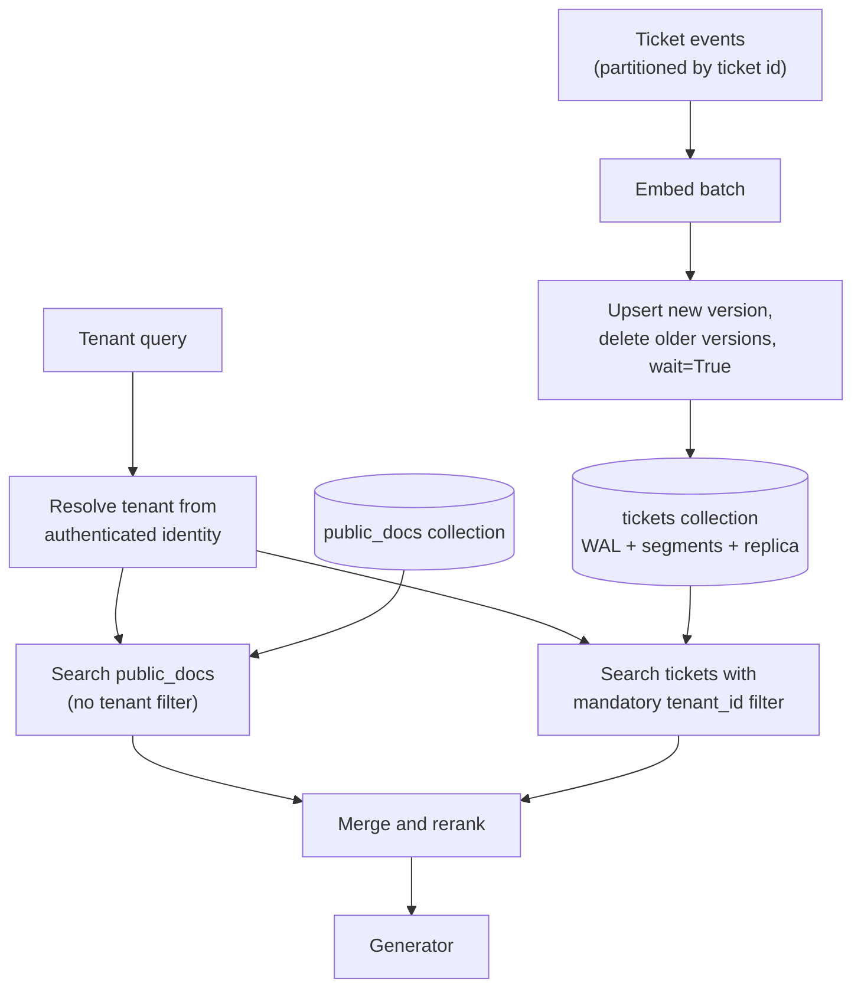

This assessment covers all eight lessons of **Vector Database Fundamentals**: what a vector database is, how vectors are stored, similarity search, indexing, metadata, filtering, CRUD operations and persistence. Answer the 18 multiple-choice questions first; the pass mark is 70% (13 of 18). Then work through the conceptual questions, coding exercises, design challenge and troubleshooting scenarios, writing your own answer before opening each model answer. The written parts are not scored, but they test whether you can apply the ideas, not just recognise them.

```quiz
[
  {"q": "Which of these is NOT one of the core responsibilities a vector database adds beyond holding an array of vectors?", "options": ["Persisting acknowledged writes so they survive a crash", "Generating the embeddings from raw text", "Searching with conditions on structured payload fields", "Accepting inserts, updates and deletes while queries run"], "answer": 1, "why": "Most vector databases store and search vectors you provide; choosing and running the embedding model is the application's job."},
  {"q": "A collection holds 5 million vectors of 768 dimensions in float32. How much memory do the raw vectors take?", "options": ["About 1.5 GB", "About 3.8 GB", "About 15.4 GB", "About 30.7 GB"], "answer": 2, "why": "5,000,000 x 768 x 4 bytes = 15.36 GB."},
  {"q": "```python\nimport numpy as np\nX = np.ones((2000, 512), dtype=np.uint8)\nprint(X.nbytes // 1000, X.strides[0])\n```\nWhat does this print?", "options": ["1024 512", "4096 2048", "1024 2048", "2048 512"], "answer": 0, "why": "uint8 is one byte: 2,000 x 512 = 1,024,000 bytes, so 1024 after integer division by 1,000, and each row is 512 bytes long."},
  {"q": "Why does a segment-based store mark deleted points with tombstones?", "options": ["So deleted points can still be returned to administrators", "Because vectors cannot be removed from memory-mapped files", "Physically removing a row from a sealed segment means rewriting it, so deletes are flagged and space is reclaimed when segments are merged", "To make search faster"], "answer": 2, "why": "Tombstones make deletes cheap and immediately effective for reads; the optimiser reclaims space later."},
  {"q": "int8 scalar quantisation of unit-length embeddings typically reduces recall@10 slightly. What is the main mechanism?", "options": ["Small per-component errors reorder candidates whose scores were nearly tied", "Quantised vectors no longer have unit length, so cosine is undefined", "Quantisation removes the payloads", "The index must be rebuilt with fewer dimensions"], "answer": 0, "why": "Score errors are tiny but enough to swap near-ties at the edge of the top k; rescoring at full precision repairs most of it."},
  {"q": "All stored vectors and the query have length 1. Which pair of metrics will produce DIFFERENT rankings?", "options": ["Cosine and dot product", "Dot product and Euclidean distance", "Cosine and Euclidean distance", "None: all three give the same ranking"], "answer": 3, "why": "For unit vectors, squared Euclidean distance equals 2 - 2 x dot product, and dot product equals cosine, so all three rank identically."},
  {"q": "A team ports search from Qdrant (cosine) to FAISS IndexFlatL2 over the same unit vectors and keeps the rule 'refuse if the best score is below 0.3'. What happens?", "options": ["The rule works exactly as before", "The rule almost never fires, because the values are now squared distances where lower is better and good matches are around 1.0 or more", "FAISS raises an error", "Every query is refused"], "answer": 1, "why": "IndexFlatL2 returns squared L2 distances (2 - 2 cos for unit vectors). A best value below 0.3 now means an almost perfect match, so weak matches pass unchecked."},
  {"q": "pgvector's <=> operator returns 0.15 for a pair of vectors. What is their cosine similarity?", "options": ["0.85", "0.15", "0.925", "-0.15"], "answer": 0, "why": "<=> is cosine distance, 1 - cos, so cos = 0.85."},
  {"q": "What does recall@10 measure for an approximate nearest-neighbour index?", "options": ["The share of returned chunks that users judged relevant", "How much faster the index is than exact search", "The fraction of queries that return 10 results", "The fraction of the exact search's top 10 that the index also returns"], "answer": 3, "why": "ANN recall compares the index's results with exact search on the same vectors; it isolates the approximation error."},
  {"q": "Which of these can be changed on an existing HNSW index without rebuilding it?", "options": ["M", "ef_construction", "efSearch (ef)", "The vector dimension"], "answer": 2, "why": "ef controls the candidate list at query time; M and ef_construction shape the graph built over the data."},
  {"q": "An IVF index has nlist = 1,000 over 2,000,000 vectors in roughly equal lists. With nprobe = 8, about how many vector comparisons does one query make, counting centroids?", "options": ["9,000", "17,000", "16,000", "2,000,000"], "answer": 1, "why": "1,000 centroid comparisons plus 8 lists of about 2,000 vectors each: 1,000 + 16,000 = 17,000."},
  {"q": "A payload stores effective_from as \"03/01/2024\". What is the main problem?", "options": ["The string is ambiguous and cannot be compared as a date, so range filters fail silently", "Strings cannot be stored in payloads", "The vector becomes invalid", "Search becomes slower"], "answer": 0, "why": "Use an RFC 3339 datetime or a timestamp so the database can compare dates; ambiguous display strings break range filters without errors."},
  {"q": "A document's allowed_groups change from [\"all-staff\"] to [\"it\"]. Its text is unchanged. What is the right operation?", "options": ["Re-embed and upsert every chunk", "Delete the document and re-ingest it", "Create a new collection", "A payload update filtered on the document's doc_id"], "answer": 3, "why": "Vectors depend only on the text; metadata changes are payload updates."},
  {"q": "A filter matches 4% of points. The application retrieves the top 20 unfiltered results and then removes non-matching ones. About how many results remain if the filter is unrelated to similarity?", "options": ["20", "4", "0.8", "8"], "answer": 2, "why": "Each candidate passes with probability 0.04: 20 x 0.04 = 0.8 on average."},
  {"q": "Why does in-graph filtering on an HNSW index lose recall under very restrictive filters?", "options": ["HNSW stores no payloads", "The bounded walk explores a neighbourhood containing too few matching points before it stops", "Filters change the distance metric", "The graph is rebuilt for each query"], "answer": 1, "why": "With few matching points nearby, the walk's limited effort ends before enough matches are found; query planners switch to pre-filtering in this regime."},
  {"q": "A policy document shrinks from 8 chunks to 5. Which procedure leaves no orphans and never makes the document unfindable?", "options": ["Upsert the 5 new chunks with positional ids", "Delete all chunks of the document, then insert the 5 new ones", "Insert the 5 new chunks one at a time with random ids", "Upsert the 5 new chunks with the new doc_version, then delete this document's chunks with an older doc_version"], "answer": 3, "why": "Writing first keeps the document visible; deleting older versions removes every stale chunk; the procedure is idempotent."},
  {"q": "During recovery, a database finds that the last record of its write-ahead log is half-written. What should it do?", "options": ["Discard and truncate it, because it was never acknowledged", "Refuse to start until an operator repairs it", "Apply the parts of it that can be parsed", "Restore the whole collection from last week's backup"], "answer": 0, "why": "Writes are acknowledged only after their log record is flushed, so a torn final record belongs to an unacknowledged write."},
  {"q": "Which part of a vector collection can be rebuilt from the stored data alone, without re-embedding?", "options": ["The vectors", "The HNSW graph", "The tombstones", "The payloads"], "answer": 1, "why": "An ANN index is derived from the vectors; the others are primary data."}
]
```

## Conceptual questions

**1.** Explain why exact nearest-neighbour search is limited by memory bandwidth rather than arithmetic, and use that to explain why float16 storage can make a flat scan faster, not just smaller.

<details><summary>Show model answer</summary>

Each stored component is used in one multiply and one add, so a scan performs about two floating-point operations per component read. A modern core can compute far more operations per second than main memory can deliver bytes, so the processor spends most of the scan waiting for data. Time is therefore roughly bytes read divided by bandwidth. float16 halves the bytes per component, so the same scan reads half as much and, being bandwidth-bound, takes roughly half as long. The arithmetic per component barely matters. The same reasoning explains why int8 (a quarter of the bytes) speeds scans further, and why batching queries helps: one pass over the stored matrix serves many queries.

</details>

**2.** A colleague says: "We use HNSW, so we don't need to worry about filters; HNSW is fast." Explain, with the three filtering strategies, why this is incomplete.

<details><summary>Show model answer</summary>

HNSW speeds up unfiltered search. A filter has to be combined with it somehow. Post-filtering (search, then discard) returns about $k \times s$ results for selectivity $s$, so users with narrow access get few or none. In-graph filtering (admit only matching points during the walk) works well for permissive filters, but its recall collapses for restrictive ones because the bounded walk meets too few matching points. Pre-filtering (use a payload index to list matching points, then scan them exactly) is exact and cheap when few points match, and expensive when most do. A database needs payload indexes and a planner that picks between in-graph filtering and pre-filtering by estimated selectivity, and the team needs to measure filtered recall at the most restrictive realistic filters. HNSW alone answers none of this.

</details>

**3.** What is the difference between ANN recall@k and the retrieval recall@k measured against human relevance labels? Give a situation where the first is perfect and the second is poor.

<details><summary>Show model answer</summary>

ANN recall@k compares an approximate index's results with exact search on the same vectors: it measures only the index's approximation. Retrieval recall@k compares results with the documents people labelled relevant: it measures the whole retrieval system, including the embedding model and chunking. A flat (exact) index has ANN recall of 1.0 by definition, yet if the embedding model places "holiday" far from "annual leave", or if the relevant fact was split across chunks, the relevant chunk is not in the top k and retrieval recall is poor. Diagnosing a bad answer means checking both: if ANN recall is high but retrieval recall low, the index is not the problem.

</details>

**4.** Why should every point record the embedding model that produced its vector, even when a collection only ever holds one model?

<details><summary>Show model answer</summary>

Because the collection will not always hold one model. During a migration (re-embedding with a new model, or the same model with a context prefix), points are rewritten in batches, and a crash, a bug or a missed document can leave some points on the old model. Vectors from different models live in unrelated spaces, so a mixed collection returns meaningless rankings with no error. A per-point `embedding_model` field turns "I think everything was re-embedded" into a checkable count: "zero points have the old model". It also lets a migration resume where it stopped, by filtering on the old value. The cost is a few dozen bytes per point.

</details>

**5.** Explain why the source documents and the ingestion pipeline are the final backup of a vector database, and name one failure that a write-ahead log and replicas cannot protect against but a rebuild from source can.

<details><summary>Show model answer</summary>

A vector collection is derived data: every point was produced from a source document by parsing, chunking and embedding. As long as the sources and the pipeline (with its recorded configuration) exist, the collection can be recreated. A write-ahead log and replicas faithfully preserve whatever was written, including mistakes. If an ingestion bug writes wrong vectors (for example, embeddings from the wrong model, or chunks with the wrong text), or an operator runs a delete with a wrong filter that is acknowledged and replicated, the log replays the damage and every replica holds it. Snapshots taken before the mistake help if they exist and are recent enough; a rebuild from source repairs it regardless, at the cost of re-embedding.

</details>

## Coding exercises

**1.** Write `search(X, q, k, min_score=None, ids=None)` that performs exact cosine top-k over *unnormalised* vectors using partial selection, returns `(id, score)` pairs best first, and drops results below `min_score`. Also write `l2sq_to_cosine(d2)` converting FAISS `IndexFlatL2` results on unit vectors to cosines. Test both on small inputs.

<details><summary>Show solution</summary>

```python
import numpy as np


def search(X, q, k, min_score=None, ids=None):
    """Exact cosine top-k over unnormalised vectors, with an optional score floor."""
    X = np.asarray(X, dtype=np.float32)
    q = np.asarray(q, dtype=np.float32)
    Xn = X / np.linalg.norm(X, axis=1, keepdims=True)
    qn = q / np.linalg.norm(q)
    scores = Xn @ qn
    k = min(k, len(scores))
    part = np.argpartition(-scores, k - 1)[:k]
    order = part[np.argsort(-scores[part])]
    ids = ids if ids is not None else list(range(len(X)))
    return [(ids[i], round(float(scores[i]), 3)) for i in order
            if min_score is None or scores[i] >= min_score]


def l2sq_to_cosine(d2):
    """FAISS IndexFlatL2 returns squared L2 distances; for unit vectors cos = 1 - d2 / 2."""
    return 1 - np.asarray(d2) / 2


X = [[3, 0, 0], [0.5, 0.5, 0], [0, 2, 2], [1, 0, 1]]
names = ["leave", "remote", "vpn", "expenses"]
print(search(X, [1, 0.2, 0], k=3, ids=names))
print(search(X, [1, 0.2, 0], k=3, min_score=0.7, ids=names))
print(l2sq_to_cosine([0.36, 1.1256]))
```

```output
[('leave', 0.981), ('remote', 0.832), ('expenses', 0.693)]
[('leave', 0.981), ('remote', 0.832)]
[0.82   0.4372]
```

Normalising both sides makes the dot product a cosine, so the long vector `[3, 0, 0]` wins on direction, not length. `np.argpartition(-scores, k - 1)` uses `k - 1` as the pivot index so it also works when `k` equals the number of vectors. The threshold drops `expenses` (0.693), returning fewer than $k$ results. The conversion follows from $\lVert q - x \rVert^2 = 2 - 2\cos\theta$.

</details>

**2.** Using Qdrant in `:memory:` mode, implement `replace_document(client, coll, doc_id, version, chunks)` with deterministic UUIDs, which writes the new version and then deletes only chunks of that document with an *older* version. Show that replacing a 3-chunk version 1 with a 1-chunk version 2 leaves one point, and that repeating the call changes nothing. Use a deterministic fake embedding so the test needs no model.

<details><summary>Show solution</summary>

```python
import hashlib
import uuid

import numpy as np
from qdrant_client import QdrantClient, models


def fake_embed(text: str, dim: int = 16) -> list[float]:
    """Deterministic stand-in for an embedding model (tests only)."""
    seed = int(hashlib.sha256(text.encode()).hexdigest()[:8], 16)
    v = np.random.default_rng(seed).normal(size=dim)
    return (v / np.linalg.norm(v)).tolist()


def replace_document(client, coll, doc_id, version, chunks):
    client.upsert(coll, wait=True, points=[
        models.PointStruct(id=str(uuid.uuid5(uuid.NAMESPACE_URL, f"{doc_id}#{i}")),
                           vector=fake_embed(text),
                           payload={"doc_id": doc_id, "doc_version": version, "position": i, "text": text})
        for i, text in enumerate(chunks)])
    stale = models.Filter(must=[
        models.FieldCondition(key="doc_id", match=models.MatchValue(value=doc_id)),
        models.FieldCondition(key="doc_version", range=models.Range(lt=version)),   # older versions only
    ])
    client.delete(coll, wait=True, points_selector=models.FilterSelector(filter=stale))


def count_doc(client, coll, doc_id):
    flt = models.Filter(must=[models.FieldCondition(key="doc_id", match=models.MatchValue(value=doc_id))])
    return client.count(coll, count_filter=flt, exact=True).count


client = QdrantClient(":memory:")
client.create_collection("t", vectors_config=models.VectorParams(size=16, distance=models.Distance.COSINE))
replace_document(client, "t", "rb-laptop", 1, ["Laptops are refreshed every 3 years.",
                                                "Report a lost laptop to the support desk at once.",
                                                "Support desk hours are 08:00 to 18:00 UK time."])
replace_document(client, "t", "rb-laptop", 2, ["Laptops are refreshed every 3 years; report losses at once."])
print("after v2:", count_doc(client, "t", "rb-laptop"))
replace_document(client, "t", "rb-laptop", 2, ["Laptops are refreshed every 3 years; report losses at once."])
print("after v2 again:", count_doc(client, "t", "rb-laptop"))
versions = {p.payload["doc_version"] for p in client.scroll("t", limit=10)[0]}
print("versions present:", versions)
```

```output
after v2: 1
after v2 again: 1
versions present: {2}
```

Position 0 is overwritten by version 2; positions 1 and 2 are version 1 orphans, removed by the delete of older versions. Using `doc_version < new` rather than `!= new` means a delayed worker carrying an old version can never delete a newer one. The second call rewrites the same point and finds nothing older, so it is idempotent.

</details>

**3.** On 30,000 synthetic clustered unit vectors of 256 dimensions (seed 1), quantise to uint8 with a per-dimension range, and report memory and recall@10 for (a) uint8 scores alone and (b) uint8 candidates rescored at float32 from the top 40.

<details><summary>Show solution</summary>

```python
import numpy as np

rng = np.random.default_rng(1)
N, d, k, n_q, depth = 30_000, 256, 10, 200, 40
centres = rng.normal(size=(100, d))
X = centres[rng.integers(0, 100, N)] + 0.8 * rng.normal(size=(N, d))
X = (X / np.linalg.norm(X, axis=1, keepdims=True)).astype(np.float32)
Q = centres[rng.integers(0, 100, n_q)] + 0.8 * rng.normal(size=(n_q, d))
Q = (Q / np.linalg.norm(Q, axis=1, keepdims=True)).astype(np.float32)

exact = Q @ X.T
truth = np.argpartition(-exact, k, axis=1)[:, :k]

lo, hi = X.min(axis=0), X.max(axis=0)
step = (hi - lo) / 255
codes = np.round((X - lo) / step).astype(np.uint8)          # 1 byte per component
approx = Q @ (codes.astype(np.float32) * step + lo).T

def recall(found):
    return np.mean([len(set(f) & set(t)) / k for f, t in zip(found, truth)])

top_q = np.argpartition(-approx, k, axis=1)[:, :k]
cand = np.argpartition(-approx, depth, axis=1)[:, :depth]
rescored = np.array([c[np.argsort(-(X[c] @ Q[i]))[:k]] for i, c in enumerate(cand)])
print(f"memory: float32 {X.nbytes / 1e6:.1f} MB, uint8 {codes.nbytes / 1e6:.1f} MB")
print(f"recall@10 uint8 only:            {recall(top_q):.3f}")
print(f"recall@10 uint8 + rescore top {depth}: {recall(rescored):.3f}")
```

```output
memory: float32 30.7 MB, uint8 7.7 MB
recall@10 uint8 only:            0.977
recall@10 uint8 + rescore top 40: 1.000
```

Quantisation quarters memory and costs about 2% of recall on this data; rescoring 40 candidates at full precision recovers it completely, because quantisation errors move true neighbours only a few places down the ranking. On real embeddings the numbers will differ, which is why the measurement, not the result, is the transferable skill.

</details>

## Architecture design challenge

Meridian is opening AskMeridian to its customers. Each customer organisation (a tenant) may search Meridian's public product documentation for Meridian Sync, Meridian Relay and Meridian Reports, plus its own private support tickets. There are about 1,200 tenants. Public documentation is 300,000 chunks; private tickets total 25 million chunks, with tenants ranging from a few hundred to 2 million chunks each. Tickets arrive continuously (about 30 per second at peak) and must be searchable within a minute; a tenant can ask for all of its data to be deleted. The embedding model produces 768-dimension vectors. Nodes have 128 GB of RAM and local NVMe SSDs.

Design the vector database layer: collections and payload, storage format and memory budget, index and filtering approach, the write path for new and edited tickets, deletion, and persistence. Justify the choices with arithmetic where you can.

<details><summary>Show reference design</summary>



**Collections.** Two: `public_docs` (300,000 chunks, shared by everyone, rarely changing) and `tickets` (25 million chunks, written continuously). Keeping public documentation separate means public queries never pay for tenant filtering, and the public index can be rebuilt independently. A collection per tenant is rejected: 1,200 collections, most tiny, each with its own index and overhead, is operationally heavy, and the largest tenants can be given dedicated shards later if needed.

**Payload.** For tickets: `tenant_id` (keyword, with a payload index), `ticket_id`, `doc_version` (integer), `position`, `created_at` (datetime), `status`, `text` inline (chunks are small; one round trip matters), and operational fields `embedding_model`, `content_hash`, `ingested_at`. Validated with a Pydantic model before every write.

**Memory.** Ticket vectors in float32: $25 \times 10^6 \times 768 \times 4 \approx 76.8$ GB, too much to hold with an index and headroom on one 128 GB node. int8 quantised vectors take about 19.2 GB; an HNSW graph at an assumed 150 bytes per vector adds about 3.75 GB. Keep the int8 copy and graph in RAM (about 23 GB), the float32 originals memory-mapped on NVMe for rescoring, and payloads on disk. Rescoring 100 candidates reads $100 \times 3{,}072 \approx 0.3$ MB per query from SSD. Public docs at float32 are under 1 GB and can stay fully in RAM.

**Filtering.** Every ticket query carries `tenant_id = T`, built server-side from the authenticated identity, never from the request. Selectivity ranges from about $300 / 2.5 \times 10^7 = 1.2 \times 10^{-5}$ to $2 \times 10^6 / 2.5 \times 10^7 = 0.08$. Small tenants hit the planner's pre-filter path (exact scan of a few thousand vectors); large ones use filtered HNSW. Measure filtered recall for a sample of tenants across this range, especially the largest, against exact filtered search. (Many dedicated databases also offer tenant-aware features designed for this pattern; [Multi-tenancy](/learn/advanced-vector-database-engineering/multi-tenancy) covers them.)

**Write path.** Ticket events are partitioned by `ticket_id`, so changes to one ticket are applied in order by one worker. Workers embed in batches, upsert with deterministic ids derived from `ticket_id#position` and the new `doc_version`, wait for acknowledgement, then delete points of that ticket with an older version. New points land in unindexed segments, searchable immediately by exact scan, which meets the one-minute freshness requirement; background indexing follows. At 30 tickets per second with a few chunks each, writes are well within one node's capacity when batched.

**Tenant deletion.** Delete by filter `tenant_id = T`, verify with an exact count of zero, and record the request. The data is then unreachable, but tombstoned rows remain until segments merge, and snapshots and backups hold copies until they expire; the deletion procedure must cover those, as [Secure deletion](/learn/enterprise-rag-governance/secure-deletion) describes.

**Persistence.** A dedicated database with a WAL flushed before acknowledgement, persisted segments and indexes (so restarts do not rebuild HNSW over 25 million vectors), a replica on a second node for availability, and regular snapshots copied off-site. The ingestion pipeline and the ticket system remain the final backup; record the embedding model with every point so a model change can be run as a resumable migration.

**Trade-offs.** One shared ticket collection is simpler to operate but makes isolation depend on a filter; dedicated collections for the largest or most sensitive tenants are a reasonable later step. Quantisation saves about 54 GB of RAM per replica at the cost of a rescoring step and a recall check. Inline text costs disk but avoids a second store on every query.

</details>

## Troubleshooting scenarios

**1.** After AskMeridian's weekly re-ingestion, answers about the equipment budget alternate between £400 and £250, and the collection has grown by about 8% a week for a month although the number of documents is stable.

<details><summary>Show diagnosis and fix</summary>

**Diagnosis.** Growth with a stable corpus means points are being added but not replaced: the ingestion job almost certainly uses non-deterministic identifiers (random UUIDs, or ids that include a timestamp), so each run inserts a fresh copy of every chunk. The contradictory answers come from old versions and the superseded 2023 handbook (with its £250 budget) surviving alongside the current one, since nothing deletes them. Check by scrolling the points of one document and counting copies per position, and by looking at `ingested_at` values.

**Fix.** Derive point ids deterministically from `doc_id` and position, replace documents by upserting the new version and deleting older versions of the same document, and mark superseded documents with `doc_status = "superseded"` (filtered out of user searches) or delete them. Clean up the existing duplicates with a one-off job: for each document, keep only points from the latest ingestion and delete the rest, verified with exact counts. Add a monitoring check that alerts when the point count grows faster than the source document count.

</details>

**2.** Contractors report that AskMeridian often says "I couldn't find that" for general IT questions, while employees asking the same questions get good answers. The permission filter is applied, and contractors can read all public runbooks.

<details><summary>Show diagnosis and fix</summary>

**Diagnosis.** The symptom depends on the user's access breadth, which points at filtering strategy. Two common causes: (a) the permission check is a post-filter in application code, so for contractors the top $k$ unfiltered results (mostly employee-only runbooks) are all removed; or (b) the filter is in the query but the `allowed_groups` field has no payload index, so the database cannot estimate selectivity and runs a filtered HNSW walk that loses recall at the contractors' low selectivity. Check the code path for (a); for (b), compare results with an exact filtered search for the same query and user.

**Fix.** Move the permission condition into the database query, built server-side from the user's identity; create a keyword payload index on `allowed_groups` so the planner can pre-filter for narrow-access users. Add an evaluation that runs the same questions as several synthetic users with progressively narrower permissions and compares recall with exact filtered search.

</details>

**3.** A self-hosted vector database node restarted after a kernel update. It came back, but searches took several seconds for the first ten minutes before returning to normal; a week earlier, a crash on the same node lost about two seconds of ticket updates, which the support team noticed.

<details><summary>Show diagnosis and fix</summary>

**Diagnosis.** Two separate issues. The slow first ten minutes is a cold page cache: vectors (or the index) are memory-mapped, so after a restart every first access reads from disk until the hot set is resident. If indexes were not persisted, the node may also have been rebuilding them while serving exact scans. The lost two seconds of updates means writes were acknowledged before their WAL records were flushed, for example an asynchronous flush interval of a few seconds, or clients writing with `wait=False` and recording success on receipt. At 30 writes per second, a 2-second window is about 60 lost updates.

**Fix.** For start-up: persist indexes, keep a node out of the load balancer until it has been warmed with representative queries, and ensure the in-RAM portion (quantised vectors and graph) fits comfortably in memory. For durability: configure the WAL to flush before acknowledgement (accepting the latency cost, mitigated by batching), make ingestion clients wait for acknowledgement before marking a ticket as indexed, and add a reconciliation job that compares ticket versions in the source with `doc_version` in the collection and re-ingests mismatches, so any future loss is repaired automatically.

</details>
