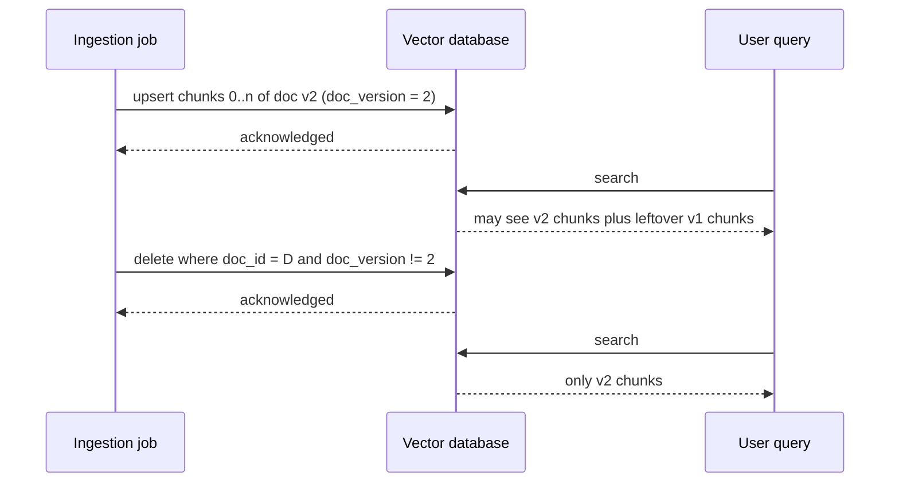

A vector index is never finished. Policies are rewritten, runbooks gain sections, documents are withdrawn, permissions change, and every change must reach the index without breaking searches that are running at the same moment. **CRUD** (create, read, update and delete) names the four basic operations any database supports. In a vector database they look familiar on the surface and behave in ways that catch people out underneath: an "update" may be a delete plus an insert, a "delete" may only mark a point, a write may be acknowledged before it is searchable, and the most common real operation, *replace this document*, is not a single call at all.

This lesson covers the semantics of each operation in a vector database, how to replace a document whose chunk count has changed without leaving orphans or a gap, when a write becomes visible to searches, and how to make every write safe to repeat. Deciding *which* documents changed is the job of [Incremental ingestion](/learn/understanding-document-ingestion/incremental-ingestion), and how to construct stable identifiers is covered in [Document identifiers](/learn/document-engineering/document-identifiers); here the focus is what happens at the database once you know.

## Learning objectives

- Distinguish insert from upsert, and explain why idempotent upserts with deterministic identifiers are the default for ingestion.
- Use the read operations (retrieve by id, scroll, count) and know which return vectors and payloads.
- Choose between a full point upsert, a vector-only update and a payload-only update for a given change.
- Replace a document whose chunk count changes, without orphaned chunks and without a window where the document is missing.
- Explain write acknowledgement and visibility, and design writes that are safe under retries and concurrent writers.

## Prerequisites

- [Metadata](/learn/vector-database-fundamentals/metadata): payload fields such as `doc_id` and `doc_version`, and payload-only updates.
- [Vector storage](/learn/vector-database-fundamentals/vector-storage): segments, tombstones and why deletes do not free space at once.
- [Document identifiers](/learn/document-engineering/document-identifiers): deterministic document and chunk identifiers.
- [Incremental ingestion](/learn/understanding-document-ingestion/incremental-ingestion): detecting which documents were added, changed or deleted.

## Why this matters

Most RAG index bugs that reach users are write bugs, not search bugs. Three are especially common.

**Orphaned chunks.** A ten-chunk policy is edited down to seven chunks. The pipeline upserts the seven new chunks; chunks 8 to 10 from the old version stay in the index. The assistant now quotes a mixture of the current policy and fragments of the old one, and nobody notices until a user complains about a contradiction.

**Duplicates.** A pipeline that generates random identifiers inserts a second copy of every chunk on every run. Results fill with near-identical chunks, the top $k$ carries less information, and the collection grows without bound.

**Disappearing documents.** A pipeline deletes a document's chunks and then re-inserts the new ones. Between the two calls, or permanently if the job crashes in between, the document cannot be found at all.

All three come from treating writes as fire-and-forget. A correct write path is idempotent (safe to run twice), complete (leaves nothing stale behind) and ordered so that the index is never worse in the middle of an update than before it.

## The intuition

Think of a library's catalogue of index cards, one card per page of each book. A new edition of a book arrives with fewer pages than the old one.

A careless librarian replaces the cards for pages 1 to 7 with new ones and goes home. Cards for pages 8 to 10 of the old edition remain in the drawer, describing pages that no longer exist. Readers find them and go looking for text that is not there.

A cautious but clumsy librarian first removes all the old edition's cards, then goes to fetch the new ones. For an hour the book is missing from the catalogue entirely, and if the librarian is called away, it stays missing.

A good librarian files the new edition's cards first, each stamped "edition 2". Then she pulls every card for this book that is *not* stamped edition 2. For a few minutes, a reader might see both editions' cards side by side, which is a small and temporary problem; at no point is the book missing, and at the end nothing stale remains. If she is interrupted and starts again, refiling the same cards and pulling non-edition-2 cards does no harm.

That is the whole of this lesson: deterministic cards, write the new before removing the old, and use a version stamp to find what is stale.

## How it works

### Create: insert versus upsert

A **pure insert** adds a point and fails (or creates a duplicate, depending on the product) if one with that identifier exists. An **upsert** (update or insert) writes the point whether or not the identifier exists, replacing the old point entirely if it does. Qdrant's `upsert`, Pinecone's `upsert` and pgvector's `INSERT ... ON CONFLICT (id) DO UPDATE` all have upsert semantics.

Upserts combine with **deterministic identifiers** (derived from the document and chunk, not generated randomly) to give **idempotency**: writing the same chunk twice leaves exactly one point. That is what makes an ingestion job safe to retry after a timeout, a crash or a duplicate message from a queue. With random identifiers, every retry is a duplicate.

Note what "replacing the old point entirely" means: the new point's vector *and* payload overwrite the old ones. A field present in the old payload and absent from the new one disappears. If you only meant to change some fields, use a payload update instead.

**Batching.** Points should be written in batches, typically hundreds to a few thousand per request. Each request has a fixed overhead (network round trip, write-ahead log append, acknowledgement), so batching amortises it. Clients often provide helpers for large uploads; qdrant-client, for instance, has `upload_points` with batch-size and parallelism options.

### Read: by identifier, by scan, by count

Search is the read operation everyone knows, but maintenance code relies on three others:

| Operation | Qdrant | Purpose |
| --- | --- | --- |
| Retrieve by id | `retrieve(ids=[...], with_vectors=...)` | Fetch known points, for example to check what is stored |
| Scroll | `scroll(scroll_filter=..., limit=..., offset=...)` | Page through all points matching a filter, in identifier order |
| Count | `count(count_filter=..., exact=True)` | How many points match; used to verify writes and deletions |

Vectors are not returned by default in most APIs (they are large), so ask for them explicitly when needed. `count` with `exact=False` may return an estimate, which is fine for dashboards and wrong for verifying a migration.

### Update: three kinds

What changed determines the cheapest correct operation.

1. **Text changed.** The chunk's meaning may have changed, so it needs a new embedding: **upsert the whole point** (new vector, new payload).
2. **Only metadata changed** (permissions, status, owner). The vector depends only on the text: **update the payload** (`set_payload` and related calls, covered in [Metadata](/learn/vector-database-fundamentals/metadata)), by identifier or by filter.
3. **Only the vector changed** (re-embedding with a new model version into the same collection, or adding a context prefix before embedding). **Update the vector** (`update_vectors` in Qdrant), leaving the payload untouched.

Underneath, as [Vector storage](/learn/vector-database-fundamentals/vector-storage) described, an update to a point in a sealed segment is usually implemented as a tombstone on the old version plus an append of the new one, and the index catches up in the background. The new version is searchable straight away through the unindexed segment.

### Delete: by identifier and by filter

Points can be deleted by a list of identifiers or by a **filter**: "every point where `doc_id = 'hb-remote'`". Deleting by filter is the natural way to remove a whole document, because you do not need to know how many chunks it had or what their identifiers were.

A delete is logical at first. The point is marked with a tombstone, excluded from all reads and searches immediately, and physically removed when its segment is next rewritten. Disk space comes back later, not at once. For data-protection deletions this distinction matters: the data is unreachable through the API immediately, but it remains on disk, in older snapshots and in backups until those are rewritten or expire. [Secure deletion](/learn/enterprise-rag-governance/secure-deletion) covers what a deletion request actually requires.

In FAISS, which is a library rather than a database, deletion by your own identifiers needs an `IndexIDMap` wrapper and `remove_ids`, and some index types do not support removal efficiently. This is one of the clearest differences between a search library and a database.

### Replacing a document

The most common real write is "this document has a new version". The new version may have more chunks, fewer, or the same number with different text. Three approaches:

**Upsert only.** Write the new chunks with deterministic ids. Positions that exist in both versions are overwritten; positions that existed only in the old version remain as **orphans**. Wrong whenever the chunk count shrinks.

**Delete then insert.** Delete every chunk of the document, then insert the new ones. Correct at the end, but there is a window where the document cannot be found, and a crash between the two steps leaves it missing until the next run.

**Insert then delete stale.** Write the new chunks, each with the new `doc_version` in its payload. Then delete every point where `doc_id` is this document and `doc_version` is *not* the new version. The document is never absent; for a moment, old and new chunks may both be visible (a brief duplication, much less harmful than absence); and the operation is idempotent, because running it again rewrites the same points and finds nothing stale.



If even the brief overlap is unacceptable, include the version in the point identifier so that old and new chunks never share ids, write the new version, and switch readers to it with a filter on the current version (or a "current" flag set with one payload update) before deleting the old. That adds a step but makes the switch effectively instantaneous.

Most dedicated vector databases do not offer multi-point transactions, so "write new and delete old" cannot be made atomic inside them. pgvector is the exception that proves the rule: inside PostgreSQL, the insert and the delete can share one transaction, and other sessions see either the old document or the new one, never both.

### Visibility and acknowledgement

When a write call returns, what has happened? It depends on the product and the options.

- **Acknowledged after logging.** Qdrant's `wait=True` returns after the change is applied and visible to searches; `wait=False` returns as soon as the request is accepted, which is faster but means an immediate search may not see it.
- **Distributed write ordering.** In a cluster, a write is applied on several replicas. Qdrant exposes an `ordering` parameter (weak, medium, strong) to trade throughput for guarantees about the order in which concurrent writes are applied across replicas; other products have their own consistency settings.
- **Eventual freshness in managed services.** Some managed and serverless services document that a newly written record may take a short time to become searchable. Check the documentation of the service you use before assuming read-your-writes.

For ingestion, wait for acknowledgement on each batch before marking the source document as indexed. Otherwise a crash can leave the pipeline believing a document is indexed when it is not.

### Concurrency: one writer per document

Two workers processing two updates of the same document at once is a race. If version 3's worker finishes before version 2's, version 2's chunks overwrite version 3's, and the "delete stale" step of version 2's worker then deletes version 3's chunks. Many vector databases offer no compare-and-set operation to prevent this.

The robust fix is architectural: **route all changes for one document to one worker** (for example by partitioning a queue on `doc_id`), so changes to a document are applied in order. Two guards help where that is not possible. First, if versions are increasing integers, define stale as `doc_version < new` rather than `doc_version != new`, so an out-of-date worker can never delete a newer version. Second, use a conditional write if your database has one: recent Qdrant releases add an `update_filter` argument to `upsert`, which overwrites an existing point only if it matches the filter (for example `doc_version < new`) and inserts points that do not exist. It behaved as described in local mode with qdrant-client 1.20; check that your server version supports it before relying on it. Reading the stored version and then writing, as two separate calls, narrows the race but does not close it.

> [!KEY]
> Write with deterministic ids and upserts so that every operation is safe to repeat; replace documents by writing the new version first and then deleting everything of that document that is not the new version; wait for acknowledgement before recording success; and serialise changes per document.

## In code

**The problem.** Show the orphan bug, fix it with insert-then-delete-stale, prove the fix is idempotent, update a vector without touching the payload, and delete a document by filter. The policy is AskMeridian's remote-work section, rewritten from four chunks into two.

**Dependencies.** qdrant-client in `:memory:` mode and sentence-transformers.

```bash
pip install qdrant-client sentence-transformers
```

```python
import uuid

from qdrant_client import QdrantClient, models
from sentence_transformers import SentenceTransformer

model = SentenceTransformer("sentence-transformers/all-MiniLM-L6-v2")
client = QdrantClient(":memory:")
COLL = "askmeridian"
client.create_collection(COLL, vectors_config=models.VectorParams(size=384, distance=models.Distance.COSINE))


def point_id(doc_id: str, position: int) -> str:
    return str(uuid.uuid5(uuid.NAMESPACE_URL, f"{doc_id}#{position}"))


def doc_filter(doc_id: str, exclude_version: int | None = None) -> models.Filter:
    must = [models.FieldCondition(key="doc_id", match=models.MatchValue(value=doc_id))]
    must_not = []
    if exclude_version is not None:
        must_not.append(models.FieldCondition(key="doc_version", match=models.MatchValue(value=exclude_version)))
    return models.Filter(must=must, must_not=must_not)


def naive_upsert(doc_id: str, version: int, chunks: list[str]) -> None:
    """Upsert the document's chunks and nothing else. Looks right; leaves orphans."""
    vectors = model.encode(chunks, normalize_embeddings=True)
    client.upsert(COLL, wait=True, points=[
        models.PointStruct(id=point_id(doc_id, i), vector=v.tolist(),
                           payload={"doc_id": doc_id, "doc_version": version, "position": i, "text": t})
        for i, (t, v) in enumerate(zip(chunks, vectors))])


def replace_document(doc_id: str, version: int, chunks: list[str]) -> int:
    """Write the new version first, then delete every chunk of this document from other versions."""
    naive_upsert(doc_id, version, chunks)                                    # step 1: new version visible
    stale = client.count(COLL, count_filter=doc_filter(doc_id, exclude_version=version), exact=True).count
    client.delete(COLL, wait=True,                                            # step 2: remove leftovers
                  points_selector=models.FilterSelector(filter=doc_filter(doc_id, exclude_version=version)))
    return stale


def show(label: str) -> None:
    points, _ = client.scroll(COLL, scroll_filter=doc_filter("hb-remote"), limit=100, with_payload=True)
    rows = sorted((p.payload["position"], p.payload["doc_version"], p.payload["text"][:38]) for p in points)
    print(f"{label}: {len(rows)} points")
    for pos, ver, text in rows:
        print(f"   #{pos} v{ver}  {text}")


v1 = ["Staff may work remotely up to 3 days a week.",
      "Remote days must be agreed with your manager.",
      "The home-office equipment budget is £400.",
      "Contractors are not eligible for the equipment budget."]
v2 = ["Staff may work remotely up to 3 days a week, agreed with their manager.",
      "The home-office equipment budget is £400; contractors are not eligible."]

naive_upsert("hb-remote", 1, v1)
show("after v1")
naive_upsert("hb-remote", 2, v2)
show("after v2, naive upsert")

stale = replace_document("hb-remote", 2, v2)
print(f"replace_document removed {stale} stale points")
show("after v2, replace_document")

again = replace_document("hb-remote", 2, v2)                                   # idempotent: run it twice
print(f"second run removed {again}; total points: {client.count(COLL, exact=True).count}")

# Read by id, then update only the vector (e.g. after re-embedding with a context prefix).
pid = point_id("hb-remote", 1)
before = client.retrieve(COLL, ids=[pid], with_vectors=True)[0]
new_vec = model.encode("Remote work policy > " + before.payload["text"], normalize_embeddings=True)
client.update_vectors(COLL, wait=True, points=[models.PointVectors(id=pid, vector=new_vec.tolist())])
after = client.retrieve(COLL, ids=[pid], with_vectors=True)[0]
print("payload unchanged:", before.payload == after.payload,
      "| vector changed:", before.vector[:3] != after.vector[:3])

# Delete the whole document by filter.
client.delete(COLL, wait=True, points_selector=models.FilterSelector(filter=doc_filter("hb-remote")))
print("after delete by filter:", client.count(COLL, exact=True).count, "points")
```

```output
after v1: 4 points
   #0 v1  Staff may work remotely up to 3 days a
   #1 v1  Remote days must be agreed with your m
   #2 v1  The home-office equipment budget is £4
   #3 v1  Contractors are not eligible for the e
after v2, naive upsert: 4 points
   #0 v2  Staff may work remotely up to 3 days a
   #1 v2  The home-office equipment budget is £4
   #2 v1  The home-office equipment budget is £4
   #3 v1  Contractors are not eligible for the e
replace_document removed 2 stale points
after v2, replace_document: 2 points
   #0 v2  Staff may work remotely up to 3 days a
   #1 v2  The home-office equipment budget is £4
second run removed 0; total points: 2
payload unchanged: True | vector changed: True
after delete by filter: 0 points
```

**The important lines.**

- `point_id` derives a UUID from `doc_id#position` with `uuid5`, so the same chunk position always maps to the same point. This is what makes upserts idempotent.
- `doc_filter(doc_id, exclude_version=version)` builds "this document AND NOT this version", the precise definition of stale. It catches orphans at any position and leftovers from any older version, including versions you have forgotten about.
- `replace_document` upserts first and deletes second. The count before the delete is only for reporting; in production you might log it, since a sudden large number of stale chunks is worth investigating.
- `wait=True` on every write means each call returns only once the change is applied, so the next line's reads see it.
- `client.update_vectors(...)` replaces only the vector, and the check confirms the payload is identical.
- `models.FilterSelector(filter=doc_filter("hb-remote"))` deletes every chunk of the document without listing identifiers.

**What the output means.**

- After the naive upsert of version 2, the collection still holds four points: two new (positions 0 and 1, now v2) and two orphans from v1 (positions 2 and 3). Position 2's orphan even says the same thing as the new position 1, which is how contradictions and duplicate context arise.
- `replace_document` found exactly the two stale points and removed them, leaving the two v2 chunks.
- Running it a second time removed nothing and left the count at two: the operation is idempotent, so a retried job does no harm.
- The vector-only update changed the embedding and left the payload untouched; deleting by filter removed the whole document.

**Errors people commonly hit.**

- Forgetting the filter's must-not clause in the stale delete. `doc_id = D` alone deletes the new version too.
- Using `exact=False` in `count` to verify a deletion. An approximate count can be non-zero after a complete delete or zero before one.
- Upserting a partial payload to change one field and losing all the others; upsert replaces the whole point.

**Extending it.** Make the brief overlap impossible: include the version in the point id (`f"{doc_id}@v{version}#{position}"`), add a `is_current` payload flag, write v2 with `is_current=False`, flip v2 to true and v1 to false with two filtered `set_payload` calls, require `is_current=True` in every search, and finally delete v1. Then consider what a reader sees between the two `set_payload` calls, and in which order they should run.

## A real-world example

Meridian's IT runbooks are edited in a wiki, and every save emits an event. AskMeridian's ingestion workers consume these events from a queue, re-chunk the page and write it to Qdrant.

During a busy afternoon, Arjun from IT made three quick edits to the laptop runbook within a minute: fixing a typo, adding a section on reporting a lost laptop to the support desk at once, and then shortening the section on the 3-year refresh cycle. Three events went into the queue; three workers picked them up in parallel. The worker handling the second edit was slowest. It finished last, overwrote the third version's chunks with the second version's, and its delete-stale step then removed the third version's remaining chunks. AskMeridian was now serving an older runbook than the wiki showed, and nothing in the logs looked wrong: every operation had succeeded.

The Platform team's fix had two parts. First, they partitioned the queue by `doc_id`, so all events for one page are processed by one worker in order; out-of-order completion for the same document became impossible. Second, every worker now fetched the page's latest content at processing time rather than using the content snapshot in the event, so a worker processing an old event writes the current version anyway. A nightly reconciliation compared each page's version in the wiki with the `doc_version` stored in the collection and re-ingested any mismatch, as the safety net described in [Incremental ingestion](/learn/understanding-document-ingestion/incremental-ingestion).

## Common mistakes

- **Random point identifiers.** Every retry and every re-run creates duplicates.
- **Upsert-only document replacement.** Orphaned chunks remain whenever a document shrinks.
- **Delete-then-insert replacement.** The document disappears for the duration, or permanently after a crash between the two steps.
- **Using upsert to change one payload field.** The whole payload is replaced; other fields vanish.
- **Not waiting for acknowledgement.** The pipeline records success for writes that were never applied, or tests read before the write is visible.
- **Parallel writers for the same document.** Out-of-order completion silently reverts documents to older versions.
- **Treating a delete as erasure.** Tombstoned data remains on disk, in snapshots and in backups until they are rewritten or expire.

## Best practices

- Derive point identifiers deterministically from the document and chunk, and write with upserts.
- Store `doc_id` and `doc_version` in every payload, and replace documents by upserting the new version and then deleting `doc_id = D AND doc_version != new`.
- Use payload updates for metadata changes and vector updates for re-embedding, rather than rewriting whole points.
- Write in batches, wait for acknowledgement per batch, and only then mark the source as indexed.
- Serialise changes per document (partition queues by `doc_id`) and process the latest source content, not stale event snapshots.
- Verify writes with exact counts in tests and reconciliation jobs.

## Performance considerations

**Batching dominates ingestion throughput.** If a write request costs an assumed 5 ms of fixed overhead plus a small per-point cost, writing 100,000 chunks one at a time spends $100{,}000 \times 5 = 500$ seconds on overhead alone; in batches of 500, it is $200 \times 5 = 1$ second. Embedding the text is usually the slower step anyway, so batch that too.

**Deletes by filter are cheap if the filter is indexed.** Deleting `doc_id = D` needs to find the document's points. With a payload index on `doc_id`, that is a lookup; without one, it is a scan of every payload. Index `doc_id`.

**Updates create background work.** Each update or delete tombstones a row and appends a new one; heavy update traffic produces segments full of tombstones, which the optimiser must merge and re-index. Plan CPU headroom for this, or schedule bulk re-ingestion off-peak.

**`wait=True` costs latency per call, not throughput overall.** Waiting for acknowledgement makes each call slower but lets you pipeline batches safely; parallel batch uploads recover throughput.

## Security considerations

Write access to the vector database is write access to what the assistant says. Restrict it to the ingestion service, with credentials separate from the query path's read-only credentials. Validate payloads before every write (especially access-control fields) so that a malformed update cannot widen a document's audience. Deletion requests for personal data need more than an API delete: plan for tombstoned data on disk, snapshots and backups, as [Secure deletion](/learn/enterprise-rag-governance/secure-deletion) explains. Finally, log every write and delete with the document identifier and version; when an answer turns out to be wrong, the write log is how you find out when and why the index changed.

## Summary

- Upsert writes a point whether or not it exists, replacing it entirely; with deterministic identifiers it makes ingestion idempotent and retries harmless.
- Reads beyond search (retrieve by id, scroll by filter, exact count) are the tools for maintenance and verification.
- Choose the update by what changed: whole point for text, payload update for metadata, vector update for re-embedding.
- Deletes are logical first (tombstones) and physical later; deleting by filter removes a whole document without knowing its chunk ids.
- Replace a document by writing the new version and then deleting `doc_id = D AND doc_version != new`: no orphans, no missing window, idempotent. Wait for acknowledgement, and serialise writes per document.

## Exercises

**1.** A document had 12 chunks in version 4 and has 9 in version 5. Using upsert-only replacement with positional ids, how many points does the document have after the update, and which are wrong? What does insert-then-delete-stale leave?

<details><summary>Show solution</summary>

Upsert-only overwrites positions 0 to 8 with version 5 and leaves positions 9, 10 and 11 from version 4: 12 points, of which 3 are orphans. Insert-then-delete-stale writes positions 0 to 8 as version 5, then deletes every point of the document whose version is not 5, removing positions 9 to 11: 9 points, all current.

</details>

**2.** A colleague writes `client.upsert(COLL, points=[models.PointStruct(id=pid, vector=v, payload={"doc_status": "superseded"})])` to mark a chunk superseded. What goes wrong, and what should they write instead?

<details><summary>Show solution</summary>

Upsert replaces the whole point, so the payload becomes only `{"doc_status": "superseded"}`: `doc_id`, `text`, `allowed_groups` and every other field are lost. The chunk can no longer be cited, filtered by document or permission-checked. (They also re-sent the vector unnecessarily.) The correct call is a payload update, ideally for the whole document:

```python
client.set_payload(COLL, payload={"doc_status": "superseded"},
                   points=models.Filter(must=[models.FieldCondition(
                       key="doc_id", match=models.MatchValue(value="hb-2023"))]))
```

</details>

**3.** Write a `delete_document(doc_id)` function that deletes all of a document's points and returns how many were deleted, verified by exact counts before and after. Why verify with counts rather than trusting the call's return value?

<details><summary>Show solution</summary>

```python
def delete_document(doc_id: str) -> int:
    flt = doc_filter(doc_id)
    before = client.count(COLL, count_filter=flt, exact=True).count
    client.delete(COLL, wait=True, points_selector=models.FilterSelector(filter=flt))
    after = client.count(COLL, count_filter=flt, exact=True).count
    if after != 0:
        raise RuntimeError(f"{after} points of {doc_id} survived deletion")
    return before
```

The delete call's result says the operation was accepted (and, with `wait=True`, applied), not how many points matched. An exact count before and after tells you what was actually removed and catches mistakes such as a filter on a misspelled field, which "succeeds" while deleting nothing.

</details>

**4.** Design decision. AskMeridian must support legal holds: when Legal places a hold on a document, its current version must remain searchable even if HR publishes a replacement, until the hold is lifted. Adapt the replace-document procedure.

<details><summary>Show solution</summary>

Add a `legal_hold` boolean to the payload and make the stale-delete step skip held versions: delete where `doc_id = D AND doc_version != new AND legal_hold != true` (a must-not condition on `legal_hold`). The held old version and the new version now coexist, so searches must decide which one users see: typically the new version for ordinary staff (filter `is_current = true`) and both for Legal's own searches. Point identifiers must include the version, otherwise the new version's upserts would overwrite the held version's chunks at shared positions. When the hold is lifted, clear `legal_hold` with a payload update and re-run the stale delete. Record each hold and release in the write log.

</details>

## Check your understanding

```quiz
[
  {"q": "Why are deterministic point identifiers combined with upsert the default for ingestion?", "options": ["They make vectors smaller", "Writing the same chunk twice leaves exactly one point, so retries and re-runs are harmless", "They make search faster", "They encrypt the payload"], "answer": 1, "why": "Upsert replaces an existing point with the same id, so a deterministic id makes the write idempotent."},
  {"q": "A document shrinks from 6 chunks to 4. Which replacement procedure leaves neither orphans nor a window where the document is missing?", "options": ["Upsert the 4 new chunks", "Delete all chunks of the document, then insert the 4 new ones", "Upsert the 4 new chunks with the new doc_version, then delete chunks of that document with any other doc_version", "Create a new collection for every edit"], "answer": 2, "why": "Writing first keeps the document visible; deleting by 'same doc, other version' removes every stale chunk, and the procedure is safe to repeat."},
  {"q": "Only a document's allowed_groups changed. What is the cheapest correct operation?", "options": ["A payload update on all points of the document", "Re-embed and upsert every chunk", "Delete the document and re-ingest it", "Update the vectors"], "answer": 0, "why": "Permissions are metadata; vectors depend only on text, so a filtered payload update is sufficient."},
  {"q": "In Qdrant, what does wait=True on a write guarantee when the call returns?", "options": ["The data is in an off-site backup", "The point has been physically removed from disk", "The segment has been re-indexed with HNSW", "The change has been applied and is visible to subsequent searches"], "answer": 3, "why": "wait=True returns after the operation is applied; indexing and physical cleanup can still happen later in the background."},
  {"q": "Two workers process versions 2 and 3 of the same document concurrently, and version 2's worker finishes last. What is the most robust fix?", "options": ["Use wait=False", "Route all changes for a document to a single worker so they are applied in order", "Increase the batch size", "Delete the collection nightly"], "answer": 1, "why": "Many vector databases lack compare-and-set; serialising writes per document removes the race at its source."}
]
```

## Further reading

- Qdrant documentation, "Points": upsert, retrieve, scroll, count, delete by id and by filter, `update_vectors`, and the `wait` and `ordering` parameters. [qdrant.tech/documentation](https://qdrant.tech/documentation/)
- PostgreSQL documentation, `INSERT ... ON CONFLICT` and transactions: upserts and atomic replace with pgvector. [postgresql.org/docs](https://www.postgresql.org/docs/)
- FAISS wiki, "Special operations on indexes": `IndexIDMap`, `add_with_ids` and `remove_ids`. [github.com/facebookresearch/faiss/wiki](https://github.com/facebookresearch/faiss/wiki)
- Kleppmann (2017), *Designing Data-Intensive Applications*, chapters 7 and 9: transactions, idempotence and ordering guarantees in distributed writes.
