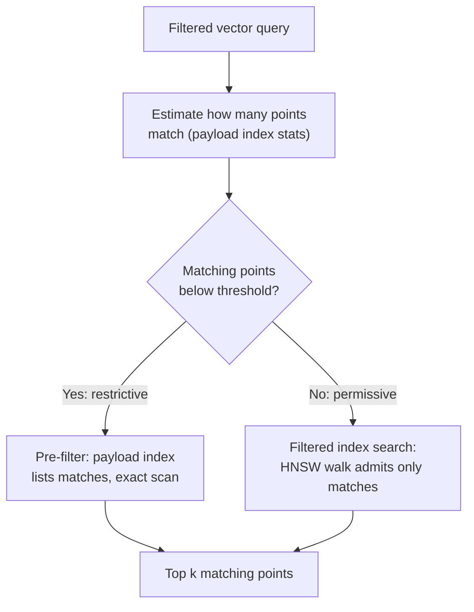

Real retrieval questions almost always come with conditions. "The closest chunks to this question, *but only from the current handbook*." "*Only from documents this user may read.*" "*Only runbooks updated in the last year.*" **Filtering** is the part of a vector database that combines a similarity search with conditions on payload fields, and it is harder than it looks. Done naively, it returns too few results, or the wrong ones, or takes far longer than an unfiltered search.

This lesson explains how filters are expressed, the three strategies a database can use to combine a filter with a vector search (post-filtering, pre-filtering and filtering inside the index), why each one breaks under particular conditions, and how a query planner chooses between them. [Metadata](/learn/vector-database-fundamentals/metadata) designed the payload these filters read. The engineering of payload indexes and filtered search at scale continues in [Metadata filtering](/learn/advanced-vector-database-engineering/metadata-filtering) and [Payload indexes](/learn/advanced-vector-database-engineering/payload-indexes); how a retriever decides *which* filter to apply to a user's question is [Filtered retrieval](/learn/advanced-retrieval/filtered-retrieval).

## Learning objectives

- Express filters with must, should and must-not clauses over match, range and emptiness conditions.
- Define filter selectivity and explain how it affects each filtering strategy.
- Explain why post-filtering returns too few results, and calculate the oversampling it would need.
- Compare pre-filtering and in-index filtering, and explain why graph search loses recall under restrictive filters.
- Describe how a query planner chooses a strategy, and verify a filtered search's recall against exact filtered search.

## Prerequisites

- [Similarity search](/learn/vector-database-fundamentals/similarity-search): exact kNN and top-k selection.
- [Indexing](/learn/vector-database-fundamentals/indexing): HNSW, IVF and recall@k against exact search.
- [Metadata](/learn/vector-database-fundamentals/metadata): typed payloads and why types decide what a condition can match.

## Why this matters

Filters carry some of a RAG system's hardest requirements. A permission filter is a security control: if it fails open, a user sees a document they should not; if it fails closed, the assistant says "I don't know" about a policy that exists. A status filter keeps superseded policies out of answers. A tenant filter separates one customer's data from another's.

Each filtering strategy has a characteristic failure, and none of them raises an error:

- Filter after searching, and a user whose permitted documents are a small slice of the collection gets two results instead of five, or none, because the top results belonged to other people.
- Filter inside an approximate index, and a very restrictive filter leaves the graph search stranded among non-matching points, so it returns poor matches while better ones exist.
- Filter before searching without an index on the filtered field, and every query reads every payload, so latency climbs with the collection.

Understanding which strategy your database uses for a given query, and checking recall under realistic filters, is the difference between a filter that works in the demo and one that works for the user with access to 1% of the corpus.

## The intuition

You are choosing a restaurant: the five closest to you, but only those that are vegetarian.

**Post-filtering:** look up the five closest restaurants, then cross off the ones that are not vegetarian. If only one of the five is vegetarian, you end up with one option, even though there are plenty of vegetarian restaurants a little further away.

**Pre-filtering:** first list every vegetarian restaurant in the city, then find the five closest among them. Always correct. Fast if the vegetarian list is short and already compiled (an index); slow if you must check every restaurant's menu, or if most restaurants are vegetarian anyway.

**Filtering while searching:** walk outwards from where you are, street by street, noting only vegetarian restaurants as you pass. Efficient when vegetarian restaurants are common. If they are rare, you walk a long way (or give up early and settle for poor choices), because the streets near you are full of places you must skip.

Which approach is best depends on one number: what fraction of restaurants are vegetarian. That fraction is the filter's **selectivity**.

## How it works

### Expressing a filter

Vector databases express filters as boolean combinations of conditions on payload fields. Qdrant's model, which most others resemble, has three clause types:

- **must:** every condition must hold (logical AND).
- **should:** at least one condition must hold (logical OR).
- **must_not:** no condition may hold (logical NOT).

Clauses can be nested. The common condition types:

| Condition | Meaning | Example |
| --- | --- | --- |
| Match value | Field equals a value | `source_type = "runbook"` |
| Match any | Field equals any of a list (for an array field: any element matches) | `allowed_groups` contains any of `["it", "all-staff"]` |
| Range | Numeric comparison | `doc_version >= 5` |
| Datetime range | Time comparison | `effective_from >= 2025-01-01` |
| Is empty / is null | Field missing, empty or null | `doc_status` is empty |
| Has id | Point identifier in a list | Restrict to known points |

In SQL with pgvector the same thing is a `WHERE` clause beside `ORDER BY embedding <=> :query LIMIT k`. Other products use their own syntax for the same logic. A typical AskMeridian query, in words: *must* be current, *must* have `allowed_groups` matching any of the user's groups, and *must_not* be a draft.

```python
from qdrant_client import models

user_groups = ["all-staff", "it"]
flt = models.Filter(
    must=[
        models.FieldCondition(key="doc_status", match=models.MatchValue(value="current")),
        models.FieldCondition(key="allowed_groups", match=models.MatchAny(any=user_groups)),
    ],
    must_not=[
        models.FieldCondition(key="source_type", match=models.MatchValue(value="draft")),
    ],
)
# client.query_points("askmeridian", query=query_vector, query_filter=flt, limit=5)
```

### Selectivity

The **selectivity** $s$ of a filter is the fraction of points that satisfy it. A filter matching 30,000 of 200,000 points has $s = 0.15$. Selectivity varies per query: an IT administrator's permission filter may match 90% of the collection and a new contractor's 2%. Every strategy below behaves well at some selectivities and badly at others, so a system must cope with the whole range its users produce.

Selectivity alone is not the whole story. **Correlation** between the filter and the query's neighbourhood matters too. If the matching points cluster near the query (a runbook filter on a technical question), even a restrictive filter is easy. If they lie far from it (a filter for "finance documents" on a question about VPNs), the best matching points are far down the unfiltered ranking.

### Strategy 1: post-filtering

1. Run the vector search for the top $k'$ candidates, ignoring the filter.
2. Discard candidates that fail the filter.
3. Return the first $k$ survivors, or fewer if not enough survived.

It is simple, and it is what you get if you filter in application code after calling the database. Its flaw is **result shortfall**: if the filter matches a fraction $s$ of points and is unrelated to similarity, about $k' s$ of the $k'$ candidates survive. With $k' = k$, a filter matching 10% of points leaves about one result of ten. The fix, **oversampling** (asking for many more candidates than needed), works only when $s$ is known and not too small, and it makes every query more expensive. The mathematics section quantifies it.

### Strategy 2: pre-filtering

1. Find every point that satisfies the filter, using a **payload index** (an index on the filtered field, such as a map from each keyword to the points that have it).
2. Search for the top $k$ only among those points, usually by exact scan of their vectors.

Pre-filtering is always **correct and complete**: it returns exactly the top $k$ matching points, or all of them if fewer than $k$ match. Its cost is proportional to the number of matching points, $sN$. That is excellent for restrictive filters (scanning 2,000 points is trivial) and poor for permissive ones (scanning 180,000 points is an exact search over most of the collection, throwing away the index's advantage). Without a payload index, step 1 itself reads every payload.

### Strategy 3: filtering inside the index

1. Search the approximate index as usual (walk the HNSW graph, or scan the probed IVF lists).
2. As candidates are found, admit only those that satisfy the filter into the result list, and keep searching until $k$ matching results are found or the search effort is exhausted.

For permissive and moderately selective filters this is the best of both worlds: index speed with no shortfall. Its weakness is **restrictive filters on graph indexes**. An HNSW search is a walk that follows links between nearby points and stops after exploring a bounded candidate list (`ef`). When only a small fraction of points match, the neighbourhood the walk explores contains few matching points, and the walk can end having found too few of them, or only distant ones. The graph is connected as a whole, but the subgraph of matching points may be fragmented. Recall falls, sometimes sharply, and the code below measures it.

### How databases choose: the query planner

Because each strategy fails in a different regime, mature vector databases use a **query planner**, the same idea relational databases use to choose between an index and a table scan.



1. **Estimate cardinality.** Use payload-index statistics to estimate how many points match.
2. **Choose.** Below a threshold, pre-filter and scan the matches exactly; above it, run a filtered index search.
3. **Execute** per segment and merge, as for any search.

Qdrant documents this behaviour: it estimates filter cardinality from payload indexes and switches to payload-index-based exact search below a configurable threshold; it also adds extra links to its HNSW graph for values of indexed payload fields, so that filtered walks stay connected. pgvector applies `WHERE` conditions to the rows an index scan yields, which can return fewer rows than the `LIMIT` under restrictive filters; recent pgvector releases add iterative index scans to keep scanning until enough rows qualify, so check the README for the version you run. The practical rule is the same everywhere: **create payload indexes on every field you filter on**, because both the planner's estimate and the pre-filter path depend on them.

> [!KEY]
> Never filter in application code after the search. Push every condition into the database query, index every filtered field, and measure recall at the most restrictive filters your real users produce.

## The mathematics

### Post-filtering shortfall and oversampling

**Intuition.** If a filter is unrelated to similarity, each candidate passes it independently with probability $s$. The number that pass among $k'$ candidates is then a binomial random variable: on average $k' s$, but it fluctuates.

$$
M \sim \text{Binomial}(k', s), \qquad \mathbb{E}[M] = k' s, \qquad P(M \ge k) = \sum_{j=k}^{k'} \binom{k'}{j} s^j (1-s)^{k'-j}
$$

$M$ is the number of candidates that pass, $k'$ the number retrieved before filtering, $s$ the selectivity, $k$ the number of results wanted, and $\binom{k'}{j}$ the number of ways to choose which $j$ candidates pass. To get $k$ results *on average* you need $k' = k / s$; to get them *reliably* you need more.

**By hand.** $k = 5$ and $s = 0.05$ (the user may read 5% of the collection).

- No oversampling, $k' = 5$: expected matches $5 \times 0.05 = 0.25$. All five pass with probability $0.05^5 \approx 3.1 \times 10^{-7}$: effectively never.
- $k' = k / s = 100$: expected matches $100 \times 0.05 = 5$. But the probability that *none* pass is still $0.95^{100} \approx 0.0059$, and as the code shows, the probability of at least five surviving is only about 56%.
- $k' = 200$: expected 10 matches; the probability of at least five rises to about 97%.

Twenty times oversampling to serve one query reliably is a steep price, and it assumes you know $s$ in advance. If the filter is anti-correlated with the query (matching points lie far from it), even that is not enough, because matching points are rarer than $s$ among the top candidates. This is why post-filtering is the wrong default.

```python
from math import comb

def p_at_least(k, k_prime, s):
    """P(at least k of k_prime independent candidates pass a filter of selectivity s)."""
    return sum(comb(k_prime, j) * s**j * (1 - s)**(k_prime - j) for j in range(k, k_prime + 1))

k, s = 5, 0.05
for k_prime in [5, 100, 200, 400]:
    print(f"k'={k_prime:>3}: expected matches {k_prime * s:5.1f}, P(at least {k}) = {p_at_least(k, k_prime, s):.3f}")
```

```output
k'=  5: expected matches   0.2, P(at least 5) = 0.000
k'=100: expected matches   5.0, P(at least 5) = 0.564
k'=200: expected matches  10.0, P(at least 5) = 0.974
k'=400: expected matches  20.0, P(at least 5) = 1.000
```

(The first line prints 0.2 because 0.25 rounds to one decimal place as 0.2.)

### Pre-filtering cost

A pre-filter scan costs about $sN$ vector comparisons plus the payload-index lookup. For $N = 1{,}000{,}000$: at $s = 0.002$ it is 2,000 comparisons, cheaper than most HNSW searches; at $s = 0.5$ it is 500,000, hundreds of times more expensive. The crossover between pre-filtering and filtered index search is where $sN$ is comparable to the number of vectors an index search touches, typically a few thousand. That is the threshold a planner tunes.

## In code

**The problem.** Measure the three strategies on the same data. Build an HNSW index over 50,000 vectors, attach a random boolean attribute (think "this user may read this chunk") at selectivities from 50% down to 0.2%, and compare post-filtering, pre-filtering and in-graph filtering against exact filtered search.

**Dependencies.** NumPy and FAISS. FAISS's HNSW accepts an `IDSelector` in its search parameters, which admits only the selected identifiers as results during the graph search: a direct model of strategy 3. The vectors are synthetic and clustered, as in [Indexing](/learn/vector-database-fundamentals/indexing). The attribute is assigned at random, so it is uncorrelated with similarity.

```bash
pip install numpy faiss-cpu
```

```python
import faiss
import numpy as np

faiss.omp_set_num_threads(1)
rng = np.random.default_rng(11)
N, d, k, n_queries = 50_000, 128, 10, 300

centres = rng.normal(size=(200, d))
X = centres[rng.integers(0, 200, N)] + 1.6 * rng.normal(size=(N, d))
X = np.ascontiguousarray(X / np.linalg.norm(X, axis=1, keepdims=True), dtype=np.float32)
Q = centres[rng.integers(0, 200, n_queries)] + 1.6 * rng.normal(size=(n_queries, d))
Q = np.ascontiguousarray(Q / np.linalg.norm(Q, axis=1, keepdims=True), dtype=np.float32)

hnsw = faiss.IndexHNSWFlat(d, 16, faiss.METRIC_INNER_PRODUCT)
hnsw.hnsw.efConstruction = 64
hnsw.add(X)
hnsw.hnsw.efSearch = 64

print(f"{'selectivity':>11} | {'post-filter':>20} | {'pre-filter':>19} | {'in-graph':>8}")
print(f"{'':>11} | {'avg found':>10}{'recall':>10} | {'recall':>8}{'scored':>11} | {'recall':>8}")
for s in [0.5, 0.1, 0.01, 0.002]:
    allowed = rng.random(N) < s                          # e.g. "allowed_groups contains it"
    ids = np.flatnonzero(allowed)

    # Ground truth: exact search restricted to allowed points.
    S = Q @ X[ids].T
    truth = [set(ids[np.argsort(-row)[:k]]) for row in S]

    # (a) Post-filter: ANN top-k first, then drop disallowed results.
    _, I = hnsw.search(Q, k)
    post = [[i for i in row if allowed[i]] for row in I]

    # (b) Pre-filter: select allowed ids first, then exact search over just those.
    #     This is the same computation as the ground truth, so its recall is 1 by construction;
    #     its cost is len(ids) vectors scored per query.
    pre = truth

    # (c) In-graph filtering: walk the HNSW graph, but only accept allowed points as results.
    params = faiss.SearchParametersHNSW(sel=faiss.IDSelectorBatch(ids), efSearch=64)
    _, I_f = hnsw.search(Q, k, params=params)
    graph = [[i for i in row if i >= 0] for row in I_f]

    rec = lambda res: np.mean([len(set(r) & t) / k for r, t in zip(res, truth)])
    print(f"{s:>11.1%} | {np.mean([len(r) for r in post]):>10.1f}{rec(post):>10.3f} | "
          f"{rec(pre):>8.3f}{len(ids):>11,} | {rec(graph):>8.3f}")
```

```output
selectivity |          post-filter |          pre-filter | in-graph
            |  avg found    recall |   recall     scored |   recall
      50.0% |        5.0     0.495 |    1.000     24,945 |    0.962
      10.0% |        1.1     0.114 |    1.000      5,066 |    0.867
       1.0% |        0.1     0.010 |    1.000        482 |    0.271
       0.2% |        0.0     0.002 |    1.000        101 |    0.091
```

**The important lines.**

- `allowed = rng.random(N) < s` gives each point the attribute independently with probability $s$, so the measured selectivity is close to, not exactly, $s$ (24,945 of 50,000 rather than 25,000).
- `truth` is exact search over only the allowed points: the correct answer to "the 10 nearest allowed points". Every strategy is scored against it.
- `post = [[i for i in row if allowed[i]] for row in I]` is post-filtering as application code does it: search, then discard.
- `faiss.SearchParametersHNSW(sel=faiss.IDSelectorBatch(ids), efSearch=64)` passes the filter into the graph search, so only allowed identifiers can enter the result list. FAISS returns `-1` for unfilled result slots, which the list comprehension removes.
- The `scored` column for pre-filtering is the number of matching points: the vectors an exact scan of the matches must score.

**What the output means.**

- **Post-filtering** returns about $10s$ results, exactly as the binomial mean predicts: 5.0 at 50%, 1.1 at 10%, almost none below that. Its recall is about $s$, because each true filtered neighbour is found only if it also happens to be in the unfiltered top 10.
- **Pre-filtering** is always exact. Its cost falls with selectivity: 24,945 vectors scored at 50% (half the collection, a poor trade against an index) but only 101 at 0.2% (trivially cheap).
- **In-graph filtering** is excellent when the filter is permissive (0.962 at 50%) and degrades as it tightens: 0.867 at 10%, then 0.271 at 1% and 0.091 at 0.2%. With `efSearch = 64`, the walk explores a bounded neighbourhood; when only one point in a hundred matches, that neighbourhood holds too few matches.
- Read the two right-hand columns together and the planner's logic appears: in-graph filtering where the filter is permissive, pre-filtering where it is restrictive. Where they cross on your data is what a planner threshold encodes.

**Errors people commonly hit.**

- Passing a NumPy boolean mask instead of an identifier array to `IDSelectorBatch`. It expects integer identifiers.
- Concluding from a permissive-filter test that filtering "works". Always test the most restrictive realistic filter.
- Forgetting that randomly assigned attributes are the *easy* case. Real filters are often anti-correlated with some queries, which makes post-filtering and in-graph filtering worse still.

**Extending it.** Raise `efSearch` in the filtered search to 256 and 1,024 at 1% selectivity and watch recall recover at increasing cost. Then make the attribute correlated: allow only points from a few of the 200 topic clusters, and query from other clusters. Compare all three strategies again; this anti-correlated case is the one that hurts in production.

## A real-world example

When Meridian's IT team restricted some runbooks to IT staff, the Platform team's first implementation of permissions in AskMeridian was a post-filter: retrieve the top 5 chunks, then drop any the user could not read. It passed every test, because the testers were all IT staff with access to everything.

A week later, Chloe, a contractor in Finance, asked how to reset her VPN client and got "I couldn't find that in the documentation". The VPN runbook's public troubleshooting section existed and was open to all staff. But the five chunks most similar to her question were all from IT-only runbooks on VPN errors, so the post-filter removed every one of them and left the generator with nothing.

The team moved the permission condition into the Qdrant query as an `allowed_groups` match-any filter and created a keyword payload index on `allowed_groups`. Contractors, whose permitted set was a small fraction of the collection, now hit the planner's pre-filter path; staff with broad access used filtered HNSW search. They then added a filtered-recall test to their evaluation suite that runs a set of questions as several synthetic users with progressively narrower permissions, and compares the results with exact filtered search. The test, not the demo, became the definition of "permissions work".

## Common mistakes

- **Filtering in application code after the search.** Results fall short in proportion to selectivity, and the users with the narrowest access suffer most.
- **Fixing shortfall with a fixed oversampling factor.** It is expensive for everyone and still fails for restrictive or anti-correlated filters.
- **Filtering on fields without payload indexes.** The planner cannot estimate cardinality, and pre-filtering must read every payload.
- **Testing filters only with permissive conditions.** Recall problems appear at low selectivity, which demo users rarely have.
- **Writing a filter against the wrong type.** A numeric range on a string field or a match on a misspelled value silently matches nothing.
- **Using filters for tenant isolation without considering separate collections.** For strict isolation between customers, separate collections or shards may be safer; [Multi-tenancy](/learn/advanced-vector-database-engineering/multi-tenancy) covers the trade-off.

## Best practices

- Push every condition into the database query, as must, should and must-not clauses.
- Create a payload index on every field that appears in filters, with the right type (keyword, integer, datetime).
- Know your selectivity distribution: compute, for real users and filters, what fraction of the collection each can see.
- Measure filtered recall against exact filtered search at several selectivities, including the most restrictive real one, and re-run it after index or data changes.
- Treat "fewer than $k$ results" as a signal to log, not a normal outcome, unless the filter genuinely matches fewer than $k$ points.
- Keep filters simple and typed; complicated nested logic is harder for planners to estimate and for people to audit.

## Performance considerations

**Selectivity drives cost in both directions.** Pre-filtering costs about $sN$ comparisons, cheap for small $s$. Filtered index search costs roughly an unfiltered search for large $s$ and grows as $s$ shrinks, because the walk must explore further to find enough matches.

**Payload indexes cost memory and write time.** A keyword index on `allowed_groups` stores, per group, the list of matching points; with 10 million points and a few groups each, that is tens of millions of entries. Each payload update must also update the index. Index only fields you filter on.

**Oversampling is paid on every query.** Retrieving $k' = 100$ to keep $k = 5$ costs a larger index search (a larger candidate list) and, if payloads are returned, twenty times the data transfer.

**Complex filters are evaluated per candidate.** In a filtered index search, every candidate the walk considers must be checked against the filter. Conditions on indexed fields are fast lookups; conditions requiring payload reads from disk are not.

## Security considerations

Permission filters are an access-control mechanism and must be designed like one.

- **Build the filter on the server from the authenticated identity**, never from parameters the client sends. A client that can supply `allowed_groups` can grant itself access.
- **Fail closed.** If the user's groups cannot be resolved, search with a filter that matches nothing, not with no filter.
- **Never post-filter for security.** Even when post-filtering returns only permitted chunks, it computes similarity over restricted ones, and logs, timings or scores can leak their existence.
- **Index and test the permission field** like any other, and include restricted-access users in automated tests.

[Document-level permissions](/learn/access-control-and-privacy/document-level-permissions) and [Tenant isolation](/learn/access-control-and-privacy/tenant-isolation) build the complete model.

## Summary

- Filters combine conditions on payload fields (match, match any, range, datetime range, emptiness) with must, should and must-not clauses, and must run inside the database query.
- Selectivity, the fraction of points a filter matches, and its correlation with the query decide how hard a filtered search is.
- Post-filtering returns about $k' s$ results; reliable results need heavy, query-dependent oversampling, so it is the wrong default.
- Pre-filtering via a payload index is exact and costs about $sN$, ideal for restrictive filters; filtering inside an HNSW search is efficient for permissive filters but loses recall as filters tighten.
- Query planners estimate cardinality from payload indexes and choose a strategy per query; index every filtered field and measure filtered recall at realistic selectivities.

## Exercises

**1.** A collection has 400,000 points. A filter matches 6,000 of them. What is its selectivity? With post-filtering and no oversampling, how many of the top 10 results would you expect to survive? How large must $k'$ be for 10 survivors on average?

<details><summary>Show solution</summary>

$s = 6{,}000 / 400{,}000 = 0.015$. Expected survivors from 10 candidates: $10 \times 0.015 = 0.15$. For 10 on average, $k' = 10 / 0.015 \approx 667$ candidates, and more for reliability. Pre-filtering would scan only the 6,000 matching vectors, which is far cheaper than a 667-candidate filtered search and exact.

</details>

**2.** Write a Qdrant filter for: chunks that are current, from either the handbook or the runbooks, effective on or after 1 January 2024, and not tagged `"draft"` in a `tags` array field.

<details><summary>Show solution</summary>

```python
flt = models.Filter(
    must=[
        models.FieldCondition(key="doc_status", match=models.MatchValue(value="current")),
        models.FieldCondition(key="source_type", match=models.MatchAny(any=["handbook", "runbook"])),
        models.FieldCondition(key="effective_from",
                              range=models.DatetimeRange(gte="2024-01-01T00:00:00Z")),
    ],
    must_not=[
        models.FieldCondition(key="tags", match=models.MatchValue(value="draft")),
    ],
)
```

`MatchAny` on `source_type` expresses the OR without a separate should clause. The must-not condition on an array field excludes any point whose `tags` contains `"draft"` among its elements.

</details>

**3.** Extend the code example so that, at 1% selectivity, the in-graph search is repeated with `efSearch` of 64, 256 and 1,024. Report recall for each, and explain why a planner would still prefer pre-filtering here.

<details><summary>Show solution</summary>

Inside the loop, for the 1% case:

```python
for ef in [64, 256, 1024]:
    p = faiss.SearchParametersHNSW(sel=faiss.IDSelectorBatch(ids), efSearch=ef)
    _, I_f = hnsw.search(Q, k, params=p)
    print(ef, round(rec([[i for i in row if i >= 0] for row in I_f]), 3))
```

```output
64 0.271
256 0.431
1024 0.81
```

Recall recovers only slowly as the walk is allowed to explore further: even with a candidate list of 1,024, about one true neighbour in five is still missed, and each increase multiplies the vectors scored. At 1% selectivity only about 500 points match, so pre-filtering scores about 500 vectors and is exact. A search with `efSearch = 1024` scores more than that and is still approximate, so pre-filtering wins on both cost and accuracy.

</details>

**4.** Design decision. AskMeridian is being extended to Meridian's customers: each customer may search only its own product documentation, and customers range from 50 to 500,000 chunks in a shared collection of 20 million. Choose between a tenant filter in one collection and a collection per customer, and justify the choice in terms of selectivity, isolation and operations.

<details><summary>Show solution</summary>

A tenant filter in one shared collection means selectivities from $50 / 2 \times 10^7 = 2.5 \times 10^{-6}$ to $0.025$: every query is highly restrictive. A planner will pre-filter small tenants cheaply, and a payload index on `tenant_id` is mandatory. Larger tenants (500,000 points) sit near the crossover and need filtered-recall testing. Isolation depends entirely on the filter being applied correctly on every query.

A collection per customer gives every query an unfiltered search over its own data (no selectivity problem) and stronger isolation, since a missing filter cannot cross tenants. Its costs are operational: thousands of collections each with their own index and overhead, and many tiny collections where an index is pointless.

A reasonable design is a shared collection with a mandatory, server-enforced `tenant_id` filter and payload index for the many small tenants, and dedicated collections (or shards) for the few largest or most security-sensitive ones. [Multi-tenancy](/learn/advanced-vector-database-engineering/multi-tenancy) develops this, including database features designed for exactly this case.

</details>

## Check your understanding

```quiz
[
  {"q": "A filter matches 2% of points. An application retrieves the top 10 unfiltered results and then removes non-matching ones. Roughly how many results remain, if the filter is unrelated to similarity?", "options": ["10", "0.2", "5", "2"], "answer": 1, "why": "Each candidate passes with probability 0.02, so about 10 x 0.02 = 0.2 survive on average: usually none."},
  {"q": "Why does filtering inside an HNSW search lose recall when the filter is very restrictive?", "options": ["HNSW cannot store payloads", "Restrictive filters change the similarity metric", "The bounded graph walk explores a neighbourhood that contains too few matching points before it stops", "Pre-filtering runs first and removes the graph"], "answer": 2, "why": "The walk's effort is limited by ef; when matches are rare, it ends before reaching enough of them."},
  {"q": "Which strategy is exact and cheapest when a filter matches only 300 of 5,000,000 points?", "options": ["Pre-filtering with a payload index, then exact search over the 300", "Post-filtering with k' = 10", "Filtered HNSW search with a small ef", "Unfiltered search with a higher k"], "answer": 0, "why": "Scanning 300 matching vectors exactly is trivial and returns the true filtered top k."},
  {"q": "What does a vector database's query planner typically use to choose a filtering strategy?", "options": ["The length of the query text", "An estimate of how many points match the filter, from payload index statistics", "The embedding model's name", "The number of replicas"], "answer": 1, "why": "Estimated cardinality (selectivity) decides whether pre-filtering or filtered index search is cheaper and more accurate."},
  {"q": "Where should a permission filter's allowed groups come from?", "options": ["A parameter in the client's search request", "The text of the retrieved chunks", "The model's answer", "The server's record of the authenticated user's groups"], "answer": 3, "why": "Anything the client supplies can be forged; access-control filters must be built server-side from the authenticated identity."}
]
```

## Further reading

- Qdrant documentation, "Filtering", "Indexing" (payload indexes) and the article on filtrable HNSW: conditions, clauses, cardinality-based query planning. [qdrant.tech/documentation](https://qdrant.tech/documentation/)
- pgvector README, "Filtering" and iterative index scans: how `WHERE` interacts with approximate indexes in PostgreSQL. [github.com/pgvector/pgvector](https://github.com/pgvector/pgvector)
- FAISS wiki, "Setting search parameters for one query" and ID selectors: filtered search inside FAISS indexes. [github.com/facebookresearch/faiss/wiki](https://github.com/facebookresearch/faiss/wiki)
- Gollapudi and colleagues (2023), *Filtered-DiskANN: Graph Algorithms for Approximate Nearest Neighbor Search with Filters*, ACM Web Conference: research on building graphs that stay navigable under label filters.
- Pan, Wang and Li (2023), *Survey of Vector Database Management Systems*: section on hybrid (attribute plus vector) query processing (arXiv 2310.14021).
