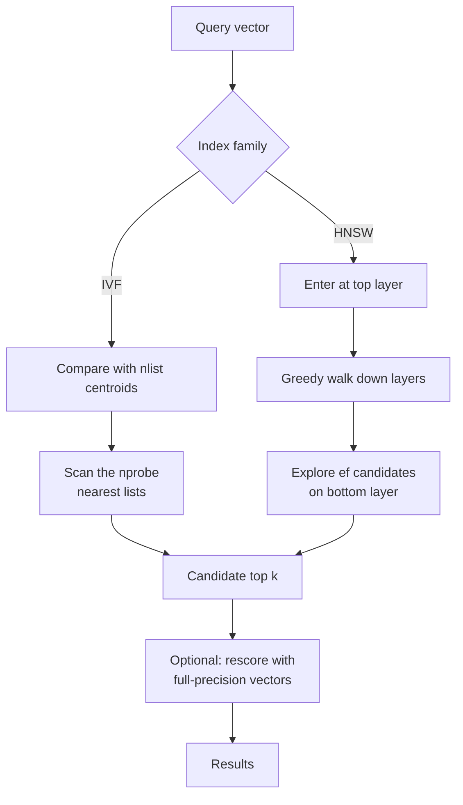

The previous lesson showed that exact similarity search reads every stored vector for every query. That is fine for thousands of vectors and impossible for hundreds of millions. A **vector index** is the data structure that lets a database examine only a small fraction of the vectors and still return, nearly always, the same top results.

This lesson explains what a vector index is, why the indexes you know from ordinary databases do not work for this problem, the main families of approximate index and the idea behind each, how an index's quality is measured, and how indexes live inside a database that is constantly being written to. It is deliberately a map rather than a manual: the algorithms themselves (IVF, HNSW, product and scalar quantisation) each get a full lesson in [Vector indexing algorithms](/learn/vector-indexing-algorithms). Here you learn enough to recognise each, configure it sensibly and measure what it costs you.

## Learning objectives

- Explain what a vector index is and why B-trees and low-dimensional spatial trees do not solve nearest-neighbour search on embeddings.
- Define approximate nearest-neighbour search and measure an index's quality with recall@k against exact search.
- Describe the core idea of partition-based, graph-based and quantisation-based indexes, and name a representative of each.
- Distinguish build-time from query-time index parameters and tune a query-time parameter along a recall-versus-cost curve.
- Explain how a vector database builds, updates and rebuilds indexes while data changes, and what that means for freshly written points.

## Prerequisites

- [Similarity search](/learn/vector-database-fundamentals/similarity-search): exact kNN, metrics and top-k selection.
- [Vector storage](/learn/vector-database-fundamentals/vector-storage): vectors as a contiguous matrix, segments and quantised storage.
- [Embedding space geometry](/learn/embedding-mathematics/embedding-space-geometry): how embeddings are distributed in high-dimensional space.

## Why this matters

At AskMeridian's current size, about 200,000 chunks, an exact scan of 384-dimension vectors reads roughly 300 MB per query. That works, slowly, on one server. If the corpus grows to 20 million chunks at 1,024 dimensions, an exact scan reads about 82 GB per query. No amount of tuning makes that interactive. An index is not an optimisation at that scale; it is the only way the system can work at all.

Indexes bring their own problems, and they are subtle because they fail quietly. An approximate index can miss the most relevant chunk while returning other, plausible ones, so nothing looks broken. A badly tuned index can lose several per cent of recall without anyone noticing, which shows up only as answers that are slightly worse. An index trained on last year's data can degrade as the content drifts. Engineers who treat the index as a black box with a "fast" switch ship these problems. Engineers who understand the recall-versus-cost trade-off measure it, choose a point on it deliberately, and re-measure when the data changes.

## The intuition

Imagine finding the people in a city whose taste in music is closest to yours. Asking every resident is exact and hopeless.

A **partition** approach divides the city into neighbourhoods by taste (all the jazz lovers in one district, the metal fans in another), notes a typical resident of each, and asks you first which few districts' typical residents you most resemble. Then you ask only the residents of those districts. You might miss someone just across a district boundary, so you check a few nearby districts, not just the best one.

A **graph** approach gives every resident a short list of friends with similar taste. You start with anyone, ask who among their friends is closer to your taste, move to that person, and repeat. Each step brings you closer, and after a few dozen steps you are among people very like you. You might get stuck in a local cluster, so you keep a short list of promising people to explore rather than following a single path.

A **compression** approach does not reduce whom you ask; it makes asking cheaper. Instead of a long conversation with each person, you compare short summaries of their taste. Summaries are quick to compare but lose detail, so you finish by talking properly to the few who looked best.

Real indexes combine these: districts of summarised residents, or friendship graphs over summaries, with a final careful check.

## How it works

### What "index" means here

In an ordinary database an **index** is an auxiliary structure, built from the data and kept in step with it, that answers a class of queries without scanning the table. A B-tree on a `created_at` column answers "rows after 1 March" by walking down a sorted tree in a handful of steps.

A vector index is the same idea for a different query: "the $k$ vectors most similar to this one". The difficulty is that similarity in hundreds of dimensions has no useful sort order. A B-tree sorts on one value; there is no single number you can sort embeddings by such that similar embeddings end up adjacent.

**Spatial trees** such as the k-d tree, which split space on one coordinate at a time, work beautifully in two or three dimensions and are what map applications use. In high dimensions they collapse. The reason is a cluster of effects usually called the **curse of dimensionality**: in hundreds of dimensions, a query's distances to most points become similar to one another, so a tree cannot rule out large regions without risking the true neighbour, and an exact tree search ends up visiting most of the leaves. Beyond a few tens of dimensions, exact tree search is often no faster than a scan.

So vector indexes make a different bargain.

### The bargain: approximate nearest neighbours

**Approximate nearest-neighbour (ANN)** search returns $k$ vectors that are *probably* the true $k$ nearest, examining only a small fraction of the collection. The scores of the returned vectors are computed exactly (or rescored exactly); what is approximate is *which* vectors get examined. A true neighbour that the index never looks at simply does not appear.

The quality of an ANN index is measured by **recall@k**: the fraction of the true top $k$ (found by an exact scan) that the index returns. A recall@10 of 0.95 means that on average 9.5 of the true 10 nearest neighbours are found. Note the difference from retrieval recall in [Recall@K](/learn/retrieval-fundamentals/recall-k), which compares against *relevant* documents labelled by people; ANN recall compares against the *exact* search's answer and measures only the index's approximation.

Every ANN index exposes knobs that move it along a curve: examine more vectors, get higher recall, pay more latency. Choosing a point on that curve is the central decision in index tuning.

```playground
vector-search
```

### Family 1: partition the space (IVF)

The **inverted file index (IVF)** clusters the vectors, usually with k-means, into `nlist` groups, each represented by its centre (**centroid**). Every vector is stored in the list of its nearest centroid.

1. **Train:** run k-means on the vectors (or a sample) to find `nlist` centroids.
2. **Add:** assign each vector to its nearest centroid's list.
3. **Search:** compare the query with all centroids, pick the `nprobe` nearest, and scan only the vectors in those lists exactly.

The name comes from search engines' inverted index: a list of items per "term", where the term here is a centroid. IVF's cost per query is roughly the centroid comparisons plus the scanned lists. Its weakness is boundaries: a true neighbour in an adjacent cell is found only if `nprobe` is large enough to include that cell. Its other characteristic is that it must be **trained** before vectors are added, and the centroids describe the data at training time. [IVF](/learn/vector-indexing-algorithms/ivf) covers it in depth.

### Family 2: navigate a graph (HNSW)

A **proximity graph** connects each vector to a few of its near neighbours. Search is a **greedy walk**: start at an entry point, look at its neighbours, move to the one nearest the query, and repeat until no neighbour is closer. To avoid stopping at a local dead end, the search keeps a candidate list of the best `ef` vectors seen so far and explores from all of them.

**HNSW (Hierarchical Navigable Small World)**, from Malkov and Yashunin, adds layers: sparse upper layers with long links for travelling across the space quickly, and a dense bottom layer containing every vector for the final, local search. It is the most widely used index in vector databases today, the default in Qdrant and Weaviate and available in pgvector, Elasticsearch, OpenSearch, Milvus and FAISS. Its parameters are `M` (links per node), `ef_construction` (effort spent choosing links when building) and `ef` or `efSearch` (the candidate-list size at query time). It needs no training and accepts inserts incrementally; its costs are memory for the graph and relatively expensive builds. [HNSW](/learn/vector-indexing-algorithms/hnsw) explains the construction and why the layers work.



### Family 3: compress the vectors (quantisation)

Quantisation does not reduce the number of vectors examined; it makes each examination cheaper and the whole index smaller. You met **scalar quantisation** (one byte per component) in [Vector storage](/learn/vector-database-fundamentals/vector-storage). **Product quantisation (PQ)** goes further: it splits each vector into sub-vectors, replaces each sub-vector with the identifier of the nearest of 256 learned prototypes, and so stores a 1,024-dimension vector in a few dozen bytes. Distances are then approximated with table lookups.

Quantisation is almost always **combined** with a partition or graph index: FAISS's `IVFPQ` scans PQ codes in the probed lists, and several databases run HNSW over quantised vectors and rescore the best candidates at full precision. See [Product quantisation](/learn/vector-indexing-algorithms/product-quantisation) and [Scalar quantisation](/learn/vector-indexing-algorithms/scalar-quantisation).

### Other families, briefly

- **Tree ensembles.** Annoy (from Spotify) builds many random-projection trees and searches several of them, which avoids the single k-d tree's collapse by accepting approximation.
- **Locality-sensitive hashing (LSH).** Hash functions designed so that similar vectors tend to collide; search looks only in the query's buckets. It has elegant theory but, in practice, has largely been overtaken by graph and partition indexes for embedding search.
- **Disk-oriented graphs.** DiskANN (Microsoft Research) builds a graph designed to be searched from SSD with few reads, keeping compressed vectors in memory. Several databases offer a disk-based index of this kind for collections larger than RAM.

### Build-time versus query-time parameters

Index parameters fall into two groups, and confusing them wastes time.

| | Build-time | Query-time |
| --- | --- | --- |
| Set when | The index is created | Each search (or per collection default) |
| Changing it needs | A rebuild | Nothing: try a new value on the next query |
| IVF | `nlist`, training sample | `nprobe` |
| HNSW | `M`, `ef_construction` | `ef` / `efSearch` |
| Quantisation | Bits, sub-vector count | Rescoring depth (oversampling) |

Tune query-time parameters first. They are free to change and usually give most of the available recall. Change build-time parameters only when no query-time setting reaches the recall you need at an acceptable latency.

### Indexes inside a living database

A library like FAISS builds an index once over a fixed array. A database must keep an index correct while points are inserted, updated and deleted. The common pattern, building on the segments from [Vector storage](/learn/vector-database-fundamentals/vector-storage):

1. New points land in a small, **unindexed** appendable segment. Searches scan it exactly; since it is small, that is cheap, and new points are searchable immediately.
2. When a segment grows past a threshold (Qdrant calls it the indexing threshold), the database **builds an index** for it in the background, often while merging small segments.
3. **Deletes** are tombstones: the index still contains the point, and searches skip it. Many tombstones degrade a graph index (paths run through deleted nodes), so the optimiser eventually rebuilds affected segments.
4. **Updates** are delete plus insert, so the new version appears in the unindexed segment until the next build.
5. A search runs on every segment, using each segment's index (or a scan), and merges the per-segment results.

Two practical consequences. Bulk loading is faster if indexing is deferred until the load completes, and some databases let you disable indexing during an initial load. And an IVF index's centroids are fixed at training time, so if content drifts (a new product line with its own vocabulary, say), lists become unbalanced and recall can fall; graph indexes adapt better because inserts create new links. pgvector's documentation, for example, advises creating an IVFFlat index only after the table holds representative data, for exactly this reason.

### Choosing, at a glance

| Situation | Reasonable starting point |
| --- | --- |
| Up to roughly a few hundred thousand vectors, or strict recall of 1.0 | Flat (exact) search |
| General purpose, data fits in RAM, frequent inserts | HNSW |
| Memory-constrained, mostly static, very large | IVF with PQ, or HNSW over quantised vectors with rescoring |
| Larger than RAM | A disk-oriented graph index or memory-mapped storage with quantisation |

Treat this as a starting point to measure, not an answer. [Recall versus latency](/learn/vector-indexing-algorithms/recall-versus-latency) shows how to benchmark the alternatives properly.

## The mathematics

### Recall@k for an ANN index

**Intuition.** Count how many of the true nearest neighbours the index found, as a fraction, and average over many queries.

$$
\text{recall@}k = \frac{1}{|Q|} \sum_{q \in Q} \frac{\lvert A_k(q) \cap E_k(q) \rvert}{k}
$$

$Q$ is the set of test queries, $A_k(q)$ the $k$ identifiers the approximate index returns for query $q$, $E_k(q)$ the $k$ identifiers exact search returns, and $\lvert \cdot \rvert$ counts set members.

**By hand.** Two queries, $k = 4$. For query 1 exact search returns $\{3, 8, 12, 40\}$ and the index returns $\{3, 8, 40, 77\}$: 3 shared, recall $3/4 = 0.75$. For query 2 both return $\{5, 6, 9, 21\}$: recall $1.0$. The average is $(0.75 + 1.0)/2 = 0.875$.

```python
exact = [{3, 8, 12, 40}, {5, 6, 9, 21}]
approx = [{3, 8, 40, 77}, {5, 6, 9, 21}]
k = 4
per_query = [len(a & e) / k for a, e in zip(approx, exact)]
print(per_query, sum(per_query) / len(per_query))
```

```output
[0.75, 1.0] 0.875
```

### The cost of an IVF search

**Intuition.** An IVF query compares the query with every centroid, then scans the vectors in `nprobe` lists. If the lists are roughly equal in size, each holds about $N / n_{\text{list}}$ vectors.

$$
C(n_{\text{list}}) \approx n_{\text{list}} + n_{\text{probe}} \cdot \frac{N}{n_{\text{list}}}
$$

$C$ counts vector comparisons per query, $N$ is the collection size, $n_{\text{list}}$ the number of lists and $n_{\text{probe}}$ the number scanned. Too few lists and each is huge; too many and comparing with the centroids dominates. Setting the derivative to zero gives the minimum at $n_{\text{list}} = \sqrt{n_{\text{probe}} N}$.

**By hand.** $N = 1{,}000{,}000$ and $n_{\text{probe}} = 16$.

- With $n_{\text{list}} = 1{,}000$: $C = 1{,}000 + 16 \times 1{,}000 = 17{,}000$.
- With $n_{\text{list}} = 4{,}000$ ($= \sqrt{16 \times 10^6}$): $C = 4{,}000 + 16 \times 250 = 8{,}000$.
- With $n_{\text{list}} = 16{,}000$: $C = 16{,}000 + 16 \times 62.5 = 17{,}000$.

At the optimum, 8,000 comparisons replace the 1,000,000 of an exact scan, a 125-fold reduction. But this formula counts only cost: more lists also means smaller cells and more boundary misses at a fixed `nprobe`, so recall must be measured, not derived. FAISS's own guidelines suggest a number of lists in the region of $4\sqrt{N}$ to $16\sqrt{N}$ as a starting point.

```python
import math
N, nprobe = 1_000_000, 16
for nlist in [1_000, 4_000, 16_000]:
    print(f"nlist={nlist:>6}: {nlist + nprobe * N / nlist:>9,.0f} comparisons")
print("optimum nlist =", math.isqrt(nprobe * N))
```

```output
nlist=  1000:    17,000 comparisons
nlist=  4000:     8,000 comparisons
nlist= 16000:    17,000 comparisons
optimum nlist = 4000
```

## In code

**The problem.** Build an exact index, an IVF index and an HNSW index over the same 50,000 vectors, sweep each approximate index's query-time parameter, and measure recall@10 against exact search together with the number of vectors actually scored per query. This is the recall-versus-cost curve, measured.

**Dependencies.** NumPy and FAISS (CPU). The vectors are synthetic and clustered (200 topics, deliberately noisy) so that the run is reproducible without a model download. Counting vectors scored, rather than timing, gives numbers that do not depend on your machine.

```bash
pip install numpy faiss-cpu
```

```python
import faiss
import numpy as np

faiss.omp_set_num_threads(1)                 # deterministic builds and fair counting
rng = np.random.default_rng(7)
N, d, k, n_queries = 50_000, 128, 10, 500

# Clustered synthetic embeddings (200 topics), unit length, float32.
centres = rng.normal(size=(200, d))
X = centres[rng.integers(0, 200, N)] + 1.6 * rng.normal(size=(N, d))
X = np.ascontiguousarray(X / np.linalg.norm(X, axis=1, keepdims=True), dtype=np.float32)
Q = centres[rng.integers(0, 200, n_queries)] + 1.6 * rng.normal(size=(n_queries, d))
Q = np.ascontiguousarray(Q / np.linalg.norm(Q, axis=1, keepdims=True), dtype=np.float32)

# Ground truth from an exact (flat) index.
flat = faiss.IndexFlatIP(d)
flat.add(X)
_, truth = flat.search(Q, k)

def recall_at_k(found):
    return np.mean([len(set(f) & set(t)) / k for f, t in zip(found, truth)])

# IVF: cluster the vectors into nlist lists; search only the nprobe nearest lists.
nlist = 256
quantiser = faiss.IndexFlatIP(d)
ivf = faiss.IndexIVFFlat(quantiser, d, nlist, faiss.METRIC_INNER_PRODUCT)
ivf.train(X)                                  # k-means to find the 256 list centres
ivf.add(X)
print("IVF (nlist=256)")
print(f"  {'nprobe':>6}{'recall@10':>11}{'vectors scored/query':>23}")
for nprobe in [1, 8, 32, 128]:
    ivf.nprobe = nprobe
    faiss.cvar.indexIVF_stats.reset()
    _, found = ivf.search(Q, k)
    scored = faiss.cvar.indexIVF_stats.ndis / n_queries
    print(f"  {nprobe:>6}{recall_at_k(found):>11.3f}{scored:>17,.0f} ({scored / N:.1%})")

# HNSW: a navigable graph; efSearch is the size of the candidate list kept while walking it.
hnsw = faiss.IndexHNSWFlat(d, 16, faiss.METRIC_INNER_PRODUCT)   # M = 16 links per node
hnsw.hnsw.efConstruction = 64
hnsw.add(X)
print("HNSW (M=16)")
print(f"  {'efSearch':>8}{'recall@10':>11}{'vectors scored/query':>23}")
for ef in [16, 64, 256]:
    hnsw.hnsw.efSearch = ef
    faiss.cvar.hnsw_stats.reset()
    _, found = hnsw.search(Q, k)
    scored = faiss.cvar.hnsw_stats.ndis / n_queries
    print(f"  {ef:>8}{recall_at_k(found):>11.3f}{scored:>17,.0f} ({scored / N:.1%})")
```

```output
IVF (nlist=256)
  nprobe  recall@10   vectors scored/query
       1      0.868              222 (0.4%)
       8      0.984            1,577 (3.2%)
      32      0.997            6,250 (12.5%)
     128      1.000           24,977 (50.0%)
HNSW (M=16)
  efSearch  recall@10   vectors scored/query
        16      0.861              426 (0.9%)
        64      0.972              810 (1.6%)
       256      0.990            2,721 (5.4%)
```

**The important lines.**

- `flat.search(Q, k)` produces the ground truth. Every ANN evaluation needs an exact baseline on the same vectors and queries.
- `ivf.train(X)` runs k-means to place the 256 centroids. Calling `add` before `train` raises an error, because vectors cannot be assigned to lists that do not exist yet.
- `ivf.nprobe = nprobe` and `hnsw.hnsw.efSearch = ef` change query-time parameters on an existing index, with no rebuild. That is why sweeping them is cheap.
- `faiss.cvar.indexIVF_stats.ndis` and `faiss.cvar.hnsw_stats.ndis` are FAISS's counters of distance computations. For IVF the count excludes the 256 centroid comparisons per query, which you can add mentally.
- `faiss.IndexHNSWFlat(d, 16, ...)` sets `M = 16`, a build-time parameter; changing it would require rebuilding the graph.

**What the output means.**

- With one probe, IVF scores only 0.4% of the vectors and finds 86.8% of the true neighbours. Eight probes (3.2% of the vectors) reach 98.4%. Getting the last 1.6% costs four times as much again (32 probes for 99.7%), and perfect recall here costs scanning half the collection. This shape (fast gains, then steeply diminishing returns) is the recall-versus-cost curve every ANN index has.
- HNSW reaches 97.2% recall while scoring 1.6% of the vectors, and 99.0% at 5.4%. Raising `efSearch` buys recall with more work, the same trade-off with a different knob.
- Do not conclude that one family beats the other from this table. The data is synthetic, the build parameters were not tuned, and the comparison counts ignore memory access patterns and the HNSW graph's memory cost. The method (exact baseline, parameter sweep, recall and cost per setting) is what transfers to your data.

**Errors people commonly hit.**

- Training IVF on too few vectors. FAISS warns when there are fewer than about 39 training points per centroid; the centroids are then poor and recall suffers.
- Evaluating recall with queries that are copies of stored vectors. Each query trivially finds itself, inflating recall. Use held-out queries, ideally real ones.
- Mixing metrics: building IVF with the default L2 metric over vectors meant for inner product. Pass the metric explicitly, as above.

**Extending it.** Rebuild the HNSW index with `M = 32` and repeat the sweep. Observe that recall at each `efSearch` rises, and note that the graph's memory roughly doubles: a build-time trade-off you can only explore by rebuilding.

## A real-world example

Meridian's Platform team enabled HNSW on AskMeridian's Qdrant collection when it passed a million chunks with the product documentation, accepting the default parameters. Latency dropped from tens of milliseconds to a few. A month later, Tomás, who owned retrieval quality, noticed that the evaluation suite's answer accuracy on product questions had slipped slightly, while handbook questions were unchanged.

He did not guess. He took 500 logged product questions, ran each with the collection's exact-search option (Qdrant lets a query request exact search, bypassing the index) and with the index, and computed recall@10 of the index against exact search. Handbook queries were near 1.0. Product queries were noticeably lower. The product documentation contained hundreds of near-duplicate release-note chunks for Meridian Sync versions, crowded so closely together that the default candidate list ran out before reaching all of the true neighbours.

Raising the query-time `ef` brought product recall back up to match handbook recall at a latency still well within budget. Because `ef` is a query-time parameter, the fix required no rebuild and was rolled out with a configuration change. The team added an "index recall against exact search" job to their nightly evaluation, run on a sample of real queries, so that the next drift would be caught by a number instead of by users.

## Common mistakes

- **Never measuring index recall.** Without an exact baseline you cannot tell whether a bad answer is an embedding problem or an index problem.
- **Tuning build-time parameters first.** Rebuilding is slow; query-time parameters are free to sweep and usually suffice.
- **Benchmarking on uniform random vectors.** Real embeddings are clustered and contain near-duplicates; random data hides exactly the crowded regions where indexes struggle.
- **Ignoring tombstones and drift.** A graph with many deleted nodes or an IVF index trained on old data loses recall over time if never rebuilt.
- **Indexing tiny collections.** Below a few tens of thousands of vectors an exact scan is fast and perfectly accurate; an approximate index adds error for no gain.
- **Comparing products on latency alone.** A latency figure without the recall it was measured at is meaningless; any index is fast at low enough recall.

## Best practices

- Keep an exact-search path and a set of real held-out queries, and measure recall@k of the index against it whenever the index, its parameters or the data distribution change.
- Choose a target recall (for example 0.95 to 0.99 at the $k$ your pipeline uses) and then the cheapest setting that meets it.
- Start with the database's default index (usually HNSW) and tune its query-time parameter before changing anything else.
- Retrieve a few more candidates than the prompt needs when a reranker follows; a reranker cannot recover a chunk the index never returned.
- Bulk-load first, index afterwards, where the database allows it.
- Schedule rebuilds or optimiser runs after large deletions or major content changes, and re-measure recall afterwards.

## Performance considerations

**Memory.** An index adds structure on top of the vectors. An HNSW graph stores roughly $2M$ neighbour identifiers per vector on the bottom layer; with $M = 16$ and 4-byte identifiers that is about $32 \times 4 = 128$ bytes per vector, plus a little for upper layers. For 384-dimension float32 vectors (1,536 bytes) that is under 10% extra; for 1-byte quantised vectors (384 bytes) it is a third extra. IVF adds only the centroids and list bookkeeping.

**Build time.** Building an HNSW graph requires a search per insertion, so it costs far more than writing the vectors; for tens of millions of vectors, builds take hours on one machine and are usually parallelised. IVF's k-means training is cheaper and can use a sample.

**Query cost.** Work per query grows slowly with collection size for graph indexes (roughly logarithmically in practice), and with $\sqrt{N}$ at the IVF optimum. Both are vastly better than a scan's linear growth, which is the whole point.

**Write cost.** Each insert into a graph index costs a search plus link updates; under heavy write load, background indexing can compete with queries for CPU. Throttling or scheduling bulk ingestion off-peak keeps query latency stable.

## Summary

- A vector index lets a database examine a small fraction of vectors per query; B-trees and exact spatial trees do not work because similarity in high dimensions has no useful sort order and trees degrade to scans.
- Approximate nearest-neighbour search trades a small, measurable loss of recall for orders-of-magnitude less work; recall@k against exact search measures that loss.
- The main families are partition-based (IVF: probe a few clusters), graph-based (HNSW: greedy walk on a layered proximity graph) and quantisation-based (compress vectors, usually combined with the others).
- Build-time parameters (`nlist`, `M`, `ef_construction`) need a rebuild; query-time parameters (`nprobe`, `ef`) can be swept freely and should be tuned first.
- Databases index sealed segments in the background, scan fresh points exactly, and rebuild after deletions and drift; recall must be re-measured as data changes.

## Exercises

**1.** An index returns these top-5 lists for three queries, and exact search returns the second list each time. Compute recall@5. Query A: index $\{1,2,3,4,5\}$, exact $\{1,2,3,4,6\}$. Query B: index $\{7,8,9,10,11\}$, exact $\{7,8,9,10,11\}$. Query C: index $\{12,13,14,15,16\}$, exact $\{12,13,17,18,19\}$.

<details><summary>Show solution</summary>

A shares 4 of 5 (0.8), B shares 5 (1.0), C shares 2 (0.4). Recall@5 $= (0.8 + 1.0 + 0.4)/3 \approx 0.733$. The average hides that query C is badly served; in practice, look at the distribution of per-query recall, not only the mean.

</details>

**2.** For $N = 4{,}000{,}000$ and $n_{\text{probe}} = 25$, compute the cost-optimal `nlist` and the comparisons per query at that value. How many times fewer comparisons is that than an exact scan?

<details><summary>Show solution</summary>

$n_{\text{list}} = \sqrt{25 \times 4 \times 10^6} = \sqrt{10^8} = 10{,}000$. Cost: $10{,}000 + 25 \times 4{,}000{,}000 / 10{,}000 = 10{,}000 + 10{,}000 = 20{,}000$ comparisons. An exact scan does $4{,}000{,}000$, so the IVF query does 200 times fewer. Recall at `nprobe = 25` with 10,000 lists must still be measured.

</details>

**3.** Modify the code example to report, for HNSW, the smallest `efSearch` from the list $[8, 16, 32, 64, 128, 256]$ that achieves recall@10 of at least 0.95. Explain why this procedure, run on real queries, is how you should set `ef` in production.

<details><summary>Show solution</summary>

```python
for ef in [8, 16, 32, 64, 128, 256]:
    hnsw.hnsw.efSearch = ef
    _, found = hnsw.search(Q, k)
    r = recall_at_k(found)
    if r >= 0.95:
        print(f"smallest efSearch reaching 0.95: {ef} (recall {r:.3f})")
        break
```

```output
smallest efSearch reaching 0.95: 32 (recall 0.952)
```

Recall rises monotonically (in practice) with `ef` while cost rises too, so the cheapest setting that meets the target is the right one. Doing it on real held-out queries matters because recall depends on where queries land; crowded regions of your own data need more effort than synthetic averages suggest.

</details>

**4.** Design decision. A collection of 600,000 chunks receives about 5,000 inserts and 5,000 deletes per day, and the business requires that a deleted document never appears in results and a new one appears within a minute. Which index behaviour matters most, and how do you verify it?

<details><summary>Show solution</summary>

Freshness and deletion visibility matter more than raw speed. Choose a database whose search covers unindexed segments by exact scan (so new points appear immediately, before background indexing) and applies tombstones at query time (so deleted points are excluded at once, even though they remain in the graph). HNSW suits incremental inserts better than an IVF index trained once.

Verify with a test: insert a point with a unique marker, query for it immediately and assert it is returned; delete it, query again and assert it is absent; repeat under background load. Also schedule optimiser runs or rebuilds so that tombstones (about 5,000 a day, nearly 1% of the collection) do not accumulate and degrade the graph, and track index recall against exact search over time.

</details>

## Check your understanding

```quiz
[
  {"q": "Why do B-tree indexes not help with nearest-neighbour search on embeddings?", "options": ["B-trees cannot store floating-point numbers", "There is no single sort key that keeps similar high-dimensional vectors adjacent", "B-trees only work in memory", "B-trees require normalised vectors"], "answer": 1, "why": "A B-tree orders rows by one value; similarity across hundreds of dimensions cannot be captured by any one ordering."},
  {"q": "What does recall@10 of 0.93 mean for an ANN index?", "options": ["93% of returned chunks are relevant to the user", "On average 9.3 of the 10 vectors exact search would return are found by the index", "The index is 93% faster than exact search", "93% of queries return at least one result"], "answer": 1, "why": "ANN recall compares the index's results with exact search's results, not with human relevance labels."},
  {"q": "Which parameter can be changed without rebuilding the index?", "options": ["HNSW M", "IVF nlist", "HNSW efSearch", "The number of PQ sub-vectors"], "answer": 2, "why": "efSearch controls the candidate list at query time; the others shape the structure built over the data."},
  {"q": "An IVF index has nlist = 2,000 over 1,000,000 vectors with equal-sized lists. Roughly how many vector comparisons does a query with nprobe = 10 make, counting centroids?", "options": ["7,000", "5,000", "12,000", "1,000,000"], "answer": 0, "why": "2,000 centroid comparisons plus 10 lists of 500 vectors each = 2,000 + 5,000 = 7,000."},
  {"q": "A team reports that their new index is 'ten times faster' than the old one. What should you ask first?", "options": ["Which programming language it is written in", "Whether it uses cosine similarity", "How many dimensions the vectors have", "What recall it achieved at that speed, measured against exact search on realistic queries"], "answer": 3, "why": "Any ANN index can be made faster by lowering recall; a speed figure without its recall is not comparable."}
]
```

## Further reading

- Malkov and Yashunin (2018), *Efficient and robust approximate nearest neighbor search using Hierarchical Navigable Small World graphs*, IEEE TPAMI. [arXiv:1603.09320](https://arxiv.org/abs/1603.09320)
- Jégou, Douze and Schmid (2011), *Product Quantization for Nearest Neighbor Search*, IEEE TPAMI: IVF with compressed codes.
- FAISS wiki, "Guidelines to choose an index" and "Faiss indexes": practical parameter advice. [github.com/facebookresearch/faiss/wiki](https://github.com/facebookresearch/faiss/wiki)
- Aumüller, Bernhardsson and Faithfull (2020), *ANN-Benchmarks: A benchmarking tool for approximate nearest neighbor algorithms*, Information Systems: how to compare indexes by recall and throughput together. [ann-benchmarks.com](https://ann-benchmarks.com/)
- Qdrant documentation, "Indexing" and "Optimizer": HNSW parameters, indexing thresholds and exact search. [qdrant.tech/documentation](https://qdrant.tech/documentation/)
