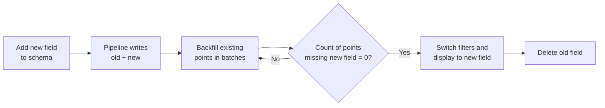

A vector tells the database what a chunk is *about*. It says nothing about which document the chunk came from, whether that document is still in force, who may read it, or how to cite it. All of that lives in the point's **payload**: the structured data stored beside each vector. Retrieval quality, access control, citations and every future migration depend on getting the payload right.

[Document metadata](/learn/document-engineering/document-metadata) designed the metadata schema from the document's side: which fields to collect, where they come from and how they are copied onto chunks. This lesson takes the database's side. It covers how payloads are stored and typed, what belongs in a payload and what does not, the operational fields a vector collection needs for its own maintenance, how payloads are read and updated without re-embedding, and how to evolve a payload schema across millions of points. Using payload fields to restrict a search is the next lesson, [Filtering](/learn/vector-database-fundamentals/filtering).

## Learning objectives

- Describe how vector databases store payloads, and contrast schemaless payloads, declared schemas and SQL columns.
- Decide, for a given field, whether it belongs in the payload, and whether chunk text should be stored inline or by reference.
- Choose correct payload types for identifiers, dates, numbers and multi-valued fields, and explain the bugs that wrong types cause.
- Define the operational fields a collection needs (embedding model, content hash, versions) and use them to plan re-embedding and migrations.
- Read selected payload fields and update payloads in bulk without re-embedding.

## Prerequisites

- [What is a vector database?](/learn/vector-database-fundamentals/what-is-a-vector-database): points, identifiers, vectors and payloads.
- [Vector storage](/learn/vector-database-fundamentals/vector-storage): why payloads are stored separately from vectors.
- [Document metadata](/learn/document-engineering/document-metadata): the metadata schema and its propagation to chunks.
- [Dataclasses and Pydantic](/learn/python-for-rag-engineering/dataclasses-and-pydantic): validating records with Pydantic models.

## Why this matters

Payload mistakes are among the most expensive in a RAG system, because they are discovered late and fixed across every point.

Some fail loudly: a citation shows "Untitled" because the title was never stored. Most fail quietly. A date stored as the string `"03/01/2024"` cannot be compared with another date, so a filter for "documents effective this year" silently matches nothing, or everything, depending on how it was written. A permissions field holding `"it,security"` as one string instead of a list never matches the group `"it"`. A collection that never recorded which embedding model produced each vector cannot be partially re-embedded; when the model changes, everything must be rebuilt because nobody can tell which points are stale.

The cost of fixing these grows with the collection. Adding a missing field to 50 million points means rewriting 50 million payloads, and if the information needed to fill it was never kept, it means re-ingesting from source. Designing the payload deliberately, typing it strictly and validating it before every write is far cheaper than any of those repairs.

## The intuition

Think of each point as a parcel in a sorting depot. The vector is the parcel's position on a map of topics. The payload is the label stuck to the parcel.

A good label has a fixed layout: sender, recipient, weight, date, handling codes, each in its own box and each written the same way on every parcel. The scanners in the depot read specific boxes. If one clerk writes the date as "3 Jan" and another as "2024-01-03", the scanner that sorts by date misroutes half the parcels without complaint. If the "fragile" box sometimes says "yes", sometimes "Y" and sometimes "fragile, handle with care", the handling rule fails unpredictably.

A good label also does not try to be the parcel. You do not photocopy the entire contents onto the label; you write enough to route it, track it and tell the recipient what it is. And when a recipient's address changes, you relabel the parcel, you do not repack it.

The payload is the label: fixed layout, consistent types, enough to route and cite, cheap to change without touching the vector inside.

## How it works

### How payloads are stored

A payload is, in most vector databases, a JSON-like document attached to a point: keys mapped to strings, numbers, booleans, arrays or nested objects. Products differ in how much structure they impose.

| Approach | Examples | What it means for you |
| --- | --- | --- |
| Schemaless JSON payload | Qdrant, Chroma, Pinecone | Any keys, any types, per point. Flexible, and nothing stops two points disagreeing about a field's type. Validation is your job. |
| Declared collection schema | Milvus, Weaviate (with auto-schema switched off) | Fields and types are declared up front; writes that do not conform are rejected. Safer; schema changes need planning. |
| Table columns | pgvector | Payload fields are ordinary SQL columns (or a JSONB column), with SQL types, constraints and joins. |

Physically, as [Vector storage](/learn/vector-database-fundamentals/vector-storage) explained, payloads live in a separate store from the vector matrix, keyed by the point's internal offset. A search computes similarities on vectors only, then fetches payloads for the few points returned. Payload size therefore barely affects search speed, but it affects storage, memory if payloads are held in RAM, network transfer of results, and the speed of any filter that reads them.

Separately from the payload itself, many databases let you build a **payload index** on chosen fields: a typed index (such as a keyword map or a numeric range index) that makes filtering on that field fast. The payload is the data; the payload index is an acceleration structure over it. Payload indexes are covered in [Filtering](/learn/vector-database-fundamentals/filtering) and in depth in [Payload indexes](/learn/advanced-vector-database-engineering/payload-indexes).

### What belongs in a payload

Every field in a payload should have at least one job. From the database's point of view there are four:

1. **Filtering.** Fields used in search conditions: `source_type`, `allowed_groups`, `language`, `doc_status`, `effective_from`. These must be exactly typed and drawn from controlled vocabularies.
2. **Citation and display.** Fields shown to the model in the context and to the user beside the answer: `doc_title`, `section`, `doc_version`, `url`, `page`.
3. **Reassembly.** Fields that let the application find neighbouring chunks or the parent document: `doc_id`, `position`, `parent_id`. [Parent-child chunking](/learn/chunking-optimisation/parent-child-chunking) depends on these.
4. **Operations.** Fields the pipeline needs to maintain the collection: `content_hash`, `embedding_model`, `chunker_version`, `ingested_at`. Never shown, rarely filtered on in user queries, and indispensable during migrations.

Things that do **not** belong in a payload: secrets of any kind; large binary objects such as images or PDFs (store them in object storage and keep a reference); fields nobody reads; and, usually, personal data beyond what retrieval genuinely requires.

### Text inline or by reference?

The biggest single decision is whether to store the chunk's text in the payload.

**Inline** means the payload contains the full text. A search returns everything the generator needs in one round trip, and the collection is self-contained. The costs: storage roughly equal to the corpus again (on every replica), a second copy of the text to keep consistent with the source, and a second place where confidential text must be protected.

**By reference** means the payload contains an identifier, and the text lives in a document store, a relational database or object storage. The vector collection stays small and the text has one home. The cost is a second lookup on every query, which adds latency and a dependency.

Most RAG systems store text inline, because chunks are small (a few hundred to a few thousand bytes), the latency of a second store matters, and keeping text and vector in one atomic write avoids a class of inconsistency bugs. Reference storage is common when chunks are large, when the text must be governed in one place for compliance, or when several indexes share one text store. Either is defensible; what is not defensible is storing text inline *and* letting it drift from the source.

### Types: the source of the quietest bugs

Schemaless payloads accept whatever you send. The database will compare values only when their types allow it, so a wrong type does not cause an error. It causes a filter that silently fails to match.

| Field | Wrong | Right | What goes wrong |
| --- | --- | --- | --- |
| Version number | `"7"` (string) | `7` (integer) | A numeric range filter `version >= 5` never matches strings |
| Date | `"03/01/2024"` | `"2024-01-03T00:00:00Z"` (RFC 3339) or a Unix timestamp | Ambiguous (March or January?) and not comparable as a date |
| Groups | `"it,security"` | `["it", "security"]` | A match on `"it"` fails; the database sees one opaque string |
| Category | `"Runbook"`, `"runbook "`, `"RUNBOOK"` | One canonical lower-case value | Exact matches miss the variants |
| Missing value | `""` or `"N/A"` | Omit the key, or use `null` consistently | Filters treat `"N/A"` as a real value |

For multi-valued fields, arrays have a specific and useful semantics in most vector databases: a condition on an array field matches if **any** element matches. That is exactly what permission checks need ("does any of this chunk's allowed groups appear in the user's groups?"), and it only works if the field really is an array.

The reliable defence is to **validate every payload against a schema before writing it**, whether or not the database enforces one. A Pydantic model is the natural tool in Python.

### Operational metadata

A collection is derived data that you will rebuild, partly or wholly, many times: when the embedding model changes, when the chunker improves, when a parser bug is fixed, when a document is edited. Each of those needs a query of the form "which points were produced by the old X?". Only operational fields can answer it.

| Field | Answers |
| --- | --- |
| `embedding_model` (name and version) | Which points need re-embedding after a model change |
| `chunker_version` | Which points came from the old chunking rules |
| `content_hash` (of the chunk text) | Whether a chunk's text actually changed, so unchanged chunks can skip re-embedding |
| `doc_id`, `doc_version` | Which points belong to a document, and whether they are current |
| `ingested_at` | When the point was written, for debugging freshness complaints |

Recording the embedding model per point may look redundant when a collection holds only one model. It costs a few dozen bytes per point, and it turns a dangerous migration ("I think everything was re-embedded") into a checkable one ("zero points have the old model name").

### Reading payloads efficiently

A search request can usually say which payload fields to return. In Qdrant, `with_payload` takes `True` (all), `False` (none), a list of field names to include, or a selector that excludes fields. Request only what the caller needs: the generator needs text and citation fields, not hashes and group lists. Smaller responses mean less serialisation, less network transfer and less risk of leaking internal fields into a prompt or a user interface.

Retrieving points by identifier (Qdrant's `retrieve`) and iterating through a collection page by page with a filter (`scroll`) are the other two read paths; the second is how maintenance jobs walk through, say, every point of one document.

### Updating payloads without re-embedding

Many metadata changes do not change the text: a document's permissions change, its status becomes "superseded", its owner moves to a different team. Re-embedding for these would waste money and time. Vector databases provide payload-only updates:

1. **Set (merge):** add or overwrite the given keys, leaving others untouched. Qdrant: `set_payload`.
2. **Overwrite (replace):** replace the whole payload with the given one. Qdrant: `overwrite_payload`.
3. **Delete keys:** remove named keys. Qdrant: `delete_payload`.
4. **Clear:** remove the entire payload. Qdrant: `clear_payload`.

Each can target a list of identifiers or **a filter**, so "set `allowed_groups` on every chunk where `doc_id` is `rb-vpn`" is one call. That is how a permissions change reaches every chunk of a document in seconds.

### Evolving the payload schema

Payload schemas change. A new field is needed for a new filter; a field is renamed; a type is corrected. The safe sequence is the same one used for database migrations in general:

1. **Add, do not mutate.** Introduce the new field alongside the old one.
2. **Write both.** Update the ingestion pipeline so new and re-ingested points carry the new field.
3. **Backfill.** Walk existing points with `scroll`, compute the new field (from existing payload or from source) and `set_payload` it in batches.
4. **Switch readers.** Move filters and display code to the new field, after verifying that a count of points missing it is zero.
5. **Remove the old field** with `delete_payload` once nothing reads it.



> [!KEY]
> A payload is a schema whether or not your database enforces one. Validate every write against an explicit model, type fields for the comparisons you will make, record how each vector was produced, and change metadata with payload updates rather than re-embedding.

## In code

**The problem.** Write five AskMeridian chunks into a collection with a validated, typed payload, then use that payload four ways: return only citation fields, filter by a datetime range, change a document's permissions without re-embedding, and count the points a model migration would need to re-embed.

**Dependencies.** Pydantic for the schema, sentence-transformers for real embeddings, and qdrant-client in `:memory:` mode.

```bash
pip install pydantic sentence-transformers qdrant-client
```

```python
import hashlib
import json
import uuid
from datetime import datetime
from typing import Literal

from pydantic import BaseModel, Field, ValidationError
from qdrant_client import QdrantClient, models
from sentence_transformers import SentenceTransformer

MODEL_NAME = "sentence-transformers/all-MiniLM-L6-v2"


class ChunkPayload(BaseModel):
    """The payload contract for every point in the collection."""
    doc_id: str
    doc_title: str
    doc_version: int = Field(ge=1)
    section: str
    position: int = Field(ge=0)
    source_type: Literal["handbook", "runbook"]
    allowed_groups: list[str] = Field(min_length=1)       # never empty: no group means no access
    effective_from: datetime
    text: str
    content_hash: str
    embedding_model: str


def make_payload(doc, section, position, text, groups):
    return ChunkPayload(
        doc_id=doc["id"], doc_title=doc["title"], doc_version=doc["version"],
        section=section, position=position, source_type=doc["type"],
        allowed_groups=groups, effective_from=doc["effective_from"], text=text,
        content_hash=hashlib.sha256(text.encode()).hexdigest()[:16],
        embedding_model=MODEL_NAME,
    )


handbook = {"id": "hb-2025", "title": "Employee Handbook", "version": 7, "type": "handbook",
            "effective_from": "2025-01-01T00:00:00Z"}
runbook = {"id": "rb-vpn", "title": "VPN Runbook", "version": 3, "type": "runbook",
           "effective_from": "2024-06-01T00:00:00Z"}
rows = [
    (handbook, "Leave", 0, "Annual leave is 25 days; up to 5 unused days carry over to 31 March.", ["all-staff"]),
    (handbook, "Remote work", 1, "Staff may work remotely up to 3 days a week.", ["all-staff"]),
    (handbook, "Expenses", 2, "Submit expenses within 30 days; anything over £75 needs a receipt.", ["all-staff"]),
    (runbook, "Access", 0, "VPN is required on public Wi-Fi.", ["all-staff"]),
    (runbook, "Errors", 1, "Error E-4021: the VPN client is out of date; update it from the IT portal.", ["it"]),
]

# 1. Validate before writing: a bad payload is rejected at the door, not discovered in production.
try:
    make_payload(runbook, "Errors", 2, "Draft note.", [])
except ValidationError as e:
    print("rejected:", e.errors()[0]["loc"], e.errors()[0]["msg"])

payloads = [make_payload(*r) for r in rows]
model = SentenceTransformer(MODEL_NAME)
vectors = model.encode([p.text for p in payloads], normalize_embeddings=True)

client = QdrantClient(":memory:")
client.create_collection("askmeridian", vectors_config=models.VectorParams(
    size=vectors.shape[1], distance=models.Distance.COSINE))
client.upsert("askmeridian", points=[
    models.PointStruct(
        id=str(uuid.uuid5(uuid.NAMESPACE_URL, f"{p.doc_id}#{p.position}")),   # stable id
        vector=v.tolist(),
        payload=p.model_dump(mode="json"),                                     # datetime -> RFC 3339 string
    )
    for p, v in zip(payloads, vectors)
])

# 2. Ask only for the fields the caller needs.
q = model.encode("What does error E-4021 mean?", normalize_embeddings=True).tolist()
full = client.query_points("askmeridian", query=q, limit=1, with_payload=True).points[0]
slim = client.query_points("askmeridian", query=q, limit=1,
                           with_payload=["doc_title", "section", "doc_version", "text"]).points[0]
print(f"top hit: {slim.payload['doc_title']} > {slim.payload['section']} (v{slim.payload['doc_version']})")
print(f"payload bytes: full={len(json.dumps(full.payload))}, selected={len(json.dumps(slim.payload))}")

# 3. Types matter: a range filter on a datetime field.
recent = models.Filter(must=[models.FieldCondition(
    key="effective_from", range=models.DatetimeRange(gte="2025-01-01T00:00:00Z"))])
print("effective since 2025:", client.count("askmeridian", count_filter=recent).count)

# 4. Permissions changed: update the payload of every chunk of one document. No re-embedding.
client.set_payload("askmeridian", payload={"allowed_groups": ["it", "security"]},
                   points=models.Filter(must=[models.FieldCondition(
                       key="doc_id", match=models.MatchValue(value="rb-vpn"))]))
it_only = models.Filter(must=[models.FieldCondition(
    key="allowed_groups", match=models.MatchAny(any=["all-staff"]))])
print("chunks visible to all-staff after ACL change:", client.count("askmeridian", count_filter=it_only).count)

# 5. Operational metadata answers migration questions.
old_model = models.Filter(must=[models.FieldCondition(
    key="embedding_model", match=models.MatchValue(value=MODEL_NAME))])
print("points to re-embed when the model changes:", client.count("askmeridian", count_filter=old_model).count)
```

```output
rejected: ('allowed_groups',) List should have at least 1 item after validation, not 0
top hit: VPN Runbook > Errors (v3)
payload bytes: full=379, selected=153
effective since 2025: 3
chunks visible to all-staff after ACL change: 3
points to re-embed when the model changes: 5
```

**The important lines.**

- `class ChunkPayload(BaseModel)` is the payload contract. `Literal["handbook", "runbook"]` enforces a controlled vocabulary, `Field(ge=1)` rejects impossible versions, `effective_from: datetime` parses and normalises dates, and `Field(min_length=1)` on `allowed_groups` refuses a chunk that nobody could be permitted to read. An empty group list would be either invisible or, with a careless filter, visible to everyone.
- `uuid.uuid5(uuid.NAMESPACE_URL, f"{p.doc_id}#{p.position}")` derives a UUID deterministically from the document and position, so re-ingesting the same chunk overwrites the same point. Qdrant accepts only integers and UUIDs as identifiers, so the readable key is kept in the payload (`doc_id`, `position`) and hashed into the id. [CRUD operations](/learn/vector-database-fundamentals/crud-operations) builds on this.
- `p.model_dump(mode="json")` converts the model to JSON-compatible types; the `datetime` becomes an RFC 3339 string such as `"2025-01-01T00:00:00Z"`, which Qdrant's `DatetimeRange` can compare.
- `with_payload=[...]` returns only the listed fields, here less than half the bytes of the full payload.
- `set_payload(..., points=models.Filter(...))` updates every point matching the filter: every chunk of `rb-vpn`, in one call, with no embedding work.

**What the output means.**

- The draft note with no permitted groups never reaches the database. The validation error names the field and the rule.
- The E-4021 question finds the runbook's Errors section, and the slim payload carries everything needed to cite it: "VPN Runbook > Errors (v3)".
- Three chunks (the handbook's) have `effective_from` on or after 1 January 2025; the runbook's date is in 2024. The range works because the field holds a properly formatted datetime.
- After the permissions change, only the three handbook chunks remain visible to `all-staff`: the VPN runbook's "Access" chunk, previously open to everyone, is now restricted to IT and security. Nothing was re-embedded.
- All five points record the current model, so a model change would require re-embedding all five. After a partial migration, the same count tells you exactly how many remain.

**Errors people commonly hit.**

- Passing a Pydantic model or a `datetime` object directly as a payload. The client must serialise it, and depending on the version that either fails or produces an unexpected format. Dump to JSON-compatible types explicitly.
- Using a string such as `"hb-2025#0"` as the point id. Qdrant rejects it; derive a UUID as above.
- Filtering on a field that some points store as a string and others as a number. The condition matches only the points whose type fits, with no error.

**Extending it.** Add a `doc_status` field with values `"current"` and `"superseded"`, mark the 2023 handbook's chunks (with its 4-year laptop cycle and £250 equipment budget) as superseded with `set_payload`, and add `doc_status = "current"` to every user-facing search. Old policies then stay available for audit queries but never reach staff answers.

## A real-world example

When Meridian's HR team published the 2025 handbook, AskMeridian started giving contradictory answers about the home-office equipment budget: sometimes £400, sometimes £250. Both handbooks were in the collection. The ingestion pipeline had written the 2025 chunks under new identifiers and nothing had removed or marked the 2023 ones.

Yusuf from the Platform team found that the payload offered no clean way to tell the two apart. The 2023 chunks had a `version` field stored as the string `"2023"`, the 2025 chunks had `version` as the integer `7` (HR's internal revision number), and there was no status field at all. A filter on `version` could not express "the current one".

The repair took a week instead of an afternoon because the schema had to be fixed on live data. The team defined a payload model with `doc_version` as an integer, `effective_from` as a datetime and `doc_status` as one of `"current"` or `"superseded"`. They added the new fields alongside the old ones, backfilled every existing point with a scroll-and-set job, verified with a count that no point lacked `doc_status`, switched the search to require `doc_status = "current"`, and then deleted the old `version` field. From then on, the pipeline validated every payload against the model before upserting and, when a document was replaced, marked the previous version's chunks superseded in the same job. Contradictory answers about the equipment budget stopped.

## Common mistakes

- **Writing payloads without validation.** Schemaless storage accepts typos, wrong types and missing fields, and filters then fail silently.
- **Storing dates and numbers as display strings.** They cannot be compared by range, and some formats are ambiguous.
- **Encoding lists as delimited strings.** A comma-separated string cannot be matched element by element; use an array.
- **Omitting operational fields.** Without `embedding_model`, `content_hash` and `doc_version`, every migration becomes "rebuild everything and hope".
- **Re-embedding to change metadata.** Permissions, status and ownership changes need payload updates, not new vectors.
- **Returning the whole payload everywhere.** Internal fields leak into prompts and logs, and responses grow for no benefit.
- **Letting inline text drift from the source.** If text is stored in the payload, it must be rewritten whenever the source changes, together with the vector.

## Best practices

- Define the payload as an explicit model (Pydantic, or the database's declared schema) and validate every point before writing it.
- Give every field a job: filter, citation, reassembly or operations. Remove fields that have none.
- Use native types: integers for counts and versions, RFC 3339 datetimes or Unix timestamps for time, arrays for multi-valued fields, lower-case canonical values for categories.
- Record `embedding_model`, `content_hash`, `doc_id`, `doc_version` and `ingested_at` on every point.
- Request only the payload fields each caller needs.
- Change metadata with filtered payload updates; evolve schemas by adding, backfilling, verifying with a count, switching readers and only then removing.

## Performance considerations

**Payload size multiplies.** A 2 KB payload (mostly chunk text) on 10 million points is about 20 GB, comparable to the vectors themselves at 512 float32 dimensions, and it is stored on every replica. Keeping payloads on disk and reading them only for returned points keeps that out of RAM. Some managed services also impose per-record metadata size limits; check your provider's current documentation before designing around large payloads.

**Returned payload size affects latency at the edges.** A search returning 50 candidates for reranking with 2 KB each moves about 100 KB per query; with selected fields it may be a fraction of that. At hundreds of queries per second this is network and serialisation time worth saving.

**Filtered updates touch many points.** Changing the permissions of a document with 2,000 chunks rewrites 2,000 payloads and updates any payload indexes on the changed field. That is fast, but a backfill over tens of millions of points should run in batches, off-peak, with progress tracked so it can resume.

**Fields that are filtered on need payload indexes.** Without one, a filter must read the payload of every candidate. The next lesson explains when that matters.

## Security considerations

Payloads frequently hold the most sensitive parts of a RAG system: the chunk text itself and the access-control fields that decide who sees it. Three rules follow.

- **Access-control fields must come from a trusted source**, such as the source system's permission model, never from document content or user input, and they must be validated (never empty, canonical group names). A malformed permission field is a data leak.
- **Do not store secrets or unnecessary personal data in payloads.** Payloads are returned by searches, copied into prompts, written to logs and exported in snapshots. Treat them as widely readable.
- **Restrict what leaves the database.** Returning only selected fields prevents internal metadata (group lists, internal URLs, hashes) from reaching the model or the user. [Document-level permissions](/learn/access-control-and-privacy/document-level-permissions) builds the full access model.

## Summary

- The payload is the structured data beside each vector, used for filtering, citation, reassembly and operations; it is stored separately from vectors and fetched for returned points.
- Products range from schemaless JSON (validation is your job) to declared schemas and SQL columns; either way, the payload is a schema and should be defined explicitly.
- Wrong types cause silent filter failures: use integers, real datetimes, arrays and canonical values.
- Operational fields such as `embedding_model`, `content_hash` and `doc_version` make partial re-embedding and migrations checkable.
- Change metadata with filtered payload updates instead of re-embedding, return only the fields callers need, and evolve schemas by add, backfill, verify, switch, remove.

## Exercises

**1.** Classify each field by its job (filter, citation, reassembly, operations) and say whether it should be stored at all: `doc_title`, `allowed_groups`, `position`, `content_hash`, `author_email`, `chunk_text`, `pdf_bytes`, `language`.

<details><summary>Show solution</summary>

- `doc_title`: citation. Store.
- `allowed_groups`: filter. Store, as an array from a trusted source.
- `position`: reassembly. Store.
- `content_hash`: operations. Store.
- `author_email`: personal data with no retrieval job in most systems. Do not store unless a filter or citation genuinely needs it.
- `chunk_text`: citation and generation. Store inline or by reference.
- `pdf_bytes`: large binary. Do not store; keep a reference to object storage.
- `language`: filter. Store, as a canonical code such as `"en"`.

</details>

**2.** Add a point to the code example whose payload has `doc_version` as the string `"3"` (bypassing the Pydantic model), then count points matching `models.Range(gte=3)` on `doc_version`. How many match, and why does the database not raise an error?

<details><summary>Show solution</summary>

```python
client.upsert("askmeridian", points=[models.PointStruct(
    id=str(uuid.uuid4()), vector=vectors[0].tolist(),
    payload={"doc_id": "legacy", "doc_version": "3"})])
ge3 = models.Filter(must=[models.FieldCondition(key="doc_version", range=models.Range(gte=3))])
print(client.count("askmeridian", count_filter=ge3).count)
```

```output
5
```

The five validated points (versions 7 and 3, stored as integers) match; the legacy point does not, because a numeric range condition does not apply to a string value. The payload is schemaless, so storing a string was legal, and a condition that does not apply simply does not match. Nothing is wrong from the database's point of view, which is why validation must happen before the write.

</details>

**3.** Write a backfill function that adds `doc_status="current"` to every point that lacks it, using `scroll` in batches of 100 and `set_payload`. How do you verify it finished?

<details><summary>Show solution</summary>

```python
def backfill_status(client, collection):
    missing = models.Filter(must=[models.IsEmptyCondition(is_empty=models.PayloadField(key="doc_status"))])
    while True:
        points, _ = client.scroll(collection, scroll_filter=missing, limit=100, with_payload=False)
        if not points:
            break
        client.set_payload(collection, payload={"doc_status": "current"},
                           points=[p.id for p in points])
    return client.count(collection, count_filter=missing).count   # should be 0
```

Each pass fetches up to 100 points still missing the field and updates them; updated points no longer match the filter, so the loop always makes progress and ends when none remain. Verify with the final count of points matching "field is empty", which must be zero before any reader starts relying on the field.

</details>

**4.** Design decision. Meridian's compliance team wants chunk text stored in exactly one governed place, but the Platform team wants a single round trip per search. Propose a design that satisfies both as far as possible, and name what each side gives up.

<details><summary>Show solution</summary>

Store text **by reference** in a governed document store (the single place compliance controls, audits and deletes from), and keep in the vector payload only identifiers, citation fields and filters. To recover most of the latency, fetch texts for all top-k results in **one batched lookup** keyed by chunk id immediately after the search, and cache hot chunks in memory with a short expiry and invalidation on document change.

Compliance gives up nothing on location, but accepts a cache that briefly holds copies (bounded by the expiry and invalidated on deletion). The Platform team gives up the single round trip: each query becomes two calls, one search and one batched fetch, and gains a dependency on the document store's availability. A middle option, storing a short snippet inline for display and fetching full text only for the generator, is worth discussing with compliance if latency is critical.

</details>

## Check your understanding

```quiz
[
  {"q": "A payload stores allowed_groups as the string \"it,security\". A filter matches chunks whose allowed_groups contains \"it\". What happens?", "options": ["The chunk matches because the string contains it", "The database raises a type error", "The chunk does not match, because the field is one opaque string, not a list of values", "The database splits the string automatically"], "answer": 2, "why": "Element matching needs an array; a delimited string is a single value that is not equal to \"it\"."},
  {"q": "Which field lets you find exactly which points must be re-embedded after changing the embedding model?", "options": ["content_hash", "embedding_model", "position", "doc_title"], "answer": 1, "why": "Recording the model name and version on each point makes the stale points countable and selectable by filter."},
  {"q": "A document's permitted groups change, but its text does not. What is the right operation?", "options": ["Delete and re-ingest the document", "Re-embed every chunk with the new groups in the text", "Create a new collection", "A filtered payload update (for example set_payload on all points with that doc_id)"], "answer": 3, "why": "Metadata-only changes are payload updates; the vectors depend only on the text, which did not change."},
  {"q": "Why validate payloads in application code when using a schemaless vector database?", "options": ["The database accepts any keys and types, so wrong types and missing fields would otherwise be stored silently and break filters", "Validation makes vector search faster", "Schemaless databases reject unvalidated payloads", "It is required for cosine similarity"], "answer": 0, "why": "Schemaless means no enforcement; type errors surface later as filters that silently match the wrong points."},
  {"q": "What is the main cost of storing chunk text inline in the payload?", "options": ["Searches need two round trips", "Vectors become less accurate", "A second copy of the text must be stored, protected and kept consistent with the source", "Payload updates become impossible"], "answer": 2, "why": "Inline text saves a lookup but duplicates the corpus in the vector store, on every replica, with its own consistency and security obligations."}
]
```

## Further reading

- Qdrant documentation, "Payload": payload types, payload updates (set, overwrite, delete, clear) and payload selectors. [qdrant.tech/documentation](https://qdrant.tech/documentation/)
- Milvus documentation, "Schema": declared collection schemas and field types, for the schema-first approach. [milvus.io/docs](https://milvus.io/docs)
- pgvector README: storing vectors alongside ordinary columns in PostgreSQL. [github.com/pgvector/pgvector](https://github.com/pgvector/pgvector)
- Pydantic documentation, "Models" and "Fields": validation, constraints and JSON-mode serialisation. [docs.pydantic.dev](https://docs.pydantic.dev/)
- RFC 3339, *Date and Time on the Internet: Timestamps* (Klyne and Newman, 2002): the datetime format to use in payloads.
