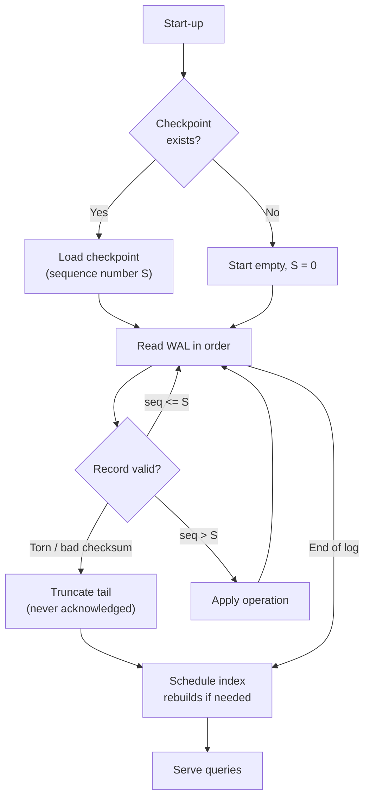

A vector database that loses its data when the process stops is a cache. **Persistence** is the set of mechanisms that make acknowledged writes survive restarts, crashes and power loss: writing changes to durable storage before confirming them, taking consistent snapshots, and rebuilding the in-memory state correctly on start-up. It is the least visible of a vector database's responsibilities and the one whose failure is most expensive, because recovering a lost collection usually means re-embedding the whole corpus.

This lesson explains what "durable" means, how a write-ahead log and checkpoints work together, what must be persisted, how recovery proceeds, and how the main kinds of product differ. You will build a small vector store with crash recovery. Backups, replication and disaster recovery across machines build on this and are covered in [Backup and recovery](/learn/advanced-vector-database-engineering/backup-and-recovery) and [Replication](/learn/advanced-vector-database-engineering/replication).

## Learning objectives

- Define durability and explain why an acknowledged write must be on stable storage before the acknowledgement.
- Describe how a write-ahead log, checkpoints (snapshots) and recovery replay work together, including the handling of a torn final write.
- Identify which parts of a vector collection must be persisted and which can be rebuilt, and why the source documents are the final backup.
- Compare the persistence guarantees of FAISS index files, embedded local modes, dedicated vector databases and pgvector.
- Estimate data at risk and recovery time from write rate, flush policy and checkpoint interval.

## Prerequisites

- [Vector storage](/learn/vector-database-fundamentals/vector-storage): segments, memory-mapped files and tombstones.
- [Indexing](/learn/vector-database-fundamentals/indexing): how indexes are built over segments.
- [CRUD operations](/learn/vector-database-fundamentals/crud-operations): acknowledgement and `wait=True`.
- [Exception handling](/learn/python-for-rag-engineering/exception-handling): handling errors when reading partly written files.

## Why this matters

Rebuilding a vector collection is not like restarting a cache. Every chunk must be re-read, re-parsed, re-chunked and re-embedded; for 10 million chunks, embedding alone can take many hours on a GPU or cost a meaningful sum through a hosted API, while the assistant serves nothing or a partial index.

Persistence failures are also subtle. A nightly pickle loses a day of updates to an afternoon crash; a file written in place and interrupted leaves a corrupt index; a write acknowledged by a database configured for speed may never have reached the disk. Tests rarely pull the power cord.

Understanding the mechanisms lets you ask the right questions of any product ("when exactly is my write durable?", "what happens to a half-written segment?", "how long does recovery take?") and configure it to match what your system can afford to lose.

## The intuition

Think of a shopkeeper's ledger. During the day, sales happen fast, and the shopkeeper keeps the current stock counts in her head because that is quick. But before handing over any item, she writes a line in a bound daybook: "sold one umbrella". The daybook is never rewritten, only appended to, and each line takes seconds.

Once a week she does a full stock-take, writes the complete counts on a fresh page, and staples it into the front of the book. Old daybook lines from before the stock-take are no longer needed.

If she falls ill and someone else takes over, they do not need her memory. They read the latest stock-take and then work through the daybook lines written since, applying each one. If the last line is half-written ("sold one umbr"), it was never completed, so no customer was told the sale went through; they ignore it.

That is a write-ahead log (the daybook), a checkpoint (the stock-take), and recovery (stock-take plus replay). The in-memory state (her head) is fast and disposable; the log and the checkpoint are what make it recoverable.

## How it works

### What durability means

A database's **durability** guarantee is: once it tells you a write succeeded, that write survives a crash of the process or the machine. Two details make this harder than it sounds.

1. **Writing to a file is not the same as writing to disk.** The operating system buffers file writes in memory (the page cache) and flushes them to the device later. A process crash leaves the buffer intact, but a power loss or kernel crash loses it. Only an explicit flush, `fsync` on POSIX systems, asks the OS to put the data on stable storage and wait until it has.
2. **Writes are not atomic at file level.** If the machine fails halfway through writing a large file, the file may contain part of the new data and part of the old, or a truncated tail. Recovery code must detect and handle partial writes.

So "durable" means: the change was written to a file, that file was flushed with `fsync`, and only then was the write acknowledged. Every flush costs time (a millisecond or more on many devices), which is why databases offer settings that trade durability for speed, and why you must know which setting you are running.

### The write-ahead log

Rewriting the full collection on every upsert would be ruinously slow. Instead, databases use a **write-ahead log (WAL)**: an append-only file of operations.

1. A write request arrives (upsert, delete, payload update).
2. The database appends a record describing the operation, with an increasing **sequence number**, to the WAL.
3. It flushes the WAL (immediately, or for a group of writes together, called **group commit**).
4. It applies the operation to the in-memory structures: vector storage, payload storage, tombstones, the unindexed segment.
5. It acknowledges the write.

Appending is the cheapest possible disk operation, so the WAL makes durable writes fast. The in-memory state can be rebuilt from it at any time. The rule in the name, *write ahead*, is what makes this safe: the log record is durable before the change is visible or acknowledged.

### Checkpoints and snapshots

A WAL alone grows forever, and replaying a year of operations at start-up would take hours. Periodically the database writes a **checkpoint**: a durable, consistent image of the data (for a segment-based store, the sealed segments with their vectors, payloads and indexes), tagged with the sequence number it includes. WAL records up to that number are then no longer needed and can be truncated.

Checkpoint files must be written **atomically**: either the old checkpoint or the new one must be intact after a crash, never a half-written mixture. The standard technique is to write the new file under a temporary name, flush it, and then rename it over the old one. On POSIX file systems a rename within one directory is atomic, so a reader sees either the complete old file or the complete new one. (For full durability the directory itself should also be flushed after the rename, so the new name is on disk.)

Products use the word "snapshot" for related but different things. Qdrant's **snapshot** API produces a portable archive of a collection for backup or migration; its on-disk segments and WAL are what provide crash durability. Treat the two separately: crash recovery is automatic and local, while snapshots are something you create, copy elsewhere and restore deliberately.

### Recovery

When the database starts, after a clean shutdown or a crash, it rebuilds its state:

1. **Load the latest checkpoint.** Read the persisted segments (or memory-map them, which makes this fast) and note the sequence number they include.
2. **Replay the WAL.** Read WAL records in order, skip any with a sequence number already included in the checkpoint, and apply the rest.
3. **Handle the torn tail.** If the last record is incomplete or fails its checksum, it was being written when the crash happened. It was never acknowledged (acknowledgement comes after the flush), so it is safe to discard. Truncate it so that new records follow valid ones.
4. **Rebuild what was not persisted.** If an index was not saved, or the unindexed segment needs indexing, schedule it. The data is searchable meanwhile by exact scan of unindexed segments.
5. **Start serving.**



A crash at *any* point leaves a state this procedure recovers correctly. A crash after the checkpoint rename but before the WAL truncation leaves records already in the checkpoint; step 2 skips them by sequence number. A crash during the checkpoint write leaves only a temporary file; the old checkpoint and the full WAL are intact.

### What must be persisted, and what can be rebuilt

A vector collection has layers with different persistence needs.

| Layer | Persist? | If lost |
| --- | --- | --- |
| Vectors, payloads, identifiers | Yes, durably | Must re-embed from source: slow and costly |
| Tombstones (deletes) | Yes, durably | Deleted data reappears: a correctness and compliance bug |
| ANN index (HNSW graph, IVF lists) | Usually, for fast restarts | Can be rebuilt from the vectors: hours of CPU at scale, but no data loss |
| Payload indexes | Usually | Rebuilt from payloads |
| Quantised copies | Optional | Recomputed from the vectors |
| Collection configuration (dimension, metric, model name) | Yes | Without it, you cannot interpret or extend the data correctly |

Behind all of these sits a final layer: the **source documents** and the pipeline that turns them into points. The vector collection is derived data. If the database, its WAL and its backups were all lost, a rebuild from source would still recover everything that still exists in the sources, at the cost of re-embedding. Keeping that path working (the pipeline, the configuration, the embedding model version) is the ultimate durability guarantee, and the one that protects you from bugs that corrupt data *through* the API, which no WAL can undo.

### Persistence across the landscape

**FAISS (library).** `faiss.write_index` serialises an index to a file and `faiss.read_index` loads it. There is no log: changes between saves exist only in memory, and writing the file in place is not atomic. If you use FAISS in a service, you are responsible for saving to a temporary file and renaming, deciding how often to save, and recovering changes since the last save (typically by re-running ingestion for documents changed since then).

**Embedded local modes.** Chroma's persistent client and Qdrant's `QdrantClient(path=...)` store data on local disk inside your process. They are designed for development, tests and small single-process deployments; check their crash guarantees before relying on them.

**Dedicated vector databases.** Qdrant, Milvus and Weaviate servers use a WAL plus persisted segments (or comparable designs) and recover automatically after a crash. Their configuration controls flush behaviour and WAL size; their snapshot or backup features provide copies you can move off the machine.

**pgvector.** Vectors are rows in PostgreSQL, so they inherit PostgreSQL's mature WAL, crash recovery, point-in-time recovery and replication. Index builds are logged too. For teams that already operate PostgreSQL, this is often the strongest argument for pgvector: persistence is a solved problem they already know how to run.

> [!KEY]
> A write is durable only if it reached stable storage before it was acknowledged. Log first, checkpoint atomically, recover by snapshot plus replay, and keep the ability to rebuild from source for the failures no log can fix.

## The mathematics

Two quantities describe a persistence configuration: how much acknowledged data can be lost, and how long recovery takes.

### Data at risk

**Intuition.** If the WAL is flushed every $\Delta$ seconds instead of on every write, then writes acknowledged within the last $\Delta$ seconds before a power loss may be lost.

$$
L = w \cdot \Delta
$$

$L$ is the number of acknowledged writes at risk, $w$ the write rate in operations per second, and $\Delta$ the flush interval in seconds. With a flush before every acknowledgement, $\Delta = 0$ and nothing acknowledged is at risk.

**By hand.** AskMeridian's ingestion peaks at an assumed 400 upserts per second during a nightly re-index. With a 1-second flush interval, up to $400 \times 1 = 400$ acknowledged upserts could be lost to a power failure. Because ingestion is idempotent and re-runnable, losing those is an inconvenience (re-run the batch), not a disaster. For a system where each write is a unique user action that cannot be replayed, the same 400 would be unacceptable.

### Recovery time

**Intuition.** Recovery loads the checkpoint, then replays every WAL record since it. More time between checkpoints means more records to replay.

$$
T_{\text{rec}} \approx T_{\text{load}} + \frac{w \cdot C}{r}
$$

$T_{\text{rec}}$ is the recovery time, $T_{\text{load}}$ the time to load or memory-map the checkpoint, $w$ the average write rate, $C$ the checkpoint interval in seconds, and $r$ the replay rate in records per second.

**By hand.** Assume an average of 50 writes per second, a checkpoint every 10 minutes ($C = 600$ s), a replay rate of 20,000 records per second and 30 seconds to load the checkpoint. WAL records to replay: at most $50 \times 600 = 30{,}000$, taking $30{,}000 / 20{,}000 = 1.5$ s. Recovery is about $30 + 1.5 = 31.5$ s, dominated by loading. Stretch checkpoints to every 24 hours and the worst case becomes $50 \times 86{,}400 = 4{,}320{,}000$ records, $216$ s of replay: recovery takes about four minutes instead of half a minute. Checkpoints cost disk writes; less frequent checkpoints cost recovery time.

```python
w_peak, flush_interval = 400, 1.0
print(f"writes at risk: {w_peak * flush_interval:.0f}")
w_avg, replay_rate, t_load = 50, 20_000, 30
for interval in [600, 86_400]:
    records = w_avg * interval
    print(f"checkpoint every {interval:>6} s: replay {records:>9,} records, "
          f"recovery ~{t_load + records / replay_rate:.1f} s")
```

```output
writes at risk: 400
checkpoint every    600 s: replay    30,000 records, recovery ~31.5 s
checkpoint every  86400 s: replay 4,320,000 records, recovery ~246.0 s
```

All the rates here are assumptions for the arithmetic; measure your own system's replay rate and load time by restarting a staging node.

## In code

**The problem.** Build a small vector store with exactly the guarantees described above: every write logged and flushed before it is applied, atomic checkpoints, and recovery by loading the checkpoint and replaying newer log records, discarding a torn final record. Then crash it deliberately and recover. Finally, see how FAISS and Qdrant's local mode persist data.

**Dependencies.** NumPy only for the store; FAISS and qdrant-client for the second block.

```bash
pip install numpy faiss-cpu qdrant-client
```

```python
import json
import os
import tempfile

import numpy as np


class DurableVectorStore:
    """Exact-search vector store with a write-ahead log and atomic checkpoints."""

    def __init__(self, directory: str, dim: int):
        self.dir, self.dim = directory, dim
        self.wal_path = os.path.join(directory, "wal.jsonl")
        self.vectors: dict[str, np.ndarray] = {}
        self.payloads: dict[str, dict] = {}
        self.seq = 0                                   # sequence number of the last applied operation
        self._recover()
        self.wal = open(self.wal_path, "a", encoding="utf-8")

    # ---- write path: log first, then apply -----------------------------------
    def _log(self, op: dict) -> None:
        self.seq += 1
        op["seq"] = self.seq
        self.wal.write(json.dumps(op) + "\n")
        self.wal.flush()
        os.fsync(self.wal.fileno())                    # durable before we acknowledge

    def upsert(self, pid: str, vector, payload: dict) -> None:
        v = np.asarray(vector, dtype=np.float32)
        v = v / np.linalg.norm(v)
        self._log({"op": "upsert", "id": pid, "vector": v.tolist(), "payload": payload})
        self._apply_upsert(pid, v, payload)

    def delete(self, pid: str) -> None:
        self._log({"op": "delete", "id": pid})
        self._apply_delete(pid)

    def _apply_upsert(self, pid, v, payload):
        self.vectors[pid], self.payloads[pid] = np.asarray(v, dtype=np.float32), payload

    def _apply_delete(self, pid):
        self.vectors.pop(pid, None)
        self.payloads.pop(pid, None)

    # ---- checkpoint: write a full snapshot atomically, then truncate the log --
    def checkpoint(self) -> None:
        ids = list(self.vectors)
        tmp = os.path.join(self.dir, "snapshot.tmp.npz")
        np.savez(tmp, ids=np.array(ids), vectors=np.stack([self.vectors[i] for i in ids]),
                 payloads=np.array(json.dumps([self.payloads[i] for i in ids])), seq=self.seq)
        with open(tmp, "rb") as f:
            os.fsync(f.fileno())
        os.replace(tmp, os.path.join(self.dir, "snapshot.npz"))   # atomic: old or new, never half
        self.wal.close()
        self.wal = open(self.wal_path, "w", encoding="utf-8")       # log restarts after the snapshot

    # ---- recovery: load the latest snapshot, then replay newer log entries ----
    def _recover(self) -> None:
        snap = os.path.join(self.dir, "snapshot.npz")
        if os.path.exists(snap):
            data = np.load(snap)
            payloads = json.loads(str(data["payloads"]))
            for pid, v, p in zip(data["ids"].tolist(), data["vectors"], payloads):
                self._apply_upsert(pid, v, p)
            self.seq = int(data["seq"])
        replayed = torn = 0
        if os.path.exists(self.wal_path):
            valid_bytes = 0
            with open(self.wal_path, "rb") as f:
                for raw in f:
                    try:
                        op = json.loads(raw)
                    except json.JSONDecodeError:       # torn final write from a crash: never acknowledged
                        torn = 1
                        break
                    valid_bytes += len(raw)
                    if op["seq"] <= self.seq:          # already contained in the snapshot
                        continue
                    if op["op"] == "upsert":
                        self._apply_upsert(op["id"], op["vector"], op["payload"])
                    else:
                        self._apply_delete(op["id"])
                    self.seq = op["seq"]
                    replayed += 1
            if torn:
                os.truncate(self.wal_path, valid_bytes)   # cut the torn tail so new entries follow valid ones
        print(f"  recovered: {len(self.vectors)} points, replayed {replayed} log entries, "
              f"torn entries discarded: {torn}, last seq {self.seq}")

    def search(self, query, k=2):
        ids = list(self.vectors)
        q = np.asarray(query, dtype=np.float32) / np.linalg.norm(query)
        scores = np.stack([self.vectors[i] for i in ids]) @ q
        return [(ids[i], round(float(scores[i]), 3)) for i in np.argsort(-scores)[:k]]


rng = np.random.default_rng(5)
d = 8
vec = {name: rng.normal(size=d) for name in ["leave", "remote", "expenses", "vpn", "laptop"]}
folder = tempfile.mkdtemp()

print("1. first process: write three points, checkpoint, write two more, delete one")
s = DurableVectorStore(folder, d)
for name in ["leave", "remote", "expenses"]:
    s.upsert(name, vec[name], {"source": "handbook"})
s.checkpoint()
s.upsert("vpn", vec["vpn"], {"source": "runbook"})
s.upsert("laptop", vec["laptop"], {"source": "runbook"})
s.delete("remote")
with open(s.wal_path, "a") as f:                   # simulate a crash halfway through writing an entry
    f.write('{"op": "upsert", "id": "half-writ')
del s                                              # the process "dies" without a clean shutdown

print("2. second process: recover from disk")
s2 = DurableVectorStore(folder, d)
print("  ids:", sorted(s2.vectors))
print("  search near 'vpn':", s2.search(vec["vpn"] + 0.1 * rng.normal(size=d)))
print("  files:", sorted(os.listdir(folder)))
```

```output
1. first process: write three points, checkpoint, write two more, delete one
  recovered: 0 points, replayed 0 log entries, torn entries discarded: 0, last seq 0
2. second process: recover from disk
  recovered: 4 points, replayed 3 log entries, torn entries discarded: 1, last seq 6
  ids: ['expenses', 'laptop', 'leave', 'vpn']
  search near 'vpn': [('vpn', 0.995), ('laptop', 0.471)]
  files: ['snapshot.npz', 'wal.jsonl']
```

**The important lines.**

- `_log` appends one JSON line with a sequence number, then calls `flush` (Python's buffer to the OS) and `os.fsync` (the OS's buffer to the device). Only after both does `upsert` apply the change. Remove the `fsync` and the store survives a process crash but not a power cut.
- `checkpoint` writes `snapshot.tmp.npz`, flushes it, and `os.replace`s it over `snapshot.npz`. `os.replace` is an atomic rename on POSIX and Windows, so a crash leaves either the old snapshot or the new one. The snapshot records `seq`, the last operation it contains.
- `_recover` loads the snapshot, then replays only log records with a higher sequence number. That makes recovery correct even if the crash happened after the snapshot rename but before the log was truncated.
- The `json.JSONDecodeError` branch handles the torn tail. That record was being written when the "crash" happened, so it was never acknowledged, and discarding it loses nothing that was promised. `os.truncate` removes it so the next record is appended after valid data, not after garbage.
- The vectors are normalised before logging, so replay reproduces exactly what was applied, without depending on code that might change between versions.

**What the output means.** The first process starts with an empty directory, so recovery finds nothing. It writes three points (sequence 1 to 3), checkpoints them, writes two more and a delete (4 to 6), and then a fourth write is cut off halfway. The second process loads the three checkpointed points, replays the three newer records (adding `vpn` and `laptop`, deleting `remote`), discards the torn record, and ends with four points at sequence 6: exactly the acknowledged state. Search works immediately on the recovered data. The directory contains only the snapshot and the log.

**Errors people commonly hit.**

- Writing the snapshot directly to its final name. A crash mid-write leaves a corrupt file and no valid snapshot at all.
- Replaying every log record after loading a snapshot, ignoring sequence numbers. Non-idempotent operations are then applied twice.
- Treating a decode error in the middle of the log, not at the end, as a torn tail. Damage in the middle means corruption, which should stop recovery and alert someone rather than silently drop later records. Real WALs add a checksum per record to tell the two apart.

### Persistence in FAISS and in Qdrant's local mode

```python
import os
import tempfile

import faiss
import numpy as np
from qdrant_client import QdrantClient, models

rng = np.random.default_rng(0)
X = rng.normal(size=(1000, 64)).astype(np.float32)
folder = tempfile.mkdtemp()

# FAISS: an index is saved and loaded as a whole file. Nothing is logged between saves.
index = faiss.IndexHNSWFlat(64, 16)
index.add(X)
faiss.write_index(index, os.path.join(folder, "chunks.faiss"))
restored = faiss.read_index(os.path.join(folder, "chunks.faiss"))
print("FAISS restored:", restored.ntotal, "vectors,",
      os.path.getsize(os.path.join(folder, "chunks.faiss")) // 1024, "KB on disk")

# Qdrant local mode with a path: data survives closing and reopening the client.
path = os.path.join(folder, "qdrant")
client = QdrantClient(path=path)
client.create_collection("askmeridian", vectors_config=models.VectorParams(size=64, distance=models.Distance.COSINE))
client.upsert("askmeridian", points=[models.PointStruct(id=i, vector=X[i].tolist(), payload={"n": i})
                                     for i in range(100)])
client.close()
reopened = QdrantClient(path=path)
print("Qdrant reopened:", reopened.count("askmeridian", exact=True).count, "points")
reopened.close()
```

```output
FAISS restored: 1000 vectors, 390 KB on disk
Qdrant reopened: 100 points
```

The FAISS file holds the vectors (1,000 × 64 × 4 bytes = 250 KB) plus the HNSW graph, which accounts for the rest. Anything added to `index` after `write_index` would be lost by a crash; making that safe is your job. Qdrant's local mode persisted the 100 points across a close and reopen with no extra code. It is meant for development and small single-process use; a Qdrant server provides the WAL-based durability described in this lesson.

**Extending it.** Add a CRC32 checksum per log record and make recovery distinguish a torn tail from mid-log corruption; then add a `flush_every` option and describe its cost with the data-at-risk formula.

## A real-world example

Before AskMeridian moved to Qdrant, its prototype kept a FAISS index in memory and wrote it to a shared network drive with `faiss.write_index` every night. One morning a scheduled server restart coincided with the end of the nightly save. The save had been writing directly to `chunks.faiss`; the restart killed it partway through. When the service came back, `read_index` failed on the truncated file. There was no previous copy, because each save overwrote the last.

Ngozi, on call for the Platform team, had no choice but a full re-embedding of 200,000 chunks on the team's shared GPU. The assistant was down for most of the working day.

The review produced three changes. Saves would go to a temporary file renamed into place, keeping the previous two versions. Daytime updates would no longer exist only in memory: the team moved to Qdrant, whose WAL made each acknowledged upsert durable. And the rebuild-from-source path was documented and tested quarterly, with its expected duration in the runbook, so the next on-call engineer would know the cost of that option before choosing it.

## Common mistakes

- **Equating "saved to a file" with "durable".** Without `fsync`, the data may still be in the OS's memory when the power goes.
- **Overwriting index files in place.** A crash mid-write destroys both versions.
- **Keeping one copy.** A single snapshot, overwritten each time, is lost as soon as one save goes wrong.
- **Running a durability-relaxing setting without knowing it.** Asynchronous flush or `wait=False` can be the right choice for re-runnable ingestion, and the wrong one for writes that cannot be replayed.
- **Persisting vectors but not configuration.** Without the embedding model name, dimension and metric, a restored collection cannot be safely queried or extended.
- **Never testing recovery.** A restore or rebuild that has not been run is a hope, not a plan.
- **Sharing an embedded database directory between processes.** Concurrent writers can corrupt it.

## Best practices

- Know exactly when your database considers a write durable, and choose the flush setting deliberately per workload.
- Use a database with a WAL for anything that receives updates; reserve file-based FAISS persistence for static or easily rebuilt indexes, saved atomically with previous versions kept.
- Store collection configuration (model name and version, dimension, metric, chunker version) with the data and in your deployment configuration.
- Take regular snapshots or backups and copy them off the machine; Module 21's [Backup and recovery](/learn/advanced-vector-database-engineering/backup-and-recovery) covers schedules and restore drills.
- Keep the rebuild-from-source pipeline working and measure how long it takes.
- Rehearse a crash on staging: kill the process during writes, restart, and verify every acknowledged write with exact counts.

## Performance considerations

**`fsync` sets the floor on write latency.** If one flush costs an assumed 2 ms, flushing per write caps a single writer at about 500 writes per second. Group commit (one flush for many concurrent writes) and batching (many points per request) raise throughput without weakening durability, because each acknowledged batch is still flushed before acknowledgement.

**Checkpoints compete with queries.** Writing a checkpoint or merging segments writes large amounts of data and can use significant disk bandwidth and CPU. Databases throttle this; schedule bulk loads and heavy optimisation outside peak hours where possible.

**Recovery time grows with the WAL and with unpersisted indexes.** As the mathematics showed, infrequent checkpoints lengthen replay. If indexes are not persisted, recovery must rebuild them: for millions of vectors, an HNSW rebuild can take far longer than replay, during which queries fall back to slower scans. Persisting indexes buys fast restarts at the cost of disk space.

**Memory-mapped checkpoints make start-up fast but the first queries slow**, as [Vector storage](/learn/vector-database-fundamentals/vector-storage) described. Warm the cache before taking traffic.

## Security considerations

Everything persisted is a copy of your documents: the WAL contains every upsert's vector and payload (often including chunk text), checkpoints contain the full collection, and snapshots are portable archives of it. Protect them like the source data: restrict file-system and backup-bucket access, encrypt at rest where the platform supports it, and include them in retention policies. A deletion is not complete until the deleted data has left the WAL (after the next checkpoint and truncation), the segments (after merging) and every backup that held it, which is why data-protection deletions need the dedicated treatment in [Secure deletion](/learn/enterprise-rag-governance/secure-deletion).

## Summary

- Durability means an acknowledged write survives a crash; it requires writing to stable storage (`fsync`) before acknowledging.
- A write-ahead log makes durable writes cheap: append and flush a record, then apply the change in memory. Checkpoints bound the log, and must be written atomically (temporary file, flush, rename).
- Recovery loads the latest checkpoint, replays newer log records by sequence number, and discards a torn final record, which was never acknowledged.
- Vectors, payloads, tombstones and configuration must be persisted; indexes and quantised copies can be rebuilt; the source documents and ingestion pipeline are the final backup.
- FAISS files have no log, embedded modes suit development, dedicated databases and pgvector provide WAL-based crash recovery. Estimate data at risk as $w\Delta$ and recovery time as load time plus $wC/r$, and test recovery for real.

## Exercises

**1.** A database flushes its WAL every 200 ms and receives 1,500 writes per second at peak. How many acknowledged writes could a power failure lose? What would change if it flushed before every acknowledgement?

<details><summary>Show solution</summary>

$L = 1{,}500 \times 0.2 = 300$ writes at risk. Flushing before every acknowledgement makes $\Delta = 0$: no acknowledged write can be lost. The cost is a flush per write (or per group of concurrent writes), which limits throughput unless writes are batched or grouped.

</details>

**2.** In the code example, the process crashes after `os.replace` in `checkpoint` but before the WAL is truncated. Walk through what the next recovery does and explain why the result is correct.

<details><summary>Show solution</summary>

The new snapshot is in place with `seq = S`, and the WAL still contains records 1 to $S$ (and possibly later ones). Recovery loads the snapshot and sets `self.seq = S`. While reading the WAL, every record with `seq <= S` is skipped, because the snapshot already contains its effect, and any record with `seq > S` is replayed. Each operation is applied exactly once, so the state equals the acknowledged state. Without sequence numbers, records 1 to $S$ would be applied a second time.

</details>

**3.** Extend `DurableVectorStore` so that after recovery from the torn write in the example, a new upsert followed by another restart recovers correctly. Explain what would have gone wrong without the `os.truncate` call.

<details><summary>Show solution</summary>

The class already truncates; test it by continuing the example:

```python
s2.upsert("expenses-2026", vec["expenses"], {"source": "handbook"})
del s2
s3 = DurableVectorStore(folder, d)
print(sorted(s3.vectors))
```

```output
  recovered: 5 points, replayed 4 log entries, torn entries discarded: 0, last seq 7
['expenses', 'expenses-2026', 'laptop', 'leave', 'vpn']
```

Without the truncation, the torn fragment would still sit at the end of the log, and the new record would be appended directly after it, on the same line. On the next recovery that combined line would fail to parse, recovery would stop there, and the new, acknowledged upsert would be lost.

</details>

**4.** Design decision. AskMeridian's collection is 4 million chunks. A full re-embedding takes an assumed 10 hours. The business accepts at most 15 minutes of unavailability and no loss of acknowledged updates. Outline a persistence and recovery design that meets this, and say what the rebuild-from-source path is still needed for.

<details><summary>Show solution</summary>

- Run a dedicated vector database (or pgvector) with a WAL, flushing before acknowledgement, so no acknowledged update is lost on a crash.
- Persist indexes and memory-map segments, so a restart does not rebuild HNSW; measure restart time on staging and keep checkpoints frequent enough that replay is short.
- Because a single node's disk can fail, add a replica on another machine that can take traffic within minutes ([Replication](/learn/advanced-vector-database-engineering/replication)); 15 minutes is too short to restore a large snapshot reliably and far too short for a rebuild.
- Take regular snapshots copied off-site for recovery from corruption or operator error, with a tested restore time.

The rebuild-from-source path (10 hours) is still essential for failures that the WAL and replicas faithfully reproduce: an ingestion bug that wrote wrong vectors or payloads, an embedding model change, or the loss of every copy. It is the last resort, not the first, and its duration should be known and documented.

</details>

## Check your understanding

```quiz
[
  {"q": "Why must a database flush its write-ahead log before acknowledging a write?", "options": ["So that queries are faster", "So that an acknowledged write survives a power loss, not just a process crash", "Because the index cannot be updated otherwise", "To compress the log"], "answer": 1, "why": "Data written but not flushed may still be in the OS page cache; only after fsync is it on stable storage, so only then is the promise of durability honest."},
  {"q": "During recovery, the last record of the WAL is half-written. What is the correct action?", "options": ["Discard it, because it was never acknowledged, and truncate the log there", "Stop recovery and refuse to start", "Guess the missing bytes", "Replay the whole log twice"], "answer": 0, "why": "Acknowledgement happens after the record is flushed, so a torn final record belongs to a write the client was never told succeeded."},
  {"q": "Which part of a vector collection can be rebuilt without re-embedding if it is lost?", "options": ["The vectors", "The tombstones recording deletions", "The HNSW graph", "The payloads"], "answer": 2, "why": "An ANN index is derived from the stored vectors and can be rebuilt from them; vectors, payloads and tombstones are primary data."},
  {"q": "A service saves its FAISS index with faiss.write_index directly to chunks.faiss every hour. What is the main risk?", "options": ["FAISS cannot read files it wrote", "The index will use more memory", "Search results will change after loading", "A crash during the save leaves a corrupt file and no valid copy, and changes since the last save exist only in memory"], "answer": 3, "why": "Writing in place is not atomic, and FAISS has no log between saves; write to a temporary file, rename, keep previous versions, and accept or cover the window of unsaved changes."},
  {"q": "Writes average 100 per second, checkpoints happen every 30 minutes, and replay runs at 25,000 records per second. What is the worst-case replay time?", "options": ["About 7 seconds", "About 72 seconds", "About 0.7 seconds", "About 30 minutes"], "answer": 0, "why": "100 x 1,800 = 180,000 records; 180,000 / 25,000 = 7.2 seconds of replay."}
]
```

## Further reading

- Qdrant documentation, "Storage" and "Snapshots": segments, the write-ahead log and creating and restoring snapshots. [qdrant.tech/documentation](https://qdrant.tech/documentation/)
- PostgreSQL documentation, "Reliability and the Write-Ahead Log": the WAL, `fsync` and crash recovery that pgvector inherits. [postgresql.org/docs](https://www.postgresql.org/docs/)
- FAISS wiki, "Index IO, cloning and hyper parameter tuning": `write_index` and `read_index`. [github.com/facebookresearch/faiss/wiki](https://github.com/facebookresearch/faiss/wiki)
- Mohan and colleagues (1992), *ARIES: A Transaction Recovery Method Supporting Fine-Granularity Locking and Partial Rollbacks Using Write-Ahead Logging*, ACM TODS: the classic account of write-ahead logging and recovery.
- Kleppmann (2017), *Designing Data-Intensive Applications*, chapters 3 and 7: logs, durability and what `fsync` does and does not guarantee.
