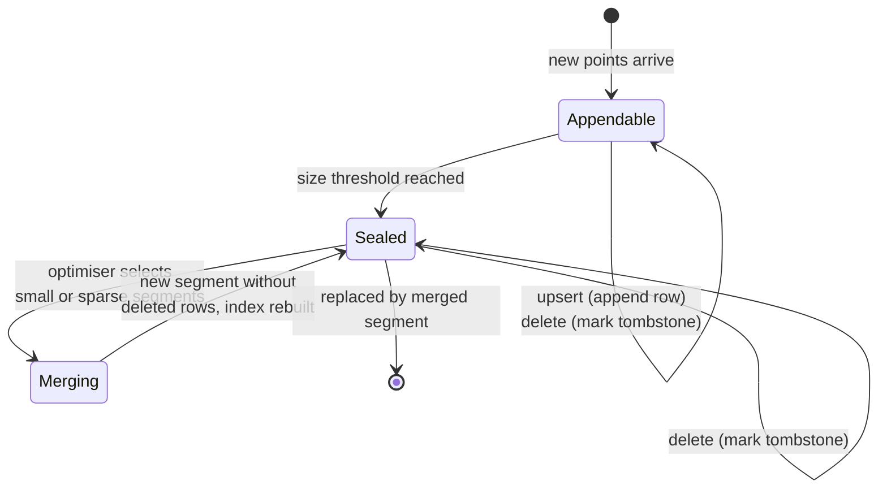

A vector database spends most of its life reading vectors. Every exact search reads all of them, and every approximate search still reads thousands. How those numbers are laid out in memory and on disk, how many bytes each one takes, and which of them must sit in RAM decides how fast search is, how much the hardware costs, and how much accuracy you give up to save space.

This lesson opens the box. It shows how vectors are stored as contiguous arrays, how identifiers map to positions, why storage is split into segments, the choice between RAM, memory-mapped files and disk, and what lower-precision formats such as float16 and int8 cost in accuracy. The algorithms that compress vectors more aggressively are covered later in [Vector indexing algorithms](/learn/vector-indexing-algorithms); this lesson gives you the storage model they all sit on.

## Learning objectives

- Calculate the memory needed for a collection from its size, dimension and number format, including index and payload overheads.
- Explain why vectors are stored as one contiguous row-major array and how external identifiers are mapped to internal positions.
- Describe segment-based storage and explain how it makes appends cheap and deletes deferred.
- Compare in-RAM, memory-mapped and on-disk vector storage, and choose between them for a stated workload.
- Measure the accuracy cost of storing vectors as float16 and int8 against a float32 baseline.

## Prerequisites

- [What is a vector database?](/learn/vector-database-fundamentals/what-is-a-vector-database): collections, points, vectors and payloads.
- [What are embeddings?](/learn/embedding-fundamentals/what-are-embeddings): what the numbers in a vector represent.
- [Dimensionality](/learn/embedding-fundamentals/dimensionality): why vectors have hundreds or thousands of components.

## Why this matters

Storage is where a vector database's bill comes from. Consider a modest enterprise deployment: 10 million chunks, embedded at 1,024 dimensions. Stored as 32-bit floats, the raw vectors take $10^7 \times 1{,}024 \times 4$ bytes, about 41 GB, before any index or metadata. If all of it must sit in RAM on every replica, that is a large and expensive server, multiplied by however many replicas you run.

The same data stored at one byte per component takes about 10 GB. Kept on fast SSD with only a compressed copy in memory, the RAM requirement falls further. Each of these choices changes cost by a factor of two to ten, and each has a price in accuracy, latency or complexity. Engineers who do not understand the storage model either overpay for memory they do not need or turn on compression and quietly lose recall without measuring it.

Storage layout also explains behaviour that otherwise looks mysterious: why bulk inserts are much faster than single inserts, why deleted points still take space for a while, why the first queries after a restart are slow, and why a database can "run out of memory" on a collection that fits comfortably on disk.

## The intuition

Picture a warehouse of identical boxes, each holding one vector. If the boxes stand in one long, numbered row, a forklift can drive down the row and inspect each in turn without stopping: that is a **contiguous array**, and it is the fastest thing a computer can scan. Finding box 1,234 is arithmetic: it is 1,234 box-widths from the start.

Now suppose the warehouse fills up faster than you can build a single long row. You start new short rows (**segments**), each sealed when full, and every so often you merge short rows into longer ones. Withdrawn boxes are not dragged out immediately; you stick a "withdrawn" label on them and remove them at the next merge.

Some boxes are used constantly, some rarely. You keep the busy ones near the loading bay (**RAM**) and the rest in the back (**disk**), fetching them when asked. And if the boxes are too bulky, you can repack the contents into smaller boxes with a little loss of detail (**lower precision**), which lets far more of them fit near the bay.

## How it works

### One vector, in bytes

A vector of $d$ components is stored as $d$ numbers in a fixed binary format. The default is **float32** (IEEE 754 single precision), 4 bytes per component, which is what embedding models produce. A 384-dimension vector is therefore $384 \times 4 = 1{,}536$ bytes, and that is all it is: no field names, no separators, just 1,536 bytes.

Other formats trade precision for space:

| Format | Bytes per component | What it keeps | Typical use |
| --- | --- | --- | --- |
| float32 | 4 | About 7 significant decimal digits | Default; the reference for accuracy |
| float16 | 2 | About 3 significant digits, narrower range | Halving memory with almost no ranking change |
| bfloat16 | 2 | float32's range, about 2 to 3 digits | Common on accelerators |
| int8 / uint8 | 1 | 256 levels per component after scaling | **Scalar quantisation**; a quarter of float32 |
| 1 bit | 1/8 | Only the sign of each component | **Binary quantisation**; usually needs rescoring |

**Quantisation** means mapping values onto a smaller set of levels. Scalar quantisation, which this lesson computes by hand, is the simplest version; [Scalar quantisation](/learn/vector-indexing-algorithms/scalar-quantisation) and [Product quantisation](/learn/vector-indexing-algorithms/product-quantisation) treat compression in depth, and [Embedding quantisation](/learn/embedding-optimisation/embedding-quantisation) covers it from the model side.

### Many vectors: one contiguous matrix

A collection of $N$ vectors is stored as an $N \times d$ matrix laid out **row-major**: all of vector 0, then all of vector 1, and so on, with no gaps. Three things follow.

1. **Addressing is arithmetic.** Vector $i$ starts at byte offset $i \times d \times b$, where $b$ is the bytes per component. No lookup is needed.
2. **Scanning is streaming.** The processor reads memory in cache lines (commonly 64 bytes) and prefetches the next ones when access is sequential. A contiguous scan keeps the memory bus busy with useful data, and SIMD instructions (which apply one operation to several numbers at once) can multiply many components per instruction.
3. **Batching is natural.** Many queries against many vectors is one matrix multiplication, the operation that numerical libraries and GPUs are most heavily optimised for.

Storing vectors as a list of separate Python objects, or as JSON, throws all of this away. Every vector becomes a scattered allocation with headers and pointers, and scanning them chases pointers around memory.

### Identifiers and internal offsets

Users refer to points by **external identifiers**: integers, UUIDs or strings such as `handbook-v7#chunk-12`. The storage engine refers to them by **internal offsets**: the row number in a matrix. A mapping table connects the two, in both directions:

- external id → (segment, offset), used by retrieve, update and delete;
- (segment, offset) → external id, used to translate search results back.

This indirection is why a database can move vectors around (during merges) without your identifiers changing, and it is why FAISS, which by default identifies vectors only by their insertion position, needs an `IndexIDMap` wrapper before it can use your own identifiers.

### Payload storage sits beside, not inside

Payloads (metadata and often the chunk text) are variable-length and irregular, the opposite of vectors. Databases therefore keep them in a **separate store**, typically a key-value store or a set of columnar files keyed by the internal offset. Keeping them apart preserves the dense vector matrix for scanning and lets each be placed independently: vectors in RAM and payloads on disk is a common arrangement, because payloads are only read for the handful of points returned, or for filtering. [Metadata](/learn/vector-database-fundamentals/metadata) designs what goes into them.

### Segments: append now, tidy later

A single matrix is ideal for reading but awkward for writing. Appending to a full array means allocating a larger one and copying everything, and deleting a row from the middle means shifting everything after it. Storage engines borrowed a solution from search engines and log-structured databases: **segments**.



1. New points are appended to a small **appendable segment**. Appending to the end of an array is cheap.
2. When it reaches a size threshold, the segment is **sealed**: it becomes read-only, and the database can build an index over it and lay it out optimally.
3. A **delete** does not move data. It sets a bit in a **tombstone** bitmap (a "deleted" flag per row), and searches skip flagged rows.
4. An **update** is a delete plus an insert: the old row is tombstoned and the new version appended.
5. In the background, an **optimiser** merges small segments and rewrites segments with many tombstones, reclaiming space and rebuilding their indexes.

A search runs over every segment and merges the per-segment top-k lists into one. This is why bulk inserts are faster than single ones (fewer, larger appends and fewer index updates), why disk and memory use can stay high after a large delete until the optimiser runs, and why a collection with very many small segments searches more slowly than the same data in a few large ones. Qdrant, Milvus and Lucene-based engines (Elasticsearch, OpenSearch) all use variations of this design.

### RAM, memory-mapped files and disk

Where the bytes live is the biggest single cost decision.

**In RAM.** Fastest and simplest: every read is a memory access. Memory is also the most expensive resource per gigabyte, and the whole collection must fit, with headroom.

**Memory-mapped (mmap).** The vectors live in a file, and the operating system maps that file into the process's address space. The program reads it like an array; the first access to each 4 KB page triggers a read from disk, after which the page stays in the OS **page cache** while memory allows. Frequently read pages stay resident and rarely read ones are evicted. The result behaves like RAM for the hot portion and like disk for the rest, and the "working set" adapts automatically. The cost is unpredictable latency when a query touches cold pages, and slow first queries after a restart, when the cache is empty.

**On disk with a compressed copy in RAM.** A common production design keeps a small quantised copy of every vector in memory for fast approximate scoring, and the full-precision vectors on disk. Search scores candidates with the compact copy, then re-reads the best few hundred at full precision to **rescore** them. Only a few hundred disk reads happen per query, which fast SSDs handle easily.

| Placement | RAM per million 1,024-d vectors | Latency | Main risk |
| --- | --- | --- | --- |
| float32 in RAM | about 4.1 GB | Lowest, stable | Cost; out-of-memory as data grows |
| float32 memory-mapped | depends on working set | Low when warm, spiky when cold | Cold-start and tail latency |
| int8 in RAM, float32 on disk with rescoring | about 1.0 GB plus cache | Low, plus a small rescoring cost | Recall loss if rescoring is skipped |

Slow disks change the picture: memory-mapped or rescoring designs assume local SSDs. On network-attached storage with high per-read latency, each cold page or rescoring read costs far more.

### What the knobs look like in practice

In Qdrant these choices are collection settings. The configuration below, written against qdrant-client's current models, keeps the original float32 vectors memory-mapped from disk, keeps an int8 scalar-quantised copy in RAM, and stores payloads on disk. It is shown for its shape: the embedded `:memory:` mode accepts these settings but only a Qdrant server applies them, so its storage behaviour was not measured here.

```python
from qdrant_client import QdrantClient, models

client = QdrantClient(url="http://localhost:6333")   # a Qdrant server
client.create_collection(
    collection_name="handbook_minilm_v1",
    vectors_config=models.VectorParams(
        size=384,
        distance=models.Distance.COSINE,
        on_disk=True,                 # original float32 vectors memory-mapped from disk
    ),
    quantization_config=models.ScalarQuantization(
        scalar=models.ScalarQuantizationConfig(
            type=models.ScalarType.INT8,
            quantile=0.99,            # ignore the most extreme 1% when choosing the range
            always_ram=True,          # keep the 1-byte copy in memory for fast scoring
        )
    ),
    on_disk_payload=True,             # payloads read from disk only when needed
)
```

pgvector takes a different route: vectors are values in a table column, stored in PostgreSQL's 8 KB pages like any other column, and cached by PostgreSQL's shared buffers and the OS page cache. Its README documents the storage size of each vector type (for the `vector` type, 4 bytes per dimension plus a small fixed header) and a `halfvec` type for 2-byte components.

## The mathematics

### Memory for a collection

**Intuition.** Raw vectors are a fixed number of bytes each; everything else (index, identifiers, payloads, segment slack) is overhead that you estimate separately.

$$
M \approx N \cdot d \cdot b \;+\; N \cdot (g + p + c)
$$

$N$ is the number of vectors, $d$ the dimension, $b$ the bytes per component, $g$ the index bytes per vector (an HNSW graph's neighbour lists, for example), $p$ the average payload bytes if payloads are in RAM, and $c$ a small per-point cost for identifiers and bookkeeping.

**By hand.** One million 384-dimension float32 vectors, with an index costing an assumed 150 bytes per vector, payloads on disk, and 16 bytes of bookkeeping:

- Vectors: $10^6 \times 384 \times 4 = 1{,}536{,}000{,}000$ bytes $= 1.536$ GB.
- Overhead: $10^6 \times (150 + 0 + 16) = 166{,}000{,}000$ bytes $= 0.166$ GB.
- Total: about 1.70 GB, so the vectors are 90% of it. At 1,536 dimensions the vectors are four times larger and dominate even more. This is why compression targets the vectors.

### Scalar quantisation to 8 bits

**Intuition.** Within one dimension, the stored values occupy some range, say $-0.21$ to $0.24$. Divide that range into 255 equal steps and store, for each value, the number of the nearest step: an integer from 0 to 255, which fits in one byte.

$$
s_j = \frac{\max_j - \min_j}{255}, \qquad q_{ij} = \operatorname{round}\!\left(\frac{x_{ij} - \min_j}{s_j}\right), \qquad \hat{x}_{ij} = q_{ij}\, s_j + \min_j
$$

$x_{ij}$ is component $j$ of vector $i$; $\min_j$ and $\max_j$ are the smallest and largest values of component $j$ across the collection; $s_j$ is the **step size**; $q_{ij}$ is the stored byte; $\hat{x}_{ij}$ is the value reconstructed at search time. Rounding to the nearest step means the error in each component is at most half a step: $|x_{ij} - \hat{x}_{ij}| \le s_j / 2$.

**By hand.** Suppose component $j$ ranges from $-0.21$ to $0.24$, and a vector has $x_{ij} = 0.05$.

- Step: $s_j = (0.24 - (-0.21)) / 255 = 0.45 / 255 \approx 0.0017647$.
- Code: $(0.05 + 0.21) / 0.0017647 = 0.26 / 0.0017647 \approx 147.33$, rounded to $q_{ij} = 147$.
- Reconstruction: $147 \times 0.0017647 - 0.21 \approx 0.25941 - 0.21 = 0.04941$.
- Error: $0.05 - 0.04941 = 0.00059$, inside the bound $s_j / 2 \approx 0.00088$.

Each component is off by less than a thousandth, but a similarity score sums hundreds of such errors. They partly cancel, so scores move only slightly, yet two candidates whose scores differed by less than that movement can swap places. That is how quantisation loses recall: not by making scores badly wrong, but by reordering near-ties.

```python
lo, hi, x = -0.21, 0.24, 0.05
step = (hi - lo) / 255
code = round((x - lo) / step)
restored = code * step + lo
print(f"step = {step:.7f}, code = {code}, restored = {restored:.5f}, "
      f"error = {x - restored:.5f}, bound = {step / 2:.5f}")
```

```output
step = 0.0017647, code = 147, restored = 0.04941, error = 0.00059, bound = 0.00088
```

## In code

**The problem.** Measure, rather than assume, what storing vectors in smaller formats costs. Store 20,000 vectors as float32, float16 and uint8, run the same 200 queries against each, and compare memory, recall against the exact float32 answer, and the largest change in any score. Then store the float32 matrix in a file and search it through a memory map.

**Dependencies.** NumPy only. The vectors are synthetic: 50 topic centres with points scattered around each, normalised to unit length, which imitates the clustered structure of real embeddings while staying reproducible.

```bash
pip install numpy
```

```python
import os
import tempfile
import numpy as np

rng = np.random.default_rng(42)
N, d, k = 20_000, 384, 10

# Clustered synthetic "embeddings": 50 topics, points scattered around each centre.
centres = rng.normal(size=(50, d))
X = centres[rng.integers(0, 50, N)] + 0.6 * rng.normal(size=(N, d))
X = (X / np.linalg.norm(X, axis=1, keepdims=True)).astype(np.float32)   # unit length, float32
Q = centres[rng.integers(0, 50, 200)] + 0.6 * rng.normal(size=(200, d))
Q = (Q / np.linalg.norm(Q, axis=1, keepdims=True)).astype(np.float32)

def top_k(scores, k):
    idx = np.argpartition(-scores, k, axis=1)[:, :k]          # unordered top k per row
    return [set(row) for row in idx]

truth = top_k(Q @ X.T, k)                                       # exact float32 answer

def recall(found):
    return np.mean([len(f & t) / k for f, t in zip(found, truth)])

# 1. float16: half the bytes, ~3 significant decimal digits
X16 = X.astype(np.float16)
s16 = Q.astype(np.float16).astype(np.float32) @ X16.astype(np.float32).T

# 2. int8 scalar quantisation, one (min, max) range per dimension
lo, hi = X.min(axis=0), X.max(axis=0)
scale = (hi - lo) / 255.0
X8 = np.round((X - lo) / scale).astype(np.uint8)               # stored: 1 byte per component
X8_restored = X8.astype(np.float32) * scale + lo                # decoded at search time
s8 = Q @ X8_restored.T

exact = Q @ X.T
print(f"{'format':<8}{'bytes/vector':>13}{'total MB':>10}{'recall@10':>11}{'max |score error|':>19}")
for name, arr, scores in [("float32", X, exact), ("float16", X16, s16), ("uint8", X8, s8)]:
    print(f"{name:<8}{arr.nbytes // N:>13}{arr.nbytes / 1e6:>10.2f}"
          f"{recall(top_k(scores, k)):>11.3f}{np.abs(scores - exact).max():>19.5f}")

# 3. Memory-mapped storage: the vectors live in a file; the OS pages them in on demand.
path = os.path.join(tempfile.mkdtemp(), "vectors.f32")
X.tofile(path)                                                  # raw row-major bytes, no header
mm = np.memmap(path, dtype=np.float32, mode="r", shape=(N, d))
print(f"\nfile size: {os.path.getsize(path):,} bytes = N x d x 4 = {N * d * 4:,}")
print("row 1234 read through mmap equals in-memory row:", np.array_equal(mm[1234], X[1234]))
print("C-contiguous rows:", X.flags["C_CONTIGUOUS"], "| stride between rows:", X.strides[0], "bytes")
```

```output
format   bytes/vector  total MB  recall@10  max |score error|
float32          1536     30.72      1.000            0.00000
float16           768     15.36      0.999            0.00009
uint8             384      7.68      0.973            0.00216

file size: 30,720,000 bytes = N x d x 4 = 30,720,000
row 1234 read through mmap equals in-memory row: True
C-contiguous rows: True | stride between rows: 1536 bytes
```

**The important lines.**

- `np.argpartition(-scores, k, axis=1)[:, :k]` finds the $k$ highest scores per query without fully sorting all 20,000; [Similarity search](/learn/vector-database-fundamentals/similarity-search) explains why that matters. The comparison uses sets, so order within the top 10 is ignored.
- `lo, hi = X.min(axis=0), X.max(axis=0)` computes one range **per dimension**, exactly as in the formula. A single global range would waste levels on dimensions with narrow spread.
- `X8.astype(np.float32) * scale + lo` reconstructs approximate floats. Production engines usually avoid this step and compute similarities directly in integer arithmetic, which is faster still; the reconstruction here keeps the arithmetic easy to read.
- `X.tofile(path)` writes nothing but the raw bytes. The file is exactly $N \times d \times 4$ bytes, which is the whole storage format of a flat vector file. `np.memmap` then exposes it as an array without reading it all into memory.
- `X.strides[0]` is 1,536 bytes: moving from one vector to the next means moving 1,536 bytes forward in memory, which is what "contiguous row-major" means concretely.

**What the output means.** float16 halves the memory and changes scores by less than a ten-thousandth; recall@10 is 0.999, meaning one result in a thousand differs. uint8 quarters the memory; the largest score change is about 0.002, small, but enough to swap near-tied candidates, and recall@10 falls to 0.973. On this toy data, about 3 of every 100 top-10 results change. The exact figure on your data will differ (it depends on how crowded the neighbourhoods are), which is precisely why you measure rather than assume. The memory-mapped row is byte-for-byte identical to the in-memory one; mmap changes where the bytes live, not what they are.

**Errors people commonly hit.**

- Computing the quantisation range on the first batch of data and reusing it forever. Later vectors outside the range are clipped and lose accuracy; ranges should be computed on a representative sample, and engines recompute them when segments are rebuilt.
- Opening a memmap with the wrong `dtype` or `shape`. A raw file has no header, so NumPy cannot check; float32 bytes read as float64 produce garbage without any error. Record the format alongside the file.
- Measuring quantised recall on random, unclustered vectors. They have no near-ties, so compression looks harmless; real embeddings are clustered and suffer more.

**Extending it.** Add a rescoring step: for each query, take the top 50 by uint8 score, recompute their scores in float32, and keep the best 10. Recall should return to almost 1.000 while still scanning only the 1-byte copy. That is the "compressed in RAM, full precision on disk" design from the table above, in a dozen lines.

## A real-world example

Meridian's Platform team planned to add the product documentation for Meridian Sync, Meridian Relay and Meridian Reports to AskMeridian, which would take the collection from about 200,000 chunks to an expected 4 million. At the same time they were evaluating a 1,024-dimension embedding model to replace `all-MiniLM-L6-v2`.

Hamid, the engineer sizing the Qdrant cluster, did the arithmetic first. Four million vectors at 1,024 float32 components is $4 \times 10^6 \times 4{,}096 \approx 16.4$ GB of raw vectors, plus an HNSW graph, on each of two replicas. The existing nodes had 16 GB of RAM. Keeping everything in memory meant new, larger nodes.

Rather than choosing by instinct, he built a labelled set of 300 real staff questions with known relevant chunks and measured three configurations on a staging copy: float32 in RAM, int8 quantised in RAM with float32 memory-mapped and no rescoring, and the same with rescoring. Quantisation without rescoring lost a few relevant chunks from the top 5, concentrated in product questions where several near-identical release-note chunks competed. With rescoring, the measured recall matched float32 within the noise of a 300-question set, and the RAM requirement fell to about a quarter for the vectors.

The team shipped the quantised configuration with rescoring on the existing node size, and added the recall check to the deployment checklist so that any future storage change would be measured the same way. The decision was not "quantisation is good"; it was "quantisation plus rescoring is good enough on our questions, and we have the numbers to show it".

## Common mistakes

- **Sizing memory from the raw vectors alone.** Index structures, payloads held in RAM, segment overhead and the OS page cache all need room. A node at 95% memory use fails when the optimiser needs space to merge segments.
- **Storing vectors as JSON or Python lists.** Text formats inflate each float to around 10 to 20 characters and must be parsed before use; lists of objects scatter vectors across memory. Use binary arrays.
- **Turning on quantisation without measuring recall.** The loss is small on average and concentrated in exactly the crowded neighbourhoods where users notice it.
- **Putting memory-mapped storage on slow network disks.** Every cold page becomes a slow network read, and tail latency explodes.
- **Expecting deletes to free space immediately.** Tombstoned rows stay until segments are merged; plan disk headroom for that, and do not panic when usage stays high right after a large delete.
- **Mixing float formats between write and read.** Writing float32 bytes and reading them as float64 (or the reverse) produces nonsense silently in raw formats.

## Best practices

- Do the memory arithmetic ($N \times d \times b$ plus overhead) before choosing hardware, for today's size and for the size expected in a year.
- Normalise vectors once at write time if the metric is cosine, so search is a plain dot product.
- Prefer bulk upserts in batches of hundreds or thousands over single-point writes during ingestion.
- If memory is tight, try in order: float16 (almost free), int8 with rescoring, then the more aggressive methods in [Vector indexing algorithms](/learn/vector-indexing-algorithms). Measure recall on a labelled set at each step.
- Keep payloads, and especially chunk text, out of RAM unless filters need them there; they are read only for the few results returned.
- Warm the page cache after a restart (for example by running representative queries) before sending production traffic to a node that uses memory-mapped storage.

## Performance considerations

**Bandwidth, not arithmetic, usually limits a scan.** A dot product does two floating-point operations per 4 bytes read. Modern cores can compute far faster than memory can feed them, so halving the bytes (float16) or quartering them (int8) speeds up a scan in proportion, not just saves memory.

**Compression multiplies across replicas.** If a collection runs on three replicas, every gigabyte saved per node is saved three times. With 41 GB of float32 vectors (10 million at 1,024 dimensions), int8 brings each replica down to about 10 GB of vectors, a saving of roughly 93 GB of RAM across three replicas.

**Rescoring cost is small and bounded.** Rescoring 100 candidates at 1,024 float32 dimensions reads $100 \times 4{,}096 = 409{,}600$ bytes, about 0.4 MB, per query. From local SSD that is a few hundred random reads; from RAM it is negligible. What you must not do is rescore thousands of candidates from a slow disk.

**Cold starts are real.** A node that has just started with memory-mapped storage serves its first queries from disk. If a 16 GB file must be paged in at an assumed 500 MB/s of effective random-read throughput, a full warm-up takes around 30 seconds; queries during that time see higher latency.

## Summary

- A vector is $d$ numbers in a fixed binary format, usually float32 (4 bytes each); a collection is an $N \times d$ row-major matrix, addressed by arithmetic and scanned as a stream.
- External identifiers map to internal offsets, and payloads are stored separately from vectors, so each can be placed in RAM or on disk independently.
- Segments make writes cheap: append to a small segment, seal it, mark deletes with tombstones, and merge in the background. Space is reclaimed at merge time, not at delete time.
- RAM is fastest and dearest; memory-mapped files keep the hot set in the page cache; a compressed in-RAM copy plus full-precision rescoring from disk is a common production compromise.
- float16 halves memory with negligible ranking change; int8 quarters it with a measurable recall loss that rescoring largely recovers. Always measure on your own data.

## Exercises

**1.** A collection holds 2.5 million vectors at 768 dimensions. Compute the raw vector memory in float32, float16 and int8. If the HNSW graph adds an assumed 200 bytes per vector, what fraction of the int8 total is graph?

<details><summary>Show solution</summary>

- float32: $2.5 \times 10^6 \times 768 \times 4 = 7.68$ GB.
- float16: 3.84 GB.
- int8: 1.92 GB.
- Graph: $2.5 \times 10^6 \times 200 = 0.5$ GB.

With int8 vectors the total is $1.92 + 0.5 = 2.42$ GB, so the graph is $0.5 / 2.42 \approx 21\%$. Once vectors are compressed, the index becomes a significant share of memory, which is why some engines also compress or memory-map the graph.

</details>

**2.** Quantise the value $x = -0.13$ for a dimension whose range is $-0.21$ to $0.24$. Give the stored code, the reconstructed value and the error, and check the error against the bound.

<details><summary>Show solution</summary>

Step $s = 0.45 / 255 \approx 0.0017647$. Code: $(-0.13 + 0.21) / 0.0017647 = 0.08 / 0.0017647 \approx 45.33$, so $q = 45$. Reconstruction: $45 \times 0.0017647 - 0.21 \approx 0.07941 - 0.21 = -0.13059$. Error: $-0.13 - (-0.13059) = 0.00059$ in absolute value, within the bound $s/2 \approx 0.00088$.

</details>

**3.** Implement the rescoring extension from the code section: take the top 50 candidates by uint8 score, rescore them in float32, keep the top 10, and report recall@10. Explain why rescoring 50 candidates is enough to recover almost all of the loss.

<details><summary>Show solution</summary>

```python
cand = np.argpartition(-s8, 50, axis=1)[:, :50]               # 50 best by uint8 score
rescored = []
for qi, c in enumerate(cand):
    exact_scores = X[c] @ Q[qi]                                # float32 for 50 rows only
    rescored.append(set(c[np.argpartition(-exact_scores, k)[:k]]))
print(f"uint8 + rescoring recall@10: {recall(rescored):.3f}")
```

```output
uint8 + rescoring recall@10: 1.000
```

Quantisation error moves scores by roughly a thousandth, so a true top-10 vector can slip a few places but almost never falls out of the top 50. Rescoring those 50 at full precision restores the exact order among them. The cost is reading 50 full vectors per query instead of all 20,000.

</details>

**4.** Design decision. A team must serve 30 million vectors at 1,024 dimensions with a p99 latency target of 100 ms, on nodes with 64 GB of RAM and local NVMe SSDs. Propose a storage configuration and justify it with arithmetic.

<details><summary>Show solution</summary>

float32 vectors are $30 \times 10^6 \times 4{,}096 \approx 123$ GB, which does not fit in 64 GB, so all-in-RAM float32 is out on one node. int8 vectors are about 31 GB; with a graph at an assumed 150 bytes per vector (4.5 GB) that is about 35 GB, leaving headroom for payload indexes, the OS and merges.

Proposal: int8 quantised vectors and the index in RAM; float32 originals memory-mapped on local NVMe; payloads on disk; rescoring of the top 100 to 200 candidates at full precision. Rescoring 200 candidates reads about 0.8 MB per query from fast local SSD, comfortably within a 100 ms budget. Validate recall against a float32 baseline on a labelled sample before go-live, and plan to shard if growth would push the in-RAM portion past roughly 70% of memory.

</details>

## Check your understanding

```quiz
[
  {"q": "How many bytes does one 1,536-dimension float32 vector occupy, ignoring overhead?", "options": ["1,536", "3,072", "6,144", "12,288"], "answer": 2, "why": "1,536 components x 4 bytes = 6,144 bytes."},
  {"q": "Why do storage engines mark deleted points with tombstones instead of removing them immediately?", "options": ["Removing a row from a contiguous array or sealed segment would mean rewriting it; flagging is cheap and space is reclaimed at the next merge", "Tombstones make deleted points searchable for auditing", "Deleting is impossible in memory-mapped files", "The index requires deleted vectors to stay forever"], "answer": 0, "why": "Physically removing rows is expensive, so engines flag them, skip them during search and reclaim the space when segments are rewritten."},
  {"q": "```python\nimport numpy as np\nX = np.zeros((1000, 384), dtype=np.float16)\nprint(X.nbytes, X.strides[0])\n```\nWhat does this print?", "options": ["1536000 1536", "768000 768", "384000 384", "768000 1536"], "answer": 1, "why": "float16 is 2 bytes: 1,000 x 384 x 2 = 768,000 bytes in total, and each row is 384 x 2 = 768 bytes long."},
  {"q": "A node uses memory-mapped vector storage. Why are the first queries after a restart slower?", "options": ["The index must be rebuilt from scratch", "The vectors are decompressed on start-up", "Pages of the file are not yet in the operating system's page cache, so first accesses read from disk", "Memory-mapped files are always slower than disk"], "answer": 2, "why": "mmap loads 4 KB pages on first access; until the hot set is cached, queries pay disk reads."},
  {"q": "What is the main way int8 scalar quantisation reduces recall?", "options": ["It changes the dimension of the vectors", "Small score errors reorder candidates whose scores were nearly tied", "It removes the payloads of quantised points", "It turns cosine similarity into Euclidean distance"], "answer": 1, "why": "Per-component errors are tiny and largely cancel, but near-ties can swap, pushing true neighbours just outside the top k; rescoring at full precision repairs this."}
]
```

## Further reading

- Qdrant documentation, "Storage" and "Quantization": segments, memory-mapped storage and scalar quantisation with rescoring. [qdrant.tech/documentation](https://qdrant.tech/documentation/)
- pgvector README: vector, halfvec and other types and their storage sizes. [github.com/pgvector/pgvector](https://github.com/pgvector/pgvector)
- NumPy documentation for `numpy.memmap` and array memory layout (strides, C order). [numpy.org/doc](https://numpy.org/doc/stable/)
- Jégou, Douze and Schmid (2011), *Product Quantization for Nearest Neighbor Search*, IEEE TPAMI: the foundation for the compressed storage formats covered in the next module.
- Kleppmann (2017), *Designing Data-Intensive Applications*, chapter 3, "Storage and Retrieval": log-structured storage, segments and compaction, the ideas vector stores borrow.
