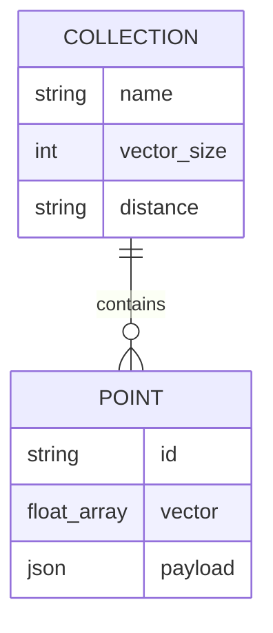
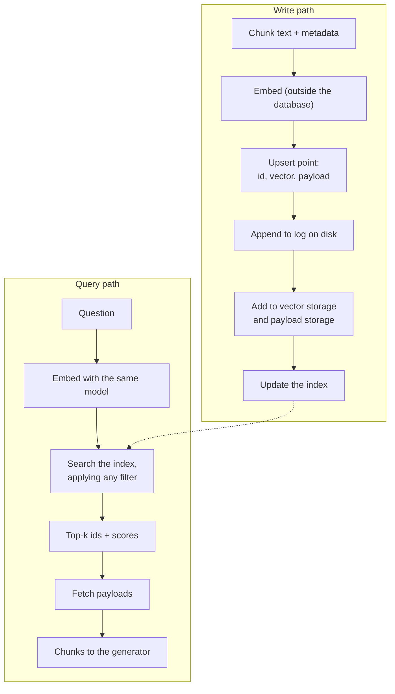

By now you can turn a chunk of text into an [embedding](/learn/embedding-fundamentals/what-are-embeddings): a list of a few hundred numbers whose direction encodes meaning. A RAG system produces one of these for every chunk it indexes, and at question time it needs the handful of stored vectors closest to the query's vector. Something has to hold those vectors, find the closest ones quickly, keep track of which document each came from, and survive being updated and restarted. That something is a **vector database**.

This lesson defines the term, shows what a vector database adds over a NumPy array, and maps the kinds of product that use the name. The rest of the module takes each responsibility in turn.

## Learning objectives

- Define a vector database and name the five responsibilities it has beyond storing an array.
- Describe the data model of a typical vector database: collection, point, identifier, vector and payload.
- Build a minimal in-memory vector store in Python and identify which production requirements it fails.
- Distinguish a vector search library, a vector extension to a general database and a dedicated vector database, and choose between them for a stated workload.
- Estimate the cost of exact search for a given collection size and explain why indexing becomes necessary.

## Prerequisites

- [What are embeddings?](/learn/embedding-fundamentals/what-are-embeddings): text as vectors whose geometry encodes meaning.
- [Indexing pipeline](/learn/rag-architecture-fundamentals/indexing-pipeline): where vectors are produced and written.
- [Retrieval pipeline](/learn/rag-architecture-fundamentals/retrieval-pipeline): where they are searched.
- [Query-document matching](/learn/rag-architecture-fundamentals/query-document-matching): scoring functions and cosine similarity.

## Why this matters

The first RAG prototype most engineers write keeps its embeddings in a Python list or a NumPy array and computes a cosine against every one of them. For a few thousand chunks this is fine; for a demo it is ideal. Then it meets production, and four problems appear.

**It gets slow.** Comparing a query with every stored vector costs time proportional to the number of vectors; at a few million chunks, every question scans gigabytes of memory. **It forgets.** The array lives in process memory, and re-embedding a corpus after a restart can take hours and cost real money. **It cannot change safely.** Documents are edited every day, and rebuilding the array for each change, or rewriting rows while another thread searches, is not a plan. **It cannot answer the questions people actually ask.** "The closest chunks, but only from the current handbook, only from documents this user may read" needs structured data next to every vector and a way to search with conditions.

A vector database exists to solve these four problems together. Choosing one, configuring it and operating it is therefore a core RAG engineering skill: when retrieval is slow, stale, leaks restricted documents or loses data after a restart, the cause is usually here.

## The intuition

Think of a large library that shelves its books not by author or title but by *subject*, so that books on similar topics sit physically close to each other. To find books about "working from home", you walk to the right part of the building and look along the nearby shelves. You do not read every spine in the library.

A vector database is that library for embeddings. Each book is a **point**: its position in the building is its vector, and its catalogue card is its **payload** (title, author, date, which collection it belongs to, who may borrow it). The library needs:

- **shelves** that hold millions of books compactly (vector storage);
- a **way to find the nearest shelves** to a subject without walking every aisle (an index);
- **catalogue cards** so you can say "only books published after 2024" (metadata and filtering);
- **a returns and acquisitions desk** to add, replace and withdraw books (create, read, update, delete);
- **a building that does not burn down** with the books inside (persistence).

A NumPy array is a pile of books on the floor with no catalogue: perfectly sensible for a pile of fifty.

## How it works

### A definition

A **vector database** is a data store whose primary query is **nearest-neighbour search**: given a query vector, return the stored items whose vectors are most similar to it under a chosen similarity measure, usually together with structured conditions on the items' other data. Around that query it provides the things any database provides: durable storage, inserts, updates and deletes, and concurrent access.

Two phrases in the definition carry most of the weight.

- **Nearest-neighbour search**, often written **k-nearest-neighbour** or **kNN** search, means "the $k$ most similar items". Exact kNN examines every vector. **Approximate nearest-neighbour (ANN)** search examines a cleverly chosen subset and may occasionally miss a true neighbour in exchange for a large speed-up. Almost every vector database at scale uses ANN.
- **A chosen similarity measure**: cosine similarity, dot product or Euclidean distance. You fix it when you create a collection, and it must match how the embedding model was trained. [Similarity search](/learn/vector-database-fundamentals/similarity-search) covers this choice.

### The data model

Product vocabularies differ, but nearly all vector databases share one model. This lesson uses Qdrant's terms because AskMeridian runs on Qdrant; the table gives the equivalents.

| Concept | Meaning | Qdrant | Other common names |
| --- | --- | --- | --- |
| Collection | A named set of points that share a vector size and similarity measure | collection | index (Pinecone, FAISS), class (Weaviate), table (pgvector) |
| Point | One stored item | point | record, vector, object, row |
| Identifier | A unique key for the point | id (integer or UUID) | id, primary key |
| Vector | The embedding | vector | embedding, values |
| Payload | Structured data attached to the point | payload | metadata, properties, attributes, columns |



In a RAG system a point is almost always one **chunk**. Its vector is the chunk's embedding; its payload holds the chunk's text (or a pointer to it), the identifier of its source document, its position in that document, and fields used for filtering and citation, such as the document's title, owner, version and access-control list. [Metadata](/learn/vector-database-fundamentals/metadata) designs that payload in detail.

All vectors in one collection must have the same number of dimensions and must come from the same embedding model. A vector from `all-MiniLM-L6-v2` (384 dimensions) and one from a 1,024-dimension model cannot be compared at all, and two 384-dimension vectors from *different* models can be compared arithmetically but the result is meaningless, because each model arranges its space differently.

### The five responsibilities

Everything a vector database does beyond holding an array falls under five headings. Each is the subject of a later lesson in this module.

1. **Store vectors compactly and accessibly.** Millions of vectors of hundreds of 32-bit numbers each are gigabytes of data, and search reads them constantly. How they are laid out in memory and on disk, and whether they are compressed, decides cost and speed. See [Vector storage](/learn/vector-database-fundamentals/vector-storage).
2. **Find nearest neighbours fast.** Exact search is a scan; production systems build an **index** (a data structure such as a graph or a set of clusters) that narrows the search to a small fraction of the vectors. See [Similarity search](/learn/vector-database-fundamentals/similarity-search) and [Indexing](/learn/vector-database-fundamentals/indexing).
3. **Keep structured data beside each vector and search with conditions.** See [Metadata](/learn/vector-database-fundamentals/metadata) and [Filtering](/learn/vector-database-fundamentals/filtering).
4. **Accept changes.** Insert, update and delete points while queries continue, without rebuilding everything. See [CRUD operations](/learn/vector-database-fundamentals/crud-operations).
5. **Survive failure.** Persist data so that a crash or restart loses nothing that was acknowledged. See [Persistence](/learn/vector-database-fundamentals/persistence).

At larger scale, a sixth group appears: replication, sharding, multi-tenancy and backups. Those belong to [Advanced vector database engineering](/learn/advanced-vector-database-engineering) later in this phase.

### What happens on a write and on a query

The two paths through a vector database mirror the [offline and online halves](/learn/rag-architecture-fundamentals/offline-and-online-processing) of a RAG system.



On the **write path**:

1. The application embeds the chunk. Most vector databases do not embed text themselves (some offer optional integrations), so the embedding model is your responsibility and its choice must be recorded.
2. The application sends an **upsert**: "insert this point, or replace it if the identifier already exists".
3. The database records the change durably, typically by appending it to a log on disk before acknowledging it.
4. It places the vector in vector storage and the payload in payload storage.
5. It updates the index, immediately or in the background; well-designed databases scan the not-yet-indexed portion meanwhile, so recent writes stay visible.

On the **query path**:

1. The application embeds the question with the same model.
2. The database searches the index for the nearest vectors, applying any filter conditions as it goes.
3. It returns the top-$k$ identifiers with their similarity scores.
4. It fetches the payloads of those points, so the application receives the chunk text and metadata in the same response.

### The landscape: three kinds of product

The phrase "vector database" is used loosely for three different kinds of software. Knowing which kind you are looking at tells you which of the five responsibilities you will have to handle yourself.

**Vector search libraries.** FAISS (from Meta), hnswlib, Annoy and ScaNN are libraries you link into your own process. They are superb at responsibility 2, building and searching indexes (on GPUs too, for FAISS), and mostly leave the rest (payloads, arbitrary filters, durable incremental updates, concurrency) to you.

**Vector extensions to general-purpose databases.** pgvector adds a vector column type, distance operators and approximate indexes to PostgreSQL. Elasticsearch, OpenSearch and Redis have added vector fields to their existing engines, and several other databases have done the same. You get the host database's mature persistence, transactions, backups and access control, and you can join vectors with ordinary tables in one query. The trade-off is that vector search is one feature among many, and its performance and tuning options depend on how the host engine implements it.

**Dedicated vector databases.** Qdrant, Milvus, Weaviate, Chroma and the managed service Pinecone are built around nearest-neighbour search with payloads. They provide all five responsibilities, usually with payload indexes designed to make filtered vector search fast, and they run as a separate service (or, for Chroma, Qdrant's local mode and some others, embedded in your process for development).

The individual products are the subject of the next module, [Vector database ecosystem](/learn/vector-database-ecosystem). Here, what matters is the shape of the decision:

| Situation | Usually a good fit |
| --- | --- |
| Offline experiment, static corpus, one process | A library (FAISS) or plain NumPy |
| You already run PostgreSQL and have up to a few million chunks | pgvector |
| You already run Elasticsearch or OpenSearch for keyword search | Its vector fields, to keep hybrid search in one engine |
| Heavy filtering, frequent updates, tens of millions of vectors or more | A dedicated vector database |
| No wish to operate infrastructure | A managed service |

These are starting points, not rules; benchmark your own data, filters and query rate.

> [!KEY]
> A vector database is not "a place to put embeddings". It is a database whose main query is nearest-neighbour search with conditions, and it has all the obligations of a database: durability, updates, concurrency and access control.

## The mathematics

There is one calculation every engineer should be able to do in their head: the cost of exact search, which is what an index exists to avoid.

**Intuition.** Exact search compares the query with every stored vector. Each comparison is a dot product: one multiplication and one addition per dimension. So the work is the number of vectors times the number of dimensions, and the memory read is the same count times the bytes per number.

$$
\text{FLOPs per query} \approx 2 N d, \qquad \text{bytes read per query} \approx N d b
$$

$N$ is the number of stored vectors, $d$ the number of dimensions, $b$ the bytes per component (4 for 32-bit floats), and a FLOP is one floating-point operation (the factor 2 counts the multiply and the add).

**By hand.** AskMeridian has about 200,000 chunks (an assumption for this example) with $d = 384$:

- Work: $2 \times 200{,}000 \times 384 = 153{,}600{,}000 \approx 1.5 \times 10^8$ FLOPs.
- Memory read: $200{,}000 \times 384 \times 4 = 307{,}200{,}000$ bytes $\approx 307$ MB.

A modern CPU core can do several billion simple floating-point operations per second with vector instructions, but reading 307 MB from main memory is the real limit: at an assumed memory bandwidth of 20 GB/s for one core, that is about $0.307 / 20 \approx 15$ ms. Fine for one query. At 100 queries per second it is 1.5 seconds of scanning every second, beyond what one core can do. Now scale to 50 million chunks and a single query reads about 77 GB, which does not even fit in a typical server's memory. That is the arithmetic behind indexes.

```python
N, d, b = 200_000, 384, 4
bandwidth = 20e9  # bytes per second, an assumed figure for one core

flops = 2 * N * d
bytes_read = N * d * b
print(f"FLOPs per query:   {flops:,}")
print(f"bytes per query:   {bytes_read:,} ({bytes_read / 1e6:.0f} MB)")
print(f"memory-bound time: {bytes_read / bandwidth * 1000:.1f} ms")
print(f"50M chunks:        {50_000_000 * d * b / 1e9:.1f} GB per query")
```

```output
FLOPs per query:   153,600,000
bytes per query:   307,200,000 (307 MB)
memory-bound time: 15.4 ms
50M chunks:        76.8 GB per query
```

## In code

**The problem.** Build the smallest thing that deserves the name "vector store": points with identifiers, vectors and payloads; upsert and delete; exact cosine search with an optional metadata condition. Then run the same search in a real vector database and compare. Building it yourself shows exactly what the real thing must do better.

**Dependencies.** NumPy, sentence-transformers (for real embeddings; the model downloads once, about 90 MB) and qdrant-client (whose `:memory:` mode runs in-process with no server).

```bash
pip install numpy sentence-transformers qdrant-client
```

```python
import numpy as np
from sentence_transformers import SentenceTransformer


class TinyVectorStore:
    """A deliberately minimal vector database: ids, vectors, payloads, exact search."""

    def __init__(self, dim: int):
        self.dim = dim
        self.ids: list[str] = []
        self.vectors = np.empty((0, dim), dtype=np.float32)
        self.payloads: list[dict] = []

    def upsert(self, point_id: str, vector, payload: dict) -> None:
        v = np.asarray(vector, dtype=np.float32)
        if v.shape != (self.dim,):
            raise ValueError(f"expected {self.dim} dimensions, got {v.shape}")
        v = v / np.linalg.norm(v)                      # store unit vectors: cosine = dot
        if point_id in self.ids:                       # update in place
            i = self.ids.index(point_id)
            self.vectors[i], self.payloads[i] = v, payload
        else:                                          # insert at the end
            self.ids.append(point_id)
            self.vectors = np.vstack([self.vectors, v])
            self.payloads.append(payload)

    def delete(self, point_id: str) -> None:
        i = self.ids.index(point_id)
        self.ids.pop(i)
        self.payloads.pop(i)
        self.vectors = np.delete(self.vectors, i, axis=0)

    def search(self, query, k: int = 3, where: dict | None = None):
        q = np.asarray(query, dtype=np.float32)
        q = q / np.linalg.norm(q)
        scores = self.vectors @ q                      # one dot product per stored vector
        if where:                                      # exact-match metadata filter
            keep = np.array([all(p.get(f) == v for f, v in where.items()) for p in self.payloads])
            scores = np.where(keep, scores, -np.inf)
        top = np.argsort(-scores)[:k]
        return [(self.ids[i], float(scores[i]), self.payloads[i]) for i in top if np.isfinite(scores[i])]


chunks = {
    "hb-leave":    ("Annual leave is 25 days; up to 5 unused days carry over to 31 March.", "handbook"),
    "hb-remote":   ("Staff may work remotely up to 3 days a week; the equipment budget is £400.", "handbook"),
    "hb-expenses": ("Submit expenses within 30 days; anything over £75 needs a receipt.", "handbook"),
    "rb-password": ("Passwords must be rotated every 90 days.", "runbook"),
    "rb-vpn":      ("VPN is required on public Wi-Fi.", "runbook"),
    "rb-laptop":   ("Laptops are refreshed every 3 years; report a lost laptop to the support desk at once.", "runbook"),
}

model = SentenceTransformer("sentence-transformers/all-MiniLM-L6-v2")
texts = [text for text, _ in chunks.values()]
vectors = model.encode(texts, normalize_embeddings=True)   # shape (6, 384), float32
store = TinyVectorStore(dim=vectors.shape[1])

for (chunk_id, (text, source)), vec in zip(chunks.items(), vectors):
    store.upsert(chunk_id, vec, {"source": source, "text": text})

def show(title, hits):
    print(title)
    for chunk_id, score, payload in hits:
        print(f"  {score:.3f}  {chunk_id:<12} [{payload['source']}]")

q = model.encode("How many days of holiday do I get?", normalize_embeddings=True)
show("Q1 holiday, all sources:", store.search(q, k=3))

q = model.encode("Is it safe to use the coffee shop internet?", normalize_embeddings=True)
show("Q2 coffee-shop Wi-Fi, runbooks only:", store.search(q, k=2, where={"source": "runbook"}))

store.upsert("hb-leave", model.encode(
    "Annual leave is 25 days a year. Up to 5 unused days carry over and must be used by 31 March.",
    normalize_embeddings=True), {"source": "handbook", "text": "reworded leave policy"})
store.delete("rb-laptop")
print(f"after update and delete: {len(store.ids)} points, matrix shape {store.vectors.shape}")
```

```output
Q1 holiday, all sources:
  0.452  hb-leave     [handbook]
  0.287  hb-remote    [handbook]
  0.265  hb-expenses  [handbook]
Q2 coffee-shop Wi-Fi, runbooks only:
  0.259  rb-vpn       [runbook]
  0.155  rb-laptop    [runbook]
after update and delete: 5 points, matrix shape (5, 384)
```

**The important lines.**

- `v = v / np.linalg.norm(v)` normalises every vector on the way in. Once all stored vectors and the query have length 1, a plain dot product *is* the cosine similarity, so search is a single matrix-vector product. Real databases configured for cosine do the same.
- `self.vectors @ q` is the entire search: one dot product per stored vector. It is exact, and its cost grows linearly with the number of points, as the mathematics section computed.
- The `where` filter sets the scores of non-matching points to minus infinity before sorting, so they can never be returned. This is a correct but naive form of filtering; [Filtering](/learn/vector-database-fundamentals/filtering) shows why the order of "filter" and "search" matters once an index is involved.
- `upsert` replaces the vector *and* the payload when the identifier exists. That is what makes re-ingesting a changed document safe, provided identifiers are stable.

**What the output means.** Query 1 never says "annual leave", yet the leave chunk comes first, because the embedding places "holiday" near "annual leave". Query 2 says "coffee shop internet", and the runbook filter restricts the candidates to the three runbook chunks before ranking; the VPN rule wins. The scores are modest (0.452, 0.259): this model's cosines between a question and its answer are often in that range, which is why a fixed score threshold copied from elsewhere is unreliable. After the update and the delete there are five points.

### The same thing in a real vector database

Here is query 2 in Qdrant, running in-process with `:memory:`.

```python
from qdrant_client import QdrantClient, models
from sentence_transformers import SentenceTransformer

chunks = {
    1: ("Annual leave is 25 days; up to 5 unused days carry over to 31 March.", "handbook"),
    2: ("Staff may work remotely up to 3 days a week; the equipment budget is £400.", "handbook"),
    3: ("Submit expenses within 30 days; anything over £75 needs a receipt.", "handbook"),
    4: ("Passwords must be rotated every 90 days.", "runbook"),
    5: ("VPN is required on public Wi-Fi.", "runbook"),
    6: ("Laptops are refreshed every 3 years; report a lost laptop to the support desk at once.", "runbook"),
}
model = SentenceTransformer("sentence-transformers/all-MiniLM-L6-v2")
vectors = model.encode([t for t, _ in chunks.values()], normalize_embeddings=True)

client = QdrantClient(":memory:")          # embedded, in-process; nothing is written to disk
client.create_collection(
    collection_name="askmeridian",
    vectors_config=models.VectorParams(size=vectors.shape[1], distance=models.Distance.COSINE),
)
client.upsert(
    collection_name="askmeridian",
    points=[
        models.PointStruct(id=pid, vector=vec.tolist(), payload={"source": src, "text": text})
        for (pid, (text, src)), vec in zip(chunks.items(), vectors)
    ],
)
hits = client.query_points(
    collection_name="askmeridian",
    query=model.encode("Is it safe to use the coffee shop internet?", normalize_embeddings=True).tolist(),
    query_filter=models.Filter(must=[models.FieldCondition(key="source", match=models.MatchValue(value="runbook"))]),
    limit=2,
).points
for h in hits:
    print(f"{h.score:.3f}  id={h.id}  {h.payload['text']}")
```

```output
0.259  id=5  VPN is required on public Wi-Fi.
0.155  id=6  Laptops are refreshed every 3 years; report a lost laptop to the support desk at once.
```

The scores match the toy store, because both do exact cosine search over the same vectors. The difference is what you did not write: enforced vector size and metric, durable upserts (with a server or a path), filtering inside the engine, and an index for millions of points.

**Errors people commonly hit.**

- `ValueError` or a "wrong vector dimension" error on upsert: the embedding model changed but the collection was created for the old size. Collections are tied to one model; create a new collection for a new model.
- Using a string such as `"hb-leave"` as a Qdrant point id. Qdrant accepts only unsigned integers and UUIDs; keep a human-readable key in the payload or derive a UUID from it, as [CRUD operations](/learn/vector-database-fundamentals/crud-operations) shows.
- Forgetting that `:memory:` loses everything when the process exits; use `QdrantClient(path="...")` or a server URL.

**Extending it.** Time `search` at 10,000, 100,000 and 1,000,000 random vectors and confirm linear growth. Note the hidden cost in `upsert`: `np.vstack` copies the whole matrix on every insert, so $N$ single inserts cost on the order of $N^2$ copies. Real engines append to pre-allocated segments, the subject of the next lesson.

## A real-world example

Meridian's Platform team built the first version of AskMeridian in a fortnight. Embeddings for the employee handbook and IT runbooks lived in a NumPy array pickled to disk by a nightly job, with a parallel Python list of chunk texts. It answered questions well, and the team moved on.

Three incidents followed in the first quarter. First, HR corrected the remote-work policy, but the assistant kept quoting the old text until the next nightly rebuild, and the support desk fielded a day of confused questions. Second, a deploy restarted the service while the nightly job was still writing the pickle file; the service loaded a half-written file, failed to start, and stayed down until someone re-ran the job by hand. Third, the IT team asked for some runbooks to be visible only to IT staff. The array had no place to record who could see what, so the only option was to filter after search, which sometimes returned fewer than the five chunks the prompt expected, and occasionally none.

None of these were embedding or prompt problems. Each was a missing responsibility: immediate updates, crash-safe writes, and conditions on structured data. The team moved the index to Qdrant, upserted changed chunks with stable identifiers, stored source document, version and permitted groups in each payload, and applied permission filters inside the search. Their write-up was short: the array was a cache, and they had been treating it as a database.

## Common mistakes

- **Treating the vector database as the system of record.** Source documents belong in their source systems; the vector index is derived data. If you cannot rebuild it from source, a corruption or a model change becomes a disaster.
- **Mixing embedding models in one collection.** Vectors from different models live in unrelated spaces. Search still returns results, with scores that mean nothing, and no error is raised.
- **Choosing a product by benchmark headline.** Published figures use someone else's data, hardware and recall target.
- **Assuming a search library is a database.** FAISS will not store your payloads, enforce access control or survive a crash mid-write. Using it in production means writing those parts yourself.
- **Adding a dedicated service too early.** For a few thousand static chunks, an array or pgvector is simpler and just as fast.

## Best practices

- Decide the embedding model, vector size and similarity measure first, and create the collection from that decision. Name collections so the model is visible, for example `handbook_minilm_v1`.
- Give every point a **stable identifier** derived from its source (document id plus chunk position, or a hash of them), so that re-ingesting a document replaces its points instead of duplicating them.
- Store enough payload to cite and filter: source document id, title, chunk position, version, and access-control fields. Keep the source text retrievable from the payload or by id.
- Keep the ability to rebuild the whole collection from source documents with one command. Test it before you need it.
- Prototype with an embedded mode and the same client library you will use in production.
- Measure retrieval quality (recall against a labelled set) as well as latency whenever you change the database, its index settings or its filters.

## Performance considerations

The mathematics section gave the core numbers: exact search reads $N \times d \times 4$ bytes per query. Three consequences follow.

**Memory is the first budget.** One million 384-dimension float32 vectors occupy about 1.5 GB; at 1,536 dimensions, about 6.1 GB, before any index structure or payload. An approximate index such as HNSW adds its own graph on top. Whether everything must sit in RAM, or can live on disk with only the hot parts in memory, is a major cost lever, discussed in [Vector storage](/learn/vector-database-fundamentals/vector-storage).

**Exact search scales linearly; indexes scale far better.** Up to roughly a few hundred thousand vectors, a flat scan on one machine is often fast enough, and it has perfect recall. Beyond that, an ANN index cuts the vectors examined per query by orders of magnitude, at the cost of build time, extra memory and a small loss of recall. [Indexing](/learn/vector-database-fundamentals/indexing) introduces the trade-off.

**The database is rarely the slowest stage, but it is the one that grows.** Embedding the query and generating the answer typically take longer than a well-indexed search, but only the search grows with the corpus.

## Security considerations

A vector database holds a derived copy of every document you indexed, often including the chunk text in the payload. Treat it with the same access controls as the source systems: authentication on the API, network isolation, and encryption at rest where the deployment supports it. Embeddings themselves are not a safe anonymisation of text; research on embedding inversion has shown that a surprising amount of the original text can be recovered from some embedding models' vectors, so do not assume that a leaked vector store leaks "only numbers".

Permissions are the other half. A similarity search ranks every point it can see; it has no idea who is asking. Per-user access must be enforced as a filter inside the query (or by separate collections), never by trusting the application to discard results afterwards. [Document-level permissions](/learn/access-control-and-privacy/document-level-permissions) develops this.

## Summary

- A vector database is a data store whose main query is nearest-neighbour search under a chosen similarity measure, usually combined with conditions on structured data, wrapped in the usual database guarantees.
- Its data model is a collection of points; each point has an identifier, a vector and a payload. In RAG, a point is a chunk.
- Beyond holding an array, it must store vectors compactly, search them fast through an index, keep and filter on metadata, accept updates, and persist data safely.
- Libraries (FAISS), extensions (pgvector, Elasticsearch, OpenSearch, Redis) and dedicated databases (Qdrant, Milvus, Weaviate, Chroma, Pinecone) cover those responsibilities to different degrees.
- Exact search costs about $2Nd$ operations and $Nd \cdot 4$ bytes read per query; at millions of vectors that motivates approximate indexes.
- The vector index is derived data: keep the source documents and the ability to rebuild it.

## Exercises

**1.** A collection holds 3 million chunks embedded at 768 dimensions in float32. How much memory do the raw vectors take, and roughly how long would one exact search take at an assumed 20 GB/s of memory bandwidth?

<details><summary>Show solution</summary>

Bytes: $3{,}000{,}000 \times 768 \times 4 = 9{,}216{,}000{,}000 \approx 9.2$ GB. One exact search reads all of it: $9.2 / 20 \approx 0.46$ seconds per query on one core, before any sorting. That is too slow for an interactive assistant at any real query rate, so an approximate index (or heavy parallelism) is required.

</details>

**2.** Extend `TinyVectorStore` with a `get(point_id)` method that returns the stored vector and payload, and a `count()` method. Then explain why `search` would become wrong if two different chunks were upserted with the same identifier.

<details><summary>Show solution</summary>

```python
def get(self, point_id: str):
    i = self.ids.index(point_id)
    return self.vectors[i], self.payloads[i]

def count(self) -> int:
    return len(self.ids)
```

`upsert` treats an existing identifier as "replace". If two distinct chunks share an identifier, the second silently overwrites the first, so the first chunk disappears from search with no error. Identifiers must be unique per chunk and stable across re-ingestion, for example `f"{document_id}#{chunk_index}"`.

</details>

**3.** For each workload, choose a library, an extension or a dedicated database, and justify it in two sentences: (a) a research notebook comparing five embedding models on a fixed 50,000-chunk dataset; (b) an internal tool at a company whose product already runs on PostgreSQL, with 300,000 chunks updated hourly and permissions stored in existing tables; (c) a multi-tenant SaaS assistant with 80 million chunks, per-tenant filters on every query and continuous ingestion.

<details><summary>Show solution</summary>

(a) **A library or plain NumPy.** The data is static and small, nothing needs to survive between runs, and exact search over 50,000 vectors takes milliseconds, so a database adds only overhead.

(b) **pgvector.** The permissions already live in PostgreSQL, so a single SQL query can join vector search with the permission tables, and the team inherits PostgreSQL's backups and transactions. At 300,000 chunks, an HNSW index in pgvector is comfortably within its range.

(c) **A dedicated vector database (self-hosted or managed).** Eighty million vectors with a filter on every query and continuous writes is exactly the workload these systems optimise for, with payload indexes, sharding and multi-tenancy features. The extra service is justified by the scale.

</details>

**4.** Design question. AskMeridian is about to switch from `all-MiniLM-L6-v2` (384 dimensions) to a 1,024-dimension model. List the steps to make the switch without downtime and without ever serving mixed results.

<details><summary>Show solution</summary>

1. Create a **new collection** for 1,024 dimensions, named so the model is visible.
2. Re-embed every chunk from the **source documents** (old vectors cannot be converted) and upsert into it with the same identifiers and payloads, while still serving from the old collection and sending ongoing changes to **both**.
3. Compare recall of the two collections on a labelled query set.
4. Switch the query path to the new model **and** the new collection in one configuration change (an alias makes this atomic), and keep the old collection for a rollback window.

The rule that must never be broken: the query is always embedded with the same model that built the collection being searched.

</details>

## Check your understanding

```quiz
[
  {"q": "Which statement best describes a vector database?", "options": ["A file format for saving NumPy arrays", "A data store whose main query is nearest-neighbour search, usually with conditions on metadata, plus durability and updates", "An embedding model hosted behind an API", "A cache that stores LLM responses"], "answer": 1, "why": "Its defining query is nearest-neighbour search with conditions, and it carries the usual database obligations of persistence, updates and concurrency."},
  {"q": "In Qdrant's data model, what is a payload?", "options": ["The structured data, such as source and permissions, attached to a point", "The compressed form of the vector", "The query vector sent at search time", "The index graph built over the vectors"], "answer": 0, "why": "A point has an id, a vector and a payload; the payload holds metadata used for filtering and citation."},
  {"q": "Two collections both use 384-dimension vectors, but from different embedding models. What happens if you search one with a query embedded by the other model?", "options": ["The database rejects the query", "Results are correct but slower", "The search runs and returns scores, but the ranking is meaningless", "The database converts the query automatically"], "answer": 2, "why": "The arithmetic works because the sizes match, but each model arranges its space differently, so similarities across models carry no meaning and no error is raised."},
  {"q": "Exact search over 1 million 768-dimension float32 vectors reads about how much memory per query?", "options": ["3 MB", "31 MB", "307 MB", "3.1 GB"], "answer": 3, "why": "1,000,000 x 768 x 4 bytes = 3.072 GB, all of which an exact scan must read."},
  {"q": "Which responsibility does FAISS, used on its own, handle best?", "options": ["Building and searching nearest-neighbour indexes", "Durable logging of every write before acknowledgement", "Per-user access control on points", "Storing and filtering arbitrary JSON payloads"], "answer": 0, "why": "FAISS is a search library: excellent at indexes and search, while payloads, durability and access control are left to the application."}
]
```

## Further reading

- Qdrant documentation, "Concepts": collections, points, payloads and search. [qdrant.tech/documentation](https://qdrant.tech/documentation/)
- Johnson, Douze and Jégou (2017), *Billion-scale similarity search with GPUs*, the paper behind FAISS. [arXiv:1702.08734](https://arxiv.org/abs/1702.08734)
- FAISS repository and wiki, for the library view of vector search. [github.com/facebookresearch/faiss](https://github.com/facebookresearch/faiss)
- pgvector README, for the extension approach inside PostgreSQL. [github.com/pgvector/pgvector](https://github.com/pgvector/pgvector)
- Pan, Wang and Li (2023), *Survey of Vector Database Management Systems*, a broad academic overview of the design space (arXiv 2310.14021).
