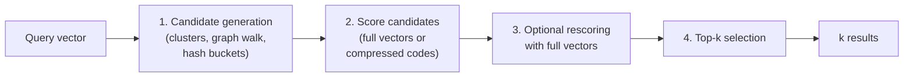

The earlier lessons in this module each described one index: [flat](/learn/vector-indexing-algorithms/flat-indexes), [IVF](/learn/vector-indexing-algorithms/ivf), [HNSW](/learn/vector-indexing-algorithms/hnsw), [product quantisation](/learn/vector-indexing-algorithms/product-quantisation) and [scalar quantisation](/learn/vector-indexing-algorithms/scalar-quantisation). This lesson steps back and looks at what they have in common. **Approximate nearest neighbour (ANN) search** is the deliberate decision to accept a search that is usually, but not always, exactly right, in exchange for examining a tiny fraction of the collection.

You will learn how the bargain is defined precisely, how its quality is measured, the four families of technique that make it possible and how they combine, and what an approximate miss actually means for a RAG system. The worked example builds locality-sensitive hashing from scratch, because it shows the probability at the heart of ANN most plainly.

## Learning objectives

- Define the k-nearest-neighbour problem and its approximate version, and compute recall@k of an ANN result against exact ground truth.
- Describe the candidate-generation and rescoring pattern shared by ANN indexes, and place hashing, trees, partitioning and graphs within it.
- Calculate the probability that random-hyperplane hashing makes a point a candidate, for given numbers of bits and tables.
- Distinguish an ANN miss from a relevance miss in a RAG system, and design a check that tells them apart.
- Decide when approximate search is appropriate and when exact search should be used instead.

## Prerequisites

- [Similarity search](/learn/vector-database-fundamentals/similarity-search): exact kNN, scores and top-k selection.
- [Indexing](/learn/vector-database-fundamentals/indexing): why databases build index structures at all.
- [Flat indexes](/learn/vector-indexing-algorithms/flat-indexes): the cost of scanning everything.
- [IVF](/learn/vector-indexing-algorithms/ivf) and [HNSW](/learn/vector-indexing-algorithms/hnsw): the two index structures you will meet most often.

## Why this matters

A flat scan touches every vector for every query. As [Flat indexes](/learn/vector-indexing-algorithms/flat-indexes) showed, its cost is roughly the size of the collection divided by memory bandwidth, so latency grows in step with the corpus. Ten million 768-dimension float32 vectors are about 31 GB; scanning them for every question is too slow for an interactive assistant and far too expensive at high query rates.

ANN indexes make search cost grow much more slowly than the corpus. The price is that the index may return a list that is not quite the true top $k$. That price is invisible unless you measure it. A RAG system with a badly tuned index does not raise an error; it returns five plausible chunks, one of which should have been a different, better chunk, and the generated answer is subtly worse. Engineers who do not understand the bargain make two opposite mistakes: they treat the index as exact and blame the embedding model for misses the index caused, or they distrust ANN entirely and pay for exact search they do not need. Understanding ANN as one family also lets you read any vector database's documentation quickly: the products use different names for the same few knobs.

## The intuition

Imagine finding the ten books in a large library most similar to one you are holding. Comparing with every book on every shelf gives the right answer, slowly. There are four shortcuts.

- **Go to the right section.** The library is organised by subject. Walk to the two or three sections that best match your book and compare only with the books there. You might miss a relevant book that was shelved in a neighbouring section. This is **partitioning**, and it is what IVF does.
- **Follow the "see also" notes.** Each book lists a few similar books. Start anywhere, keep moving to whichever listed book is more similar to yours, and stop when no note leads anywhere better. You might get stuck in a corner of the library. This is **graph search**, and it is what HNSW does.
- **Use a coarse label.** Give every book a short code made of yes/no answers ("has diagrams?", "longer than 300 pages?", "mentions finance?"). Only compare with books whose code matches yours exactly. Two similar books will usually share a code, but sometimes one answer flips. This is **hashing**.
- **Read the summary card, not the book.** Compare with a short summary of each book, then read in full only the few that look promising. This is **compression**, and it combines with any of the other three.

Each shortcut examines far fewer books, and each can miss. The engineering question is never "is it exact?" but "how often does it miss, and how much time does it save?"

## How it works

### The problem, stated precisely

Let the collection be $N$ vectors $x_1, \dots, x_N$ in $d$ dimensions, and let $\text{sim}(q, x)$ be the similarity the collection was configured with (cosine, inner product, or negative Euclidean distance). The **k-nearest-neighbour (kNN)** problem is: given a query $q$, return the $k$ indices with the highest similarity. The answer is unique up to ties, and a flat scan always finds it.

An **approximate** nearest-neighbour search returns $k$ indices that are allowed to differ from the true set. There are two common ways to say how far they may differ.

- **The theoretical definition** (the **c-approximate** nearest neighbour). The returned point must be within a factor $c > 1$ of the best distance: if the true nearest neighbour is at distance $r$, any point within $c \cdot r$ is acceptable. This is the definition used in the theory of locality-sensitive hashing, and it gives worst-case guarantees.
- **The practical definition** (**recall@k**). Compute the exact top $k$ (the **ground truth**) for a set of test queries, and report what fraction of those true neighbours the index returned. A recall@10 of 0.95 means that, on average, 9.5 of the true 10 were found.

Practitioners use recall@k almost exclusively, because it measures what users experience and because real indexes such as HNSW do not come with useful worst-case guarantees. Note the difference from the [Recall@K](/learn/retrieval-fundamentals/recall-k) used in retrieval evaluation. That metric compares results with human relevance labels; ANN recall compares them with the exact search over the same vectors. An index can have perfect ANN recall and still return irrelevant chunks, because the embeddings put them nearest.

### Why exact shortcuts stop working

In two or three dimensions, a **k-d tree** finds exact neighbours much faster than a scan by skipping regions that provably cannot contain a closer point. In the hundreds of dimensions of text embeddings those proofs almost never succeed, so exact trees end up visiting nearly everything; [Exact nearest neighbour search](/learn/vector-indexing-algorithms/exact-nearest-neighbour-search) shows why. In high dimensions you can be exact or fast, but not reliably both.

### The common shape: generate candidates, then rescore

Almost every ANN index does the same two things.

1. **Generate candidates.** Use a cheap structure to pick a small subset of the collection that probably contains the true neighbours. IVF picks the vectors in the few nearest clusters; HNSW collects the nodes visited during a greedy walk; hashing picks the vectors whose hash matches the query's.
2. **Score candidates.** Compute the similarity between the query and each candidate. This may be exact (full-precision vectors) or approximate (compressed codes, as in product quantisation).
3. **Optionally rescore.** If step 2 used compressed codes, take the best few hundred, fetch their full-precision vectors and recompute exact similarities. This is often called **rescoring** or **refinement**.
4. **Select the top $k$** from the scored candidates, exactly as in a flat search.



Two numbers describe any run of this pipeline: the **fraction of the collection scored** (the work) and the **recall** (the quality). IVF's `nprobe` (clusters searched) and HNSW's `ef` (candidate list size during the walk) both widen candidate generation, raising recall and work together. The trade-off curve between them is the subject of [Recall versus latency](/learn/vector-indexing-algorithms/recall-versus-latency).

A miss can happen at two points. Either a true neighbour **never became a candidate** (a partitioning or navigation miss), or it was a candidate but its **approximate score ranked it too low** (a compression miss). Rescoring repairs the second kind but not the first. Diagnosing which kind you have tells you which knob to turn.

### The four families

| Family | How candidates are chosen | Typical examples | Main weakness |
| --- | --- | --- | --- |
| Hashing | Vectors whose hash code matches the query's | Random-hyperplane LSH; FAISS `IndexLSH` | Needs many tables, so much memory, for high recall |
| Trees | Leaves reached by descending one or more random-split trees | Annoy (random projection trees) | Many trees needed in high dimensions |
| Partitioning | Vectors in the clusters nearest the query | IVF, and its variants in most databases | Neighbours just across a cluster boundary are missed |
| Graphs | Nodes visited while greedily walking a neighbour graph | HNSW, Vamana (DiskANN) | Memory for the edges; slow, costly deletes |

**Compression** is not a fifth row but a second axis. Product and scalar quantisation make scoring cheaper and the index smaller, and they combine with any row: IVF with product quantisation (IVF-PQ) and HNSW over scalar-quantised vectors are both standard.

**Hashing** was the first family with strong theory: the idea of **locality-sensitive hashing (LSH)**, introduced by Indyk and Motwani in 1998, is a hash function under which similar vectors collide more often than dissimilar ones. It makes the probabilistic nature of ANN explicit, and it is still used for near-duplicate detection, where [MinHash](/learn/data-processing/duplicate-detection), a member of the same family, is standard. For dense-vector retrieval it has largely been overtaken by graphs and partitioning, which reach the same recall with less memory on real data. The code example below shows why.

**Trees** in ANN are not the exact k-d trees of low dimensions. Annoy, released by Spotify, builds a forest of trees that split the data with random hyperplanes and merges the leaves the query reaches in several trees; many random trees keep recall up where one would route the query away from its neighbours.

**Partitioning** clusters the collection with k-means and searches only the clusters nearest to the query. **Graphs** link each vector to some of its neighbours and walk the links. The [IVF](/learn/vector-indexing-algorithms/ivf) and [HNSW](/learn/vector-indexing-algorithms/hnsw) lessons cover both in depth. Graph indexes currently dominate in-memory serving in the vector databases you are likely to use, and partitioning with compression dominates when collections are too large for RAM or run on GPUs. Public benchmarks such as ANN-Benchmarks are a guide to what to try, not a verdict on your data.

```playground
vector-search
```

### What an approximate miss means in RAG

The embedding model is itself an approximation of relevance: its top 10 is the 10 chunks the model places closest, not the 10 most relevant. A recall@10 of 0.97 loses 3% of *nearest neighbours*, and only some of those are relevant. The drop in answer quality from exact search to a well-tuned ANN index is usually small compared with differences between embedding models or chunking strategies, but measure it on your own data rather than assume it.

Three properties of ANN misses deserve attention because they make the average misleading.

- **Misses are not random.** They concentrate on particular queries and particular points: vectors in sparse regions of the space, small clusters, or points at the boundary between partitions. A recall of 0.97 can mean that some queries always lose their best chunk.
- **Misses are usually deterministic.** The same query against the same index visits the same candidates, so the same chunk is missed every time. Retrying does not help.
- **Filters make misses worse.** When a metadata filter excludes most of the collection, the candidates the index generates may contain few points that pass the filter, so the search returns fewer than $k$ results or worse ones. Databases counter this in various ways, from filter-aware graph traversal to switching to an exact scan over the filtered subset. [Filtering](/learn/vector-database-fundamentals/filtering) and [Metadata filtering](/learn/advanced-vector-database-engineering/metadata-filtering) cover the mechanisms.

### When not to use ANN

Approximate search is a cost optimisation. Skip it when the cost does not exist or the approximation is not acceptable:

- **Small collections.** Below some tens of thousands of vectors, a flat scan costs about as much as the network round trip.
- **Heavily filtered queries.** If a filter leaves a few thousand points (one customer's documents, say), an exact scan of those is fast and avoids the filtering problems above.
- **Ground truth** for evaluating an index, and **audit requirements** where you must show the best-matching record was considered.

## The mathematics

### Recall@k

**Intuition.** Of the true top $k$, how many did the index return? Average over queries.

$$
\text{recall@}k = \frac{1}{|Q|} \sum_{q \in Q} \frac{|A_k(q) \cap G_k(q)|}{k}
$$

- $Q$ is the set of test queries and $|Q|$ their number.
- $A_k(q)$ is the set of $k$ indices returned by the approximate index for query $q$.
- $G_k(q)$ is the exact top $k$ (ground truth) for $q$.
- $|A_k(q) \cap G_k(q)|$ counts the true neighbours found. Order within the top $k$ is ignored.

**By hand.** Two queries, $k = 5$. For the first, the index returns 5 of the 5 true neighbours; for the second, 3 of 5. Recall@5 is $\frac{1}{2}\left(\frac{5}{5} + \frac{3}{5}\right) = 0.8$.

Near-duplicate chunks create ties that make ground truth ambiguous; [Exact nearest neighbour search](/learn/vector-indexing-algorithms/exact-nearest-neighbour-search) shows how to handle them.

### Random-hyperplane hashing

**Intuition.** Pick a random direction $r$. Every vector lies on one side or the other of the plane perpendicular to $r$. Two vectors pointing in nearly the same direction usually fall on the same side; two vectors at right angles fall on the same side only half the time. Repeat with $K$ directions and you get a $K$-bit code in which similar vectors tend to agree.

The probability that one random hyperplane puts $x$ and $y$ on the same side depends only on the angle $\theta$ between them (a result used by Goemans and Williamson in 1995 and turned into a hash by Charikar in 2002):

$$
p = \Pr[\operatorname{sign}(r \cdot x) = \operatorname{sign}(r \cdot y)] = 1 - \frac{\theta}{\pi}, \qquad \theta = \arccos\big(\cos(x, y)\big)
$$

- $r$ is a random vector with independent standard normal components, so its direction is uniform.
- $\theta$ is the angle between $x$ and $y$, in radians; $\cos(x, y)$ is their cosine similarity.
- $p$ is the probability that one bit of the two codes agrees.

A single bit separates similar from dissimilar too weakly. LSH therefore **amplifies** the gap twice. Concatenating $K$ bits into one code (a bucket key) means two vectors share a bucket only if all $K$ bits agree, probability $p^K$; this sharply penalises dissimilar pairs but also hurts similar ones. Building $L$ independent tables and taking the union of the query's buckets gives a similar pair $L$ chances:

$$
P_{\text{candidate}} = 1 - \left(1 - p^{K}\right)^{L}
$$

- $K$ is the number of bits per table: larger $K$ makes buckets smaller and more selective.
- $L$ is the number of tables: larger $L$ raises the chance of at least one collision, at the cost of $L$ times the memory and lookups.

**By hand.** Take $K = 8$ and $L = 10$.

- A close pair with cosine 0.8: $\theta = \arccos 0.8 \approx 0.6435$ radians, so $p = 1 - 0.6435/3.1416 \approx 0.795$. Then $p^8 \approx 0.160$, and $P = 1 - (1 - 0.160)^{10} = 1 - 0.840^{10} \approx 1 - 0.175 = 0.825$.
- A distant pair with cosine 0.2: $\theta \approx 1.3694$, $p \approx 0.564$, $p^8 \approx 0.0103$, and $P = 1 - 0.9897^{10} \approx 0.098$.

So the close point becomes a candidate 82.5% of the time and the distant one under 10% of the time. The gap between 0.795 and 0.564 for one bit has become a gap between 0.825 and 0.098.

```python
import numpy as np

def p_candidate(cos, K, L):
    p = 1 - np.arccos(cos) / np.pi        # one hyperplane agrees
    return p, 1 - (1 - p**K) ** L         # all K agree in at least one of L tables

for cos in (0.8, 0.2):
    p, P = p_candidate(cos, K=8, L=10)
    print(f"cos={cos}: p={p:.3f}  p^8={p**8:.4f}  P(candidate)={P:.3f}")
```

```output
cos=0.8: p=0.795  p^8=0.1598  P(candidate)=0.825
cos=0.2: p=0.564  p^8=0.0103  P(candidate)=0.098
```

The formula also shows the weakness. Text embeddings of related chunks often have cosines of 0.5 to 0.7 rather than 0.9, and the gap between a true neighbour at 0.65 and a non-neighbour at 0.55 is small. Separating them needs large $K$, which then needs large $L$ to keep recall up, and every table stores all $N$ identifiers.

## In code

**The problem.** Build random-hyperplane LSH from scratch on 50,000 synthetic embeddings, measure recall@10 and the fraction of the collection scored for several values of $K$ and $L$, and compare with an HNSW index from FAISS. The data are clustered unit vectors (200 "topics", 128 dimensions), standing in for text embeddings so that the script runs in seconds with no model download.

**Dependencies.** NumPy and the CPU build of FAISS.

```bash
pip install numpy faiss-cpu
```

```python
import numpy as np
import faiss

rng = np.random.default_rng(42)
N, d, n_topics, n_queries, k = 50_000, 128, 200, 200, 10

# Synthetic "embeddings": points scattered around topic centres, unit length.
centres = rng.standard_normal((n_topics, d)).astype(np.float32)
def sample(n):
    labels = rng.integers(0, n_topics, n)
    x = centres[labels] + 0.9 * rng.standard_normal((n, d)).astype(np.float32)
    return (x / np.linalg.norm(x, axis=1, keepdims=True)).astype(np.float32)
X, Q = sample(N), sample(n_queries)          # database and held-out queries

# Ground truth: exact top-k by inner product (= cosine on unit vectors).
S = Q @ X.T
truth = np.argsort(-S, axis=1)[:, :k]
print(f"mean cosine of 1st / 10th true neighbour: {np.sort(S, axis=1)[:, -1].mean():.3f} / {np.sort(S, axis=1)[:, -k].mean():.3f}")

def recall(found):
    return np.mean([len(set(f) & set(t)) / k for f, t in zip(found, truth)])

# Random-hyperplane LSH: L tables, each hashing a vector to K sign bits.
def build_lsh(K, L):
    planes = rng.standard_normal((L, K, d)).astype(np.float32)
    weights = 1 << np.arange(K)                       # turn K bits into one integer
    tables = []
    for l in range(L):
        codes = ((X @ planes[l].T) > 0).astype(np.int64) @ weights
        table = {}
        for i, c in enumerate(codes):
            table.setdefault(c, []).append(i)
        tables.append(table)
    return planes, weights, tables

def search_lsh(index, q):
    planes, weights, tables = index
    cand = set()
    for l, table in enumerate(tables):
        code = int(((planes[l] @ q) > 0).astype(np.int64) @ weights)
        cand.update(table.get(code, []))
    cand = np.fromiter(cand, dtype=np.int64)
    if len(cand) == 0:
        return np.array([], dtype=np.int64), 0
    scores = X[cand] @ q                               # exact rescoring of candidates only
    return cand[np.argsort(-scores)[:k]], len(cand)

print(f"{'method':<22}{'recall@10':>10}{'scanned':>10}")
for K, L in [(8, 1), (8, 8), (8, 32), (12, 32), (12, 128)]:
    index = build_lsh(K, L)
    results = [search_lsh(index, q) for q in Q]
    r = recall([f for f, _ in results])
    scanned = np.mean([n for _, n in results]) / N
    print(f"{f'LSH K={K:<2} L={L}':<22}{r:>10.3f}{scanned:>10.1%}")

faiss.omp_set_num_threads(1)
hnsw = faiss.IndexHNSWFlat(d, 16, faiss.METRIC_INNER_PRODUCT)
hnsw.add(X)
for ef in (16, 64):
    hnsw.hnsw.efSearch = ef
    faiss.cvar.hnsw_stats.reset()
    _, I = hnsw.search(Q, k)
    scanned = faiss.cvar.hnsw_stats.ndis / n_queries / N
    print(f"{f'HNSW M=16 ef={ef}':<22}{recall(I):>10.3f}{scanned:>10.1%}")
```

```output
mean cosine of 1st / 10th true neighbour: 0.675 / 0.631
method                 recall@10   scanned
LSH K=8  L=1               0.084      0.5%
LSH K=8  L=8               0.476      3.5%
LSH K=8  L=32              0.908     13.0%
LSH K=12 L=32              0.477      1.1%
LSH K=12 L=128             0.921      4.1%
HNSW M=16 ef=16            0.855      0.6%
HNSW M=16 ef=64            0.992      0.9%
```

**The important lines.**

- `planes` holds $L \times K$ random Gaussian directions. `(X @ planes[l].T) > 0` gives each vector's $K$ sign bits for table $l$, and multiplying by `weights` (1, 2, 4, …) packs them into one integer bucket key.
- Each table is a dictionary from bucket key to the list of vector indices in that bucket. Every table holds all $N$ indices, so memory grows linearly with $L$.
- `search_lsh` takes the union of the query's buckets across tables (candidate generation), then scores only those candidates with full vectors (exact scoring) and keeps the top $k$.
- `faiss.cvar.hnsw_stats.ndis` counts the distance computations HNSW performed, which makes "fraction scanned" comparable between the two methods.
- The queries are held out from the data, like real user questions. Database vectors as queries flatter every index, because each one's nearest neighbour is itself.

**What the output means.**

- The first line sets the scene: true neighbours have cosines around 0.63 to 0.68. As the mathematics predicted, that is a hard regime for hyperplane hashing.
- With one table of 8 bits, LSH finds only 8% of the true neighbours. Adding tables raises recall exactly as $1 - (1 - p^K)^L$ says: 0.48 with 8 tables and 0.91 with 32. But 32 tables of 8 bits score 13% of the collection, a 7.7-fold saving over a flat scan, bought with 32 copies of the identifier list.
- Raising $K$ to 12 makes buckets more selective (1.1% scanned) but drops recall to 0.48; it takes 128 tables to bring it back above 0.9.
- HNSW reaches a recall of 0.99 while computing distances to under 1% of the collection, with one graph. This is why graph indexes displaced hashing for dense retrieval.

**Errors people commonly hit.**

- Generating hyperplanes from uniform numbers in $[0, 1)$ instead of Gaussian ones: the directions all fall in one orthant and the collision formula no longer holds.
- Forgetting to normalise vectors before using inner product in FAISS, which then ranks by raw dot product, not cosine.

**Extending it.** Implement **multi-probe LSH**: in each table, also look up the buckets whose codes differ from the query's in the bits whose projections were closest to zero. This raises recall with far fewer tables.

## A real-world example

Meridian's AskMeridian assistant answers from about 200,000 chunks in a Qdrant collection with an HNSW index. A product manager reported that the question "can I claim my home broadband as an expense?" kept producing the answer "I don't know", although a remote-work FAQ chunk clearly answered it. The Platform team's first theory was that the embedding model misunderstood the question, and someone proposed fine-tuning.

Before touching the model, an engineer ran the same query twice: once normally and once with `exact=True` in the search parameters, which makes Qdrant scan the collection instead of using the HNSW graph. The exact search returned the FAQ chunk at rank 3. The normal search did not return it at all. That single comparison changed the diagnosis from a relevance miss (the model ranks the chunk low) to an ANN miss (the model ranks it high but the index never visits it).

The cause was a filter restricting results to the current handbook version, which excluded about 85% of the collection; the graph walk spent most of its candidate budget on chunks the filter then rejected. Raising the search-time `hnsw_ef` fixed this query. The more general fix was a payload index on the version field, so that Qdrant's query planner could choose an exact scan when a filter selects few points, plus twenty filtered questions added to the nightly job that compares HNSW with exact search. The fine-tuning project was not needed.

The team's runbook now says: **when a chunk is missing, compare with exact search before blaming the model.**

## Common mistakes

- **Treating the ANN index as exact.** Missing chunks are blamed on the embedding model or chunking, and weeks go into fixing the wrong layer.
- **Testing with database vectors as queries.** Each finds itself, and recall looks perfect.
- **Confusing ANN recall with retrieval recall.** A team reports "recall 0.99" from an index benchmark, and everyone assumes retrieval quality is solved when the relevance recall is 0.7.
- **Tuning on the average only.** A good mean hides queries, often filtered ones, with very low recall.

## Best practices

- Keep an exact path available (a flat index, or an `exact` search option) for diagnosis and for computing ground truth.
- Build a recall test set from real, held-out queries, including filtered ones, and compute ground truth with exact search.
- Report the distribution of per-query recall (for example the 5th percentile), not just the mean.
- When a miss is reported, classify it: never a candidate (widen candidate generation), or a candidate scored too low (add rescoring).
- Measure end-to-end answer quality with and without ANN before deciding how much recall you need.

## Performance considerations

The cost of a query is roughly (number of candidates scored) × (cost of one score) plus the overhead of generating candidates. Exact search scores all $N$ vectors at $d$ multiply-adds each. An index that scores 1% of the collection does about one hundredth of the arithmetic, but not one hundredth of the latency: graph walks and cluster lookups access memory in a scattered order, which is slower per byte than a sequential scan, and every index has fixed overheads.

Take Meridian's collection: 200,000 vectors at 384 dimensions is $7.68 \times 10^7$ multiply-adds per exact query. An index scoring 1,500 candidates does about $5.8 \times 10^5$, 130 times less. At this size both are fast; the saving matters at tens of millions of vectors or thousands of queries per second.

Memory is the other budget: HNSW stores up to $2M$ neighbour identifiers per vector in its bottom layer, LSH stores $L$ copies of all identifiers, and compression shrinks vectors but usually keeps full vectors somewhere (often on disk) for rescoring. [Recall versus latency](/learn/vector-indexing-algorithms/recall-versus-latency) and [Index construction](/learn/vector-indexing-algorithms/index-construction) work through these costs.

## Security considerations

Search-time parameters such as `ef`, `nprobe` and $k$ control how much work a query does. If an API lets callers set them, one caller can ask for $k = 10{,}000$ with a very large `ef` and consume a large share of the server's CPU. Fix these parameters on the server or cap them.

Access-control filters must still be applied inside the search ([Filtering](/learn/vector-database-fundamentals/filtering)). With ANN, a restrictive permission filter can make a search return fewer or worse results, so test recall for users with narrow permissions too.

## Summary

- ANN search gives up the guarantee of returning the exact top $k$ in exchange for scoring only a small fraction of the collection.
- Its quality is measured by recall@k against exact ground truth on held-out queries, which is different from relevance recall.
- Almost every index generates candidates (hash buckets, tree leaves, clusters or a graph walk), scores them, optionally rescores with full vectors, and selects the top $k$.
- LSH makes the probability explicit: a candidate appears with probability $1 - (1 - p^K)^L$, which needs many tables when neighbours are only moderately similar; graphs and partitioning do better on real embeddings.
- ANN misses are deterministic and concentrated, often on filtered queries; compare with exact search before blaming the model.

## Exercises

**1.** An index returns these top-5 lists for three queries. The true top-5 sets are $\{1,2,3,4,5\}$, $\{6,7,8,9,10\}$ and $\{11,12,13,14,15\}$. The returned lists are $[1,2,3,4,5]$, $[6,7,8,20,21]$ and $[15,14,13,12,30]$. Compute recall@5 per query and overall.

<details><summary>Show solution</summary>

Query 1 finds 5 of 5 (1.0). Query 2 finds 6, 7 and 8 (0.6). Query 3 finds 15, 14, 13 and 12 (0.8); the order is reversed, but recall ignores order. The mean is $(1.0 + 0.6 + 0.8)/3 = 0.8$.

</details>

**2.** Using random-hyperplane LSH with $K = 8$, how many tables $L$ are needed for a pair with cosine 0.65 to become a candidate with probability at least 0.9? Compare your answer with the code output.

<details><summary>Show solution</summary>

$\theta = \arccos 0.65 \approx 0.863$ radians, so $p = 1 - 0.863/\pi \approx 0.725$ and $p^8 \approx 0.0764$. We need $1 - (1 - 0.0764)^L \geq 0.9$, that is $0.9236^L \leq 0.1$, so $L \geq \ln 0.1 / \ln 0.9236 \approx 2.303 / 0.0795 \approx 29$. So 29 tables. The code, whose true neighbours have cosines around 0.63 to 0.68, measured 0.908 with 32 tables, consistent with the formula.

</details>

**3.** Modify the code to compute per-query recall for HNSW with `efSearch = 16` and print the 5th percentile and the number of queries with recall below 0.5. What does this tell you that the mean of 0.855 does not?

<details><summary>Show solution</summary>

```python
hnsw.hnsw.efSearch = 16
_, I = hnsw.search(Q, k)
per_query = np.array([len(set(f) & set(t)) / k for f, t in zip(I, truth)])
print("mean", per_query.mean(), "p5", np.percentile(per_query, 5),
      "below 0.5:", int((per_query < 0.5).sum()))
```

```output
mean 0.855 p5 0.0 below 0.5: 17
```

The distribution is bimodal: 154 of the 200 queries have recall 0.9 or 1.0, but 17 have recall **zero**. On these clustered data, a greedy walk with a short candidate list sometimes settles in the wrong cluster and never finds any true neighbour. The mean of 0.855 suggests "fairly good"; the percentile shows that some users get nothing useful, every time. Tune against the low percentile, not only the mean.

</details>

**4.** Design decision. Meridian plans a contracts search over 3 million chunks, but every query is filtered to a single customer, and the largest customer has 40,000 chunks. Would you build a global ANN index, per-customer indexes, or something else? Justify with arithmetic.

<details><summary>Show solution</summary>

The filter is the dominant fact. Even the largest customer's subset of 40,000 vectors at 384 dimensions is $40{,}000 \times 384 \times 4 \approx 61$ MB, scanned exactly in a few milliseconds; most customers are far smaller. A global ANN index would spend its candidate budget on other customers' chunks, so it would need filter-aware search and careful testing to keep recall up.

A good design is to filter first and search exactly within the customer's subset, using a payload index on the customer field (or one collection or shard per customer if the database supports it efficiently; see [Multi-tenancy](/learn/advanced-vector-database-engineering/multi-tenancy)). This is exact, so there is no recall to monitor, and it isolates customers. Revisit the choice only if a single customer grows to millions of chunks, at which point that customer could get its own ANN index.

</details>

## Check your understanding

```quiz
[
  {
    "q": "An HNSW index reports recall@10 of 0.98. What exactly does that mean?",
    "options": [
      "98% of returned chunks are relevant to the user's question",
      "On average, 9.8 of the exact top 10 neighbours were returned",
      "98% of queries return results within the latency budget",
      "The top result is correct 98% of the time"
    ],
    "answer": 1,
    "why": "ANN recall compares the index's results with the exact top k for the same vectors. It says nothing about human relevance."
  },
  {
    "q": "A chunk is missing from search results. With exact search enabled it appears at rank 2. What kind of miss is this?",
    "options": [
      "A relevance miss: the embedding model ranks the chunk low",
      "A chunking miss: the chunk is too long",
      "An ANN miss: the model ranks it highly but the index did not find it",
      "A random miss that a retry would fix"
    ],
    "answer": 2,
    "why": "Exact search shows the model places the chunk near the query, so the index's approximation lost it. Retrying will not help; ANN misses are deterministic."
  },
  {
    "q": "In random-hyperplane LSH, what is the main effect of increasing the number of tables L while keeping K fixed?",
    "options": [
      "Buckets become smaller and more selective",
      "Recall rises, along with memory and the number of candidates scored",
      "The collision probability of a single bit increases",
      "Recall falls because more tables add noise"
    ],
    "answer": 1,
    "why": "Each extra table is another independent chance for a near neighbour to collide with the query, so recall and work rise together, and each table stores all N identifiers."
  },
  {
    "q": "An IVF-PQ index misses a true neighbour that was in a probed cluster, but whose compressed score ranked it below the top k. Which change addresses this kind of miss most directly?",
    "options": [
      "Rescore the best few hundred candidates with full-precision vectors",
      "Increase nprobe",
      "Rebuild the index with more clusters",
      "Use database vectors as test queries"
    ],
    "answer": 0,
    "why": "The point was a candidate, so candidate generation worked; the approximate score failed. Rescoring with full vectors fixes scoring errors, whereas nprobe widens candidate generation."
  },
  {
    "q": "Which situation is the strongest case for exact search instead of ANN?",
    "options": [
      "50 million vectors and a 20 ms latency budget",
      "A global index serving thousands of queries per second",
      "Every query is filtered to one tenant with at most 20,000 vectors",
      "Vectors with 1,024 dimensions"
    ],
    "answer": 2,
    "why": "A scan of 20,000 vectors is fast and exact, and it avoids the recall problems ANN indexes have under restrictive filters."
  }
]
```

## Further reading

- Piotr Indyk and Rajeev Motwani (1998), "Approximate nearest neighbors: towards removing the curse of dimensionality", STOC. The paper that introduced locality-sensitive hashing.
- Moses Charikar (2002), "Similarity estimation techniques from rounding algorithms", STOC. Random-hyperplane hashing for angular similarity.
- Yu. A. Malkov and D. A. Yashunin (2016), [Efficient and robust approximate nearest neighbor search using Hierarchical Navigable Small World graphs](https://arxiv.org/abs/1603.09320).
- Martin Aumüller, Erik Bernhardsson and Alexander Faithfull (2018), [ANN-Benchmarks: A Benchmarking Tool for Approximate Nearest Neighbor Algorithms](https://arxiv.org/abs/1807.05614).
- Matthijs Douze and others (2024), [The Faiss library](https://arxiv.org/abs/2401.08281): a survey of the design space of vector indexes.
- Qdrant documentation, [Search](https://qdrant.tech/documentation/concepts/search/): search parameters including `hnsw_ef` and `exact`.
