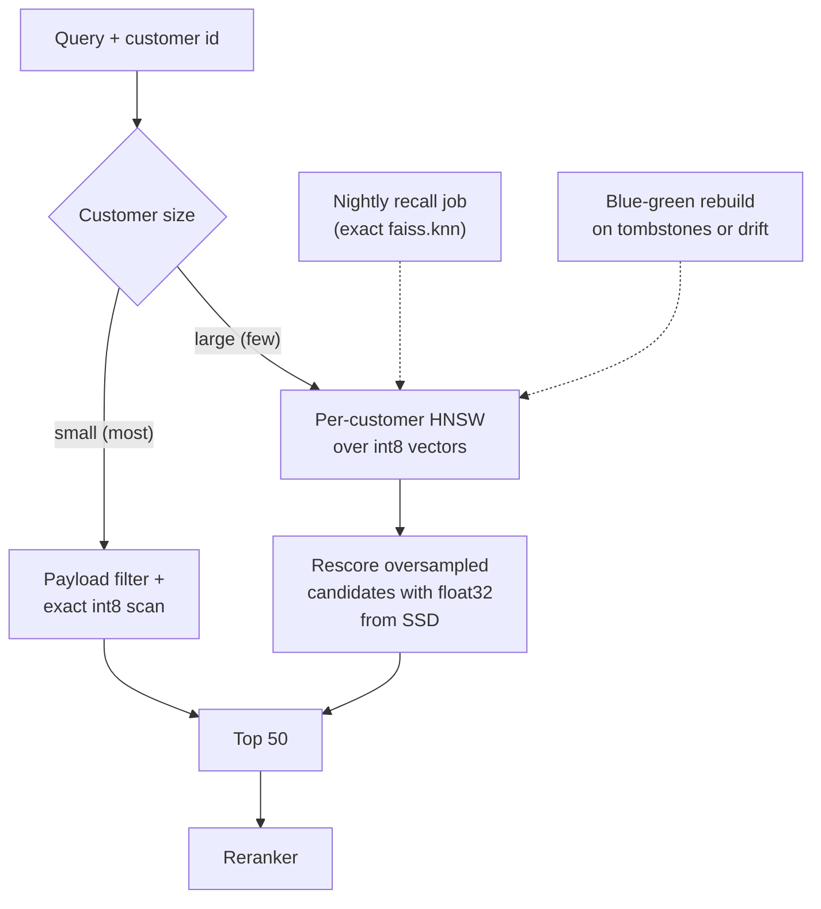

This assessment covers the whole Vector Indexing Algorithms module: flat indexes, IVF, HNSW, product and scalar quantisation, approximate and exact nearest neighbour search, the recall-latency trade-off and index construction. It mixes quick recall with calculations, code-reading and production scenarios. Aim for at least 70% on the quiz (13 of 18) before moving on, and write an answer to every open question before opening its model answer. The coding exercises run locally with NumPy, scikit-learn and the CPU build of FAISS, and need no API key or model download.

```quiz
[
  {
    "q": "What does a flat index do when it answers a query?",
    "options": [
      "Scores the query against every stored vector and selects the top k",
      "Searches the clusters nearest the query",
      "Walks a neighbour graph from an entry point",
      "Compares compressed codes and returns approximate results"
    ],
    "answer": 0,
    "why": "A flat index has no structure on top of the vectors: it scans all of them, which makes it exact and its cost linear in N."
  },
  {
    "q": "A flat scan of 1 million 384-dimension float32 vectors runs at an assumed effective memory bandwidth of 20 GB/s. Roughly how long does one query take at minimum?",
    "options": [
      "About 0.8 ms",
      "About 77 ms",
      "About 19 ms",
      "About 1.5 s"
    ],
    "answer": 1,
    "why": "1,000,000 x 384 x 4 bytes is about 1.54 GB. Divided by 20 GB/s that is about 0.077 s."
  },
  {
    "q": "In an IVF index with nlist = 1,024 over 1 million vectors, roughly how many vectors does a query with nprobe = 8 score, ignoring the centroid comparison and assuming balanced lists?",
    "options": [
      "1,024",
      "125,000",
      "8",
      "About 7,800"
    ],
    "answer": 3,
    "why": "Each list holds about 1,000,000 / 1,024, roughly 977 vectors, and 8 lists are scanned: about 7,800."
  },
  {
    "q": "Why does an IVF index lose recall at all?",
    "options": [
      "A true neighbour may sit in a cell whose centroid is not among the nprobe nearest to the query",
      "IVF compresses every vector to one byte",
      "k-means returns random results at query time",
      "IVF only supports Euclidean distance"
    ],
    "answer": 0,
    "why": "Neighbours just across a cell boundary are never scanned unless their cell is probed. Raising nprobe recovers them at linear cost."
  },
  {
    "q": "Which HNSW parameter can be changed per query without rebuilding the index?",
    "options": [
      "M",
      "efConstruction",
      "efSearch",
      "The level multiplier"
    ],
    "answer": 2,
    "why": "efSearch sets the size of the candidate list during a search. M and efConstruction shape the graph and need a rebuild to change."
  },
  {
    "q": "With M = 16, roughly what fraction of HNSW nodes appear on layer 1 or above?",
    "options": [
      "One half",
      "One in 16",
      "One in 256",
      "All of them"
    ],
    "answer": 1,
    "why": "The level distribution gives a probability of M to the power minus j of reaching layer j, so 1/16 for layer 1."
  },
  {
    "q": "Product quantisation with m = 32 sub-quantisers of 8 bits each stores a 768-dimension float32 vector in how many bytes, and what compression ratio is that?",
    "options": [
      "32 bytes, 96 times smaller",
      "256 bytes, 12 times smaller",
      "768 bytes, 4 times smaller",
      "8 bytes, 384 times smaller"
    ],
    "answer": 0,
    "why": "Each sub-vector becomes one byte, so 32 bytes, against 768 x 4 = 3,072 bytes: a ratio of 96."
  },
  {
    "q": "In asymmetric distance computation (ADC) for product quantisation, what is computed once per query?",
    "options": [
      "A full decode of every stored vector",
      "A new set of codebooks",
      "A lookup table of distances from each query sub-vector to every centroid of its codebook",
      "The exact distance to every stored vector"
    ],
    "answer": 2,
    "why": "The tables (m tables of 256 entries) let every stored code be scored with m lookups and additions."
  },
  {
    "q": "int8 scalar quantisation of float32 vectors reduces vector memory by what factor, and what usually restores most of the lost recall?",
    "options": [
      "2 times; clipping the tails of every dimension",
      "8 times; nothing can restore it",
      "16 times; raising efConstruction",
      "4 times; oversampling candidates and rescoring them with full-precision vectors"
    ],
    "answer": 3,
    "why": "One byte replaces four. Rescoring an oversampled candidate set with the original vectors repairs most ordering errors."
  },
  {
    "q": "An index reports recall@10 = 0.97. Which statement is correct?",
    "options": [
      "97% of returned chunks are relevant to the user",
      "On average, 9.7 of the exact top 10 neighbours were returned",
      "97% of queries finish within the latency budget",
      "The first result is correct 97% of the time"
    ],
    "answer": 1,
    "why": "ANN recall compares the index's result with exact search over the same vectors. It says nothing about human relevance."
  },
  {
    "q": "In random-hyperplane LSH, one hyperplane separates two unit vectors at angle theta with probability theta / pi. Two vectors have cosine 0. What is the probability that a single bit of their codes agrees?",
    "options": [
      "0.5",
      "1.0",
      "0",
      "0.25"
    ],
    "answer": 0,
    "why": "Cosine 0 means theta = pi/2, so the bits agree with probability 1 - (pi/2)/pi = 0.5."
  },
  {
    "q": "Why are k-d trees not used for exact search over 384-dimension embeddings?",
    "options": [
      "They return approximate results in high dimensions",
      "They cannot store more than 1,000 points",
      "Distances concentrate, so their lower bounds almost never prune and they end up scoring every point, more slowly than a scan",
      "They only support cosine similarity"
    ],
    "answer": 2,
    "why": "The tree stays exact but loses its speed: pruning fails when the nearest neighbour is almost as far as everything else."
  },
  {
    "q": "A team computes ground truth for its HNSW index by searching the same index with a very large efSearch. What is wrong?",
    "options": [
      "Nothing: a large efSearch makes HNSW exact",
      "Points the graph cannot reach are missing from both results, so recall is overstated",
      "Large efSearch values damage the graph",
      "Ground truth must use cosine distance"
    ],
    "answer": 1,
    "why": "An approximate method cannot measure its own misses. Ground truth must come from an independent exact scan."
  },
  {
    "q": "What does this code print?\n```python\nrows = [(0.90, 1.0), (0.95, 2.0), (0.93, 2.5), (0.99, 4.0)]  # (recall, p99 ms)\nfront = [r for r in rows if not any(o[0] >= r[0] and o[1] <= r[1] and o != r for o in rows)]\nprint(len(front))\n```",
    "options": [
      "4",
      "2",
      "1",
      "3"
    ],
    "answer": 3,
    "why": "(0.93, 2.5) is dominated by (0.95, 2.0), which is more accurate and faster. The other three are on the Pareto frontier."
  },
  {
    "q": "Under the M/M/1 queueing model, mean latency is S / (1 - utilisation). A node runs at utilisation 0.5. Raising efSearch makes each query take 60% longer. What happens to mean latency?",
    "options": [
      "It rises by 60%",
      "It falls, because recall is higher",
      "It quadruples, from 2 S to 8 S",
      "It is unchanged"
    ],
    "answer": 2,
    "why": "Before: W = S / 0.5 = 2S. After: service 1.6S, utilisation 0.8, W = 1.6S / 0.2 = 8S. That is four times the old latency."
  },
  {
    "q": "FAISS prints \"WARNING clustering 5000 points to 1024 centroids: please provide at least 39936 training points\". What is the most likely consequence if you ignore it?",
    "options": [
      "Unbalanced inverted lists: some lists are far longer than average, so queries do more work for less recall",
      "The index refuses to accept vectors",
      "Search results become non-deterministic",
      "The vectors are stored in float16"
    ],
    "answer": 0,
    "why": "With about 5 points per centroid, k-means fits noise and leaves lists badly unbalanced. The index works, but inefficiently."
  },
  {
    "q": "Meridian switches AskMeridian to a new embedding model. Which plan is correct?",
    "options": [
      "Retrain the IVF centroids and keep the old vectors",
      "Re-embed every chunk into a new index, validate it against exact search and a quality test set, then switch an alias",
      "Update vectors in place while serving traffic",
      "Raise efSearch to compensate for the new model"
    ],
    "answer": 1,
    "why": "Vectors from different models are not comparable. A blue-green rebuild avoids mixing them and keeps a rollback path."
  },
  {
    "q": "A HNSW collection has had 30% of its points deleted over six months, and recall has drifted down while memory use has not fallen. What explains both?",
    "options": [
      "efSearch was reset to its default",
      "The embedding model changed",
      "IVF centroids drifted",
      "Deleted nodes are tombstones: still stored and traversed, but never returned, until maintenance rebuilds the affected segments"
    ],
    "answer": 3,
    "why": "Graphs cannot simply drop nodes without cutting paths, so deletes are marked and cleaned up later. Until then they cost memory and search effort."
  }
]
```

## Conceptual questions

**1.** Explain the difference between ANN recall and retrieval recall (the Recall@K of retrieval evaluation). Give an example where one is high and the other low, and say which a RAG team should report to its stakeholders.

<details><summary>Show model answer</summary>

ANN recall compares an index's results with exact search over the same vectors: it measures how faithfully the index reproduces the embedding model's ranking. Retrieval recall compares results with human relevance labels: it measures whether the chunks that answer the question are retrieved.

They are independent. An exact flat index has ANN recall of 1.0 by definition, yet if the embedding model ranks a policy paragraph poorly for a paraphrased question, retrieval recall is low. Conversely, a well-tuned HNSW index with ANN recall of 0.97 on a strong embedding model can have high retrieval recall, since the 3% of neighbours lost are mostly not the relevant ones.

Stakeholders care about retrieval recall and, ultimately, answer quality. ANN recall is an engineering health metric for the index: report it to the team that operates the database, and use it to diagnose whether a missing chunk is an index problem or a model problem.

</details>

**2.** Every ANN index generates candidates and then scores them. Use that two-stage view to explain why rescoring with full-precision vectors repairs some misses of an IVF-PQ index but not others, and which knob fixes each kind.

<details><summary>Show model answer</summary>

A true neighbour can be lost in two ways. It may **never become a candidate**: its IVF cell was not among the `nprobe` probed. Rescoring only re-ranks candidates, so it cannot recover this point; raising `nprobe` (or improving the partition by retraining on representative data) is the fix.

Or it may be **a candidate scored too low**: its product-quantised code is a coarse approximation, so its approximate score falls below the top $k$. Rescoring the best few hundred candidates with full-precision vectors restores the correct order, so a deeper rescoring list (oversampling, FAISS `k_factor`) fixes it, as long as the point was within the rescored depth.

A third case sits between them: with very small codes, a neighbour's approximate score can be so poor that it falls below even the rescoring depth. More bytes per vector (larger $m$) is the fix there.

</details>

**3.** Why does exact search remain important in a system whose main index is HNSW? Name at least three uses and the reason each needs exactness or benefits from it.

<details><summary>Show model answer</summary>

- **Ground truth for evaluation.** Recall can only be measured against exact results; computing them with the index under test hides its misses.
- **Small or heavily filtered subsets.** A tenant's few thousand chunks are scanned exactly in well under a millisecond, with no recall loss and none of the problems graph search has under restrictive filters.
- **Rescoring.** Exact scores over a small candidate set repair the ordering errors of compressed scoring.
- **Diagnosis.** When a chunk is missing, re-running the query exactly shows whether the index or the model is at fault.
- **Offline jobs** such as near-duplicate detection, where completeness matters and throughput, not latency, is the constraint.

</details>

**4.** A colleague proposes IVF-Flat instead of HNSW for a collection of 3 million chunks that receives a steady stream of inserts and deletes and whose content changes as new products launch. Give the strongest arguments on each side.

<details><summary>Show model answer</summary>

**For IVF.** Its memory overhead is small (a centroid table and list identifiers, against HNSW's $2M$ links per vector), its lists support removal cleanly, it compresses well (IVF-PQ, IVF-SQ) if memory becomes tight, and its build is fast because training cost is capped by the sample size.

**For HNSW.** It needs no training, so new product content is inserted into a graph that adapts, while IVF assigns new content to centroids trained on old data. That is exactly the drift case: lists become unbalanced and recall at a fixed `nprobe` falls until the index is retrained. HNSW also usually reaches high recall at lower latency in RAM.

On balance, for a changing corpus HNSW is the safer default, with monitoring of tombstones and periodic segment rebuilds. IVF is a strong choice if memory is the binding constraint, provided the team monitors list balance and retrains (blue-green) when it degrades. Either way, the decision should rest on a recall-latency sweep on the real data.

</details>

## Coding exercises

**1. IVF from scratch.** Implement IVF with scikit-learn's `KMeans`: train 128 centroids on 20,000 synthetic unit vectors, assign each vector to a list, and search by probing the `nprobe` centroids with the highest inner product and scanning their lists exactly. Report recall@10 against brute force and the fraction of the collection scanned for `nprobe` from 1 to 32.

<details><summary>Show solution</summary>

```python
import numpy as np
from sklearn.cluster import KMeans

rng = np.random.default_rng(0)
N, d, k, nlist = 20_000, 64, 10, 128
scales = 1.0 / np.arange(1, d + 1) ** 0.75
def sample(n):
    x = rng.standard_normal((n, d)) * scales
    return (x / np.linalg.norm(x, axis=1, keepdims=True)).astype(np.float32)
X, Q = sample(N), sample(200)
truth = np.argsort(-(Q @ X.T), axis=1)[:, :k]

# Train: k-means centres. Add: assign each vector to its nearest centre.
km = KMeans(n_clusters=nlist, n_init=1, random_state=0).fit(X)
centres = km.cluster_centers_.astype(np.float32)
lists = [np.where(km.labels_ == c)[0] for c in range(nlist)]

def search(q, nprobe):
    probe = np.argsort(-(centres @ q))[:nprobe]          # nearest centres by inner product
    cand = np.concatenate([lists[c] for c in probe])
    return cand[np.argsort(-(X[cand] @ q))[:k]], len(cand)

for nprobe in (1, 2, 4, 8, 16, 32):
    res = [search(q, nprobe) for q in Q]
    r = np.mean([len(set(f) & set(t)) / k for (f, _), t in zip(res, truth)])
    print(f"nprobe={nprobe:<3} recall@10={r:.3f}  scanned={np.mean([n for _, n in res]) / N:.1%}")
```

```output
nprobe=1   recall@10=0.417  scanned=1.1%
nprobe=2   recall@10=0.608  scanned=2.1%
nprobe=4   recall@10=0.805  scanned=4.2%
nprobe=8   recall@10=0.936  scanned=8.0%
nprobe=16  recall@10=0.986  scanned=15.1%
nprobe=32  recall@10=1.000  scanned=27.8%
```

Recall climbs steeply and then saturates: 8% of the collection gives 0.936, and the last point and a half of recall cost doubling the work. Note that `scanned` grows slightly faster than `nprobe / nlist` (27.8% rather than 25% at 32 probes): queries tend to land near dense regions, whose lists are larger than average. k-means assigns by Euclidean distance, which for unit vectors and near-unit centroids ranks clusters almost the same way as inner product; for production use, FAISS's `IndexIVFFlat` with `METRIC_INNER_PRODUCT` handles this consistently.

</details>

**2. Scalar quantisation with rescoring.** Quantise the same kind of vectors to int8 with one (minimum, maximum) range per dimension, search on the decoded vectors, and then oversample by factors of 2 and 4 and rescore the candidates with the original float32 vectors. Report memory and recall@10 for each.

<details><summary>Show solution</summary>

```python
import numpy as np

rng = np.random.default_rng(0)
N, d, k = 20_000, 64, 10
scales = 1.0 / np.arange(1, d + 1) ** 0.75
def sample(n):
    x = rng.standard_normal((n, d)) * scales
    return (x / np.linalg.norm(x, axis=1, keepdims=True)).astype(np.float32)
X, Q = sample(N), sample(200)
truth = np.argsort(-(Q @ X.T), axis=1)[:, :k]

# int8 scalar quantisation with one (min, max) range per dimension
lo, hi = X.min(0), X.max(0)
step = (hi - lo) / 255
codes = np.round((X - lo) / step).astype(np.uint8)        # 1 byte per component
X_hat = codes * step + lo                                   # decoded approximation

def recall(found):
    return np.mean([len(set(f) & set(t)) / k for f, t in zip(found, truth)])

approx = np.argsort(-(Q @ X_hat.T), axis=1)
print(f"memory: float32 {X.nbytes / 1e6:.2f} MB, int8 {codes.nbytes / 1e6:.2f} MB")
print(f"int8 only:            recall@10 {recall(approx[:, :k]):.3f}")
for factor in (2, 4):
    cand = approx[:, :k * factor]                           # oversample, then rescore exactly
    rescored = [c[np.argsort(-(X[c] @ q))[:k]] for c, q in zip(cand, Q)]
    print(f"int8 + rescore x{factor}:    recall@10 {recall(rescored):.3f}")
```

```output
memory: float32 5.12 MB, int8 1.28 MB
int8 only:            recall@10 0.953
int8 + rescore x2:    recall@10 1.000
int8 + rescore x4:    recall@10 1.000
```

int8 alone keeps 95% of the true neighbours at a quarter of the memory; its errors are small re-orderings near the boundary of the top 10, so rescoring just 20 candidates restores every one. The full-precision vectors must still be kept somewhere for rescoring, usually on disk or in cheaper memory. Whether to clip the range before quantising depends on the bit width, as [Scalar quantisation](/learn/vector-indexing-algorithms/scalar-quantisation) showed; measure rather than assume.

</details>

**3. How many bytes does PQ need?** Using FAISS `IndexPQ` wrapped in `IndexRefineFlat`, compare recall@10 at 8, 16 and 32 bytes per vector, without and with rescoring of the top 100 candidates.

<details><summary>Show solution</summary>

```python
import numpy as np
import faiss

rng = np.random.default_rng(0)
N, d, k = 20_000, 64, 10
scales = 1.0 / np.arange(1, d + 1) ** 0.75
def sample(n):
    x = rng.standard_normal((n, d)) * scales
    return (x / np.linalg.norm(x, axis=1, keepdims=True)).astype(np.float32)
X, Q = sample(N), sample(200)
_, truth = faiss.knn(Q, X, k, metric=faiss.METRIC_INNER_PRODUCT)

def recall(I):
    return np.mean([len(set(f) & set(t)) / k for f, t in zip(I, truth)])

for m in (8, 16, 32):
    pq = faiss.IndexPQ(d, m, 8, faiss.METRIC_INNER_PRODUCT)   # m bytes per vector
    refine = faiss.IndexRefineFlat(pq)                         # wraps PQ, keeps full vectors
    refine.train(X); refine.add(X)                             # trains and fills both
    _, I = pq.search(Q, k)                                     # PQ scores only
    refine.k_factor = 10                                       # rescore the best 10 x k exactly
    _, I2 = refine.search(Q, k)
    print(f"PQ{m:<2}: {m:>2} bytes/vector  recall@10 {recall(I):.3f}  with rescoring x10 {recall(I2):.3f}")
```

```output
PQ8 :  8 bytes/vector  recall@10 0.086  with rescoring x10 0.506
PQ16: 16 bytes/vector  recall@10 0.203  with rescoring x10 0.740
PQ32: 32 bytes/vector  recall@10 0.584  with rescoring x10 0.985
```

PQ scores on their own are coarse: even 32 bytes (an 8-fold compression of 256 bytes) recovers only 58% of the true top 10. Rescoring the best 100 transforms the picture at 32 bytes (0.985) but not at 8 bytes (0.506), because with very small codes many true neighbours are scored so poorly that they fall outside even the top 100. That is the "too few bytes lose neighbours no rescoring can recover" rule from [Product quantisation](/learn/vector-indexing-algorithms/product-quantisation). The wrapper must be built before `add`: `IndexRefineFlat` checks that the base index and its own store hold the same vectors.

</details>

## Architecture design challenge

Meridian is launching search over the support tickets of its "Meridian Relay" product: 30 million tickets, one chunk each, embedded at 768 dimensions. Every query is filtered to one customer. The largest customer has 2 million tickets; 95% of customers have fewer than 20,000. About 300,000 tickets are added and 100,000 deleted each week. Retrieval must meet a p99 of 50 ms at a peak of 300 queries per second, recall@50 against exact search of at least 0.95 (the results feed a reranker), and fit a RAM budget of 64 GB per node across at most four nodes. Design the indexing layer.

<details><summary>Show reference design</summary>

**Memory first.** Float32 vectors take $30 \times 10^6 \times 768 \times 4 \approx 92$ GB, too much for comfortable RAM with an HNSW graph on top (another 4 to 8 GB at $M = 16$ to 32). int8 scalar quantisation brings vectors to about 23 GB; 64-byte PQ codes to about 1.9 GB. Full-precision vectors are still needed for rescoring, but only for a few hundred candidates per query, so they can live on local SSD.

**Exploit the filter.** Since every query names a customer, partition by customer rather than building one global index whose candidates are mostly other customers' tickets.

- **Small customers** (under, say, 50,000 tickets): no ANN index. Filter by customer with a payload index and scan exactly. 20,000 vectors at 768 dimensions in int8 are about 15 MB, scanned in a few milliseconds, with recall 1.0 and no tombstone problems.
- **Large customers** (the few above the threshold): a dedicated HNSW index over int8 vectors per customer, with rescoring of an oversampled candidate list from float32 vectors on SSD. Tune `ef` and oversampling on a recall@50 sweep with that customer's real queries.

**Sharding.** Spread customers across four nodes by hashing the customer identifier, placing the largest customers explicitly so that no node holds two of them. Each node holds about a quarter of the int8 vectors (about 6 GB) plus graphs for its large customers, leaving headroom for blue-green rebuilds.

**Churn.** For large customers, track the tombstone fraction and rebuild a customer's graph blue-green when it exceeds about 15%, or let the database's segment optimisation do it. Small customers need nothing, since exact scans have no structure to degrade.

**Operations.** A nightly job samples 200 queries per large customer and computes recall@50 against an exact `faiss.knn` scan of exported vectors; alerts fire on the 5th percentile, not the mean. Load tests replay peak traffic, keeping CPU utilisation well below saturation so that a rise in `ef` does not tip the nodes into long queues. All construction parameters are written explicitly in configuration, with the embedding model version.



**Trade-offs.** Per-customer indexes cost more operational complexity than one global index, but they turn most queries into exact scans and avoid restrictive-filter recall problems entirely. int8 with rescoring keeps recall near float32 at a quarter of the memory, at the cost of an SSD read per query for a few hundred vectors; PQ would save more memory but needs deeper rescoring and its recall must be checked carefully. If the largest customer grows far beyond 2 million, it may need its own shard or an IVF-PQ index on disk.

</details>

## Troubleshooting scenarios

**1.** AskMeridian uses an IVF index (`nlist` 4,096, `nprobe` 32). After the Meridian Reports product documentation was imported, users report that questions about Reports exports often get "I don't know", while handbook questions are fine. Recall on the nightly evaluation set, which was built at launch, has not moved.

<details><summary>Show diagnosis and fix</summary>

**Diagnosis.** Data drift. The centroids were trained before the Reports documentation existed, so its vectors were assigned to the few old centroids nearest to them, creating a handful of very long lists in an ill-fitting region. Queries about Reports probe cells that do not contain their true neighbours. The nightly recall set was built at launch and contains no Reports questions, so it cannot see the problem.

**Confirm** by printing list sizes (largest against mean, compared with the value after training) and by running a few Reports questions with exact search: the right chunks appear in exact results but not in the index's.

**Fix.** Retrain the centroids on a uniform sample of the current collection and rebuild blue-green, validating before switching. Add Reports questions to the evaluation set, and monitor list balance after every import so that the next drift is caught before users notice.

</details>

**2.** After a Qdrant upgrade, the p99 retrieval latency of AskMeridian rose from 12 ms to 45 ms at Monday-morning peak, while mean latency rose only from 5 to 7 ms. Recall is unchanged. CPU utilisation at peak rose from about 55% to about 80%.

<details><summary>Show diagnosis and fix</summary>

**Diagnosis.** A modest increase in per-query work (here plausibly a changed default for a search or construction parameter after the upgrade, which would also explain unchanged or slightly higher recall) pushed utilisation from 0.55 to 0.8. Queueing grows sharply with utilisation: in the M/M/1 model, the factor $1/(1 - \rho)$ goes from about 2.2 to 5, so waits multiply even though each query is only a little slower. The tail feels it most.

**Fix.** Compare the effective configuration before and after the upgrade and set `hnsw_ef` and the HNSW construction parameters explicitly. If the higher work is wanted (for recall), add capacity (a replica) to bring peak utilisation back down. Make p99 at realistic load, not idle single-query latency, the acceptance test for upgrades.

</details>

**3.** Managers can see HR documents that other staff cannot, enforced by a permission filter. Staff without manager rights report that AskMeridian sometimes returns only two or three chunks for HR questions, and the answers are poor. Managers see five chunks and good answers.

<details><summary>Show diagnosis and fix</summary>

**Diagnosis.** A restrictive filter interacting with approximate search. For ordinary staff, the filter excludes the many manager-only HR chunks that are often the nearest neighbours of HR questions. The HNSW walk spends its candidate budget on chunks the filter then rejects and finishes with fewer than $k$ that pass. Managers' searches are barely filtered, so they do not see the problem. This is an availability bug, not a leak: the filter is correctly applied inside the search.

**Fix.** Measure recall separately for each permission group against exact search with the same filter. Make sure the permission field has a payload index so that the query planner can choose an exact scan when the filtered set is small, and raise `hnsw_ef` for filtered queries if needed. Never "fix" it by filtering results after an unfiltered search, which would both lose results and risk exposing restricted chunks in logs or scores.

</details>
