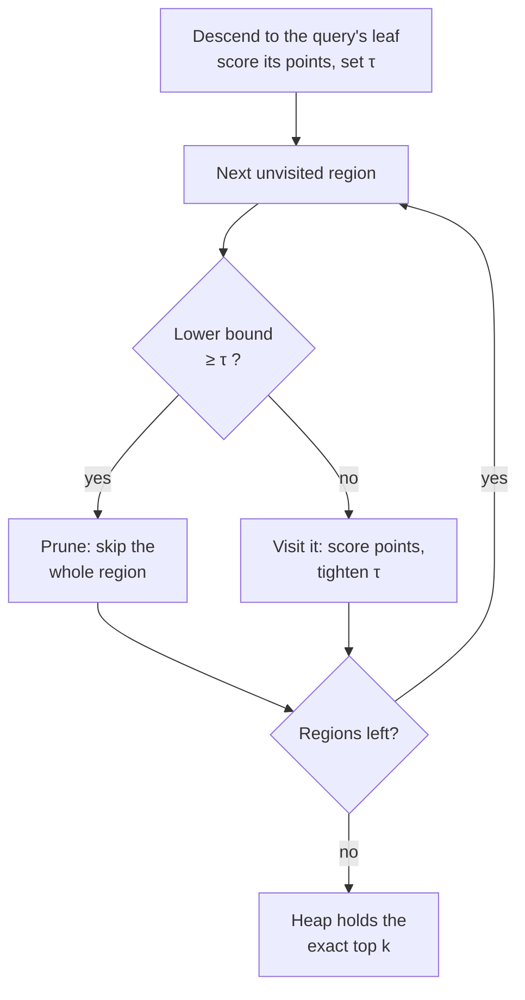

Approximate indexes are everywhere in production, but every one of them is judged against something exact. **Exact nearest neighbour search** returns the true top $k$, with no misses, and it is what you compute when you need to know the right answer: to measure an index's recall, to search a small or heavily filtered set, or to rescore candidates that a faster index has found.

[Flat indexes](/learn/vector-indexing-algorithms/flat-indexes) covered the simplest exact method, the full scan, as a piece of engineering. This lesson asks the theoretical question behind it: is there an exact method that does better than scanning everything? In low dimensions the answer is yes, and the tree structures that achieve it are elegant. In the hundreds of dimensions of text embeddings the answer is, in practice, no. You will see why with measurements and with a short piece of probability, and then learn where exact search earns its place in a RAG system and how to compute it reliably at scale.

## Learning objectives

- State the exact k-nearest-neighbour problem, including how ties and floating-point rounding affect what "exact" means.
- Explain how k-d trees and ball trees prune the search with geometric lower bounds, and apply the triangle-inequality bound to decide whether a region can be skipped.
- Explain distance concentration and calculate the relative spread of distances between random points in $d$ dimensions.
- Measure, with scikit-learn, how the share of points a k-d tree must examine grows with dimension.
- Choose an exact strategy for ground truth, small or filtered subsets, and rescoring, and compute ground truth for a large collection in bounded memory.

## Prerequisites

- [Similarity search](/learn/vector-database-fundamentals/similarity-search): exact kNN as a database operation, and top-k selection.
- [Flat indexes](/learn/vector-indexing-algorithms/flat-indexes): the scan, its memory-bandwidth cost, and the L2 expansion.
- [Euclidean distance](/learn/embedding-mathematics/euclidean-distance): the distance used by the tree structures.
- [Approximate nearest neighbour search](/learn/vector-indexing-algorithms/approximate-nearest-neighbour-search): recall@k and why approximate search exists.

## Why this matters

An approximate index is only as trustworthy as your measurement of it, and the measurement needs exact answers. If the ground truth you compute is wrong (because you used the wrong metric, an approximate method, or a comparison that ignores ties), every recall figure built on it is wrong, and tuning decisions follow. A surprising number of reported recall numbers come from ground truth that was itself produced by an index.

Exact search is also a practical tool. Many RAG queries are not "search everything": they are "search this tenant's 8,000 chunks" or "rank these 200 candidates precisely". For those, exact search is both faster to build and better than any approximate index.

Finally, it is worth knowing why engineers do not simply use a clever exact structure. People who learnt k-d trees in an algorithms course reasonably ask why vector databases bother with approximation at all. The answer, distance concentration, also explains why approximate methods are built the way they are, and why distances between embeddings behave so differently from distances on a map.

## The intuition

Imagine finding the nearest café to you in a city. You do not measure the distance to every café in the country. You know you are in one district; any café in a district ten kilometres away is certainly farther than the one around the corner, so you skip that district without looking inside. This is **pruning**: ruling out whole regions using a bound, a guaranteed minimum distance to anything inside them.

Pruning works on a map because distances vary enormously. The café next door is 50 metres away; most cafés are kilometres away. Now imagine a strange city in which every café is between 9.5 and 10.5 kilometres from you, whichever one you pick. A district's nearest edge is never far enough away to rule it out, because the best café you have found so far is also about 10 kilometres away. You end up checking every district. High-dimensional spaces are that strange city. Random points in 384 dimensions are all at roughly the same distance from each other, so geometric pruning almost never succeeds.

## How it works

### The exact problem, precisely

Given vectors $x_1, \dots, x_N$, a query $q$ and a similarity or distance, exact kNN returns the $k$ points with the best scores. Two details turn "exact" from a slogan into something you can test.

- **Ties.** If the $k$-th and $(k{+}1)$-th points have the same score, either set is correct. Real corpora contain exact and near-duplicate chunks (the same disclaimer in fifty runbooks), so ties are common. A reproducible implementation breaks ties by a fixed rule, usually the smaller identifier, and an evaluation should accept any point whose score equals the $k$-th score.
- **Floating-point rounding.** Float32 arithmetic is not associative: summing 384 products in a different order gives a slightly different result. Two correct exact implementations (NumPy and FAISS, or a CPU and a GPU) can therefore disagree in the last digit and, when two scores are within about $10^{-6}$ of each other, in the order of the results. The L2 expansion $\|q\|^2 - 2\,q \cdot x + \|x\|^2$ used by fast scans also suffers from cancellation when $q$ and $x$ are nearly equal, and can return a tiny negative squared distance. Neither is a bug, but both break naive equality checks. Compare result sets with a score tolerance.

### Exact methods that beat the scan, in low dimensions

All exact methods faster than a scan use **branch and bound**: organise the points into nested regions, and skip a region whenever a lower bound on the distance to anything inside it is worse than the $k$-th best distance found so far.

**k-d trees** (Bentley, 1975) split the points recursively: at each node, choose one coordinate and a split value, typically the median, and send points to the left or right child. Each node therefore covers an axis-aligned box. The lower bound for a box is the distance from the query to the nearest face of the box.

**Ball trees** and other **metric trees** split points into nested balls, each described by a centre $c$ and a radius $r$ covering all its points. They use only the triangle inequality, so they work for any true metric, not just Euclidean distance. The lower bound for a ball is $\max(0, \|q - c\| - r)$.

Both trees search the same way:

1. Descend from the root to the leaf whose region contains the query, and compute exact distances to the points in that leaf. Keep the best $k$ in a bounded heap; let $\tau$ be the $k$-th best distance.
2. Walk back up. At each node, compute the lower bound for the sibling region that has not yet been visited.
3. If the bound is at least $\tau$, **prune**: nothing in that region can enter the top $k$.
4. Otherwise, descend into it, scoring the points of any leaves reached and tightening $\tau$.
5. Stop when every region has been either visited or pruned. The heap then holds the exact top $k$.



The answer is always exact, whatever happens. What varies is how often step 3 succeeds. In two dimensions it succeeds almost always and the search visits a handful of leaves. When it rarely succeeds, the tree visits every leaf and does more work than a scan, because it pays for bound computations and scattered memory access on top of the same distance calculations.

### Why pruning fails in high dimensions

Pruning needs the bound to exceed $\tau$. The bound is roughly "distance to the region minus the region's size", and $\tau$ is the distance to a near neighbour. In high dimensions three effects push against this.

- **Distances concentrate.** For random points, the distance from the query to its nearest neighbour and to a typical point differ by only a small fraction. The mathematics below makes this exact for Gaussian data. If the nearest neighbour is at 95% of the typical distance, $\tau$ is almost as large as the distance to anything, so no region is ever clearly too far.
- **Regions are large.** A ball containing many points in high dimension has a radius comparable to the distances between points, so $\|q - c\| - r$ is small or zero.
- **k-d splits cover few dimensions.** A tree of depth 15 over 20,000 points splits on at most 15 coordinates. In 384 dimensions, each box is unbounded along most axes, so the distance to a box's face says almost nothing about the distance to its points.

This is a facet of the **curse of dimensionality**. Beyer and colleagues (1999) showed that under broad conditions the ratio between the farthest and nearest distances tends to 1 as dimension grows, and Weber, Schek and Blott (1998) showed that tree-based exact methods are outperformed by a sequential scan beyond roughly ten dimensions on such data.

Real embeddings are not random Gaussian points: they are clustered and lie near lower-dimensional structure, so their distances concentrate less. The code example measures whether that is enough to rescue trees at 384 dimensions. (It is not.)

### Where exact search earns its place

In RAG systems, exact search is used deliberately in five places.

- **Ground truth for evaluation.** Every recall measurement in [Recall versus latency](/learn/vector-indexing-algorithms/recall-versus-latency) needs it.
- **Small collections.** Below some tens of thousands of vectors, a scan is fast enough and needs no index to build or tune. Qdrant, for example, does not build an HNSW graph for segments below a configurable size and scans them instead.
- **Filtered subsets.** When a filter selects a few thousand points, scanning exactly those is faster and more reliable than steering an approximate index around the excluded ones. Several databases' query planners choose this automatically when a payload index says the filtered set is small; [Filtering](/learn/vector-database-fundamentals/filtering) explains why.
- **Rescoring.** A compressed index proposes a few hundred candidates; their full-precision vectors are fetched and scored exactly. This is exact search over a tiny set, and it repairs the scoring errors of [product quantisation](/learn/vector-indexing-algorithms/product-quantisation).
- **Offline jobs.** Deduplication, clustering and building neighbour graphs process all pairs in batches, where throughput matters more than latency. GPUs scan very fast here: their memory bandwidth is several times a CPU's, and batched queries make the scan a large matrix multiplication.

### Computing ground truth at scale

For a large evaluation, the obvious approach fails on memory. 1,000 queries against 10 million vectors is a score matrix of $10^{10}$ float32 values, 40 GB. The standard fix is to **block the database**:

1. Split the stored vectors into blocks of, say, 100,000.
2. For each block, compute the $1{,}000 \times 100{,}000$ score matrix (400 MB) and take each query's top $k$ within the block.
3. Merge each query's running top $k$ with the block's top $k$, keeping the best $k$ of the $2k$.
4. After the last block, the running lists are the exact global top $k$.

This is the same merge that databases use across segments. FAISS's `knn` function and its flat indexes do this blocking internally, so in practice `faiss.knn(xq, xb, k)` or a flat index over memory-mapped vectors is the simplest route. Save ground truth to disk with the vectors' identifiers and the embedding model's version: it is only valid for exactly those vectors, and it must be recomputed when the corpus or the model changes.

## The mathematics

### The triangle-inequality bound

**Intuition.** If every point in a ball is within $r$ of its centre, no point in the ball can be closer to the query than the distance to the centre minus $r$.

$$
\|q - x\| \;\geq\; \|q - c\| - \|x - c\| \;\geq\; \|q - c\| - r \quad \text{for every } x \text{ in the ball}
$$

- $q$ is the query, $x$ any point in the ball.
- $c$ is the ball's centre and $r$ its radius, the largest $\|x - c\|$ over its points.
- The first inequality is the triangle inequality rearranged; the second uses $\|x - c\| \leq r$.

The ball can be pruned if $\|q - c\| - r \geq \tau$, where $\tau$ is the current $k$-th best distance.

**By hand.** A ball has radius $r = 1.5$, its centre is at distance 4.0 from the query, and the best distance so far is $\tau = 2.2$. The bound is $4.0 - 1.5 = 2.5 \geq 2.2$, so the whole ball is skipped. Now the same situation in high dimension: distances concentrate, so the centre is at 4.0, the radius is 3.8 (the ball's own points are about as far from its centre as anything is from anything), and $\tau = 3.9$. The bound is $0.2$, far below $3.9$: the ball must be opened.

```python
def can_prune(dist_to_centre, radius, tau):
    bound = max(0.0, dist_to_centre - radius)
    return bound, bound >= tau

print(can_prune(4.0, 1.5, 2.2))   # low-dimensional situation
print(can_prune(4.0, 3.8, 3.9))   # high-dimensional situation
```

```output
(2.5, True)
(0.20000000000000018, False)
```

### Distance concentration

**Intuition.** A squared distance in $d$ dimensions is a sum of $d$ per-coordinate terms. Sums of many independent terms grow like $d$, but their random fluctuation grows only like $\sqrt{d}$, so relative to their size, all distances look alike.

Take $x$ and $y$ independent with standard normal coordinates. Each coordinate of $x - y$ is normal with variance 2, so

$$
\|x - y\|^2 = \sum_{i=1}^{d} (x_i - y_i)^2, \qquad \mathbb{E}\big[\|x - y\|^2\big] = 2d, \qquad \operatorname{sd}\big(\|x - y\|^2\big) = 2\sqrt{2d}
$$

$$
\frac{\operatorname{sd}}{\text{mean}} = \frac{2\sqrt{2d}}{2d} = \sqrt{\frac{2}{d}}
$$

- $d$ is the dimension; $x_i, y_i$ are the coordinates.
- Each $(x_i - y_i)^2$ is 2 times a chi-squared variable with one degree of freedom, which has mean 1 and variance 2; so each term has mean 2 and variance 8, and the sum has mean $2d$ and variance $8d$.
- The ratio $\sqrt{2/d}$ is the relative spread: how different a typical distance is from the average.

**By hand.** At $d = 2$: mean 4, standard deviation $2\sqrt{4} = 4$, relative spread 1.0. Distances vary as much as their own size; some points are very close and some very far. At $d = 384$: mean 768, standard deviation $2\sqrt{768} \approx 55.4$, relative spread $\sqrt{2/384} \approx 0.072$. Nearly all squared distances lie within a few times 7% of 768, so nearest and farthest are not far apart. Checking by simulation:

```python
import numpy as np

rng = np.random.default_rng(1)
for d in (2, 384):
    x, y = rng.standard_normal((2, 100_000, d))
    sq = ((x - y) ** 2).sum(1)                       # squared distances of 100,000 random pairs
    print(f"d={d}: mean={sq.mean():.1f} (theory {2*d}), "
          f"std/mean={sq.std() / sq.mean():.3f} (theory {np.sqrt(2/d):.3f})")
```

```output
d=2: mean=4.0 (theory 4), std/mean=1.006 (theory 1.000)
d=384: mean=768.0 (theory 768), std/mean=0.072 (theory 0.072)
```

## In code

**The problem.** Measure how well exact tree search does as dimension rises. For Gaussian data at several dimensions, and for clustered data at 384 dimensions (closer to real embeddings), compare brute force with scikit-learn's `KDTree` and `BallTree`. Report the nearest-to-median distance ratio (concentration), query times, and the share of points whose distance the k-d tree had to compute. Assert that the trees return exactly the same neighbours as brute force.

**Dependencies.** NumPy and scikit-learn.

```bash
pip install numpy scikit-learn
```

```python
import time
import numpy as np
from sklearn.neighbors import KDTree, BallTree

rng = np.random.default_rng(0)
N, n_queries, k = 20_000, 100, 10

def gaussian(n, d):
    return rng.standard_normal((n, d))

def clustered(n, d, centres):
    labels = rng.integers(0, len(centres), n)
    return centres[labels] + 0.9 * rng.standard_normal((n, d))

def brute_force(X, Q):
    d2 = (Q**2).sum(1)[:, None] - 2 * Q @ X.T + (X**2).sum(1)[None, :]   # squared L2
    part = np.argpartition(d2, k, axis=1)[:, :k]
    return part, d2

def run(name, X, Q):
    t0 = time.perf_counter()
    brute, d2 = brute_force(X, Q)
    t_brute = time.perf_counter() - t0
    dist = np.sqrt(np.maximum(d2, 0))
    ratio = np.mean(dist.min(1) / np.median(dist, axis=1))   # nearest / typical distance

    kd = KDTree(X, leaf_size=40)
    kd.reset_n_calls()
    t0 = time.perf_counter()
    _, idx = kd.query(Q, k=k)
    t_kd = time.perf_counter() - t0
    frac = kd.get_n_calls() / (n_queries * N)                # share of points whose distance was computed
    assert all(set(a) == set(b) for a, b in zip(idx, brute))  # exact: same neighbours as brute force

    ball = BallTree(X, leaf_size=40)
    t0 = time.perf_counter()
    ball.query(Q, k=k)
    t_ball = time.perf_counter() - t0
    print(f"{name:<17}{ratio:>8.2f}{t_brute*1000:>9.1f}{frac:>10.1%}{t_kd*1000:>9.1f}{t_ball*1000:>9.1f}")

print(f"{'data':<17}{'near/med':>8}{'brute ms':>9}{'kd scored':>10}{'kd ms':>9}{'ball ms':>9}")
for d in (2, 8, 16, 32, 128, 384):
    run(f"gaussian d={d}", gaussian(N, d), gaussian(n_queries, d))
centres = rng.standard_normal((200, 384))
run("clustered d=384", clustered(N, 384, centres), clustered(n_queries, 384, centres))
```

```output
data             near/med brute ms kd scored    kd ms  ball ms
gaussian d=2         0.01     23.4      0.8%      0.4      2.3
gaussian d=8         0.25     41.4     22.8%     15.2     23.9
gaussian d=16        0.43     43.3     94.9%     95.2     37.7
gaussian d=32        0.58     57.1    100.0%    188.1    152.0
gaussian d=128       0.79     59.4    100.0%    746.4    517.2
gaussian d=384       0.88     42.6    100.0%    911.7    835.3
clustered d=384      0.62     33.8    100.0%    907.8    818.0
```

The times are wall-clock milliseconds for all 100 queries on one laptop and vary noticeably between runs; the other columns are fixed by the seed.

**The important lines.**

- `brute_force` computes all squared distances with the L2 expansion from [Flat indexes](/learn/vector-indexing-algorithms/flat-indexes): one matrix product, which NumPy hands to an optimised, multi-threaded BLAS library. `np.argpartition` then selects each row's 10 smallest.
- `np.maximum(d2, 0)` guards against the tiny negative values that cancellation in the expansion can produce, which would make `np.sqrt` return NaN.
- `KDTree(X, leaf_size=40)` builds the tree; leaves of 40 or so points are scanned directly. `get_n_calls()` counts distance computations between the query and stored points, so dividing by `n_queries * N` gives the fraction of the collection actually scored.
- The `assert` checks that the trees are exact: whatever the dimension, they return the same neighbour sets as brute force. Only their cost changes.

**What the output means.**

- The **near/med** column is distance concentration made visible. In 2 dimensions the nearest neighbour is at 1% of the median distance; in 384 Gaussian dimensions it is at 88%. Clustering helps (0.62), as it does for real embeddings, but the nearest point is still more than half as far as a typical point.
- The **kd scored** column tracks it. At $d = 2$ the k-d tree scores under 1% of the points and beats brute force by a wide margin. At $d = 8$ it scores 23%. From $d = 16$ it scores essentially everything, and from $d = 32$ it is exactly 100%: pruning never succeeds.
- At 384 dimensions both trees are about 20 times slower than brute force. They do the same number of distance computations, one point at a time in scattered order, while the matrix product streams through memory with vectorised, multi-threaded code. Even on the clustered data the k-d tree still scores every point.

**Errors people commonly hit.**

- Comparing a tree's single-threaded query time with a multi-threaded BLAS scan and concluding the scan is better only because of threads. The **kd scored** column removes that doubt: the tree does all the work of a scan, so no amount of tuning will rescue it.
- Using `KDTree` with `metric="cosine"`: it is not in `KDTree.valid_metrics`, and scikit-learn raises a `ValueError`. Normalise the vectors and use Euclidean distance, which ranks unit vectors identically to cosine.
- Expecting `NearestNeighbors(algorithm="auto")` to pick a tree for embeddings: in current scikit-learn versions its heuristic chooses brute force when there are more than 15 features, which is the right call.

**Extending it.** Replace the synthetic data with 20,000 real sentence embeddings from `all-MiniLM-L6-v2` and see where they fall between the Gaussian and clustered rows. Then try `leaf_size` values from 10 to 400: larger leaves make the tree behave more like a blocked scan, which narrows the gap but never closes it.

## A real-world example

Meridian's Platform team runs a nightly job that compares AskMeridian's HNSW index with exact search on 300 evaluation questions, as described in [Flat indexes](/learn/vector-indexing-algorithms/flat-indexes). When the corpus grew to about 200,000 chunks, someone rewrote the ground-truth step to save time, using the same Qdrant collection with a high `hnsw_ef` value "that is effectively exact". Recall@10 reported 1.00 every night for a month.

Then a configuration change accidentally lowered the production `hnsw_ef`, and answer quality complaints rose. The nightly job did not notice, because both the "ground truth" and the production search came from the same graph: when the graph failed to reach a chunk, it failed for both, and they agreed. An approximate method cannot measure its own misses.

The fix was to compute ground truth independently of the index. The job now exports the vectors (about 200,000 × 384 float32, roughly 307 MB) to a NumPy array and runs `faiss.knn` over them: 300 queries take a fraction of a second. Results are compared as sets with a tolerance for scores within $10^{-5}$ of the 10th, because the handbook has dozens of near-identical footer chunks that tie. With independent ground truth, the lowered `hnsw_ef` showed up immediately as a drop in recall, and the team added an alert on the 5th-percentile per-query recall.

## Common mistakes

- **Computing ground truth with an approximate index.** Its misses are invisible in the comparison, so recall is overstated, sometimes reported as perfect.
- **Using a k-d tree or ball tree for embeddings because it is "exact and logarithmic".** The logarithmic behaviour holds only in low dimensions; at 384 dimensions it scores every point and is slower than a scan.
- **Comparing exact results with strict equality.** Ties and float32 rounding make two correct implementations disagree, and the test fails for no real reason.
- **Building the full query-by-collection score matrix.** At millions of vectors it does not fit in memory; block the database and merge.
- **Reusing ground truth after re-embedding or re-chunking.** It is only valid for the vectors it was computed on.
- **Forgetting that rescoring is exact only over its candidates.** It cannot recover a neighbour that candidate generation never proposed.

## Best practices

- Compute ground truth with a flat scan (`faiss.knn`, a flat index, or blocked NumPy) that shares no code with the index under test.
- Store ground truth with the identifiers, the embedding model version and a hash of the corpus snapshot.
- Break ties by identifier for reproducibility, and evaluate with a score tolerance at the $k$-th position.
- Use exact search for small collections and small filtered subsets, and make that an explicit configuration rather than an accident.
- Normalise once and use inner product or L2 consistently, so that exact and approximate paths rank by the same measure.
- On GPUs or in batch jobs, group queries so that the scan becomes a matrix multiplication.

## Performance considerations

The cost of exact search is $N \times d$ multiply-adds per query, and it is limited by how fast the vectors can be read from memory. [Flat indexes](/learn/vector-indexing-algorithms/flat-indexes) works through the bandwidth arithmetic; the additions here concern trees and ground truth.

**Trees.** In low dimensions a tree query costs roughly the logarithm of $N$ plus a few leaves. In high dimensions it costs $N$ distance computations plus bound computations, in scattered memory order: more than a scan. The code measured about 20 times slower at 384 dimensions.

**Ground truth.** For $Q$ queries, the total work is $Q \times N \times d$ multiply-adds. For 1,000 queries against 10 million 768-dimension vectors that is $7.68 \times 10^{12}$. At an assumed sustained 1 TFLOP/s on a multi-core CPU (2 floating-point operations per multiply-add), that is about 15 seconds of arithmetic; a GPU is faster still. Memory, not arithmetic, is what needs planning: the 30.7 GB of vectors can be memory-mapped and read block by block, and each block's score matrix must fit in RAM.

**Filtered subsets.** An exact scan of $m$ filtered points costs $m \times d$ multiply-adds plus the cost of finding them through a payload index. At $m = 10{,}000$ and $d = 384$ that is under 4 million multiply-adds, well under a millisecond of arithmetic.

## Summary

- Exact kNN returns the true top $k$; ties and float32 rounding mean two correct implementations can differ slightly, so compare with a tolerance.
- k-d trees and ball trees prune regions using lower bounds and are dramatically faster than a scan in low dimensions.
- Distances concentrate as dimension grows (relative spread $\sqrt{2/d}$ for Gaussian data), so bounds stop pruning and trees score every point, more slowly than a scan.
- In RAG, exact search is the right tool for ground truth, small collections, filtered subsets, rescoring and offline batch jobs.
- Compute ground truth independently of the index under test, in blocks, and version it with the vectors.

## Exercises

**1.** Using $\sqrt{2/d}$, compute the relative spread of squared distances between random Gaussian points at $d = 32$ and $d = 1{,}536$. What does the second number suggest about tree-based exact search for 1,536-dimension embeddings?

<details><summary>Show solution</summary>

At $d = 32$: $\sqrt{2/32} = 0.25$. At $d = 1{,}536$: $\sqrt{2/1536} \approx 0.036$. With squared distances varying by only a few per cent, the gap between the nearest neighbour and the bulk of the collection is tiny, so lower bounds will essentially never prune. Real embeddings concentrate less than Gaussian noise, but the code showed that even clustered data at 384 dimensions defeated the tree; at 1,536 there is no reason to expect better.

</details>

**2.** A ball has centre at distance 6.0 from the query and radius 2.5. The current 5th-best distance is 3.0. Can the ball be pruned? What is the largest radius for which it could be?

<details><summary>Show solution</summary>

The bound is $6.0 - 2.5 = 3.5 \geq 3.0$, so yes, the ball is pruned. It can be pruned as long as $6.0 - r \geq 3.0$, so for any radius up to 3.0.

</details>

**3.** Write a function `blocked_knn(Q, X, k, block)` that computes the exact top $k$ by inner product for unit vectors, processing `X` in blocks and merging running results, and check it against one full matrix product on random data.

<details><summary>Show solution</summary>

```python
import numpy as np

def blocked_knn(Q, X, k, block):
    best_s = np.full((len(Q), k), -np.inf, dtype=np.float32)
    best_i = np.full((len(Q), k), -1, dtype=np.int64)
    for start in range(0, len(X), block):
        S = Q @ X[start:start + block].T                       # (queries, block)
        kk = min(k, S.shape[1])
        part = np.argpartition(-S, kk - 1, axis=1)[:, :kk]
        s = np.concatenate([best_s, np.take_along_axis(S, part, 1)], axis=1)
        i = np.concatenate([best_i, part + start], axis=1)
        keep = np.argsort(-s, axis=1, kind="stable")[:, :k]    # best k of the 2k
        best_s, best_i = np.take_along_axis(s, keep, 1), np.take_along_axis(i, keep, 1)
    return best_s, best_i

rng = np.random.default_rng(0)
X = rng.standard_normal((50_000, 64)).astype(np.float32)
X /= np.linalg.norm(X, axis=1, keepdims=True)
Q = X[:5] + 0.1 * rng.standard_normal((5, 64)).astype(np.float32)
_, I = blocked_knn(Q, X, k=10, block=7_000)
full = np.argsort(-(Q @ X.T), axis=1)[:, :10]
print(all(set(a) == set(b) for a, b in zip(I, full)))
```

```output
True
```

Memory is bounded by `len(Q) * block` scores rather than `len(Q) * len(X)`. A block size that is not a divisor of `len(X)` checks that the last, shorter block is handled.

</details>

**4.** Design decision. Meridian wants a weekly report of near-duplicate chunks across its 200,000-chunk corpus: every pair with cosine above 0.97. Would you use the production HNSW index, a k-d tree, or something else? Estimate the cost.

<details><summary>Show solution</summary>

Neither the HNSW index nor a k-d tree. The k-d tree will score everything at 384 dimensions, more slowly than a scan. HNSW could be used (query every chunk for its 10 nearest and keep those above 0.97), and is a reasonable option at much larger scale, but it may miss pairs, and a deduplication report should be complete.

An exact blocked self-join is affordable: $200{,}000^2 \times 384 \approx 1.5 \times 10^{13}$ multiply-adds, about $3 \times 10^{13}$ floating-point operations. At an assumed sustained 1 TFLOP/s that is about 30 seconds of arithmetic (15 if you exploit symmetry), a few minutes in practice on a CPU and less on a GPU: fine for a weekly job. Process blocks of, say, 5,000 chunks against the whole matrix, keep only scores above 0.97, and write the pairs out. Run it on a copy of the vectors, not on the serving database.

</details>

## Check your understanding

```quiz
[
  {
    "q": "A k-d tree over 20,000 Gaussian vectors in 384 dimensions answers a query. Compared with a brute-force scan, what happens?",
    "options": [
      "It returns approximate results that miss some neighbours",
      "It scores a small fraction of points and is much faster",
      "It returns the exact neighbours but computes the distance to essentially every point, and is slower",
      "It refuses to build because the dimension is too high"
    ],
    "answer": 2,
    "why": "Trees are always exact; dimension only affects cost. In high dimensions the bounds never prune, so every point is scored, with extra overhead."
  },
  {
    "q": "For random Gaussian points, the relative spread of squared distances is sqrt(2/d). What is it at d = 200?",
    "options": [
      "1.0",
      "0.01",
      "0.2",
      "0.1"
    ],
    "answer": 3,
    "why": "sqrt(2/200) = sqrt(0.01) = 0.1. Distances vary by about 10% of their typical size."
  },
  {
    "q": "A team computes ground truth for its HNSW index by running the same HNSW index with a very large ef. Why is this a problem?",
    "options": [
      "A large ef makes the index exact, so the comparison is unnecessary",
      "Neighbours the graph cannot reach are missing from both results, so recall is overstated",
      "Large ef values corrupt the index",
      "Ground truth must always be computed on a GPU"
    ],
    "answer": 1,
    "why": "An approximate method cannot measure its own misses. Ground truth must come from an independent exact scan."
  },
  {
    "q": "NumPy and FAISS exact searches return the same top 10 but in a slightly different order for one query. What is the most likely cause?",
    "options": [
      "Two scores were nearly equal, and float32 rounding differs between the implementations",
      "One of the libraries is approximate",
      "The vectors were not normalised",
      "FAISS sorts results in ascending order"
    ],
    "answer": 0,
    "why": "Float32 sums depend on the order of operations, so near-ties can swap. Compare result sets with a score tolerance."
  },
  {
    "q": "Which is the best use of exact search in a large RAG deployment?",
    "options": [
      "Replacing the HNSW index for a 50-million-chunk global search with a strict latency budget",
      "Searching the 6,000 chunks a filter selects for one tenant",
      "Building a k-d tree over 768-dimension embeddings",
      "Computing ground truth with the production index"
    ],
    "answer": 1,
    "why": "Scanning a small filtered subset is fast, exact and avoids the problems approximate indexes have with restrictive filters."
  }
]
```

## Further reading

- Jon Louis Bentley (1975), "Multidimensional binary search trees used for associative searching", Communications of the ACM. The k-d tree.
- Kevin Beyer, Jonathan Goldstein, Raghu Ramakrishnan and Uri Shaft (1999), "When is 'nearest neighbor' meaningful?", ICDT. Distance concentration.
- Roger Weber, Hans-Jörg Schek and Stephen Blott (1998), "A quantitative analysis and performance study for similarity-search methods in high-dimensional spaces", VLDB. Why tree indexes lose to scans in high dimensions.
- scikit-learn documentation, [Nearest Neighbors](https://scikit-learn.org/stable/modules/neighbors.html): brute force, k-d trees and ball trees, and when each is chosen.
- Jeff Johnson, Matthijs Douze and Hervé Jégou (2017), [Billion-scale similarity search with GPUs](https://arxiv.org/abs/1702.08734): exact and approximate search on GPUs, including fast k-selection.
