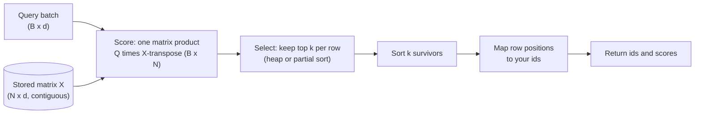

Every vector index in this module is an answer to one question: how do we avoid comparing the query with every stored vector? Before studying those answers, it pays to study the thing they avoid. A **flat index** stores the vectors as they are, with no structure on top, and answers each query by scoring every one of them. It is the simplest index there is, it is perfectly accurate, and it is far more useful in production than its name suggests.

This lesson treats the flat index as a piece of engineering: how it is laid out, why a well-implemented scan is ten or more times faster than a naive one, how batching changes its cost, how identifiers and deletes work, and the arithmetic that tells you when a flat index is enough and when it is not. The broader theory of exact search, including why clever tree structures fail in high dimensions, belongs to [Exact nearest neighbour search](/learn/vector-indexing-algorithms/exact-nearest-neighbour-search); here we stay with the concrete structure.

## Learning objectives

- Describe what a flat index stores and the three steps of a flat search: score, select, return.
- Implement a flat inner-product search in NumPy and reproduce its results with FAISS `IndexFlatIP`.
- Derive the identity that lets L2 distance be computed with a matrix product, and use it to explain why L2 and inner product rank unit vectors identically.
- Estimate the memory and per-query cost of a flat index from $N$, $d$ and memory bandwidth, and explain why batching queries raises throughput.
- Decide, for a stated collection size and latency budget, whether a flat index is the right choice.

## Prerequisites

- [Vector storage](/learn/vector-database-fundamentals/vector-storage): vectors as one contiguous row-major float32 matrix, and the memory arithmetic $N \times d \times b$.
- [Similarity search](/learn/vector-database-fundamentals/similarity-search): what a top-k query is.
- [Dot product](/learn/embedding-mathematics/dot-product) and [Euclidean distance](/learn/embedding-mathematics/euclidean-distance): the two scores a flat index computes.

## Why this matters

A flat index matters for three reasons, and only the first is obvious.

**It is often the right production index.** A surprising share of RAG collections are small: one team's runbooks, one customer's documents, one product's manuals. At tens or low hundreds of thousands of vectors, scoring everything takes a few milliseconds, has perfect recall, needs no training, no tuning parameters and no rebuilds, and accepts inserts and deletes instantly. Engineers who reach for an approximate index by reflex take on tuning work and a recall loss to solve a problem they do not have.

**It is the ground truth for every other index.** You cannot know how much an approximate index loses unless you know the right answer. Every recall figure for IVF, HNSW or a quantised index in this module is computed by comparing its results with a flat search over the same vectors. If you cannot run a flat search on a sample of your data, you cannot measure your retrieval.

**It is the inner loop of the other indexes.** IVF scans a few lists flatly, quantised indexes scan compressed codes flatly, and rescoring re-ranks candidates flatly. Its performance lessons reappear in every lesson that follows.

Without this understanding, teams deploy HNSW on 30,000 vectors and spend a week tuning it, or keep a flat index as a collection grows to 50 million vectors and watch latency grow until it breaks the service.

## The intuition

Imagine Meridian's support desk keeps 5,000 paper index cards, one per runbook, and a question arrives. The flat approach is to read every card, give each a relevance mark, and keep the ten best. It is tedious but it cannot miss: the best card is always found, because every card was read.

Two refinements make it fast. First, the clerk does not sort all 5,000 cards; she keeps a pile of the ten best so far and touches it only when a card beats the worst one in it. Second, if twenty questions arrive at once, she pulls each card once and marks it against all twenty while it is in her hand. Reading the cards is the slow part; marking is quick.

Those two refinements are, almost exactly, partial selection and batched search. Everything else is detail.

## How it works

### What a flat index stores

A flat index holds an $N \times d$ matrix of float32 values, one row per vector, stored contiguously, and nothing else apart from a count and, optionally, a mapping from row positions to your own identifiers. There is no training, no graph, no clusters. Adding vectors appends rows. The [Vector storage](/learn/vector-database-fundamentals/vector-storage) lesson describes this layout in detail; a flat index *is* that layout, with a search procedure attached.

That simplicity has consequences worth stating precisely:

- **Memory is exactly the raw vectors.** $N \times d \times 4$ bytes, with no index overhead.
- **Build time is a copy.** Adding a million vectors costs about as much as writing them to memory.
- **Recall is 1.0 by construction**, up to floating-point ties.
- **Query cost grows linearly with $N$.** Double the collection, double the work.

### The search procedure

For a single query vector $\mathbf{q}$ and a requested $k$:

1. **Score.** Compute the similarity (inner product or L2 distance) between $\mathbf{q}$ and every stored row. This produces $N$ numbers.
2. **Select.** Find the $k$ best scores among the $N$. This does not require sorting all $N$: a min-heap of size $k$ (for similarities) keeps the best seen so far, and each new score is compared only with the heap's worst element. Alternatively, a selection algorithm such as introselect (what NumPy's `argpartition` uses) finds the top $k$ in time linear in $N$.
3. **Order and return.** Sort the $k$ survivors, map their row positions to identifiers, and return identifiers with scores.



Step 1 dominates. For one query it costs $N \times d$ multiply-adds and, more importantly, reads all $N \times d \times 4$ bytes from memory. Step 2 costs about $N$ comparisons, a factor of $d$ less. Step 3 is negligible.

### Why the scan is limited by memory, not arithmetic

A modern CPU core can perform many floating-point operations per nanosecond using SIMD instructions (single instruction, multiple data: one instruction processes 8 or 16 floats at once). Main memory delivers data far more slowly than that. A dot product performs one multiply and one add for every 4 bytes it reads, which is very little work per byte. So when one query scans a large matrix, the core spends most of its time waiting for data to arrive. The scan is **memory-bandwidth bound**.

Two practical consequences follow.

- **Smaller numbers scan faster.** Halving the bytes per component (float16) or quartering them (int8) speeds up a scan roughly in proportion, as [Scalar quantisation](/learn/vector-indexing-algorithms/scalar-quantisation) explores.
- **Batching is nearly free throughput.** If $B$ queries are scored together, each stored row is read from memory once and used $B$ times while it sits in the CPU cache. The total arithmetic is the same as $B$ separate searches, but the memory traffic is divided by up to $B$. Libraries implement this by turning the scoring step into a **matrix-matrix product**: stack the queries into a $B \times d$ matrix $Q$, and compute $Q X^\top$, a $B \times N$ matrix of scores. Optimised linear algebra libraries (BLAS, the Basic Linear Algebra Subprograms) are extremely good at this operation because they tile it to reuse cached data.

This is why a flat index's throughput (queries per second) can be far higher than one divided by its single-query latency, and why offline jobs such as evaluation should always submit queries in batches.

### Inner product, cosine and L2 in one scan

A flat index supports the metrics your embedding model needs. FAISS offers `IndexFlatIP` (inner product, higher is better) and `IndexFlatL2` (squared Euclidean distance, lower is better). Cosine similarity is inner product on unit-length vectors, so for a model meant to be scored with cosine you normalise the vectors once at write time and use inner product, as [Vector normalisation](/learn/embedding-mathematics/vector-normalisation) explains.

L2 distance looks like a different computation, but it reduces to the same matrix product through an identity derived in the mathematics section: the squared distance equals the two squared lengths minus twice the inner product. A flat L2 index therefore precomputes each stored vector's squared length once, runs the same $Q X^\top$ product, and combines. On unit vectors both lengths are 1, so the squared distance is $2 - 2\,\mathbf{q}\cdot\mathbf{x}$: a decreasing function of the inner product, which means **identical rankings**. On vectors of varying length the two metrics rank differently, and you must use the one the model was trained with.

### Identifiers and deletes

Rows are addressed by position: 0, 1, 2 and so on, in the order they were added. Real systems need their own identifiers (chunk ids from the document store), so flat indexes are usually wrapped in an id map. In FAISS, `IndexIDMap` stores a parallel array of 64-bit ids, accepts them through `add_with_ids`, and translates positions back to ids on every search.

Deletes are where flat indexes are pleasantly simple. Because there is no structure to repair, removing a vector means removing its row. In FAISS, `remove_ids` on a flat index compacts the array, which costs time proportional to $N$ but leaves the index exactly as if the vector had never been added. Compare that with a graph index, where a deleted node's neighbours lose a link and the graph slowly degrades, as the [HNSW](/learn/vector-indexing-algorithms/hnsw) lesson describes. Database engines usually prefer tombstones (a "deleted" flag checked at search time) with periodic compaction, so that deletes do not block queries.

### Filters are easy and exact

Metadata filters ("only HR documents", "only this tenant") are a well-known pain for approximate indexes, because the structure that makes them fast was built over all vectors, not the filtered subset. A flat index has no such problem: scan only the rows that pass the filter, or scan all rows and skip those that fail. The result is still exact. FAISS exposes this through an `IDSelector` passed in search parameters; databases do it through payload indexes that yield the allowed row set. Engines such as Qdrant deliberately fall back to an exact scan of the filtered set when a filter is very selective, because scanning a few thousand allowed vectors is cheaper and more accurate than walking a graph in which most nodes are forbidden. [Filtering](/learn/vector-database-fundamentals/filtering) covers the strategies.

### Where flat indexes appear in real systems

FAISS has `IndexFlatIP`, `IndexFlatL2` and GPU equivalents. Qdrant accepts `exact=True` in a search request's parameters to bypass its HNSW index, and does not build a graph for segments below a configurable size. In pgvector, a vector column without an index is searched by an exact sequential scan.

## The mathematics

### Cost of a flat search

**Intuition.** Every stored component is read and multiplied once per query, so cost is the size of the matrix.

$$
\text{work per query} = N \cdot d \ \text{multiply-adds}, \qquad \text{bytes read per query} = N \cdot d \cdot b
$$

$N$ is the number of stored vectors, $d$ the dimension and $b$ the bytes per component (4 for float32). If memory delivers $W$ bytes per second to the scan, a single query takes at least

$$
t_{\text{query}} \gtrsim \frac{N \cdot d \cdot b}{W}
$$

and a batch of $B$ queries, reading the matrix once, takes not much more than one query's worth of reading plus $B$ times the arithmetic.

**By hand.** Meridian's collection of 200,000 chunks at 384 dimensions, float32, with an assumed effective bandwidth of 10 GB/s for one core:

- Bytes: $200{,}000 \times 384 \times 4 = 307{,}200{,}000$ bytes, about 307 MB.
- Time: $307.2 \times 10^6 / (10 \times 10^9) \approx 0.031$ seconds, about 31 ms per query on one core.
- With 8 cores sharing the scan (and an assumed 40 GB/s total), about 8 ms.

The bandwidth figures are assumptions; measure your own hardware. The method is what matters: bytes divided by bandwidth.

### The L2 expansion

**Intuition.** Squared distance can be split into "how long is each vector" and "how aligned are they". The lengths can be precomputed; the alignment is the inner product we already know how to compute fast.

$$
\lVert \mathbf{q} - \mathbf{x} \rVert^2 = \sum_{i=1}^{d} (q_i - x_i)^2 = \lVert \mathbf{q} \rVert^2 - 2\, \mathbf{q} \cdot \mathbf{x} + \lVert \mathbf{x} \rVert^2
$$

$\mathbf{q}$ is the query, $\mathbf{x}$ a stored vector, $q_i$ and $x_i$ their components, and $\lVert \cdot \rVert$ the Euclidean length. Expanding $(q_i - x_i)^2 = q_i^2 - 2 q_i x_i + x_i^2$ and summing over $i$ gives the right-hand side. For unit vectors, $\lVert \mathbf{q} \rVert^2 = \lVert \mathbf{x} \rVert^2 = 1$, so $\lVert \mathbf{q} - \mathbf{x} \rVert^2 = 2 - 2\,\mathbf{q}\cdot\mathbf{x}$.

**By hand.** $\mathbf{q} = (1, 2)$, $\mathbf{x} = (3, 1)$.

- Direct: $(1-3)^2 + (2-1)^2 = 4 + 1 = 5$.
- Expansion: $\lVert \mathbf{q} \rVert^2 = 1 + 4 = 5$; $\lVert \mathbf{x} \rVert^2 = 9 + 1 = 10$; $\mathbf{q} \cdot \mathbf{x} = 3 + 2 = 5$. So $5 - 2 \times 5 + 10 = 5$. The same.

```python
import numpy as np

q, x = np.array([1.0, 2.0]), np.array([3.0, 1.0])
direct = np.sum((q - x) ** 2)
expanded = q @ q - 2 * (q @ x) + x @ x
print(direct, expanded)

# Cost of one flat query on Meridian's collection, at an assumed 10 GB/s
N, d, b, W = 200_000, 384, 4, 10e9
print(f"{N * d * b / 1e6:.1f} MB read, about {N * d * b / W * 1e3:.0f} ms per query")
```

```output
5.0 5.0
307.2 MB read, about 31 ms per query
```

One caution: when $\mathbf{q}$ and $\mathbf{x}$ are close, the expansion subtracts nearly equal numbers and loses floating-point precision, which is why libraries sometimes report tiny negative squared distances for identical vectors.

## In code

**The problem.** Build a flat index two ways (by hand in NumPy, and with FAISS), confirm they return the same neighbours, measure the effect of batching, verify the L2 identity on real search results, and use your own identifiers with a delete.

**Dependencies.** NumPy and FAISS (the CPU build). No model download: the vectors are synthetic, clustered around 200 topic centres and normalised, which imitates the structure of real embeddings.

```bash
pip install numpy faiss-cpu
```

```python
import time
import numpy as np
import faiss

rng = np.random.default_rng(0)
N, d, k, n_queries = 100_000, 384, 10, 1_000

# Clustered synthetic "embeddings", unit length, float32 (FAISS requires float32).
centres = rng.normal(size=(200, d))
X = centres[rng.integers(0, 200, N)] + 0.7 * rng.normal(size=(N, d))
X = (X / np.linalg.norm(X, axis=1, keepdims=True)).astype(np.float32)
Q = centres[rng.integers(0, 200, n_queries)] + 0.7 * rng.normal(size=(n_queries, d))
Q = (Q / np.linalg.norm(Q, axis=1, keepdims=True)).astype(np.float32)

# 1. A flat index from scratch: one matrix product, then a partial sort.
def numpy_flat_search(Q, X, k):
    S = Q @ X.T                                         # (n_queries, N) inner products
    idx = np.argpartition(-S, k, axis=1)[:, :k]         # unordered top k per row
    top = np.take_along_axis(S, idx, axis=1)
    order = np.argsort(-top, axis=1)                    # sort only those k
    return np.take_along_axis(top, order, axis=1), np.take_along_axis(idx, order, axis=1)

t = time.perf_counter()
D_np, I_np = numpy_flat_search(Q, X, k)
t_np = time.perf_counter() - t

# 2. The same thing with FAISS.
index = faiss.IndexFlatIP(d)                            # inner product; = cosine on unit vectors
index.add(X)                                            # no training step: it just copies
t = time.perf_counter()
D_f, I_f = index.search(Q, k)                           # all 1,000 queries in one call
t_batch = time.perf_counter() - t

t = time.perf_counter()
for i in range(n_queries):                              # the same queries one at a time
    index.search(Q[i:i + 1], k)
t_single = time.perf_counter() - t

print(f"vectors: {index.ntotal:,}  dim: {index.d}  is_trained: {index.is_trained}")
print(f"memory of stored vectors: {X.nbytes / 1e6:.1f} MB")
same_sets = np.mean([set(a) == set(b) for a, b in zip(I_np, I_f)])
print(f"queries with identical top-{k} sets in NumPy and FAISS: {same_sets:.0%}")
print(f"largest score difference: {np.abs(D_np - D_f).max()}")
print(f"NumPy, 1,000 queries batched : {t_np * 1e3:7.1f} ms")
print(f"FAISS, 1,000 queries batched : {t_batch * 1e3:7.1f} ms")
print(f"FAISS, 1,000 queries singly  : {t_single * 1e3:7.1f} ms")

# 3. L2 through the same matrix product: ||q - x||^2 = ||q||^2 - 2 q.x + ||x||^2
l2 = faiss.IndexFlatL2(d)
l2.add(X)
D_l2, I_l2 = l2.search(Q[:5], k)
D_ip, I_ip = index.search(Q[:5], k)
print("L2 and IP give the same ranking on unit vectors:", np.array_equal(I_l2, I_ip))
print("first query, top 3 IP scores:", np.round(D_ip[0, :3], 4))
print("first query, top 3 squared L2:", np.round(D_l2[0, :3], 4),
      "= 2 - 2*IP:", np.round(2 - 2 * D_ip[0, :3], 4))

# 4. Your own ids, and deletion.
idmap = faiss.IndexIDMap(faiss.IndexFlatIP(d))
ids = np.arange(N, dtype=np.int64) + 5_000_000          # e.g. chunk ids from your database
idmap.add_with_ids(X, ids)
_, I_before = idmap.search(Q[:1], 3)
removed = idmap.remove_ids(np.array([I_before[0, 0]], dtype=np.int64))
_, I_after = idmap.search(Q[:1], 3)
print("top 3 before delete:", I_before[0].tolist())
print(f"removed {removed}; top 3 after: ", I_after[0].tolist())
```

The timings below come from a 10-core laptop; yours will differ, but the ratios are what to look at.

```output
vectors: 100,000  dim: 384  is_trained: True
memory of stored vectors: 153.6 MB
queries with identical top-10 sets in NumPy and FAISS: 100%
largest score difference: 0.0
NumPy, 1,000 queries batched :   699.2 ms
FAISS, 1,000 queries batched :    60.5 ms
FAISS, 1,000 queries singly  :  1288.2 ms
L2 and IP give the same ranking on unit vectors: True
first query, top 3 IP scores: [0.7251 0.7129 0.7117]
first query, top 3 squared L2: [0.5497 0.5743 0.5766] = 2 - 2*IP: [0.5497 0.5743 0.5766]
top 3 before delete: [5070501, 5047868, 5046367]
removed 1; top 3 after:  [5047868, 5046367, 5022590]
```

**The important lines.**

- `Q @ X.T` is the whole scoring step as a single matrix product, which NumPy hands to its BLAS library. It materialises a $1{,}000 \times 100{,}000$ score matrix (400 MB of float32), which is why real implementations process queries and stored vectors in blocks rather than all at once.
- `np.argpartition(-S, k, axis=1)` is the selection step: it moves the $k$ largest scores of each row into the first $k$ positions in linear time, without sorting the rest. Only those $k$ are then sorted.
- `faiss.IndexFlatIP(d)` creates an empty flat index for inner product. `index.is_trained` is already `True`: there is nothing to learn. `index.add(X)` copies the rows in.
- `index.search(Q, k)` returns two arrays of shape `(n_queries, k)`: scores `D` and row positions `I`, best first. FAISS fuses scoring and selection in blocks, so it never builds the full score matrix.
- `faiss.IndexIDMap(...)` with `add_with_ids` attaches your 64-bit ids. Search results then contain your ids rather than positions, and `remove_ids` deletes by id.

**What the output means.**

- **Correctness.** NumPy and FAISS agree on every query's top-10 set and on the scores. (Comparing *positions* rather than sets, you may see two results with exactly equal scores swap places; ties can be broken either way.)
- **Implementation quality.** FAISS's batched search is more than ten times faster than the NumPy version on the same machine. Both do the same arithmetic; FAISS avoids materialising the full score matrix and selects the top $k$ while the scores are still in cache.
- **Batching.** The same 1,000 queries sent one at a time take about twenty times longer than sent as one batch. Per-query overheads and repeated reading of the 154 MB matrix dominate when queries arrive singly. Online services see single queries, so their latency is what you must budget for; offline jobs (evaluation, deduplication, backfills) should always batch.
- **The L2 identity.** The squared L2 distances equal $2 - 2 \times$ the inner products to four decimal places, and the two indexes return identical rankings, exactly as the mathematics predicted for unit vectors.
- **Ids and deletes.** After deleting the top result, the others move up, exactly as if that vector had never been added.

**Errors people commonly hit.**

- Passing float64 arrays to FAISS. NumPy defaults to float64, and FAISS requires float32 and C-contiguous arrays; convert with `.astype(np.float32)` and, after slicing columns, `np.ascontiguousarray`.
- Using `IndexFlatIP` on vectors that were never normalised, while believing it computes cosine. Long vectors win regardless of direction.
- Reading `D` from `IndexFlatL2` as a distance: it is the **squared** distance. Take the square root if you need the real distance (the ranking is the same).
- Keeping your own list of ids in parallel with an `IndexFlatIP` and then calling `remove_ids`. Removal compacts the rows, shifting every later position, so your list is now wrong. Use `IndexIDMap`.

**Extending it.** Time `index.search` for single queries at $N$ = 25,000, 50,000, 100,000 and 200,000 and plot latency against $N$: it should be close to a straight line. Then pass `params=faiss.SearchParameters(sel=faiss.IDSelectorRange(0, 10_000))` to restrict search to the first 10,000 rows and confirm the results equal a flat search over `X[:10_000]`.

## A real-world example

When Meridian's Platform team added a separate collection for the HR team's policy documents, the plan in the design review was to configure it like the main AskMeridian collection, with an HNSW index and the same tuning parameters. Naomi, who owned the HR integration, asked how many chunks the collection would hold. The answer was about 6,000: the employee handbook, the expenses policy, the remote-work policy and a few dozen FAQs.

She did the arithmetic in the review. At 384 dimensions, 6,000 float32 vectors are about 9.2 MB; a full scan is well under a millisecond, less than the network round trip to the database. An HNSW graph would add memory, build time on every reload of the handbook, and a recall loss to monitor, all to save time nobody could measure.

The team used exact search, setting `exact=True` in the Qdrant search parameters to make the intent explicit. Two later benefits surprised them. Permission filters (some HR documents are visible only to managers) are exact and cheap, because the scan simply skips forbidden rows. And when the handbook was reissued, re-indexing was a delete and an insert, with no rebuild to schedule.

The team also kept a flat index for a second purpose: a nightly job runs 300 evaluation questions against both the production HNSW collection and an exact scan, and alerts if recall@10 falls.

## Common mistakes

- **Using an approximate index for a small collection.** You gain nothing measurable and inherit tuning, rebuilds and recall loss. Below a few hundred thousand vectors, start with a flat index and measure.
- **Keeping a flat index while the collection grows by orders of magnitude.** Latency grows linearly with $N$. A design that is fine at 100,000 vectors is not at 50 million; put a size threshold in the capacity plan.
- **Quoting batched benchmark results as online latency.** Batch throughput can be ten or more times better than single-query latency implies. Measure the way production calls it.
- **Assuming "exact" means "correct".** A flat index returns the true nearest neighbours of the vectors you gave it; with poor embeddings or badly cut chunks, the exact answer is exactly wrong.
- **Holding your own position-to-id list.** Deletions shift positions; mismatched ids return the wrong chunks with plausible scores.

## Best practices

- Start with a flat index whenever the collection is small enough for your latency budget; move to an approximate index when arithmetic or measurement says you must.
- Keep a flat search available on a sample of production data, and use it to measure the recall of whatever index serves traffic.
- Normalise once at write time for cosine models, and use inner product.
- Batch offline queries; for online traffic, measure single-query latency at the 95th or 99th percentile.
- With many small tenants, consider a flat index (or filtered exact scan) per tenant rather than one shared approximate index.

## Performance considerations

**Memory.** Exactly $N \times d \times b$. One million 768-dimension float32 vectors take $10^6 \times 768 \times 4 = 3.07$ GB. Ten million take 30.7 GB, which no longer fits on a modest server.

**Latency.** Linear in $N$. With an assumed 20 GB/s available to one query, one million 768-dimension float32 vectors take at least $3.07 \times 10^9 / (20 \times 10^9) \approx 0.15$ s per query: too slow for an interactive assistant that must also embed, rerank and generate. The same scan over 100,000 vectors takes about 15 ms, which is fine.

**Throughput.** Batching concurrent queries multiplies queries per second, but most RAG services handle one request at a time, so plan on single-query latency.

**Compression and hardware.** Since the scan is bandwidth-bound, int8 storage cuts scan time roughly fourfold, and a GPU's higher memory bandwidth scans proportionally faster.

**The crossover.** A rough planning rule: if $N \times d \times b$ divided by your realistic bandwidth exceeds about a tenth of your retrieval latency budget, start evaluating approximate indexes. The precise trade-off is the subject of [Recall versus latency](/learn/vector-indexing-algorithms/recall-versus-latency).

## Security considerations

A flat index has no notion of who may see which vector. Access control must be enforced as a filter on the scan or by separate indexes per tenant, never by hoping unauthorised chunks rank low. Filtering a flat scan is exact: a forbidden row is skipped, not merely ranked lower. A separate index per tenant is the strongest isolation, because a bug in filter construction cannot leak another tenant's vectors.

## Summary

- A flat index stores the raw $N \times d$ matrix and nothing else; a query scores every row, selects the top $k$ with a heap or partial sort, and maps positions to ids.
- It has perfect recall, no training, no parameters, instant inserts and deletes, and exact filtering, at a cost that grows linearly with $N$.
- The scan is limited by memory bandwidth, so smaller numbers scan faster and batched queries share the cost of reading the matrix.
- L2 distance reduces to an inner product plus precomputed lengths; on unit vectors, L2 and inner product rank identically.
- Flat search is the ground truth for measuring every approximate index, and the right production choice for small collections.

## Exercises

**1.** A collection holds 2 million chunks embedded at 1,024 dimensions in float32. Compute the memory of a flat index. With an assumed effective bandwidth of 25 GB/s, estimate the minimum single-query latency. Is a flat index suitable for an interactive assistant with a 50 ms retrieval budget?

<details><summary>Show solution</summary>

Memory: $2 \times 10^6 \times 1{,}024 \times 4 = 8{,}192{,}000{,}000$ bytes, about 8.2 GB.

Latency: $8.192 \times 10^9 / (25 \times 10^9) \approx 0.33$ s, about 330 ms.

No. A single query alone would use more than six times the whole budget. Options are an approximate index, int8 storage (about 82 ms, still over budget), or a GPU scan. An approximate index is the usual answer at this size.

</details>

**2.** Two stored vectors are $\mathbf{x}_1 = (2, 0)$ and $\mathbf{x}_2 = (0.6, 0.8)$, and the query is $\mathbf{q} = (0.8, 0.6)$. Rank them by inner product and by squared L2 distance. Why do the rankings differ, and which should you use?

<details><summary>Show solution</summary>

Inner product: $\mathbf{q}\cdot\mathbf{x}_1 = 1.6$, $\mathbf{q}\cdot\mathbf{x}_2 = 0.48 + 0.48 = 0.96$. Inner product ranks $\mathbf{x}_1$ first.

Squared L2: $\lVert \mathbf{q} - \mathbf{x}_1 \rVert^2 = 1.44 + 0.36 = 1.80$; $\lVert \mathbf{q} - \mathbf{x}_2 \rVert^2 = 0.04 + 0.04 = 0.08$. L2 ranks $\mathbf{x}_2$ first.

They differ because $\mathbf{x}_1$ has length 2 and $\mathbf{x}_2$ length 1. Inner product rewards length; L2 penalises the difference in length. Use the metric the embedding model was trained with: inner product for a dot-product model, and for a cosine model normalise all vectors, after which both metrics agree.

</details>

**3.** Write a function `blocked_search(Q, X, k, block=20_000)` that returns the same top-$k$ ids and scores as `numpy_flat_search` from the lesson but never builds a score matrix wider than `block` columns. Verify it against `faiss.IndexFlatIP` on the lesson's data.

<details><summary>Show solution</summary>

Scan the stored matrix in column blocks, keep a running top $k$ per query, and merge each block's candidates with it.

```python
def blocked_search(Q, X, k, block=20_000):
    best_s = np.full((len(Q), k), -np.inf, dtype=np.float32)
    best_i = np.full((len(Q), k), -1, dtype=np.int64)
    for start in range(0, len(X), block):
        S = Q @ X[start:start + block].T                       # (n_queries, <= block)
        cand_s = np.concatenate([best_s, S], axis=1)
        cand_i = np.concatenate([best_i, np.broadcast_to(
            np.arange(start, start + S.shape[1]), S.shape)], axis=1)
        keep = np.argpartition(-cand_s, k, axis=1)[:, :k]
        best_s = np.take_along_axis(cand_s, keep, axis=1)
        best_i = np.take_along_axis(cand_i, keep, axis=1)
    order = np.argsort(-best_s, axis=1)
    return np.take_along_axis(best_s, order, axis=1), np.take_along_axis(best_i, order, axis=1)

D_b, I_b = blocked_search(Q, X, 10)
print(np.mean([set(a) == set(b) for a, b in zip(I_b, I_f)]))   # 1.0
```

Peak memory for scores is now $1{,}000 \times 20{,}000 \times 4 = 80$ MB instead of 400 MB. This is, in miniature, what FAISS does internally.

</details>

**4.** Design decision. AskMeridian is adding a "customer workspaces" feature: each of 2,000 customers has its own documents, from 500 to 40,000 chunks per customer (384 dimensions), and a query must only see one customer's chunks. Compare (a) one shared HNSW index with a customer filter, and (b) one flat index per customer. Which would you choose, and what would make you change your mind?

<details><summary>Show solution</summary>

The largest customer has 40,000 vectors, about 61 MB in float32; a full scan is a few milliseconds. So (b) meets any reasonable latency budget with perfect recall, exact isolation (a query physically cannot touch another customer's vectors), trivial deletes when a customer leaves, and no graph tuning. Total memory equals the raw vectors in either design, and (b) avoids the graph overhead.

(a) suffers from selective filtering: each customer is a tiny fraction of the shared graph, so traversal becomes inefficient or inaccurate unless the engine handles it specially. Its advantage is one index to manage instead of 2,000.

Choose (b), or its database equivalent (a payload-indexed customer field with exact search), and move any customer that grows past a few hundred thousand chunks to its own approximate index. [Multi-tenancy](/learn/advanced-vector-database-engineering/multi-tenancy) discusses the general pattern.

</details>

## Check your understanding

```quiz
[
  {
    "q": "What does a FAISS `IndexFlatIP` store in addition to the raw vectors?",
    "options": [
      "A k-means codebook learned during training",
      "A neighbour graph built during insertion",
      "Nothing substantial: just the vectors and a count",
      "A compressed copy of each vector for fast scanning"
    ],
    "answer": 2,
    "why": "A flat index is the raw matrix with a search procedure. It needs no training and keeps no auxiliary structure."
  },
  {
    "q": "Why does sending 1,000 queries to a flat index in one batch take far less time than sending them one at a time?",
    "options": [
      "Batched search skips vectors that scored poorly for earlier queries",
      "Each stored vector is read from memory once and reused for many queries while it is in cache",
      "Batched search uses an approximate algorithm",
      "FAISS caches the answers to previous queries"
    ],
    "answer": 1,
    "why": "The scan is limited by memory bandwidth. Batching turns many matrix-vector products into one matrix-matrix product that reuses cached data."
  },
  {
    "q": "All vectors in an index are normalised to unit length. How do the rankings from inner product and squared L2 distance compare?",
    "options": [
      "They are identical, because squared L2 equals 2 minus twice the inner product",
      "They are reversed",
      "They differ unpredictably",
      "They agree only for the top result"
    ],
    "answer": 0,
    "why": "For unit vectors the squared distance is a decreasing function of the inner product, so ordering by one is ordering by the other."
  },
  {
    "q": "A flat index over 500,000 float32 vectors of 768 dimensions is scanned at an effective 20 GB/s. Roughly how long does one query take at minimum?",
    "options": [
      "About 0.08 ms",
      "About 8 s",
      "About 0.8 ms",
      "About 77 ms"
    ],
    "answer": 3,
    "why": "500,000 x 768 x 4 bytes is about 1.54 GB; divided by 20 GB/s that is about 0.077 s."
  },
  {
    "q": "Why is metadata filtering simpler with a flat index than with a graph index?",
    "options": [
      "Flat indexes store metadata inside each vector",
      "Rows that fail the filter are simply skipped, and the result over the remaining rows is still exact",
      "Flat indexes ignore filters",
      "Graph indexes cannot store metadata"
    ],
    "answer": 1,
    "why": "A flat scan has no structure that depends on which vectors are present, so restricting it to an allowed subset keeps it exact."
  }
]
```

## Further reading

- Johnson, Douze and Jégou (2017), "Billion-scale similarity search with GPUs", [arXiv:1702.08734](https://arxiv.org/abs/1702.08734). Includes how exact k-selection and brute-force search are implemented efficiently on GPUs.
- Douze et al. (2024), "The Faiss library", [arXiv:2401.08281](https://arxiv.org/abs/2401.08281). A survey of the library's index types, starting from flat search.
- FAISS wiki, [github.com/facebookresearch/faiss/wiki](https://github.com/facebookresearch/faiss/wiki): "Getting started" and "Faiss indexes" pages describe `IndexFlatL2`, `IndexFlatIP` and `IndexIDMap`.
- Qdrant documentation, [Search](https://qdrant.tech/documentation/concepts/search/): exact search with `exact=True`.
- pgvector, [github.com/pgvector/pgvector](https://github.com/pgvector/pgvector): exact search by sequential scan, and when to add an approximate index.
