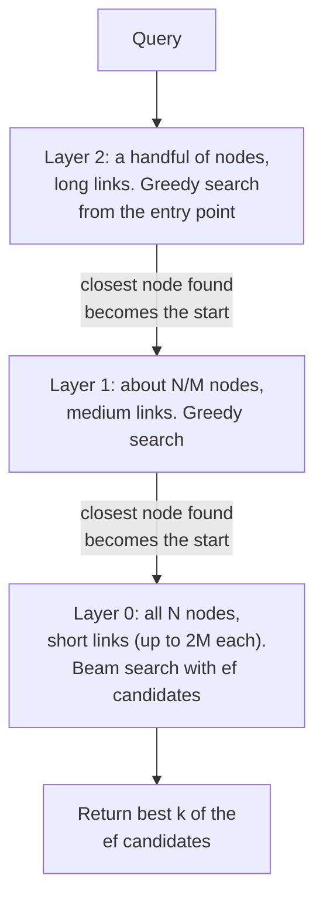

**Hierarchical Navigable Small World** graphs, almost always called **HNSW**, are the default vector index in most of the databases a RAG engineer will use: Qdrant, Weaviate, pgvector's `hnsw` index type, Elasticsearch, OpenSearch, Redis and Milvus all offer it, and several use it by default. Where [IVF](/learn/vector-indexing-algorithms/ivf) divides the space into regions, HNSW links each vector to a few of its neighbours and answers a query by walking the links, starting with long jumps and finishing with short steps.

This lesson builds HNSW from its two ideas, a navigable graph and a hierarchy of layers, then walks through insertion and search step by step, explains its three parameters (`M`, `efConstruction` and `efSearch`), measures them in FAISS, and covers the operational facts that matter in production: memory overhead, build time, deletions and filtered search.

## Learning objectives

- Explain how greedy search on a proximity graph finds near neighbours, and why it can get stuck in a local minimum.
- Describe the layered structure of HNSW, how a node's top layer is chosen, and how search descends the layers.
- Explain what `M`, `efConstruction` and `efSearch` control, and predict the effect of changing each on recall, latency, memory and build time.
- Build and tune a FAISS `IndexHNSWFlat` and measure recall against a flat baseline.
- Identify HNSW's operational weak points (memory overhead, slow builds, deletions, restrictive filters) and how databases address them.

## Prerequisites

- [Flat indexes](/learn/vector-indexing-algorithms/flat-indexes): exhaustive search and its role as ground truth.
- [IVF](/learn/vector-indexing-algorithms/ivf): the other main family of approximate index, and the idea of trading recall for speed with a search-time parameter.
- [Vector storage](/learn/vector-database-fundamentals/vector-storage): segments and memory budgets.

## Why this matters

Because HNSW is the default, it is the index you are most likely to be running without having chosen it. That makes its parameters the ones you most need to understand. Three situations recur in practice.

First, **the default search breadth may not be enough for your data.** HNSW is approximate; at a given search setting it misses some true neighbours, and how many depends on the data, the dimension and the parameters. If you never measure recall, you do not know whether your retriever is losing 1% or 20% of the relevant chunks before the reranker or the language model ever sees them.

Second, **memory and build time are real costs.** The graph is usually held in RAM, and building it is far slower than building a flat or IVF index, which matters when re-indexing after a model change.

Third, **graphs handle deletions and restrictive filters badly** unless the database compensates. Knowing why lets you recognise the symptoms (recall that decays over months of updates, filtered queries returning too few results) and choose the right remedy.

## The intuition

Imagine trying to reach a particular house in an unfamiliar country with no map, only signposts. At each junction you can see the roads leading away and roughly how far each destination is from your goal. A simple strategy is to always take the road that brings you closest to the goal, and stop when no road gets you closer. This is **greedy search**.

If the only roads are short local lanes, greedy search works but takes thousands of steps. If there are also motorways, you can cover most of the distance in a few long jumps and then switch to local lanes for the last stretch. A network with both long and short links, in which a few hops connect any two points, is a **small world**: the same property that lets any two people be connected through a short chain of acquaintances.

HNSW builds exactly this, in an orderly way. It keeps several layers of road network. The top layer has very few towns and long roads between them; each lower layer has more towns and shorter roads; the bottom layer contains every town, linked to its near neighbours. You start at the top, drive greedily until you can get no closer, drop down a layer at that spot, and repeat. By the time you reach the bottom layer, you are already in the right neighbourhood.

```playground
hnsw
```

## How it works

### Proximity graphs and greedy search

A **proximity graph** has one node per stored vector and edges (links) between vectors that are near each other. Greedy search on it works like this:

1. Start at an entry node.
2. Compute the distance from the query to each neighbour of the current node.
3. If the best neighbour is closer to the query than the current node, move there and repeat from step 2.
4. Otherwise stop: the current node is a **local minimum**, and it is returned.

The trace below runs greedy search on a toy graph of six points on a line, at positions A = 0, B = 3, C = 5, D = 7, E = 8, F = 10, looking for the point nearest to the query at 7.6. Node A has a long-range link to F, which is the "motorway".

```trace
{"title": "Greedy search on a six-node graph (query at 7.6)", "code": ["def greedy(entry, q):", "    current = entry", "    while True:", "        best = min(links[current], key=lambda n: abs(pos[n] - q))", "        if abs(pos[best] - q) >= abs(pos[current] - q):", "            return current", "        current = best"], "steps": [{"line": 2, "vars": {"current": "A (distance 7.6)"}, "note": "Start at the entry node A, at position 0."}, {"line": 4, "vars": {"current": "A (distance 7.6)", "links[A]": "[B, F]", "best": "F (distance 2.4)"}, "note": "B is 4.6 away, F is 2.4 away. The long link to F wins."}, {"line": 7, "vars": {"current": "F (distance 2.4)"}, "note": "F is closer than A, so move. One hop covered most of the distance."}, {"line": 4, "vars": {"current": "F (distance 2.4)", "links[F]": "[A, E]", "best": "E (distance 0.4)"}, "note": "From F, neighbour E is only 0.4 away."}, {"line": 7, "vars": {"current": "E (distance 0.4)"}, "note": "Move to E."}, {"line": 4, "vars": {"current": "E (distance 0.4)", "links[E]": "[D, F]", "best": "D (distance 0.6)"}, "note": "The best neighbour of E is D, at 0.6."}, {"line": 6, "vars": {"current": "E (distance 0.4)"}, "out": ["E"], "note": "D is not closer than E, so E is a local minimum and is returned. Here it is also the true nearest neighbour."}]}
```

Without the A to F link, the walk would have stepped through B, C and D. With it, two hops sufficed. The weakness is equally visible: greedy search stops at the first local minimum, which need not be the global one. If the graph lacks a link that leads towards the true nearest neighbour, the search never finds it.

HNSW fixes both problems: the layers supply the long links in an organised way, and a **beam search** (keeping several candidates instead of one) makes local minima much less likely to trap the search.

### The layers

Every stored vector appears in layer 0, the bottom layer. Some also appear in layer 1, fewer in layer 2, and so on, like an express-lane system or the skip list data structure that inspired it. A vector's top layer is chosen at random when it is inserted, with probability falling geometrically: with the standard setting, roughly one vector in $M$ reaches layer 1, one in $M^2$ reaches layer 2, and so on. The mathematics section derives this.

On each layer, each vector is linked to up to $M$ near neighbours that are also on that layer (up to $2M$ on layer 0, which needs more links because it holds everyone). Because upper layers are sparse, their links span large distances; because layer 0 is dense, its links are short. A single **entry point**, a vector on the top layer, is where every search begins.



### Searching

For a query $\mathbf{q}$, a requested $k$ and a search breadth `efSearch` (written `ef`):

1. Start at the entry point on the top layer.
2. On each layer above 0, run greedy search (a beam of one) to find the node nearest to $\mathbf{q}$ on that layer, and use it as the starting point on the layer below.
3. On layer 0, run a **beam search**: keep a candidate set of up to `ef` nodes. Repeatedly take the closest unexpanded candidate, compute the distance from $\mathbf{q}$ to each of its neighbours not yet visited, and add any that are closer than the worst of the current `ef` candidates (dropping the worst if the set is full).
4. Stop when the closest unexpanded candidate is farther than the worst member of the set: no expansion can improve it.
5. Return the best $k$ of the `ef` candidates.

`ef` must be at least $k$. Larger `ef` explores more of the graph, escapes more local minima, finds more true neighbours, and costs more distance computations. It is a query-time setting: changing it needs no rebuild, which makes it the main tuning knob in production.

### Inserting

HNSW is built by inserting vectors one at a time; there is no separate training step.

1. Draw the new vector's top layer $\ell$ at random.
2. From the entry point, greedy-search down the layers above $\ell$ to find a good starting node.
3. On each layer from $\ell$ down to 0, run the beam search with breadth `efConstruction` to find candidate neighbours.
4. Choose up to $M$ of them (up to $2M$ on layer 0) using a **neighbour selection heuristic**, and link the new vector to them in both directions.
5. If a neighbour now has too many links, prune its list back to the maximum with the same heuristic.
6. If $\ell$ is above the current top layer, the new vector becomes the entry point.

The heuristic in step 4 matters more than it looks. Taking the $M$ closest candidates tends to pick neighbours that are all in one direction, clustered together, which leaves the node poorly connected to other regions. The heuristic from the original paper instead accepts a candidate only if it is closer to the new vector than to any neighbour already selected. This favours neighbours in different directions, keeps the graph navigable across cluster boundaries, and is a large part of why HNSW works well on clustered data.

### The three parameters

| Parameter | When it is used | Raising it | Typical starting values |
| --- | --- | --- | --- |
| `M` | Build | More links per node: higher recall at a given `ef`, more memory, slower build and slightly slower search per step | 16; 32 or more for high-dimensional or hard data |
| `efConstruction` | Build | Better neighbour choices: higher graph quality, slower build | 64 to 200 |
| `efSearch` (`ef`) | Query | More candidates explored: higher recall, higher latency | Tune per workload; at least $k$ |

Defaults vary by product, and they change between versions. At the time of writing, pgvector uses `m` = 16 and `ef_construction` = 64 with `hnsw.ef_search` = 40, Qdrant uses `m` = 16 and `ef_construct` = 100, and FAISS initialises `efConstruction` to 40 and `efSearch` to 16. Check the current documentation for your version, and treat any default as a starting point to measure.

### Deletions

Removing a node from a graph breaks paths that ran through it, and its neighbours lose a link they relied on. Repairing the graph properly means re-linking those neighbours, which is expensive. Implementations therefore take shortcuts: hnswlib marks nodes as deleted and skips them in results while still walking through them; database engines such as Qdrant mark points deleted and rebuild the graph for a segment in the background when enough have accumulated. FAISS's `IndexHNSWFlat` does not support removal at all. The consequence for heavily updated collections is that graph quality can drift between rebuilds, and rebuilds cost CPU. [Index updates](/learn/advanced-vector-database-engineering/index-updates) covers the operational side.

### Filtered search

A metadata filter ("only HR documents") interacts badly with a graph. If only 1% of nodes pass the filter, most of the paths the search would follow run through forbidden nodes. A search that skips forbidden nodes entirely can be cut off from the allowed region; one that walks through them but does not return them must explore far more of the graph to collect $k$ allowed results. Databases handle this in different ways: falling back to an exact scan of the filtered set when it is small (as discussed in [Flat indexes](/learn/vector-indexing-algorithms/flat-indexes)), adding extra links between nodes that share common filter values, or continuing the search until enough results pass. [Metadata filtering](/learn/advanced-vector-database-engineering/metadata-filtering) treats the strategies in depth.

## The mathematics

### How a node's top layer is drawn

**Intuition.** Each layer should hold a constant fraction of the layer below, so that the number of layers grows only logarithmically with $N$. Drawing the level from an exponential distribution achieves this.

$$
\ell = \left\lfloor -\ln(U) \cdot m_L \right\rfloor, \qquad U \sim \text{Uniform}(0, 1), \qquad m_L = \frac{1}{\ln M}
$$

$\ell$ is the node's top layer, $U$ a uniform random number, $\lfloor \cdot \rfloor$ rounds down, and $m_L$ the **level multiplier**, set to $1/\ln M$ as the paper recommends. The probability of reaching layer $\ell$ or above is

$$
P(\text{level} \ge \ell) = P\!\left(-\ln U \ge \ell \ln M\right) = P\!\left(U \le M^{-\ell}\right) = M^{-\ell}
$$

So layer $\ell$ holds about $N / M^{\ell}$ nodes, and the number of layers is about $\log_M N$.

**By hand.** $N = 200{,}000$, $M = 16$.

- Layer 1: $200{,}000 / 16 = 12{,}500$ nodes.
- Layer 2: $200{,}000 / 256 \approx 781$ nodes.
- Layer 3: $200{,}000 / 4{,}096 \approx 49$ nodes.
- Number of layers: $\log_{16} 200{,}000 = \ln 200{,}000 / \ln 16 \approx 12.21 / 2.77 \approx 4.4$.

The code below builds exactly this graph; FAISS reports 12,631, 749 and 40 nodes on layers 1 to 3, and a top layer of 5, close to the prediction for a random process.

```python
import numpy as np

N, M = 200_000, 16
print("expected nodes on layers 1-3:", [round(N / M**l) for l in (1, 2, 3)])
print(f"expected number of layers: {np.log(N) / np.log(M):.1f}")

rng = np.random.default_rng(0)
levels = np.floor(-np.log(rng.random(N)) / np.log(M)).astype(int)
print("simulated nodes on layers 1-3:", [int(np.sum(levels >= l)) for l in (1, 2, 3)])
```

```output
expected nodes on layers 1-3: [12500, 781, 49]
expected number of layers: 4.4
simulated nodes on layers 1-3: [12459, 807, 57]
```

### Memory of the graph

**Intuition.** Each node stores its links as integer ids; layer 0 dominates because every node is there with twice as many links.

$$
\text{graph bytes} \approx N \cdot \left(2M \cdot b_{\text{id}} + \frac{M \cdot b_{\text{id}}}{M - 1}\right)
$$

$b_{\text{id}}$ is the bytes per stored link id (4 in FAISS). The first term is layer 0's $2M$ links per node; the second is the upper layers, where a fraction $1/M + 1/M^2 + \dots = 1/(M-1)$ of nodes store $M$ links each. For $M = 16$: $N \times (128 + 4.3) \approx 132$ bytes per node, or about 26 MB for 200,000 nodes, which is what FAISS reports below. For 384-dimension float32 vectors (1,536 bytes each), that is under 9% overhead; real engines add some bookkeeping on top, so measure your own.

## In code

**The problem.** Build HNSW indexes with two settings of `M` and `efConstruction` over the same 200,000 vectors used in the [IVF](/learn/vector-indexing-algorithms/ivf) lesson, inspect the layer structure and graph memory, and measure recall@10, distance computations and single-query latency across `efSearch`, against a flat index.

**Dependencies.** NumPy and FAISS (CPU build).

```bash
pip install numpy faiss-cpu
```

```python
import time
import numpy as np
import faiss

rng = np.random.default_rng(0)
N, d, k, n_queries = 200_000, 384, 10, 500

# The same synthetic data as the IVF lesson: two-scale topic structure plus noise.
def make(n, topics, noise):
    v = topics[rng.integers(0, len(topics), n)] + noise * rng.normal(size=(n, d))
    return (v / np.linalg.norm(v, axis=1, keepdims=True)).astype(np.float32)

subjects = rng.normal(size=(100, d))
topics = subjects[rng.integers(0, 100, 5_000)] + 0.8 * rng.normal(size=(5_000, d))
X, Q = make(N, topics, 2.0), make(n_queries, topics, 2.0)

flat = faiss.IndexFlatIP(d)
flat.add(X)
_, I_true = flat.search(Q, k)

def recall_at_k(I):
    return np.mean([len(set(a) & set(b)) / k for a, b in zip(I, I_true)])

def build_and_sweep(M, ef_construction):
    # M links per node on upper layers, 2*M on layer 0; efConstruction candidates per insert.
    index = faiss.IndexHNSWFlat(d, M, faiss.METRIC_INNER_PRODUCT)
    index.hnsw.efConstruction = ef_construction
    t = time.perf_counter()
    index.add(X)                                    # no train step: the graph grows by insertion
    build_s = time.perf_counter() - t
    links_mb = faiss.vector_to_array(index.hnsw.neighbors).nbytes / 1e6
    levels = faiss.vector_to_array(index.hnsw.levels) - 1   # FAISS stores level + 1 per node
    layer_sizes = [int(np.sum(levels >= l)) for l in range(levels.max() + 1)]
    print(f"\nM={M}, efConstruction={ef_construction}: built in {build_s:.1f} s, "
          f"graph links {links_mb:.0f} MB (vectors {X.nbytes / 1e6:.0f} MB)")
    print(f"nodes per layer, bottom to top: {layer_sizes}")
    print(f"{'efSearch':>8} {'recall@10':>10} {'distances computed':>19} {'ms/query':>9}")
    for ef in [16, 32, 64, 128, 256]:
        index.hnsw.efSearch = ef
        t = time.perf_counter()
        for i in range(n_queries):                  # one query at a time, like online traffic
            index.search(Q[i:i + 1], k)
        ms = (time.perf_counter() - t) / n_queries * 1e3
        faiss.cvar.hnsw_stats.reset()
        _, I = index.search(Q, k)
        ndis = faiss.cvar.hnsw_stats.ndis / n_queries
        print(f"{ef:>8} {recall_at_k(I):>10.3f} {ndis:>19,.0f} {ms:>9.3f}")

t = time.perf_counter()
for i in range(n_queries):
    flat.search(Q[i:i + 1], k)
print(f"flat search: {(time.perf_counter() - t) / n_queries * 1e3:.3f} ms/query, {N:,} distances")

build_and_sweep(M=16, ef_construction=100)
build_and_sweep(M=32, ef_construction=200)
```

Timings come from a 10-core laptop and will differ on your hardware; the recall and distance counts are what to compare.

```output
flat search: 6.500 ms/query, 200,000 distances

M=16, efConstruction=100: built in 17.4 s, graph links 26 MB (vectors 307 MB)
nodes per layer, bottom to top: [200000, 12631, 749, 40, 2, 1]
efSearch  recall@10  distances computed  ms/query
      16      0.632                 514     0.090
      32      0.741                 825     0.156
      64      0.846               1,325     0.254
     128      0.951               1,980     0.420
     256      0.982               2,469     0.719

M=32, efConstruction=200: built in 44.0 s, graph links 52 MB (vectors 307 MB)
nodes per layer, bottom to top: [200000, 6275, 187, 5, 1]
efSearch  recall@10  distances computed  ms/query
      16      0.916                 811     0.158
      32      0.967               1,211     0.228
      64      0.993               1,805     0.305
     128      0.999               2,454     0.437
     256      1.000               3,103     0.744
```

**The important lines.**

- `faiss.IndexHNSWFlat(d, M, faiss.METRIC_INNER_PRODUCT)` creates an empty graph index that stores full vectors ("Flat") plus links. Without the metric argument it uses L2.
- `index.hnsw.efConstruction = ...` must be set **before** `add`; changing it afterwards has no effect on the graph already built.
- `index.add(X)` inserts vectors into the graph; there is no `train` call. This is the slow step.
- `index.hnsw.levels` holds each node's top layer plus one; subtracting one gives the layer numbers used in the mathematics section.
- `index.hnsw.efSearch = ef` changes the beam width at query time, instantly.
- `faiss.cvar.hnsw_stats.ndis` counts the distance computations performed during search, a hardware-independent measure of work.

**What the output means.**

- **The layer sizes match the theory.** With `M` = 16, layer 1 holds 12,631 nodes against a predicted 12,500, layer 2 holds 749 against 781. With `M` = 32 each layer is about 32 times smaller than the one below, so the hierarchy is flatter.
- **`efSearch` is the recall dial.** With `M` = 16, recall@10 climbs from 0.632 at `ef` = 16 (FAISS's default) to 0.982 at 256, while distance computations grow from about 500 to 2,500, which is 0.25% to 1.2% of a flat scan.
- **`M` changes the whole curve.** With `M` = 32, `ef` = 32 already gives 0.967 and `ef` = 64 gives 0.993. More links per node give the beam search more routes around local minima. The price is double the graph memory (52 MB against 26 MB) and a build about 2.5 times slower.
- **Latency follows work.** Single-query latency rises with distance computations, from under 0.1 ms to about 0.7 ms, against 6.5 ms for the flat scan. At equal recall (0.98 or so), `M` = 32 at `ef` = 64 is faster than `M` = 16 at `ef` = 256.
- **Your curve will differ.** The synthetic vectors carry a lot of random noise, which makes them harder for graphs than typical text embeddings. Measure on your own data.

**Errors people commonly hit.**

- Setting `efConstruction` after `add`, and wondering why build quality did not change.
- Leaving `efSearch` at a low default and assuming the index is "almost exact".
- Asking for $k$ larger than `efSearch`. Engines generally raise the effective `ef` to at least $k$, but the recall at that setting may be poor; set `ef` comfortably above $k$.
- Calling `remove_ids` on a FAISS HNSW index, which raises "remove_ids not implemented for this type of index".

**Extending it.** Plot recall against distance computations for both settings on one chart; then add the IVF curve from the previous lesson on the same axes. That chart, recall against work, is the standard way to compare index families, and it is the subject of [Recall versus latency](/learn/vector-indexing-algorithms/recall-versus-latency).

## A real-world example

AskMeridian's Platform team runs its main collection on Qdrant with the default HNSW settings. When the product documentation for Meridian Sync, Meridian Relay and Meridian Reports was added, the collection grew to about 4 million chunks, and the support desk began reporting that answers about product features were sometimes missing details that existed in the documentation.

Femi, the engineer on retrieval, suspected the index rather than the embeddings. She sampled 300 recent staff questions and, for each, ran the production search alongside the same search with `exact=True` in Qdrant's search parameters, which bypasses the graph. Treating the exact results as ground truth, recall@10 for handbook questions was close to 1, but for product questions it was noticeably lower. Product documentation contains many near-duplicate chunks (release notes that differ by one version number), which form dense clusters where the graph's beam search must separate many almost equally close candidates.

She then swept `hnsw_ef` in the search parameters (`SearchParams(hnsw_ef=...)` in the Python client) on the same 300 questions. Raising it from the collection's default to 128 brought product-question recall@10 close to the exact results, and the 95th-percentile search latency rose by a small amount that was still far below the time spent calling the language model. The team set `hnsw_ef` per request rather than changing the collection's defaults, and added the exact-versus-HNSW comparison to their weekly evaluation job, so that the next growth in the collection would be measured rather than reported by users.

## Common mistakes

- **Never measuring recall.** HNSW returns $k$ plausible-looking results whatever its settings. Without comparing against exact search on a sample, you cannot tell good settings from bad.
- **Tuning on a different collection size.** Recall at fixed `ef` generally falls as the collection grows.
- **Raising `M` to fix every problem.** Higher `M` helps recall but doubles graph memory and slows builds; `efSearch` is free to change and should be tuned first.
- **Ignoring build time in a migration plan.** Re-embedding with a new model means rebuilding the graph; at tens of millions of vectors that can take hours.
- **Heavy update workloads without rebuilds.** Deleted nodes accumulate as tombstones and graph quality drifts until segments are rebuilt.
- **Assuming filtered queries behave like unfiltered ones.** Restrictive filters can make graph search slow or incomplete; test filtered recall separately.

## Best practices

- Start from the engine's defaults, build a labelled or exact-search ground truth on a few hundred real queries, and sweep `efSearch` to the smallest value that meets your recall target.
- Increase `M` (to 32 or 48) when recall plateaus below target even at large `ef`, typically on high-dimensional or highly clustered data, and budget the extra memory.
- Set `efConstruction` generously (100 to 200 or more): it costs only build time, which you pay once per build.
- Set `ef` per request where the engine allows, so that high-value or filtered queries can search more broadly.
- Rebuild or optimise segments after large deletes or bulk updates, and schedule bulk builds off-peak.
- Re-measure recall when the collection grows by an order of magnitude or its content changes character.

## Performance considerations

**Memory.** Vectors plus links: about $d \times 4 + 2M \times 4$ bytes per vector in FAISS, plus a little for upper layers. At $d = 768$ and $M = 16$: $3{,}072 + 128 = 3{,}200$ bytes per vector, so 10 million vectors need about 32 GB, of which 1.3 GB is graph. The graph is small relative to float32 vectors, but if you quantise the vectors to int8 (768 bytes each), the graph becomes a much larger fraction, and with very compact codes it can exceed the vectors.

**Memory access pattern.** Each hop reads the vectors of a node's neighbours, which are scattered across memory. A search with 2,000 distance computations makes about 2,000 random reads of $d \times 4$ bytes. This is why HNSW is normally kept in RAM: on SSD, each random read costs tens of microseconds or more, and the latency multiplies. Disk-oriented graph indexes (such as the DiskANN family) are designed specifically around this problem.

**Query cost.** Distance computations grow slowly with $N$ (the hierarchy keeps the number of hops small) and roughly linearly with `ef`. In the output above, 2,000 to 3,000 computations sufficed for high recall over 200,000 vectors, about 1% of a flat scan.

**Build cost.** Each insertion performs a beam search of width `efConstruction` on each of its layers, so build time grows roughly with $N \times \text{efConstruction} \times M$ and is much higher than IVF's k-means plus assignment. The build above took 17 to 44 seconds for 200,000 vectors on a laptop; scale that linearly (and a little more) for planning, and measure.

**Concurrency.** Search parallelises across queries; heavy concurrent inserts, which lock the neighbour lists they modify, can slow reads in some engines.

## Summary

- HNSW links each vector to a few neighbours on several layers; upper layers are sparse with long links, layer 0 holds every vector with short links.
- Search descends greedily through the upper layers, then runs a beam search of width `efSearch` on layer 0 and returns the best $k$ candidates.
- A node's top layer is drawn so that layer $\ell$ holds about $N / M^{\ell}$ nodes, giving about $\log_M N$ layers; a diversity heuristic chooses neighbours in different directions.
- `efSearch` is the query-time recall dial; `M` and `efConstruction` set graph quality, memory and build time, and need a rebuild to change.
- HNSW is fast and accurate in RAM, but it costs memory for links, builds slowly, handles deletes by tombstones and rebuilds, and needs special handling for restrictive filters.

## Exercises

**1.** For $N = 10$ million and $M = 32$, estimate the number of nodes on layers 1 and 2 and the number of layers. Then estimate the graph memory in FAISS with 4-byte link ids.

<details><summary>Show solution</summary>

Layer 1: $10^7 / 32 = 312{,}500$. Layer 2: $10^7 / 1{,}024 \approx 9{,}766$. Layers: $\log_{32} 10^7 = \ln 10^7 / \ln 32 \approx 16.12 / 3.47 \approx 4.7$, so about 5 layers above layer 0 at most.

Graph: $10^7 \times (2 \times 32 \times 4 + 32 \times 4 / 31) \approx 10^7 \times (256 + 4.1) \approx 2.6$ GB.

</details>

**2.** A team's HNSW index returns recall@10 of 0.90 at `efSearch` = 64. Rank these changes by how quickly and cheaply they can be tried, and say what each costs: (a) raise `efSearch` to 128; (b) rebuild with `M` = 32; (c) rebuild with `efConstruction` = 400.

<details><summary>Show solution</summary>

(a) first: it is a query-time setting, takes effect immediately, and costs only latency (roughly proportional to the extra distance computations). (c) next: it needs a rebuild and more build time but no extra memory or query cost; it helps if the graph's neighbour choices were poor. (b) last: a rebuild, slower builds, double the layer-0 link memory and slightly costlier hops, though it is often the fix when recall plateaus at large `ef`.

</details>

**3.** Using the lesson's code with `M` = 16, find the smallest `efSearch` that reaches recall@10 of at least 0.95 for $k$ = 10, then repeat for $k$ = 50 (recompute the ground truth with $k$ = 50). What do you observe, and why?

<details><summary>Show solution</summary>

Loop `ef` over 16 to 512 for each $k$. One run gave 0.951 at `ef` = 128 for $k$ = 10, but only 0.939 at 128 for $k$ = 50, which first passes 0.95 at 256 (0.982). Recall over a deeper list is harder: the 40th to 50th true neighbours are farther from the query and nearly tied with many other vectors, so the beam needs more room. Note also that recall flattens near 0.98 even at `ef` = 512: with `M` = 16 the graph itself limits recall. Set `ef` relative to $k$, and set recall targets for the $k$ your pipeline actually retrieves (for example, the candidate count fed to a reranker).

</details>

**4.** Design decision. Meridian wants a separate index for 300 small customer workspaces (2,000 to 20,000 chunks each) in one collection, with every query filtered to a single workspace. Explain why a single shared HNSW graph with a workspace filter may perform poorly, and propose an alternative.

<details><summary>Show solution</summary>

Each workspace is a tiny fraction of the shared graph (at most about 0.5% of a few million nodes). A filtered graph search either skips forbidden nodes, which can disconnect the allowed nodes from the entry point, or traverses them, which wastes work and may still return fewer than $k$ allowed results within the `ef` budget. Recall and latency become unpredictable.

Alternatives: exact search over the filtered set, which for at most 20,000 vectors is a few milliseconds and perfectly accurate (many engines do this automatically below a threshold); or partition by workspace (separate collections, shards or a payload-aware index), so each graph contains only one workspace's vectors. [Multi-tenancy](/learn/advanced-vector-database-engineering/multi-tenancy) compares these designs.

</details>

## Check your understanding

```quiz
[
  {
    "q": "Why does HNSW use several layers instead of a single proximity graph?",
    "options": [
      "To store vectors at different precisions",
      "Sparse upper layers provide long-range links, so search reaches the right region in a few hops before refining on the dense bottom layer",
      "So that each layer can use a different distance metric",
      "To allow deletions without tombstones"
    ],
    "answer": 1,
    "why": "Upper layers contain few nodes, so their links span large distances. Descending through them gets close to the target cheaply."
  },
  {
    "q": "With M = 16, roughly what fraction of vectors appear on layer 2 or above?",
    "options": [
      "1 in 256",
      "1 in 16",
      "1 in 32",
      "Half"
    ],
    "answer": 0,
    "why": "The probability of reaching layer l is M to the power minus l, so 1/16 squared, which is 1/256."
  },
  {
    "q": "Recall is too low in production. Which change can be made instantly, without rebuilding the index?",
    "options": [
      "Raise M",
      "Raise efConstruction",
      "Raise efSearch",
      "Change the level multiplier"
    ],
    "answer": 2,
    "why": "efSearch is used only at query time. M, efConstruction and the level multiplier shape the graph and need a rebuild."
  },
  {
    "q": "What does the HNSW neighbour selection heuristic achieve compared with simply linking to the M closest candidates?",
    "options": [
      "It reduces memory by storing fewer links",
      "It makes insertion faster",
      "It removes the need for upper layers",
      "It favours neighbours in different directions, keeping the graph navigable between clusters"
    ],
    "answer": 3,
    "why": "A candidate is accepted only if it is closer to the new node than to already chosen neighbours, which avoids picking a tight bunch in one direction."
  },
  {
    "q": "Why is HNSW usually kept in RAM rather than on SSD?",
    "options": [
      "Each search hop reads scattered neighbour vectors, and thousands of random disk reads per query would make latency very high",
      "The graph format cannot be written to disk",
      "SSDs cannot store float32 values",
      "HNSW requires a GPU"
    ],
    "answer": 0,
    "why": "Graph traversal is a sequence of random accesses. In RAM each costs nanoseconds; on SSD each costs far more."
  }
]
```

## Further reading

- Malkov and Yashunin (2016), "Efficient and robust approximate nearest neighbor search using Hierarchical Navigable Small World graphs", [arXiv:1603.09320](https://arxiv.org/abs/1603.09320). The original HNSW paper, including the level distribution and the neighbour selection heuristic.
- Malkov, Ponomarenko, Logvinov and Krylov (2014), "Approximate nearest neighbor algorithm based on navigable small world graphs", *Information Systems* 45. The single-layer predecessor.
- Pugh (1990), "Skip lists: a probabilistic alternative to balanced trees", *Communications of the ACM* 33(6). The layered structure HNSW's hierarchy resembles.
- hnswlib, [github.com/nmslib/hnswlib](https://github.com/nmslib/hnswlib): the reference implementation, with a guide to `M`, `ef_construction` and `ef`.
- Qdrant documentation, [Indexing](https://qdrant.tech/documentation/concepts/indexing/): HNSW parameters and filterable indexing in a production database.
