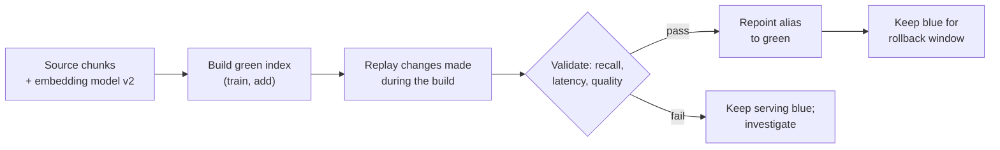

Every lesson so far in this module has treated an index as something that exists and is searched. This lesson is about how it comes to exist. **Index construction** is the process that turns a pile of vectors into a searchable structure: learning cluster centres or codebooks from a sample, inserting every vector, and writing the result somewhere it can be served from. It happens offline or in the background, so it is easy to neglect, but the decisions made here fix the recall-latency curve that [Recall versus latency](/learn/vector-indexing-algorithms/recall-versus-latency) taught you to measure, and the failures made here (a bad training sample, a build that runs out of memory, an index that drifts out of date) are some of the hardest to diagnose later.

## Learning objectives

- Describe the train, add and serialise phases of index construction, and say which index types need training and what they learn.
- Choose a training sample of suitable size and content for IVF and product quantisation, and explain the consequences of a sample that is too small or unrepresentative.
- Explain how HNSW inserts a vector, and predict the effect of `M` and `efConstruction` on build time, memory and recall.
- Estimate the memory of an HNSW index from $N$, $d$ and $M$, and check the estimate against a real index file.
- Design a rebuild process that validates a new index and switches traffic to it without downtime.

## Prerequisites

- [IVF](/learn/vector-indexing-algorithms/ivf), [HNSW](/learn/vector-indexing-algorithms/hnsw), [Product quantisation](/learn/vector-indexing-algorithms/product-quantisation) and [Scalar quantisation](/learn/vector-indexing-algorithms/scalar-quantisation): the structures being built.
- [Recall versus latency](/learn/vector-indexing-algorithms/recall-versus-latency): measuring recall and work per query.
- [Vector storage](/learn/vector-database-fundamentals/vector-storage): segments, memory-mapped files and the memory budget.

## Why this matters

A search takes milliseconds; a build can take hours. For a large collection the build is a scheduled job with its own memory peak, its own failure modes, and a window during which the new index is not yet ready. Teams that discover these properties in production discover them as outages: a rebuild that exhausts memory, or a re-embedding project that cannot switch over because nobody planned for two indexes at once.

Construction choices also set limits that search-time tuning cannot lift. An IVF index trained on an unrepresentative sample has badly shaped clusters, and no `nprobe` gives both good recall and good speed; an HNSW graph with too few links buys recall only at a steep price in latency. And a trained index encodes the data's distribution at training time, so it slowly becomes wrong as the corpus changes.

## The intuition

Think about setting up a new library. First you **design the catalogue**: you look at a representative selection of books and decide on the sections (history, cookery, law) and how much shelf space each needs. Then you **shelve the books**, putting each in the section it fits best. Some libraries also write **"see also" cards** as each book arrives, linking it to similar books already on the shelves.

Three things can go wrong. Sections designed from a box of mostly cookery books give twelve cookery sections and one enormous "everything else" section (a biased training sample). If the library later acquires mostly law books, the old sections no longer fit and the law shelves overflow (drift). And careful see-also cards take longer to write than hasty ones but make later searches quicker (HNSW's construction parameters).

## How it works

### Three phases

Building any index follows the same outline.

1. **Train** (some index types only). Learn parameters from a sample of vectors: cluster centres for IVF, codebooks for product quantisation, value ranges for scalar quantisation.
2. **Add.** Insert every vector: assign it to a cluster, encode it, or link it into a graph. Identifiers are recorded so that results can be mapped back to chunks.
3. **Finalise and serialise.** Write the structure to disk (or to the database's segment files) so that it can be loaded, memory-mapped or replicated.

| Index | What training learns | What adding does | Training needed? |
| --- | --- | --- | --- |
| Flat | Nothing | Appends the vector | No |
| IVF | `nlist` cluster centres by k-means | Assigns the vector to its nearest centre's list | Yes |
| PQ | A small codebook per sub-vector, by k-means | Encodes the vector as codebook indices | Yes |
| SQ | Per-dimension value ranges | Encodes each component in fewer bits | Yes (cheap) |
| IVF-PQ | Centres, then codebooks for the residuals | Assigns, then encodes the residual | Yes |
| HNSW | Nothing | Searches the graph and links the vector to neighbours | No |

FAISS lets you describe a composite index with a short **factory string**, a convenient notation even outside FAISS: `"IVF1024,Flat"` is IVF with 1,024 lists and uncompressed vectors, `"IVF4096,PQ32"` is IVF with 32-byte product-quantised codes, `"HNSW32"` is HNSW with $M = 32$, and `"HNSW32,SQ8"` is HNSW over 8-bit scalar-quantised vectors. `faiss.index_factory(d, string, metric)` builds an empty index, and its `is_trained` attribute tells you whether it needs `train` before `add`.

### Training: how much data, and which data

Training is k-means in all the interesting cases, so its quality depends on the sample. Two properties matter.

**Size.** k-means needs enough points per centre to place each centre well. FAISS's clustering defaults encode a widely used rule of thumb: it warns if there are fewer than 39 training points per centroid, and it subsamples to at most 256 per centroid, because more adds time but little quality. For IVF with 1,024 lists that means at least about 40,000 and at most about 262,000 training vectors. For PQ with 8-bit codes, each sub-quantiser has 256 centroids, so the same rule asks for about 10,000 to 65,000 vectors. Too few points per centre produce centres that fit noise; for IVF that shows up as **unbalanced lists**, where some lists hold many times the average number of vectors and every query that probes them pays for it.

**Representativeness.** The sample must look like the data that will be searched. A sample taken from the first file of a bulk import, from one tenant, or from one document type produces centres concentrated where that sample was. The safest default is a uniform random sample of the whole collection. When the collection does not exist yet (a new product), train on the best proxy available and plan to retrain once real data arrive.

Train on vectors processed exactly as the indexed ones will be (same model, same normalisation), and fix the seed so that rebuilding the same data gives the same index.

### HNSW construction

HNSW needs no training; it is built by inserting vectors one at a time into a growing graph. For each new vector:

1. **Draw its top layer** at random, so that each layer above the bottom has a geometrically shrinking fraction of the nodes (the mathematics below gives the distribution).
2. **Descend greedily** from the entry point through the layers above the new vector's top layer, moving each time to the closest node found, as a search would.
3. **Search each of its own layers** with a candidate list of size `efConstruction`, collecting the closest existing nodes.
4. **Choose neighbours** from those candidates with a diversity heuristic: up to $M$ links on upper layers and up to $2M$ on the bottom layer in common implementations, preferring neighbours that are not already close to each other, so that links point in varied directions.
5. **Link both ways**, and if an existing node now has too many links, prune its list with the same heuristic.

The two parameters do different jobs. **`M`** sets the number of links per node, so it fixes the graph's memory and the work per hop, and a richer graph needs a smaller search `ef` for the same recall. **`efConstruction`** sets how hard the builder looks for good neighbours. A larger value costs build time roughly in proportion and usually gives a better-shaped graph, though the gain flattens beyond a point. Neither can be changed without rebuilding.

Parallel builds insert many vectors at once, so two builds of the same data give slightly different graphs: harmless, but not byte-identical.

**Deletes** are the weak point of graphs. Removing a node would cut the paths through it, so most implementations mark deleted nodes as **tombstones** that are skipped in results but still traversed, and repair or rebuild the affected structure later. FAISS's `IndexHNSWFlat` does not support `remove_ids` at all. Vector databases handle this with background processes that rebuild segments once enough points are deleted. A collection with heavy churn therefore accumulates dead weight and slowly loses recall until that maintenance runs; [Index updates](/learn/advanced-vector-database-engineering/index-updates) covers the strategies.

### Bulk loads and incremental growth

There are two ways for an index to come into being: build it once over a complete dataset, or let it grow as vectors arrive. Bulk builds are faster and give better structures: k-means sees all the data, and an HNSW build can be parallelised without interference from concurrent queries. That is why database documentation commonly recommends loading data first and building the index afterwards. pgvector's README gives this advice, and notes that HNSW builds are much faster when the graph fits in `maintenance_work_mem`. Qdrant's segment-based design builds HNSW only for segments above an indexing threshold, and its documentation describes deferring indexing during large uploads.

Incremental growth is unavoidable for a live system, and it is where trained indexes go stale. New vectors are assigned to the nearest of the old centres whether or not those centres suit them. HNSW copes better, since every insert searches the current graph, but tombstones and changes in the data distribution still degrade it over time.

### Drift and the rebuild

**Data drift** is a change in the distribution of the vectors over time: a new product's documentation, a new department's policies, a new language. For IVF, drift shows up as growing imbalance: new content piles into the few old lists nearest to it, those lists become long, queries about the new content probe long lists, and recall at a fixed `nprobe` falls. The code below demonstrates this.

Some changes require a rebuild no matter what: a **new embedding model** produces vectors in a different space, so every vector must be re-embedded and the index rebuilt from scratch; vectors from two models must never be mixed in one index. A change of **chunking** or **metric** is the same.

The standard way to rebuild without downtime is a **blue-green switch**:

1. Build the new index (green) alongside the serving one (blue), from a snapshot of the source data.
2. Replay the changes that arrived during the build, or dual-write new changes to both.
3. Validate green: recall against exact search, latency at load, and a retrieval-quality test set.
4. Switch traffic, for example by repointing a collection alias (Qdrant and Elasticsearch both support aliases).
5. Keep blue for a rollback window, then delete it.



Two copies exist during the switch, so budget memory and disk for both. [CI/CD and MLOps](/learn/ci-cd-and-mlops) treats index versioning and rollback.

## The mathematics

### HNSW levels

**Intuition.** Each layer above the bottom keeps a fixed fraction of the nodes below it, like an express train stopping at one station in $M$.

Common implementations, including FAISS and hnswlib, draw a node's top layer as $\ell = \lfloor -\ln(U) \cdot m_L \rfloor$ with $U$ uniform on $(0, 1)$ and $m_L = 1/\ln M$. That gives

$$
\Pr[\ell \geq j] = M^{-j}, \qquad \mathbb{E}[\ell] = \sum_{j \geq 1} M^{-j} = \frac{1}{M - 1}
$$

- $\ell$ is the node's top layer (0 is the bottom layer, which contains every node).
- $M$ is the links parameter; $m_L$ is the level multiplier the original paper recommends.
- $\mathbb{E}[\ell]$ is the expected number of layers above the bottom per node.

**By hand.** With $M = 16$, a node reaches layer 1 with probability $1/16$, layer 2 with $1/256$, and the expected number of upper layers per node is $1/15 \approx 0.067$. For 100,000 nodes, about 6,250 reach layer 1, about 390 layer 2 and about 24 layer 3, so the graph is about $\log_{16} 100{,}000 \approx 4.2$ layers tall.

### HNSW memory

**Intuition.** The index holds the vectors plus a list of neighbour identifiers per node per layer.

$$
\text{bytes} \approx N \Big( 4d + 4 \big( 2M + \tfrac{M}{M - 1} \big) + c \Big)
$$

- $4d$ is the float32 vector.
- $2M$ neighbour slots on the bottom layer and, on average, $\frac{1}{M-1}$ upper layers of $M$ slots each, at 4 bytes per identifier.
- $c$ is per-node bookkeeping; in FAISS about 12 bytes (an 8-byte offset and a 4-byte level).

**By hand.** $N = 100{,}000$, $d = 128$, $M = 16$: vectors $100{,}000 \times 512 = 51.2$ MB; links $100{,}000 \times 4 \times (32 + 1.067) \approx 13.2$ MB; bookkeeping 1.2 MB; total about 65.6 MB. With $M = 32$, the links become $100{,}000 \times 4 \times (64 + 1.03) \approx 26.0$ MB, total 78.4 MB. For Meridian's collection (200,000 chunks at 384 dimensions, $M = 16$), the vectors are 307 MB and the graph adds about 29 MB.

```python
def hnsw_bytes(N, d, M):
    vectors = N * d * 4                               # float32
    links = N * 4 * (2 * M + M / (M - 1))             # layer 0: 2M ids; upper layers: M ids each
    bookkeeping = N * (8 + 4)                          # per-node offset and level
    return vectors + links + bookkeeping

for M in (16, 32):
    print(f"M={M}: {hnsw_bytes(100_000, 128, M) / 1e6:.1f} MB")
print(f"Meridian, 200,000 x 384, M=16: {hnsw_bytes(200_000, 384, 16) / 1e6:.0f} MB")
```

```output
M=16: 65.6 MB
M=32: 78.4 MB
Meridian, 200,000 x 384, M=16: 336 MB
```

The code example below writes real FAISS indexes to disk; their file sizes match these estimates exactly. Other implementations lay out the graph differently, so treat the formula as a planning estimate for them and measure.

## In code

**The problem.** Build indexes over 100,000 embedding-like vectors and observe three construction decisions: (1) the size of the IVF training sample, (2) training on data that no longer matches the collection (drift), and (3) HNSW's `M` and `efConstruction`. For each, report build cost, list balance or file size, the number of vectors scored per query, and recall@10 against exact search.

The vectors are synthetic unit vectors with variance concentrated in a few directions, as in [Recall versus latency](/learn/vector-indexing-algorithms/recall-versus-latency). Drift is simulated by drawing half of a new collection from a distribution whose important directions are different.

**Dependencies.** NumPy and the CPU build of FAISS.

```bash
pip install numpy faiss-cpu
```

```python
import os, tempfile, time
import numpy as np
import faiss

faiss.omp_set_num_threads(1)
rng = np.random.default_rng(11)
N, d, n_queries, k, nlist = 100_000, 128, 1_000, 10, 1024
scales = (1.0 / np.arange(1, d + 1) ** 0.75).astype(np.float32)
perm = rng.permutation(d)                       # a second "topic mix", for drift

def sample(n, shifted=False):
    x = rng.standard_normal((n, d)).astype(np.float32) * (scales[perm] if shifted else scales)
    return x / np.linalg.norm(x, axis=1, keepdims=True)

def evaluate(index, X, Q, stats):
    _, truth = faiss.knn(Q, X, k, metric=faiss.METRIC_INNER_PRODUCT)   # exact ground truth
    stats.reset()
    _, I = index.search(Q, k)
    r = np.mean([len(set(a) & set(b)) / k for a, b in zip(I, truth)])
    return r, stats.ndis / len(Q)                # recall, vectors scored per query

def build_ivf(train, X):
    index = faiss.index_factory(d, f"IVF{nlist},Flat", faiss.METRIC_INNER_PRODUCT)
    t0 = time.process_time(); index.train(train); t_train = time.process_time() - t0
    index.add(X)
    sizes = np.array([index.invlists.list_size(i) for i in range(nlist)])
    index.nprobe = 16
    return index, t_train, sizes.max() / sizes.mean()

X, Q = sample(N), sample(n_queries)
ivf_stats, hnsw_stats = faiss.cvar.indexIVF_stats, faiss.cvar.hnsw_stats

print("1. IVF training sample size (nprobe=16)")
for n_train in (2_048, 20_000, 100_000):
    index, t_train, imb = build_ivf(X[:n_train], X)
    r, scored = evaluate(index, X, Q, ivf_stats)
    print(f"  {n_train:>7,} points: train {t_train:5.2f}s  largest list/mean {imb:4.1f}  "
          f"scored/query {scored:6.0f}  recall@10 {r:.3f}")

print("2. Drift: half the corpus now comes from a new distribution")
X2 = np.vstack([X[:N // 2], sample(N // 2, shifted=True)])
Q2 = np.vstack([Q[:500], sample(500, shifted=True)])
for label, train in (("old data", X[:50_000]), ("current data", X2[rng.permutation(N)[:50_000]])):
    index, _, imb = build_ivf(train, X2)
    r, scored = evaluate(index, X2, Q2, ivf_stats)
    print(f"  trained on {label:<12}: largest list/mean {imb:4.1f}  "
          f"scored/query {scored:6.0f}  recall@10 {r:.3f}")

print("3. HNSW build parameters (efSearch=40)")
for M, efc in ((16, 40), (16, 200), (32, 40), (32, 200)):
    index = faiss.IndexHNSWFlat(d, M, faiss.METRIC_INNER_PRODUCT)
    index.hnsw.efConstruction = efc
    t0 = time.process_time(); index.add(X); t_build = time.process_time() - t0
    index.hnsw.efSearch = 40
    r, scored = evaluate(index, X, Q, hnsw_stats)
    path = os.path.join(tempfile.mkdtemp(), "hnsw.faiss")
    faiss.write_index(index, path)
    print(f"  M={M:<2} efC={efc:<3}: build {t_build:5.1f}s  file {os.path.getsize(path) / 1e6:4.1f} MB  "
          f"scored/query {scored:6.0f}  recall@10 {r:.3f}")
print(f"  raw vectors alone: {X.nbytes / 1e6:.1f} MB")
```

```output
WARNING clustering 2048 points to 1024 centroids: please provide at least 39936 training points
WARNING clustering 20000 points to 1024 centroids: please provide at least 39936 training points
1. IVF training sample size (nprobe=16)
    2,048 points: train  0.02s  largest list/mean 13.0  scored/query   3678  recall@10 0.903
   20,000 points: train  0.18s  largest list/mean  6.0  scored/query   2827  recall@10 0.922
  100,000 points: train  0.87s  largest list/mean  3.5  scored/query   2274  recall@10 0.920
2. Drift: half the corpus now comes from a new distribution
  trained on old data    : largest list/mean 33.3  scored/query   3125  recall@10 0.679
  trained on current data: largest list/mean  4.7  scored/query   2425  recall@10 0.955
3. HNSW build parameters (efSearch=40)
  M=16 efC=40 : build   3.4s  file 65.6 MB  scored/query    602  recall@10 0.894
  M=16 efC=200: build  18.0s  file 65.6 MB  scored/query    773  recall@10 0.946
  M=32 efC=40 : build  13.0s  file 78.4 MB  scored/query   1220  recall@10 0.973
  M=32 efC=200: build  36.9s  file 78.4 MB  scored/query    979  recall@10 0.962
  raw vectors alone: 51.2 MB
```

Build times are CPU seconds on a laptop that was busy with other work, and they varied by up to a factor of three between runs; read them as rough ratios. Everything else is fixed by the seed.

**The important lines.**

- `faiss.index_factory(d, "IVF1024,Flat", ...)` creates an untrained IVF index; `train` runs k-means on whatever sample it is given, and `add` assigns every vector to a list.
- `index.invlists.list_size(i)` reads the length of list $i$. The ratio of the largest to the mean is a quick health check for an IVF index.
- `faiss.cvar.indexIVF_stats` and `faiss.cvar.hnsw_stats` count the vectors scored during searches. Scored vectors per query are a hardware-independent proxy for latency.
- `faiss.knn` computes exact ground truth with a blocked flat scan, independent of the indexes under test.

**What the output means.**

- **The warnings are FAISS's 39-points-per-centroid rule.** With only 2,048 training points for 1,024 lists (two per centre), the largest list holds 13 times the average, and queries score 3,678 vectors on average instead of 2,274, about 60% more work, for slightly lower recall. Recall was not ruined: on these smooth data even poor centres partition space usefully. The cost shows up as wasted work and uneven latency, which is exactly the kind of damage that goes unnoticed without a list-balance check.
- **Drift is the dramatic case.** Centres trained only on the old distribution, applied to a collection that is half new content, produce a list 33 times the average and recall of 0.679 at the same `nprobe`. Retraining on a sample of the current collection restores 0.955. Nothing errors; recall simply falls by a quarter.
- **`M` costs memory; `efConstruction` costs build time.** File size depends only on `M` (65.6 MB and 78.4 MB, matching the formula), and both are well above the 51.2 MB of raw vectors. Raising `efConstruction` from 40 to 200 multiplied build time by roughly three to five.
- **Compare graphs by recall for the work done, not at a fixed `ef`.** For $M = 16$, `efConstruction = 200` raised recall from 0.894 to 0.946. For $M = 32$ it lowered recall slightly (0.973 to 0.962) at `efSearch = 40`, but the search also scored 20% fewer vectors (979 against 1,220). A better-built graph finds its way with fewer steps; to compare two builds fairly, sweep `efSearch` for each and compare their recall-versus-work curves.

**Errors people commonly hit.**

- Calling `add` on an untrained IVF or PQ index: FAISS raises an error because `is_trained` is false.
- Training on the first $n$ rows of a file sorted by source or date, which is a biased sample. Shuffle first.
- Calling `remove_ids` on `IndexHNSWFlat`, which raises a "not implemented" error. Wrap an index that supports removal (such as IVF) in an ID map, or rebuild.

**Extending it.** Add a step that simulates gradual drift: start with all-old data, add new-distribution vectors in batches of 10,000 without retraining, and print list imbalance and recall after each batch. Choose an imbalance threshold that would trigger a retrain before recall falls by more than two points.

## A real-world example

Meridian's Platform team decided to move AskMeridian from its original 384-dimension embedding model to a newer one producing 768-dimension vectors, after an evaluation showed better retrieval on policy questions. The corpus was about 200,000 chunks.

The first plan was to update each point's vector in place in the existing Qdrant collection. The design review rejected it: for the hours the update took, searches would compare new-model queries with a mixture of old and new vectors (which could not even share one vector field, having different dimensions), and there would be no way back if the new model disappointed.

They used a blue-green rebuild instead. A batch job re-embedded every chunk with the new model and uploaded the vectors to a new collection, with the HNSW build deferred until the upload finished. The memory budget was checked in advance with the formula above: about 614 MB of vectors plus a graph of roughly 29 MB at $M = 16$, comfortably within the cluster's spare capacity, while the old collection kept serving. Edits to the handbook during the build were captured from the ingestion queue and replayed. The new collection was validated with the nightly recall job (HNSW against exact search) and with the team's retrieval test set, then the `askmeridian` alias was pointed at it. The old collection was kept for two weeks and then deleted.

## Common mistakes

- **Training on too small a sample.** Lists become unbalanced and queries do more work; FAISS warns, but warnings in a batch job's log go unread.
- **Training on a biased sample**, such as the first file of an import or one tenant's data. Centres crowd where the sample was and the rest of the data is poorly partitioned.
- **Mixing embedding models in one index** during a migration. Similarities between vectors from different models are meaningless.
- **Planning memory for the finished index only.** Builds need working memory, and a blue-green rebuild needs two indexes at once.
- **Assuming deletes free space and preserve recall.** Tombstones keep occupying memory and degrade graph search until maintenance runs.

## Best practices

- Train on a shuffled, uniform sample of the current data, at least 39 and preferably a few hundred vectors per centroid, processed exactly like the indexed vectors.
- Fix seeds, and record the factory string or configuration, the training sample's provenance and the embedding model version with every index.
- Monitor IVF list balance and recall against exact search; retrain when imbalance grows or recall falls.
- Bulk-load first and build afterwards when you can; defer indexing during large uploads.
- Set `M` and `efConstruction` explicitly; compare builds by recall-versus-work curves, not at a single `ef`.
- Rebuild with a blue-green switch behind an alias, with validation before the switch and a rollback window after.

## Performance considerations

**Training cost.** k-means costs about $n_{\text{train}} \times \text{nlist} \times d$ multiply-adds per iteration. With 262,144 training points (the FAISS cap for 1,024 lists), 1,024 lists, 768 dimensions and 25 iterations (FAISS's default), that is about $5 \times 10^{12}$ multiply-adds: seconds to minutes on a CPU, far less on a GPU. Training cost does not grow with $N$ once the sample is capped, which is why IVF builds scale well.

**HNSW build cost.** Each insertion is a search with a candidate list of `efConstruction`, so total build cost grows roughly as $N$ times the cost of one such search, which itself grows slowly with $N$. In the code, `efConstruction` 200 cost three to five times as much as 40. Builds parallelise well across cores, and recent pgvector versions use parallel maintenance workers for HNSW builds.

**Build memory.** The finished HNSW index is about $N(4d + 8M + 4)$ bytes plus bookkeeping. A build that does not fit in its allotted memory slows down sharply (pgvector warns when the graph no longer fits in `maintenance_work_mem`). During a blue-green rebuild, plan for both indexes, plus the source vectors, at once.

**Rebuild time** is an operational limit: measure it at your scale before you need it.

## Security considerations

An index file contains the vectors, and embeddings are not anonymous. Research on embedding inversion (for example Morris and colleagues, 2023) has shown that a substantial amount of the original text can be reconstructed from some text embeddings. Protect index files, snapshots and the scratch storage used during builds with the same access controls as the documents themselves.

Deletion is the other concern. When a document must be removed (a data-subject erasure request, or a document published by mistake), deleting its points marks them as tombstones; the vectors may remain in segment files, snapshots and old blue-green copies until compaction or deletion. Make sure your erasure procedure covers every copy, including the retained rollback index and any training samples saved alongside the index.

## Summary

- Building an index means training (IVF, PQ, SQ), adding, and serialising; flat and HNSW indexes need no training.
- Training samples must be large enough (FAISS warns below 39 points per centroid) and representative of the current data; small or biased samples unbalance IVF lists and waste work.
- HNSW's `M` sets memory and graph richness, `efConstruction` sets build effort; compare builds by recall for the work done.
- Drift degrades trained indexes silently; a new embedding model, chunking or metric requires a full rebuild.
- Rebuild blue-green behind an alias, validate before switching, and budget memory for two indexes and the build itself.

## Exercises

**1.** An IVF index will have 4,096 lists. Using FAISS's 39 and 256 points-per-centroid defaults, what are the minimum and maximum useful training sample sizes? The collection has 600,000 vectors; what would you use?

<details><summary>Show solution</summary>

Minimum $39 \times 4{,}096 = 159{,}744$; maximum $256 \times 4{,}096 = 1{,}048{,}576$. The collection has 600,000 vectors, so use all of them (shuffled), or a uniform random sample of several hundred thousand if training time matters. FAISS would use all 600,000, since that is below its cap.

</details>

**2.** Estimate the size of a FAISS `IndexHNSWFlat` with $M = 32$ over 5 million 768-dimension vectors. What fraction is the graph?

<details><summary>Show solution</summary>

Vectors: $5 \times 10^6 \times 768 \times 4 = 15.36$ GB. Links: $5 \times 10^6 \times 4 \times (64 + 32/31) \approx 1.30$ GB. Bookkeeping: $5 \times 10^6 \times 12 = 0.06$ GB. Total about 16.7 GB, of which the graph is about 8%. At high dimension the vectors dominate, which is why compression (SQ or PQ) is the main lever for memory, not `M`.

</details>

**3.** Extend the code's drift experiment into a monitor: after adding each batch of 10,000 new-distribution vectors to an index trained on old data, print the list imbalance and recall. At what point would a rule "retrain when the largest list exceeds 10 times the mean" fire, and how much recall had been lost by then?

<details><summary>Show solution</summary>

```python
index, _, _ = build_ivf(X[:50_000], X[:50_000])          # trained and filled with old data
current = X[:50_000]
for step in range(1, 6):
    batch = sample(10_000, shifted=True)
    index.add(batch)
    current = np.vstack([current, batch])
    sizes = np.array([index.invlists.list_size(i) for i in range(nlist)])
    Qm = np.vstack([Q[:250], sample(250, shifted=True)])
    r, _ = evaluate(index, current, Qm, ivf_stats)
    print(f"{len(current):>6} vectors: largest/mean {sizes.max() / sizes.mean():5.1f}  recall@10 {r:.3f}")
```

With the lesson's seed:

```output
 60000 vectors: largest/mean  11.2  recall@10 0.654
 70000 vectors: largest/mean  18.8  recall@10 0.656
 80000 vectors: largest/mean  25.1  recall@10 0.675
 90000 vectors: largest/mean  29.9  recall@10 0.666
100000 vectors: largest/mean  33.5  recall@10 0.684
```

The rule fires after the very first batch (11.2), but by then the damage is done: recall on the mixed queries is already 0.654, against about 0.92 for the well-trained index in part 1 of the code. Recall on queries about the new content collapses as soon as that content arrives, because it lands in a few ill-fitting lists; adding more batches only makes the lists longer. Two conclusions: a threshold of 10 is far too lax (check imbalance after every import and compare it with the value just after training, which was 3.5 for a full sample), and the check must be paired with the nightly recall job, ideally with test queries about recently added content. Imbalance is cheap to compute; recall is the ground truth.

</details>

**4.** Design decision. A Meridian team proposes rebuilding AskMeridian's index every night "to be safe". The collection changes by about 1% a day and uses HNSW. Argue for or against, and propose an alternative policy.

<details><summary>Show solution</summary>

Against, mostly. HNSW needs no training, so it does not go stale the way IVF centres do; inserts search the current graph. A nightly rebuild costs build time and memory every day and adds a daily risk (a failed build, a changed default) for little benefit at 1% daily change.

A better policy is condition-based: monitor recall against exact search nightly, track the fraction of tombstoned points, and rebuild (or let the database's background optimisation compact segments) when deleted points exceed a threshold such as 10 to 20%, when recall falls below target, or when the embedding model, chunking or construction parameters change. Keep the blue-green procedure ready and tested so that a rebuild, when needed, is routine.

</details>

## Check your understanding

```quiz
[
  {
    "q": "Which of these index types needs a training step before vectors can be added?",
    "options": [
      "IndexFlatIP",
      "IndexHNSWFlat",
      "IndexIVFPQ",
      "None of them; all indexes are trained during add"
    ],
    "answer": 2,
    "why": "IVF-PQ learns cluster centres and product-quantisation codebooks from a sample. Flat and HNSW indexes need no training."
  },
  {
    "q": "An IVF index's largest list holds 30 times the mean number of vectors, and recall at the usual nprobe has fallen since launch. What is the most likely cause and fix?",
    "options": [
      "The query embedding model changed; normalise queries",
      "nprobe is too high; lower it",
      "The HNSW graph has too few links; raise M",
      "The data have drifted away from the training sample; retrain the centres on current data"
    ],
    "answer": 3,
    "why": "New content piles into the few old lists nearest to it. Retraining on a sample of the current collection rebalances the lists."
  },
  {
    "q": "What does raising HNSW's efConstruction mainly cost?",
    "options": [
      "Build time",
      "Index memory",
      "Query-time memory per request",
      "Training data"
    ],
    "answer": 0,
    "why": "efConstruction sets how widely each insertion searches for neighbours. Memory is set by M, which fixes the number of links per node."
  },
  {
    "q": "A team switches embedding models. What is the correct way to update the index?",
    "options": [
      "Update vectors in place over a few hours while serving",
      "Re-embed everything into a new index, validate it, and switch traffic, for example with an alias",
      "Keep old vectors and add new ones to the same index",
      "Only retrain the IVF centres"
    ],
    "answer": 1,
    "why": "Vectors from different models are not comparable. A full rebuild in parallel, validated before an atomic switch, avoids mixed results and keeps a rollback path."
  },
  {
    "q": "Two HNSW builds are compared at efSearch = 40. Build B has slightly lower recall than build A but scores 20% fewer vectors per query. What should you conclude?",
    "options": [
      "A is better because its recall is higher",
      "B is broken",
      "Nothing yet: sweep efSearch for both and compare recall against work",
      "The builds are identical"
    ],
    "answer": 2,
    "why": "At a fixed ef, the builds do different amounts of work. The fair comparison is each build's recall-versus-work curve."
  }
]
```

## Further reading

- Yu. A. Malkov and D. A. Yashunin (2016), [Efficient and robust approximate nearest neighbor search using Hierarchical Navigable Small World graphs](https://arxiv.org/abs/1603.09320): the insertion algorithm, level distribution and neighbour-selection heuristic.
- Hervé Jégou, Matthijs Douze and Cordelia Schmid (2011), "Product quantization for nearest neighbor search", IEEE Transactions on Pattern Analysis and Machine Intelligence: training IVF-PQ.
- FAISS wiki, [GitHub: facebookresearch/faiss](https://github.com/facebookresearch/faiss/wiki): the index factory, training guidelines and index I/O.
- pgvector, [README](https://github.com/pgvector/pgvector): building HNSW and IVFFlat indexes, `maintenance_work_mem` and parallel builds.
- Qdrant documentation, [Indexing](https://qdrant.tech/documentation/concepts/indexing/): HNSW parameters and when segments are indexed.
- John X. Morris and others (2023), "Text Embeddings Reveal (Almost) As Much As Text", EMNLP: embedding inversion.
