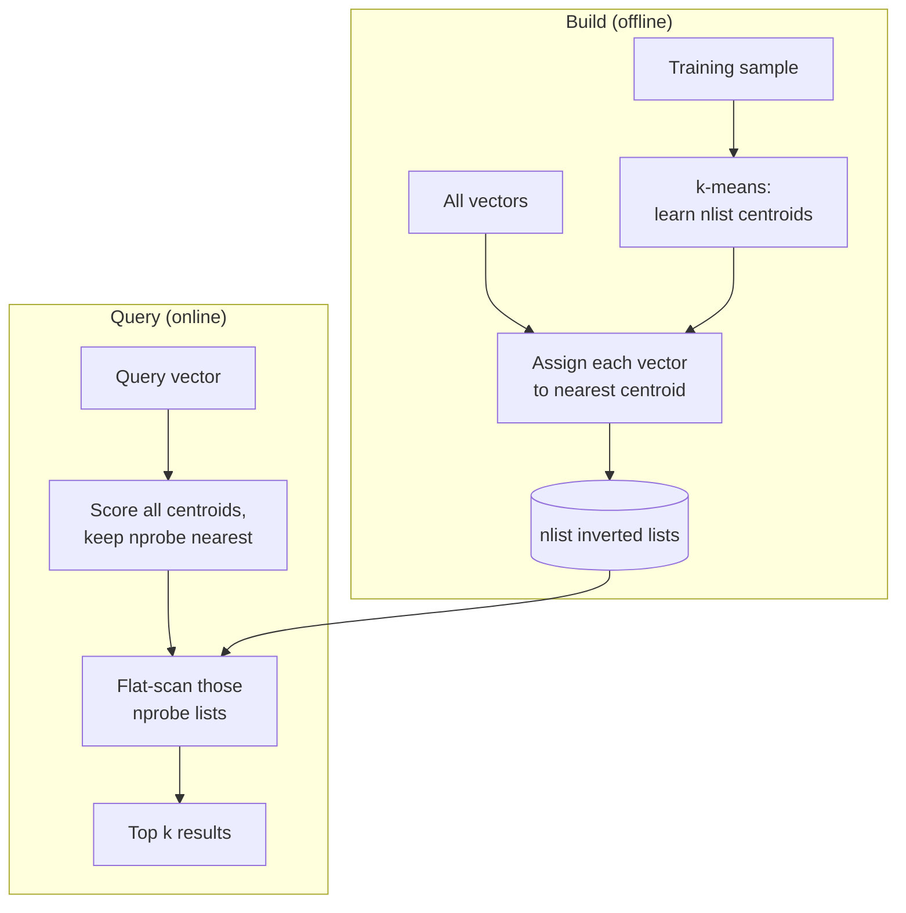

A [flat index](/learn/vector-indexing-algorithms/flat-indexes) compares the query with every stored vector. The **inverted file index**, almost always shortened to **IVF**, makes the first and most intuitive cut: divide the vectors into groups of neighbours ahead of time, and at query time search only the few groups closest to the query. It is the oldest of the widely used approximate indexes, the easiest to reason about, and the backbone of many large-scale systems, both on its own and combined with the compression methods later in this module.

This lesson builds IVF from its parts (k-means clustering, cell assignment, probing), shows exactly where it loses recall, measures the trade-off controlled by its two parameters, and explains the operational duties it brings: training, retraining and choosing list counts.

## Learning objectives

- Explain how IVF partitions a collection with k-means and searches only the `nprobe` nearest partitions.
- Explain why a true neighbour can be missed (the boundary problem) and how `nprobe` addresses it.
- Derive the cost of an IVF search and the list count that minimises it, and apply the derivation to a stated collection size.
- Build, train and tune a FAISS `IndexIVFFlat`, measuring recall against a flat baseline.
- Identify the operational risks of IVF (unrepresentative training data, data drift, unbalanced lists) and describe how to detect and fix them.

## Prerequisites

- [Flat indexes](/learn/vector-indexing-algorithms/flat-indexes): exhaustive search, its cost, and its use as ground truth.
- [Similarity search](/learn/vector-database-fundamentals/similarity-search): top-k queries over vectors.
- [Recall@K](/learn/retrieval-fundamentals/recall-k) is defined fully later; here, recall@10 means the fraction of the true 10 nearest neighbours that the index returns.

## Why this matters

A flat scan's cost grows linearly with the collection. At a few million vectors it no longer fits an interactive latency budget, and you need an index that examines a small fraction of the data. IVF is one of the two dominant answers (the other is [HNSW](/learn/vector-indexing-algorithms/hnsw)), and it has properties that make it the better choice in some situations: its memory overhead is tiny, its structure combines naturally with compressed vectors for collections too large for RAM, and it is the index type behind pgvector's `ivfflat`, Milvus's `IVF_FLAT` and `IVF_PQ`, and many FAISS deployments.

IVF also fails in specific, predictable ways. Built on unrepresentative data, it puts most vectors into a handful of overloaded lists and becomes both slow and inaccurate. Left with its default of probing a single list, it silently misses a large share of true neighbours. Engineers who understand the mechanism catch these problems in a design review; those who treat it as a black box find them in production.

## The intuition

Think of a large library. Searching every shelf for books about VPN troubleshooting would take all day, so the library is divided into sections: networking, security, HR policy, and so on. To find your book you walk to the section whose sign best matches your question and search only its shelves.

That works most of the time. But the section boundaries are somebody's decision, and some books sit near them: a book on "VPN policy for remote workers" could reasonably be in networking, security or HR. If it was shelved in security and you searched only networking, you miss it. The fix is equally intuitive: search the two or three sections whose signs best match your question, not just one. Each extra section costs time, and each one recovers some of the books shelved near a boundary.

IVF is exactly this. The sections are clusters found by k-means, the signs are cluster centres, and "how many sections to search" is the parameter `nprobe`.

## How it works

### Partitioning the space with k-means

IVF needs a way to divide the vectors into groups of mutual neighbours. It uses **k-means clustering**, which finds `nlist` points called **centroids** so that every vector is as close as possible to its nearest centroid. Lloyd's algorithm, the standard method, alternates two steps:

1. **Assign:** give each training vector to its nearest centroid.
2. **Update:** move each centroid to the mean of the vectors assigned to it.

It starts from randomly chosen vectors as centroids and repeats until the assignments barely change (or for a fixed number of iterations). The result divides space into **Voronoi cells**: the cell of a centroid is the region of points closer to it than to any other centroid. Every possible vector, stored or query, falls into exactly one cell.

### The structure

An IVF index has two parts:

- A **coarse quantiser**: the `nlist` centroids, usually held in a small flat index of their own. "Quantiser" because it maps any vector to one of a finite set of representatives (its nearest centroid); "coarse" because there are relatively few of them.
- An array of `nlist` **inverted lists**, one per centroid. List $c$ holds the ids (and, in `IVFFlat`, the full vectors) of every stored vector whose nearest centroid is $c$.

The name comes from text search. A text [inverted index](/learn/sparse-retrieval/inverted-indexes) maps each word to the documents containing it; an inverted file maps each centroid to the vectors belonging to it. Sivic and Zisserman's "Video Google" (2003) applied the idea to image features, and Jégou, Douze and Schmid (2011) made it the standard first stage of large-scale vector search.

### Building the index

1. **Train.** Run k-means on a sample of vectors to learn `nlist` centroids. The sample must be representative of the data the index will hold.
2. **Add.** For each vector, find its nearest centroid (a small flat search over `nlist` centroids) and append the vector and its id to that centroid's list.

Training is a separate step, and that is IVF's most important operational property. A flat index has no training; an IVF index cannot accept a single vector until it has centroids.

### Searching the index

For a query $\mathbf{q}$ and a requested $k$:

1. **Probe.** Compare $\mathbf{q}$ with all `nlist` centroids and pick the `nprobe` nearest.
2. **Scan.** Flat-scan the vectors in those `nprobe` lists, scoring each against $\mathbf{q}$.
3. **Select.** Keep the top $k$ across all scanned lists and return them.



If the lists are roughly equal in size, each holds about $N / \text{nlist}$ vectors, and a query scans about $\text{nprobe} \times N / \text{nlist}$ of them, plus the `nlist` centroid comparisons. With 1,024 lists and `nprobe` = 8, that is under 1% of the collection.

### The boundary problem

Why not always probe one list? Because a query's nearest neighbours do not all live in the query's own cell. A query near the edge of its cell can have a true neighbour just across the boundary, in the next cell over, closer to the query than most vectors in the query's own cell. Probing only the nearest centroid misses it.

In two dimensions, boundaries are lines and only a small fraction of queries sit near one. In 384 dimensions the picture is far worse: almost every point is near some boundary, because in high dimensions a cell has a very large number of neighbouring cells, and distances to the nearest few centroids tend to be similar. This is why IVF with `nprobe` = 1 often returns well under half of the true top 10 on realistic embeddings, as the code below shows.

Raising `nprobe` widens the search to the next-nearest cells, which are exactly where boundary neighbours live. Recall rises quickly at first and then flattens, while cost grows linearly. Choosing `nprobe` is choosing a point on that curve, the subject of [Recall versus latency](/learn/vector-indexing-algorithms/recall-versus-latency).

### Choosing nlist

`nlist` sets the granularity of the partition. More lists means smaller lists, so each probe scans fewer vectors, but also more centroids to compare at the start, more boundaries for neighbours to fall across (so you need a larger `nprobe` for the same recall), and more training data. Two published starting points:

- The **FAISS wiki** guidelines suggest, for collections up to about a million vectors, `nlist` between $4\sqrt{N}$ and $16\sqrt{N}$, and a training set of 30 to 256 vectors per centroid.
- The **pgvector** documentation suggests `lists` of about rows / 1,000 up to a million rows and $\sqrt{\text{rows}}$ beyond, with `probes` starting at $\sqrt{\text{lists}}$.

These are starting points for measurement, not answers. The mathematics section shows where the $\sqrt{N}$ comes from.

### Unbalanced lists

k-means minimises distance, not list-size variance. Real embeddings are lumpy: some subjects (for Meridian, perhaps IT runbooks) have far more chunks than others, so some lists end up many times larger than the average. A query that lands in a large list scans more vectors than the average suggests, so **latency varies by query**, and the slowest queries are the ones touching the biggest lists. Inspecting the distribution of list sizes after building is a cheap, essential check.

### Adding and deleting after training

New vectors are assigned to the nearest existing centroid; the centroids do not move. This is fine while new data resembles the training data. When it does not (a new product's documentation, a new language, a new embedding model), new vectors pile into whichever existing cells happen to be nearest, lists become unbalanced, and those cells cover their new contents poorly. This is **drift**, and the remedy is retraining: learn new centroids on a fresh sample and rebuild the lists. Deletion is easy by comparison: remove the id from its list.

### IVF as a framework

`IVFFlat` stores full vectors in the lists. The partition idea is independent of how vectors in a list are stored, and IVF is most often deployed with compressed codes: `IVFPQ` stores [product-quantised](/learn/vector-indexing-algorithms/product-quantisation) codes and `IVF` with [scalar quantisation](/learn/vector-indexing-algorithms/scalar-quantisation) stores 8-bit codes. For very large `nlist` (tens of thousands of centroids or more), comparing the query with every centroid itself becomes costly, so the coarse quantiser is replaced by an HNSW index over the centroids; in FAISS's index-factory notation that is `"IVF65536_HNSW32,Flat"`.

## The mathematics

### The k-means objective

**Intuition.** Good centroids are ones every vector is close to, so that "which centroid is nearest" is a faithful summary of where a vector lies.

$$
J = \sum_{i=1}^{N} \min_{c \in \{1, \dots, \text{nlist}\}} \lVert \mathbf{x}_i - \boldsymbol{\mu}_c \rVert^2
$$

$\mathbf{x}_i$ is stored vector $i$, $\boldsymbol{\mu}_c$ is centroid $c$, and $J$ is the total squared distance from each vector to its nearest centroid. Lloyd's algorithm never increases $J$: the assign step picks the nearest centroid for each vector, and the update step moves each centroid to the mean of its vectors, which is the point minimising the summed squared distance to them. It converges to a local minimum, not necessarily the global one, which is why different random seeds give slightly different indexes.

### The cost of a search and the best nlist

**Intuition.** You pay once to compare with every centroid and again to scan the probed lists. More lists make the first cost bigger and the second smaller, so there is a best balance.

$$
C(\text{nlist}) = \text{nlist} + \text{nprobe} \cdot \frac{N}{\text{nlist}}
$$

$C$ is the number of vector comparisons per query (each costing $d$ multiply-adds), $N$ the collection size, and the formula assumes equally sized lists. Setting the derivative with respect to nlist to zero, $1 - \text{nprobe} \cdot N / \text{nlist}^2 = 0$, gives

$$
\text{nlist}^{*} = \sqrt{\text{nprobe} \cdot N}, \qquad C(\text{nlist}^{*}) = 2\sqrt{\text{nprobe} \cdot N}
$$

**By hand.** $N = 1{,}000{,}000$.

- With `nprobe` = 1: $\text{nlist}^* = \sqrt{10^6} = 1{,}000$, and $C = 1{,}000 + 1{,}000 = 2{,}000$ comparisons, 0.2% of a flat scan.
- With `nprobe` = 16: $\text{nlist}^* = \sqrt{1.6 \times 10^7} \approx 4{,}000$, and $C \approx 4{,}000 + 16 \times 250 = 8{,}000$, 0.8% of a flat scan.

This is the source of the "$\sqrt{N}$" rules of thumb. Real guidelines push nlist higher than $\sqrt{N}$ because the centroid comparisons are cheap (the centroids are few and stay in cache) while list scans touch scattered memory, and because recall at a fixed fraction scanned tends to improve with finer partitions.

```python
import numpy as np

N = 1_000_000
for nprobe in [1, 16]:
    nlist = np.sqrt(nprobe * N)
    cost = nlist + nprobe * N / nlist
    print(f"nprobe={nprobe:>2}: best nlist ~ {nlist:,.0f}, comparisons ~ {cost:,.0f} "
          f"({100 * cost / N:.1f}% of flat)")
```

```output
nprobe= 1: best nlist ~ 1,000, comparisons ~ 2,000 (0.2% of flat)
nprobe=16: best nlist ~ 4,000, comparisons ~ 8,000 (0.8% of flat)
```

## In code

**The problem.** Build an IVF index over 200,000 vectors, check how balanced its lists are, and measure recall@10, vectors scanned and per-query latency as `nprobe` rises, against a flat index as ground truth.

**Dependencies.** NumPy and FAISS (CPU build).

```bash
pip install numpy faiss-cpu
```

The vectors are synthetic but have structure at two scales: 100 broad subjects, each containing many narrower topics, plus substantial per-document noise. This produces neighbourhoods that straddle cluster boundaries, which is what makes IVF's trade-off visible. (Perfectly separated toy clusters make IVF look flawless at `nprobe` = 1, which real embeddings never do.)

```python
import time
import numpy as np
import faiss

rng = np.random.default_rng(0)
N, d, k, n_queries = 200_000, 384, 10, 500

# Synthetic "embeddings" with structure at two scales: 100 broad subjects,
# each with many narrower topics, plus per-document noise. Unit length, float32.
def make(n, topics, noise):
    v = topics[rng.integers(0, len(topics), n)] + noise * rng.normal(size=(n, d))
    return (v / np.linalg.norm(v, axis=1, keepdims=True)).astype(np.float32)

subjects = rng.normal(size=(100, d))
topics = subjects[rng.integers(0, 100, 5_000)] + 0.8 * rng.normal(size=(5_000, d))
X, Q = make(N, topics, 2.0), make(n_queries, topics, 2.0)

# Ground truth from a flat index.
flat = faiss.IndexFlatIP(d)
flat.add(X)
_, I_true = flat.search(Q, k)

def recall_at_k(I):
    return np.mean([len(set(a) & set(b)) / k for a, b in zip(I, I_true)])

# Build an IVF index: a coarse quantiser (flat index over the centroids) + inverted lists.
nlist = 1024                                       # about 2.3 x sqrt(N)
quantiser = faiss.IndexFlatIP(d)
ivf = faiss.IndexIVFFlat(quantiser, d, nlist, faiss.METRIC_INNER_PRODUCT)

train_sample = X[rng.choice(N, 50_000, replace=False)]
t = time.perf_counter()
ivf.train(train_sample)                            # k-means: learn 1,024 centroids
t_train = time.perf_counter() - t
t = time.perf_counter()
ivf.add(X)                                         # assign every vector to its nearest centroid
t_add = time.perf_counter() - t
print(f"trained on {len(train_sample):,} vectors in {t_train:.1f} s; added {ivf.ntotal:,} in {t_add:.1f} s")

sizes = np.array([ivf.invlists.list_size(i) for i in range(nlist)])
print(f"list sizes: mean {sizes.mean():.0f}, min {sizes.min()}, max {sizes.max()}, "
      f"empty {np.sum(sizes == 0)}")

print(f"\n{'nprobe':>6} {'recall@10':>10} {'vectors scanned':>16} {'% of N':>7} {'ms/query':>9}")
for nprobe in [1, 2, 4, 8, 16, 32, 64, 128]:
    ivf.nprobe = nprobe
    t = time.perf_counter()
    for i in range(n_queries):                     # one query at a time, like online traffic
        ivf.search(Q[i:i + 1], k)
    elapsed = (time.perf_counter() - t) / n_queries
    faiss.cvar.indexIVF_stats.reset()
    _, I_all = ivf.search(Q, k)
    scanned = faiss.cvar.indexIVF_stats.ndis / n_queries
    print(f"{nprobe:>6} {recall_at_k(I_all):>10.3f} {scanned:>16,.0f} {100 * scanned / N:>6.1f}% {elapsed * 1e3:>9.3f}")

t = time.perf_counter()
for i in range(n_queries):
    flat.search(Q[i:i + 1], k)
print(f"{'flat':>6} {1.0:>10.3f} {N:>16,} {100.0:>6.1f}% {(time.perf_counter() - t) / n_queries * 1e3:>9.3f}")
```

Timings are from a 10-core laptop and will differ on your machine; recall and vectors scanned will not, given the same seed and library version.

```output
trained on 50,000 vectors in 0.7 s; added 200,000 in 0.3 s
list sizes: mean 195, min 6, max 905, empty 0

nprobe  recall@10  vectors scanned  % of N  ms/query
     1      0.433              292    0.1%     0.038
     2      0.611              588    0.3%     0.041
     4      0.810            1,119    0.6%     0.054
     8      0.966            1,848    0.9%     0.087
    16      1.000            3,134    1.6%     0.141
    32      1.000            6,273    3.1%     0.233
    64      1.000           12,581    6.3%     0.460
   128      1.000           25,042   12.5%     0.874
  flat      1.000          200,000  100.0%     3.084
```

**The important lines.**

- `faiss.IndexIVFFlat(quantiser, d, nlist, faiss.METRIC_INNER_PRODUCT)` combines a coarse quantiser (here a flat inner-product index that will hold the centroids) with `nlist` lists of full vectors. The metric must be passed explicitly; the default is L2.
- `ivf.train(train_sample)` runs k-means. Calling `add` before `train` raises an error, because there are no centroids to assign to. 50,000 training vectors for 1,024 centroids is about 49 per centroid, inside the 30 to 256 range the FAISS guidelines suggest.
- `ivf.invlists.list_size(i)` reports how many vectors list `i` holds, which is how you inspect balance.
- `ivf.nprobe = nprobe` changes the search breadth at query time without rebuilding anything. FAISS's default is 1.
- `faiss.cvar.indexIVF_stats.ndis` counts the stored vectors whose similarity was computed, which is the honest measure of work. It excludes the 1,024 centroid comparisons per query.

**What the output means.**

- **`nprobe` = 1 finds fewer than half of the true neighbours.** Recall@10 is 0.433 while scanning 0.1% of the data. More than half the true top 10 live in other cells: the boundary problem, measured.
- **Recall climbs steeply, then saturates.** Doubling `nprobe` from 1 to 2, 2 to 4 and 4 to 8 adds 18, 20 and 16 points of recall. From 16 on, every true neighbour is already found and extra probes are pure cost. The useful operating range for this data is roughly 8 to 16.
- **Cost is linear in `nprobe`.** Vectors scanned roughly doubles with each doubling. Latency grows more slowly at first, because fixed per-query costs (the centroid comparisons, Python overhead) dominate when little is scanned.
- **The speed-up is large.** At `nprobe` = 16, the index returns the exact top 10 for every query while being about 20 times faster than the flat scan, and scanning 1.6% of the vectors.
- **The lists are unbalanced.** The mean list holds 195 vectors, but the largest holds 905 and the smallest 6. A query that probes the largest lists does several times the average work, which shows up in tail latency.

Treat the specific numbers as properties of this synthetic data. On real embeddings, the curve's shape is the same but where it flattens is not; measure it on your own vectors and queries.

**Errors people commonly hit.**

- Leaving `nprobe` at its default of 1 (FAISS) or `ivfflat.probes` at 1 (pgvector), and concluding that "vector search is inaccurate".
- Training on a sample that is not representative, such as the first 50,000 vectors of a file sorted by document type. The centroids then describe only part of the space.
- Training with too few vectors. FAISS prints a warning when there are fewer than about 39 training vectors per centroid; take it seriously.
- Forgetting the metric argument and getting an L2 index for inner-product embeddings.

**Extending it.** Rebuild with `nlist` = 256 and 4,096 and plot recall against vectors scanned for each; you should find that finer partitions need more probes but can reach the same recall while scanning fewer vectors. Then train on only the vectors from 10 of the 100 subjects, add everything, and inspect `sizes.max()` and recall: that is drift, simulated.

## A real-world example

Meridian's Reports team stores the text of customer-facing help articles in PostgreSQL and added semantic search with pgvector. Following the pgvector documentation, they created an `ivfflat` index with 100 lists, appropriate for the roughly 100,000 rows they expected.

The problem was timing. The migration that created the index ran on a fresh staging database containing only the 3,000 articles for Meridian Reports itself; the Sync and Relay articles were loaded afterwards. The k-means step had seen only Reports articles, so its 100 centroids described one product's vocabulary. When 97,000 Sync and Relay articles arrived, each was assigned to whichever Reports-shaped centroid happened to be nearest, and a few lists swelled to many thousands of rows.

The symptoms were confusing at first. Queries about Reports worked well. Queries about Sync were slow (they landed in the giant lists) and also missed obvious matches (the giant lists mixed unrelated subjects, so the true neighbours were scattered across several of them). Olusegun, the engineer who investigated, compared the indexed query results with an exact query on the same rows, which in PostgreSQL meant running the query with the index disabled for that session, and found recall@10 around half for Sync questions.

The fix was a `REINDEX` after the full load, so that k-means saw all three products, plus a deployment rule: IVF indexes are created or rebuilt only after bulk loads, and a scheduled job compares indexed and exact results on a fixed set of 200 queries each week, flagging the index for rebuilding when recall falls. They also set `ivfflat.probes` to 10 rather than relying on the default.

## Common mistakes

- **Building an IVF index before the data is loaded.** k-means learns from whatever is present at build time; an index built on an empty or partial table has meaningless centroids.
- **Never retraining.** As the corpus shifts, new data piles into old cells. Recall falls and latency rises gradually, with no error to alert you.
- **Probing one list.** The default `nprobe` of 1 sacrifices a large share of recall on real embeddings.
- **Choosing `nlist` without measurement.** Too few lists and each probe scans too much; too many and you need many probes, more training data and longer builds.
- **Ignoring list balance.** Average-case arithmetic hides the queries that hit the largest lists; those queries define your tail latency.
- **Filtering after a narrow probe.** With a restrictive metadata filter, the few probed lists may contain fewer than $k$ allowed vectors, so the query returns too few results. Recent pgvector versions offer iterative index scans to continue probing; otherwise, raise `nprobe` for filtered queries or filter differently.

## Best practices

- Train on a random sample drawn from the whole collection, of at least 30 to 50 vectors per centroid, and build after the bulk load.
- Start `nlist` near the published guidelines ($4\sqrt{N}$ to $16\sqrt{N}$ in FAISS, rows / 1,000 in pgvector), then sweep `nprobe` and pick the smallest value that meets your recall target.
- Measure recall against a flat search on a fixed query set, both when you build and periodically afterwards.
- Log list-size statistics (mean, maximum, and the share of vectors in the largest 1% of lists) after every build.
- Plan retraining as a routine operation: when the corpus grows substantially, when its content shifts, and always when the embedding model changes.
- Set `nprobe` per request where the engine allows it, so that filtered or high-value queries can probe more.

## Performance considerations

**Memory.** IVFFlat stores the full vectors, so its memory is essentially a flat index's: $N \times d \times 4$ bytes, plus 8 bytes per vector for ids in FAISS, plus the centroids ($\text{nlist} \times d \times 4$, which is 1.6 MB for 1,024 centroids at 384 dimensions). This tiny overhead, compared with an HNSW graph, is one of IVF's main attractions, and it becomes decisive when the lists hold compressed codes instead of full vectors.

**Query cost.** Proportional to $\text{nlist} + \text{nprobe} \times N / \text{nlist}$ comparisons, inflated for queries that hit large lists. Scanning a list is a flat scan over a contiguous block, which is cache- and SIMD-friendly, so IVF achieves high throughput per vector examined.

**Build cost.** k-means costs roughly (iterations) × (training vectors) × nlist × $d$ multiply-adds. For 50,000 training vectors, 1,024 centroids and 384 dimensions, each iteration is about $50{,}000 \times 1{,}024 \times 384 \approx 2 \times 10^{10}$ multiply-adds, which is why training above took under a second on a laptop, but grows quickly: 65,536 centroids trained on 4 million vectors is about 5,000 times more work per iteration. Large builds use GPUs or a smaller training sample. Assigning vectors to lists costs $N \times \text{nlist} \times d$.

**Latency predictability.** Unlike graph indexes, the work per query is easy to bound: at most `nprobe` times the largest list. That makes IVF attractive where worst-case latency matters, provided the lists are balanced.

**Disk-friendliness.** Each list is a contiguous block, so an IVF index whose lists live on SSD can serve a query with `nprobe` sequential reads. This is one reason IVF-based designs are common for collections too large for memory.

## Summary

- IVF partitions vectors into `nlist` Voronoi cells with k-means and, at query time, flat-scans only the `nprobe` cells whose centroids are nearest the query.
- Recall is lost at cell boundaries, which in high dimensions are everywhere; raising `nprobe` recovers it at linear cost, and recall saturates well before the whole collection is scanned.
- Search cost is about $\text{nlist} + \text{nprobe} \cdot N / \text{nlist}$, minimised near $\text{nlist} = \sqrt{\text{nprobe} \cdot N}$; practical guidelines start from multiples of $\sqrt{N}$ and are then measured.
- IVF must be trained before use. Unrepresentative training data, partial loads and later drift all produce unbalanced lists, poorer recall and slower queries.
- Its memory overhead is tiny and its lists are contiguous, which is why IVF is the usual host for compressed vectors and disk-based indexes.

## Exercises

**1.** A collection has 4 million vectors. Using the cost model with equal lists, compute the best `nlist` and the comparisons per query for `nprobe` = 4. What fraction of a flat scan is that? Then compute the FAISS wiki's suggested range of `nlist`.

<details><summary>Show solution</summary>

$\text{nlist}^* = \sqrt{4 \times 4 \times 10^6} = \sqrt{1.6 \times 10^7} = 4{,}000$. Comparisons: $4{,}000 + 4 \times 4 \times 10^6 / 4{,}000 = 4{,}000 + 4{,}000 = 8{,}000$, which is 0.2% of 4 million.

Guideline range: $\sqrt{4 \times 10^6} = 2{,}000$, so $4\sqrt{N} = 8{,}000$ to $16\sqrt{N} = 32{,}000$ lists. The guidelines favour finer partitions than the simple cost model, because centroid comparisons are cheap and finer cells raise recall per vector scanned.

</details>

**2.** Explain, without code, why a vector database that adds 50,000 vectors per day to an IVF index trained a year ago may become both slower and less accurate, even though no setting has changed.

<details><summary>Show solution</summary>

New vectors are assigned to the nearest of the old centroids, which were learned from last year's data. If new content differs (new products, new topics, a different writing style), it concentrates in whichever old cells happen to be nearest. Those lists grow far beyond average, so queries probing them scan more (slower), and each such cell now covers a large, mixed region badly, so its centroid is a poor signpost and true neighbours are spread across cells that a fixed `nprobe` does not reach (less accurate). Retraining on a current sample restores balance.

</details>

**3.** Using the lesson's code, find the smallest `nprobe` at which recall@10 reaches at least 0.95 for `nlist` = 256, 1,024 and 4,096. Report the vectors scanned at that setting for each `nlist`. Which `nlist` is cheapest for this recall target?

<details><summary>Show solution</summary>

Wrap the build in a function of `nlist` and loop `nprobe` over powers of two until recall reaches 0.95, printing `indexIVF_stats.ndis / n_queries`. For 4,096 lists, train on more than the 50,000-vector sample: FAISS warns below 39 per centroid, which is 159,744 vectors. One run gave:

| nlist | smallest nprobe | recall@10 | vectors scanned | plus centroids |
| --- | --- | --- | --- | --- |
| 256 | 4 | 0.998 | 3,341 | 3,597 |
| 1,024 | 8 | 0.961 | 1,870 | 2,894 |
| 4,096 | 16 | 0.963 | 1,058 | 5,154 |

Finer partitions need more probes but scan fewer stored vectors. Counting the centroid comparisons too, 1,024 lists is cheapest here; with a faster coarse quantiser (an HNSW over the centroids) 4,096 would win. The winner depends on the data and on how centroid comparisons are done, which is the point: measure.

</details>

**4.** Design decision. AskMeridian's main collection will grow to about 40 million chunks at 768 dimensions. RAM per node is 64 GB. Is IVFFlat a sensible choice? If not, what IVF variant would you consider, and why?

<details><summary>Show solution</summary>

IVFFlat stores full vectors: $40 \times 10^6 \times 768 \times 4 \approx 123$ GB, about twice one node's RAM before anything else. It would need sharding across at least three nodes or storing lists on SSD.

A compressed IVF variant fits better. IVF with 8-bit scalar quantisation brings vectors to about 31 GB; IVFPQ with, say, 64 bytes per vector brings them to about 2.6 GB. Both keep IVF's small overhead and contiguous lists, at a recall cost that you would recover by re-ranking the top candidates with full-precision vectors kept on disk. [Product quantisation](/learn/vector-indexing-algorithms/product-quantisation) and [Scalar quantisation](/learn/vector-indexing-algorithms/scalar-quantisation) cover the codes.

</details>

## Check your understanding

```quiz
[
  {
    "q": "What does the coarse quantiser in an IVF index do?",
    "options": [
      "Compresses each stored vector to 8 bits",
      "Maps a vector to its nearest centroid, deciding which inverted list it belongs to",
      "Builds a neighbour graph between centroids",
      "Sorts each inverted list by similarity"
    ],
    "answer": 1,
    "why": "The coarse quantiser holds the nlist centroids. At build time it assigns vectors to lists; at query time it chooses which lists to probe."
  },
  {
    "q": "An IVF index with nprobe = 1 has poor recall on real embeddings. What is the main reason?",
    "options": [
      "k-means did not converge",
      "The vectors were not normalised",
      "Many true neighbours lie in neighbouring cells, across a boundary from the query",
      "The inverted lists are stored in the wrong order"
    ],
    "answer": 2,
    "why": "In high dimensions, most queries are close to some cell boundary, so a share of their true neighbours sit in adjacent cells that a single probe does not visit."
  },
  {
    "q": "With N = 1,000,000 equally sized lists and nprobe = 1, which nlist minimises nlist + nprobe x N / nlist?",
    "options": [
      "1,000",
      "100",
      "10,000",
      "1,000,000"
    ],
    "answer": 0,
    "why": "The optimum is the square root of nprobe x N, which is the square root of 1,000,000."
  },
  {
    "q": "A team creates a pgvector ivfflat index on an empty table and then loads two million rows. What is the most likely result?",
    "options": [
      "The index is rebuilt automatically after the load",
      "Search is exact until the index is retrained",
      "The insert fails because the index has no centroids",
      "Centroids learned from little or no data give badly unbalanced lists and poor recall"
    ],
    "answer": 3,
    "why": "IVF learns its partition at build time. Built before the data exists, the partition does not reflect the data that is later assigned to it."
  },
  {
    "q": "Why does IVF combine well with compressed vector codes for very large collections?",
    "options": [
      "IVF cannot store full-precision vectors",
      "Its own overhead is tiny and each list is a contiguous block, so the compressed codes dominate memory and can be scanned or read from disk efficiently",
      "Compression removes the need for training",
      "Compressed codes make the boundary problem disappear"
    ],
    "answer": 1,
    "why": "IVF adds only centroids and ids, so compressing the stored vectors shrinks almost the whole index, and contiguous lists suit fast scans and sequential disk reads."
  }
]
```

## Further reading

- Jégou, Douze and Schmid (2011), "Product quantization for nearest neighbor search", *IEEE Transactions on Pattern Analysis and Machine Intelligence* 33(1). Introduces the inverted file with asymmetric distance computation (IVFADC).
- Sivic and Zisserman (2003), "Video Google: A text retrieval approach to object matching in videos", *ICCV*. The inverted-file idea applied to vector quantised features.
- Lloyd (1982), "Least squares quantization in PCM", *IEEE Transactions on Information Theory* 28(2). The k-means algorithm IVF uses to learn its centroids.
- FAISS wiki, [github.com/facebookresearch/faiss/wiki](https://github.com/facebookresearch/faiss/wiki): the "Guidelines to choose an index" and "Faster search" pages cover `nlist`, `nprobe` and training-set sizes.
- pgvector, [github.com/pgvector/pgvector](https://github.com/pgvector/pgvector): the IVFFlat section covers `lists`, `ivfflat.probes` and building after loading data.
