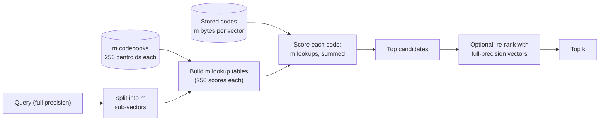

The indexes so far, [flat](/learn/vector-indexing-algorithms/flat-indexes), [IVF](/learn/vector-indexing-algorithms/ivf) and [HNSW](/learn/vector-indexing-algorithms/hnsw), all keep every vector at full precision: 1,536 bytes for a 384-dimension float32 embedding, 3,072 for a 768-dimension one. At tens or hundreds of millions of vectors that no longer fits in memory. **Product quantisation** (PQ) compresses each vector to a few dozen bytes, often a 16- to 64-fold reduction, and lets the index compute approximate similarities directly from the compressed codes, without ever decompressing them.

This lesson explains how PQ works: why it splits vectors into pieces, how each piece is replaced by the number of its nearest centroid, how similarities are computed from small lookup tables, and why the result is an excellent filter but a poor final ranking. You will implement it from scratch in NumPy, check it against FAISS, and measure what re-ranking recovers.

## Learning objectives

- Explain vector quantisation and why a single codebook cannot compress high-dimensional vectors finely enough.
- Describe how product quantisation splits a vector into sub-vectors, trains one codebook per sub-space, and encodes each vector as a short sequence of bytes.
- Compute an asymmetric distance (ADC) score from lookup tables by hand and in NumPy, and explain why it needs no multiplications per stored vector.
- Measure the effect of the number of sub-vectors on memory, recall and reconstruction error, and use re-ranking to recover recall.
- Describe how PQ is combined with IVF in practice (IVFPQ, residual encoding) and name the main refinements (OPQ, fast-scan).

## Prerequisites

- [IVF](/learn/vector-indexing-algorithms/ivf): k-means, centroids and the idea of a coarse quantiser.
- [Flat indexes](/learn/vector-indexing-algorithms/flat-indexes): exact search as ground truth, and why scans are limited by memory bandwidth.
- [Vector storage](/learn/vector-database-fundamentals/vector-storage): memory arithmetic, and float16 and int8 storage with rescoring.

## Why this matters

Memory is usually the first thing that limits a vector index at scale. Suppose Meridian indexes five years of support-desk tickets: 60 million chunks at 768 dimensions. In float32 that is $60 \times 10^6 \times 3{,}072 \approx 184$ GB of vectors, before any index structure, on every replica. 8-bit [scalar quantisation](/learn/vector-indexing-algorithms/scalar-quantisation) brings that to 46 GB, which is still large. PQ with 64 bytes per vector brings it to 3.8 GB, which fits in the RAM of a single ordinary server.

Compression also buys speed. A scan is limited by how many bytes it reads, so scanning 64-byte codes is far faster than scanning 3,072-byte vectors. This is why PQ, usually combined with IVF, is the standard technique for billion-scale search, and why several databases (Milvus, Qdrant, Weaviate, LanceDB among them) offer it.

The price is accuracy. PQ scores are approximate, sometimes quite coarse, and a PQ index used naively can lose a large share of the true neighbours. Engineers who understand where the error comes from know to pair PQ with re-ranking and how to size the codes; those who do not see recall collapse and blame the embedding model.

## The intuition

Suppose you had to describe thousands of faces to a sketch artist over a crackly phone line, using as few words as possible. Describing each face as "most like face number 3,172 in this catalogue of 4,096 faces" is compact, but crude: a catalogue of 4,096 faces cannot capture much variety.

The police identikit does something cleverer. It splits a face into parts (hairline, eyes, nose, mouth, chin) and keeps a separate catalogue of, say, 256 options for each part. A face is described as five numbers: "hairline 17, eyes 201, nose 3, mouth 88, chin 140". Each number fits in one byte, so the description is five bytes. Yet the number of distinct faces it can describe is $256^5$, about a trillion, because the parts combine freely.

Product quantisation is the identikit applied to vectors. Cut the vector into $m$ pieces, give each piece its own catalogue of 256 representative pieces learned from data, and store each vector as $m$ catalogue numbers.

## How it works

### Vector quantisation, and why one codebook is not enough

**Vector quantisation** replaces a vector with the nearest member of a fixed set of representatives, called a **codebook**. The codebook is learned with k-means (exactly as IVF learns its centroids), and a vector is stored as the index of its nearest centroid. With $2^{b}$ centroids, the index takes $b$ bits.

The trouble is resolution. To describe vectors finely you need a great many centroids. A 64-bit code would need a codebook of $2^{64}$ centroids, which can be neither trained nor stored. A codebook of 65,536 centroids (16 bits) is trainable, but its centroids are spaced so far apart in 384 dimensions that every vector is a long way from its representative. One codebook cannot both be learnable and have fine resolution.

### The product trick

PQ splits each $d$-dimensional vector into $m$ consecutive **sub-vectors** of $d/m$ dimensions each, and quantises each sub-vector separately with its own small codebook of $k^*$ centroids (almost always $k^* = 256$, so one byte per sub-vector). The overall codebook is the Cartesian product of the $m$ small ones, which is where the name comes from: there are $(k^*)^m$ possible reconstructions, while only $m \times k^*$ sub-centroids are ever trained and stored.

For a 384-dimension vector with $m = 48$: 48 sub-vectors of 8 dimensions, 48 codebooks of 256 centroids, a 48-byte code, and $256^{48}$ possible reconstructions. The code is 32 times smaller than the float32 vector.

### Training and encoding

1. **Split the training sample.** Take a representative sample of vectors and cut each into $m$ sub-vectors.
2. **Train $m$ codebooks.** Run k-means with $k^* = 256$ separately on each sub-space's sub-vectors.
3. **Encode every vector.** For each sub-vector, find the nearest of the 256 centroids in that sub-space and store its index as one byte. The vector becomes $m$ bytes.

The original vectors can then be discarded from memory (or kept on disk for re-ranking, below). The **reconstruction** of a vector is the concatenation of its $m$ chosen centroids; it is never needed for search, but it shows what PQ "thinks" the vector is.

### Searching with lookup tables

The key to PQ's speed is that you never reconstruct stored vectors. For inner product (or L2), a similarity over the whole vector is the sum of similarities over the sub-vectors. So, for a query $\mathbf{q}$:

1. **Split the query** into the same $m$ sub-vectors. The query itself is **not** quantised.
2. **Build $m$ lookup tables.** For sub-space $j$, compute the similarity between the query's sub-vector and each of the 256 centroids: a table of 256 numbers. That is $m \times 256$ small dot products in total, a fixed cost that does not depend on the collection size.
3. **Score each stored code** by looking up one entry per sub-space and adding: for code $(c_1, \dots, c_m)$, the score is $T_1[c_1] + T_2[c_2] + \dots + T_m[c_m]$. That is $m$ table lookups and $m - 1$ additions, with no multiplications.
4. **Select** the top $k$ (or the top candidates for re-ranking).



This is called **asymmetric distance computation (ADC)**: the query is exact and only the database side is quantised. The alternative, **symmetric distance computation (SDC)**, quantises the query too and uses precomputed centroid-to-centroid tables. SDC is slightly cheaper but strictly less accurate, since it adds the query's own quantisation error; ADC is what libraries use by default.

### Where the error comes from, and re-ranking

Each stored sub-vector is replaced by a centroid some distance away, so each table entry is slightly wrong, and the score of a stored vector is a sum of $m$ slightly wrong numbers. Errors partly cancel, but enough remain to reorder vectors whose true scores are close. In a crowded neighbourhood, where the true 10th and 50th neighbours differ by a few hundredths in similarity, PQ ranks them in a fairly scrambled order. The true top 10 usually *are* near the top, just not in the right order, and not always within the top 10.

The standard remedy is **re-ranking** (also called refinement or rescoring): ask PQ for the top $R$ candidates, say 100 or 200, then fetch their full-precision vectors (from RAM, SSD or a separate store) and recompute exact similarities to choose the final $k$. PQ does the heavy lifting of discarding 99.9% of the collection cheaply; exact arithmetic on a few hundred vectors fixes the order. FAISS offers this as `IndexRefineFlat`; databases offer it as a rescoring option on quantised collections.

### IVF plus PQ

On its own, PQ still compares the query with every code: a flat scan, just a cheaper one. In practice it is combined with IVF as **IVFPQ**, introduced in the original PQ paper as IVFADC:

1. A coarse quantiser partitions the collection into `nlist` cells, exactly as in IVF.
2. Each vector is assigned to a cell, and PQ encodes not the vector itself but its **residual**: the vector minus its cell's centroid.
3. At query time, `nprobe` cells are probed; for each, lookup tables are built for the query's residual relative to that centroid, and the cell's codes are scanned.

Encoding residuals helps because residuals are smaller and more uniform than raw vectors: the coarse centroid has already captured "which region of space", so the PQ bytes are spent on the finer detail within the cell. In FAISS's index-factory notation, `"IVF4096,PQ48"` is an IVF index with 4,096 lists and 48-byte residual PQ codes, and `"IVF4096,PQ48,RFlat"` adds full-precision re-ranking.

### Refinements worth knowing

- **Optimised product quantisation (OPQ)** (Ge, He, Ke and Sun, 2013) learns a rotation of the vectors before splitting them, so that information is spread evenly across sub-spaces and correlated dimensions are not split apart. It usually reduces error at no cost in code size. In FAISS notation, `"OPQ48,IVF4096,PQ48"`.
- **Fast-scan PQ** uses 16 centroids per sub-space (4 bits) instead of 256, so each lookup table is small enough to sit in a CPU SIMD register, and scanning becomes much faster. FAISS implements this in its fast-scan index types.
- **Anisotropic quantisation**, used in Google's ScaNN library (Guo and colleagues, 2020), trains codebooks to minimise the error that matters for inner-product ranking rather than plain reconstruction error.

### Choosing the parameters

The main choice is $m$, which sets the code size in bytes (with 8-bit codes). More bytes means finer sub-spaces, lower error and higher recall, and more memory and scan time. $d$ must be divisible by $m$, and FAISS's optimised implementations work best with sub-vectors of a few dimensions (common choices put between 2 and 16 dimensions in each sub-vector). The training set should be at least tens of thousands of vectors, so that each sub-space's 256 centroids are well estimated, and representative of the whole collection.

## The mathematics

### The ADC score

**Intuition.** A dot product over the whole vector is the sum of dot products over its pieces, and each piece of a stored vector has been replaced by one of 256 known centroids, so those piece-wise products can be precomputed per query.

$$
\mathbf{q} \cdot \mathbf{x} \;\approx\; \mathbf{q} \cdot \hat{\mathbf{x}} \;=\; \sum_{j=1}^{m} \mathbf{q}^{(j)} \cdot \mathbf{c}^{(j)}_{c_j(\mathbf{x})} \;=\; \sum_{j=1}^{m} T_j\big[c_j(\mathbf{x})\big]
$$

$\mathbf{q}^{(j)}$ is the $j$-th sub-vector of the query, $c_j(\mathbf{x})$ is the stored byte for sub-space $j$ of vector $\mathbf{x}$, $\mathbf{c}^{(j)}_{i}$ is centroid $i$ of codebook $j$, $\hat{\mathbf{x}}$ is the reconstruction, and $T_j[i] = \mathbf{q}^{(j)} \cdot \mathbf{c}^{(j)}_{i}$ is the precomputed table entry. The approximation error is exactly $\mathbf{q} \cdot (\mathbf{x} - \hat{\mathbf{x}})$: the query's dot product with the quantisation error. For L2 distance the same decomposition holds, with squared sub-distances in the tables.

**By hand.** $d = 4$, $m = 2$, and for readability just 2 centroids per codebook instead of 256.

- Codebook 1: $\mathbf{c}^{(1)}_0 = (1, 0)$, $\mathbf{c}^{(1)}_1 = (0, 1)$. Codebook 2: $\mathbf{c}^{(2)}_0 = (1, 1)$, $\mathbf{c}^{(2)}_1 = (-1, 0)$.
- Encode $\mathbf{x} = (0.9, 0.2, -0.8, 0.1)$. Sub-vector $(0.9, 0.2)$: squared distance to $(1, 0)$ is $0.01 + 0.04 = 0.05$, to $(0, 1)$ is $0.81 + 0.64 = 1.45$, so code 0. Sub-vector $(-0.8, 0.1)$: to $(1, 1)$ is $3.24 + 0.81 = 4.05$, to $(-1, 0)$ is $0.04 + 0.01 = 0.05$, so code 1. Stored code: $(0, 1)$, two bytes.
- Query $\mathbf{q} = (0.5, 0.5, -1, 0.5)$. Table 1: $(0.5, 0.5)\cdot(1,0) = 0.5$ and $(0.5,0.5)\cdot(0,1) = 0.5$. Table 2: $(-1, 0.5)\cdot(1,1) = -0.5$ and $(-1, 0.5)\cdot(-1, 0) = 1$.
- ADC score: $T_1[0] + T_2[1] = 0.5 + 1 = 1.5$. Exact score: $0.45 + 0.1 + 0.8 + 0.05 = 1.4$. The error, 0.1, is the query's dot product with $\mathbf{x} - \hat{\mathbf{x}} = (-0.1, 0.2, 0.2, 0.1)$: $-0.05 + 0.1 - 0.2 + 0.05 = -0.1$, so the estimate is 0.1 too high.

```python
import numpy as np

books = np.array([[[1.0, 0.0], [0.0, 1.0]],      # codebook for sub-space 1
                  [[1.0, 1.0], [-1.0, 0.0]]])    # codebook for sub-space 2
x = np.array([0.9, 0.2, -0.8, 0.1])
q = np.array([0.5, 0.5, -1.0, 0.5])

code = [int(np.argmin(((x[2*j:2*j+2] - books[j]) ** 2).sum(1))) for j in range(2)]
tables = [books[j] @ q[2*j:2*j+2] for j in range(2)]
print("code:", code, " reconstruction:", np.concatenate([books[j][c] for j, c in enumerate(code)]))
print("tables:", [t.tolist() for t in tables])
print("ADC score:", sum(tables[j][c] for j, c in enumerate(code)), " exact:", round(float(q @ x), 4))
```

```output
code: [0, 1]  reconstruction: [ 1.  0. -1.  0.]
tables: [[0.5, 0.5], [-0.5, 1.0]]
ADC score: 1.5  exact: 1.4
```

### Memory and cost

$$
\text{code bytes} = \frac{m \cdot \log_2 k^*}{8}, \qquad \text{codebook bytes} = m \cdot k^* \cdot \frac{d}{m} \cdot 4 = k^* \cdot d \cdot 4
$$

With $k^* = 256$, each code is $m$ bytes, and the codebooks take $256 \times d \times 4$ bytes regardless of $m$: 393 KB for $d = 384$, negligible. Per query, building tables costs $k^* \times d$ multiply-adds (98,304 for $d = 384$), and scanning $N$ codes costs $N \times m$ lookups and additions. For $N = 10^6$ and $m = 48$: 48 million lookups reading 48 MB of codes, against 384 million multiply-adds reading 1.5 GB for a float32 flat scan.

## In code

**The problem.** Implement PQ from scratch (training, encoding and ADC search), measure memory, reconstruction error and recall@10 for three code sizes, measure what re-ranking the top 100 recovers, and check the implementation against FAISS's `IndexPQ`.

**Dependencies.** NumPy and FAISS (used here for its fast k-means and as a reference).

```bash
pip install numpy faiss-cpu
```

The data has the same two-scale topic structure as the IVF and HNSW lessons, with 100,000 vectors.

```python
import numpy as np
import faiss

rng = np.random.default_rng(0)
N, d, k, n_queries = 100_000, 384, 10, 300

# The same kind of synthetic data as the IVF and HNSW lessons.
def make(n, topics, noise):
    v = topics[rng.integers(0, len(topics), n)] + noise * rng.normal(size=(n, d))
    return (v / np.linalg.norm(v, axis=1, keepdims=True)).astype(np.float32)

subjects = rng.normal(size=(100, d))
topics = subjects[rng.integers(0, 100, 5_000)] + 0.8 * rng.normal(size=(5_000, d))
X, Q = make(N, topics, 2.0), make(n_queries, topics, 2.0)
train = X[rng.choice(N, 20_000, replace=False)]

S_true = Q @ X.T                                         # exact inner products
I_true = np.argsort(-S_true, axis=1)[:, :k]

def recall_at_k(I):
    return np.mean([len(set(a) & set(b)) / k for a, b in zip(I, I_true)])

def train_pq(train, m, ks=256):
    """One k-means codebook of ks centroids per sub-space of d/m dimensions."""
    dsub = d // m
    books = []
    for j in range(m):
        km = faiss.Kmeans(dsub, ks, niter=20, seed=j)
        km.train(np.ascontiguousarray(train[:, j * dsub:(j + 1) * dsub]))
        books.append(km.centroids)                       # (ks, dsub)
    return np.stack(books)                               # (m, ks, dsub)

def encode(X, books):
    m, ks, dsub = books.shape
    codes = np.empty((len(X), m), dtype=np.uint8)        # one byte per sub-vector
    for j in range(m):
        sub = X[:, j * dsub:(j + 1) * dsub]
        # nearest centroid by squared L2; ||sub||^2 is the same for every centroid, so drop it
        dist = (books[j] ** 2).sum(1) - 2 * sub @ books[j].T      # (n, ks)
        codes[:, j] = dist.argmin(1)
    return codes

def adc_scores(Q, codes, books):
    """Asymmetric distance computation: exact query, quantised database."""
    m, ks, dsub = books.shape
    S = np.zeros((len(Q), len(codes)), dtype=np.float32)
    for j in range(m):
        table = Q[:, j * dsub:(j + 1) * dsub] @ books[j].T      # (n_queries, ks) lookup table
        S += table[:, codes[:, j]]                               # gather, no multiplications
    return S

print(f"float32 vectors: {d * 4} bytes each, {X.nbytes / 1e6:.1f} MB in total")
for m in [16, 48, 96]:
    books = train_pq(train, m)
    codes = encode(X, books)
    S = adc_scores(Q, codes, books)
    I_pq = np.argsort(-S, axis=1)[:, :k]

    # Re-rank: take the top 100 by PQ score, rescore them with the full vectors.
    cand = np.argpartition(-S, 100, axis=1)[:, :100]
    exact = np.take_along_axis(S_true, cand, axis=1)    # stands in for reading float32 from disk
    I_rr = np.take_along_axis(cand, np.argsort(-exact, axis=1)[:, :k], axis=1)

    recon = np.concatenate([books[j][codes[:, j]] for j in range(m)], axis=1)
    rel_err = np.mean(np.linalg.norm(X - recon, axis=1))  # vectors have length 1
    print(f"m={m:>2}: {codes.shape[1]:>2} bytes/vector ({d * 4 // m}x smaller), "
          f"reconstruction error {rel_err:.3f}, recall@10 {recall_at_k(I_pq):.3f}, "
          f"after re-ranking top 100: {recall_at_k(I_rr):.3f}")

# The same thing with FAISS's built-in product quantiser.
pq_index = faiss.IndexPQ(d, 48, 8, faiss.METRIC_INNER_PRODUCT)   # 48 sub-vectors, 8 bits each
pq_index.train(train)
pq_index.add(X)
_, I_faiss = pq_index.search(Q, k)
print(f"faiss.IndexPQ m=48: code size {pq_index.code_size} bytes, recall@10 {recall_at_k(I_faiss):.3f}")
```

```output
float32 vectors: 1536 bytes each, 153.6 MB in total
m=16: 16 bytes/vector (96x smaller), reconstruction error 0.827, recall@10 0.180, after re-ranking top 100: 0.600
m=48: 48 bytes/vector (32x smaller), reconstruction error 0.567, recall@10 0.516, after re-ranking top 100: 0.960
m=96: 96 bytes/vector (16x smaller), reconstruction error 0.313, recall@10 0.730, after re-ranking top 100: 1.000
faiss.IndexPQ m=48: code size 48 bytes, recall@10 0.508
```

**The important lines.**

- `faiss.Kmeans(dsub, ks, niter=20, seed=j)` trains one 256-centroid codebook per sub-space. Any k-means works; FAISS's is simply fast.
- In `encode`, `(books[j] ** 2).sum(1) - 2 * sub @ books[j].T` is the L2 expansion from the [flat index lesson](/learn/vector-indexing-algorithms/flat-indexes) with the constant $\lVert \text{sub} \rVert^2$ dropped: finding the nearest centroid for 100,000 sub-vectors becomes one matrix product.
- `codes` has dtype `uint8`: one byte per sub-vector, so the whole collection at `m=48` is $100{,}000 \times 48 = 4.8$ MB.
- `table = Q[:, j*dsub:(j+1)*dsub] @ books[j].T` builds the 256-entry lookup table for every query in sub-space $j$. `table[:, codes[:, j]]` then gathers one entry per stored vector: a lookup, not a multiplication. Real implementations do this gather in tight SIMD loops; NumPy's version shows the logic.
- `np.argpartition(-S, 100, axis=1)[:, :100]` takes 100 candidates by PQ score; `S_true` then supplies their exact scores, standing in for fetching full vectors from disk.
- `faiss.IndexPQ(d, 48, 8, faiss.METRIC_INNER_PRODUCT)` is the library version: 48 sub-vectors of 8 bits each. `code_size` confirms 48 bytes per vector.

**What the output means.**

- **The from-scratch version matches FAISS.** At 48 bytes, recall@10 is 0.516 from scratch and 0.508 from FAISS. The small difference comes from k-means initialisation and iteration settings, not from a different algorithm.
- **Recall without re-ranking is poor.** Even at 96 bytes (16 times smaller), PQ alone finds 73% of the true top 10; at 16 bytes, 18%. The scores are too coarse to order a crowded neighbourhood.
- **Re-ranking changes the picture.** With 48-byte codes, re-ranking the top 100 brings recall@10 to 0.960; with 96-byte codes, to 1.000. PQ places almost all true neighbours somewhere in its top 100, even when it orders them badly. At 16 bytes, it does not: too much information was discarded, and even the top 100 misses 40% of them.
- **Reconstruction error tracks recall.** The average distance between a unit vector and its reconstruction falls from 0.83 to 0.31 as $m$ grows. This synthetic data is deliberately noisy and so compresses badly; real text embeddings, whose information is more concentrated, usually reach a given recall with fewer bytes. Measure on your own data.

**Errors people commonly hit.**

- Choosing $m$ that does not divide $d$. FAISS raises an error; a hand-rolled version silently drops dimensions.
- Training on too few vectors. Each sub-space needs enough points to place 256 centroids; FAISS warns when there are fewer than 39 per centroid, which is about 10,000 vectors.
- Judging PQ by recall without re-ranking, then rejecting it, or deploying it without re-ranking and accepting poor results.
- Forgetting that codes are tied to their codebooks. Retraining the codebooks invalidates every stored code; the whole collection must be re-encoded.

**Extending it.** Implement SDC (quantise the query as well and score with centroid-to-centroid tables) and compare its recall with ADC at `m=48`. Then try `faiss.index_factory(d, "OPQ48,PQ48", faiss.METRIC_INNER_PRODUCT)` and see whether the learned rotation improves recall on this data.

## A real-world example

Meridian's support desk wanted AskMeridian to search five years of resolved tickets, about 60 million chunks, to answer questions like "has anyone seen this Relay sync error before?". Embedded at 768 dimensions, the float32 vectors alone would take about 184 GB per replica. The Platform team's budget allowed one 64 GB node per replica.

Tunde, the engineer on the project, prototyped an IVFPQ index in FAISS on a 2-million-ticket sample. His first configuration used 32-byte codes, to leave plenty of memory headroom. Recall@10 against a flat search on 400 held-out queries was poor, and it was poor in a telling way: queries quoting an exact error message did well, while descriptive queries ("Relay stops syncing after the laptop wakes from sleep") often missed the best tickets. Descriptive queries land in crowded neighbourhoods of similar tickets, which is exactly where coarse scores scramble the order.

Rather than guessing, he swept two levers together on the same queries: code size (32, 64 and 96 bytes) and re-ranking depth (the top 50, 200 or 500 candidates rescored from float32 vectors kept on local SSD). The team chose the cheapest combination that met their recall target: 64-byte codes with OPQ (3.8 GB for 60 million vectors), re-ranking the top 200 from SSD. That reads $200 \times 3{,}072 \approx 614$ KB per query, a few hundred small random reads, well within their latency budget.

Two operational rules came out of the project: the PQ codebooks are retrained and the index rebuilt when the embedding model changes or the ticket corpus doubles, and the recall measurement against a flat search on a sample is part of every rebuild.

## Common mistakes

- **Using PQ scores as the final ranking.** PQ is an excellent filter and a poor ranker; without re-ranking, recall@10 can be well under the level users will tolerate.
- **Choosing the code size by memory alone.** Too few bytes and the true neighbours are not even in the candidate set, so no amount of re-ranking helps. Sweep code size and re-ranking depth together.
- **Training on unrepresentative data.** Codebooks learned from one part of the corpus describe other parts badly, and the error is invisible without a recall measurement.
- **Re-ranking from slow storage at large depth.** Re-ranking 1,000 candidates from network storage per query can cost more latency than the PQ scan saved.
- **Applying PQ to small collections.** Below a few million vectors, the memory saving rarely justifies the recall loss and the operational work; float16 or int8 storage is simpler.

## Best practices

- Reach for PQ when memory, not latency, is the binding constraint, typically at tens of millions of vectors and beyond, and combine it with IVF so that only a few cells are scanned.
- Always plan re-ranking: keep full-precision vectors on SSD or in a separate store, and re-rank a candidate set several times larger than $k$.
- Sweep code size and re-ranking depth on a few hundred real queries against flat-search ground truth, and pick the cheapest combination that meets your recall target.
- Try OPQ (or the engine's equivalent rotation option); it often improves recall at the same code size.
- Train on a random sample of at least tens of thousands of vectors drawn from the whole collection, and retrain when the content or embedding model changes.
- Record the codebook version alongside the index, so codes are never scored with the wrong codebooks.

## Performance considerations

**Memory.** $N \times m$ bytes for codes, plus the IVF ids (8 bytes per vector in FAISS, which at 32 or 64 bytes per code is a significant share), plus negligible codebooks. For 60 million vectors at 64 bytes, codes take 3.8 GB and ids about 0.5 GB.

**Scan speed.** Codes are small, so far more fit in cache and far fewer bytes stream from memory. The per-code work is $m$ table lookups. Lookup tables of 256 float entries ($m \times 1$ KB in total) fit in the CPU's fast caches; fast-scan variants with 16 entries per table fit in registers and are faster still.

**Table construction.** A fixed $256 \times d$ multiply-adds per query (per probed cell in IVFPQ with residuals, since the residual depends on the cell). With `nprobe` = 32 at $d = 768$, that is about 6.3 million multiply-adds per query, small but not negligible next to scanning a few thousand codes; it is one reason IVFPQ libraries offer precomputed-table optimisations.

**Re-ranking.** $R$ full vectors per query: $R \times d \times 4$ bytes. At $R = 200$ and $d = 768$, 614 KB. From RAM, trivial; from local NVMe SSD, a few hundred random reads that typically take well under a few milliseconds in total; from network storage, potentially much more. Size $R$ by measurement.

**Training and encoding.** Training is $m$ small k-means runs; encoding costs $N \times 256 \times d$ multiply-adds and parallelises well.

## Summary

- Product quantisation splits each vector into $m$ sub-vectors, learns a 256-centroid codebook per sub-space, and stores each vector as $m$ bytes, giving $256^m$ possible reconstructions from only $256m$ trained centroids.
- Search uses asymmetric distance computation: the query stays exact, $m$ lookup tables of 256 scores are built once per query, and each stored vector's score is $m$ lookups summed.
- PQ scores are coarse: they find the right neighbourhood but scramble its order, so PQ is used as a filter followed by re-ranking with full-precision vectors.
- Code size trades memory against recall; too few bytes lose neighbours that no re-ranking can recover.
- In practice PQ is combined with IVF (IVFPQ, encoding residuals) and often with a learned rotation (OPQ), and it is the standard technique for collections too large for float32 in RAM.

## Exercises

**1.** A collection of 200 million vectors at 1,024 dimensions is to be held in RAM as IVFPQ codes with $m = 64$ and 8-bit codes, plus 8-byte ids. Compute the memory for codes and ids, and compare with float32 storage. How large are the codebooks?

<details><summary>Show solution</summary>

Codes: $2 \times 10^8 \times 64 = 12.8$ GB. Ids: $2 \times 10^8 \times 8 = 1.6$ GB. Total about 14.4 GB.

float32: $2 \times 10^8 \times 1{,}024 \times 4 = 819.2$ GB, about 57 times more.

Codebooks: $256 \times 1{,}024 \times 4 = 1{,}048{,}576$ bytes, about 1 MB, regardless of $m$.

</details>

**2.** Using the by-hand example's codebooks, encode $\mathbf{y} = (0.1, 0.9, 0.7, 0.8)$ and compute its ADC score for the same query $\mathbf{q} = (0.5, 0.5, -1, 0.5)$. Compare it with the exact score. Does PQ rank $\mathbf{x}$ and $\mathbf{y}$ in the right order?

<details><summary>Show solution</summary>

Sub-vector $(0.1, 0.9)$: squared distance to $(1, 0)$ is $0.81 + 0.81 = 1.62$, to $(0, 1)$ is $0.01 + 0.01 = 0.02$, so code 1. Sub-vector $(0.7, 0.8)$: to $(1, 1)$ is $0.09 + 0.04 = 0.13$, to $(-1, 0)$ is $2.89 + 0.64 = 3.53$, so code 0. Code $(1, 0)$.

ADC: $T_1[1] + T_2[0] = 0.5 + (-0.5) = 0.0$. Exact: $0.05 + 0.45 - 0.7 + 0.4 = 0.2$.

Exact scores are 1.4 for $\mathbf{x}$ and 0.2 for $\mathbf{y}$; ADC gives 1.5 and 0.0. Both orderings put $\mathbf{x}$ first, so the ranking is right. The two vectors are far apart in score, so errors of 0.1 to 0.2 do not swap them; vectors with closer scores could be swapped.

</details>

**3.** Extend the lesson's code to re-rank the top 25, 50, 100 and 200 PQ candidates for `m=16` and `m=48`, and print recall@10 for each. What does the result tell you about the relationship between code size and re-ranking depth?

<details><summary>Show solution</summary>

Replace the fixed 100 with a loop:

```python
for R in [25, 50, 100, 200]:
    cand = np.argpartition(-S, R, axis=1)[:, :R]
    exact = np.take_along_axis(S_true, cand, axis=1)
    I_rr = np.take_along_axis(cand, np.argsort(-exact, axis=1)[:, :k], axis=1)
    print(m, R, round(recall_at_k(I_rr), 3))
```

One run gave, for $R$ = 25, 50, 100, 200: 0.309, 0.453, 0.600, 0.752 at 16 bytes, and 0.747, 0.882, 0.960, 0.990 at 48 bytes. Recall rises with $R$ for both, but 16-byte codes stay far behind even at $R = 200$, because many true neighbours rank below 200 under such coarse scores. Re-ranking can only reorder what the filter lets through: smaller codes need much deeper re-ranking, and beyond some point no practical depth compensates. Choose the two together.

</details>

**4.** Design decision. An AskMeridian collection has 3 million chunks at 768 dimensions (about 9.2 GB in float32) on nodes with 32 GB of RAM, and latency is acceptable with HNSW. A colleague proposes switching to IVFPQ to "save memory". What would you advise?

<details><summary>Show solution</summary>

Advise against it for now. 9.2 GB of vectors plus an HNSW graph fits comfortably in 32 GB, and latency is acceptable, so PQ would add a recall loss, a re-ranking path, codebook training and retraining, all to solve a problem the system does not have. If memory does become tight (more data, a larger model, more replicas per node), try the cheaper options first: float16 (halves memory, negligible recall loss) or int8 [scalar quantisation](/learn/vector-indexing-algorithms/scalar-quantisation) with rescoring (quarters it). PQ becomes the right tool when even int8 does not fit, typically at tens of millions of vectors or more.

</details>

## Check your understanding

```quiz
[
  {
    "q": "With d = 768, m = 96 and 256 centroids per sub-space, how many bytes does each PQ code take?",
    "options": [
      "768",
      "96",
      "8",
      "3,072"
    ],
    "answer": 1,
    "why": "Each of the 96 sub-vectors is stored as the index of one of 256 centroids, which fits in one byte."
  },
  {
    "q": "What is 'asymmetric' about asymmetric distance computation?",
    "options": [
      "Queries use inner product while stored vectors use L2",
      "Different sub-spaces have different numbers of centroids",
      "The query is kept at full precision while only the stored vectors are quantised",
      "Scores are computed in one direction only"
    ],
    "answer": 2,
    "why": "ADC compares an exact query against quantised database vectors, avoiding the extra error of quantising the query too."
  },
  {
    "q": "Why does scoring a stored PQ code need no multiplications?",
    "options": [
      "Similarities between the query's sub-vectors and every centroid are precomputed into tables, so scoring is m lookups and additions",
      "PQ codes are binary, so a dot product becomes a bit count",
      "The query is quantised to integers",
      "PQ uses Hamming distance"
    ],
    "answer": 0,
    "why": "Each stored sub-vector is one of 256 known centroids, so its contribution is looked up from a per-query table."
  },
  {
    "q": "A PQ index has recall@10 of 0.5, but re-ranking its top 100 with full vectors gives 0.96. What does that show?",
    "options": [
      "The codebooks were trained on the wrong data",
      "The index should use SDC instead of ADC",
      "Re-ranking is computing scores incorrectly",
      "PQ puts most true neighbours near the top but orders them poorly; exact rescoring of a candidate set fixes the order"
    ],
    "answer": 3,
    "why": "Coarse scores scramble the order within a crowded neighbourhood, but the true neighbours still fall within a modest candidate set."
  },
  {
    "q": "In IVFPQ, why does PQ encode the residual (vector minus its cell centroid) rather than the vector itself?",
    "options": [
      "Residuals are always zero",
      "The coarse centroid already captures where the vector is, so PQ bytes are spent on the finer detail within the cell, reducing error",
      "It allows the query to be quantised",
      "It removes the need for training"
    ],
    "answer": 1,
    "why": "Residuals are smaller and more uniform than raw vectors, so the same code size describes them more accurately."
  }
]
```

## Further reading

- Jégou, Douze and Schmid (2011), "Product quantization for nearest neighbor search", *IEEE Transactions on Pattern Analysis and Machine Intelligence* 33(1). The original paper: PQ, ADC and SDC, and IVFADC.
- Ge, He, Ke and Sun (2013), "Optimized Product Quantization for Approximate Nearest Neighbor Search", *CVPR*. The learned rotation known as OPQ.
- Guo et al. (2020), "Accelerating Large-Scale Inference with Anisotropic Vector Quantization", *ICML*, [arXiv:1908.10396](https://arxiv.org/abs/1908.10396). The quantisation behind ScaNN.
- Douze et al. (2024), "The Faiss library", [arXiv:2401.08281](https://arxiv.org/abs/2401.08281). Covers PQ, IVFPQ, fast-scan and refinement in one library.
- FAISS wiki, [github.com/facebookresearch/faiss/wiki](https://github.com/facebookresearch/faiss/wiki): the index-factory notation (`IVF4096,PQ48`, `OPQ`, `RFlat`) and guidance on code sizes.
