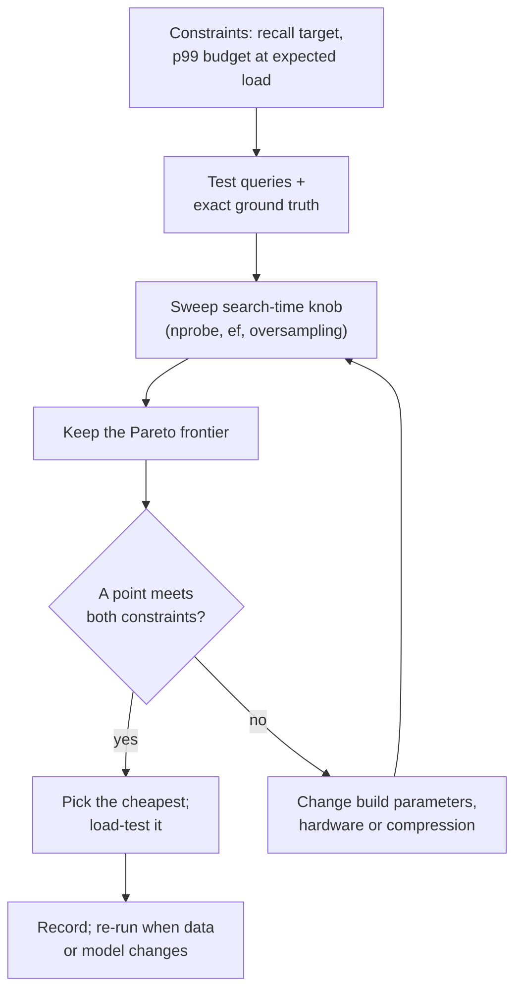

Every approximate index has a dial. Turn it one way and searches get faster but miss more true neighbours; turn it the other way and they find more but take longer. [Approximate nearest neighbour search](/learn/vector-indexing-algorithms/approximate-nearest-neighbour-search) introduced the bargain. This lesson is about striking it well: how to measure both sides honestly, how to read the curve that connects them, how to choose a setting from a latency budget and a recall target, and why the answer you get on a quiet benchmark machine is not the answer your production system will see under load.

The output of this lesson is a method, not a number. Recall and latency figures depend on your data, your hardware and your query mix, so the only trustworthy operating point is one you have measured yourself.

## Learning objectives

- Measure recall@k against exact ground truth and latency as percentiles (p50, p99) for an index under a range of settings.
- Identify the Pareto frontier of a set of index configurations and choose an operating point from a recall target and a latency budget.
- Name the search-time knob that trades recall for latency in IVF, HNSW and quantised indexes, and in common vector databases.
- Use Little's law and a simple queueing model to explain why latency under load grows faster than per-query work.
- Design a benchmark whose results transfer to production: realistic queries, filters, concurrency and collection size.

## Prerequisites

- [Approximate nearest neighbour search](/learn/vector-indexing-algorithms/approximate-nearest-neighbour-search): recall@k and candidate generation.
- [IVF](/learn/vector-indexing-algorithms/ivf) and [HNSW](/learn/vector-indexing-algorithms/hnsw): what `nprobe` and `ef` control.
- [Product quantisation](/learn/vector-indexing-algorithms/product-quantisation): compressed scores and rescoring.
- [Exact nearest neighbour search](/learn/vector-indexing-algorithms/exact-nearest-neighbour-search): computing ground truth correctly.

## Why this matters

Vector databases ship with default settings chosen to be reasonable on typical benchmark data. Your data are not typical benchmark data. A default `ef` can give a recall of 0.99 on one corpus and 0.85 on another with the same dimension, and nothing in the logs tells you which you have. Teams that never measure either pay for recall they do not need (more servers, higher latency) or silently lose chunks that should have reached the language model.

The trade-off is also not one decision made once. Recall at fixed settings falls as a collection grows, restrictive filters change it per query, and latency depends on load. A setting that was right at launch can be wrong six months later. Knowing how to produce a recall-latency curve, and how to read one, is what lets you revisit the decision with evidence instead of guesswork.

Finally, in a RAG system the vector search is one stage of several. Query embedding, reranking and generation all take time, and generation usually dominates. Knowing what a few extra milliseconds of search buys in recall lets you spend the latency budget where it improves answers most.

## The intuition

Suppose you have lost your keys somewhere in a large house. You can search one room, the one where you usually leave them, and you will find them most of the time, quickly. Searching three rooms finds them more often and takes three times as long. Searching every room always finds them and takes all afternoon.

Two things about this are worth noticing. First, **returns diminish**: the first room catches most cases; each additional room catches fewer. Going from 90% to 99% success may cost as much as going from 0% to 90%. Second, **time depends on more than the search**: if five people are queueing to use the only torch, your wait grows sharply as the queue lengthens, even though each search takes the same time. Recall versus latency in a vector index has both features.

## How it works

### Measuring the two axes

**Recall** is measured as in the [previous lessons](/learn/vector-indexing-algorithms/approximate-nearest-neighbour-search): run a set of test queries through the index and through an exact search, and compute the fraction of the true top $k$ that the index returned. Use real or realistic queries that are not in the collection, the same $k$ the application uses, and the same filters.

**Latency** is the time one query takes, measured as a distribution, never as an average alone.

- The **p50** (median) is the latency half of the queries beat. It describes the typical experience.
- The **p99** is the latency 99% of queries beat. It describes the worst 1 in 100, and it is what service-level objectives (SLOs) are usually written against, because a user who sends several requests per session will often meet one tail value.
- The **mean** is pulled up by the tail and corresponds to no particular query; report it only alongside percentiles.

**Throughput** (queries per second, QPS) is how many queries a deployment can complete per second at an acceptable latency. It is a different number from 1/latency: a server with eight cores can run eight single-threaded queries at once, and batching several queries into one call can raise throughput further at the cost of individual latency.

### The knobs

Each index exposes one main search-time parameter that sets how much of the collection is examined, plus build-time parameters that shape the structure being searched.

| Index | Search-time knob | Effect of raising it | Build-time parameters that move the curve |
| --- | --- | --- | --- |
| IVF | `nprobe`: clusters searched | More clusters, higher recall, roughly linear cost | `nlist` (number of clusters) |
| HNSW | `ef` (`efSearch`): candidate list size, at least $k$ | Wider graph walk, higher recall | `M` (links per node), `efConstruction` |
| PQ / SQ with rescoring | rescoring depth (oversampling) | More candidates rescored with full vectors | code size, number of sub-quantisers |

The names differ by product. In pgvector they are the session settings `hnsw.ef_search` and `ivfflat.probes`. In Qdrant they are `hnsw_ef` in the search parameters, plus `oversampling` and `rescore` when quantisation is on. Elasticsearch's kNN search asks for `num_candidates`, the number of candidates gathered per shard before the top `k` is chosen. FAISS uses `nprobe`, `efSearch` and, for rescoring, the `k_factor` of `IndexRefineFlat`. All of them do the same thing: widen candidate generation.

Search-time knobs can be changed per query, without rebuilding, which makes them the first thing to tune. Build-time parameters change the curve itself: a better-connected graph (larger `M`) reaches a given recall at a smaller `ef`, at the cost of memory and build time. [Index construction](/learn/vector-indexing-algorithms/index-construction) covers those.

### The shape of the curve

Plot recall on one axis and latency on the other for a sweep of a knob, and you get a curve that rises steeply and then flattens. The flattening has a cause. Most queries' neighbours are easy to find: they sit in the query's own cluster or a few graph hops away. The last few per cent of recall come from hard cases: neighbours on the far side of a cluster boundary, queries in sparse regions, points the graph links to poorly. Finding those means widening the search for every query, so the cost of each extra point of recall grows.

This means the useful question is never "what is the maximum recall?" (1.0, with exact search) but "what does the next 1% cost?" Going from 0.90 to 0.95 may be cheap, from 0.98 to 0.99 expensive, and from 0.99 to 0.999 extravagant.

### The Pareto frontier and the operating point

When you compare several indexes and settings, some configurations are simply worse than others: another configuration is at least as accurate and at least as fast. A configuration that no other beats on both axes is **Pareto-optimal**, and the set of them is the **Pareto frontier**. Only configurations on the frontier are worth considering; everything else is dominated.

Choosing a setting is then a constrained choice along the frontier:

1. **Fix the constraints** from the product: a latency budget for retrieval (for example, p99 under 30 ms at the expected load) and a minimum recall (for example, recall@10 of at least 0.95).
2. **Build the test set**: a few hundred to a few thousand realistic queries with exact ground truth computed by a flat scan.
3. **Sweep** the search-time knob of each candidate index, measuring recall and latency percentiles.
4. **Keep the frontier** and discard dominated configurations.
5. **Pick the cheapest point that meets both constraints.** If none does, change a build-time parameter, add hardware, compress, or revisit the constraints.
6. **Confirm under load** with realistic concurrency, then record the setting and the curve, and re-run the sweep when the collection grows or the embedding model changes.



```playground
latency-cost
```

### Benchmarks that transfer to production

A recall-latency curve is only as good as the conditions it was measured in. Six conditions matter most.

- **Realistic queries.** User questions embedded with the same model, not stored vectors. Stored vectors find themselves, flattering recall.
- **The real $k$ and the real filters.** Recall@100 for a reranker's candidate list behaves differently from recall@5, and filtered queries can have much lower recall than unfiltered ones at the same setting.
- **The real collection size.** At a fixed `ef` or `nprobe`, recall usually falls as the collection grows, because the same search covers a smaller fraction of it. Benchmark at the size you will run at, or re-measure as you grow.
- **Warm state.** The first queries after a restart load data from disk into memory and run slowly. Discard a warm-up period, or measure it separately if cold starts matter to you.
- **Realistic concurrency.** Single-query latency on an idle machine is the floor. Under load, queues form and the tail grows (see the mathematics below).
- **Repeated runs.** Timing noise from other processes, CPU frequency changes and memory placement is large at sub-millisecond scales. Repeat measurements and look at their spread before declaring a winner.

### From index recall to answer quality

What ultimately matters is whether the right chunks reach the language model. A rough model: if exact search would put a relevant chunk in the top $k$ with probability $R_{\text{exact}}$ (relevance recall, from [Recall@K](/learn/retrieval-fundamentals/recall-k)) and the index returns a true neighbour with probability $r$ (ANN recall), then the relevant chunk arrives with probability about $R_{\text{exact}} \times r$. With $R_{\text{exact}} = 0.85$ and $r = 0.97$, that is about 0.82. The model assumes ANN misses are independent of relevance, which is not guaranteed, so use it to reason about orders of magnitude and confirm with an end-to-end evaluation.

Two practical consequences follow. First, it is often cheap to buy ANN recall: a search taking 5 ms instead of 2 ms is invisible next to a generation step of a second or more. Second, when a [reranker](/learn/reranking-fundamentals/why-reranking-is-needed) follows retrieval, the recall that matters is at the reranker's candidate depth (say 50), not at the final 5. Recall at a larger $k$ is usually *lower* at the same `ef`, because the same candidate budget must now cover more true neighbours, so a deeper candidate list needs its own sweep.

## The mathematics

### Little's law

**Intuition.** The number of requests in progress equals how fast they arrive multiplied by how long each stays.

$$
L = \lambda \, W
$$

- $L$ is the average number of queries in the system (being served or waiting).
- $\lambda$ is the arrival rate in queries per second.
- $W$ is the average time a query spends in the system, in seconds.

**By hand.** AskMeridian peaks at 200 queries per second and each search spends 8 ms in the vector database: $L = 200 \times 0.008 = 1.6$ queries in flight on average. If raising `ef` doubles the time to 16 ms, $L = 3.2$. On a node with 8 cores, that is still well below one query per core; the next model shows why the tail can still grow.

### Queueing and utilisation

**Intuition.** When a server is busy part of the time, some queries arrive while it is occupied and must wait. The busier it is, the longer the waits, and the growth is not linear.

The simplest queueing model, M/M/1 (random arrivals, random service times, one server), gives the mean time in the system as:

$$
\rho = \lambda S, \qquad W = \frac{S}{1 - \rho} \quad (\rho < 1)
$$

- $S$ is the mean service time: the work one query takes when it does not wait.
- $\lambda$ is the arrival rate at this server.
- $\rho$ is the **utilisation**, the fraction of time the server is busy. At $\rho \geq 1$ the queue grows without limit.

Real vector databases are multi-core servers with less random service times, so treat this as a qualitative model; the conclusion survives more accurate models.

**By hand.** Treat one core as the server, receiving 100 queries per second, each needing $S = 4$ ms. Then $\rho = 100 \times 0.004 = 0.4$ and $W = 4 / 0.6 \approx 6.7$ ms. Now raise `ef` so that each query needs 8 ms: $\rho = 0.8$ and $W = 8 / 0.2 = 40$ ms. **Doubling the work multiplied the mean latency by six**, and the tail grows even more. On an idle benchmark machine the same change would have looked like 4 ms becoming 8 ms.

```python
def mm1_latency(service_ms, qps_per_core):
    rho = service_ms / 1000 * qps_per_core          # utilisation of the core
    return rho, (service_ms / (1 - rho) if rho < 1 else float("inf"))

for service_ms in (4, 8):
    rho, r = mm1_latency(service_ms, qps_per_core=100)
    print(f"service {service_ms} ms at 100 QPS/core: utilisation {rho:.1f}, mean latency {r:.1f} ms")
```

```output
service 4 ms at 100 QPS/core: utilisation 0.4, mean latency 6.7 ms
service 8 ms at 100 QPS/core: utilisation 0.8, mean latency 40.0 ms
```

The lesson for tuning: choose the recall setting on single-query curves, then check it at the expected load, and keep utilisation comfortably below 1 (many teams aim for well under 0.7 at peak) so that a recall increase does not tip the system into long queues.

## In code

**The problem.** Sweep IVF's `nprobe` and HNSW's `efSearch` on 100,000 embedding-like vectors, measure recall@10 against a flat index and per-query latency percentiles, mark the Pareto frontier, and pick the fastest configuration that reaches a recall of 0.95.

The data are synthetic: unit vectors whose variance is concentrated in a few directions and that have no clean clusters, which makes them harder for both indexes than well-separated synthetic clusters and closer to real embeddings. Queries are held out. Each query is sent alone, one at a time on one thread, as an online service would receive it.

**Dependencies.** NumPy and the CPU build of FAISS.

```bash
pip install numpy faiss-cpu
```

```python
import time
import numpy as np
import faiss

faiss.omp_set_num_threads(1)                 # one query, one core: stable latencies
rng = np.random.default_rng(7)
N, d, n_queries, k = 100_000, 128, 1_000, 10

# Embedding-like data: no clean clusters, variance concentrated in a few directions.
scales = (1.0 / np.arange(1, d + 1) ** 0.75).astype(np.float32)
def sample(n):
    x = rng.standard_normal((n, d)).astype(np.float32) * scales
    return x / np.linalg.norm(x, axis=1, keepdims=True)
X, Q = sample(N), sample(n_queries)

flat = faiss.IndexFlatIP(d); flat.add(X)
_, truth = flat.search(Q, k)                 # exact ground truth

def measure(index, repeats=3):
    """Search one query at a time, as an online service does; repeat to damp noise."""
    p50s, p99s = [], []
    for _ in range(repeats):
        found, lat = [], []
        for q in Q:
            t0 = time.perf_counter()
            _, I = index.search(q[None, :], k)
            lat.append((time.perf_counter() - t0) * 1e3)
            found.append(I[0])
        p50s.append(np.percentile(lat, 50)); p99s.append(np.percentile(lat, 99))
    recall = np.mean([len(set(f) & set(t)) / k for f, t in zip(found, truth)])
    return recall, np.median(p50s), np.median(p99s)

ivf = faiss.IndexIVFFlat(faiss.IndexFlatIP(d), d, 1024, faiss.METRIC_INNER_PRODUCT)
ivf.train(X); ivf.add(X)
hnsw = faiss.IndexHNSWFlat(d, 32, faiss.METRIC_INNER_PRODUCT)
hnsw.hnsw.efConstruction = 100
hnsw.add(X)

rows = [("flat", "-", *measure(flat))]
for nprobe in (1, 4, 8, 16, 32, 64):
    ivf.nprobe = nprobe
    rows.append(("IVF1024", f"nprobe={nprobe}", *measure(ivf)))
for ef in (10, 20, 40, 80, 160):
    hnsw.hnsw.efSearch = ef
    rows.append(("HNSW32", f"ef={ef}", *measure(hnsw)))

# Pareto frontier: no other configuration is both faster (p99) and more accurate.
def dominated(r):
    return any(o[2] >= r[2] and o[4] <= r[4] and (o[2], o[4]) != (r[2], r[4]) for o in rows)

print(f"{'index':<9}{'setting':<12}{'recall@10':>10}{'p50 ms':>8}{'p99 ms':>8}  frontier")
for r in rows:
    print(f"{r[0]:<9}{r[1]:<12}{r[2]:>10.3f}{r[3]:>8.3f}{r[4]:>8.3f}  {'' if dominated(r) else 'yes'}")

ok = [r for r in rows if r[2] >= 0.95]
best = min(ok, key=lambda r: r[4])
print(f"\nfastest p99 with recall >= 0.95: {best[0]} {best[1]} ({best[2]:.3f}, {best[4]:.3f} ms)")
```

```output
index    setting      recall@10  p50 ms  p99 ms  frontier
flat     -                1.000   1.321   2.742  yes
IVF1024  nprobe=1         0.240   0.019   0.036  yes
IVF1024  nprobe=4         0.581   0.028   0.050  
IVF1024  nprobe=8         0.778   0.036   0.051  
IVF1024  nprobe=16        0.917   0.057   0.093  yes
IVF1024  nprobe=32        0.981   0.091   0.138  yes
IVF1024  nprobe=64        0.998   0.163   0.263  yes
HNSW32   ef=10            0.757   0.024   0.037  yes
HNSW32   ef=20            0.872   0.035   0.050  yes
HNSW32   ef=40            0.946   0.063   0.107  yes
HNSW32   ef=80            0.981   0.118   0.220  yes
HNSW32   ef=160           0.993   0.216   0.370  

fastest p99 with recall >= 0.95: IVF1024 nprobe=32 (0.981, 0.138 ms)
```

**The important lines.**

- `faiss.omp_set_num_threads(1)` and searching `q[None, :]` one query at a time reproduce how an online service sees traffic. Passing all 1,000 queries in one call would measure batch throughput instead, a different and usually much more flattering number.
- `measure` records every query's latency, takes the 50th and 99th percentiles, and repeats the run three times, reporting the median of each, because single runs at this scale are noisy.
- `truth` comes from `IndexFlatIP`, an exact scan that shares nothing with the indexes under test.
- `dominated` implements the Pareto definition directly: a row is dominated if another row has recall at least as high and p99 at least as low.
- The final selection applies the constraint (recall at least 0.95) and then minimises p99, which is step 5 of the procedure.

**What the output means.**

- **Diminishing returns are plain.** IVF goes from 0.24 to 0.58 recall by probing 4 clusters instead of 1 for almost no extra time, but from 0.981 to 0.998 costs nearly double the latency. HNSW shows the same: `ef` 80 to 160 buys 1.2 points of recall for 1.7 times the p99.
- **Both indexes are about 10 to 20 times faster than the flat scan** at a recall of 0.98, and the flat scan's 1.3 ms is itself fast at this size. With 100,000 vectors, any of these is far inside a RAG latency budget; the differences matter at tens of millions of vectors or thousands of queries per second.
- **The winner is fragile.** IVF with `nprobe=32` and HNSW with `ef=80` reach the same recall (0.981) with p99 values of 0.138 and 0.220 ms. On an earlier run of the same script, with other work on the machine, their order was reversed. Recall columns are fixed by the seed; timing columns are not. When two configurations are this close, the choice should rest on other factors (memory, update behaviour, filter support) and on measurements under realistic load.
- **The tail is roughly 1.4 to 2 times the median** throughout. HNSW's p99 at `ef=160` (0.370 ms) is dominated by IVF at `nprobe=64`, which is both more accurate and faster at the tail.

**Errors people commonly hit.**

- Setting `efSearch` below $k$. HNSW cannot return more results than its candidate list holds, so most implementations quietly raise it to $k$, and the setting you think you tested is not the one that ran.
- Timing the first call, which includes one-off allocation and cache warming. Discard warm-up queries.
- Benchmarking with many threads per query and then deploying with many concurrent queries: the per-query parallelism disappears when all cores are busy with other queries.

**Extending it.** Add an `IndexIVFPQ` with 16-byte codes and wrap it in `IndexRefineFlat`, sweeping the refine `k_factor` to see rescoring trade latency for recall. Then double $N$ to 200,000 and re-run: at the same `nprobe` and `ef`, recall falls, which is why sweeps must be repeated as a collection grows.

## A real-world example

Meridian's Platform team set a retrieval SLO for AskMeridian of 40 ms at p99, measured at the Qdrant cluster, with a recall@10 target of 0.95 against exact search. Generation takes one to three seconds, so retrieval is a small part of the total, but the team wanted headroom for adding a reranker.

The first sweep, run by an engineer on an idle staging node, found that `hnsw_ef` of 64 gave recall 0.97 at a p99 of 6 ms. It went to production. Two weeks later, the Monday-morning peak (when staff ask about leave, expenses and VPN problems as the week starts) pushed p99 above 60 ms, while average latency looked fine.

The team's investigation found two things, both predicted by this lesson. Single-query latency had been measured with no concurrent load, and the peak drove the nodes' CPU utilisation close to saturation, where queueing multiplies latency. And a recent import of product documentation had grown the collection by about 40%, lowering recall at `ef = 64` to 0.93, which had gone unnoticed because the sweep was not repeated.

They rebuilt the benchmark to replay a recorded hour of Monday traffic at its real rate, re-ran the sweep at the new collection size, and chose `hnsw_ef = 96`, which restored recall to 0.96. To keep p99 under budget at the higher setting, they added a replica, bringing peak utilisation down. The runbook now requires the sweep to be repeated after any import that grows the collection by more than 20%, and the dashboard shows p99 and recall side by side, not averages.

## Common mistakes

- **Reporting mean latency only.** The tail, which users feel and SLOs measure, can be several times the mean and is invisible.
- **Measuring latency on an idle machine and treating it as production latency.** Under load, queueing makes latency grow much faster than per-query work.
- **Benchmarking with batched queries.** Batch throughput is far higher than single-query performance and misrepresents an online service.
- **Tuning once.** Recall at a fixed setting falls as the collection grows; a setting chosen at launch drifts out of target.
- **Declaring a winner from one run** when two configurations differ by a fraction of a millisecond. Timing noise is often larger than the difference.
- **Ignoring filters and $k$.** Recall measured unfiltered at $k = 10$ says little about filtered queries at a reranker's depth of 50.

## Best practices

- Write the constraints first (recall target, p99 budget, expected peak QPS), then search for the cheapest configuration that meets them.
- Sweep search-time knobs before touching build parameters; they are free to change.
- Plot or tabulate the full curve and keep only the Pareto frontier.
- Report recall percentiles across queries and latency percentiles across requests.
- Load-test the chosen point at peak traffic and keep utilisation well below saturation.
- Re-run the sweep after large imports, embedding model changes, and database upgrades, and keep the results with the configuration.
- Allow per-query overrides: a higher `ef` for a handful of high-value, heavily filtered query types can be cheaper than raising it globally.

## Performance considerations

**Cost scales with work, roughly.** For IVF, the work per query is about $\text{nprobe} \times N / \text{nlist}$ vectors scored plus the coarse search over centroids. For HNSW it grows with `ef` and, slowly, with $N$. Both are far less than $N$ at practical recall levels, which is why the code saw 10 to 20 times speed-ups at 100,000 vectors; the factor grows with $N$.

**Hardware is part of the curve.** The same index has a different curve on a machine with less memory bandwidth, or when vectors must be read from disk. A collection whose index no longer fits in RAM can see latency rise by orders of magnitude at the same `ef`, because each graph hop becomes a disk read.

**Throughput, not just latency.** At a fixed setting, throughput per core is about $1/S$ at full utilisation, but you should not run at full utilisation. With $S = 0.2$ ms, one core could in principle serve 5,000 queries per second; aiming for utilisation of 0.5 gives 2,500. Doubling `ef` roughly halves that capacity, so recall targets translate directly into server count.

**Where to spend the budget.** In a RAG pipeline, retrieval is usually milliseconds and generation seconds. Unless retrieval is at very large scale or very high QPS, raising recall is cheap relative to the rest of the pipeline. [Latency optimisation](/learn/performance-optimisation/latency-optimisation) treats the whole pipeline's budget.

## Summary

- Recall and latency are measured against exact ground truth and as percentiles, on realistic queries, filters, $k$ and collection size.
- Each index has a search-time knob (`nprobe`, `ef`, rescoring depth) that widens candidate generation; returns diminish steeply near full recall.
- Only Pareto-optimal configurations are worth considering; choose the cheapest that meets the recall target and latency budget.
- Under load, queueing makes latency grow much faster than per-query work, so check the chosen point at peak traffic.
- Recall at fixed settings falls as collections grow: re-run the sweep after large changes.

## Exercises

**1.** From the output table, list the configurations that meet recall@10 of at least 0.9 and p99 below 0.15 ms. Which would you choose, and why might you choose differently in production?

<details><summary>Show solution</summary>

IVF `nprobe=16` (0.917, 0.093 ms), IVF `nprobe=32` (0.981, 0.138 ms) and HNSW `ef=40` (0.946, 0.107 ms). On these numbers, IVF `nprobe=32` gives by far the most recall within the budget. In production the choice may differ: the timing differences are within run-to-run noise, HNSW handles inserts without retraining while IVF's clusters can go stale as data drift ([Index construction](/learn/vector-indexing-algorithms/index-construction)), and the database you run may offer only one of them. Re-measure under load before deciding.

</details>

**2.** A node serves 150 queries per second per core with a mean service time of 5 ms. Using the M/M/1 model, compute the utilisation and mean latency. What happens if `ef` is raised so that service time becomes 6.5 ms?

<details><summary>Show solution</summary>

$\rho = 150 \times 0.005 = 0.75$ and $W = 5 / 0.25 = 20$ ms. At 6.5 ms, $\rho = 150 \times 0.0065 = 0.975$ and $W = 6.5 / 0.025 = 260$ ms. A 30% increase in work made mean latency 13 times worse, because the core is now almost always busy. In practice the queue would also be very unstable. The fix is more capacity (replicas or cores) before raising `ef`.

</details>

**3.** Modify the code to measure recall@50 as well as recall@10 for HNSW at `ef` of 50, 80 and 160. Is recall@50 higher or lower than recall@10 at the same `ef`, and what does that mean for a pipeline with a reranker?

<details><summary>Show solution</summary>

Compute a second ground truth with `flat.search(Q, 50)`, search HNSW with `k = 50`, and compute recall against the 50-element sets. On this data:

```output
ef=50:  recall@10 0.962  recall@50 0.917
ef=80:  recall@10 0.981  recall@50 0.958
ef=160: recall@10 0.993  recall@50 0.986
```

Recall@50 is lower at every `ef`: the same candidate list must now contain 50 true neighbours rather than 10, and the 40 extra ones are farther from the query and harder to reach. A pipeline that hands 50 candidates to a reranker therefore needs a larger `ef` than a recall@10 benchmark suggests. Here, keeping 0.95 at depth 50 needs `ef` of about 80 rather than 50. Sweep at the depth you actually retrieve.

</details>

**4.** Design decision. Meridian is adding a contracts search with 20 million chunks, a p99 retrieval budget of 50 ms, and a legal team that asks for "100% recall". How would you respond, and what would you propose?

<details><summary>Show solution</summary>

Explain the distinction first: 100% ANN recall means exact search, and a flat scan of 20 million 384-dimension float32 vectors (about 30.7 GB) cannot run within 50 ms per query on ordinary hardware at any meaningful query rate. More importantly, ANN recall is not what the legal team cares about. They care about finding the relevant contract, and the embedding model's relevance recall is the larger risk.

Propose instead: (1) a target such as recall@50 of at least 0.99 against exact search, measured nightly; (2) a reranker over the 50 candidates; (3) metadata filters (counterparty, date) so that most queries search a small subset exactly; (4) an "exhaustive search" mode, with exact search and a longer time budget, for audits where completeness must be demonstrated; and (5) hybrid search with keyword matching for contract numbers and names, which embeddings handle poorly. Report end-to-end relevance metrics to the legal team, not index recall alone.

</details>

## Check your understanding

```quiz
[
  {
    "q": "Why is p99 latency usually preferred to mean latency for a retrieval SLO?",
    "options": [
      "It is easier to compute",
      "It is always lower than the mean",
      "It reflects the slow requests users actually encounter, which the mean hides",
      "It does not depend on load"
    ],
    "answer": 2,
    "why": "The mean mixes many fast requests with a few slow ones. The p99 describes the slowest 1 in 100, which users who send several requests meet regularly."
  },
  {
    "q": "Configuration A has recall 0.96 and p99 2 ms. Configuration B has recall 0.95 and p99 3 ms. Which statement is true?",
    "options": [
      "B dominates A",
      "A dominates B, so B is not on the Pareto frontier",
      "Neither dominates the other",
      "Both are on the frontier because their recalls differ"
    ],
    "answer": 1,
    "why": "A is both more accurate and faster, so B is dominated and should never be chosen."
  },
  {
    "q": "A team chose hnsw_ef from a benchmark at 1 million vectors. The collection has grown to 3 million and nothing else changed. What should they expect?",
    "options": [
      "Recall at the same ef has probably fallen and should be re-measured",
      "Recall is unchanged because ef controls recall exactly",
      "Recall has risen because there are more neighbours to find",
      "Latency is unchanged"
    ],
    "answer": 0,
    "why": "At a fixed search setting, the search covers a smaller share of a larger collection, so recall usually falls. Re-run the sweep at the new size."
  },
  {
    "q": "A benchmark sends 1,000 queries to FAISS in a single search call with 8 threads. What does the result measure?",
    "options": [
      "Single-query p99 latency",
      "Recall under load",
      "Single-thread service time",
      "Batch throughput, which overstates what an online service handling one query per request will see"
    ],
    "answer": 3,
    "why": "Batching amortises overheads and parallelises across queries. Online services receive queries one at a time, so measure them that way."
  },
  {
    "q": "Under the M/M/1 model, a core at utilisation 0.5 has mean latency twice its service time. What is the mean latency at utilisation 0.9?",
    "options": [
      "1.8 times the service time",
      "10 times the service time",
      "0.9 times the service time",
      "Unchanged"
    ],
    "answer": 1,
    "why": "W = S / (1 - rho). With rho = 0.9 that is S / 0.1 = 10 S."
  }
]
```

## Further reading

- Martin Aumüller, Erik Bernhardsson and Alexander Faithfull (2018), [ANN-Benchmarks: A Benchmarking Tool for Approximate Nearest Neighbor Algorithms](https://arxiv.org/abs/1807.05614). The standard recall-versus-throughput methodology.
- FAISS wiki, [GitHub: facebookresearch/faiss](https://github.com/facebookresearch/faiss/wiki): index types and search-time parameters such as `nprobe` and `efSearch`.
- pgvector, [README](https://github.com/pgvector/pgvector): `hnsw.ef_search`, `ivfflat.probes` and their effect on recall and speed.
- Qdrant documentation, [Optimize performance](https://qdrant.tech/documentation/guides/optimize/): `hnsw_ef`, quantisation with rescoring and oversampling.
- John D. C. Little (1961), "A proof for the queuing formula: L = λW", Operations Research.
