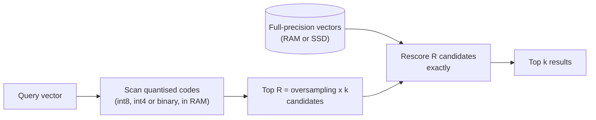

**Scalar quantisation** (SQ) compresses a vector one number at a time: each 32-bit float is replaced by a small integer, 8 bits, 4 bits or even a single bit, on a fixed grid. It is the simplest compression a vector index can apply, needs almost no training, and is the first compression most production systems turn on: Qdrant, Weaviate, Milvus, Elasticsearch, OpenSearch, pgvector and FAISS all offer some form of it.

[Vector storage](/learn/vector-database-fundamentals/vector-storage) introduced the basic 8-bit formula and measured its accuracy. This lesson goes further. It treats scalar quantisation as a family with three design choices (how many bits, what range, and whether to clip outliers), shows how similarities are computed directly on the integer codes without decoding them, takes the idea to its limit with binary quantisation, and explains the rescoring and oversampling settings that make aggressive quantisation usable. Training an embedding model so that its vectors survive quantisation well is a separate topic, covered in [Embedding quantisation](/learn/embedding-optimisation/embedding-quantisation).

## Learning objectives

- Describe scalar quantisation as an affine map from a range of floats to $2^b$ integer levels, and compute its step size and maximum rounding error.
- Compare global, per-dimension and clipped (quantile) ranges, and explain why the best amount of clipping depends on the bit width.
- Show algebraically how inner products can be computed on integer codes by folding the scale into the query, and why the offset term does not affect ranking.
- Explain binary quantisation, Hamming distance and why binary codes need rescoring with oversampling.
- Configure and evaluate scalar or binary quantisation with rescoring, measuring recall against full precision.

## Prerequisites

- [Vector storage](/learn/vector-database-fundamentals/vector-storage): the 8-bit min/max formula, float16, and rescoring from full-precision vectors on disk.
- [Flat indexes](/learn/vector-indexing-algorithms/flat-indexes): why scans are limited by memory bandwidth.
- [Product quantisation](/learn/vector-indexing-algorithms/product-quantisation): the other main compression family, and re-ranking.

## Why this matters

A float32 component carries about seven significant decimal digits, yet the ranking of candidates is decided by differences in the second or third decimal place of their scores. Most of the bits are spent on precision the ranking never uses.

Scalar quantisation reclaims them. int8 cuts memory to a quarter, and because scans are bandwidth-bound, scan time roughly in proportion. Binary quantisation cuts memory to a thirty-second and replaces floating-point arithmetic with single-instruction bit operations. For a team whose vectors no longer fit in RAM, this is usually the cheapest effective change available.

The risk is in the details. Choose the range badly and a few outliers waste most of the levels; use 4-bit or binary codes without rescoring and recall falls sharply; enable quantisation without measuring and users find the loss for you.

## The intuition

Think of recording people's heights. A laboratory instrument gives 175.2384 cm, but "175 cm" is as good for nearly every purpose, and "tall" or "short" is enough for some. Each coarser description saves effort and loses detail.

The tape's range matters as much as its markings. A 3-metre tape with 256 marks has marks about 1.2 cm apart. If it must also cover a 30-metre tree that turned up in one measurement, the marks are 12 cm apart for everyone. Better to cap the tape at 2.5 m and record the tree as "2.5 m or more": one measurement is wrong, but every other one is ten times more precise.

That is scalar quantisation. The marks are the integer levels, the tape's length is the range, and capping it is clipping. The question is always how few marks you can get away with and where to put the ends of the tape.

## How it works

### The affine map

Scalar quantisation with $b$ bits maps each float $x$ in a range $[\ell, u]$ to one of $2^b$ evenly spaced levels:

1. **Choose the range** $[\ell, u]$ (per dimension or for all dimensions; see below).
2. **Compute the step** $s = (u - \ell) / (2^b - 1)$: the distance between adjacent levels.
3. **Encode**: clip $x$ to $[\ell, u]$, then store the integer $c = \operatorname{round}((x - \ell)/s)$, which lies in $0 \dots 2^b - 1$.
4. **Decode** (when needed): $\hat{x} = \ell + s\,c$.

Rounding to the nearest level makes the error in each in-range component at most $s/2$. With 8 bits there are 256 levels; with 4 bits, 16; with 1 bit, 2. The [Vector storage](/learn/vector-database-fundamentals/vector-storage) lesson worked through an 8-bit example by hand; the same arithmetic applies at every bit width, with a coarser step.

This is called **affine** (or asymmetric) quantisation because of the offset $\ell$. A common simpler variant, **symmetric** quantisation, fixes the range to $[-a, a]$ and stores signed integers ($-127 \dots 127$ for int8) with $\hat{x} = s\,c$, which has no offset at all. It wastes levels when values are not centred on zero but makes integer arithmetic simpler.

### Choosing the range

The step size, and therefore the precision, is set entirely by the range. Three choices are common:

- **One global range** for all dimensions, for example $[-\max|x|, \max|x|]$ over the whole collection. Simplest, and one scale to store. But dimensions whose values span a narrow band are measured with a step sized for the widest dimension.
- **Per-dimension min/max**: each dimension $j$ gets its own $[\ell_j, u_j]$ from the smallest and largest values seen. Every dimension uses all its levels. Costs two floats per dimension to store, which is nothing.
- **Per-dimension quantiles (clipping)**: set $\ell_j$ and $u_j$ to, say, the 0.5% and 99.5% points of dimension $j$. Values beyond them are clipped to the end levels. A few extreme values no longer stretch the range, so the step is smaller for everything else, but each clipped value now carries a large error.

Clipping trades **rounding error** (small, spread over every value) for **clipping error** (large, concentrated on a few values). Which wins depends on how fine the grid is. With 256 levels, rounding error is already tiny, and clipping usually costs more than it saves. With 16 levels, rounding error is large, and shrinking the step by clipping the tails is often a clear gain. The code below shows exactly this reversal. Engines expose the choice: Qdrant's scalar quantisation, for example, has a `quantile` parameter that excludes the most extreme values from the range calculation.

The range is computed from a sample at build time. Vectors added later with values outside it are clipped, so the sample must be representative, and engines recompute ranges when segments are rebuilt.

### Scoring without decoding

Decoding every stored vector back to floats before computing a dot product would throw away much of the speed-up. Fortunately it is unnecessary. Substitute the decode formula into the inner product:

$$
\mathbf{q} \cdot \hat{\mathbf{x}} = \sum_{j} q_j (\ell_j + s_j c_j) = \sum_j (q_j s_j)\, c_j + \sum_j q_j \ell_j
$$

The first sum is a dot product between a **scaled query** $q'_j = q_j s_j$ (computed once per query) and the raw integer codes. The second sum depends only on the query, so it is the same for every stored vector and **cannot change the ranking**. A search engine can rank by $\mathbf{q}' \cdot \mathbf{c}$ alone. With a symmetric scheme and the query quantised as well, the whole computation becomes an integer dot product, which CPUs execute with dedicated SIMD instructions that process many 8-bit values per cycle.

So a quantised scan reads one byte per component instead of four and does cheaper arithmetic on it. This, not just the memory saving, is why int8 search is faster.

### Binary quantisation

Push the bit width to its limit: one bit per component, recording only whether it is positive.

1. **Encode**: $c_j = 1$ if $x_j > 0$, else 0. Pack eight components into each byte. A 384-dimension vector becomes 48 bytes, a 1,536-dimension vector 192 bytes.
2. **Compare**: the **Hamming distance** between two codes is the number of bit positions in which they differ, computed as XOR followed by a population count (counting the 1 bits). Both are single CPU instructions on 64-bit words, so comparing two 384-bit codes takes a handful of instructions.
3. **Rank** by ascending Hamming distance.

Some implementations keep the query at full precision and score it against the stored bits (asymmetric binary scoring), which is more accurate than Hamming distance at slightly higher cost.

Binary codes are a very coarse summary. Two vectors with the same signs in every dimension are indistinguishable, however different their magnitudes. Whether that is acceptable depends heavily on the embedding model: high-dimensional models, and models trained with quantisation in mind, tend to survive binarisation far better than small ones, and vendors publish guidance on which models suit it. For a 384-dimension model like `all-MiniLM-L6-v2`, binary codes alone are rarely good enough. Binary quantisation is therefore almost always used as a first-stage filter followed by rescoring.

### Rescoring and oversampling

The pattern from [product quantisation](/learn/vector-indexing-algorithms/product-quantisation) applies here too:

1. Search the quantised codes for $R = \text{oversampling} \times k$ candidates.
2. Fetch those candidates' full-precision vectors (from RAM, or from memory-mapped storage on SSD).
3. Rescore them exactly and return the top $k$.

**Oversampling** is the factor by which $R$ exceeds $k$. With int8, an oversampling of 2 to 3 typically restores recall to within measurement noise of float32. With binary codes, much larger factors are needed, and even then some true neighbours may rank too low to be fetched. In Qdrant, these are search-time settings (`rescore` and `oversampling` in the quantisation search parameters), so they can be tuned per request without rebuilding anything.



### Scalar quantisation inside indexes

SQ is a storage format, not an index structure, so it combines with all of them. FAISS offers `IndexScalarQuantizer` (flat) and `IndexIVFScalarQuantizer`, with types such as `QT_8bit`, `QT_4bit` and `QT_fp16`; HNSW-based databases traverse the graph using quantised distances and rescore at the end. Compared with PQ, SQ compresses less (int8 is 4 times, PQ commonly 16 to 64 times) but is more accurate at moderate compression and needs no codebook training.

## The mathematics

### Step size and error

**Intuition.** $b$ bits give $2^b$ levels across the range; halve the bits and the step grows enormously.

$$
s = \frac{u - \ell}{2^b - 1}, \qquad |x - \hat{x}| \le \frac{s}{2} \ \text{ for } \ell \le x \le u
$$

$s$ is the step, $u$ and $\ell$ the range ends, $b$ the bits per component, $x$ the original value and $\hat{x}$ its reconstruction. Values outside the range are clipped and can have any larger error.

**By hand.** A dimension with values from $-0.25$ to $0.25$ (range 0.5):

- 8 bits: $s = 0.5 / 255 \approx 0.00196$, maximum error about 0.00098.
- 4 bits: $s = 0.5 / 15 \approx 0.0333$, maximum error about 0.0167, seventeen times larger.
- Clipping the 4-bit range to $[-0.15, 0.15]$: $s = 0.3/15 = 0.02$, maximum in-range error 0.01, but a value of 0.25 is now stored as 0.15, an error of 0.10.

### Folding the scale into the query

**Intuition.** The decode step is a multiply and an add per component; the multiply can be applied to the query once, and the add contributes the same amount to every score.

$$
\mathbf{q} \cdot \hat{\mathbf{x}} = \underbrace{\sum_{j=1}^{d} (q_j s_j)\, c_j}_{\text{depends on } \mathbf{x}} \;+\; \underbrace{\sum_{j=1}^{d} q_j \ell_j}_{\text{same for every } \mathbf{x}}
$$

$q_j$ is the query's $j$-th component, $s_j$ and $\ell_j$ the step and lower bound of dimension $j$, and $c_j$ the stored integer code of a database vector.

**By hand.** Two dimensions with $\ell = (-0.2, -0.1)$ and $s = (0.002, 0.001)$; a stored vector with codes $c = (150, 80)$; the query $\mathbf{q} = (0.5, 1.0)$.

- Decode: $\hat{\mathbf{x}} = (-0.2 + 0.3, -0.1 + 0.08) = (0.1, -0.02)$. Dot product: $0.05 - 0.02 = 0.03$.
- Folded: $\mathbf{q}' = (0.5 \times 0.002, 1.0 \times 0.001) = (0.001, 0.001)$; $\mathbf{q}' \cdot c = 0.15 + 0.08 = 0.23$; constant $= 0.5 \times (-0.2) + 1.0 \times (-0.1) = -0.2$; total $0.03$. The same, without decoding.

```python
import numpy as np

lo = np.array([-0.2, -0.1])          # per-dimension lower bounds
scale = np.array([0.002, 0.001])     # per-dimension step sizes
codes = np.array([150, 80])          # the stored bytes
q = np.array([0.5, 1.0])             # the query, in full precision

decoded = lo + scale * codes
print("decode then dot:", round(float(q @ decoded), 6))
q_scaled, const = q * scale, q @ lo
print("integer codes, scale folded into query:", round(float(q_scaled @ codes + const), 6),
      f"(q_scaled = {q_scaled.tolist()}, constant = {const})")
```

```output
decode then dot: 0.03
integer codes, scale folded into query: 0.03 (q_scaled = [0.001, 0.001], constant = -0.2)
```

### Hamming distance and angle

**Intuition.** If the axes were random directions, two vectors at a small angle would usually fall on the same side of each axis, and the fraction of disagreeing signs would measure the angle.

$$
\mathbb{E}\!\left[\frac{\text{Hamming}(\mathbf{x}, \mathbf{y})}{d}\right] = \frac{\theta(\mathbf{x}, \mathbf{y})}{\pi}
$$

$\theta$ is the angle between the vectors, and the expectation is over random hyperplanes through the origin. This is the result behind Charikar's random-hyperplane hashing (2002). For sign bits taken on the model's own axes, the relation holds only approximately, which is one reason binary quality varies between models. **Example:** two vectors at 60° ($\theta = \pi/3$) disagree, on average, on a third of 384 random hyperplanes, about 128 bits; two at 30° on about 64.

## In code

**The problem.** Quantise the same 100,000 vectors used earlier in this module with five scalar schemes and one binary scheme, score with integer codes directly, measure recall@10 against float32, and measure what rescoring recovers.

**Dependencies.** NumPy 2.0 or later (for `np.bitwise_count`). No index library is needed: the point is to see the arithmetic.

```bash
pip install "numpy>=2.0"
```

To show the effect of outliers, the script plants an extreme value in 100 of the stored vectors (one component set to $\pm 0.9$, where typical components are a few hundredths).

```python
import numpy as np

rng = np.random.default_rng(0)
N, d, k, n_queries = 100_000, 384, 10, 300

# The same kind of synthetic data as the earlier lessons in this module...
def make(n, topics, noise):
    v = topics[rng.integers(0, len(topics), n)] + noise * rng.normal(size=(n, d))
    return (v / np.linalg.norm(v, axis=1, keepdims=True)).astype(np.float32)

subjects = rng.normal(size=(100, d))
topics = subjects[rng.integers(0, 100, 5_000)] + 0.8 * rng.normal(size=(5_000, d))
X, Q = make(N, topics, 2.0), make(n_queries, topics, 2.0)
# ...plus 100 stored vectors with one extreme component each, as real data sometimes has.
bad = rng.choice(N, 100, replace=False)
X[bad, rng.integers(0, d, 100)] = rng.choice([-0.9, 0.9], 100)

S_true = Q @ X.T
I_true = np.argsort(-S_true, axis=1)[:, :k]

def recall(S, rescore_from=None):
    """recall@10 from approximate scores S; optionally rescore the top R exactly."""
    if rescore_from:
        cand = np.argpartition(-S, rescore_from, axis=1)[:, :rescore_from]
        S = np.full_like(S_true, -np.inf)
        np.put_along_axis(S, cand, np.take_along_axis(S_true, cand, axis=1), axis=1)
    I = np.argpartition(-S, k, axis=1)[:, :k]
    return np.mean([len(set(a) & set(b)) / k for a, b in zip(I, I_true)])

def affine_codes(X, lo, hi, bits):
    """Uniform quantisation of each dimension's [lo, hi] range into 2**bits levels."""
    levels = 2 ** bits - 1
    scale = (hi - lo) / levels
    codes = np.round((np.clip(X, lo, hi) - lo) / scale).astype(np.uint8)
    return codes, scale, lo

def int_scores(Q, codes, scale, lo):
    """Score integer codes without decoding them: fold the scale into the query."""
    q_scaled = Q * scale                     # one multiply per query component, once per query
    const = Q @ lo                           # the same for every stored vector: ignorable for ranking
    return q_scaled @ codes.T.astype(np.float32) + const[:, None]

results = []
qlo, qhi = np.quantile(X, [0.005, 0.995], axis=0)       # per-dimension 0.5% and 99.5% points
m = np.abs(X).max()
configs = [   # name, bits, lower bounds, upper bounds
    ("int8, one global range", 8, np.full(d, -m), np.full(d, m)),
    ("int8, per-dim min/max", 8, X.min(0), X.max(0)),
    ("int8, per-dim clipped 1%", 8, qlo, qhi),
    ("int4, per-dim min/max", 4, X.min(0), X.max(0)),
    ("int4, per-dim clipped 1%", 4, qlo, qhi),
]
scores = {}
for name, bits, lo_b, hi_b in configs:
    c, s, lo = affine_codes(X, lo_b, hi_b, bits)
    scores[name] = int_scores(Q, c, s, lo)
    results.append((name, d * bits // 8, recall(scores[name])))   # int4: two codes per byte

# Binary: keep only the sign of each component, compare with Hamming distance on packed bits.
Xb, Qb = np.packbits(X > 0, axis=1), np.packbits(Q > 0, axis=1)
hamming = np.stack([np.bitwise_count(Xb ^ qb).sum(1) for qb in Qb])
scores["binary"] = -hamming.astype(np.float32)          # fewer differing bits = more similar
results.append(("binary (1 bit), Hamming", d // 8, recall(scores["binary"])))

print(f"{'format':<28}{'bytes/vector':>13}{'recall@10':>11}")
print(f"{'float32':<28}{d * 4:>13}{1.0:>11.3f}")
for name, nbytes, r in results:
    print(f"{name:<28}{nbytes:>13}{r:>11.3f}")

print("\nrecall@10 after rescoring the top R candidates with exact float32 scores:")
for name in ["int8, per-dim min/max", "int4, per-dim clipped 1%", "binary"]:
    print(f"  {name:<26}" + "  ".join(f"R={R}: {recall(scores[name], R):.3f}" for R in (20, 50, 100, 300)))
```

```output
format                       bytes/vector  recall@10
float32                              1536      1.000
int8, one global range                384      0.962
int8, per-dim min/max                 384      0.987
int8, per-dim clipped 1%              384      0.947
int4, per-dim min/max                 192      0.799
int4, per-dim clipped 1%              192      0.903
binary (1 bit), Hamming                48      0.304

recall@10 after rescoring the top R candidates with exact float32 scores:
  int8, per-dim min/max     R=20: 1.000  R=50: 1.000  R=100: 1.000  R=300: 1.000
  int4, per-dim clipped 1%  R=20: 0.995  R=50: 0.998  R=100: 0.999  R=300: 1.000
  binary                    R=20: 0.422  R=50: 0.608  R=100: 0.741  R=300: 0.901
```

**The important lines.**

- `affine_codes` is the four-step recipe: clip to the range, compute the step from the number of levels, round, store as `uint8`. For 4-bit codes the values fit in 0 to 15; a real implementation packs two per byte, which is why the table reports 192 bytes.
- `int_scores` never decodes. `Q * scale` folds each dimension's step into the query, and `Q @ lo` is the per-query constant. The product with `codes` stands in for the integer SIMD loop a real engine runs.
- `np.quantile(X, [0.005, 0.995], axis=0)` computes clipping bounds per dimension: the 0.5% most extreme values at each end are clipped, 1% in total.
- `np.packbits(X > 0, axis=1)` turns 384 signs into 48 bytes. `np.bitwise_count(Xb ^ qb)` counts the differing bits byte by byte; the sum across the 48 bytes is the Hamming distance.
- `recall(S, rescore_from=R)` keeps the top `R` approximate candidates, replaces their scores with exact ones, and ranks only those, which is exactly what `rescore=True` with oversampling `R / k` does in a database.

**What the output means.**

- **Per-dimension ranges beat a global range.** int8 with one global range reaches 0.962; per-dimension min/max reaches 0.987 with the same 384 bytes. The planted outliers set the global range to $\pm 0.9$, so every dimension is measured with a step sized for the extreme values.
- **Clipping hurts at 8 bits and helps at 4 bits.** At int8, clipping 1% of values lowers recall from 0.987 to 0.947: the rounding error was already tiny, and the clipped values lost far more. At int4, the same clipping raises recall from 0.799 to 0.903: with only 16 levels, the smaller step outweighs the damage to the clipped values. The right clipping depends on the bit width; measure it rather than copying a setting.
- **Rescoring makes int8 and int4 essentially lossless.** With only 20 candidates rescored (oversampling of 2), int8 recovers fully and int4 reaches 0.995. The true neighbours are almost all in the quantised top 20; only their order was disturbed.
- **Binary codes need much deeper rescoring on this data.** Hamming distance alone finds 30% of the true top 10, and rescoring even 300 candidates (oversampling of 30) reaches only 0.901. These 384-dimension synthetic vectors lose too much when reduced to signs. Higher-dimensional models, and models trained with binary quantisation in mind, behave much better, which is why vendors recommend binary quantisation only for particular models. Test with your own embeddings.

**Errors people commonly hit.**

- Computing the range on an unrepresentative first batch; later vectors outside it are clipped silently.
- Copying a quantile setting without measuring: the same clipping can help at one bit width and hurt at another.
- Forgetting that `np.packbits` pads the last byte with zeros when $d$ is not a multiple of 8 (harmless if both sides are padded identically).

**Extending it.** Try an asymmetric binary score, `Q @ (2 * (X > 0) - 1).T`, which keeps the query at full precision, and compare its recall with Hamming distance; then repeat with real `all-MiniLM-L6-v2` embeddings.

### Turning it on in a database

In a database you configure quantisation on the collection and control rescoring per query. The following uses the Qdrant Python client against a Qdrant server. It was **not executed** for this lesson: the client's local in-memory mode accepts the collection but does not apply quantisation, so a server is needed to see any effect.

```python
from qdrant_client import QdrantClient, models

client = QdrantClient(url="http://localhost:6333")

client.create_collection(
    collection_name="askmeridian",
    vectors_config=models.VectorParams(
        size=384,
        distance=models.Distance.COSINE,
        on_disk=True,                       # full-precision vectors memory-mapped from disk
    ),
    quantization_config=models.ScalarQuantization(
        scalar=models.ScalarQuantizationConfig(
            type=models.ScalarType.INT8,
            quantile=0.99,                  # exclude the most extreme 1% of values from the range
            always_ram=True,                # keep the int8 codes in RAM
        ),
    ),
)

hits = client.query_points(
    collection_name="askmeridian",
    query=query_vector,                     # a 384-dimension list of floats
    limit=5,
    search_params=models.SearchParams(
        quantization=models.QuantizationSearchParams(
            rescore=True,                   # rescore candidates with the full vectors
            oversampling=2.0,               # fetch 2 x limit candidates from the codes first
        ),
    ),
).points
```

Compact codes in RAM for the scan, full-precision vectors on disk for rescoring: the design measured above. Binary quantisation is configured with `models.BinaryQuantization(binary=models.BinaryQuantizationConfig(always_ram=True))`, usually with a larger oversampling factor.

## A real-world example

AskMeridian's Qdrant cluster had been running with float32 vectors in RAM. When the team evaluated a new 1,024-dimension embedding model, the projected vector memory per replica nearly tripled, and a colleague suggested binary quantisation because a blog post reported "32 times less memory with almost no loss".

Ama, the engineer running the evaluation, was cautious about the "almost no loss". She set up three configurations on a staging copy (int8 with the full vectors on disk, binary with the full vectors on disk, and float32 as the reference), and measured recall@5 on 300 labelled staff questions with rescoring at several oversampling factors.

int8 with rescoring at an oversampling of 2 matched float32 within the noise of a 300-question set. Binary at an oversampling of 3 to 4 matched it on most handbook questions but lost relevant chunks on product release notes, where many near-duplicate chunks have almost identical sign patterns. Raising oversampling recovered them, but the extra disk reads showed in tail latency.

The team shipped int8 with rescoring. Their write-up made one point prominent: the blog post's claim may have been true for the model it tested, but quantisation loss is a property of the model and the data, so it is measured, not borrowed.

## Common mistakes

- **Treating quantisation as free.** int8 loss is small, not zero, and concentrates in crowded neighbourhoods where users notice it.
- **Using one global range for data with uneven dimensions.** A few wide or outlier dimensions coarsen every other dimension's step. Use per-dimension ranges where the engine allows.
- **Clipping by habit.** Clipping can help (low bit widths, heavy tails) or hurt (int8 on well-behaved data). Sweep it.
- **Binary quantisation without rescoring, or on an unsuitable model.** Recall can collapse; check the model vendor's guidance and test.
- **Rescoring from slow storage with high oversampling.** The fetches can cost more latency than the quantised scan saved.

## Best practices

- Try compression in order of risk: float16, then int8 with rescoring, then int4 or binary with rescoring, then [product quantisation](/learn/vector-indexing-algorithms/product-quantisation). Stop at the first that meets your memory target.
- Keep full-precision vectors available (on SSD is fine) and rescore a small oversampled candidate set; start with an oversampling of 2 to 3 for int8 and much higher for binary, then tune.
- Evaluate on your own model and queries, with flat float32 search as ground truth, and report recall at the $k$ your pipeline actually uses.
- Prefer per-dimension ranges, and choose clipping by measurement for your bit width.
- Keep codes in RAM and rescoring vectors on fast local storage, and re-measure after changing the model, the bit width or the corpus.

## Performance considerations

**Memory.** Codes take $N \times d \times b / 8$ bytes. For 10 million vectors at 1,024 dimensions: float32 41 GB, int8 10.2 GB, int4 5.1 GB, binary 1.3 GB. With rescoring, the float32 copy still exists, but on disk rather than in RAM.

**Scan speed.** Bandwidth-bound scans speed up roughly in proportion to bytes read: int8 reads a quarter of the bytes of float32. Binary goes further: comparing two 1,024-bit codes is 16 XOR-and-popcount operations on 64-bit words, against 1,024 multiply-adds for float32.

**Rescoring cost.** $R \times d \times 4$ bytes per query. At $k = 10$, oversampling 3 and $d = 1{,}024$, that is $30 \times 4{,}096 \approx 123$ KB, a few dozen random reads from local SSD. At oversampling 30, 1.2 MB and several hundred reads: still feasible on NVMe, but visible in tail latency.

**Build cost.** One pass over a sample for the ranges and one over the data to encode: almost nothing, unlike PQ's codebook training.

**Interaction with HNSW.** Quantising the vectors does not shrink the graph. At int8 and $M = 16$, the vector is 1,024 bytes and the layer-0 links 128 bytes, so links are about 11% of the total; with binary codes (128 bytes at $d = 1{,}024$), the links are as large as the vectors.

## Summary

- Scalar quantisation maps each component to one of $2^b$ evenly spaced levels across a range; the step $s = (u - \ell)/(2^b - 1)$ bounds the in-range error at $s/2$.
- Per-dimension ranges use the levels efficiently; clipping the tails trades small rounding errors for large clipping errors and tends to help at low bit widths and hurt at 8 bits.
- Inner products can be computed directly on integer codes by folding the scale into the query; the offset term is the same for every vector and does not affect ranking.
- Binary quantisation keeps only signs, compares codes with XOR and popcount, and is a coarse filter whose quality depends strongly on the embedding model.
- Rescoring an oversampled candidate set with full-precision vectors makes int8 and int4 nearly lossless and is essential for binary codes; always measure recall on your own data.

## Exercises

**1.** A dimension's values range from $-0.3$ to $0.3$. Compute the step and maximum in-range error for 8-bit and 4-bit quantisation. What is the error for the value 0.3 if the 4-bit range is clipped to $[-0.2, 0.2]$?

<details><summary>Show solution</summary>

8-bit: $s = 0.6 / 255 \approx 0.00235$, maximum error about 0.00118. 4-bit: $s = 0.6 / 15 = 0.04$, maximum error 0.02.

Clipped 4-bit: 0.3 is stored as the top level, 0.2, so the error is 0.1, five times the unclipped maximum, while in-range values now have a step of $0.4 / 15 \approx 0.0267$ and maximum error about 0.0133.

</details>

**2.** Using the folded-scale formula, explain why two stored vectors' scores can be compared using only $\mathbf{q}' \cdot \mathbf{c}$, but a similarity threshold (for example, "discard results below 0.3") cannot.

<details><summary>Show solution</summary>

The constant $\sum_j q_j \ell_j$ is added to every stored vector's score for a given query, so it shifts all scores equally and leaves the order unchanged. Ranking can ignore it. A threshold compares a score with a fixed number, so the constant matters: without it the values are on a different scale. If you need thresholds, add the constant back (or rescore with full precision, which gives the true similarity).

</details>

**3.** Modify the lesson's code to add a symmetric int8 scheme per dimension: $a_j = \max_i |x_{ij}|$, codes in $-127 \dots 127$ stored as `int8`, decoded as $\hat{x} = c \cdot a_j / 127$. Compare its recall with per-dimension min/max. When would symmetric be worse?

<details><summary>Show solution</summary>

```python
a = np.abs(X).max(0)
codes = np.round(X / a * 127).astype(np.int8)
S_sym = (Q * (a / 127)) @ codes.T.astype(np.float32)   # no offset term at all
print(recall(S_sym))
```

One run gave 0.979 for symmetric against 0.987 for min/max: close, because each dimension's values are roughly centred on zero here. Symmetric is worse when a dimension's values are not centred on zero, for example all between 0.1 and 0.5: the symmetric range $[-0.5, 0.5]$ spends half its levels on values that never occur, doubling the step compared with a min/max range of $[0.1, 0.5]$ spread over all 255 levels.

</details>

**4.** Design decision. A collection of 20 million chunks at 1,536 dimensions must fit on nodes with 64 GB of RAM, alongside an HNSW graph with $M = 16$. Full-precision vectors can live on local NVMe SSD. Compare int8 and binary quantisation for this case, and state what you would measure before choosing.

<details><summary>Show solution</summary>

float32 would be $20 \times 10^6 \times 6{,}144 \approx 123$ GB, so it does not fit. int8: $20 \times 10^6 \times 1{,}536 \approx 30.7$ GB of codes, plus the graph at about 132 bytes per vector (about 2.6 GB): about 33 GB, which fits with headroom. Binary: $20 \times 10^6 \times 192 = 3.8$ GB of codes plus the same graph: about 6.5 GB, which fits easily and leaves room to spare.

int8 with an oversampling of 2 or 3 is the low-risk choice and fits. Binary saves a further 27 GB per node and scans faster, but its recall depends on the model and may need high oversampling, meaning more SSD reads per query.

Measure both on a few hundred real queries against flat float32: recall@k at several oversampling factors, and 95th and 99th percentile latency including the SSD reads. Choose binary only if it meets the recall target at acceptable latency.

</details>

## Check your understanding

```quiz
[
  {
    "q": "How many levels does 4-bit scalar quantisation have, and how does its step compare with 8-bit on the same range?",
    "options": [
      "16 levels; the step is about 17 times larger",
      "4 levels; the step is twice as large",
      "16 levels; the step is twice as large",
      "256 levels; the step is the same"
    ],
    "answer": 0,
    "why": "4 bits give 2 to the power 4 = 16 levels. The step is the range divided by 15 rather than by 255, so it is 17 times larger."
  },
  {
    "q": "In the lesson's experiment, clipping 1% of values lowered int8 recall but raised int4 recall. Why?",
    "options": [
      "Clipping only works with signed integers",
      "int4 codes are rescored automatically",
      "With 256 levels rounding error is already tiny, so clipping costs more than it saves; with 16 levels the smaller step outweighs the clipping error",
      "The quantiles were computed differently for each bit width"
    ],
    "answer": 2,
    "why": "Clipping trades rounding error for clipping error. Which dominates depends on how fine the grid is."
  },
  {
    "q": "When scoring int8 codes with the scale folded into the query, why can the term sum(q_j * lo_j) be ignored for ranking?",
    "options": [
      "It is always zero",
      "It is the same for every stored vector, so it shifts all scores equally",
      "It is too small to matter",
      "It cancels with the rounding error"
    ],
    "answer": 1,
    "why": "The term depends only on the query and the ranges, not on the stored vector, so it cannot change the order."
  },
  {
    "q": "How is the Hamming distance between two binary codes computed efficiently?",
    "options": [
      "By decoding both to floats and taking the dot product",
      "By sorting the bits",
      "By summing the bytes",
      "By XOR of the codes followed by a population count of the 1 bits"
    ],
    "answer": 3,
    "why": "XOR sets a bit wherever the codes differ, and popcount counts those bits; both are single CPU instructions per machine word."
  },
  {
    "q": "A Qdrant collection uses int8 quantisation with rescore enabled and oversampling 3. A query asks for limit 10. What happens?",
    "options": [
      "The 30 best candidates by int8 score are rescored with full-precision vectors and the best 10 returned",
      "The query is run three times and the results merged",
      "The 10 best int8 results are returned, three times faster",
      "Only one vector in three is searched"
    ],
    "answer": 0,
    "why": "Oversampling fetches extra candidates from the compressed codes; rescoring then orders them exactly."
  }
]
```

## Further reading

- Jacob et al. (2018), "Quantization and Training of Neural Networks for Efficient Integer-Arithmetic-Only Inference", *CVPR*, [arXiv:1712.05877](https://arxiv.org/abs/1712.05877). The affine (scale and zero-point) quantisation scheme and integer-only arithmetic, from the neural-network side.
- Charikar (2002), "Similarity estimation techniques from rounding algorithms", *STOC*. Random-hyperplane hashing and the link between Hamming distance and angle.
- Qdrant documentation, [Quantization](https://qdrant.tech/documentation/guides/quantization/): scalar, binary and product quantisation, `quantile`, `always_ram`, rescoring and oversampling.
- FAISS wiki, [github.com/facebookresearch/faiss/wiki](https://github.com/facebookresearch/faiss/wiki): `IndexScalarQuantizer` and its quantiser types.
- Hugging Face blog (2024), "Binary and Scalar Embedding Quantization for Significantly Faster & Cheaper Retrieval", [huggingface.co/blog/embedding-quantization](https://huggingface.co/blog/embedding-quantization). Measured effects of int8 and binary quantisation with rescoring on real embedding models.
