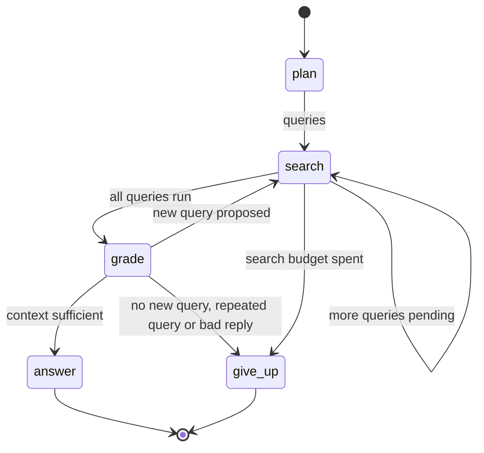

A standard RAG pipeline retrieves once and answers with whatever came back. An **agent** is a program in which the model's output decides what happens next: search again, search differently, answer, or stop. In this project you build a research assistant for Meridian's handbook that plans its searches, judges whether the retrieved context is enough, refines its query when it is not, and gives up cleanly when a budget runs out.

## Overview

The control flow is written as an explicit **state machine** in plain Python: a set of named steps (nodes), each of which reads and updates a shared state object and names the step to run next. Nothing is hidden inside a framework, so every decision the agent takes is recorded in a trace you can read.

The project's listed stack includes LangGraph, a library for exactly this node-and-edge pattern. The runnable code here does not import it: writing the loop by hand first is the best way to understand what LangGraph does for you, and the section "How this maps to LangGraph" below shows the one-to-one translation.

You build two variants that share one search tool and the same limits:

1. **The state machine** (`agent/machine.py`): your code owns the control flow and asks the model three narrow questions (plan, grade, answer). It is run and tested here with a scripted fake model.
2. **The tool-use loop** (`agent/tool_loop.py`): Claude owns the control flow, calling a `search_handbook` tool as often as it sees fit, inside a loop you write and bound. It is tested here with a fake client; the real API call was not executed.

The ideas come from the [Agentic RAG module](/learn/agentic-rag), in particular [iterative search](/learn/agentic-rag/iterative-search) and [agent failure handling](/learn/agentic-rag/agent-failure-handling), and from [Corrective RAG](/learn/advanced-rag-patterns/corrective-rag).

## Learning objectives

- Implement an agent as a state machine with explicit nodes, transitions and state.
- Enforce hard limits on steps, searches and spend, and detect a repeating loop.
- Parse and validate model decisions, and fail safely when they are malformed.
- Write a manual Claude tool-use loop that returns a result for every tool call.
- Test agent behaviour deterministically with a scripted fake model.

## Requirements

- Python 3.10 or later, and about 100 MB for the MiniLM embedding model (used by the demo, not by the tests).
- An Anthropic API key only for the `--claude` and `--tools` modes.
- Comfort with [structured outputs](/learn/generation-strategies/structured-outputs) and [tool-based retrieval](/learn/agentic-rag/tool-based-retrieval).

## Technology stack

| Piece | Choice | Why |
| --- | --- | --- |
| Control flow | Plain Python state machine | Every transition is visible and testable; maps directly onto LangGraph |
| Search tool | Qdrant (local mode) + `all-MiniLM-L6-v2` | A real vector store with nothing to deploy |
| Decisions | Pydantic models parsed from JSON | A malformed decision becomes a handled case, not a crash |
| Model | Claude through the Anthropic SDK, behind `LLM` | Swappable for `ScriptedLLM` in tests |

## System architecture



Not drawn, because it applies to every arrow: before each transition the loop checks the step and cost budgets and diverts to `give_up` if either is spent. `give_up` makes no model call; it returns what was found and why the agent stopped.

## Folder structure

```text
agentic-rag-research-assistant/
├── requirements.txt
├── run_demo.py
├── data/
│   └── corpus.json
├── agent/
│   ├── __init__.py         # empty
│   ├── search.py           # the search tool (Qdrant)
│   ├── llm.py              # LLM interface, Claude, scripted fake, cost
│   ├── machine.py          # the state machine
│   └── tool_loop.py        # Claude tool use, manual loop
└── tests/
    └── test_agent.py
```

## Setup

```bash
mkdir agentic-rag-research-assistant && cd agentic-rag-research-assistant
python -m venv .venv && source .venv/bin/activate
pip install -r requirements.txt
export ANTHROPIC_API_KEY="..."   # optional
```

`requirements.txt`:

```text
anthropic
numpy
pydantic
qdrant-client
sentence-transformers
pytest
```

## Implementation

### `data/corpus.json`

Ten single-fact passages. Note what is absent: nothing mentions parental leave, which gives the agent a question it must refuse.

```json
[
  {"id": "leave-allowance", "text": "Meridian staff receive 25 days of annual leave each year, in addition to public holidays."},
  {"id": "leave-carry-over", "text": "Up to 5 unused days of annual leave carry over into the next year. Carried-over days must be used by 31 March."},
  {"id": "remote-days", "text": "Staff may work remotely up to 3 days a week, agreed with their manager."},
  {"id": "remote-equipment", "text": "The home-office equipment budget is £400 per person. Claim it through the expenses portal."},
  {"id": "expenses-deadline", "text": "Expenses must be submitted within 30 days of the purchase."},
  {"id": "expenses-receipts", "text": "Any expense over £75 needs a receipt attached to the claim."},
  {"id": "password-rotation", "text": "Passwords must be rotated every 90 days."},
  {"id": "vpn-policy", "text": "VPN is required whenever you connect from public Wi-Fi."},
  {"id": "laptop-refresh", "text": "Laptops are replaced on a 3 year refresh cycle."},
  {"id": "support-hours", "text": "The support desk is open from 08:00 to 18:00 UK time."}
]
```

### `agent/search.py`

```python
"""The agent's one tool: semantic search over the handbook, backed by Qdrant in local mode."""
import json
import uuid
from dataclasses import dataclass
from pathlib import Path
from typing import Callable, Sequence

import numpy as np
from qdrant_client import QdrantClient, models

Embedder = Callable[[Sequence[str]], np.ndarray]
COLLECTION = "meridian_handbook"


@dataclass(frozen=True)
class Passage:
    id: str
    text: str
    score: float


def minilm_embedder(name: str = "sentence-transformers/all-MiniLM-L6-v2") -> Embedder:
    from sentence_transformers import SentenceTransformer

    model = SentenceTransformer(name)
    return lambda texts: model.encode(list(texts), normalize_embeddings=True)


class SearchTool:
    def __init__(self, corpus_path: str | Path, embed: Embedder, min_score: float = 0.0):
        self.embed = embed
        self.min_score = min_score
        self.client = QdrantClient(":memory:")
        docs = json.loads(Path(corpus_path).read_text(encoding="utf-8"))
        vectors = np.asarray(embed([d["text"] for d in docs]))
        self.client.create_collection(
            COLLECTION, vectors_config=models.VectorParams(size=vectors.shape[1], distance=models.Distance.COSINE)
        )
        self.client.upsert(COLLECTION, points=[
            models.PointStruct(id=str(uuid.uuid5(uuid.NAMESPACE_URL, d["id"])), vector=v.tolist(), payload=d)
            for d, v in zip(docs, vectors)
        ])

    def search(self, query: str, k: int = 3) -> list[Passage]:
        vector = np.asarray(self.embed([query]))[0].tolist()
        response = self.client.query_points(COLLECTION, query=vector, limit=k, score_threshold=self.min_score)
        return [Passage(p.payload["id"], p.payload["text"], round(p.score, 3)) for p in response.points]
```

The tool is deliberately small: a query in, a list of `Passage` objects out. `query_points` is the Qdrant client's search call, and `score_threshold` lets you drop weak matches at the source. The embedder is injected, so tests pass a hashing function and never load a model.

### `agent/llm.py`

```python
"""The single seam between the agent and a language model, plus cost accounting."""
from dataclasses import dataclass
from typing import Protocol

# US dollars per million tokens. Defaults are Claude Opus 5.5 list prices when this was written;
# check the current pricing page and override them rather than trusting a constant in a tutorial.
INPUT_USD_PER_MTOK = 4.00
OUTPUT_USD_PER_MTOK = 20.00


@dataclass
class LLMReply:
    text: str
    input_tokens: int
    output_tokens: int

    @property
    def cost_usd(self) -> float:
        return (self.input_tokens * INPUT_USD_PER_MTOK + self.output_tokens * OUTPUT_USD_PER_MTOK) / 1_000_000


class LLM(Protocol):
    def complete(self, system: str, prompt: str) -> LLMReply: ...


class ClaudeLLM:
    def __init__(self, model: str = "claude-opus-5-5", max_tokens: int = 1024):
        import anthropic

        self.client = anthropic.Anthropic()  # reads ANTHROPIC_API_KEY from the environment
        self.model, self.max_tokens = model, max_tokens

    def complete(self, system: str, prompt: str) -> LLMReply:
        response = self.client.messages.create(
            model=self.model,
            max_tokens=self.max_tokens,
            system=system,
            messages=[{"role": "user", "content": prompt}],
        )
        text = "".join(block.text for block in response.content if block.type == "text")
        return LLMReply(text, response.usage.input_tokens, response.usage.output_tokens)


class ScriptedLLM:
    """A fake that replays a fixed list of replies, in order. Records every prompt it was given."""

    def __init__(self, replies: list[str], input_tokens: int = 400, output_tokens: int = 60):
        self.replies = list(replies)
        self.input_tokens, self.output_tokens = input_tokens, output_tokens
        self.calls: list[tuple[str, str]] = []

    def complete(self, system: str, prompt: str) -> LLMReply:
        self.calls.append((system, prompt))
        if not self.replies:
            raise AssertionError("ScriptedLLM ran out of replies: the agent made an unexpected call")
        return LLMReply(self.replies.pop(0), self.input_tokens, self.output_tokens)
```

- `LLMReply` carries token counts alongside the text, because the agent has to account for spend after every call. `ClaudeLLM` fills them from `response.usage`.
- The two price constants turn tokens into dollars. Treat them as configuration: prices change, and a budget computed from a stale constant is wrong without any error.
- `ScriptedLLM` replays a list of replies in order and raises if the agent asks for one more than the script holds. That makes an unexpected extra model call a test failure.

### `agent/machine.py`

```python
"""The agent as an explicit state machine: plan -> search -> grade -> answer | refine | give up."""
import json
import re
from dataclasses import dataclass, field
from typing import Literal

from pydantic import BaseModel, ValidationError

from .llm import LLM
from .search import Passage, SearchTool

PLAN_SYSTEM = (
    "You plan searches over a company handbook. Split the question into the fewest search queries "
    'that together cover it. Reply with JSON only: {"queries": ["..."]}'
)
GRADE_SYSTEM = (
    "You judge whether the passages contain everything needed to answer the question. Reply with JSON only: "
    '{"sufficient": true or false, "missing": "what is still missing, or empty", '
    '"next_query": "one new search query that might find it, or empty"}'
)
ANSWER_SYSTEM = (
    "Answer only from the provided passages and cite passage ids in square brackets. "
    "If part of the question is not covered, say so."
)


class Plan(BaseModel):
    queries: list[str]


class Grade(BaseModel):
    sufficient: bool
    missing: str = ""
    next_query: str = ""


@dataclass
class Limits:
    max_steps: int = 8  # every state transition counts, so a loop cannot run for ever
    max_searches: int = 5
    max_cost_usd: float = 0.05


@dataclass
class AgentState:
    question: str
    pending: list[str] = field(default_factory=list)  # queries not yet run
    tried: list[str] = field(default_factory=list)  # queries already run
    evidence: dict[str, Passage] = field(default_factory=dict)
    steps: int = 0
    cost_usd: float = 0.0
    status: Literal["running", "answered", "gave_up"] = "running"
    stop_reason: str = ""
    answer: str = ""
    trace: list[dict] = field(default_factory=list)


def parse_json(text: str, model: type[BaseModel]) -> BaseModel | None:
    """Models sometimes wrap JSON in prose or a code fence. Take the outermost braces, then validate."""
    match = re.search(r"\{.*\}", text, flags=re.DOTALL)
    if not match:
        return None
    try:
        return model.model_validate(json.loads(match.group(0)))
    except (json.JSONDecodeError, ValidationError):
        return None


def format_evidence(state: AgentState) -> str:
    return "\n".join(f"[{p.id}] {p.text}" for p in state.evidence.values()) or "(no passages found)"


class ResearchAgent:
    def __init__(self, llm: LLM, search: SearchTool, limits: Limits | None = None, k: int = 2):
        self.llm, self.search, self.limits, self.k = llm, search, limits or Limits(), k

    # ---- helpers -------------------------------------------------------------------------------
    def _log(self, state: AgentState, node: str, **detail) -> None:
        state.trace.append({"step": state.steps, "node": node, "cost_usd": round(state.cost_usd, 6), **detail})

    def _call(self, state: AgentState, system: str, prompt: str) -> str:
        reply = self.llm.complete(system, prompt)
        state.cost_usd += reply.cost_usd
        return reply.text

    def _give_up(self, state: AgentState, reason: str) -> str:
        state.status, state.stop_reason = "gave_up", reason
        found = format_evidence(state)
        state.answer = f"I could not find enough in the handbook to answer this reliably ({reason}).\nWhat I did find:\n{found}"
        self._log(state, "give_up", reason=reason)
        return "end"

    # ---- nodes: each takes the state, changes it, and returns the name of the next node --------
    def plan(self, state: AgentState) -> str:
        plan = parse_json(self._call(state, PLAN_SYSTEM, f"Question: {state.question}"), Plan)
        state.pending = [q for q in (plan.queries if plan else []) if q.strip()] or [state.question]
        self._log(state, "plan", queries=list(state.pending), parsed=plan is not None)
        return "search"

    def do_search(self, state: AgentState) -> str:
        if len(state.tried) >= self.limits.max_searches:
            return self._give_up(state, "search budget exhausted")
        query = state.pending.pop(0)
        state.tried.append(query)
        hits = self.search.search(query, self.k)
        new = [p.id for p in hits if p.id not in state.evidence]
        for passage in hits:
            state.evidence.setdefault(passage.id, passage)
        self._log(state, "search", query=query, hits=[(p.id, p.score) for p in hits], new=new)
        return "search" if state.pending else "grade"

    def grade(self, state: AgentState) -> str:
        prompt = f"Question: {state.question}\n\nPassages:\n{format_evidence(state)}"
        grade = parse_json(self._call(state, GRADE_SYSTEM, prompt), Grade)
        if grade is None:
            return self._give_up(state, "grader reply was not valid JSON")
        self._log(state, "grade", sufficient=grade.sufficient, missing=grade.missing, next_query=grade.next_query)
        if grade.sufficient:
            return "answer"
        query = grade.next_query.strip()
        if not query:
            return self._give_up(state, "context insufficient and no new query proposed")
        if query.lower() in (q.lower() for q in state.tried):
            return self._give_up(state, "grader repeated a query that was already tried")
        state.pending.append(query)
        return "search"

    def answer(self, state: AgentState) -> str:
        prompt = f"Passages:\n{format_evidence(state)}\n\nQuestion: {state.question}"
        state.answer = self._call(state, ANSWER_SYSTEM, prompt)
        state.status, state.stop_reason = "answered", "context judged sufficient"
        self._log(state, "answer", cited=re.findall(r"\[([\w-]+)\]", state.answer))
        return "end"

    # ---- the loop ------------------------------------------------------------------------------
    def run(self, question: str) -> AgentState:
        state = AgentState(question=question)
        nodes = {"plan": self.plan, "search": self.do_search, "grade": self.grade, "answer": self.answer}
        current = "plan"
        while current != "end":
            if state.steps >= self.limits.max_steps:
                current = self._give_up(state, "step budget exhausted")
            elif state.cost_usd >= self.limits.max_cost_usd:
                current = self._give_up(state, "cost budget exhausted")
            else:
                state.steps += 1
                current = nodes[current](state)
        return state
```

- **State.** `AgentState` is everything the agent knows: the question, queries waiting to run (`pending`), queries already run (`tried`), the evidence gathered so far keyed by passage id, the counters, and the `trace`.
- **Nodes.** `plan`, `do_search`, `grade` and `answer` each take the state, mutate it, and return the name of the next node. That return value *is* the edge. `grade` is the only node with a real choice, and it has four exits.
- **The loop.** `run` is a dozen lines: look up the current node, check the budgets, call it. The budgets are checked in the loop, not in the nodes, so no node can forget.
- **Three limits, three different failures.** `max_steps` bounds the total number of transitions. `max_searches` bounds tool calls. `max_cost_usd` bounds spend; it is checked before each step, so the agent can overshoot by at most one call's cost.
- **Loop detection.** If the grader proposes a query that was already tried, running it again would return the same passages and the same verdict. The agent stops at once instead of burning the rest of its budget.
- **Malformed decisions.** `parse_json` pulls the outermost braces out of the reply and validates them with Pydantic. A bad *plan* degrades gracefully: the agent searches with the original question. A bad *grade* stops the run, because guessing "sufficient" would let an unsupported answer through.
- **Giving up is an answer.** `_give_up` writes a reply that says the handbook did not cover the question, states the reason, and lists what was found. It uses no model call, so it cannot fail for lack of budget.

### `agent/tool_loop.py`

```python
"""The same task with Claude driving: a manual tool-use loop under the same hard limits."""
from dataclasses import dataclass, field

from .llm import INPUT_USD_PER_MTOK, OUTPUT_USD_PER_MTOK
from .search import SearchTool

SYSTEM = (
    "You are a research assistant for Meridian staff. Use the search_handbook tool to find passages before "
    "answering; search again with a different query if the results do not cover the question. Answer only "
    "from tool results and cite passage ids in square brackets. If the handbook does not contain the answer, say so."
)
TOOLS = [
    {
        "name": "search_handbook",
        "description": "Semantic search over the Meridian employee handbook. Returns the best matching passages "
        "with their ids. Call it once per distinct thing you need to find.",
        "input_schema": {
            "type": "object",
            "properties": {"query": {"type": "string", "description": "A short, specific search query"}},
            "required": ["query"],
        },
    }
]


@dataclass
class LoopResult:
    answer: str
    status: str  # "answered" | "gave_up"
    stop_reason: str
    steps: int = 0
    cost_usd: float = 0.0
    trace: list[dict] = field(default_factory=list)


def run_tool_loop(question: str, search: SearchTool, client, model: str = "claude-opus-5-5",
                  max_steps: int = 6, max_cost_usd: float = 0.25) -> LoopResult:
    """`client` is an anthropic.Anthropic() instance (or a fake with the same messages.create method)."""
    messages: list[dict] = [{"role": "user", "content": question}]
    result = LoopResult(answer="", status="gave_up", stop_reason="")

    while True:
        if result.steps >= max_steps:
            result.stop_reason = "step budget exhausted"
            break
        if result.cost_usd >= max_cost_usd:
            result.stop_reason = "cost budget exhausted"
            break
        response = client.messages.create(
            model=model,
            max_tokens=2048,
            system=SYSTEM,
            tools=TOOLS,
            messages=messages,
        )
        result.steps += 1
        result.cost_usd += (response.usage.input_tokens * INPUT_USD_PER_MTOK
                            + response.usage.output_tokens * OUTPUT_USD_PER_MTOK) / 1_000_000

        if response.stop_reason != "tool_use":
            result.answer = "".join(block.text for block in response.content if block.type == "text")
            result.status = "answered" if response.stop_reason == "end_turn" else "gave_up"
            result.stop_reason = response.stop_reason
            result.trace.append({"step": result.steps, "event": "final", "stop_reason": response.stop_reason})
            return result

        # Echo the assistant turn back unchanged, then answer every tool_use block in ONE user message.
        messages.append({"role": "assistant", "content": response.content})
        tool_results = []
        for block in response.content:
            if block.type != "tool_use":
                continue
            query = str(block.input.get("query", ""))
            passages = search.search(query) if query else []
            body = "\n".join(f"[{p.id}] {p.text}" for p in passages) or "No passages matched."
            tool_results.append({"type": "tool_result", "tool_use_id": block.id, "content": body})
            result.trace.append({"step": result.steps, "event": "search", "query": query,
                                 "hits": [p.id for p in passages]})
        messages.append({"role": "user", "content": tool_results})

    result.answer = f"I stopped before reaching an answer ({result.stop_reason})."
    result.trace.append({"step": result.steps, "event": "give_up", "reason": result.stop_reason})
    return result
```

This is the form in which Claude chooses the searches itself.

- A tool is described by `name`, `description` and a JSON Schema `input_schema`. The description is prompt text: it is how the model learns when to call the tool.
- While `response.stop_reason == "tool_use"`, the model is waiting for results. The loop appends the assistant turn **unchanged** (`response.content`, which may hold several `tool_use` blocks and other blocks that must be preserved), then sends **one** user message containing a `tool_result` for every `tool_use` block, matched by `tool_use_id`. Omitting a result, or splitting results across messages, is an API error or a quality problem.
- Tool choice is left automatic. Forcing a particular tool with `tool_choice` is not accepted by this model, and is unnecessary: the system prompt tells the model to search first.
- Any other stop reason ends the loop. Only `end_turn` counts as an answer; `max_tokens` or a refusal is reported as `gave_up` with the reason.
- The same two budgets wrap the loop. A model that keeps searching is stopped by your code, not by its own judgement.

### `run_demo.py`

```python
"""Run the state machine with real search and a scripted LLM, and print the full decision trace.

With ANTHROPIC_API_KEY set, pass --claude to use the real model for the state machine,
or --tools to let Claude drive the search tool itself.
"""
import json
import sys

from agent.llm import ClaudeLLM, ScriptedLLM
from agent.machine import Limits, ResearchAgent
from agent.search import SearchTool, minilm_embedder
from agent.tool_loop import run_tool_loop

search = SearchTool("data/corpus.json", minilm_embedder())

QUESTION_1 = "How many unused leave days can I carry over, and what is the home-office equipment budget?"
SCRIPT_1 = [
    '{"queries": ["carry over unused annual leave"]}',
    '{"sufficient": false, "missing": "the home-office equipment budget", "next_query": "home-office equipment budget"}',
    '{"sufficient": true, "missing": "", "next_query": ""}',
    "You can carry over up to 5 unused days of annual leave, to be used by 31 March [leave-carry-over]. "
    "The home-office equipment budget is £400 per person [remote-equipment].",
]
QUESTION_2 = "How many weeks of parental leave does Meridian offer?"
SCRIPT_2 = [
    '{"queries": ["parental leave"]}',
    '{"sufficient": false, "missing": "any statement about parental leave", "next_query": "maternity paternity leave weeks"}',
    '{"sufficient": false, "missing": "any statement about parental leave", "next_query": "family leave policy"}',
    '{"sufficient": false, "missing": "any statement about parental leave", "next_query": "parental leave"}',
]


def show(state) -> None:
    for entry in state.trace:
        print("  " + json.dumps(entry, ensure_ascii=False))
    print(f"  status={state.status}  steps={state.steps}  cost=${state.cost_usd:.4f}  reason={state.stop_reason}")
    print(f"  answer: {state.answer}\n")


if "--tools" in sys.argv:
    import anthropic

    result = run_tool_loop(QUESTION_1, search, anthropic.Anthropic())
    show(result)
else:
    for question, script in ((QUESTION_1, SCRIPT_1), (QUESTION_2, SCRIPT_2)):
        llm = ClaudeLLM() if "--claude" in sys.argv else ScriptedLLM(script)
        print(f"Q: {question}")
        show(ResearchAgent(llm, search, Limits(max_steps=8, max_searches=5, max_cost_usd=0.05)).run(question))
```

The two scripts play the model's part: the first under-plans and then recovers, the second keeps proposing queries for something the handbook does not contain.

### How this maps to LangGraph

LangGraph expresses the same design with three concepts:

| This project | LangGraph |
| --- | --- |
| `AgentState` dataclass | The graph's state schema (a `TypedDict` or Pydantic model); nodes return partial updates that are merged into it |
| `plan`, `do_search`, `grade`, `answer` methods | Nodes, added with `add_node(name, function)` |
| A node returning `"search"` unconditionally | A fixed edge, `add_edge("plan", "search")` |
| `grade` returning one of several names | A conditional edge: a routing function plus `add_conditional_edges` |
| `while current != "end"` with `max_steps` | The compiled graph's run loop, bounded by its `recursion_limit` setting |
| `state.trace` | Streaming of per-node updates, and checkpointing if you enable it |

A sketch of the wiring, **not executed for this tutorial** (LangGraph was not installed in the build environment) and written against LangGraph's documented `StateGraph` API; check it against the version you install:

```python
from langgraph.graph import END, START, StateGraph

builder = StateGraph(State)            # State: a TypedDict with the fields of AgentState
builder.add_node("plan", plan)         # each node: (state) -> dict of updated fields
builder.add_node("search", search)
builder.add_node("grade", grade)
builder.add_node("answer", answer)
builder.add_node("give_up", give_up)

builder.add_edge(START, "plan")
builder.add_edge("plan", "search")
builder.add_conditional_edges("search", after_search, {"search": "search", "grade": "grade", "give_up": "give_up"})
builder.add_conditional_edges("grade", after_grade, {"answer": "answer", "search": "search", "give_up": "give_up"})
builder.add_edge("answer", END)
builder.add_edge("give_up", END)

graph = builder.compile()
final_state = graph.invoke({"question": question}, {"recursion_limit": 12})
```

The difference in shape: in LangGraph, nodes return state updates and separate routing functions (`after_search`, `after_grade`) choose the next node, whereas this project's nodes do both. The cost and search budgets remain your responsibility either way; keep the counters in the state and check them in the routing functions.

## Running it

```bash
python run_demo.py
```

The searches and scores below are real (Qdrant and MiniLM); the model's replies come from the scripts in `run_demo.py`, so the answer text is the scripted text, not model output.

```output
Q: How many unused leave days can I carry over, and what is the home-office equipment budget?
  {"step": 1, "node": "plan", "cost_usd": 0.0028, "queries": ["carry over unused annual leave"], "parsed": true}
  {"step": 2, "node": "search", "cost_usd": 0.0028, "query": "carry over unused annual leave", "hits": [["leave-carry-over", 0.803], ["leave-allowance", 0.502]], "new": ["leave-carry-over", "leave-allowance"]}
  {"step": 3, "node": "grade", "cost_usd": 0.0056, "sufficient": false, "missing": "the home-office equipment budget", "next_query": "home-office equipment budget"}
  {"step": 4, "node": "search", "cost_usd": 0.0056, "query": "home-office equipment budget", "hits": [["remote-equipment", 0.765], ["expenses-deadline", 0.275]], "new": ["remote-equipment", "expenses-deadline"]}
  {"step": 5, "node": "grade", "cost_usd": 0.0084, "sufficient": true, "missing": "", "next_query": ""}
  {"step": 6, "node": "answer", "cost_usd": 0.0112, "cited": ["leave-carry-over", "remote-equipment"]}
  status=answered  steps=6  cost=$0.0112  reason=context judged sufficient
  answer: You can carry over up to 5 unused days of annual leave, to be used by 31 March [leave-carry-over]. The home-office equipment budget is £400 per person [remote-equipment].

Q: How many weeks of parental leave does Meridian offer?
  {"step": 1, "node": "plan", "cost_usd": 0.0028, "queries": ["parental leave"], "parsed": true}
  {"step": 2, "node": "search", "cost_usd": 0.0028, "query": "parental leave", "hits": [["leave-carry-over", 0.345], ["leave-allowance", 0.314]], "new": ["leave-carry-over", "leave-allowance"]}
  {"step": 3, "node": "grade", "cost_usd": 0.0056, "sufficient": false, "missing": "any statement about parental leave", "next_query": "maternity paternity leave weeks"}
  {"step": 4, "node": "search", "cost_usd": 0.0056, "query": "maternity paternity leave weeks", "hits": [["leave-carry-over", 0.347], ["remote-days", 0.305]], "new": ["remote-days"]}
  {"step": 5, "node": "grade", "cost_usd": 0.0084, "sufficient": false, "missing": "any statement about parental leave", "next_query": "family leave policy"}
  {"step": 6, "node": "search", "cost_usd": 0.0084, "query": "family leave policy", "hits": [["leave-carry-over", 0.335], ["leave-allowance", 0.316]], "new": []}
  {"step": 7, "node": "grade", "cost_usd": 0.0112, "sufficient": false, "missing": "any statement about parental leave", "next_query": "parental leave"}
  {"step": 7, "node": "give_up", "cost_usd": 0.0112, "reason": "grader repeated a query that was already tried"}
  status=gave_up  steps=7  cost=$0.0112  reason=grader repeated a query that was already tried
  answer: I could not find enough in the handbook to answer this reliably (grader repeated a query that was already tried).
What I did find:
[leave-carry-over] Up to 5 unused days of annual leave carry over into the next year. Carried-over days must be used by 31 March.
[leave-allowance] Meridian staff receive 25 days of annual leave each year, in addition to public holidays.
[remote-days] Staff may work remotely up to 3 days a week, agreed with their manager.
```

Reading the first trace: the plan covered only half the question; the first search found the leave passages; the grader named what was missing and proposed a query; the second search added `remote-equipment` (similarity 0.765); the second grade passed; the answer cited both passages. Six steps and four model calls.

In the second trace no search scores above 0.35, the grader never accepts the context, and on its third attempt it proposes "parental leave" again. The loop detector ends the run at step 7, with one step and most of the cost budget unspent.

The cost column uses the scripted token counts (400 in, 60 out per call), so `$0.0112` illustrates the accounting, not a real bill.

With a key, `python run_demo.py --claude` runs the state machine with real model decisions and `python run_demo.py --tools` runs the tool-use loop. Neither was executed for this tutorial.

## Testing

```python
import hashlib
import re
import sys
from pathlib import Path
from types import SimpleNamespace

import numpy as np
import pytest

sys.path.insert(0, str(Path(__file__).resolve().parents[1]))

from agent.llm import LLMReply, ScriptedLLM
from agent.machine import Grade, Limits, ResearchAgent, parse_json
from agent.search import SearchTool
from agent.tool_loop import TOOLS, run_tool_loop

CORPUS = Path(__file__).resolve().parents[1] / "data" / "corpus.json"


def hash_embedder(texts):
    out = np.zeros((len(texts), 256), dtype=np.float32)
    for row, text in enumerate(texts):
        for word in re.findall(r"[a-z0-9]+", text.lower()):
            out[row, int(hashlib.md5(word.encode()).hexdigest(), 16) % 256] += 1.0
    return out / np.maximum(np.linalg.norm(out, axis=1, keepdims=True), 1e-9)


@pytest.fixture(scope="module")
def search():
    return SearchTool(CORPUS, hash_embedder)


YES = '{"sufficient": true}'


def no(next_query):
    return f'{{"sufficient": false, "missing": "something", "next_query": "{next_query}"}}'


# ---- the state machine ---------------------------------------------------------------------------

def test_happy_path_plan_search_grade_answer(search):
    llm = ScriptedLLM(['{"queries": ["annual leave carry over"]}', YES, "Up to 5 days [leave-carry-over]."])
    state = ResearchAgent(llm, search).run("How many leave days carry over?")
    assert state.status == "answered"
    assert [t["node"] for t in state.trace] == ["plan", "search", "grade", "answer"]
    assert state.trace[-1]["cited"] == ["leave-carry-over"]
    assert "[leave-carry-over]" in llm.calls[-1][1]  # the answer prompt contained the evidence


def test_refines_the_query_when_context_is_insufficient(search):
    llm = ScriptedLLM(['{"queries": ["annual leave"]}', no("home-office equipment budget"), YES, "£400 [remote-equipment]."])
    state = ResearchAgent(llm, search).run("Leave, and the equipment budget?")
    assert [t["node"] for t in state.trace] == ["plan", "search", "grade", "search", "grade", "answer"]
    assert state.tried == ["annual leave", "home-office equipment budget"]
    assert "remote-equipment" in state.evidence


def test_multi_query_plan_runs_every_search_before_grading(search):
    llm = ScriptedLLM(['{"queries": ["password rotation", "vpn public wi-fi"]}', YES, "ok"])
    state = ResearchAgent(llm, search).run("Passwords and VPN?")
    assert [t["node"] for t in state.trace] == ["plan", "search", "search", "grade", "answer"]


def test_step_budget_stops_an_endless_refiner(search):
    replies = ['{"queries": ["q0"]}'] + [no(f"q{i}") for i in range(1, 50)]
    state = ResearchAgent(ScriptedLLM(replies), search, Limits(max_steps=6, max_searches=99, max_cost_usd=99)).run("?")
    assert state.status == "gave_up" and state.stop_reason == "step budget exhausted"
    assert state.steps == 6
    assert state.answer.startswith("I could not find enough")


def test_search_budget_is_enforced(search):
    replies = ['{"queries": ["q0"]}'] + [no(f"q{i}") for i in range(1, 50)]
    state = ResearchAgent(ScriptedLLM(replies), search, Limits(max_steps=99, max_searches=2, max_cost_usd=99)).run("?")
    assert state.stop_reason == "search budget exhausted" and len(state.tried) == 2


def test_cost_budget_is_enforced(search):
    replies = ['{"queries": ["q0"]}'] + [no(f"q{i}") for i in range(1, 50)]
    llm = ScriptedLLM(replies, input_tokens=100_000, output_tokens=0)  # $0.40 per call at $4 per million
    state = ResearchAgent(llm, search, Limits(max_steps=99, max_searches=99, max_cost_usd=1.0)).run("?")
    assert state.stop_reason == "cost budget exhausted"
    assert len(llm.calls) == 3 and state.cost_usd == pytest.approx(1.2)


def test_repeated_query_is_detected_as_a_loop(search):
    llm = ScriptedLLM(['{"queries": ["parental leave"]}', no("Parental Leave")])
    state = ResearchAgent(llm, search).run("Parental leave?")
    assert state.stop_reason == "grader repeated a query that was already tried"


def test_unparseable_plan_falls_back_to_the_question_and_bad_grade_gives_up(search):
    llm = ScriptedLLM(["I think we should search for leave.", "Looks fine to me!"])
    state = ResearchAgent(llm, search).run("How much annual leave?")
    assert state.trace[0]["parsed"] is False and state.tried == ["How much annual leave?"]
    assert state.stop_reason == "grader reply was not valid JSON"


def test_parse_json_accepts_fenced_json_and_rejects_wrong_types():
    assert parse_json('```json\n{"sufficient": true}\n```', Grade).sufficient is True
    assert parse_json('{"sufficient": "perhaps"}', Grade) is None
    assert LLMReply("x", 1_000_000, 1_000_000).cost_usd == pytest.approx(24.0)


# ---- the Claude tool-use loop, driven by a fake client -------------------------------------------

class FakeAnthropic:
    """Mimics client.messages.create: returns queued responses and records each request."""

    def __init__(self, responses):
        self.responses = list(responses)
        self.requests = []
        self.messages = SimpleNamespace(create=self._create)

    def _create(self, **kwargs):
        self.requests.append({**kwargs, "messages": list(kwargs["messages"])})
        return self.responses.pop(0)


def tool_call(*queries):
    blocks = [SimpleNamespace(type="tool_use", id=f"toolu_{i}", name="search_handbook", input={"query": q})
              for i, q in enumerate(queries)]
    return SimpleNamespace(stop_reason="tool_use", content=blocks, usage=SimpleNamespace(input_tokens=500, output_tokens=50))


def final(text):
    return SimpleNamespace(stop_reason="end_turn", content=[SimpleNamespace(type="text", text=text)],
                           usage=SimpleNamespace(input_tokens=800, output_tokens=40))


def test_tool_loop_answers_every_tool_use_in_one_user_message(search):
    client = FakeAnthropic([tool_call("annual leave carry over", "equipment budget"), final("5 days [leave-carry-over].")])
    result = run_tool_loop("Leave and budget?", search, client)
    assert result.status == "answered" and result.steps == 2
    second = client.requests[1]["messages"]
    assert [m["role"] for m in second] == ["user", "assistant", "user"]
    assert [b["tool_use_id"] for b in second[2]["content"]] == ["toolu_0", "toolu_1"]
    assert all(b["type"] == "tool_result" for b in second[2]["content"])
    assert client.requests[0]["tools"] == TOOLS and "tool_choice" not in client.requests[0]


def test_tool_loop_stops_at_the_step_budget(search):
    client = FakeAnthropic([tool_call(f"q{i}") for i in range(10)])
    result = run_tool_loop("?", search, client, max_steps=3)
    assert result.status == "gave_up" and result.stop_reason == "step budget exhausted"
    assert len(client.requests) == 3
```

```bash
python -m pytest -q
```

```output
...........                                                              [100%]
11 passed in 0.27s
```

Each limit has its own test, and each asserts the *reason* as well as the outcome. The cost test is worth working through by hand: at 100,000 input tokens and 4 US dollars per million, a call costs 0.40 dollars; with a budget of 1.00 the agent makes three calls (1.20 dollars) before the pre-step check stops it, which is the "overshoot by at most one call" behaviour described above. `FakeAnthropic` returns objects shaped like SDK responses, which lets `test_tool_loop_answers_every_tool_use_in_one_user_message` inspect the exact message list the loop would send, including that `tool_choice` is never passed.

## Expected results

- The first demo question ends `status=answered` after 6 steps with both parts cited.
- The second ends `status=gave_up` with the reason `grader repeated a query that was already tried`, and the reply lists the three unrelated passages that were found.
- 11 tests pass in under a second.

What this project does not show, because no model was called: how good a real model's plans and grades are. Expect the real grader to be the weak point. A grader that says "sufficient" too readily produces confident wrong answers; one that never does spends the whole budget on every question. Measure it on a labelled set before trusting it, as covered in [agent evaluation](/learn/agentic-rag/agent-evaluation).

## Common problems

- **`AssertionError: ScriptedLLM ran out of replies`.** The agent made more model calls than your script expected. Print `state.trace` to see which node ran an extra time.
- **The agent always gives up with "grader reply was not valid JSON".** The model wrapped its JSON in a way `parse_json` cannot recover, or used a string where a boolean is required. Log the raw reply; for the real model, switch the grade call to `client.messages.parse(..., output_format=Grade)` and read `response.parsed_output`.
- **API error about a missing `tool_result`.** Every `tool_use` block in an assistant turn needs a matching `tool_result` in the next user message. This happens when the loop handles only the first block, or exits between the two appends.
- **The agent never stops refining.** The grader prompt asks for a new query whenever something is missing, and something always is. The budgets contain this; the fix is in the prompt and, better, in a relevance threshold on search scores so that "nothing relevant exists" becomes visible to the grader.
- **Costs higher than the budget.** The check runs before each step, so one call can overshoot. For a strict ceiling, estimate the next call's cost and stop if it would not fit.
- **Evidence grows without bound.** Every search adds passages and every grade call resends all of them. Cap the evidence, keeping the highest-scoring passages.

## Possible improvements

- **Port it to LangGraph** using the mapping above, and add a checkpointer so a run can be resumed or inspected step by step.
- **Grade passages individually** and drop the irrelevant ones before answering, as in Corrective RAG, instead of one verdict for the whole context.
- **Parallel searches.** Run all planned queries concurrently; they are independent.
- **A second tool.** Add keyword search or a metadata filter and let the planner choose, which turns planning into [query routing](/learn/agentic-rag/query-routing).
- **Verify the answer.** Add a node after `answer` that checks each cited id exists in the evidence and each claim is supported, looping back once if not.
- **Persist traces** and build an evaluation from them: answer rate, give-up rate, steps and cost per question, and how often a give-up was correct.
