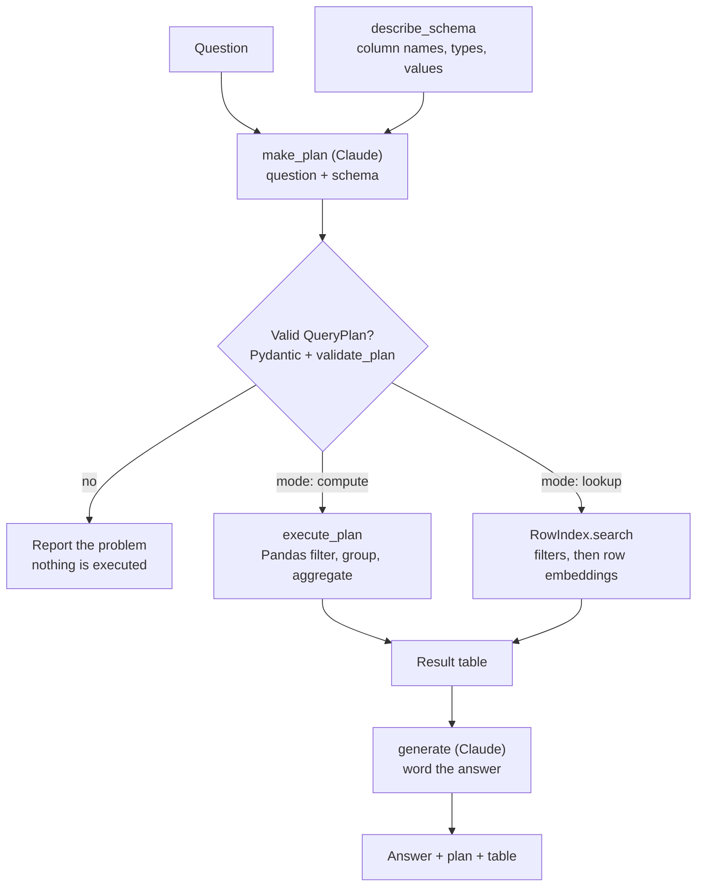

Tables break the usual RAG recipe. Retrieve the five most similar rows of a spreadsheet and you can answer "which claim was for the chair?", but not "what is the total travel spend per department?", because the answer to that is not in any row: it has to be *computed* from all of them. This project builds an assistant that does both, and does the computing safely: the model never writes code. It fills in a small, validated *query plan*, and your own Pandas code carries the plan out.

## Overview

Questions about a table come in two kinds.

- **Lookup questions** describe rows in words: "the chair for working at home". Embedding each row and searching by similarity suits these.
- **Compute questions** need arithmetic over many rows: counts, totals, averages, exact filters. A language model is unreliable at arithmetic over a table pasted into a prompt, and a large table will not fit in a prompt anyway. Pandas, on the other hand, is exact.

The tempting shortcut for compute questions is to ask the model for Pandas code and run it with `exec`. Do not. Model output is shaped by untrusted input (the question, and the cell contents of the file itself), and executing it gives whoever controls that input the run of your machine. Instead, the model returns a `QueryPlan`: a Pydantic object with a fixed set of fields such as `filters`, `group_by` and `aggregate`, each restricted to a short list of allowed values. Anything that is not a valid plan is rejected before it gets near the data.

## Learning objectives

- Distinguish lookup questions from compute questions and route each to the right mechanism.
- Turn table rows into text, embed them and retrieve rows by meaning.
- Define a constrained query plan as a Pydantic model and get one from Claude as validated structured output.
- Execute the plan with Pandas, checking every column name and value type first.
- Explain why this design is safer than executing model-written code, and test it without an API key.

## Requirements

- Python 3.10 or newer.
- An Anthropic API key in `ANTHROPIC_API_KEY` for the `ask` flow. Schema description, row retrieval and plan execution all run without one.
- Helpful background: [JSON and CSV](/learn/data-processing/json-and-csv), [Dataclasses and Pydantic](/learn/python-for-rag-engineering/dataclasses-and-pydantic) and [Structured outputs](/learn/generation-strategies/structured-outputs).

## Technology stack

| Piece | Tool | Why |
| --- | --- | --- |
| Table handling and computation | Pandas | Exact filtering, grouping and aggregation |
| Plan definition and validation | Pydantic | Rejects anything outside the allowed fields and values |
| Row retrieval | Sentence Transformers, `all-MiniLM-L6-v2`, with NumPy | Finds rows by meaning for lookup questions |
| Planning and answering | Claude through the Anthropic SDK | One call writes the plan, one words the answer |
| Tests | pytest | Fake planner, fake generator, fake embedder |

## System architecture



The model is involved twice, and both times it only produces *data*: first a plan, then prose. Every number in the answer comes from the result table, which your code computed.

## Folder structure

```text
csv-question-answering/
├── requirements.txt
├── pytest.ini
├── data/
│   └── expenses.csv
├── csvqa/
│   ├── __init__.py         empty file
│   ├── plan.py             QueryPlan, validation, Pandas execution
│   ├── rows.py             loading, schema description, row retrieval
│   ├── llm.py              the two model calls
│   ├── pipeline.py         plan -> execute -> answer
│   └── cli.py
└── tests/
    ├── conftest.py
    ├── test_plan.py
    ├── test_rows.py
    └── test_pipeline.py
```

## Setup

```bash
mkdir -p csv-question-answering/csvqa csv-question-answering/tests csv-question-answering/data
cd csv-question-answering
touch csvqa/__init__.py
python -m venv .venv
source .venv/bin/activate        # Windows: .venv\Scripts\activate
```

`requirements.txt`:

```text
pandas
numpy
pydantic
sentence-transformers
anthropic
pytest
```

`pytest.ini`:

```text
[pytest]
pythonpath = .
testpaths = tests
```

```bash
pip install -r requirements.txt
export ANTHROPIC_API_KEY="your-key-here"   # only needed for full answers
```

The data is sixteen expense claims from Meridian, the fictional company used throughout the course. Save it as `data/expenses.csv`:

```text
claim_id,date,employee,department,category,description,amount_gbp,has_receipt
C001,2026-01-08,Priya Shah,Engineering,Travel,Train to Leeds for the client workshop,62.00,False
C002,2026-01-12,Tom Okafor,Sales,Meals,Lunch with a prospective customer in Bristol,48.50,False
C003,2026-01-15,Priya Shah,Engineering,Equipment,Monitor bought with the home-office budget,189.99,True
C004,2026-01-20,Ana Ruiz,Marketing,Travel,Flight to Lisbon for the partner summit,214.00,True
C005,2026-01-27,Tom Okafor,Sales,Travel,Taxi from the airport after a customer visit,38.20,False
C006,2026-02-03,Mei Chen,Engineering,Training,Ticket for the search and retrieval conference,180.00,True
C007,2026-02-06,Ana Ruiz,Marketing,Meals,Team dinner after the product launch,96.40,True
C008,2026-02-11,James Bell,Finance,Equipment,Ergonomic chair bought with the home-office budget,149.00,True
C009,2026-02-14,Tom Okafor,Sales,Travel,Hotel in Manchester for a two-day sales meeting,132.00,True
C010,2026-02-19,Mei Chen,Engineering,Software,Annual licence for a diagramming tool,84.00,True
C011,2026-02-24,James Bell,Finance,Training,Online course on spreadsheet modelling,59.00,False
C012,2026-03-02,Priya Shah,Engineering,Travel,Train to London for the security review,71.30,False
C013,2026-03-05,Ana Ruiz,Marketing,Software,Stock photography subscription,29.00,False
C014,2026-03-10,Tom Okafor,Sales,Meals,Dinner with the Leeds client after contract signing,112.75,True
C015,2026-03-13,Mei Chen,Engineering,Equipment,Replacement keyboard and mouse,68.00,False
C016,2026-03-18,James Bell,Finance,Travel,Train to Edinburgh for the audit,128.60,True
```

## Implementation

### `csvqa/plan.py`

The heart of the project: what a plan may contain, and how it is run.

```python
"""A query plan: the only thing the model is allowed to ask our code to do with the data."""
import operator
from typing import Literal

import pandas as pd
from pandas.api.types import is_bool_dtype, is_numeric_dtype
from pydantic import BaseModel

MAX_ROWS = 20
OPERATORS = {
    "==": operator.eq, "!=": operator.ne,
    ">": operator.gt, ">=": operator.ge, "<": operator.lt, "<=": operator.le,
}


class Filter(BaseModel):
    column: str
    op: Literal["==", "!=", ">", ">=", "<", "<=", "contains"]
    value: str  # always text; converted to the column's type before comparing


class QueryPlan(BaseModel):
    mode: Literal["lookup", "compute"]  # lookup: find rows by meaning; compute: filter and aggregate
    filters: list[Filter] = []
    group_by: str | None = None
    aggregate: Literal["count", "sum", "mean", "min", "max"] | None = None
    value_column: str | None = None  # the numeric column to aggregate; not needed for count
    limit: int = 10


class PlanError(ValueError):
    """The plan refers to something the table does not have."""


def validate_plan(plan: QueryPlan, df: pd.DataFrame) -> None:
    named = [f.column for f in plan.filters] + [plan.group_by, plan.value_column]
    for column in named:
        if column is not None and column not in df.columns:
            raise PlanError(f"unknown column: {column!r}")
    if plan.aggregate in ("sum", "mean", "min", "max"):
        if plan.value_column is None:
            raise PlanError(f"{plan.aggregate} needs a value_column")
        if is_bool_dtype(df[plan.value_column]) or not is_numeric_dtype(df[plan.value_column]):
            raise PlanError(f"{plan.value_column!r} is not a numeric column")
    if plan.group_by is not None and plan.aggregate is None:
        raise PlanError("group_by needs an aggregate")


def apply_filters(plan: QueryPlan, df: pd.DataFrame) -> pd.DataFrame:
    """Return the rows that pass every filter in the plan."""
    validate_plan(plan, df)
    mask = pd.Series(True, index=df.index)
    for f in plan.filters:
        column = df[f.column]
        if f.op == "contains":
            mask &= column.astype(str).str.contains(f.value, case=False, regex=False)
        elif is_bool_dtype(column):
            mask &= OPERATORS[f.op](column, f.value.strip().lower() in ("true", "yes", "1"))
        elif is_numeric_dtype(column):
            try:
                mask &= OPERATORS[f.op](column, float(f.value))
            except ValueError:
                raise PlanError(f"{f.value!r} is not a number (column {f.column!r})") from None
        else:
            mask &= OPERATORS[f.op](column.astype(str).str.lower(), f.value.lower())
    return df[mask]


def execute_plan(plan: QueryPlan, df: pd.DataFrame) -> pd.DataFrame:
    """Run a compute plan and return a small result table."""
    rows = apply_filters(plan, df)
    limit = max(1, min(plan.limit, MAX_ROWS))
    if plan.aggregate is None:
        return rows.head(limit)
    name = "count" if plan.aggregate == "count" else f"{plan.aggregate}_{plan.value_column}"
    if plan.group_by is None:
        value = len(rows) if plan.aggregate == "count" else rows[plan.value_column].agg(plan.aggregate)
        return pd.DataFrame({name: [value]}).round(2)
    groups = rows.groupby(plan.group_by)
    series = groups.size() if plan.aggregate == "count" else groups[plan.value_column].agg(plan.aggregate)
    result = series.rename(name).reset_index().sort_values(name, ascending=False)
    return result.head(limit).round(2)
```

The important lines:

- `Literal[...]` is the safety mechanism. `op` can only be one of seven strings and `aggregate` one of five. Pydantic refuses anything else when the object is created, so there is no way to smuggle in a function name or an expression.
- `Filter.value` is always text. The model does not need to know whether a column holds numbers or booleans; `apply_filters` converts the value to the column's type and raises `PlanError` if it cannot.
- `OPERATORS` maps each allowed symbol to a function from Python's `operator` module. The plan *selects* an operation from this table; it never *supplies* one. Note what is absent: no `eval`, no `exec`, and no `DataFrame.query`, which evaluates expression strings.
- `validate_plan` checks what Pydantic cannot know: that every named column exists in *this* table and that sums and means are asked of numeric columns. `is_bool_dtype` is checked first because Pandas counts booleans as numeric.
- `regex=False` in the `contains` filter treats the value as plain text, so a value such as `.*` cannot be used as a pattern.
- `MAX_ROWS` caps how much of the table can be returned, whatever `limit` the plan asks for. That bounds both the prompt size and how much data one question can extract.
- `execute_plan` has three shapes of result: filtered rows, one aggregated number, or one number per group sorted from largest to smallest.

### `csvqa/rows.py`

```python
"""Load the CSV, describe its columns, and retrieve rows by meaning."""
import numpy as np
import pandas as pd
from pandas.api.types import is_bool_dtype, is_numeric_dtype

MODEL_NAME = "sentence-transformers/all-MiniLM-L6-v2"


def local_embedder():
    from sentence_transformers import SentenceTransformer

    model = SentenceTransformer(MODEL_NAME)
    return lambda texts: model.encode(texts, normalize_embeddings=True)


def load_csv(path: str) -> pd.DataFrame:
    return pd.read_csv(path)


def describe_schema(df: pd.DataFrame, max_values: int = 12) -> str:
    """One line per column: what the planner needs to write a valid plan."""
    lines = []
    for name in df.columns:
        column = df[name]
        if is_bool_dtype(column):
            lines.append(f"- {name} (true/false)")
        elif is_numeric_dtype(column):
            lines.append(f"- {name} (number, from {column.min()} to {column.max()})")
        elif column.nunique() <= max_values:
            lines.append(f"- {name} (text, one of: {', '.join(sorted(column.unique()))})")
        else:
            lines.append(f"- {name} (text, for example: {column.iloc[0]})")
    return "\n".join(lines)


def row_to_text(row: pd.Series) -> str:
    return "; ".join(f"{name}: {value}" for name, value in row.items())


class RowIndex:
    """Embeddings for every row, searchable with cosine similarity."""

    def __init__(self, df: pd.DataFrame, embed):
        self.df, self.embed = df, embed
        self.vectors = embed([row_to_text(row) for _, row in df.iterrows()])

    def search(self, question: str, k: int = 5, within: pd.DataFrame | None = None) -> pd.DataFrame:
        """Return the k most similar rows, optionally only among the rows of `within`."""
        scores = self.vectors @ self.embed([question])[0]
        allowed = np.ones(len(self.df), dtype=bool) if within is None else self.df.index.isin(within.index)
        order = [i for i in np.argsort(-scores) if allowed[i]][:k]
        return self.df.iloc[order].assign(score=np.round(scores[order], 3))
```

The important lines:

- `describe_schema` writes the description the planner sees. For text columns with few distinct values it lists them all, so the model can write `category == Travel` with the spelling the data uses. For other columns it gives a range or one example. The full table is never sent for planning.
- `row_to_text` turns a row into `column: value; column: value`. Keeping the column names gives the embedding model some idea of what each value means.
- `RowIndex.search` scores every row against the question with one matrix product (the vectors are unit length, so this is cosine similarity). The `within` argument restricts the ranking to rows that passed the plan's filters, which lets a question combine an exact condition with a fuzzy description.

### `csvqa/llm.py`

```python
"""The two model calls. Nothing else in the project needs an API key."""
import anthropic

from csvqa.plan import QueryPlan

MODEL = "claude-opus-5-5"
PLAN_SYSTEM = (
    "You turn a question about a table into a query plan. Use mode 'compute' for counting, totals, "
    "averages, minimums, maximums and exact filters. Use mode 'lookup' when the question describes "
    "rows in words. Use only the column names and values listed in the schema."
)
ANSWER_SYSTEM = (
    "Answer the question using only the result table provided. Quote figures exactly as they appear. "
    "If the table is empty or does not answer the question, say so."
)


def make_plan(question: str, schema: str) -> QueryPlan:
    client = anthropic.Anthropic()  # reads ANTHROPIC_API_KEY from the environment
    response = client.messages.parse(
        model=MODEL,
        max_tokens=1024,
        system=PLAN_SYSTEM,
        messages=[{"role": "user", "content": f"Table columns:\n{schema}\n\nQuestion: {question}"}],
        output_format=QueryPlan,
    )
    return response.parsed_output


def generate(prompt: str) -> str:
    client = anthropic.Anthropic()
    response = client.messages.create(
        model=MODEL,
        max_tokens=1024,
        system=ANSWER_SYSTEM,
        messages=[{"role": "user", "content": prompt}],
    )
    return "".join(block.text for block in response.content if block.type == "text")
```

The important lines:

- `client.messages.parse(..., output_format=QueryPlan)` asks for a reply that conforms to the Pydantic model, and `response.parsed_output` is a validated `QueryPlan` instance, not a string to parse by hand.
- The planner receives the schema and the question, and nothing else.
- This is the only module that imports `anthropic`. Nothing else imports this module except the command line, at the last moment.

### `csvqa/pipeline.py`

```python
"""Plan, execute, answer. The planner and generator are passed in so tests can fake them."""
from dataclasses import dataclass

import pandas as pd

from csvqa.plan import PlanError, QueryPlan, apply_filters, execute_plan
from csvqa.rows import RowIndex, describe_schema


@dataclass
class Result:
    plan: QueryPlan | None
    table: pd.DataFrame
    answer: str


def run_plan(plan: QueryPlan, question: str, index: RowIndex) -> pd.DataFrame:
    if plan.mode == "lookup":
        return index.search(question, k=min(plan.limit, 5), within=apply_filters(plan, index.df))
    return execute_plan(plan, index.df)


def build_prompt(question: str, plan: QueryPlan, table: pd.DataFrame) -> str:
    shown = table.to_string(index=False) if len(table) else "(no rows)"
    return f"Question: {question}\n\nQuery plan that was run: {plan.model_dump_json()}\n\nResult table:\n{shown}"


def answer_question(question: str, index: RowIndex, make_plan, generate) -> Result:
    plan = make_plan(question, describe_schema(index.df))
    try:
        table = run_plan(plan, question, index)
    except PlanError as error:
        return Result(plan, pd.DataFrame(), f"I could not run that query: {error}")
    return Result(plan, table, generate(build_prompt(question, plan, table)))
```

The important lines:

- `answer_question` takes `make_plan` and `generate` as arguments. In production they are the functions from `llm.py`; in tests they are two-line fakes.
- A `PlanError` is caught and turned into a plain message. The generator is not called, so a bad plan costs nothing and cannot produce a confident answer from an empty table.
- `build_prompt` includes the plan as JSON next to the result. The model can then say what was computed ("summed over travel claims"), and so can you when you check its work.

### `csvqa/cli.py`

```python
"""Command line: python -m csvqa.cli data/expenses.csv "question" [--plan JSON]"""
import argparse

from csvqa.pipeline import answer_question, run_plan
from csvqa.plan import QueryPlan
from csvqa.rows import RowIndex, describe_schema, load_csv, local_embedder


def main() -> None:
    parser = argparse.ArgumentParser(description="Ask questions about a CSV file.")
    parser.add_argument("csv")
    parser.add_argument("question", nargs="?", default="")
    parser.add_argument("--schema", action="store_true", help="print the column description and stop")
    parser.add_argument("--plan", help="run this plan (JSON) instead of asking the model; no API key")
    args = parser.parse_args()

    df = load_csv(args.csv)
    if args.schema:
        print(describe_schema(df))
        return
    index = RowIndex(df, local_embedder())
    if args.plan:
        plan = QueryPlan.model_validate_json(args.plan)
        print(run_plan(plan, args.question, index).to_string(index=False))
        return

    from csvqa.llm import generate, make_plan

    result = answer_question(args.question, index, make_plan, generate)
    print("Plan:", result.plan.model_dump_json())
    print(result.table.to_string(index=False), "\n")
    print(result.answer)


if __name__ == "__main__":
    main()
```

`--schema` and `--plan` exist for learning and debugging: the first shows what the planner will see, the second runs a plan you write yourself. Neither needs an API key.

## Running it

Start with the schema:

```bash
python -m csvqa.cli data/expenses.csv --schema
```

```output
- claim_id (text, for example: C001)
- date (text, for example: 2026-01-08)
- employee (text, one of: Ana Ruiz, James Bell, Mei Chen, Priya Shah, Tom Okafor)
- department (text, one of: Engineering, Finance, Marketing, Sales)
- category (text, one of: Equipment, Meals, Software, Training, Travel)
- description (text, for example: Train to Leeds for the client workshop)
- amount_gbp (number, from 29.0 to 214.0)
- has_receipt (true/false)
```

Now play the model's part and write a plan by hand for "total travel spend by department":

```bash
python -m csvqa.cli data/expenses.csv "Total travel spend by department" --plan '{"mode": "compute", "filters": [{"column": "category", "op": "==", "value": "Travel"}], "group_by": "department", "aggregate": "sum", "value_column": "amount_gbp"}'
```

```output
 department  sum_amount_gbp
  Marketing           214.0
      Sales           170.2
Engineering           133.3
    Finance           128.6
```

A lookup plan uses the question itself for retrieval:

```bash
python -m csvqa.cli data/expenses.csv "Which claim was for the chair for working at home?" --plan '{"mode": "lookup", "limit": 3}'
```

```output
claim_id       date   employee  department  category                                        description  amount_gbp  has_receipt  score
    C008 2026-02-11 James Bell     Finance Equipment Ergonomic chair bought with the home-office budget      149.00         True  0.686
    C003 2026-01-15 Priya Shah Engineering Equipment         Monitor bought with the home-office budget      189.99         True  0.452
    C007 2026-02-06   Ana Ruiz   Marketing     Meals               Team dinner after the product launch       96.40         True  0.439
```

With an API key, drop `--plan` and let the model write it:

```bash
python -m csvqa.cli data/expenses.csv "What is the total travel spend by department?"
```

The plan and the wording come from the model and will vary. An illustrative run looks like this (the table is what the plan shown really produces):

```output
Plan: {"mode":"compute","filters":[{"column":"category","op":"==","value":"Travel"}],"group_by":"department","aggregate":"sum","value_column":"amount_gbp","limit":10}
 department  sum_amount_gbp
  Marketing           214.0
      Sales           170.2
Engineering           133.3
    Finance           128.6

Travel spend by department, summed over all travel claims: Marketing 214.0, Sales 170.2, Engineering 133.3 and Finance 128.6 (amounts in GBP).
```

## Testing

`tests/conftest.py` loads the real CSV and builds a row index with a fake embedder:

```python
import re
import zlib

import numpy as np
import pytest

from csvqa.rows import RowIndex, load_csv


def fake_embed(texts):
    """Deterministic stand-in for the embedding model: hashed bag of words."""
    vectors = np.zeros((len(texts), 256), dtype=np.float32)
    for row, text in enumerate(texts):
        for word in re.findall(r"[a-z0-9]+", text.lower()):
            vectors[row, zlib.crc32(word.encode()) % 256] += 1.0
    return vectors / np.maximum(np.linalg.norm(vectors, axis=1, keepdims=True), 1e-9)


@pytest.fixture(scope="session")
def df():
    return load_csv("data/expenses.csv")


@pytest.fixture(scope="session")
def index(df):
    return RowIndex(df, fake_embed)
```

`tests/test_plan.py`:

```python
import pytest
from pydantic import ValidationError

from csvqa.plan import Filter, PlanError, QueryPlan, apply_filters, execute_plan


def test_sum_by_group_matches_pandas(df):
    plan = QueryPlan(mode="compute", group_by="department", aggregate="sum", value_column="amount_gbp")
    result = execute_plan(plan, df)
    expected = df.groupby("department")["amount_gbp"].sum().round(2)
    assert dict(zip(result["department"], result["sum_amount_gbp"])) == expected.to_dict()
    assert result["sum_amount_gbp"].is_monotonic_decreasing


def test_filters_convert_text_to_the_column_type(df):
    plan = QueryPlan(
        mode="compute",
        filters=[Filter(column="amount_gbp", op=">", value="75"), Filter(column="has_receipt", op="==", value="false")],
        aggregate="count",
    )
    assert execute_plan(plan, df)["count"].tolist() == [0]  # every claim over 75 pounds has a receipt


def test_text_filters_ignore_case(df):
    plan = QueryPlan(mode="compute", filters=[Filter(column="category", op="==", value="travel")])
    assert len(apply_filters(plan, df)) == 6
    plan = QueryPlan(mode="compute", filters=[Filter(column="description", op="contains", value="LEEDS")])
    assert apply_filters(plan, df)["claim_id"].tolist() == ["C001", "C014"]


@pytest.mark.parametrize(
    "plan",
    [
        QueryPlan(mode="compute", filters=[Filter(column="salary", op=">", value="1")]),
        QueryPlan(mode="compute", aggregate="sum", value_column="employee"),
        QueryPlan(mode="compute", aggregate="mean"),
        QueryPlan(mode="compute", group_by="department"),
        QueryPlan(mode="compute", filters=[Filter(column="amount_gbp", op=">", value="lots")]),
    ],
)
def test_invalid_plans_raise_plan_error(df, plan):
    with pytest.raises(PlanError):
        execute_plan(plan, df)


def test_operations_outside_the_whitelist_cannot_be_expressed():
    with pytest.raises(ValidationError):
        Filter(column="amount_gbp", op="__import__('os').system('ls')", value="1")
    with pytest.raises(ValidationError):
        QueryPlan(mode="compute", aggregate="eval")


def test_limit_is_clamped(df):
    assert len(execute_plan(QueryPlan(mode="compute", limit=10_000), df)) == len(df)  # 16 rows, cap is 20
    assert len(execute_plan(QueryPlan(mode="compute", limit=-5), df)) == 1
```

Two of these deserve attention. `test_invalid_plans_raise_plan_error` feeds in five plans that are well-formed but wrong for this table: a column that does not exist, a sum over names, a mean of nothing, a grouping with no aggregate, and a number that is not a number. `test_operations_outside_the_whitelist_cannot_be_expressed` shows that a hostile "operation" never becomes a plan at all.

`tests/test_rows.py`:

```python
from csvqa.plan import Filter, QueryPlan, apply_filters
from csvqa.rows import describe_schema, row_to_text


def test_schema_lists_categories_and_number_ranges(df):
    schema = describe_schema(df)
    assert "- category (text, one of: Equipment, Meals, Software, Training, Travel)" in schema
    assert "- amount_gbp (number, from 29.0 to 214.0)" in schema
    assert "- has_receipt (true/false)" in schema


def test_row_text_names_every_column(df):
    text = row_to_text(df.iloc[0])
    assert text.startswith("claim_id: C001; date: 2026-01-08; employee: Priya Shah")


def test_search_finds_the_row_and_respects_within(df, index):
    assert index.search("ergonomic chair", k=1)["claim_id"].tolist() == ["C008"]
    sales = apply_filters(QueryPlan(mode="lookup", filters=[Filter(column="department", op="==", value="Sales")]), df)
    hits = index.search("train to Leeds for the workshop", k=3, within=sales)
    assert set(hits["department"]) == {"Sales"}
```

`tests/test_pipeline.py`:

```python
from csvqa.pipeline import answer_question
from csvqa.plan import Filter, QueryPlan


def test_compute_question_sends_the_computed_table_to_the_generator(index):
    plan = QueryPlan(mode="compute", filters=[Filter(column="category", op="==", value="Travel")],
                     aggregate="sum", value_column="amount_gbp")
    prompts = []

    def fake_generate(prompt):
        prompts.append(prompt)
        return "Travel spend is 646.1."

    result = answer_question("Total travel spend?", index, lambda question, schema: plan, fake_generate)
    assert result.table["sum_amount_gbp"].tolist() == [646.1]
    assert "646.1" in prompts[0] and '"aggregate":"sum"' in prompts[0]
    assert result.answer == "Travel spend is 646.1."


def test_lookup_question_retrieves_rows(index):
    plan = QueryPlan(mode="lookup", limit=2)
    result = answer_question("ergonomic chair", index, lambda q, s: plan, lambda prompt: "ok")
    assert result.table["claim_id"].iloc[0] == "C008" and len(result.table) == 2


def test_bad_plan_is_reported_without_calling_the_generator(index):
    plan = QueryPlan(mode="compute", aggregate="sum", value_column="no_such_column")

    def must_not_run(prompt):
        raise AssertionError("generator was called")

    result = answer_question("?", index, lambda q, s: plan, must_not_run)
    assert "unknown column" in result.answer
```

The fake planner is `lambda question, schema: plan`. The tests therefore check everything around the model: that the right table is computed, that it reaches the generator, and that a bad plan stops the pipeline.

```bash
python -m pytest -q
```

```output
................                                                         [100%]
16 passed in 0.07s
```

## Expected results

A plan with two filters answers a compliance question exactly. Meridian's rule is that anything over £75 needs a receipt:

```bash
python -m csvqa.cli data/expenses.csv "How many claims over 75 pounds have no receipt?" --plan '{"mode": "compute", "filters": [{"column": "amount_gbp", "op": ">", "value": "75"}, {"column": "has_receipt", "op": "==", "value": "false"}], "aggregate": "count"}'
```

```output
 count
     0
```

Filters and retrieval combine. Here the filter keeps Tom's claims and the embedding ranks them against the question:

```bash
python -m csvqa.cli data/expenses.csv "What did Tom spend on entertaining clients?" --plan '{"mode": "lookup", "filters": [{"column": "employee", "op": "contains", "value": "Tom"}], "limit": 3}'
```

```output
claim_id       date   employee department category                                         description  amount_gbp  has_receipt  score
    C014 2026-03-10 Tom Okafor      Sales    Meals Dinner with the Leeds client after contract signing      112.75         True  0.114
    C009 2026-02-14 Tom Okafor      Sales   Travel     Hotel in Manchester for a two-day sales meeting      132.00         True  0.090
    C002 2026-01-12 Tom Okafor      Sales    Meals        Lunch with a prospective customer in Bristol       48.50        False  0.083
```

The order is sensible, but look at the scores: all close to 0.1 and close to each other. A row written as `column: value` pairs is not natural language, and a question that shares no words with it ("entertaining clients" against "dinner", "lunch") embeds only loosely nearby. Row retrieval is good at finding a distinctive row and weak at covering a category; for "how much did Tom spend on meals", a compute plan with `category == Meals` is the right tool. Choosing between the two is the planner's job, and its mistakes are visible because the plan is always printed.

An impossible plan fails loudly rather than returning nonsense: asking for the sum of `employee` stops with `csvqa.plan.PlanError: 'employee' is not a numeric column`.

## Common problems

- **`pydantic_core.ValidationError` when using `--plan`.** The JSON does not match the model: a misspelt field, an operator outside the list, or invalid JSON. The message names the field.
- **`PlanError: unknown column`.** Column names are case-sensitive and must match the CSV header exactly. Run `--schema` to see them.
- **A boolean column is described as text.** Pandas only reads a column as boolean when every value is `True` or `False`. Values such as `yes`/`no` or blanks leave it as text; clean the column after loading.
- **Numbers read as text.** Currency symbols or thousands separators in the file (`£1,200`) make Pandas treat the column as text, and sums are refused. Strip them when loading.
- **Date filters behave oddly.** Dates are compared as text here, which is correct only for ISO dates (`2026-03-01`). Convert other formats first.
- **The planner picks `lookup` for a question that needs a total.** Tighten `PLAN_SYSTEM` with an example of each kind. The printed plan tells you when this has happened.
- **`TypeError: "Could not resolve authentication method..."`.** `ANTHROPIC_API_KEY` is not set. `--schema` and `--plan` work without it.

## Possible improvements

- **Retry on an invalid plan.** Send the `PlanError` message back to the planner once and ask for a corrected plan.
- **Natural-language row text.** Write a template per table ("Tom Okafor claimed £112.75 for dinner with the Leeds client") to improve lookup scores, and persist the row embeddings instead of recomputing them on every start. See [Table retrieval](/learn/multimodal-rag/table-retrieval).
- **Proper dates.** Parse the date column and add `month` and `year` so that plans can group by them.
- **More operations.** Add `between`, `in`, and sorting by a chosen column, each as another whitelisted option with its own test.
- **Several tables.** Describe each table's schema and let the plan name the table; joins are a larger step best handled with SQL and the same validate-then-execute discipline.
- **Treat cell contents as untrusted.** A description cell could contain text aimed at the model ("ignore your instructions"). The plan design limits the damage to a wrong answer, but the answering prompt should still say that table contents are data, not instructions.
- **Compare with query routing.** The `mode` field is a small router; [Query routing](/learn/agentic-rag/query-routing) and [Self-query retrieval](/learn/advanced-retrieval/self-query-retrieval) generalise the idea.
