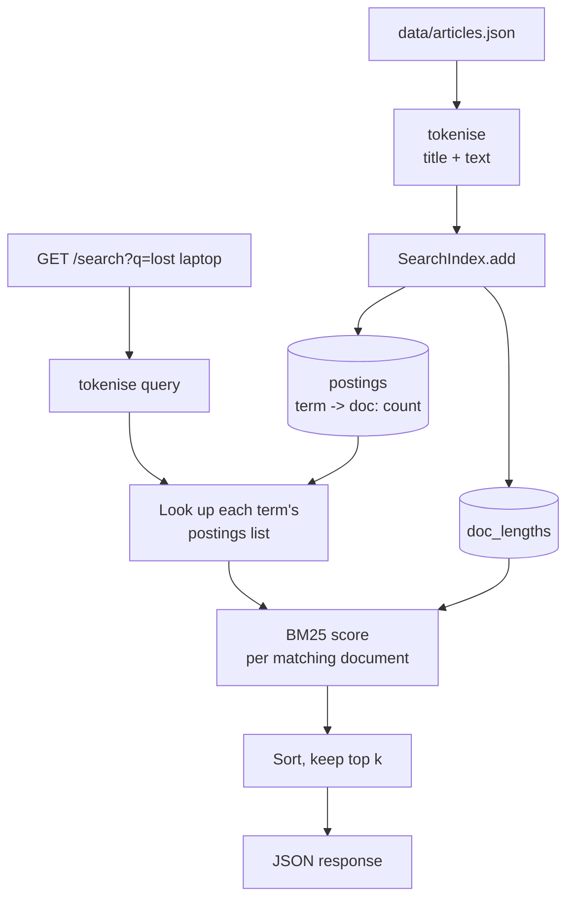

Before vectors, there was keyword search, and it has not gone away: every serious retrieval system still has a keyword component, because nothing beats it at finding exact words such as error codes, names and product numbers. In this project you build a keyword search engine from nothing but the Python standard library: a tokeniser, an inverted index and BM25 ranking. You then check your scores against the `rank-bm25` library and put the engine behind a small web API.

## Overview

A search engine answers one question quickly: *which documents contain these words, and which of them matter most?* Three pieces do the work.

1. A **tokeniser** turns text into *terms*: lower-cased words with punctuation and filler words removed.
2. An **inverted index** maps each term to the documents that contain it, like the index at the back of a book. A query then only touches documents that share a word with it, instead of scanning everything.
3. **BM25** is the scoring formula that turns "these documents contain the words" into a ranking. It rewards documents that use a query term often, rewards rare terms more than common ones, and stops long documents winning merely by being long.

There is no language model in this project. The result is the *retrieval* half of a RAG system, and it is the half that the [hybrid search project](/projects/hybrid-search-rag) later combines with embeddings.

## Learning objectives

- Write a tokeniser and explain how each of its choices changes what can be found.
- Build an inverted index and say what a postings list contains.
- Implement BM25 and explain the role of term frequency, inverse document frequency, `k1` and `b`.
- Verify an implementation against a reference library, and explain why two correct BM25 implementations can give different scores.
- Serve search over HTTP with FastAPI, with validated parameters and tests.

## Requirements

- Python 3.10 or newer. No API key and no model download.
- Helpful background: [Inverted indexes](/learn/sparse-retrieval/inverted-indexes), [Term frequency](/learn/sparse-retrieval/term-frequency), [Inverse document frequency](/learn/sparse-retrieval/inverse-document-frequency) and [BM25](/learn/sparse-retrieval/bm25). The [BM25 visualiser](/playground/bm25) lets you move `k1` and `b` and watch the scores change.

## Technology stack

| Piece | Tool | Why |
| --- | --- | --- |
| Tokeniser, index, ranking | Python standard library | The point is to see the mechanism |
| Reference implementation | rank-bm25 | An independent implementation to check yours against; used only in tests and `compare.py` |
| HTTP API | FastAPI, served by uvicorn | Parameter validation and JSON responses with very little code |
| Tests | pytest, with httpx for FastAPI's test client | Calls the API in-process, no server needed |

## System architecture



The query and the documents go through the *same* tokeniser. If they did not, "Wi-Fi" in a query would never meet "wi-fi" in the index.

## Folder structure

```text
document-search-engine/
├── requirements.txt
├── pytest.ini
├── data/
│   └── articles.json       eight short help articles
├── searchengine/
│   ├── __init__.py         empty file
│   ├── tokeniser.py
│   ├── index.py            inverted index and BM25
│   └── api.py              FastAPI application
├── search.py               command-line search
├── compare.py              side-by-side scores with rank-bm25
└── tests/
    ├── test_tokeniser.py
    ├── test_index.py
    └── test_api.py
```

## Setup

```bash
mkdir -p document-search-engine/searchengine document-search-engine/tests document-search-engine/data
cd document-search-engine
touch searchengine/__init__.py
python -m venv .venv
source .venv/bin/activate        # Windows: .venv\Scripts\activate
```

`requirements.txt`:

```text
fastapi
uvicorn
rank-bm25
httpx
pytest
```

`pytest.ini`:

```text
[pytest]
pythonpath = .
testpaths = tests
```

```bash
pip install -r requirements.txt
```

The corpus is eight help articles from Meridian, the fictional company used throughout the course. Save it as `data/articles.json`:

```json
[
  {"id": "leave-allowance", "title": "Annual leave allowance",
   "text": "Meridian staff receive 25 days of annual leave each year. Leave is booked in the HR portal and approved by your manager."},
  {"id": "leave-carry-over", "title": "Carrying over unused leave",
   "text": "Up to 5 unused leave days carry over to the next year. Carried-over leave must be used by 31 March or the days are lost."},
  {"id": "remote-work", "title": "Remote work policy",
   "text": "Meridian staff may work remotely up to 3 days a week. The home-office equipment budget is 400 pounds per person."},
  {"id": "expenses", "title": "Submitting expenses",
   "text": "Expenses must be submitted within 30 days. Any expense over 75 pounds needs a receipt attached to the claim."},
  {"id": "passwords", "title": "Password rotation",
   "text": "Your Meridian password must be changed every 90 days. A password manager is provided so that every password can be long and unique."},
  {"id": "vpn", "title": "Using the VPN",
   "text": "The VPN is required on public Wi-Fi such as cafes, hotels and trains. Connect to the VPN before opening any Meridian system."},
  {"id": "laptop-refresh", "title": "Laptop refresh cycle",
   "text": "Meridian replaces each laptop on a 3 year refresh cycle. Return the old laptop to IT so that it can be wiped."},
  {"id": "support-desk", "title": "Support desk hours",
   "text": "The support desk is open from 08:00 to 18:00 UK time. Outside those hours, report a lost laptop to the security line."}
]
```

## Implementation

### `searchengine/tokeniser.py`

```python
"""Turn raw text into the list of terms that the index stores."""
import re

STOPWORDS = frozenset(
    "a an and are as at be by for from in is it of on or so that the to with".split()
)
_TOKEN = re.compile(r"[a-z0-9]+(?:[-:'][a-z0-9]+)*")


def tokenise(text: str) -> list[str]:
    """Lower-case, split into words and numbers, and drop stopwords."""
    return [token for token in _TOKEN.findall(text.lower()) if token not in STOPWORDS]
```

The important lines:

- `text.lower()` makes matching case-insensitive: "VPN" and "vpn" become the same term.
- `_TOKEN` matches a run of letters and digits, optionally continued by a hyphen, colon or apostrophe followed by more letters and digits. That keeps `wi-fi` and `08:00` as single terms. Plain `\w+` would break them into `wi`, `fi`, `08` and `00`, and a search for "08:00" would then match any document containing "00".
- `STOPWORDS` removes words so common that they carry no information. The list is deliberately short. BM25 already gives common words little weight, so stopword removal mostly saves space.
- There is no *stemming* (reducing "passwords" to "password"). You will see the consequence in Expected results.

Every one of these choices decides what can be found. A tokeniser is not a formality.

### `searchengine/index.py`

```python
"""An inverted index with BM25 ranking, using only the standard library."""
import json
import math
from collections import Counter, defaultdict

from searchengine.tokeniser import tokenise


class SearchIndex:
    def __init__(self, k1: float = 1.5, b: float = 0.75, idf_variant: str = "lucene"):
        if idf_variant not in ("lucene", "okapi"):
            raise ValueError("idf_variant must be 'lucene' or 'okapi'")
        self.k1, self.b, self.idf_variant = k1, b, idf_variant
        self.postings: dict[str, dict[str, int]] = defaultdict(dict)  # term -> {doc_id: count}
        self.doc_lengths: dict[str, int] = {}                         # doc_id -> number of terms
        self.documents: dict[str, dict] = {}                          # doc_id -> original record

    def add(self, doc_id: str, title: str, text: str) -> None:
        if doc_id in self.documents:
            raise ValueError(f"duplicate document id: {doc_id}")
        terms = tokenise(f"{title} {text}")
        for term, count in Counter(terms).items():
            self.postings[term][doc_id] = count
        self.doc_lengths[doc_id] = len(terms)
        self.documents[doc_id] = {"id": doc_id, "title": title, "text": text}

    @classmethod
    def from_json(cls, path: str, **settings) -> "SearchIndex":
        index = cls(**settings)
        with open(path, encoding="utf-8") as file:
            for record in json.load(file):
                index.add(record["id"], record["title"], record["text"])
        return index

    def idf(self, term: str) -> float:
        """Inverse document frequency: rare terms are worth more than common ones."""
        n_docs, df = len(self.documents), len(self.postings.get(term, ()))
        if self.idf_variant == "lucene":
            return math.log(1 + (n_docs - df + 0.5) / (df + 0.5))
        raw = {t: math.log(n_docs - len(p) + 0.5) - math.log(len(p) + 0.5) for t, p in self.postings.items()}
        floor = 0.25 * sum(raw.values()) / len(raw)  # rank-bm25 replaces negative values with this
        value = raw.get(term, 0.0)
        return floor if value < 0 else value

    def search(self, query: str, k: int = 5) -> list[tuple[str, float]]:
        """Return up to k (doc_id, score) pairs, best first."""
        if not self.documents:
            return []
        average_length = sum(self.doc_lengths.values()) / len(self.doc_lengths)
        scores: dict[str, float] = defaultdict(float)
        for term in tokenise(query):
            idf = self.idf(term)
            for doc_id, tf in self.postings.get(term, {}).items():
                length_norm = 1 - self.b + self.b * self.doc_lengths[doc_id] / average_length
                scores[doc_id] += idf * tf * (self.k1 + 1) / (tf + self.k1 * length_norm)
        return sorted(scores.items(), key=lambda item: (-item[1], item[0]))[:k]
```

The index is three dictionaries. `postings` is the inverted index itself: for each term, a *postings list* recording which documents contain it and how many times. `doc_lengths` holds each document's length in terms, and `documents` keeps the original records for display.

`add` tokenises the title and text together, counts the terms with `Counter`, and files each count under its term. Nothing else happens at indexing time; all scoring is done at query time from these counts.

`search` implements BM25. For a query $q$ and a document $d$:

$$
\text{score}(q, d) = \sum_{t \in q} \text{idf}(t) \cdot \frac{f(t, d) \cdot (k_1 + 1)}{f(t, d) + k_1 \left(1 - b + b \cdot \frac{|d|}{\text{avgdl}}\right)}
$$

- $f(t, d)$ is how many times term $t$ occurs in $d$: `tf` in the code, read from the postings list.
- $|d|$ is the document's length and $\text{avgdl}$ the average length; their ratio feeds `length_norm`.
- $k_1$ (1.5 here) controls *saturation*. The fraction grows with $f$ but levels off, so the tenth occurrence of a word adds far less than the first.
- $b$ (0.75 here) controls length normalisation. At $b = 0$ length is ignored; at $b = 1$ a document twice the average length needs twice the occurrences for the same credit.
- $\text{idf}(t)$ weights rare terms above common ones.

The loop visits only documents on the postings lists of the query's terms. A document sharing no term with the query never gets a score, which is both why keyword search is fast and why it cannot find synonyms. The final `sorted` breaks ties by document id so that results are deterministic.

#### Two versions of IDF

`idf` supports two variants, and the difference matters when you compare implementations. With $N$ documents, of which $n$ contain the term:

$$
\text{idf}_{\text{okapi}}(t) = \ln\frac{N - n + 0.5}{n + 0.5} \qquad \text{idf}_{\text{lucene}}(t) = \ln\left(1 + \frac{N - n + 0.5}{n + 0.5}\right)
$$

The first is the classic formula. It has a flaw: for a term in more than half the documents the fraction drops below 1 and the logarithm goes *negative*, so matching the term would lower a document's score. In this corpus "meridian" is in 5 of 8 documents, giving $\ln(3.5 / 5.5) = -0.452$. The `rank-bm25` library's `BM25Okapi` class patches this by replacing any negative IDF with 0.25 times the average IDF of all terms (0.364 here). The second formula, used by Lucene and the search engines built on it, adds 1 inside the logarithm so the value is always positive: $\ln(1 + 3.5 / 5.5) = 0.492$.

Our default is the Lucene form because it needs no special case. The `"okapi"` setting reproduces `rank-bm25` exactly, patch included, so that the implementation can be checked. That variant recomputes every term's raw IDF on each call, which is fine for a test and wasteful in production; caching is listed under improvements.

### `searchengine/api.py`

```python
"""A small HTTP API in front of the index."""
from fastapi import FastAPI, Query
from pydantic import BaseModel

from searchengine.index import SearchIndex
from searchengine.tokeniser import tokenise


class Result(BaseModel):
    id: str
    title: str
    text: str
    score: float


class SearchResponse(BaseModel):
    query: str
    terms: list[str]
    results: list[Result]


def create_app(index: SearchIndex) -> FastAPI:
    app = FastAPI(title="Document search engine")

    @app.get("/search", response_model=SearchResponse)
    def search(
        q: str = Query(min_length=1, max_length=200, description="the search query"),
        k: int = Query(default=5, ge=1, le=50, description="maximum number of results"),
    ) -> SearchResponse:
        results = [
            Result(**index.documents[doc_id], score=round(score, 4)) for doc_id, score in index.search(q, k)
        ]
        return SearchResponse(query=q, terms=tokenise(q), results=results)

    @app.get("/stats")
    def stats() -> dict:
        return {"documents": len(index.documents), "terms": len(index.postings)}

    return app


app = create_app(SearchIndex.from_json("data/articles.json"))
```

The important lines:

- `create_app(index)` builds the application around whatever index it is given. The module-level `app` uses the real data; tests can pass any index they like.
- `Query(min_length=1, max_length=200)` and `Query(ge=1, le=50)` make FastAPI validate the parameters before your function runs. An empty query or `k=0` gets a 422 response with an explanation, and a client cannot ask for a million results.
- `response_model=SearchResponse` fixes the shape of the JSON and documents it in the automatic `/docs` page.
- The response echoes `terms`, the query as the tokeniser saw it. When a user asks why a search found nothing, that field usually answers the question.
- The index is built once at import time and only read afterwards.

### `search.py`

```python
"""Search from the command line: python search.py "carry over leave" """
import sys

from searchengine.index import SearchIndex

index = SearchIndex.from_json("data/articles.json")
query = " ".join(sys.argv[1:])
for doc_id, score in index.search(query):
    print(f"{score:6.3f}  {doc_id:18} {index.documents[doc_id]['title']}")
```

### `compare.py`

```python
"""Score one query three ways: rank-bm25, our 'okapi' variant and our default."""
import json

from rank_bm25 import BM25Okapi

from searchengine.index import SearchIndex
from searchengine.tokeniser import tokenise

PATH, QUERY = "data/articles.json", "meridian password"
with open(PATH, encoding="utf-8") as file:
    records = json.load(file)

reference = BM25Okapi([tokenise(f"{r['title']} {r['text']}") for r in records])
okapi = dict(SearchIndex.from_json(PATH, idf_variant="okapi").search(QUERY, k=len(records)))
lucene = dict(SearchIndex.from_json(PATH).search(QUERY, k=len(records)))

print(f"{'document':18} {'rank-bm25':>9} {'ours okapi':>10} {'ours lucene':>11}")
for record, score in zip(records, reference.get_scores(tokenise(QUERY))):
    doc_id = record["id"]
    print(f"{doc_id:18} {score:9.4f} {okapi.get(doc_id, 0):10.4f} {lucene.get(doc_id, 0):11.4f}")
```

`BM25Okapi` takes a list of token lists, so the script gives it the documents tokenised by our tokeniser. The comparison then tests the scoring alone.

## Running it

From the command line:

```bash
python search.py carry over unused leave
python search.py lost laptop
```

```output
 7.902  leave-carry-over   Carrying over unused leave
 2.109  leave-allowance    Annual leave allowance
 1.318  expenses           Submitting expenses
 2.570  support-desk       Support desk hours
 2.199  laptop-refresh     Laptop refresh cycle
 1.196  leave-carry-over   Carrying over unused leave
```

The first query's winner matches all four terms, several of them more than once. The expenses article appears only because it contains "over". For "lost laptop", the support desk article contains both words; the refresh article says "laptop" three times but never "lost"; and the carry-over article matches only "lost". That is BM25's saturation and rare-term weighting at work: three occurrences of one term do not beat one occurrence of each.

As a web service:

```bash
uvicorn searchengine.api:app --port 8765
```

In a second terminal:

```bash
curl -s "localhost:8765/search?q=lost+laptop&k=2" | python -m json.tool
```

```output
{
    "query": "lost laptop",
    "terms": [
        "lost",
        "laptop"
    ],
    "results": [
        {
            "id": "support-desk",
            "title": "Support desk hours",
            "text": "The support desk is open from 08:00 to 18:00 UK time. Outside those hours, report a lost laptop to the security line.",
            "score": 2.5698
        },
        {
            "id": "laptop-refresh",
            "title": "Laptop refresh cycle",
            "text": "Meridian replaces each laptop on a 3 year refresh cycle. Return the old laptop to IT so that it can be wiped.",
            "score": 2.1994
        }
    ]
}
```

Open `http://localhost:8765/docs` in a browser for an interactive page generated from the code.

## Testing

`tests/test_tokeniser.py`:

```python
from searchengine.tokeniser import tokenise


def test_lowercases_and_drops_punctuation_and_stopwords():
    assert tokenise("The VPN is required on public Wi-Fi.") == ["vpn", "required", "public", "wi-fi"]


def test_keeps_numbers_and_times_whole():
    assert tokenise("Open from 08:00 to 18:00, 25 days") == ["open", "08:00", "18:00", "25", "days"]


def test_empty_and_stopword_only_text_gives_no_terms():
    assert tokenise("") == [] and tokenise("the of and") == []
```

`tests/test_index.py`:

```python
import json

import pytest
from rank_bm25 import BM25Okapi

from searchengine.index import SearchIndex
from searchengine.tokeniser import tokenise

DATA = "data/articles.json"
QUERIES = ["carry over unused leave", "lost laptop", "meridian password", "public wi-fi vpn", "receipt"]


def test_postings_record_term_counts_per_document():
    index = SearchIndex()
    index.add("a", "Leave", "leave days and more leave")
    index.add("b", "VPN", "vpn days")
    assert index.postings["leave"] == {"a": 3}
    assert index.postings["days"] == {"a": 1, "b": 1}
    assert index.doc_lengths == {"a": 5, "b": 3}


def test_duplicate_ids_are_rejected():
    index = SearchIndex()
    index.add("a", "t", "x")
    with pytest.raises(ValueError):
        index.add("a", "t", "y")


def test_unknown_terms_and_empty_queries_return_nothing():
    index = SearchIndex.from_json(DATA)
    assert index.search("kubernetes") == [] and index.search("the of") == []


@pytest.mark.parametrize("query", QUERIES)
def test_okapi_variant_matches_rank_bm25_exactly(query):
    with open(DATA, encoding="utf-8") as file:
        records = json.load(file)
    reference = BM25Okapi([tokenise(f"{r['title']} {r['text']}") for r in records])
    expected = dict(zip([r["id"] for r in records], reference.get_scores(tokenise(query))))

    ours = dict(SearchIndex.from_json(DATA, idf_variant="okapi").search(query, k=len(records)))
    for doc_id, score in expected.items():
        assert ours.get(doc_id, 0.0) == pytest.approx(score, abs=1e-9)


@pytest.mark.parametrize("query", QUERIES)
def test_both_idf_variants_agree_on_the_top_result(query):
    lucene = SearchIndex.from_json(DATA).search(query, k=1)
    okapi = SearchIndex.from_json(DATA, idf_variant="okapi").search(query, k=1)
    assert lucene[0][0] == okapi[0][0]
```

`test_okapi_variant_matches_rank_bm25_exactly` is the verification: for five queries, every document's score from our code must equal the library's to nine decimal places. The second parametrised test checks that the default variant, though its numbers differ, picks the same top document.

`tests/test_api.py`:

```python
from fastapi.testclient import TestClient

from searchengine.api import create_app
from searchengine.index import SearchIndex

client = TestClient(create_app(SearchIndex.from_json("data/articles.json")))


def test_search_returns_ranked_results():
    body = client.get("/search", params={"q": "carry over unused leave", "k": 2}).json()
    assert body["terms"] == ["carry", "over", "unused", "leave"]
    assert [r["id"] for r in body["results"]] == ["leave-carry-over", "leave-allowance"]
    assert body["results"][0]["score"] > body["results"][1]["score"]


def test_no_match_is_an_empty_list_not_an_error():
    response = client.get("/search", params={"q": "kubernetes"})
    assert response.status_code == 200 and response.json()["results"] == []


def test_invalid_parameters_are_rejected():
    assert client.get("/search", params={"q": ""}).status_code == 422
    assert client.get("/search", params={"q": "vpn", "k": 0}).status_code == 422


def test_stats():
    assert client.get("/stats").json()["documents"] == 8
```

`TestClient` calls the application directly in the test process, so no server has to be running.

```bash
python -m pytest -q
```

```output
....................                                                     [100%]
20 passed in 0.12s
```

Twenty tests: the two parametrised tests run once per query.

## Expected results

Run the comparison:

```bash
python compare.py
```

```output
document           rank-bm25 ours okapi ours lucene
leave-allowance       0.3561     0.3561      0.4820
leave-carry-over      0.0000     0.0000      0.0000
remote-work           0.3561     0.3561      0.4820
expenses              0.0000     0.0000      0.0000
passwords             3.2954     3.2954      3.7564
vpn                   0.3743     0.3743      0.5066
laptop-refresh        0.3841     0.3841      0.5199
support-desk          0.0000     0.0000      0.0000
```

The first two columns are identical: with the same IDF, the from-scratch engine reproduces the library. The third column has different numbers and the same order. Neither is wrong; they are two variants of one formula, and the lesson is that **BM25 scores are only comparable within one implementation**. Never carry a score threshold from one engine to another. (Engines differ in other small ways as well; recent Lucene versions, for example, drop the constant $(k_1 + 1)$ factor, which changes every score and no ranking.)

Now two instructive failures:

```bash
python search.py passwords
python search.py kubernetes
```

Both print nothing. "kubernetes" is simply not in the corpus. "passwords" is the tokeniser's doing: the article says "password", and without stemming the plural is a different term. Keyword search is exact by nature, which is its strength for codes and names and its weakness for everyday wording.

## Common problems

- **A search returns nothing although the word is obviously there.** Check the `terms` field of the API response. The usual causes are a plural or other word form (no stemming), or query and documents being tokenised differently.
- **Scores do not match another BM25 tool.** Check the IDF variant, the values of `k1` and `b`, and above all the tokeniser. A different tokeniser changes document lengths and term counts, and therefore every score.
- **`FileNotFoundError: data/articles.json`.** Run `uvicorn`, `search.py` and `pytest` from the project folder; the path is relative.
- **`ModuleNotFoundError: No module named 'searchengine'` in tests.** `pytest.ini` is missing or you are running pytest from another folder.
- **`RuntimeError` mentioning httpx when importing `TestClient`.** FastAPI's test client needs the `httpx` package; it is in `requirements.txt`.
- **A 422 response.** The query is empty or `k` is outside 1 to 50. The response body says which parameter failed.
- **`Address already in use`.** Another program has the port. Pick a different `--port`.

## Possible improvements

- **Stemming or lemmatisation**, so that "passwords" finds "password". Apply it in `tokenise` and both documents and queries benefit.
- **Cache IDF values** and the average length when indexing finishes, instead of computing them per query.
- **Field weighting.** A match in the title is stronger evidence than one in the body. Keep separate postings per field and weight the title higher.
- **Snippets with highlighting.** Return the sentence that contains the matched terms, with the terms marked.
- **Phrase queries.** Store term positions in the postings lists so that "support desk" can require adjacent words.
- **Updates and deletes.** Removing a document means removing it from every postings list it appears on.
- **Persistence.** Save the three dictionaries to disk so that start-up does not re-index.
- **Semantic search alongside.** Combine this engine with embeddings, as in the [hybrid search project](/projects/hybrid-search-rag) and the lesson [Dense versus sparse retrieval](/learn/hybrid-search/dense-versus-sparse-retrieval).
