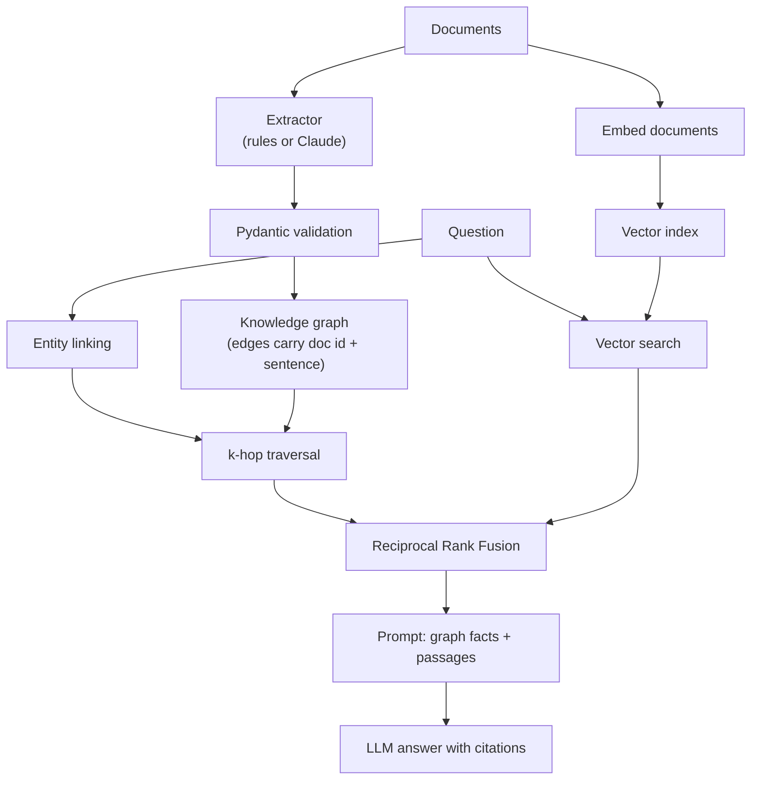

Vector search finds passages that *sound like* the question. Some questions cannot be answered that way, because the passage holding the answer shares no words or meaning with the question: it is connected to it only through a chain of other facts. In this project you build a Graph RAG system for Meridian that extracts entities and relationships into a knowledge graph, walks that graph from the things a question mentions, and combines the result with ordinary vector retrieval. You then measure, on a small question set, exactly which questions vector search alone cannot assemble the evidence for.

## Overview

Meridian's internal assistant, AskMeridian, is asked "Who leads the team that owns the VPN gateway?". The system catalogue says the VPN gateway is owned by Network Operations. A different page says Network Operations is led by Priya Nair. No single page contains both facts, and the second page never mentions the VPN. This is a **multi-hop question**: answering it means joining two or more facts end to end.

You will build:

- a Pydantic schema for entities and relations, which is the contract every extractor must satisfy;
- two extractors behind one interface: a deterministic rule-based one (used offline and in tests) and a Claude one for real documents;
- a NetworkX graph in which every edge records the document and sentence it came from (its **provenance**);
- entity linking (finding which graph nodes a question mentions) and k-hop traversal (walking at most k edges outwards);
- a hybrid retriever that fuses graph evidence with vector search;
- a comparison script that reports, per question, whether each retriever put *all* the needed documents in the context.

The concepts are taught in the [Graph RAG module](/learn/graph-rag); this project turns [entity extraction](/learn/graph-rag/entity-extraction), [graph traversal](/learn/graph-rag/graph-traversal) and [hybrid graph-vector retrieval](/learn/graph-rag/hybrid-graph-vector-retrieval) into running code.

## Learning objectives

- Define an extraction schema with Pydantic and reject malformed extractions before they reach the graph.
- Build a knowledge graph with NetworkX where every edge is traceable to a source sentence.
- Link a question to graph entities and collect evidence with a bounded breadth-first traversal.
- Fuse graph and vector results with Reciprocal Rank Fusion.
- Measure evidence completeness for multi-hop questions and explain each failure.

## Requirements

- Python 3.10 or later.
- About 100 MB of disk for the `all-MiniLM-L6-v2` embedding model, downloaded on first run.
- An Anthropic API key only for the two optional LLM paths (LLM extraction and the final answer). Everything else, including the whole test suite, runs without one.
- Familiarity with [embeddings](/learn/understanding-large-language-models/embeddings) and [Reciprocal Rank Fusion](/learn/hybrid-search/reciprocal-rank-fusion).

## Technology stack

| Piece | Choice | Why |
| --- | --- | --- |
| Graph | NetworkX `MultiDiGraph` | In-memory, directed, allows several edges between the same pair of nodes |
| Schema | Pydantic v2 | Validates extractor output; doubles as the structured-output schema for Claude |
| Embeddings | Sentence Transformers, `all-MiniLM-L6-v2` | Local, 384 dimensions, no key |
| Vector search | NumPy dot product | Nineteen documents do not need an index |
| Extraction and answers | Claude through the Anthropic SDK | Behind two small interfaces, so it is optional |

## System architecture

Indexing runs once: every document goes through the extractor, and the validated entities and relations become nodes and edges. The same documents are embedded for vector search. At question time the two retrievers run side by side and their rankings are fused.



## Folder structure

```text
graph-rag-application/
├── requirements.txt
├── compare.py              # vector vs graph vs hybrid on the question set
├── ask.py                  # ask one question
├── data/
│   ├── corpus.json         # 19 Meridian documents
│   └── questions.json      # 7 questions with gold evidence
├── graphrag/
│   ├── __init__.py         # empty
│   ├── schema.py           # Entity, Relation, Extraction
│   ├── extractors.py       # RuleBasedExtractor, ClaudeExtractor
│   ├── graph.py            # build, link, traverse
│   ├── vector.py           # embedder + exact vector index
│   ├── retrieve.py         # vector_only, graph_only, hybrid
│   └── answer.py           # prompt and the LLM interface
└── tests/
    └── test_graphrag.py
```

## Setup

```bash
mkdir graph-rag-application && cd graph-rag-application
python -m venv .venv && source .venv/bin/activate
pip install -r requirements.txt
export ANTHROPIC_API_KEY="..."   # optional: only for LLM extraction and answers
```

`requirements.txt`:

```text
anthropic
networkx
numpy
pydantic
sentence-transformers
pytest
```

## Implementation

### `data/corpus.json`

Six systems, six teams, six people and one policy page. Each relational fact lives in its own document, which is what makes the questions multi-hop.

```json
[
  {"id": "sys-vpn", "title": "VPN gateway", "text": "The VPN gateway is owned by Network Operations. VPN is required on public Wi-Fi."},
  {"id": "sys-expenses", "title": "Expenses portal", "text": "The expenses portal is owned by Finance Systems. Expenses must be submitted within 30 days, and anything over £75 needs a receipt."},
  {"id": "sys-askmeridian", "title": "AskMeridian", "text": "AskMeridian is owned by Knowledge Platform. AskMeridian depends on single sign-on."},
  {"id": "sys-sso", "title": "Single sign-on", "text": "Single sign-on is owned by Identity Engineering. Passwords are rotated every 90 days."},
  {"id": "sys-leave", "title": "Leave tracker", "text": "The leave tracker is owned by People Systems. Annual leave is 25 days, and up to 5 unused days carry over until 31 March."},
  {"id": "sys-devices", "title": "Device management service", "text": "The device management service is owned by Workplace IT. The laptop refresh cycle is 3 years."},
  {"id": "team-netops", "title": "Network Operations", "text": "Network Operations is led by Priya Nair. The team meets every Monday."},
  {"id": "team-finsys", "title": "Finance Systems", "text": "Finance Systems is led by Tom Okafor. The team meets every Tuesday."},
  {"id": "team-knowledge", "title": "Knowledge Platform", "text": "Knowledge Platform is led by Elena Rossi. The team meets every Wednesday."},
  {"id": "team-identity", "title": "Identity Engineering", "text": "Identity Engineering is led by Marcus Webb. The team meets every Thursday."},
  {"id": "team-people", "title": "People Systems", "text": "People Systems is led by Aisha Khan. The team meets every Friday."},
  {"id": "team-workplace", "title": "Workplace IT", "text": "Workplace IT is led by Daniel Brooks. The support desk is open from 08:00 to 18:00 UK time."},
  {"id": "person-priya", "title": "Priya Nair", "text": "Priya Nair is based in Leeds. Priya Nair reports to Hannah Schmidt."},
  {"id": "person-tom", "title": "Tom Okafor", "text": "Tom Okafor is based in Bristol. Tom Okafor reports to Gareth Liu."},
  {"id": "person-elena", "title": "Elena Rossi", "text": "Elena Rossi is based in Edinburgh. Elena Rossi reports to Hannah Schmidt."},
  {"id": "person-marcus", "title": "Marcus Webb", "text": "Marcus Webb is based in Manchester. Marcus Webb reports to Hannah Schmidt."},
  {"id": "person-aisha", "title": "Aisha Khan", "text": "Aisha Khan is based in Cardiff. Aisha Khan reports to Gareth Liu."},
  {"id": "person-daniel", "title": "Daniel Brooks", "text": "Daniel Brooks is based in London. Daniel Brooks reports to Gareth Liu."},
  {"id": "policy-remote", "title": "Remote work", "text": "Staff may work remotely up to 3 days a week. The home-office equipment budget is £400."}
]
```

### `data/questions.json`

Each question lists its `gold` documents: the complete set a reader would need to answer it.

```json
[
  {"q": "Who leads the team that owns the VPN gateway?", "answer": "Priya Nair", "gold": ["sys-vpn", "team-netops"], "hops": 2},
  {"q": "Who leads the team that owns the expenses portal?", "answer": "Tom Okafor", "gold": ["sys-expenses", "team-finsys"], "hops": 2},
  {"q": "In which office is the lead of the team that owns the leave tracker based?", "answer": "Cardiff", "gold": ["sys-leave", "team-people", "person-aisha"], "hops": 3},
  {"q": "Who does the lead of the team that owns the device management service report to?", "answer": "Gareth Liu", "gold": ["sys-devices", "team-workplace", "person-daniel"], "hops": 3},
  {"q": "Who leads the team that owns the service AskMeridian depends on?", "answer": "Marcus Webb", "gold": ["sys-askmeridian", "sys-sso", "team-identity"], "hops": 3},
  {"q": "How many days a week can staff work remotely?", "answer": "3", "gold": ["policy-remote"], "hops": 1},
  {"q": "Who is the lead of Knowledge Platform?", "answer": "Elena Rossi", "gold": ["team-knowledge"], "hops": 1}
]
```

### `graphrag/schema.py`

```python
"""The contract between any extractor (rule-based or LLM) and the graph builder."""
from typing import Literal

from pydantic import BaseModel, Field, model_validator

EntityType = Literal["system", "team", "person", "office"]
RelationType = Literal["owned_by", "led_by", "based_in", "reports_to", "depends_on"]


class Entity(BaseModel):
    name: str = Field(min_length=1, description="Canonical name exactly as written in the text")
    type: EntityType


class Relation(BaseModel):
    source: str = Field(description="Name of the entity the statement is about")
    relation: RelationType
    target: str = Field(description="Name of the entity it points to")
    evidence: str = Field(min_length=1, description="The sentence that states the relation, copied verbatim")


class Extraction(BaseModel):
    entities: list[Entity] = Field(default_factory=list)
    relations: list[Relation] = Field(default_factory=list)

    @model_validator(mode="after")
    def relations_use_declared_entities(self) -> "Extraction":
        names = {e.name for e in self.entities}
        for r in self.relations:
            for end in (r.source, r.target):
                if end not in names:
                    raise ValueError(f"relation refers to undeclared entity {end!r}")
        return self
```

- `Literal` types close the vocabulary. An extractor cannot invent a relation called `manages` or an entity type called `department`; validation fails instead, and you find out at indexing time rather than when a traversal silently misses an edge.
- `evidence` is mandatory. A relation with no quoted sentence cannot be traced, so the schema does not allow one.
- The `model_validator` rejects **dangling relations**: a relation whose source or target was never declared as an entity. LLM extractors produce these when they shorten a name in one place and not another.

### `graphrag/extractors.py`

```python
"""Two extractors behind one interface: rules for the offline path, Claude for real documents."""
import re
from typing import Protocol

from .schema import Entity, Extraction, Relation

# verb phrase -> (relation, type of the subject, type of the object)
PATTERNS = {
    "is owned by": ("owned_by", "system", "team"),
    "is led by": ("led_by", "team", "person"),
    "is based in": ("based_in", "person", "office"),
    "reports to": ("reports_to", "person", "person"),
    "depends on": ("depends_on", "system", "system"),
}
SENTENCE = re.compile(r"(?<=[.!?])\s+")
VERBS = "|".join(re.escape(v) for v in PATTERNS)
STATEMENT = re.compile(rf"^(?:The |the )?(?P<a>[\w' -]+?) (?P<verb>{VERBS}) (?:the )?(?P<b>[\w' -]+?)\.?$")


def canonical(name: str) -> str:
    """One spelling per entity: trimmed, single spaces, first letter capitalised."""
    name = " ".join(name.split())
    return name[:1].upper() + name[1:]


class Extractor(Protocol):
    def extract(self, text: str) -> Extraction: ...


class RuleBasedExtractor:
    """Deterministic: the same text always yields the same triples. Used in tests and offline."""

    def extract(self, text: str) -> Extraction:
        entities: dict[str, Entity] = {}
        relations: list[Relation] = []
        for sentence in SENTENCE.split(text.strip()):
            m = STATEMENT.match(sentence.strip())
            if not m:
                continue
            relation, a_type, b_type = PATTERNS[m["verb"]]
            a, b = canonical(m["a"]), canonical(m["b"])
            entities.setdefault(a, Entity(name=a, type=a_type))
            entities.setdefault(b, Entity(name=b, type=b_type))
            relations.append(Relation(source=a, relation=relation, target=b, evidence=sentence.strip()))
        return Extraction(entities=list(entities.values()), relations=relations)


SYSTEM = (
    "You extract a knowledge graph from company documentation. Return only entities and relations "
    "that the text states explicitly. Copy the supporting sentence verbatim into `evidence`. "
    "Every relation's source and target must appear in `entities` with exactly the same name."
)


class ClaudeExtractor:
    """LLM extraction with the schema enforced by the SDK. Needs ANTHROPIC_API_KEY."""

    def __init__(self, model: str = "claude-opus-5-5"):
        import anthropic

        self.client = anthropic.Anthropic()  # reads ANTHROPIC_API_KEY from the environment
        self.model = model

    def extract(self, text: str) -> Extraction:
        response = self.client.messages.parse(
            model=self.model,
            max_tokens=2048,
            system=SYSTEM,
            messages=[{"role": "user", "content": f"<document>\n{text}\n</document>"}],
            output_format=Extraction,
        )
        extraction = response.parsed_output
        for e in extraction.entities:
            e.name = canonical(e.name)
        for r in extraction.relations:
            r.source, r.target = canonical(r.source), canonical(r.target)
        return extraction
```

- `Extractor` is a `Protocol`: anything with an `extract(text) -> Extraction` method qualifies. The graph builder never knows which implementation it has.
- `RuleBasedExtractor` splits the text into sentences and matches each against one pattern, `subject verb-phrase object`. The verb phrase decides the relation *and* the entity types, so "is led by" always produces a team and a person. Sentences that match nothing ("The team meets every Monday.") are skipped. It is brittle by design: it exists so the pipeline is deterministic and testable, not to parse real prose.
- `canonical` gives one spelling per entity. "The VPN gateway" and "the VPN gateway" must become the same node, or the graph splits in two and traversal stops at the gap.
- `ClaudeExtractor` uses `client.messages.parse` with `output_format=Extraction`, so the SDK returns a validated `Extraction` in `response.parsed_output`. The same canonicalisation is applied afterwards. This class was not executed for this tutorial (no API key in the build environment); the rule-based extractor produced every result shown below.

### `graphrag/graph.py`

```python
"""Build the knowledge graph, link a question to it, and walk it."""
import json
import re
from collections import deque
from dataclasses import dataclass
from pathlib import Path

import networkx as nx

from .extractors import Extractor


@dataclass(frozen=True)
class Evidence:
    source: str
    relation: str
    target: str
    doc_id: str
    sentence: str
    hop: int

    def as_fact(self) -> str:
        return f"{self.source} --{self.relation}--> {self.target}"


def load_corpus(path: str | Path) -> list[dict]:
    return json.loads(Path(path).read_text(encoding="utf-8"))


def build_graph(docs: list[dict], extractor: Extractor) -> nx.MultiDiGraph:
    graph = nx.MultiDiGraph()
    for doc in docs:
        extraction = extractor.extract(doc["text"])
        for entity in extraction.entities:
            if entity.name not in graph:
                graph.add_node(entity.name, type=entity.type, docs=set())
            graph.nodes[entity.name]["docs"].add(doc["id"])
        for rel in extraction.relations:
            if rel.evidence not in doc["text"]:
                continue  # an extractor that cannot quote its source does not get an edge
            graph.add_edge(rel.source, rel.target, key=f"{rel.relation}:{doc['id']}",
                           relation=rel.relation, doc_id=doc["id"], sentence=rel.evidence)
    return graph


def link_entities(question: str, graph: nx.MultiDiGraph) -> list[str]:
    """Entity linking by exact name match, longest name first so 'Priya Nair' beats 'Priya'."""
    text = question.lower()
    found: list[str] = []
    for name in sorted(graph.nodes, key=len, reverse=True):
        pattern = rf"(?<!\w){re.escape(name.lower())}(?!\w)"
        if re.search(pattern, text):
            found.append(name)
            text = re.sub(pattern, " ", text)  # a matched span cannot match a shorter name again
    return found


def k_hop(graph: nx.MultiDiGraph, seeds: list[str], k: int = 2) -> list[Evidence]:
    """Breadth-first walk up to k edges from the seeds, in either direction, collecting every edge."""
    depth = {s: 0 for s in seeds if s in graph}
    queue = deque(depth)
    seen_edges: set[tuple] = set()
    evidence: list[Evidence] = []
    while queue:
        node = queue.popleft()
        if depth[node] == k:
            continue
        edges = list(graph.out_edges(node, keys=True, data=True)) + list(graph.in_edges(node, keys=True, data=True))
        for u, v, key, data in sorted(edges, key=lambda e: (e[0], e[1], e[2])):
            if (u, v, key) in seen_edges:
                continue
            seen_edges.add((u, v, key))
            evidence.append(Evidence(u, data["relation"], v, data["doc_id"], data["sentence"], depth[node] + 1))
            other = v if u == node else u
            if other not in depth:
                depth[other] = depth[node] + 1
                queue.append(other)
    return evidence


def save_graph(graph: nx.MultiDiGraph, path: str | Path) -> None:
    edges = [{"source": u, "target": v, **d} for u, v, d in graph.edges(data=True)]
    nodes = [{"name": n, "type": d["type"], "docs": sorted(d["docs"])} for n, d in graph.nodes(data=True)]
    Path(path).write_text(json.dumps({"nodes": nodes, "edges": edges}, indent=2, ensure_ascii=False), encoding="utf-8")
```

- `MultiDiGraph` is directed (ownership has a direction) and allows parallel edges, so the same relation stated in two documents is kept twice, once per source. The edge key `relation:doc_id` makes re-indexing a document idempotent.
- `if rel.evidence not in doc["text"]: continue` is the provenance gate. The schema guarantees that evidence *exists*; this line checks that it is *really a quotation* from the document. An LLM that paraphrases or invents a sentence gets no edge.
- `link_entities` is exact, case-insensitive name matching with word boundaries, longest name first. Removing each matched span stops a shorter entity name from matching inside a longer one.
- `k_hop` is a breadth-first search over edges in both directions. Following edges backwards matters: the question "What does Network Operations own?" must walk `owned_by` against its direction. `depth` records how far each node is from a seed, nodes at depth `k` are not expanded, and each `Evidence` carries the hop at which it was found, so nearer facts come first.
- The `sorted` call makes traversal order deterministic, which keeps the tests and the printed output stable.

### `graphrag/vector.py`

```python
"""A small exact vector index. The embedder is injected so tests need no model."""
from typing import Callable, Sequence

import numpy as np

Embedder = Callable[[Sequence[str]], np.ndarray]


def minilm_embedder(name: str = "sentence-transformers/all-MiniLM-L6-v2") -> Embedder:
    from sentence_transformers import SentenceTransformer

    model = SentenceTransformer(name)
    return lambda texts: model.encode(list(texts), normalize_embeddings=True)


class VectorIndex:
    def __init__(self, docs: list[dict], embed: Embedder):
        self.docs = docs
        self.embed = embed
        self.matrix = np.asarray(embed([f"{d['title']}. {d['text']}" for d in docs]), dtype=np.float32)

    def search(self, query: str, k: int = 4) -> list[tuple[str, float]]:
        q = np.asarray(self.embed([query]), dtype=np.float32)[0]
        scores = self.matrix @ q  # cosine similarity: both sides are unit length
        order = np.argsort(-scores)[:k]
        return [(self.docs[i]["id"], float(scores[i])) for i in order]
```

The embedder is a plain function from texts to a matrix. Production code passes `minilm_embedder()`; the tests pass a hashing function. Because the vectors are unit length, the dot product is the cosine similarity.

### `graphrag/retrieve.py`

```python
"""Three retrievers with one return shape, so they can be compared like for like."""
from dataclasses import dataclass, field

import networkx as nx

from .graph import Evidence, k_hop, link_entities
from .vector import VectorIndex


@dataclass
class Retrieval:
    doc_ids: list[str]
    facts: list[Evidence] = field(default_factory=list)
    seeds: list[str] = field(default_factory=list)


def vector_only(question: str, index: VectorIndex, k: int = 4) -> Retrieval:
    return Retrieval(doc_ids=[doc_id for doc_id, _ in index.search(question, k)])


def graph_only(question: str, graph: nx.MultiDiGraph, hops: int = 2, k: int = 4) -> Retrieval:
    seeds = link_entities(question, graph)
    facts = k_hop(graph, seeds, hops)
    doc_ids: list[str] = []
    for fact in facts:  # facts arrive nearest hop first
        if fact.doc_id not in doc_ids:
            doc_ids.append(fact.doc_id)
    return Retrieval(doc_ids=doc_ids[:k], facts=facts, seeds=seeds)


def hybrid(question: str, graph: nx.MultiDiGraph, index: VectorIndex, hops: int = 2, k: int = 4) -> Retrieval:
    """Graph and vector lists merged with Reciprocal Rank Fusion; graph facts ride along."""
    from_graph = graph_only(question, graph, hops, k=len(index.docs))
    from_vector = vector_only(question, index, k=len(index.docs))
    scores: dict[str, float] = {}
    for ranking in (from_graph.doc_ids, from_vector.doc_ids):
        for rank, doc_id in enumerate(ranking, start=1):
            scores[doc_id] = scores.get(doc_id, 0.0) + 1.0 / (60 + rank)
    fused = sorted(scores, key=lambda d: (-scores[d], d))[:k]
    facts = [f for f in from_graph.facts if f.doc_id in fused]
    return Retrieval(doc_ids=fused, facts=facts, seeds=from_graph.seeds)
```

- All three retrievers return a `Retrieval`, so the comparison is like for like: same `k`, same shape.
- `graph_only` turns the walked edges into a document ranking by first appearance. Hop-1 documents outrank hop-2 documents, and so on.
- `hybrid` asks both retrievers for a full ranking and fuses them with RRF: each document scores $1/(60 + \text{rank})$ in every list it appears in. A document both retrievers like rises to the top; a document only one retriever found still gets in. When no entity links (a pure policy question), the graph list is empty and the result is exactly the vector ranking.

### `graphrag/answer.py`

```python
"""Prompt assembly and the one place the answer model is called."""
from typing import Protocol

from .retrieve import Retrieval

SYSTEM = (
    "Answer only from the provided context. Graph facts are derived from the passages; "
    "cite the passage ids you relied on in square brackets. If the answer is not there, say you don't know."
)


class LLM(Protocol):
    def complete(self, system: str, prompt: str) -> str: ...


class ClaudeLLM:
    def __init__(self, model: str = "claude-opus-5-5"):
        import anthropic

        self.client = anthropic.Anthropic()  # reads ANTHROPIC_API_KEY from the environment
        self.model = model

    def complete(self, system: str, prompt: str) -> str:
        response = self.client.messages.create(
            model=self.model,
            max_tokens=1024,
            system=system,
            messages=[{"role": "user", "content": prompt}],
        )
        return "".join(block.text for block in response.content if block.type == "text")


def build_prompt(question: str, retrieval: Retrieval, docs_by_id: dict[str, dict]) -> str:
    facts = "\n".join(f"- {f.as_fact()}  [{f.doc_id}]" for f in retrieval.facts) or "- (none)"
    passages = "\n".join(f"[{d}] {docs_by_id[d]['text']}" for d in retrieval.doc_ids)
    return f"Graph facts:\n{facts}\n\nPassages:\n{passages}\n\nQuestion: {question}"


def answer(question: str, retrieval: Retrieval, docs_by_id: dict[str, dict], llm: LLM) -> str:
    return llm.complete(SYSTEM, build_prompt(question, retrieval, docs_by_id))
```

`LLM` is the single seam for generation. The prompt gives the model the graph facts as explicit triples, each tagged with its source document, followed by the passages themselves. The triples spell out the chain of reasoning; the passages let the model (and the reader) check it.

### `compare.py`

```python
"""Compare vector-only, graph-only and hybrid retrieval on the question set."""
import json
import sys
from pathlib import Path

from graphrag.extractors import RuleBasedExtractor
from graphrag.graph import build_graph, load_corpus, save_graph
from graphrag.retrieve import graph_only, hybrid, vector_only
from graphrag.vector import VectorIndex, minilm_embedder

K = int(sys.argv[1]) if len(sys.argv) > 1 else 4  # documents allowed into the context
HOPS = 3
docs = load_corpus("data/corpus.json")
questions = json.loads(Path("data/questions.json").read_text(encoding="utf-8"))
graph = build_graph(docs, RuleBasedExtractor())
save_graph(graph, "graph.json")
index = VectorIndex(docs, minilm_embedder())
print(f"graph: {graph.number_of_nodes()} entities, {graph.number_of_edges()} relations from {len(docs)} documents\n")

totals = {"vector": 0, "graph": 0, "hybrid": 0}
print(f"{'hops':<5}{'vector':<8}{'graph':<8}{'hybrid':<8}question")
for item in questions:
    runs = {
        "vector": vector_only(item["q"], index, K),
        "graph": graph_only(item["q"], graph, HOPS, K),
        "hybrid": hybrid(item["q"], graph, index, HOPS, K),
    }
    row = []
    for name, run in runs.items():
        complete = set(item["gold"]) <= set(run.doc_ids)  # every document the answer needs is in the context
        totals[name] += complete
        row.append("ok" if complete else "MISS")
    print(f"{item['hops']:<5}{row[0]:<8}{row[1]:<8}{row[2]:<8}{item['q']}")
    if row[0] == "MISS":
        missing = sorted(set(item["gold"]) - set(runs["vector"].doc_ids))
        print(f"{'':<29}vector top-{K}: {runs['vector'].doc_ids}  missing: {missing}")

n = len(questions)
print(f"\ncomplete evidence in top-{K}: " + ", ".join(f"{name} {hits}/{n}" for name, hits in totals.items()))
```

The metric is deliberately strict: a retriever scores a question only if **every** gold document is in its top `K`. For a multi-hop question, having two of three links is as useless as having none.

### `ask.py`

```python
"""Ask one question. Prints the linked entities, the walked facts and the prompt; calls Claude if a key is set."""
import os
import sys

from graphrag.answer import ClaudeLLM, answer, build_prompt
from graphrag.extractors import RuleBasedExtractor
from graphrag.graph import build_graph, load_corpus
from graphrag.retrieve import hybrid
from graphrag.vector import VectorIndex, minilm_embedder

question = " ".join(sys.argv[1:]) or "Who leads the team that owns the VPN gateway?"
docs = load_corpus("data/corpus.json")
graph = build_graph(docs, RuleBasedExtractor())
index = VectorIndex(docs, minilm_embedder())
retrieval = hybrid(question, graph, index, hops=3, k=4)
by_id = {d["id"]: d for d in docs}

print("linked entities:", retrieval.seeds)
print(build_prompt(question, retrieval, by_id))
if os.environ.get("ANTHROPIC_API_KEY"):
    print("\nAnswer:", answer(question, retrieval, by_id, ClaudeLLM()))
else:
    print("\n(ANTHROPIC_API_KEY is not set, so the prompt was built but not sent.)")
```

## Running it

```bash
python compare.py
```

```output
graph: 26 entities, 25 relations from 19 documents

hops vector  graph   hybrid  question
2    ok      ok      ok      Who leads the team that owns the VPN gateway?
2    ok      ok      ok      Who leads the team that owns the expenses portal?
3    MISS    ok      ok      In which office is the lead of the team that owns the leave tracker based?
                             vector top-4: ['sys-leave', 'team-netops', 'team-finsys', 'team-workplace']  missing: ['person-aisha', 'team-people']
3    MISS    ok      ok      Who does the lead of the team that owns the device management service report to?
                             vector top-4: ['sys-devices', 'team-netops', 'sys-askmeridian', 'person-marcus']  missing: ['person-daniel', 'team-workplace']
3    MISS    MISS    MISS    Who leads the team that owns the service AskMeridian depends on?
                             vector top-4: ['sys-askmeridian', 'team-netops', 'person-marcus', 'team-finsys']  missing: ['sys-sso', 'team-identity']
1    ok      MISS    ok      How many days a week can staff work remotely?
1    ok      ok      ok      Who is the lead of Knowledge Platform?

complete evidence in top-4: vector 4/7, graph 5/7, hybrid 6/7
```

Then ask a single question:

```bash
python ask.py "Who leads the team that owns the VPN gateway?"
```

```output
linked entities: ['VPN gateway']
Graph facts:
- VPN gateway --owned_by--> Network Operations  [sys-vpn]
- Network Operations --led_by--> Priya Nair  [team-netops]
- Priya Nair --reports_to--> Hannah Schmidt  [person-priya]
- Priya Nair --based_in--> Leeds  [person-priya]

Passages:
[sys-vpn] The VPN gateway is owned by Network Operations. VPN is required on public Wi-Fi.
[team-netops] Network Operations is led by Priya Nair. The team meets every Monday.
[person-priya] Priya Nair is based in Leeds. Priya Nair reports to Hannah Schmidt.
[person-marcus] Marcus Webb is based in Manchester. Marcus Webb reports to Hannah Schmidt.

Question: Who leads the team that owns the VPN gateway?

(ANTHROPIC_API_KEY is not set, so the prompt was built but not sent.)
```

With a key set, the script also prints the model's answer. This was not run for this tutorial; an answer would read something like the following (illustrative, not captured output):

```text
Answer: The VPN gateway is owned by Network Operations [sys-vpn], and Network Operations is led by Priya Nair [team-netops].
```

## Testing

The suite needs no API key and no model download: generation uses a `FakeLLM`, and vector search uses a hashing embedder.

```python
import hashlib
import sys
from pathlib import Path

import numpy as np
import pytest
from pydantic import ValidationError

sys.path.insert(0, str(Path(__file__).resolve().parents[1]))

from graphrag.answer import answer, build_prompt
from graphrag.extractors import RuleBasedExtractor
from graphrag.graph import build_graph, k_hop, link_entities, load_corpus
from graphrag.retrieve import graph_only, hybrid, vector_only
from graphrag.schema import Extraction
from graphrag.vector import VectorIndex

ROOT = Path(__file__).resolve().parents[1]


def hash_embedder(texts):
    """A bag-of-words embedder with no model: each word lights up one of 256 dimensions."""
    out = np.zeros((len(texts), 256), dtype=np.float32)
    for row, text in enumerate(texts):
        for word in text.lower().replace("?", " ").replace(".", " ").split():
            out[row, int(hashlib.md5(word.encode()).hexdigest(), 16) % 256] += 1.0
    return out / np.maximum(np.linalg.norm(out, axis=1, keepdims=True), 1e-9)


class FakeLLM:
    def __init__(self):
        self.prompts = []

    def complete(self, system, prompt):
        self.prompts.append(prompt)
        return "Priya Nair [team-netops]"


@pytest.fixture(scope="module")
def docs():
    return load_corpus(ROOT / "data" / "corpus.json")


@pytest.fixture(scope="module")
def graph(docs):
    return build_graph(docs, RuleBasedExtractor())


def test_rule_extractor_is_deterministic_and_typed():
    text = "The VPN gateway is owned by Network Operations. VPN is required on public Wi-Fi."
    first = RuleBasedExtractor().extract(text)
    assert first == RuleBasedExtractor().extract(text)
    assert [(r.source, r.relation, r.target) for r in first.relations] == [("VPN gateway", "owned_by", "Network Operations")]
    assert {e.name: e.type for e in first.entities} == {"VPN gateway": "system", "Network Operations": "team"}


def test_schema_rejects_relation_to_undeclared_entity():
    with pytest.raises(ValidationError):
        Extraction.model_validate({
            "entities": [{"name": "VPN gateway", "type": "system"}],
            "relations": [{"source": "VPN gateway", "relation": "owned_by", "target": "Ghost Team", "evidence": "x"}],
        })


def test_every_edge_carries_provenance_found_in_its_document(docs, graph):
    by_id = {d["id"]: d for d in docs}
    assert graph.number_of_edges() == 25
    for _, _, data in graph.edges(data=True):
        assert data["sentence"] in by_id[data["doc_id"]]["text"]


def test_unquotable_relation_is_dropped():
    class Inventing:
        def extract(self, text):
            return Extraction.model_validate({
                "entities": [{"name": "A", "type": "system"}, {"name": "B", "type": "team"}],
                "relations": [{"source": "A", "relation": "owned_by", "target": "B", "evidence": "not in the text"}],
            })

    assert build_graph([{"id": "d1", "title": "t", "text": "A exists."}], Inventing()).number_of_edges() == 0


def test_entity_linking_prefers_longest_match(graph):
    assert link_entities("Who leads the team that owns the VPN gateway?", graph) == ["VPN gateway"]
    assert link_entities("Where is Priya Nair based?", graph) == ["Priya Nair"]
    assert link_entities("What is the weather like?", graph) == []


def test_k_hop_reaches_exactly_k_edges_away(graph):
    one = k_hop(graph, ["VPN gateway"], k=1)
    assert [e.as_fact() for e in one] == ["VPN gateway --owned_by--> Network Operations"]
    two = k_hop(graph, ["VPN gateway"], k=2)
    assert "Network Operations --led_by--> Priya Nair" in [e.as_fact() for e in two]
    assert max(e.hop for e in two) == 2
    assert "Leeds" not in {e.target for e in two}  # three edges away


def test_graph_finds_the_bridge_document(docs, graph):
    question = "In which office is the lead of the team that owns the leave tracker based?"
    found = graph_only(question, graph, hops=3, k=4)
    assert {"sys-leave", "team-people", "person-aisha"} <= set(found.doc_ids)


def test_hybrid_keeps_vector_hits_when_no_entity_links(docs, graph):
    index = VectorIndex(docs, hash_embedder)
    question = "How many days a week can staff work remotely?"
    assert graph_only(question, graph).doc_ids == []
    assert hybrid(question, graph, index).doc_ids == vector_only(question, index).doc_ids


def test_prompt_contains_facts_and_passages_and_llm_is_called_once(docs, graph):
    index = VectorIndex(docs, hash_embedder)
    question = "Who leads the team that owns the VPN gateway?"
    retrieval = hybrid(question, graph, index, hops=2, k=4)
    by_id = {d["id"]: d for d in docs}
    prompt = build_prompt(question, retrieval, by_id)
    assert "Network Operations --led_by--> Priya Nair  [team-netops]" in prompt
    assert "[sys-vpn] The VPN gateway is owned by Network Operations." in prompt
    llm = FakeLLM()
    assert answer(question, retrieval, by_id, llm) == "Priya Nair [team-netops]"
    assert llm.prompts == [prompt]
```

```bash
python -m pytest -q
```

```output
.........                                                                [100%]
9 passed in 0.09s
```

The two tests worth reading closely are `test_unquotable_relation_is_dropped`, which proves that an extractor inventing its evidence cannot add an edge, and `test_k_hop_reaches_exactly_k_edges_away`, which pins the traversal bound: Leeds is three edges from the VPN gateway and must not appear in a two-hop walk.

## Expected results

These numbers are from the run above, on 19 documents and 7 questions. They describe this toy corpus and nothing larger.

| Retriever | Complete evidence, top 4 | Complete evidence, top 5 |
| --- | --- | --- |
| Vector only | 4/7 | 4/7 |
| Graph only | 5/7 | 6/7 |
| Hybrid | 6/7 | 7/7 |

What the per-question rows show:

- **Vector search handled both two-hop questions.** "Who leads the team that owns the VPN gateway?" shares enough wording with the "is led by" documents that the right one made the top 4. Multi-hop does not automatically defeat vector search; do not assume it, measure it.
- **Vector search missed all three three-hop questions.** For the leave tracker question it retrieved `sys-leave` and then three "is led by" documents for the *wrong teams*. The query mentions "lead" and "team", and every team page matches that equally well; nothing in the query says *People Systems*, because that name is only known after reading the first document. The bridge documents `team-people` and `person-aisha` are simply not similar to the question.
- **Graph-only failed the remote-work question.** No entity in the question is a graph node, so the walk has nowhere to start. A graph is not a replacement for text retrieval.
- **Hybrid still missed one question at top 4.** For "Who leads the team that owns the service AskMeridian depends on?", the walk from `AskMeridian` fans out along two branches (its own owner and its dependency), collecting seven edges across five documents. With room for four, `team-identity` was cut. Raising the budget to five (`python compare.py 5`) fixes it:

```output
complete evidence in top-5: vector 4/7, graph 6/7, hybrid 7/7
```

That last failure is the characteristic cost of Graph RAG: an undirected k-hop walk does not know which branch the question cares about, and the number of edges grows quickly with `k`.

## Common problems

- **The graph has fewer edges than expected.** The rule-based extractor matches whole sentences against one fixed pattern. "Network Operations, based in Leeds, is led by Priya Nair." matches nothing. Print the `Extraction` for the document; for prose like this you need `ClaudeExtractor`.
- **`link_entities` returns an empty list.** Linking is exact. "the VPN" does not match the node `VPN gateway`. Add aliases to the nodes, or fall back to embedding the question against entity names (see improvements).
- **Two nodes for one thing.** "Priya Nair" and "P. Nair" become separate nodes and the chain breaks between them. This is **entity resolution**, and exact canonicalisation does not solve it. Check `graph.json` after indexing for near-duplicate names.
- **`ValidationError: relation refers to undeclared entity`.** The extractor named an entity in a relation that it did not list. With an LLM extractor, catch the error per document, log it and continue, rather than letting one bad document stop the whole build.
- **Traversal returns far too much.** A hub node (a director everyone reports to, such as Hannah Schmidt here) connects most of the graph within two hops. Lower `hops`, cap the edges per node, or stop expanding through nodes above a degree threshold.
- **`ModuleNotFoundError: graphrag`.** Run the scripts and pytest from the project root.

## Possible improvements

- **Relation-aware traversal.** Score each path by how well its relations match the question ("depends on", "leads") and expand the best paths first, instead of every edge. This would fix the AskMeridian miss without a larger budget.
- **Alias and embedding-based linking.** Store aliases on nodes, and when nothing matches exactly, embed the question's noun phrases and take the nearest entity names above a threshold.
- **Entity resolution.** Merge nodes that refer to the same thing using string similarity plus type agreement, with an LLM check for the uncertain pairs.
- **Incremental updates.** Because edge keys include the document id, re-indexing a changed document is: delete its edges, extract again, add the new ones.
- **A real graph store.** Move from NetworkX to a graph database once the graph no longer fits in memory or several processes need it.
- **Community summaries.** For "what are the main themes" questions, cluster the graph and summarise each cluster, as described in [Microsoft GraphRAG concepts](/learn/graph-rag/microsoft-graphrag-concepts).
- **Evaluate LLM extraction.** Hand-label triples for twenty documents and measure the Claude extractor's precision and recall against them before trusting it on thousands.
