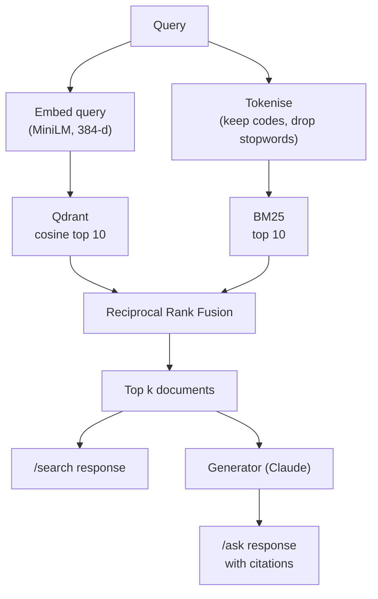

A retriever built on embeddings alone finds "holiday" when the handbook says "annual leave", but it can mix up `ATL-409` and `ATL-403`, because to an embedding model they are nearly the same string. A keyword retriever has the opposite strengths. In this project you build both, fuse them with Reciprocal Rank Fusion (RRF), and then measure, on a labelled set of queries, whether the fusion was worth building.

This is a complete implementation. Every file below was run as shown; the numbers in the tables are from that run.

## Overview

You will build the retrieval side of **AskMeridian**, the internal assistant of the fictional company Meridian, over 38 short documents: HR policies, finance rules, IT runbooks and the error catalogue of Meridian's product API, Atlas.

The system has two indexes over the same documents. A **dense** index stores one embedding per document in Qdrant and ranks by cosine similarity. A **sparse** index ranks by BM25, which scores documents by the query words they contain. A fusion step merges the two ranked lists into one. A small evaluation harness runs 28 labelled queries through dense-only, sparse-only and hybrid retrieval and reports recall@1, recall@3 and MRR for each. A FastAPI service exposes the retriever, and an `/ask` endpoint passes the top results to Claude for a cited answer.

Everything except the final Claude call runs without an API key.

## Learning objectives

- Store and query embeddings in Qdrant with the current `query_points` API, in memory, on disk or against a server.
- Build a BM25 index with a tokeniser that keeps identifiers such as `VPN-4012` intact.
- Implement Reciprocal Rank Fusion by hand and test it against the formula.
- Measure three retrievers on the same labelled queries and read the result by query type.
- Serve the retriever with FastAPI while keeping the language model behind one replaceable class.

## Requirements

- Python 3.10 or later.
- About 500 MB of disk for PyTorch and the 90 MB embedding model, which downloads on first use.
- No GPU. No Docker, unless you want the Qdrant server option.
- An Anthropic API key only for the `/ask` endpoint.
- Background: [Dense vector search](/learn/dense-retrieval/dense-vector-search), [BM25](/learn/sparse-retrieval/bm25), [Reciprocal Rank Fusion](/learn/hybrid-search/reciprocal-rank-fusion), [Recall@K](/learn/retrieval-evaluation/recall-k) and [MRR](/learn/retrieval-evaluation/mrr).

## Technology stack

| Piece | Choice | Why |
| --- | --- | --- |
| Vector store | Qdrant (`qdrant-client`) | The same client code runs in memory, from a local folder, or against a server |
| Keyword ranking | `rank-bm25` | A small, readable BM25 implementation; enough for thousands of documents |
| Embeddings | `sentence-transformers/all-MiniLM-L6-v2` | 384 dimensions, runs on a laptop CPU |
| Fusion | Reciprocal Rank Fusion, hand-written | Twelve lines; needs no score normalisation |
| API | FastAPI | Request validation and a test client for free |
| Generation | Claude through the Anthropic SDK | Only used by `/ask` |

## System architecture



Both indexes are built from the same list of documents when the service starts. At query time the two searches are independent, so each returns its own top 10; fusion looks only at the *positions* of documents in those lists, never at the raw scores. That matters because a cosine similarity (between -1 and 1) and a BM25 score (unbounded) are not on a common scale.

## Folder structure

```text
hybrid-search-rag/
├── requirements.txt
├── evaluate.py
├── data/
│   ├── corpus.jsonl
│   └── eval.jsonl
├── app/
│   ├── __init__.py
│   ├── corpus.py
│   ├── embedder.py
│   ├── dense.py
│   ├── sparse.py
│   ├── fusion.py
│   ├── retriever.py
│   ├── metrics.py
│   ├── generate.py
│   └── api.py
└── tests/
    ├── __init__.py
    ├── conftest.py
    ├── test_fusion.py
    ├── test_sparse_and_metrics.py
    └── test_retriever_and_api.py
```

`app/__init__.py` and `tests/__init__.py` are empty files.

## Setup

```bash
mkdir hybrid-search-rag && cd hybrid-search-rag
python -m venv .venv && source .venv/bin/activate
mkdir app data tests && touch app/__init__.py tests/__init__.py
```

Create `requirements.txt`:

```text
qdrant-client>=1.12
rank-bm25>=0.2.2
sentence-transformers>=3.0
fastapi>=0.115
uvicorn>=0.30
anthropic>=0.80
httpx>=0.27
pytest>=8.0
```

```bash
pip install -r requirements.txt
```

By default the project uses Qdrant's local mode, which runs inside your Python process and needs no server. Two environment variables change that:

- `QDRANT_PATH=./qdrant_data` keeps the index in a local folder between runs.
- `QDRANT_URL=http://localhost:6333` uses a real server. Start one with Docker:

```bash
docker run -p 6333:6333 -v "$(pwd)/qdrant_storage:/qdrant/storage" qdrant/qdrant
```

The run recorded here used the in-memory mode; the Docker command is Qdrant's documented quick start and was not executed for this tutorial.

## Implementation

### data/corpus.jsonl

One JSON object per line. Note the Atlas error catalogue at the end: several documents that differ mainly by a code. That is what real runbooks look like, and it is where dense retrieval struggles.

```json
{"id": "hr-001", "title": "Annual leave", "text": "Full-time staff receive 25 days of annual leave each year, in addition to public holidays."}
{"id": "hr-002", "title": "Leave carry-over", "text": "Up to 5 unused days of annual leave carry over into the next year and must be used by 31 March."}
{"id": "hr-003", "title": "Remote work", "text": "Staff may work remotely up to 3 days a week, on days agreed with their line manager."}
{"id": "hr-004", "title": "Home-office equipment", "text": "Meridian provides a home-office equipment budget of £400 for a desk, chair or monitor. Claim it with form HO-2."}
{"id": "hr-005", "title": "Sickness absence", "text": "If you are unwell, tell your line manager before 09:30 and record the absence in PeopleHub. A fit note is needed after 7 calendar days."}
{"id": "hr-006", "title": "Parental leave", "text": "New parents receive 26 weeks of parental leave on full pay. Give People Operations 8 weeks' notice of the start date."}
{"id": "fin-001", "title": "Expense deadline", "text": "Expenses must be submitted within 30 days of the purchase, using form EXP-7 in the finance portal."}
{"id": "fin-002", "title": "Receipts", "text": "Any expense over £75 needs a receipt attached. Claims without one are returned to the claimant."}
{"id": "fin-003", "title": "Business travel", "text": "Book rail and flights through the TravelDesk portal. Standard class applies to journeys under 4 hours."}
{"id": "fin-004", "title": "Corporate cards", "text": "A lost corporate card must be reported to Finance within 24 hours so that it can be cancelled."}
{"id": "it-001", "title": "Password policy", "text": "Passwords must be rotated every 90 days and be at least 14 characters long."}
{"id": "it-002", "title": "VPN on public Wi-Fi", "text": "The VPN is required whenever you connect from public Wi-Fi, such as in a café, hotel or airport."}
{"id": "it-003", "title": "Expired VPN certificate", "text": "Error VPN-4012 means your device certificate has expired. Open Self Service, run Renew Certificate, then reconnect."}
{"id": "it-004", "title": "Laptop refresh", "text": "Laptops are replaced on a 3-year refresh cycle. The standard model is the ThinkPad T14."}
{"id": "it-005", "title": "Support desk hours", "text": "The IT support desk is open 08:00 to 18:00 UK time, Monday to Friday. Raise a ticket at help.meridian.example."}
{"id": "it-006", "title": "Multi-factor authentication", "text": "Multi-factor authentication is mandatory. If you lose your phone, the support desk can issue a bypass code valid for 24 hours."}
{"id": "it-007", "title": "Laptop not checking in", "text": "Error MDM-207 appears when a laptop has not checked in with device management for 30 days. Connect to the VPN and restart."}
{"id": "it-008", "title": "Software requests", "text": "Software that is not listed in Self Service needs approval through an SR-12 request before it can be installed."}
{"id": "it-009", "title": "Office Wi-Fi", "text": "Staff connect to the Meridian-Staff wireless network. Guests use Meridian-Guest with a daily code from reception."}
{"id": "prod-001", "title": "Atlas API rate limits", "text": "The Atlas API allows 600 requests per minute for each API key. Going over the limit returns HTTP 429."}
{"id": "prod-002", "title": "Atlas webhooks", "text": "Webhooks are retried up to 5 times with exponential backoff and are signed with the X-Atlas-Signature header."}
{"id": "prod-003", "title": "Atlas data exports", "text": "Data exports are produced as CSV or Parquet files and are retained for 14 days before deletion."}
{"id": "prod-004", "title": "Atlas single sign-on", "text": "Single sign-on supports SAML 2.0 and OIDC. Configure it under Settings, then Security."}
{"id": "prod-005", "title": "Atlas ingestion queue full", "text": "Error ATL-503 indicates that the ingestion queue is full. Retry the request after 60 seconds."}
{"id": "it-010", "title": "VPN password rejected", "text": "Error VPN-4021 means the VPN gateway rejected your password. Reset it in Self Service and wait 5 minutes."}
{"id": "it-011", "title": "Outdated VPN client", "text": "Error VPN-4102 means the VPN client is out of date. Install the latest client from Self Service."}
{"id": "it-012", "title": "Disk encryption disabled", "text": "Error MDM-270 means disk encryption is switched off. Turn on FileVault or BitLocker and restart."}
{"id": "it-013", "title": "Administrator rights", "text": "Temporary administrator rights are granted through an SR-21 request and expire after 7 days."}
{"id": "fin-005", "title": "Mileage", "text": "Mileage in a private car is claimed at 45p per mile, using form EXP-9 in the finance portal."}
{"id": "hr-007", "title": "Returning equipment", "text": "When you leave Meridian, return home-office equipment by completing form HO-5 and booking a courier collection."}
{"id": "prod-006", "title": "Atlas expired API key", "text": "Error ATL-530 indicates an expired API key. Create a new key under Settings, then API keys."}
{"id": "prod-007", "title": "Atlas schema mismatch", "text": "Error ATL-305 indicates a schema mismatch in the uploaded file. Check the column names against the template."}
{"id": "prod-008", "title": "Atlas request too large", "text": "Error ATL-413 indicates that the request body is larger than 10 MB. Split the upload into smaller batches."}
{"id": "prod-009", "title": "Atlas unknown workspace", "text": "Error ATL-404 indicates that the workspace id in the URL does not exist or has been archived."}
{"id": "prod-010", "title": "Atlas permission denied", "text": "Error ATL-403 indicates that the API key lacks the scope the endpoint requires. Add the scope under Settings, then API keys."}
{"id": "prod-011", "title": "Atlas duplicate record", "text": "Error ATL-409 indicates that a record with the same external id already exists. Use the upsert endpoint instead."}
{"id": "prod-012", "title": "Atlas maintenance window", "text": "Error ATL-520 indicates planned maintenance. The API is read-only on Sundays from 02:00 to 03:00 UK time."}
{"id": "prod-013", "title": "Atlas export failed", "text": "Error ATL-350 indicates that an export failed because the destination bucket refused the write. Check the bucket policy."}
```

### data/eval.jsonl

The labelled evaluation set: each query lists the ids of the documents that answer it. Sixteen queries contain an identifier (`keyword`); twelve are reworded so that they share few words with the answer (`paraphrase`). Labelling the kind lets you see *where* each retriever fails, not just how often.

```json
{"query": "What does VPN-4012 mean?", "relevant": ["it-003"], "kind": "keyword"}
{"query": "MDM-207", "relevant": ["it-007"], "kind": "keyword"}
{"query": "ATL-503 when sending data", "relevant": ["prod-005"], "kind": "keyword"}
{"query": "Where do I find EXP-7?", "relevant": ["fin-001"], "kind": "keyword"}
{"query": "How do I raise an SR-12?", "relevant": ["it-008"], "kind": "keyword"}
{"query": "HO-2", "relevant": ["hr-004"], "kind": "keyword"}
{"query": "verify X-Atlas-Signature", "relevant": ["prod-002"], "kind": "keyword"}
{"query": "Is the T14 the standard machine?", "relevant": ["it-004"], "kind": "keyword"}
{"query": "VPN-4021", "relevant": ["it-010"], "kind": "keyword"}
{"query": "How do I fix ATL-530?", "relevant": ["prod-006"], "kind": "keyword"}
{"query": "EXP-9", "relevant": ["fin-005"], "kind": "keyword"}
{"query": "What is MDM-270?", "relevant": ["it-012"], "kind": "keyword"}
{"query": "How much holiday do I get?", "relevant": ["hr-001"], "kind": "paraphrase"}
{"query": "Can I roll over vacation I did not take?", "relevant": ["hr-002"], "kind": "paraphrase"}
{"query": "Am I allowed to do my job from my house?", "relevant": ["hr-003"], "kind": "paraphrase"}
{"query": "I am ill today, who should I inform?", "relevant": ["hr-005"], "kind": "paraphrase"}
{"query": "How often do I have to change my login credentials?", "relevant": ["it-001"], "kind": "paraphrase"}
{"query": "Is it safe to get online in a coffee shop?", "relevant": ["it-002"], "kind": "paraphrase"}
{"query": "When will my computer be swapped for a new one?", "relevant": ["it-004"], "kind": "paraphrase"}
{"query": "What time does the helpdesk close?", "relevant": ["it-005"], "kind": "paraphrase"}
{"query": "My mobile was stolen and I cannot sign in", "relevant": ["it-006"], "kind": "paraphrase"}
{"query": "How many calls can my integration make before it is throttled?", "relevant": ["prod-001"], "kind": "paraphrase"}
{"query": "How long are downloaded files kept?", "relevant": ["prod-003"], "kind": "paraphrase"}
{"query": "What is the deadline for claiming money back and do I need proof of purchase?", "relevant": ["fin-001", "fin-002"], "kind": "paraphrase"}
{"query": "ATL-409", "relevant": ["prod-011"], "kind": "keyword"}
{"query": "ATL-403 from the API", "relevant": ["prod-010"], "kind": "keyword"}
{"query": "ATL-520", "relevant": ["prod-012"], "kind": "keyword"}
{"query": "Why am I getting ATL-350?", "relevant": ["prod-013"], "kind": "keyword"}
```

### app/corpus.py

```python
"""Load the document collection from a JSON Lines file."""
import json
from dataclasses import dataclass
from pathlib import Path


@dataclass(frozen=True)
class Doc:
    id: str
    title: str
    text: str

    @property
    def searchable(self) -> str:
        """The string both retrievers index: title and body together."""
        return f"{self.title}. {self.text}"


def load_corpus(path: str | Path) -> list[Doc]:
    docs = []
    for line in Path(path).read_text(encoding="utf-8").splitlines():
        if line.strip():
            docs.append(Doc(**json.loads(line)))
    ids = [d.id for d in docs]
    if len(ids) != len(set(ids)):
        raise ValueError("duplicate document ids in corpus")
    return docs
```

`searchable` joins title and body, so both retrievers index identical text and the comparison is fair. The duplicate-id check fails fast: ids are the keys used by fusion, so two documents sharing one would silently merge.

### app/embedder.py

```python
"""Embedding models behind one small interface, so tests can swap in a fake."""
from typing import Protocol

import numpy as np


class Embedder(Protocol):
    dim: int

    def encode(self, texts: list[str]) -> np.ndarray:
        """Return one L2-normalised row per text, shape (len(texts), dim)."""
        ...


class MiniLMEmbedder:
    """sentence-transformers/all-MiniLM-L6-v2: 384 dimensions, runs on a CPU."""

    dim = 384

    def __init__(self, name: str = "sentence-transformers/all-MiniLM-L6-v2"):
        from sentence_transformers import SentenceTransformer  # slow import, so do it lazily

        self._model = SentenceTransformer(name)

    def encode(self, texts: list[str]) -> np.ndarray:
        return self._model.encode(texts, normalize_embeddings=True)
```

`Embedder` is a `Protocol`: any object with a `dim` and an `encode` method fits. The tests pass a fake that needs no download. `normalize_embeddings=True` scales every vector to length 1, the convention for cosine search.

### app/dense.py

```python
"""Dense retrieval: embed documents, store them in Qdrant, search by cosine similarity."""
import os

from qdrant_client import QdrantClient
from qdrant_client.models import Distance, PointStruct, VectorParams

from app.corpus import Doc
from app.embedder import Embedder


def make_client() -> QdrantClient:
    """Server if QDRANT_URL is set, a local folder if QDRANT_PATH is set, else in memory."""
    if url := os.environ.get("QDRANT_URL"):
        return QdrantClient(url=url, api_key=os.environ.get("QDRANT_API_KEY"))
    if path := os.environ.get("QDRANT_PATH"):
        return QdrantClient(path=path)
    return QdrantClient(":memory:")


class DenseIndex:
    def __init__(self, client: QdrantClient, embedder: Embedder, collection: str = "meridian"):
        self.client = client
        self.embedder = embedder
        self.collection = collection

    def build(self, docs: list[Doc]) -> None:
        if self.client.collection_exists(self.collection):
            self.client.delete_collection(self.collection)
        self.client.create_collection(
            self.collection,
            vectors_config=VectorParams(size=self.embedder.dim, distance=Distance.COSINE),
        )
        vectors = self.embedder.encode([d.searchable for d in docs])
        points = [
            PointStruct(id=i, vector=vec.tolist(), payload={"doc_id": d.id})
            for i, (d, vec) in enumerate(zip(docs, vectors))
        ]
        self.client.upsert(self.collection, points=points)

    def search(self, query: str, k: int = 10) -> list[tuple[str, float]]:
        """Return up to k (doc_id, cosine similarity) pairs, best first."""
        vector = self.embedder.encode([query])[0].tolist()
        result = self.client.query_points(
            self.collection, query=vector, limit=k, with_payload=True
        )
        return [(p.payload["doc_id"], p.score) for p in result.points]
```

- `make_client` is the only place that knows where Qdrant lives. `QdrantClient(":memory:")` and `QdrantClient(path=...)` run the engine in-process; `QdrantClient(url=...)` talks to a server. The rest of the code is identical for all three.
- `create_collection` fixes the vector size and distance. `Distance.COSINE` must match how you intend to compare vectors; changing it later means rebuilding the collection.
- Qdrant point ids must be unsigned integers or UUIDs, so the position `i` is the point id and the real document id travels in the **payload**, the JSON stored beside each vector.
- `query_points` is the current search method (the older `search` method has been removed from recent clients). It returns an object whose `.points` each carry `.score` and `.payload`.

### app/sparse.py

```python
"""Sparse retrieval: BM25 over a simple word tokeniser."""
import re

from rank_bm25 import BM25Okapi

from app.corpus import Doc

TOKEN = re.compile(r"[a-z0-9]+(?:-[a-z0-9]+)*")
STOPWORDS = frozenset(
    "a am an and are as at be been before by can do does for from get have how i if in "
    "is it me my not of on or should than that the then this to was what when where "
    "which who will with you your".split()
)


def tokenise(text: str, stopwords: frozenset[str] = STOPWORDS) -> list[str]:
    """Lower-case words minus stopwords; codes such as vpn-4012 stay as one token."""
    return [t for t in TOKEN.findall(text.lower()) if t not in stopwords]


class SparseIndex:
    def __init__(self) -> None:
        self._ids: list[str] = []
        self._bm25: BM25Okapi | None = None

    def build(self, docs: list[Doc]) -> None:
        self._ids = [d.id for d in docs]
        self._bm25 = BM25Okapi([tokenise(d.searchable) for d in docs])

    def search(self, query: str, k: int = 10) -> list[tuple[str, float]]:
        """Return up to k (doc_id, BM25 score) pairs, best first. Zero scores are dropped."""
        if self._bm25 is None:
            raise RuntimeError("call build() before search()")
        scores = self._bm25.get_scores(tokenise(query))
        order = sorted(range(len(scores)), key=lambda i: scores[i], reverse=True)
        return [(self._ids[i], float(scores[i])) for i in order[:k] if scores[i] > 0]
```

- The `TOKEN` pattern treats `vpn-4012` and `x-atlas-signature` as single tokens. A tokeniser that splits on hyphens turns `ATL-409` into `atl` and `409`, and `atl` occurs in every Atlas error document.
- Stopword removal is not cosmetic here. Without it, a question such as "How much holiday do I get?" matches documents on "do" and "I", and those junk matches then enter the fusion. The effect is measured under [Common problems](#common-problems).
- Documents scoring zero are dropped. BM25 has an opinion only about documents that share a term with the query; returning the rest in arbitrary order would feed noise into RRF.

### app/fusion.py

```python
"""Reciprocal Rank Fusion, written out by hand."""


def reciprocal_rank_fusion(rankings: list[list[str]], k: int = 60) -> list[tuple[str, float]]:
    """Merge ranked lists of ids into one list of (id, fused score), best first.

    Each list contributes 1 / (k + rank) for every id it contains, with rank
    starting at 1. Ids missing from a list simply get nothing from that list.
    """
    scores: dict[str, float] = {}
    for ranking in rankings:
        for rank, doc_id in enumerate(ranking, start=1):
            scores[doc_id] = scores.get(doc_id, 0.0) + 1.0 / (k + rank)
    # Sort by score, then by id so that ties always come out in the same order.
    return sorted(scores.items(), key=lambda item: (-item[1], item[0]))
```

For each document $d$, RRF sums $1 / (k + \text{rank}_i(d))$ over every list $i$ that contains it. With $k = 60$, first place in one list is worth $1/61 \approx 0.0164$, and tenth place $1/70 \approx 0.0143$: the curve is deliberately flat, so a document that both retrievers rank moderately well beats one that a single retriever ranks first. The constant 60 comes from the original paper and is rarely worth tuning before anything else. The secondary sort on id makes equal scores come out in the same order on every run, which keeps tests and evaluations reproducible.

Try the mechanism interactively:

```playground
rrf
```

### app/retriever.py

```python
"""One search() that can run dense-only, sparse-only or hybrid retrieval."""
from dataclasses import dataclass
from typing import Literal

from app.corpus import Doc
from app.dense import DenseIndex
from app.fusion import reciprocal_rank_fusion
from app.sparse import SparseIndex

Mode = Literal["dense", "sparse", "hybrid"]


@dataclass(frozen=True)
class Hit:
    doc: Doc
    score: float
    dense_rank: int | None
    sparse_rank: int | None


class HybridRetriever:
    def __init__(self, docs: list[Doc], dense: DenseIndex, sparse: SparseIndex,
                 candidates: int = 10, rrf_k: int = 60):
        self.docs = {d.id: d for d in docs}
        self.dense = dense
        self.sparse = sparse
        self.candidates = candidates
        self.rrf_k = rrf_k
        dense.build(docs)
        sparse.build(docs)

    def search(self, query: str, k: int = 3, mode: Mode = "hybrid") -> list[Hit]:
        dense = self.dense.search(query, self.candidates) if mode != "sparse" else []
        sparse = self.sparse.search(query, self.candidates) if mode != "dense" else []
        dense_ids = [doc_id for doc_id, _ in dense]
        sparse_ids = [doc_id for doc_id, _ in sparse]
        if mode == "dense":
            ranked = dense
        elif mode == "sparse":
            ranked = sparse
        else:
            ranked = reciprocal_rank_fusion([dense_ids, sparse_ids], k=self.rrf_k)
        return [
            Hit(
                doc=self.docs[doc_id],
                score=score,
                dense_rank=dense_ids.index(doc_id) + 1 if doc_id in dense_ids else None,
                sparse_rank=sparse_ids.index(doc_id) + 1 if doc_id in sparse_ids else None,
            )
            for doc_id, score in ranked[:k]
        ]
```

Each retriever fetches `candidates` results (10), more than the `k` you finally return, because a document ranked sixth by both lists can still finish in the fused top three. `Hit` records the rank each retriever gave the document; exposing that in the API makes every result explainable.

### app/metrics.py

```python
"""Retrieval metrics for one query. Average them over the evaluation set."""


def recall_at_k(retrieved: list[str], relevant: set[str], k: int) -> float:
    """Fraction of the relevant documents that appear in the top k."""
    if not relevant:
        raise ValueError("a query needs at least one relevant document")
    return len(set(retrieved[:k]) & relevant) / len(relevant)


def reciprocal_rank(retrieved: list[str], relevant: set[str]) -> float:
    """1 / rank of the first relevant document, or 0 if none was retrieved."""
    for rank, doc_id in enumerate(retrieved, start=1):
        if doc_id in relevant:
            return 1.0 / rank
    return 0.0
```

Recall@k asks "of the documents that answer this query, what fraction reached the top k?". Reciprocal rank rewards putting the first correct document high: 1 for first place, 0.5 for second. Its average over queries is MRR.

### app/generate.py

```python
"""The only module that talks to a language model."""
from typing import Protocol

from app.retriever import Hit

SYSTEM = (
    "You are AskMeridian, Meridian's internal assistant. Answer only from the "
    "numbered sources. Cite the source id in square brackets after each fact, "
    "like [it-003]. If the sources do not contain the answer, say you don't know."
)


def build_prompt(question: str, hits: list[Hit]) -> str:
    sources = "\n".join(f"[{h.doc.id}] {h.doc.title}: {h.doc.text}" for h in hits)
    return f"Sources:\n{sources}\n\nQuestion: {question}"


class Generator(Protocol):
    def generate(self, question: str, hits: list[Hit]) -> str: ...


class ClaudeGenerator:
    def __init__(self, model: str = "claude-opus-5-5"):
        self.model = model
        self._client = None

    def generate(self, question: str, hits: list[Hit]) -> str:
        if self._client is None:  # created on first use, so /search works without a key
            import anthropic

            self._client = anthropic.Anthropic()  # reads ANTHROPIC_API_KEY from the environment
        response = self._client.messages.create(
            model=self.model,
            max_tokens=1024,
            system=SYSTEM,
            messages=[{"role": "user", "content": build_prompt(question, hits)}],
        )
        return "".join(block.text for block in response.content if block.type == "text")
```

This is the only file that imports `anthropic`. `Generator` is the seam: the API depends on the protocol, the tests supply a fake, and production supplies `ClaudeGenerator`. The client is created on first use so the service starts, and `/search` works, with no key set.

### app/api.py

```python
"""FastAPI service: /search returns ranked documents, /ask adds a generated answer."""
from pathlib import Path

from fastapi import FastAPI
from pydantic import BaseModel, Field

from app.corpus import load_corpus
from app.dense import DenseIndex, make_client
from app.embedder import MiniLMEmbedder
from app.generate import ClaudeGenerator, Generator
from app.retriever import HybridRetriever, Hit, Mode
from app.sparse import SparseIndex

CORPUS = Path(__file__).resolve().parent.parent / "data" / "corpus.jsonl"


class Query(BaseModel):
    query: str = Field(min_length=1, max_length=500)
    k: int = Field(default=3, ge=1, le=10)
    mode: Mode = "hybrid"


class HitOut(BaseModel):
    id: str
    title: str
    text: str
    score: float
    dense_rank: int | None
    sparse_rank: int | None


class SearchResponse(BaseModel):
    mode: Mode
    hits: list[HitOut]


class AskResponse(SearchResponse):
    answer: str


def _out(hits: list[Hit]) -> list[HitOut]:
    return [
        HitOut(id=h.doc.id, title=h.doc.title, text=h.doc.text, score=round(h.score, 4),
               dense_rank=h.dense_rank, sparse_rank=h.sparse_rank)
        for h in hits
    ]


def create_app(retriever: HybridRetriever, generator: Generator) -> FastAPI:
    app = FastAPI(title="AskMeridian hybrid search")

    @app.get("/health")
    def health() -> dict:
        return {"status": "ok", "documents": len(retriever.docs)}

    @app.post("/search", response_model=SearchResponse)
    def search(body: Query) -> SearchResponse:
        hits = retriever.search(body.query, body.k, body.mode)
        return SearchResponse(mode=body.mode, hits=_out(hits))

    @app.post("/ask", response_model=AskResponse)
    def ask(body: Query) -> AskResponse:
        hits = retriever.search(body.query, body.k, body.mode)
        if not hits:
            return AskResponse(mode=body.mode, hits=[], answer="I don't know.")
        return AskResponse(mode=body.mode, hits=_out(hits),
                           answer=generator.generate(body.query, hits))

    return app


def build_default_app() -> FastAPI:
    """Factory for uvicorn: real embedder, real Qdrant client, real Claude."""
    docs = load_corpus(CORPUS)
    retriever = HybridRetriever(docs, DenseIndex(make_client(), MiniLMEmbedder()), SparseIndex())
    return create_app(retriever, ClaudeGenerator())
```

- `Query` validates input before any model runs: an empty query, `k` above 10 or an unknown mode is rejected with HTTP 422.
- `create_app` takes its dependencies as arguments, which is what makes the service testable. `build_default_app` wires the real ones and is what uvicorn calls.
- `/ask` skips the generator when retrieval returns nothing. That can happen in sparse mode; refusing in code is cheaper and more reliable than asking a model to refuse.

### evaluate.py

```python
"""Compare dense-only, sparse-only and hybrid retrieval on the labelled queries."""
import json
from pathlib import Path

from app.corpus import load_corpus
from app.dense import DenseIndex, make_client
from app.embedder import MiniLMEmbedder
from app.metrics import recall_at_k, reciprocal_rank
from app.retriever import HybridRetriever
from app.sparse import SparseIndex

ROOT = Path(__file__).resolve().parent
MODES = ("dense", "sparse", "hybrid")


def load_eval(path: Path) -> list[dict]:
    return [json.loads(line) for line in path.read_text(encoding="utf-8").splitlines() if line.strip()]


def evaluate(retriever: HybridRetriever, queries: list[dict], mode: str) -> dict[str, float]:
    r1 = r3 = mrr = 0.0
    for q in queries:
        retrieved = [h.doc.id for h in retriever.search(q["query"], k=10, mode=mode)]
        relevant = set(q["relevant"])
        r1 += recall_at_k(retrieved, relevant, 1)
        r3 += recall_at_k(retrieved, relevant, 3)
        mrr += reciprocal_rank(retrieved, relevant)
    n = len(queries)
    return {"recall@1": r1 / n, "recall@3": r3 / n, "mrr": mrr / n}


def main() -> None:
    docs = load_corpus(ROOT / "data" / "corpus.jsonl")
    queries = load_eval(ROOT / "data" / "eval.jsonl")
    retriever = HybridRetriever(docs, DenseIndex(make_client(), MiniLMEmbedder()), SparseIndex())

    groups = {"all": queries}
    for kind in ("keyword", "paraphrase"):
        groups[kind] = [q for q in queries if q["kind"] == kind]

    for name, group in groups.items():
        print(f"\n{name} queries (n={len(group)})")
        print(f"{'mode':<8}{'recall@1':>10}{'recall@3':>10}{'MRR':>8}")
        for mode in MODES:
            m = evaluate(retriever, group, mode)
            print(f"{mode:<8}{m['recall@1']:>10.3f}{m['recall@3']:>10.3f}{m['mrr']:>8.3f}")


if __name__ == "__main__":
    main()
```

The harness retrieves 10 results per query so that MRR can see ranks beyond 3, then averages each metric over all queries and over each kind.

### tests/conftest.py

```python
"""Shared fixtures: a tiny corpus, a fake embedder and a fake generator."""
import zlib

import numpy as np
import pytest
from qdrant_client import QdrantClient

from app.corpus import Doc
from app.dense import DenseIndex
from app.retriever import HybridRetriever
from app.sparse import SparseIndex, tokenise

DOCS = [
    Doc("hr-001", "Annual leave", "Full-time staff receive 25 days of annual leave each year."),
    Doc("it-002", "VPN on public Wi-Fi", "The VPN is required whenever you connect from public Wi-Fi."),
    Doc("it-003", "Expired VPN certificate", "Error VPN-4012 means your device certificate has expired."),
    Doc("fin-002", "Receipts", "Any expense over £75 needs a receipt attached."),
]


class FakeEmbedder:
    """Hashes each token into one of 64 buckets. Deterministic, no model download."""

    dim = 64

    def encode(self, texts: list[str]) -> np.ndarray:
        out = np.zeros((len(texts), self.dim), dtype=np.float32)
        for row, text in enumerate(texts):
            for token in tokenise(text):
                out[row, zlib.crc32(token.encode()) % self.dim] += 1.0
        norms = np.linalg.norm(out, axis=1, keepdims=True)
        return out / np.where(norms == 0, 1.0, norms)


class FakeGenerator:
    def __init__(self) -> None:
        self.calls = 0

    def generate(self, question, hits) -> str:
        self.calls += 1
        return f"Fake answer citing [{hits[0].doc.id}]"


@pytest.fixture
def retriever() -> HybridRetriever:
    dense = DenseIndex(QdrantClient(":memory:"), FakeEmbedder())
    return HybridRetriever(DOCS, dense, SparseIndex())


@pytest.fixture
def generator() -> FakeGenerator:
    return FakeGenerator()
```

`FakeEmbedder` hashes each token into one of 64 buckets and normalises. It has no notion of meaning, but texts that share words get similar vectors, which is enough to exercise the real Qdrant code path in milliseconds. `zlib.crc32` is used instead of Python's `hash` because `hash` of a string changes between processes.

### tests/test_fusion.py

```python
import pytest

from app.fusion import reciprocal_rank_fusion


def test_scores_match_the_formula():
    fused = dict(reciprocal_rank_fusion([["a", "b"], ["b", "c"]], k=60))
    assert fused["a"] == pytest.approx(1 / 61)
    assert fused["b"] == pytest.approx(1 / 62 + 1 / 61)
    assert fused["c"] == pytest.approx(1 / 62)


def test_agreement_beats_a_single_first_place():
    # "b" is second in both lists; "a" and "c" are each first in only one.
    fused = reciprocal_rank_fusion([["a", "b"], ["c", "b"]])
    assert fused[0][0] == "b"


def test_ties_are_broken_by_id():
    fused = reciprocal_rank_fusion([["z"], ["a"]])
    assert [doc_id for doc_id, _ in fused] == ["a", "z"]


def test_empty_and_one_sided_input():
    assert reciprocal_rank_fusion([]) == []
    assert reciprocal_rank_fusion([[], ["a", "b"]])[0][0] == "a"
```

### tests/test_sparse_and_metrics.py

```python
import pytest

from app.metrics import recall_at_k, reciprocal_rank
from app.sparse import SparseIndex, tokenise
from tests.conftest import DOCS


def test_tokeniser_keeps_codes_whole_and_drops_stopwords():
    assert tokenise("What does VPN-4012 mean?") == ["vpn-4012", "mean"]


def test_bm25_finds_an_exact_code():
    index = SparseIndex()
    index.build(DOCS)
    assert index.search("VPN-4012")[0][0] == "it-003"


def test_bm25_returns_nothing_without_a_shared_term():
    index = SparseIndex()
    index.build(DOCS)
    assert index.search("holiday entitlement") == []


def test_search_before_build_is_an_error():
    with pytest.raises(RuntimeError):
        SparseIndex().search("anything")


def test_recall_at_k():
    assert recall_at_k(["a", "b", "c"], {"b", "z"}, 3) == 0.5
    assert recall_at_k(["a", "b", "c"], {"c"}, 2) == 0.0


def test_reciprocal_rank():
    assert reciprocal_rank(["a", "b", "c"], {"c"}) == pytest.approx(1 / 3)
    assert reciprocal_rank(["a"], {"z"}) == 0.0
```

### tests/test_retriever_and_api.py

```python
from fastapi.testclient import TestClient

from app.api import create_app


def test_dense_search_uses_qdrant(retriever):
    hits = retriever.search("annual leave days", k=2, mode="dense")
    assert hits[0].doc.id == "hr-001"
    assert hits[0].sparse_rank is None


def test_hybrid_reports_both_ranks(retriever):
    top = retriever.search("VPN-4012 certificate", k=1, mode="hybrid")[0]
    assert top.doc.id == "it-003"
    assert top.dense_rank == 1 and top.sparse_rank == 1


def test_hybrid_keeps_dense_results_when_bm25_finds_nothing(retriever):
    assert retriever.sparse.search("zzz") == []
    assert len(retriever.search("zzz", k=3, mode="hybrid")) == 3


def test_search_endpoint(retriever, generator):
    client = TestClient(create_app(retriever, generator))
    body = client.post("/search", json={"query": "receipt for an expense", "k": 2}).json()
    assert body["mode"] == "hybrid"
    assert body["hits"][0]["id"] == "fin-002"
    assert generator.calls == 0


def test_ask_endpoint_calls_the_generator_once(retriever, generator):
    client = TestClient(create_app(retriever, generator))
    body = client.post("/ask", json={"query": "What does VPN-4012 mean?"}).json()
    assert body["answer"] == "Fake answer citing [it-003]"
    assert generator.calls == 1


def test_ask_without_hits_does_not_call_the_generator(retriever, generator):
    client = TestClient(create_app(retriever, generator))
    body = client.post("/ask", json={"query": "zzz", "mode": "sparse"}).json()
    assert body == {"mode": "sparse", "hits": [], "answer": "I don't know."}
    assert generator.calls == 0


def test_invalid_requests_are_rejected(retriever, generator):
    client = TestClient(create_app(retriever, generator))
    assert client.post("/search", json={"query": ""}).status_code == 422
    assert client.post("/search", json={"query": "x", "k": 50}).status_code == 422
    assert client.post("/search", json={"query": "x", "mode": "magic"}).status_code == 422
```

The API tests assert on `generator.calls` as well as on the response: `/search` must never reach the model, and `/ask` must reach it exactly once.

## Running it

Run the evaluation first:

```bash
python evaluate.py
```

```output
all queries (n=28)
mode      recall@1  recall@3     MRR
dense        0.875     0.964   0.932
sparse       0.554     0.696   0.643
hybrid       0.946     1.000   0.982

keyword queries (n=16)
mode      recall@1  recall@3     MRR
dense        0.812     0.938   0.880
sparse       0.938     1.000   0.969
hybrid       1.000     1.000   1.000

paraphrase queries (n=12)
mode      recall@1  recall@3     MRR
dense        0.958     1.000   1.000
sparse       0.042     0.292   0.208
hybrid       0.875     1.000   0.958
```

Then start the service and search:

```bash
uvicorn app.api:build_default_app --factory --port 8000
```

```bash
curl -s -X POST localhost:8000/search \
  -H 'content-type: application/json' \
  -d '{"query": "ATL-409", "k": 3}' | python -m json.tool
```

```output
{
    "mode": "hybrid",
    "hits": [
        {
            "id": "prod-011",
            "title": "Atlas duplicate record",
            "text": "Error ATL-409 indicates that a record with the same external id already exists. Use the upsert endpoint instead.",
            "score": 0.0323,
            "dense_rank": 3,
            "sparse_rank": 1
        },
        {
            "id": "prod-012",
            "title": "Atlas maintenance window",
            "text": "Error ATL-520 indicates planned maintenance. The API is read-only on Sundays from 02:00 to 03:00 UK time.",
            "score": 0.0164,
            "dense_rank": 1,
            "sparse_rank": null
        },
        {
            "id": "prod-006",
            "title": "Atlas expired API key",
            "text": "Error ATL-530 indicates an expired API key. Create a new key under Settings, then API keys.",
            "score": 0.0161,
            "dense_rank": 2,
            "sparse_rank": null
        }
    ]
}
```

This one response shows the whole point. Dense search alone ranked the right document third, behind two other Atlas errors. BM25 matched the token `atl-409` in exactly one document. The fused score of the winner is $1/63 + 1/61 = 0.0323$, twice that of anything found by a single retriever.

For a generated answer, set a key and call `/ask`:

```bash
export ANTHROPIC_API_KEY="your-key"
curl -s -X POST localhost:8000/ask \
  -H 'content-type: application/json' \
  -d '{"query": "What does ATL-409 mean?"}'
```

No key was available when this tutorial was written, so the generation step was not run. The response has the same `mode` and `hits` fields plus an `answer`; the wording will vary, but it looks like this (illustrative):

```text
ATL-409 means a record with the same external id already exists [prod-011]. Use the upsert endpoint instead [prod-011].
```

## Testing

```bash
python -m pytest -q
```

```output
.................                                                        [100%]
17 passed in 0.09s
```

The suite runs in a fraction of a second because nothing in it loads a model or opens a network connection: the embedder and the generator are fakes, and Qdrant runs in memory. What is real in the tests is everything you wrote: the tokeniser, BM25 ranking, the RRF arithmetic, the Qdrant calls, the metric functions and the HTTP layer.

`evaluate.py` is the other half of testing. Unit tests tell you the code does what you intended; the evaluation tells you whether what you intended is any good. Re-run it after every change to the tokeniser, the candidate count or the embedding model.

## Expected results

Reading the three tables from the run above:

- **Overall, hybrid wins**: recall@1 of 0.946 against 0.875 for dense and 0.554 for sparse, and it is the only mode with recall@3 of 1.000.
- **On keyword queries, dense is the weak one.** It put the wrong Atlas error first for 3 of 16 queries. BM25 missed first place once (`ATL-503 when sending data`, where the extra words matched another document more strongly). Hybrid got all 16 right: each retriever covered the other's mistake.
- **On paraphrase queries, BM25 is close to useless** (recall@1 of 0.042), as expected when query and document share almost no words. Dense is nearly perfect. Hybrid is slightly *worse* than dense here (0.875 against 0.958 recall@1), because a few spurious keyword matches are fused in.

That last point is the honest cost of fusion: it raises the floor and lowers the ceiling. Whether the trade is right depends on your query mix, which is why you measure with your own queries. These figures come from 28 queries over 38 documents; treat them as a demonstration of the method, not as a benchmark. Your numbers should match these exactly if you use the same model and data, since nothing in the pipeline is random.

## Common problems

- **Hybrid is worse than dense.** Check the sparse tokeniser first. With stopword removal switched off, the same evaluation gave hybrid an overall recall@1 of 0.804 and MRR of 0.884, below dense alone (0.875 and 0.932); on paraphrase queries hybrid recall@1 fell to 0.542. Junk keyword matches are fused with the same weight as good ones.
- **`AttributeError: 'QdrantClient' object has no attribute 'search'`.** You are following an older tutorial. Use `query_points(collection, query=vector, limit=k)` and read `.points`.
- **`RuntimeError: Storage folder ... is already accessed by another instance of Qdrant client`.** Local `path=` mode allows one process at a time. Use the Docker server if several processes need the index.
- **Codes are not found by BM25.** Print `tokenise("ATL-409")`. If it gives two tokens, your pattern splits on the hyphen.
- **`/ask` returns HTTP 500 with "Could not resolve authentication method".** `ANTHROPIC_API_KEY` is not set in the shell that started uvicorn. `/search` and `/health` work without it.
- **The first request is slow.** The embedding model loads when the service starts; the first `encode` call also warms PyTorch. Send one throwaway query at start-up if that matters.
- **An in-memory index is empty after a restart.** That is what in-memory means. Set `QDRANT_PATH` or `QDRANT_URL`; you would then also want `build` to skip re-embedding when the collection already exists.

## Possible improvements

- **Weight the lists.** Multiply each list's contribution by a weight, or skip the sparse list when the query contains no rare term; see [Weighted score fusion](/learn/hybrid-search/weighted-score-fusion) and [Hybrid search optimisation](/learn/hybrid-search/hybrid-search-optimisation).
- **Move sparse retrieval into Qdrant.** Qdrant supports sparse vectors and server-side fusion, which removes the in-process BM25 index and its memory cost. Check the Qdrant documentation for the current hybrid query API before relying on it.
- **Add a reranker** over the fused top 10. The [Reranking-powered RAG](/projects/reranking-powered-rag) project builds that stage and measures it.
- **Chunk longer documents.** These documents are one or two sentences; real ones need splitting first, and both indexes should then be built over chunks.
- **Grow the evaluation set** from real user queries, and add NDCG for queries with several relevant documents; see [Golden datasets](/learn/testing-and-benchmarking/golden-datasets).
- **Persist and update incrementally** instead of rebuilding both indexes at start-up.
