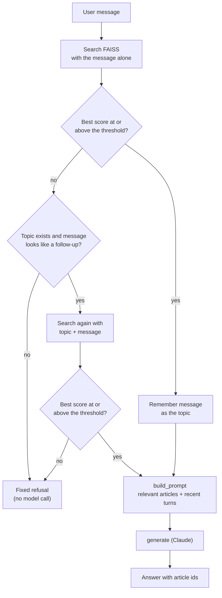

A support chatbot that makes things up is worse than no chatbot. This project builds one that knows the limits of its knowledge: it answers staff questions from a set of FAQ articles held in a FAISS index, and when nothing in the index is relevant enough it says so, without calling the language model at all. It also handles follow-up questions such as "what about on a train?" with a deliberately simple technique, and you will measure exactly where that technique stops working.

## Overview

Vector search always returns something. Ask an index of HR articles for the capital of France and it will still hand back its "nearest" article, however distant. If you pass that to a language model, you are relying on the model alone to notice the mismatch. The fix is a **similarity threshold**: if the best match scores below a chosen value, treat the question as out of scope and return a fixed refusal. The refusal costs nothing, takes milliseconds and cannot hallucinate.

Two questions follow, and the project answers both with measurements rather than guesses:

1. *Where should the threshold be?* You will score a list of questions the knowledge base can answer and a list it cannot, and look at the gap.
2. *What about follow-ups?* "And at home?" means nothing on its own, so it scores below any sensible threshold. The bot retries such messages together with the last question that worked.

## Learning objectives

- Build an exact FAISS index over normalised embeddings and read its scores as cosine similarities.
- Choose a refusal threshold from measured scores for in-scope and out-of-scope questions.
- Refuse before generation, and pass only above-threshold articles to the model.
- Handle follow-up questions by searching with conversational context, and explain why doing that carelessly defeats the threshold.
- Test conversational behaviour with a fake generator that records its prompts.

## Requirements

- Python 3.10 or newer.
- An Anthropic API key in `ANTHROPIC_API_KEY` for real answers. Calibration, tests and `--dry-run` chat need none.
- Helpful background: [FAISS](/learn/vector-database-ecosystem/faiss), [Retrieval thresholding](/learn/advanced-retrieval-optimisation/retrieval-thresholding), [Refusal behaviour](/learn/prompt-engineering-for-rag/refusal-behaviour) and [Multi-turn RAG](/learn/generation-strategies/multi-turn-rag).

## Technology stack

| Piece | Tool | Why |
| --- | --- | --- |
| Vector index | FAISS, `IndexFlatIP` | Exact inner-product search; scales to far more articles than this needs |
| Embeddings | Sentence Transformers, `all-MiniLM-L6-v2` | Local, 384 dimensions, unit-length output |
| Generation | Claude through the Anthropic SDK | Words the answer from the retrieved articles |
| Tests | pytest | Fake embedder and fake generator; no key, no download |

## System architecture



## Folder structure

```text
knowledge-base-chatbot/
├── requirements.txt
├── pytest.ini
├── calibrate.py            measures scores to choose the threshold
├── data/
│   └── faqs.json
├── kbchat/
│   ├── __init__.py         empty file
│   ├── kb.py               articles and the FAISS index
│   ├── bot.py              threshold, follow-ups, prompt, model call
│   └── cli.py
└── tests/
    ├── conftest.py
    ├── test_kb.py
    └── test_bot.py
```

## Setup

```bash
mkdir -p knowledge-base-chatbot/kbchat knowledge-base-chatbot/tests knowledge-base-chatbot/data
cd knowledge-base-chatbot
touch kbchat/__init__.py
python -m venv .venv
source .venv/bin/activate        # Windows: .venv\Scripts\activate
```

`requirements.txt` (the package is `faiss-cpu`; the module you import is `faiss`):

```text
faiss-cpu
numpy
sentence-transformers
anthropic
pytest
```

`pytest.ini`:

```text
[pytest]
pythonpath = .
testpaths = tests
```

```bash
pip install -r requirements.txt
export ANTHROPIC_API_KEY="your-key-here"   # only needed for real answers
```

The knowledge base is nine FAQ articles from Meridian, the fictional company used throughout the course. Save it as `data/faqs.json`:

```json
[
  {"id": "annual-leave", "title": "How much annual leave do I get?",
   "body": "You get 25 days of annual leave a year, plus public holidays. Book leave in the HR portal; your manager approves it."},
  {"id": "leave-carry-over", "title": "Can I carry over unused leave?",
   "body": "Up to 5 unused days carry over into the next year. Carried-over days must be used by 31 March."},
  {"id": "remote-work", "title": "How many days can I work from home?",
   "body": "You can work remotely up to 3 days a week, agreed with your manager."},
  {"id": "home-office-budget", "title": "Is there a budget for home-office equipment?",
   "body": "Yes. The home-office equipment budget is £400, for items such as a desk, chair or monitor."},
  {"id": "expenses", "title": "How do I claim expenses?",
   "body": "Submit expenses in the finance system within 30 days. Anything over £75 needs a receipt."},
  {"id": "password-rotation", "title": "How often must I change my password?",
   "body": "Passwords must be rotated every 90 days. You will get a reminder email a week before yours expires."},
  {"id": "vpn", "title": "When do I need the VPN?",
   "body": "The VPN is required on public Wi-Fi, for example in cafes, hotels and trains. It is optional on your home network."},
  {"id": "laptop-refresh", "title": "When will my laptop be replaced?",
   "body": "Laptops are replaced on a 3 year refresh cycle. IT will contact you when yours is due."},
  {"id": "support-desk", "title": "When is the support desk open?",
   "body": "The support desk is open from 08:00 to 18:00 UK time on working days."}
]
```

## Implementation

### `kbchat/kb.py`

```python
"""The knowledge base: FAQ articles in a FAISS index."""
import json
from dataclasses import dataclass

import faiss
import numpy as np

MODEL_NAME = "sentence-transformers/all-MiniLM-L6-v2"


def local_embedder():
    from sentence_transformers import SentenceTransformer

    model = SentenceTransformer(MODEL_NAME)
    return lambda texts: model.encode(texts, normalize_embeddings=True)


@dataclass(frozen=True)
class Article:
    id: str
    title: str
    body: str


@dataclass(frozen=True)
class Hit:
    article: Article
    score: float  # cosine similarity between the query and the article


def load_articles(path: str) -> list[Article]:
    with open(path, encoding="utf-8") as file:
        return [Article(**record) for record in json.load(file)]


class KnowledgeBase:
    def __init__(self, articles: list[Article], embed):
        self.articles, self.embed = articles, embed
        vectors = np.asarray(embed([f"{a.title}\n{a.body}" for a in articles]), dtype=np.float32)
        self.index = faiss.IndexFlatIP(vectors.shape[1])  # exact search by inner product
        self.index.add(vectors)

    def search(self, query: str, k: int = 3) -> list[Hit]:
        query_vector = np.asarray(self.embed([query]), dtype=np.float32)  # shape (1, d)
        scores, positions = self.index.search(query_vector, min(k, len(self.articles)))
        return [Hit(self.articles[i], float(s)) for s, i in zip(scores[0], positions[0])]
```

The important lines:

- Each article is embedded as its title and body together. FAQ titles are questions, so they sit close to the questions users ask.
- `faiss.IndexFlatIP(d)` creates a *flat* index for `d`-dimensional vectors: it stores every vector and compares the query with all of them, so results are exact. `IP` means inner product. Because the embedder returns unit-length vectors, the inner product *is* the cosine similarity, a number between -1 and 1 that the threshold can be applied to directly.
- FAISS works in `float32`, and `search` expects a two-dimensional array of queries, one row each. `embed([query])` already has shape `(1, d)`.
- `index.search` returns two arrays, scores and positions, each with one row per query; `[0]` takes the row for our only query. Positions index into `self.articles`, which is why the list order must never change after the index is built.
- `min(k, len(self.articles))` matters because FAISS pads missing results with position -1, which Python would silently read as "the last article".

### `kbchat/bot.py`

```python
"""The chatbot: retrieve, decide whether to answer, and keep track of the conversation."""
import re
from dataclasses import dataclass, field
from typing import Callable

from kbchat.kb import Hit, KnowledgeBase

SYSTEM = (
    "You are Meridian's support assistant. Answer using only the knowledge base articles provided. "
    "Cite the article id in square brackets after each fact, like [vpn]. Be brief. "
    "If the articles do not answer the question, say you don't know."
)
REFUSAL = (
    "I couldn't find that in the knowledge base. Try rephrasing, "
    "or contact the support desk (08:00 to 18:00 UK time)."
)


def generate(prompt: str) -> str:
    """The only function that needs an API key."""
    import anthropic

    client = anthropic.Anthropic()  # reads ANTHROPIC_API_KEY from the environment
    response = client.messages.create(
        model="claude-opus-5-5",
        max_tokens=1024,
        system=SYSTEM,
        messages=[{"role": "user", "content": prompt}],
    )
    return "".join(block.text for block in response.content if block.type == "text")


def build_prompt(message: str, hits: list[Hit], history: list[tuple[str, str]]) -> str:
    articles = "\n\n".join(f"[{h.article.id}] {h.article.title}\n{h.article.body}" for h in hits)
    past = "".join(f"User: {q}\nAssistant: {a}\n" for q, a in history[-3:])
    conversation = f"Conversation so far:\n{past}\n" if past else ""
    return f"Knowledge base articles:\n\n{articles}\n\n{conversation}User: {message}"


@dataclass
class Reply:
    text: str
    refused: bool
    sources: list[str]  # ids of the articles given to the model
    best_score: float
    query: str          # the text that was actually searched for


_POINTERS = {"it", "its", "they", "them", "their", "those", "these"}
_OPENERS = ("and ", "what about", "how about", "but ", "or ")


def looks_like_follow_up(message: str) -> bool:
    """True for messages that lean on the previous question: short, or pointing back at it."""
    text = message.lower().strip()
    words = re.findall(r"[a-z']+", text)
    return len(words) <= 3 or text.startswith(_OPENERS) or bool(_POINTERS & set(words))


@dataclass
class ChatBot:
    kb: KnowledgeBase
    generate: Callable[[str], str] = generate
    threshold: float = 0.40
    k: int = 3
    history: list[tuple[str, str]] = field(default_factory=list)  # answered turns only
    topic: str = ""  # the last question that retrieved well on its own

    def retrieve(self, message: str) -> tuple[str, list[Hit]]:
        """Search with the message alone; for a follow-up that finds nothing, add the topic."""
        hits = self.kb.search(message, self.k)
        if hits[0].score >= self.threshold:
            self.topic = message
            return message, hits
        if self.topic and looks_like_follow_up(message):
            contextual = f"{self.topic} {message}"
            return contextual, self.kb.search(contextual, self.k)
        return message, hits

    def ask(self, message: str) -> Reply:
        query, hits = self.retrieve(message)
        relevant = [h for h in hits if h.score >= self.threshold]
        if not relevant:
            return Reply(REFUSAL, True, [], hits[0].score, query)
        text = self.generate(build_prompt(message, relevant, self.history))
        self.history.append((message, text))
        return Reply(text, False, [h.article.id for h in relevant], hits[0].score, query)
```

The important lines:

- `REFUSAL` is a constant written by you, not by the model. It can point people to a human channel, and it is identical every time, which makes refusals easy to count in logs.
- `ChatBot.ask` filters the hits with `h.score >= self.threshold`. If none survive, it returns the refusal **before** `self.generate` is ever called. If some survive, only those reach the prompt: the threshold both gates the answer and keeps weak articles out of the context.
- `retrieve` first searches with the message alone. A message that scores well by itself becomes the `topic`.
- Only if that fails, a topic exists, *and* `looks_like_follow_up` says so, does it search again with the topic and the message joined together.
- `looks_like_follow_up` is a small heuristic: at most three words, or opening with a phrase such as "and" or "what about", or containing a pronoun that points backwards ("it", "them"). The next section shows why this guard is essential rather than decorative.
- Refused turns are not added to `history`, so a refusal never pollutes the next prompt.
- `generate` is a field of the dataclass with the real function as its default. Tests and `--dry-run` pass a different one.

### `kbchat/cli.py`

```python
"""Chat in the terminal: python -m kbchat.cli [--dry-run] [--threshold 0.40]"""
import argparse

from kbchat.bot import ChatBot, generate
from kbchat.kb import KnowledgeBase, load_articles, local_embedder


def main() -> None:
    parser = argparse.ArgumentParser(description="Chat with the FAQ knowledge base.")
    parser.add_argument("--faqs", default="data/faqs.json")
    parser.add_argument("--threshold", type=float, default=0.40)
    parser.add_argument("--dry-run", action="store_true", help="show decisions without calling the model")
    args = parser.parse_args()

    kb = KnowledgeBase(load_articles(args.faqs), local_embedder())
    placeholder = lambda prompt: "(an answer would be generated here)"
    bot = ChatBot(kb, generate=placeholder if args.dry_run else generate, threshold=args.threshold)
    print(f"{len(kb.articles)} articles loaded. Type /quit to leave.")
    while True:
        try:
            message = input("you> ").strip()
        except EOFError:
            break
        if message == "/quit":
            break
        if not message:
            continue
        reply = bot.ask(message)
        print(f"bot> {reply.text}")
        decision = "REFUSED" if reply.refused else "ANSWERED from " + ", ".join(reply.sources)
        print(f"     [{decision}; best score {reply.best_score:.3f}; searched: {reply.query!r}]")


if __name__ == "__main__":
    main()
```

After each reply the loop prints a diagnostic line: the decision, the best score and the exact text that was searched. In `--dry-run` mode a placeholder stands in for the model so you can study the decisions without a key.

### `calibrate.py`

```python
"""Print the best retrieval score for questions the knowledge base can and cannot answer."""
from kbchat.kb import KnowledgeBase, load_articles, local_embedder

IN_SCOPE = [
    "How many days of holiday do I get?",
    "Can I take unused holiday into next year?",
    "Do I have to use the VPN in a hotel?",
    "How often do I need to change my password?",
    "Is there money for a desk at home?",
    "What time does IT support close?",
    "Do I need a receipt for a £90 train ticket?",
    "My laptop is old, when do I get a new one?",
]
OUT_OF_SCOPE = [
    "What is the parental leave policy?",
    "How do I book a meeting room?",
    "What is the capital of France?",
    "Can you write me a poem about spring?",
    "What is the company's share price?",
    "How do I reset my phone's voicemail?",
]

kb = KnowledgeBase(load_articles("data/faqs.json"), local_embedder())
for label, questions in [("in scope", IN_SCOPE), ("out of scope", OUT_OF_SCOPE)]:
    print(label)
    for question in questions:
        hit = kb.search(question, k=1)[0]
        print(f"  {hit.score:.3f}  {hit.article.id:20} {question}")
```

## Running it

### Choosing the threshold

```bash
python calibrate.py
```

```output
in scope
  0.456  annual-leave         How many days of holiday do I get?
  0.603  leave-carry-over     Can I take unused holiday into next year?
  0.714  vpn                  Do I have to use the VPN in a hotel?
  0.819  password-rotation    How often do I need to change my password?
  0.641  home-office-budget   Is there money for a desk at home?
  0.637  support-desk         What time does IT support close?
  0.470  expenses             Do I need a receipt for a £90 train ticket?
  0.703  laptop-refresh       My laptop is old, when do I get a new one?
out of scope
  0.345  leave-carry-over     What is the parental leave policy?
  0.172  home-office-budget   How do I book a meeting room?
  0.052  vpn                  What is the capital of France?
  0.135  password-rotation    Can you write me a poem about spring?
  0.117  home-office-budget   What is the company's share price?
  0.296  password-rotation    How do I reset my phone's voicemail?
```

Every in-scope question finds the right article. The lowest in-scope score is 0.456 and the highest out-of-scope score is 0.345, so any threshold between them separates the two lists; the default of 0.40 sits in the middle. Be clear about what this shows. The gap is narrow, the lists are short, and the number is specific to this embedding model and these articles. "Parental leave" lands close to the line because it shares a topic with real articles. A threshold is a trade-off between refusing good questions and attempting bad ones, and you should re-run the calibration whenever the model or the knowledge base changes.

### Chatting

```bash
python -m kbchat.cli --dry-run
```

```output
9 articles loaded. Type /quit to leave.
you> Do I need the VPN in a cafe?
bot> (an answer would be generated here)
     [ANSWERED from vpn; best score 0.769; searched: 'Do I need the VPN in a cafe?']
you> What about on a train?
bot> (an answer would be generated here)
     [ANSWERED from vpn; best score 0.772; searched: 'Do I need the VPN in a cafe? What about on a train?']
you> And at home?
bot> (an answer would be generated here)
     [ANSWERED from vpn; best score 0.778; searched: 'Do I need the VPN in a cafe? And at home?']
you> What is the capital of France?
bot> I couldn't find that in the knowledge base. Try rephrasing, or contact the support desk (08:00 to 18:00 UK time).
     [REFUSED; best score 0.052; searched: 'What is the capital of France?']
you> Is there a budget for a chair?
bot> (an answer would be generated here)
     [ANSWERED from home-office-budget; best score 0.615; searched: 'Is there a budget for a chair?']
you> How much is it?
bot> (an answer would be generated here)
     [ANSWERED from home-office-budget; best score 0.597; searched: 'Is there a budget for a chair? How much is it?']
you> What is the parental leave policy?
bot> I couldn't find that in the knowledge base. Try rephrasing, or contact the support desk (08:00 to 18:00 UK time).
     [REFUSED; best score 0.345; searched: 'What is the parental leave policy?']
```

On its own, "What about on a train?" scores 0.186 and "And at home?" 0.292; joined to the topic they score above 0.77. Note that the topic stays "Do I need the VPN in a cafe?" through both follow-ups: follow-ups are always resolved against the last question that stood on its own, not against each other.

Without `--dry-run` the model writes the replies. The wording will vary; an illustrative exchange:

```output
you> Do I need the VPN in a cafe?
bot> Yes. The VPN is required on public Wi-Fi, which includes cafes [vpn].
you> And at home?
bot> No, it is optional on your home network [vpn].
```

## Testing

`tests/conftest.py` builds a three-article knowledge base with a fake embedder. FAISS itself is real in these tests; only the model is replaced.

```python
import re
import zlib

import numpy as np
import pytest

from kbchat.kb import Article, KnowledgeBase


def fake_embed(texts):
    """Deterministic stand-in for the embedding model: hashed bag of words."""
    vectors = np.zeros((len(texts), 256), dtype=np.float32)
    for row, text in enumerate(texts):
        for word in re.findall(r"[a-z0-9]+", text.lower()):
            vectors[row, zlib.crc32(word.encode()) % 256] += 1.0
    return vectors / np.maximum(np.linalg.norm(vectors, axis=1, keepdims=True), 1e-9)


ARTICLES = [
    Article("vpn", "When do I need the VPN?", "The VPN is required on public Wi-Fi such as cafes and trains."),
    Article("leave", "How much annual leave do I get?", "You get 25 days of annual leave a year."),
    Article("support", "When is the support desk open?", "The support desk is open from 08:00 to 18:00."),
]


@pytest.fixture
def kb():
    return KnowledgeBase(ARTICLES, fake_embed)
```

`tests/test_kb.py`:

```python
import pytest

from kbchat.kb import load_articles


def test_search_returns_best_article_first_with_descending_scores(kb):
    hits = kb.search("how much annual leave do I get", k=3)
    assert hits[0].article.id == "leave"
    assert [h.score for h in hits] == sorted((h.score for h in hits), reverse=True)


def test_an_identical_text_scores_one(kb):
    article = kb.articles[0]
    assert kb.search(f"{article.title}\n{article.body}", k=1)[0].score == pytest.approx(1.0, abs=1e-5)


def test_k_larger_than_the_index_is_safe(kb):
    assert len(kb.search("vpn", k=50)) == 3


def test_the_sample_file_loads():
    articles = load_articles("data/faqs.json")
    assert len(articles) == 9 and len({a.id for a in articles}) == 9
```

`tests/test_bot.py`:

```python
import pytest

from kbchat.bot import REFUSAL, ChatBot, build_prompt, looks_like_follow_up


class Recorder:
    """A fake generator that remembers every prompt it was given."""

    def __init__(self):
        self.prompts = []

    def __call__(self, prompt):
        self.prompts.append(prompt)
        return "The VPN is required on public Wi-Fi [vpn]."


@pytest.fixture
def fake():
    return Recorder()


def test_answers_when_retrieval_is_confident(kb, fake):
    reply = ChatBot(kb, fake, threshold=0.5).ask("When do I need the VPN?")
    assert not reply.refused and reply.sources == ["vpn"]
    assert "[vpn] When do I need the VPN?" in fake.prompts[0]


def test_refuses_without_calling_the_model_when_nothing_is_relevant(kb, fake):
    reply = ChatBot(kb, fake, threshold=0.5).ask("What is the capital of France?")
    assert reply.refused and reply.text == REFUSAL and reply.sources == []
    assert fake.prompts == []


def test_only_articles_above_the_threshold_reach_the_prompt(kb, fake):
    ChatBot(kb, fake, threshold=0.5).ask("When do I need the VPN?")
    assert "[leave]" not in fake.prompts[0] and "[support]" not in fake.prompts[0]


@pytest.mark.parametrize(
    "message, expected",
    [("And on trains?", True), ("Is it open on Saturdays?", True), ("how many?", True),
     ("What is the capital of France?", False), ("How do I book a meeting room?", False)],
)
def test_follow_up_detection(message, expected):
    assert looks_like_follow_up(message) is expected


def test_follow_up_is_searched_together_with_the_topic(kb, fake):
    bot = ChatBot(kb, fake, threshold=0.5)
    bot.ask("When do I need the VPN?")
    reply = bot.ask("And at home?")
    assert not reply.refused and reply.sources == ["vpn"]
    assert reply.query == "When do I need the VPN? And at home?"
    assert "User: When do I need the VPN?\nAssistant: The VPN is required" in fake.prompts[1]


def test_unrelated_question_after_a_good_turn_is_still_refused(kb, fake):
    bot = ChatBot(kb, fake, threshold=0.5)
    bot.ask("When do I need the VPN?")
    reply = bot.ask("What is the capital of France?")
    assert reply.refused and reply.query == "What is the capital of France?"
    assert len(fake.prompts) == 1 and len(bot.history) == 1


def test_prompt_keeps_only_the_last_three_turns():
    prompt = build_prompt("now?", [], [(f"q{i}", f"a{i}") for i in range(5)])
    assert "q1" not in prompt and "User: q2" in prompt and prompt.endswith("User: now?")
```

The tests use a threshold of 0.5 because the word-counting embedder produces a different range of scores from the real model: another reminder that a threshold belongs to one embedder. The two most important tests are `test_refuses_without_calling_the_model_when_nothing_is_relevant`, which asserts that the recorder saw no prompt, and `test_unrelated_question_after_a_good_turn_is_still_refused`.

```bash
python -m pytest -q
```

```output
...............                                                          [100%]
15 passed in 0.02s
```

## Expected results

In-scope questions are answered from the right article, out-of-scope questions get the fixed refusal, and short follow-ups stay on topic. The simple follow-up logic has two failure modes, and both are worth seeing. This continues the session above:

```output
you> How often must I change my password?
bot> (an answer would be generated here)
     [ANSWERED from password-rotation; best score 0.835; searched: 'How often must I change my password?']
you> will I get a reminder?
bot> I couldn't find that in the knowledge base. Try rephrasing, or contact the support desk (08:00 to 18:00 UK time).
     [REFUSED; best score 0.392; searched: 'will I get a reminder?']
you> What is its share price?
bot> (an answer would be generated here)
     [ANSWERED from password-rotation; best score 0.667; searched: 'How often must I change my password? What is its share price?']
```

**A missed follow-up.** "will I get a reminder?" is a genuine follow-up, and the article does answer it, but the message has five words, no opener and no pronoun, so it is searched alone and falls just short at 0.392.

**A false accept.** "What is its share price?" has nothing to do with passwords, but "its" makes it look like a follow-up, and once the topic is attached the combined text scores 0.667.

The second case shows why the heuristic exists at all. When a strong question is joined to *any* text, the strong question dominates the embedding. Measured on this knowledge base, "What is the capital of France?" scores 0.052 alone and 0.646 when appended to "When does the support desk open?". A bot that attached context to every message would sail past its own threshold on almost anything. Restricting the retry to messages that look like follow-ups shrinks the hole without closing it, which is why the system prompt still tells the model to say it does not know: the threshold is the first line of defence and the prompt is the second. In the false-accept case the model receives only the password article and should decline, although that depends on the model following its instructions.

## Common problems

- **Everything is refused.** The threshold is too high for your data, or the embeddings are not normalised (then inner products are not cosine similarities and may be on a different scale). Run `calibrate.py` and look at the numbers.
- **Nothing is refused.** The threshold is too low, or your out-of-scope test questions are closer to the articles than you thought. Add realistic near-miss questions to `OUT_OF_SCOPE`.
- **`ValueError: not enough values to unpack (expected 2, got 1)` from `index.search`.** The query is a one-dimensional vector. FAISS expects shape `(n, d)` even for a single query, so pass `embed([query])`, not `embed([query])[0]`.
- **`ModuleNotFoundError: No module named 'faiss'`.** Install `faiss-cpu`; there is no package called `faiss` on PyPI for this purpose.
- **The process crashes on macOS when FAISS and PyTorch are both loaded**, with a message about OpenMP being initialised twice. Both libraries bundle an OpenMP runtime. Setting the environment variable `KMP_DUPLICATE_LIB_OK=TRUE` is the common workaround; the cleaner fix is installing both from the same source, such as conda-forge.
- **Scores changed after editing an article.** Expected: the article's embedding changed. Re-run the calibration.
- **`TypeError: "Could not resolve authentication method..."`.** `ANTHROPIC_API_KEY` is not set. Use `--dry-run` or export the key.

## Possible improvements

- **Rewrite follow-ups with the model.** Ask Claude to turn the conversation and the new message into one standalone question, then search with that. It fixes both failure modes above at the cost of one extra call per turn. See [Query rewriting](/learn/advanced-retrieval/query-rewriting).
- **A larger calibration set.** Collect real user questions, label them in or out of scope, and choose the threshold from the two score distributions; see [Similarity distributions](/learn/embedding-mathematics/similarity-distributions) and [Score calibration](/learn/advanced-retrieval-optimisation/score-calibration).
- **A "did you mean" band.** Between two thresholds, offer the titles of the nearest articles instead of answering or refusing outright.
- **Persist the index** with `faiss.write_index` and `faiss.read_index`, saving the article list beside it in the same order.
- **Log refusals.** The questions your bot refuses are a ready-made list of articles the knowledge base is missing.
- **Check citations.** Verify that every article id in the answer is one of the ids that was sent, as the [PDF question-answering project](/projects/pdf-question-answering) does for pages.
- **Rerank before thresholding.** A cross-encoder gives sharper relevance scores than embedding similarity; the [reranking project](/projects/reranking-powered-rag) adds one.
