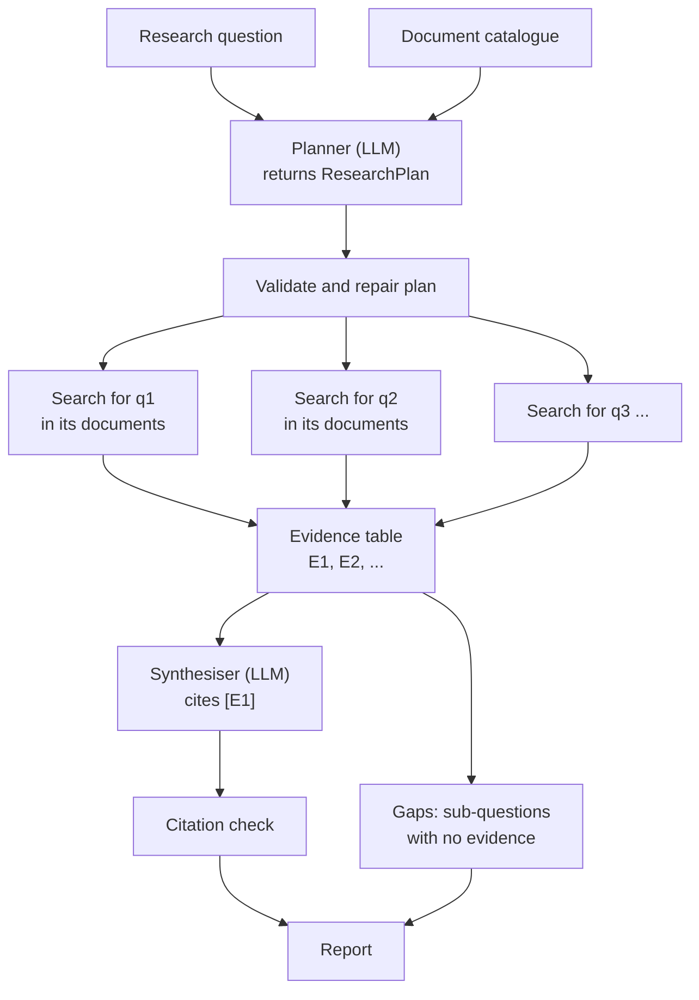

Some questions cannot be answered by one retrieval. "What are the rules for working remotely, covering how often, security, and paying for equipment?" touches four documents, and a single search for the whole sentence returns whichever topic happens to dominate its embedding. A research assistant handles this by splitting the question into parts, retrieving for each part separately, collecting what it finds into an evidence table, and only then writing a report in which every claim points at a row of that table.

**What was run.** The listed stack is LlamaIndex and ChromaDB. Neither could be installed in the environment used to write this tutorial, so the core logic is implemented in plain Python with NumPy as the vector store, and that code was run and tested: every `output` block is real. The ChromaDB store is given as an optional file written against Chroma's documented API and **not executed**. The LlamaIndex equivalent is described in prose. The two Claude calls were not executed either, as no API key was available; a model-free `OfflineLLM` exercises the whole pipeline instead.

## Overview

The assistant works over four Meridian documents: the Employee Handbook, the IT Security Standard, the Expenses Policy and a Remote Work Guide. A research run has five steps:

1. **Plan.** The model turns the question into two to five sub-questions and names the documents likely to answer each. The plan is a Pydantic model, so a malformed plan is rejected before any retrieval happens.
2. **Repair.** Document ids that do not exist are removed from the plan.
3. **Retrieve.** Each sub-question is searched separately, restricted to its documents.
4. **Tabulate.** Retrieved chunks become rows `E1`, `E2`, … of an evidence table. Sub-questions with no evidence are recorded as gaps.
5. **Synthesise and check.** The model writes a report citing row labels. Code then checks that every label exists and every paragraph cites something.

## Learning objectives

- Represent a research plan as a validated Pydantic model and reject bad plans.
- Retrieve per sub-question with a document filter, and merge duplicates into one evidence row.
- Build an evidence table that both the model and the reader can inspect.
- Check a generated report's citations deterministically.
- Report what was *not* found instead of letting the model fill the gap.

## Requirements

- Python 3.10 or later; no GPU.
- About 500 MB of disk for PyTorch and the embedding model.
- An Anthropic API key for real planning and synthesis. The `--offline` mode and the tests need none.
- Background: [Query decomposition](/learn/advanced-retrieval/query-decomposition), [Multi-document synthesis](/learn/generation-strategies/multi-document-synthesis) and [Sub-question engines](/learn/llamaindex/sub-question-engines).

## Technology stack

| Piece | Choice | Status in this tutorial |
| --- | --- | --- |
| Plan and data shapes | Pydantic | Run and tested |
| Embeddings | `sentence-transformers/all-MiniLM-L6-v2` | Run |
| Vector store | NumPy matrix behind a `Library` class | Run and tested |
| Vector store, persistent | ChromaDB (`ChromaLibrary`) | Written, not executed |
| Planning and synthesis | Claude through the Anthropic SDK | Written, not executed |
| Framework alternative | LlamaIndex | Described in prose |

## System architecture



The model is used twice, at the top and near the bottom. Everything between, and the check after, is ordinary code. That is deliberate: retrieval, bookkeeping and checking are things code does reliably and a model does not.

## Folder structure

```text
multi-document-research-assistant/
├── requirements.txt
├── research.py
├── data/
│   ├── demo_plan.json
│   └── docs/
│       ├── employee-handbook.md
│       ├── expenses-policy.md
│       ├── it-security-standard.md
│       └── remote-work-guide.md
├── app/
│   ├── __init__.py
│   ├── models.py
│   ├── library.py
│   ├── chroma_library.py      (optional)
│   ├── llm.py
│   └── research.py
└── tests/
    ├── __init__.py
    ├── conftest.py
    └── test_research.py
```

The two `__init__.py` files are empty.

## Setup

```bash
mkdir multi-document-research-assistant && cd multi-document-research-assistant
python -m venv .venv && source .venv/bin/activate
mkdir -p app data/docs tests && touch app/__init__.py tests/__init__.py
```

Create `requirements.txt`:

```text
pydantic>=2.7
numpy>=1.26
sentence-transformers>=3.0
anthropic>=0.80
pytest>=8.0
# Optional, for the ChromaDB store and the LlamaIndex variant described at the end:
# chromadb
# llama-index
```

```bash
pip install -r requirements.txt
```

## Implementation

### data/docs/

Four Markdown files. The file name without `.md` is the document id.

`employee-handbook.md`:

```text
# Employee Handbook

## Annual leave

Full-time staff receive 25 days of annual leave each year. Up to 5 unused days carry over into the next year and must be used by 31 March.

## Remote work

Staff may work remotely up to 3 days a week, on days agreed with their line manager. New joiners work from the office for their first 2 weeks.

## Home-office equipment

Meridian provides a home-office equipment budget of £400 for a desk, chair or monitor. Equipment bought with the budget remains Meridian property.
```

`it-security-standard.md`:

```text
# IT Security Standard

## Passwords

Passwords must be rotated every 90 days and be at least 14 characters long.

## Network access

The VPN is required whenever you connect from public Wi-Fi, such as in a café, hotel or airport. Home broadband does not require the VPN for email, but access to the finance system always does.

## Devices

Laptops are replaced on a 3-year refresh cycle. Work must be done on a Meridian laptop; personal computers may not be used to access company data.

## Support

The IT support desk is open 08:00 to 18:00 UK time, Monday to Friday.
```

`expenses-policy.md`:

```text
# Expenses Policy

## Deadlines

Expenses must be submitted within 30 days of the purchase. Late claims need approval from the Finance Director.

## Receipts

Any expense over £75 needs a receipt attached. A photograph of the receipt is acceptable.

## Home-office purchases

Home-office equipment is claimed as an expense under the category Home Office, up to the £400 budget. Broadband and electricity bills are not reimbursed.
```

`remote-work-guide.md`:

```text
# Remote Work Guide

## Availability

Remote staff must be reachable by chat and phone during core hours, 10:00 to 16:00 UK time.

## Working abroad

Working remotely from another country for more than 10 working days needs approval from People Operations.

## Leaving Meridian

Equipment bought with the home-office budget is returned by courier when you leave.
```

### app/models.py

```python
"""The data that flows through a research run."""
from pydantic import BaseModel, Field, model_validator


class SubQuestion(BaseModel):
    id: str = Field(pattern=r"^q[0-9]+$", description="q1, q2, ... in order.")
    question: str = Field(min_length=8, description="A self-contained question answerable from one or two documents.")
    documents: list[str] = Field(
        default_factory=list,
        description="Ids of the documents likely to contain the answer. Empty means search all.",
    )


class ResearchPlan(BaseModel):
    question: str
    sub_questions: list[SubQuestion] = Field(min_length=1, max_length=6)

    @model_validator(mode="after")
    def ids_are_unique(self) -> "ResearchPlan":
        ids = [sq.id for sq in self.sub_questions]
        if len(ids) != len(set(ids)):
            raise ValueError("sub-question ids must be unique")
        return self


class Chunk(BaseModel):
    id: str            # "employee-handbook#2"
    doc_id: str
    doc_title: str
    section: str
    text: str


class Evidence(BaseModel):
    id: str            # "E1", "E2", ... the label the report cites
    chunk: Chunk
    score: float
    answers: list[str]  # ids of the sub-questions this chunk was retrieved for


class Report(BaseModel):
    plan: ResearchPlan
    evidence: list[Evidence]
    body: str
    gaps: list[str]       # sub-questions with no evidence
    problems: list[str]   # citation errors found in the body
    markdown: str
```

- `ResearchPlan` is the contract with the planner. `min_length=1, max_length=6` bounds the cost of a run: each sub-question is one retrieval, and a model asked to "be thorough" will otherwise produce a dozen.
- The `pattern` on `id` and the uniqueness validator matter because ids are how evidence is tied back to sub-questions.
- `Evidence.answers` records which sub-questions a chunk was retrieved for; one chunk can serve several.

### app/library.py

```python
"""Load Markdown documents, split them into section chunks, and search them."""
from pathlib import Path
from typing import Protocol

import numpy as np

from app.models import Chunk


class Embedder(Protocol):
    def encode(self, texts: list[str]) -> np.ndarray: ...


class MiniLMEmbedder:
    def __init__(self, name: str = "sentence-transformers/all-MiniLM-L6-v2"):
        from sentence_transformers import SentenceTransformer

        self._model = SentenceTransformer(name)

    def encode(self, texts: list[str]) -> np.ndarray:
        return self._model.encode(texts, normalize_embeddings=True)


def split_document(doc_id: str, markdown: str) -> list[Chunk]:
    """One chunk per '## ' section. The '# ' line is the document title."""
    title, section, lines, chunks = doc_id, "", [], []

    def flush() -> None:
        text = " ".join(" ".join(lines).split())
        if text:
            chunks.append(Chunk(id=f"{doc_id}#{len(chunks) + 1}", doc_id=doc_id,
                                doc_title=title, section=section, text=text))
        lines.clear()

    for line in markdown.splitlines():
        if line.startswith("# "):
            title = line[2:].strip()
        elif line.startswith("## "):
            flush()
            section = line[3:].strip()
        else:
            lines.append(line)
    flush()
    return chunks


class Library:
    """An in-memory vector store over the chunks of every document."""

    def __init__(self, chunks: list[Chunk], embedder: Embedder):
        self.chunks = chunks
        self.embedder = embedder
        self.titles = {c.doc_id: c.doc_title for c in chunks}
        self._vectors = np.asarray(embedder.encode([f"{c.section}. {c.text}" for c in chunks]))

    @classmethod
    def from_folder(cls, folder: str | Path, embedder: Embedder) -> "Library":
        chunks = []
        for path in sorted(Path(folder).glob("*.md")):
            chunks.extend(split_document(path.stem, path.read_text(encoding="utf-8")))
        return cls(chunks, embedder)

    def catalogue(self) -> str:
        """What the planner is told about the collection: ids, titles and section names."""
        lines = []
        for doc_id, title in self.titles.items():
            sections = [c.section for c in self.chunks if c.doc_id == doc_id]
            lines.append(f"- {doc_id}: {title} (sections: {', '.join(sections)})")
        return "\n".join(lines)

    def search(self, query: str, k: int = 3, doc_ids: list[str] | None = None) -> list[tuple[Chunk, float]]:
        """Top k chunks by cosine similarity, optionally restricted to some documents."""
        scores = self._vectors @ np.asarray(self.embedder.encode([query]))[0]
        allowed = [i for i, c in enumerate(self.chunks) if not doc_ids or c.doc_id in doc_ids]
        best = sorted(allowed, key=lambda i: -scores[i])[:k]
        return [(self.chunks[i], float(scores[i])) for i in best]
```

- `split_document` makes one chunk per `##` section and keeps the document title and section name with it. That metadata is what makes a citation readable later ("Expenses Policy, Receipts").
- `catalogue` is the planner's only view of the collection: ids, titles and section names, never the content. It is short, so it costs little to send, and it lets the model route sub-questions to documents.
- `search` computes cosine similarity with one matrix product (the vectors are normalised) and applies the document filter *before* taking the top `k`. Filtering afterwards would return fewer than `k` results whenever another document ranked higher.

### app/llm.py

```python
"""Everything that needs a language model: planning and synthesis. Nothing else imports anthropic."""
import json
from pathlib import Path
from typing import Protocol

from app.models import Evidence, ResearchPlan

PLAN_SYSTEM = """You plan research over a fixed document collection.
Break the user's question into 2 to 5 sub-questions. Each must be self-contained,
answerable from the documents, and must not overlap with the others.
For each, list the ids of the documents most likely to hold the answer."""

SYNTHESIS_SYSTEM = """You write a short research report from an evidence table.
Use only the evidence. After every claim cite the evidence it rests on, like [E2].
Never cite a label that is not in the table. Where documents differ or add
conditions to one another, say so. Do not write a sources list; it is added later."""


def evidence_block(evidence: list[Evidence]) -> str:
    return "\n".join(
        f"[{e.id}] ({e.chunk.doc_title}, {e.chunk.section}) {e.chunk.text}" for e in evidence
    )


class LLM(Protocol):
    def plan(self, question: str, catalogue: str) -> ResearchPlan: ...
    def synthesise(self, plan: ResearchPlan, evidence: list[Evidence]) -> str: ...


class ClaudeLLM:
    def __init__(self, model: str = "claude-opus-5-5"):
        import anthropic

        self.client = anthropic.Anthropic()  # reads ANTHROPIC_API_KEY from the environment
        self.model = model

    def plan(self, question: str, catalogue: str) -> ResearchPlan:
        response = self.client.messages.parse(
            model=self.model,
            max_tokens=1024,
            system=PLAN_SYSTEM,
            messages=[{"role": "user", "content": f"Documents:\n{catalogue}\n\nQuestion: {question}"}],
            output_format=ResearchPlan,
        )
        if response.parsed_output is None:
            raise RuntimeError("the model returned no plan")
        return response.parsed_output

    def synthesise(self, plan: ResearchPlan, evidence: list[Evidence]) -> str:
        sub_questions = "\n".join(f"- {sq.question}" for sq in plan.sub_questions)
        prompt = (f"Question: {plan.question}\n\nSub-questions:\n{sub_questions}\n\n"
                  f"Evidence:\n{evidence_block(evidence)}")
        response = self.client.messages.create(
            model=self.model,
            max_tokens=2048,
            system=SYNTHESIS_SYSTEM,
            messages=[{"role": "user", "content": prompt}],
        )
        return "".join(block.text for block in response.content if block.type == "text")


class OfflineLLM:
    """No model at all: replays a saved plan and writes an extractive report.

    It lets you run and inspect the whole pipeline without an API key. The plan
    file goes through the same ResearchPlan validation as a model's output would.
    """

    def __init__(self, plan_path: str | Path):
        self.plan_path = Path(plan_path)

    def plan(self, question: str, catalogue: str) -> ResearchPlan:
        return ResearchPlan.model_validate(json.loads(self.plan_path.read_text(encoding="utf-8")))

    def synthesise(self, plan: ResearchPlan, evidence: list[Evidence]) -> str:
        paragraphs = []
        for sq in plan.sub_questions:
            found = [e for e in evidence if sq.id in e.answers]
            if found:
                quoted = " ".join(f"{e.chunk.text} [{e.id}]" for e in found)
                paragraphs.append(f"**{sq.question}** {quoted}")
        return "\n\n".join(paragraphs)
```

- `LLM` is the protocol the pipeline depends on. `ClaudeLLM` implements it with two calls: `messages.parse` with `output_format=ResearchPlan` for the plan, so the SDK validates the model's JSON against the Pydantic model, and `messages.create` for the report.
- The synthesis prompt shows each evidence row with its label, document and section, and forbids labels that are not in the table. The prompt asks; `check_citations` verifies.
- `OfflineLLM` is not a mock of Claude's intelligence. It replays a plan you wrote and builds an *extractive* report by quoting the evidence for each sub-question. Its value is that the real validation, retrieval, table and checking code runs end to end without a key.

### app/research.py

```python
"""The research loop: plan, retrieve per sub-question, tabulate evidence, synthesise, check."""
import re

from app.library import Library
from app.llm import LLM
from app.models import Evidence, Report, ResearchPlan

CITATION = re.compile(r"\[(E[0-9]+)\]")


def repair_plan(plan: ResearchPlan, known_docs: set[str]) -> ResearchPlan:
    """Drop document ids the planner invented. A sub-question left with none searches everything."""
    fixed = [sq.model_copy(update={"documents": [d for d in sq.documents if d in known_docs]})
             for sq in plan.sub_questions]
    return plan.model_copy(update={"sub_questions": fixed})


def gather_evidence(plan: ResearchPlan, library: Library, k: int = 2,
                    min_score: float = 0.3) -> list[Evidence]:
    """Retrieve for each sub-question. A chunk found twice becomes one row answering both."""
    by_chunk: dict[str, Evidence] = {}
    for sq in plan.sub_questions:
        for chunk, score in library.search(sq.question, k, sq.documents or None):
            if score < min_score:
                continue
            if chunk.id in by_chunk:
                row = by_chunk[chunk.id]
                row.answers.append(sq.id)
                row.score = max(row.score, score)
            else:
                by_chunk[chunk.id] = Evidence(id=f"E{len(by_chunk) + 1}", chunk=chunk,
                                              score=score, answers=[sq.id])
    return list(by_chunk.values())


def evidence_table(evidence: list[Evidence]) -> str:
    rows = ["| Id | Answers | Document | Section | Score | Text |", "| --- | --- | --- | --- | --- | --- |"]
    for e in evidence:
        text = e.chunk.text if len(e.chunk.text) <= 60 else e.chunk.text[:57] + "..."
        rows.append(f"| {e.id} | {', '.join(e.answers)} | {e.chunk.doc_title} | {e.chunk.section} "
                    f"| {e.score:.2f} | {text} |")
    return "\n".join(rows)


def check_citations(body: str, evidence: list[Evidence]) -> list[str]:
    """Problems a reader should know about: unknown labels and paragraphs that cite nothing."""
    known = {e.id for e in evidence}
    problems = [f"cites {label}, which is not in the evidence table"
                for label in sorted(set(CITATION.findall(body)) - known)]
    for number, paragraph in enumerate([p for p in body.split("\n\n") if p.strip()], start=1):
        if not paragraph.lstrip().startswith("#") and not CITATION.search(paragraph):
            problems.append(f"paragraph {number} has no citation")
    return problems


def run_research(question: str, library: Library, llm: LLM, k: int = 2,
                 min_score: float = 0.3) -> Report:
    plan = repair_plan(llm.plan(question, library.catalogue()), set(library.titles))
    evidence = gather_evidence(plan, library, k, min_score)
    answered = {sq_id for e in evidence for sq_id in e.answers}
    gaps = [sq.question for sq in plan.sub_questions if sq.id not in answered]

    if not evidence:
        body, problems = "No evidence was found for any part of this question.", []
    else:
        body = llm.synthesise(plan, evidence)
        problems = check_citations(body, evidence)

    parts = [f"## Report\n\n{body}"]
    if gaps:
        parts.append("## Not found in the documents\n\n" + "\n".join(f"- {g}" for g in gaps))
    if problems:
        parts.append("## Citation problems\n\n" + "\n".join(f"- {p}" for p in problems))
    parts.append("## Evidence\n\n" + (evidence_table(evidence) if evidence else "None."))
    return Report(plan=plan, evidence=evidence, body=body, gaps=gaps, problems=problems,
                  markdown="\n\n".join(parts))
```

- `repair_plan` handles the commonest planner error, a plausible but non-existent document id, without failing the run. A sub-question left with no documents searches the whole library.
- `gather_evidence` drops chunks scoring below `min_score` and merges repeats. Without the merge, the same paragraph would appear as `E2` and `E5`, and the report could cite the "agreement" of two sources that are one.
- `check_citations` finds labels the model invented and paragraphs with no citation at all. Headings are exempt.
- `run_research` skips synthesis entirely when there is no evidence. Giving a model an empty table and asking for a report invites it to answer from memory.
- Gaps and citation problems are printed in the report itself. A reader should see what the system could not support, not only what it could.

### app/chroma_library.py (optional, not executed)

```python
"""The same Library interface, stored in ChromaDB. Optional: needs `pip install chromadb`."""
from app.library import Embedder, Library
from app.models import Chunk


class ChromaLibrary(Library):
    def __init__(self, chunks: list[Chunk], embedder: Embedder, path: str = "./chroma_db"):
        import chromadb

        self.chunks = chunks
        self.embedder = embedder
        self.titles = {c.doc_id: c.doc_title for c in chunks}
        self._by_id = {c.id: c for c in chunks}
        client = chromadb.PersistentClient(path=path)
        self._collection = client.get_or_create_collection(
            "meridian_docs", metadata={"hnsw:space": "cosine"}
        )
        vectors = embedder.encode([f"{c.section}. {c.text}" for c in chunks])
        self._collection.upsert(
            ids=[c.id for c in chunks],
            embeddings=[v.tolist() for v in vectors],
            documents=[c.text for c in chunks],
            metadatas=[{"doc_id": c.doc_id} for c in chunks],
        )

    def search(self, query: str, k: int = 3, doc_ids: list[str] | None = None) -> list[tuple[Chunk, float]]:
        vector = self.embedder.encode([query])[0].tolist()
        result = self._collection.query(
            query_embeddings=[vector],
            n_results=k,
            where={"doc_id": {"$in": doc_ids}} if doc_ids else None,
        )
        # Chroma returns cosine *distance*; similarity is 1 minus that.
        return [(self._by_id[i], 1.0 - d) for i, d in zip(result["ids"][0], result["distances"][0])]
```

This subclass keeps the `Library` interface and moves storage into ChromaDB, so `Library.from_folder` and the rest of the project work unchanged if you replace `Library` with `ChromaLibrary` in `research.py`. It was written against Chroma's documented client API (`PersistentClient`, `get_or_create_collection`, `upsert`, `query` with a `where` filter) but could not be run here, so treat it as a starting point and test it before relying on it.

### data/demo_plan.json

```json
{
  "question": "What are the rules for working remotely at Meridian, covering how often, security, and paying for equipment?",
  "sub_questions": [
    {"id": "q1", "question": "How many days a week may staff work remotely, and when must they be available?", "documents": ["employee-handbook", "remote-work-guide"]},
    {"id": "q2", "question": "What security rules apply to networks and devices when working outside the office?", "documents": ["it-security-standard"]},
    {"id": "q3", "question": "What is the home-office equipment budget and how is it claimed?", "documents": ["employee-handbook", "expenses-policy"]},
    {"id": "q4", "question": "What are the deadline and receipt rules for expense claims?", "documents": ["expenses-policy"]},
    {"id": "q5", "question": "What is the dress code for video calls with clients?", "documents": []}
  ]
}
```

A plan of the kind a model would return, used by `--offline`. The fifth sub-question is deliberately unanswerable.

### research.py

```python
"""Command line: python research.py "your question"  (add --offline to run without an API key)."""
import argparse

from app.library import Library, MiniLMEmbedder
from app.llm import ClaudeLLM, OfflineLLM
from app.research import run_research

DEFAULT = ("What are the rules for working remotely at Meridian, covering how often, "
           "security, and paying for equipment?")


def main() -> None:
    parser = argparse.ArgumentParser()
    parser.add_argument("question", nargs="?", default=DEFAULT)
    parser.add_argument("--offline", action="store_true", help="replay data/demo_plan.json, no model")
    args = parser.parse_args()

    library = Library.from_folder("data/docs", MiniLMEmbedder())
    llm = OfflineLLM("data/demo_plan.json") if args.offline else ClaudeLLM()
    report = run_research(args.question, library, llm)

    print("Plan:")
    for sq in report.plan.sub_questions:
        print(f"  {sq.id} {sq.question}  -> {sq.documents or 'all documents'}")
    print()
    print(report.markdown)


if __name__ == "__main__":
    main()
```

### tests/conftest.py

```python
"""A two-document library with a hashing embedder, and a scriptable fake LLM."""
import zlib

import numpy as np
import pytest

from app.library import Library, split_document
from app.models import ResearchPlan, SubQuestion

HANDBOOK = """# Employee Handbook

## Remote work

Staff may work remotely up to 3 days a week.

## Annual leave

Full-time staff receive 25 days of annual leave each year.
"""
EXPENSES = """# Expenses Policy

## Deadlines

Expenses must be submitted within 30 days of the purchase.
"""


class FakeEmbedder:
    def encode(self, texts: list[str]) -> np.ndarray:
        out = np.zeros((len(texts), 64), dtype=np.float32)
        for row, text in enumerate(texts):
            for word in text.lower().replace(".", " ").replace("?", " ").split():
                out[row, zlib.crc32(word.encode()) % 64] += 1.0
        norms = np.linalg.norm(out, axis=1, keepdims=True)
        return out / np.where(norms == 0, 1.0, norms)


class FakeLLM:
    """Returns the plan and report body it was built with; records what it was asked."""

    def __init__(self, plan: ResearchPlan, body: str = ""):
        self._plan, self._body = plan, body
        self.catalogue = None
        self.evidence_seen = None

    def plan(self, question, catalogue):
        self.catalogue = catalogue
        return self._plan

    def synthesise(self, plan, evidence):
        self.evidence_seen = evidence
        return self._body


def make_plan(*subs: tuple[str, str, list[str]]) -> ResearchPlan:
    return ResearchPlan(question="test question", sub_questions=[
        SubQuestion(id=i, question=q, documents=d) for i, q, d in subs
    ])


@pytest.fixture
def library() -> Library:
    chunks = split_document("handbook", HANDBOOK) + split_document("expenses", EXPENSES)
    return Library(chunks, FakeEmbedder())
```

### tests/test_research.py

```python
import json

import pytest
from pydantic import ValidationError

from app.library import split_document
from app.llm import OfflineLLM
from app.models import ResearchPlan
from app.research import check_citations, gather_evidence, repair_plan, run_research
from tests.conftest import HANDBOOK, FakeLLM, make_plan

REMOTE = ("q1", "How many days a week may staff work remotely?", ["handbook"])
DEADLINE = ("q2", "When must expenses be submitted after the purchase?", ["expenses"])


def test_split_document_makes_one_chunk_per_section():
    chunks = split_document("handbook", HANDBOOK)
    assert [c.id for c in chunks] == ["handbook#1", "handbook#2"]
    assert chunks[0].doc_title == "Employee Handbook" and chunks[0].section == "Remote work"
    assert chunks[1].text == "Full-time staff receive 25 days of annual leave each year."


def test_search_can_be_restricted_to_documents(library):
    query = "When must expenses be submitted after the purchase?"
    assert library.search(query, k=1)[0][0].doc_id == "expenses"
    assert {c.doc_id for c, _ in library.search(query, k=3, doc_ids=["handbook"])} == {"handbook"}


@pytest.mark.parametrize("payload", [
    {"question": "q", "sub_questions": []},                                               # no sub-questions
    {"question": "q", "sub_questions": [{"id": "q1", "question": "A valid question?"}] * 7},  # too many
    {"question": "q", "sub_questions": [{"id": "q1", "question": "A valid question?"}] * 2},  # duplicate ids
    {"question": "q", "sub_questions": [{"id": "first", "question": "A valid question?"}]},   # bad id
    {"question": "q", "sub_questions": [{"id": "q1", "question": "Why?"}]},                # too short to search
    {"question": "q"},                                                                    # field missing
])
def test_invalid_plans_are_rejected(payload):
    with pytest.raises(ValidationError):
        ResearchPlan.model_validate_json(json.dumps(payload))


def test_repair_plan_drops_invented_document_ids():
    plan = make_plan(("q1", "How many days a week may staff work remotely?", ["handbook", "wiki"]),
                     ("q2", "When must expenses be submitted?", ["intranet"]))
    fixed = repair_plan(plan, {"handbook", "expenses"})
    assert fixed.sub_questions[0].documents == ["handbook"]
    assert fixed.sub_questions[1].documents == []          # falls back to searching everything


def test_each_sub_question_retrieves_from_its_own_documents(library):
    evidence = gather_evidence(make_plan(REMOTE, DEADLINE), library, k=1, min_score=0.1)
    assert [(e.id, e.chunk.doc_id, e.answers) for e in evidence] == [
        ("E1", "handbook", ["q1"]), ("E2", "expenses", ["q2"]),
    ]


def test_a_chunk_found_for_two_sub_questions_is_one_evidence_row(library):
    again = ("q2", "Can staff work remotely 3 days a week?", ["handbook"])
    evidence = gather_evidence(make_plan(REMOTE, again), library, k=1, min_score=0.1)
    assert len(evidence) == 1 and evidence[0].answers == ["q1", "q2"]


def test_weak_matches_are_not_evidence_and_become_gaps(library):
    off_topic = ("q2", "What is the dress code for client video calls?", [])
    llm = FakeLLM(make_plan(REMOTE, off_topic), body="Staff may work remotely 3 days a week [E1].")
    report = run_research("test question", library, llm, k=1, min_score=0.3)
    assert report.gaps == ["What is the dress code for client video calls?"]
    assert "## Not found in the documents" in report.markdown
    assert [e.id for e in llm.evidence_seen] == ["E1"]


def test_planner_is_given_the_catalogue(library):
    llm = FakeLLM(make_plan(REMOTE), body="Three days [E1].")
    run_research("test question", library, llm, k=1)
    assert "- handbook: Employee Handbook (sections: Remote work, Annual leave)" in llm.catalogue


def test_citation_check_finds_unknown_labels_and_uncited_paragraphs(library):
    evidence = gather_evidence(make_plan(REMOTE), library, k=1, min_score=0.1)
    body = "Staff may work remotely 3 days a week [E1].\n\nThey get 30 days of leave [E7].\n\nEveryone agrees."
    assert check_citations(body, evidence) == [
        "cites E7, which is not in the evidence table",
        "paragraph 3 has no citation",
    ]
    assert check_citations("## Heading\n\nA supported claim [E1].", evidence) == []


def test_citation_problems_are_printed_in_the_report(library):
    llm = FakeLLM(make_plan(REMOTE), body="Staff get unlimited remote days [E9].")
    report = run_research("test question", library, llm, k=1)
    assert report.problems == ["cites E9, which is not in the evidence table"]
    assert "## Citation problems" in report.markdown


def test_no_evidence_means_no_synthesis_call(library):
    llm = FakeLLM(make_plan(("q1", "What is the dress code for client video calls?", [])), body="unused")
    report = run_research("test question", library, llm, min_score=0.9)
    assert llm.evidence_seen is None
    assert report.evidence == [] and len(report.gaps) == 1


def test_offline_llm_validates_the_plan_file_and_cites_only_real_evidence(library, tmp_path):
    plan_file = tmp_path / "plan.json"
    plan_file.write_text(make_plan(REMOTE, DEADLINE).model_dump_json(), encoding="utf-8")
    report = run_research("test question", library, OfflineLLM(plan_file), k=1, min_score=0.1)
    assert report.problems == [] and "[E1]" in report.body and "[E2]" in report.body

    plan_file.write_text('{"question": "q", "sub_questions": []}', encoding="utf-8")
    with pytest.raises(ValidationError):
        OfflineLLM(plan_file).plan("q", "")
```

`FakeLLM` returns whatever plan and report text a test supplies, which is how the suite checks the pipeline's reaction to a model that invents a citation or cites nothing.

## Running it

Without a key:

```bash
python research.py --offline
```

```output
Plan:
  q1 How many days a week may staff work remotely, and when must they be available?  -> ['employee-handbook', 'remote-work-guide']
  q2 What security rules apply to networks and devices when working outside the office?  -> ['it-security-standard']
  q3 What is the home-office equipment budget and how is it claimed?  -> ['employee-handbook', 'expenses-policy']
  q4 What are the deadline and receipt rules for expense claims?  -> ['expenses-policy']
  q5 What is the dress code for video calls with clients?  -> all documents

## Report

**How many days a week may staff work remotely, and when must they be available?** Staff may work remotely up to 3 days a week, on days agreed with their line manager. New joiners work from the office for their first 2 weeks. [E1] Remote staff must be reachable by chat and phone during core hours, 10:00 to 16:00 UK time. [E2]

**What security rules apply to networks and devices when working outside the office?** The VPN is required whenever you connect from public Wi-Fi, such as in a café, hotel or airport. Home broadband does not require the VPN for email, but access to the finance system always does. [E3] Laptops are replaced on a 3-year refresh cycle. Work must be done on a Meridian laptop; personal computers may not be used to access company data. [E4]

**What is the home-office equipment budget and how is it claimed?** Home-office equipment is claimed as an expense under the category Home Office, up to the £400 budget. Broadband and electricity bills are not reimbursed. [E5] Meridian provides a home-office equipment budget of £400 for a desk, chair or monitor. Equipment bought with the budget remains Meridian property. [E6]

**What are the deadline and receipt rules for expense claims?** Expenses must be submitted within 30 days of the purchase. Late claims need approval from the Finance Director. [E7] Any expense over £75 needs a receipt attached. A photograph of the receipt is acceptable. [E8]

## Not found in the documents

- What is the dress code for video calls with clients?

## Evidence

| Id | Answers | Document | Section | Score | Text |
| --- | --- | --- | --- | --- | --- |
| E1 | q1 | Employee Handbook | Remote work | 0.77 | Staff may work remotely up to 3 days a week, on days agre... |
| E2 | q1 | Remote Work Guide | Availability | 0.63 | Remote staff must be reachable by chat and phone during c... |
| E3 | q2 | IT Security Standard | Network access | 0.41 | The VPN is required whenever you connect from public Wi-F... |
| E4 | q2 | IT Security Standard | Devices | 0.33 | Laptops are replaced on a 3-year refresh cycle. Work must... |
| E5 | q3 | Expenses Policy | Home-office purchases | 0.76 | Home-office equipment is claimed as an expense under the ... |
| E6 | q3 | Employee Handbook | Home-office equipment | 0.64 | Meridian provides a home-office equipment budget of £400 ... |
| E7 | q4 | Expenses Policy | Deadlines | 0.75 | Expenses must be submitted within 30 days of the purchase... |
| E8 | q4 | Expenses Policy | Receipts | 0.46 | Any expense over £75 needs a receipt attached. A photogra... |
```

Reading the output from the top:

- The plan routes each sub-question to one or two documents. `q5` names none, so it searches everything.
- The report has one paragraph per sub-question, each sentence group ending in a label. This text is extractive: the offline mode pastes evidence, it does not reason.
- `q5` appears under **Not found in the documents**. Its best match scored 0.25, below the 0.3 threshold, so no evidence row was created and the synthesiser never saw it.
- The evidence table has eight rows from four documents. The scores show how much easier the specific sub-questions were (0.75 and above) than the broad security one (0.41 and 0.33).

With a key, drop the flag:

```bash
export ANTHROPIC_API_KEY="your-key"
python research.py "How do the handbook and the expenses policy differ on home-office equipment?"
```

This was not run. The plan and wording will vary from run to run; a synthesised paragraph looks like this (illustrative):

```text
Staff may work remotely up to 3 days a week on days agreed with their line manager [E1], and must be reachable during core hours of 10:00 to 16:00 UK time [E2]. The handbook sets the equipment budget at £400 [E6]; the Expenses Policy adds that it is claimed under the Home Office category and that broadband and electricity are excluded [E5].
```

## Testing

```bash
python -m pytest -q
```

```output
.................                                                        [100%]
17 passed in 0.01s
```

The tests use a hashing embedder and `FakeLLM`, so they need no model. They cover:

- **The plan contract**: six kinds of invalid plan are rejected by Pydantic; invented document ids are repaired.
- **Retrieval bookkeeping**: each sub-question searches its own documents; a chunk found twice is one row; weak matches become gaps.
- **Report checking**: unknown labels and uncited paragraphs are detected and printed; with no evidence, the synthesiser is never called.
- **Offline mode**: the plan file is validated like model output, and the extractive report cites only real rows.

## Expected results

The offline run is deterministic and should match the output above exactly. With Claude, the structure stays the same (plan, report, gaps, evidence table) while the plan and prose vary.

What the design guarantees, whatever the model writes:

- every evidence row is a real chunk retrieved for a named sub-question;
- every label in the report that does not exist is listed under **Citation problems**;
- every sub-question with no evidence is listed as not found.

What it does not guarantee is that a sentence citing `[E3]` is actually supported by row `E3`. Checking that needs quote-level verification, which the [RAG application with citations](/projects/rag-with-citations) project builds.

## Common problems

- **An unanswerable sub-question still gets evidence.** A similarity threshold measures topic, not whether the question is answered. When the fifth sub-question was "Does Meridian pay for childcare while working from home?", its top chunk (returning home-office equipment) scored 0.49, above several genuinely useful rows, and was accepted. Raising `min_score` to exclude it would also have dropped rows `E3`, `E4` and `E8`. Rely on the synthesis prompt and a reranker for this, not on the threshold alone.
- **`ValidationError` from `plan`.** The model returned more than six sub-questions, duplicate ids or a very short question. Either catch the error and retry once with the message included, or relax the limits knowingly.
- **Every sub-question returns the same chunks.** The planner produced overlapping sub-questions. The merged `Answers` column makes this visible; tighten the planning prompt.
- **A document is never searched.** Its id never appears in the plan. Check `library.catalogue()`: section names are all the planner knows, so vague headings ("Miscellaneous") hide content.
- **"paragraph N has no citation" on a harmless introduction.** The check is strict by design. Tell the model not to write uncited framing, or exempt the first paragraph.
- **`TypeError: Could not resolve authentication method`.** `ANTHROPIC_API_KEY` is not set; use `--offline` or export the key.

## Possible improvements

- **Use LlamaIndex.** Its sub-question query engine implements the same pattern: you wrap one query engine per document as a tool with a description, and the engine generates sub-questions, routes each to a tool and combines the answers. You gain loaders, node parsers and integrations; you give up direct control of the evidence table and the checks, so keep those as a post-processing step. Follow the [Sub-question engines](/learn/llamaindex/sub-question-engines) lesson and the current LlamaIndex documentation for exact class names, which have changed between releases.
- **Persist the index** with `ChromaLibrary`, and skip re-embedding documents whose content has not changed.
- **Run sub-question retrievals concurrently.** They are independent; with a remote vector store this cuts latency roughly by the number of sub-questions.
- **Add a second round.** After the first evidence table, ask the model whether any sub-question needs a follow-up search. This is the step towards the [Agentic RAG research assistant](/projects/agentic-rag-research-assistant) project.
- **Rerank evidence per sub-question** with a cross-encoder before it enters the table.
- **Verify quotes**, not just labels, before showing the report.
