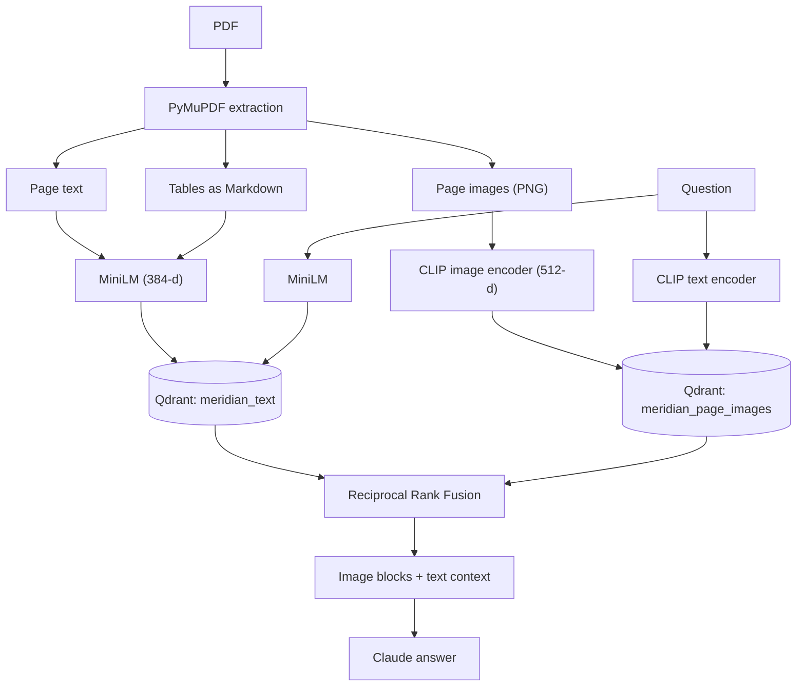

A PDF is not only text. The answer to a question may sit in a table, where reading order destroys the meaning, or in a chart, where there is almost no text at all. In this project you build a retrieval system for Meridian's IT handbook that indexes three kinds of content (prose, tables and whole-page images), searches them through two vector spaces, and hands Claude a prompt containing both text and pictures.

## Overview

The system does four things:

1. **Extract** each PDF page with PyMuPDF into text, tables (converted to Markdown) and a rendered PNG of the page.
2. **Embed** text and tables with a text model (MiniLM), and page images with CLIP, a model trained so that a picture and a sentence describing it get nearby vectors. Because CLIP places text and images in **one shared space**, a typed question can be compared directly with a page image.
3. **Store** the two kinds of vector in two Qdrant collections and, at question time, search both and fuse the rankings.
4. **Generate** an answer from a multimodal prompt: the retrieved page images as image blocks, the retrieved text and tables as text.

> [!WARNING]
> **What was and was not run for this tutorial.** Everything here was executed except the CLIP embedding itself. The build environment had no Pillow, which the CLIP image processor requires, so `ClipEmbedder` could not be loaded. The demo output below was produced with `StubImageTextEmbedder`, which does **not** look at pixels: it hashes the text PyMuPDF extracted from the page. The stub exercises every other line (extraction, both collections, fusion, prompt assembly) but says nothing about how well CLIP retrieves. `ClipEmbedder` is written against the documented sentence-transformers API; run `python run_demo.py --clip` on your machine to use it.

Background for the ideas used here: [PyMuPDF](/learn/advanced-document-parsing/pymupdf), [visual embeddings](/learn/multimodal-rag/visual-embeddings), [table retrieval](/learn/multimodal-rag/table-retrieval) and [cross-modal search](/learn/multimodal-rag/cross-modal-search).

## Learning objectives

- Extract text, tables and page renders from a PDF with PyMuPDF without indexing table cells twice.
- Explain what a shared image-text embedding space is and embed a text query into it.
- Create and query two Qdrant collections with different vector sizes in local mode.
- Fuse rankings from two embedding models whose scores are not comparable.
- Build a Messages API request that mixes image and text content blocks.

## Requirements

- Python 3.10 or later.
- Disk: about 100 MB for MiniLM and about 600 MB for `clip-ViT-B-32` (only when run with `--clip`).
- Pillow, for CLIP only.
- An Anthropic API key for the final answer only. The tests need neither a key nor any model.

## Technology stack

| Piece | Choice | Why |
| --- | --- | --- |
| PDF parsing | PyMuPDF (`pymupdf`) | Text blocks with coordinates, table detection and page rendering in one library |
| Text embeddings | `all-MiniLM-L6-v2`, 384-d | Strong on sentences; CLIP's text encoder is weak on long prose and truncates at 77 tokens |
| Image-text embeddings | CLIP `clip-ViT-B-32` via sentence-transformers, 512-d | One space for pictures and words |
| Vector store | Qdrant in local mode | Same client API as a Qdrant server, no process to run |
| Generation | Claude through the Anthropic SDK | Accepts images and text in one message |

## System architecture



The question is embedded twice, once per space. A MiniLM vector cannot be compared with a CLIP vector: they have different sizes and, more importantly, were trained separately, so their coordinates mean different things.

## Folder structure

```text
multimodal-rag-system/
├── requirements.txt
├── pytest.ini
├── make_sample_pdf.py      # generates the sample handbook
├── run_demo.py
├── data/
│   ├── meridian-it-handbook.pdf   # generated
│   └── pages/                     # generated page PNGs
├── mmrag/
│   ├── __init__.py         # empty
│   ├── extract.py          # PDF -> text, table and image items
│   ├── embed.py            # MiniLM, CLIP and the stubs
│   ├── store.py            # Qdrant collections
│   └── pipeline.py         # ingest, retrieve, prompt, answer
└── tests/
    └── test_mmrag.py
```

## Setup

```bash
mkdir multimodal-rag-system && cd multimodal-rag-system
python -m venv .venv && source .venv/bin/activate
pip install -r requirements.txt
export ANTHROPIC_API_KEY="..."   # optional
```

`requirements.txt`:

```text
anthropic
numpy
pillow
pymupdf
qdrant-client
sentence-transformers
pytest
```

`pytest.ini` silences deprecation warnings that PyMuPDF's bindings emit on recent Python versions:

```text
[pytest]
filterwarnings =
    ignore::DeprecationWarning
```

## Implementation

### `make_sample_pdf.py`

You need a PDF whose content you know exactly, so that tests can assert on it. This script draws one: a page of prose, a ruled table and a bar chart made of vector rectangles.

```python
"""Generate the three-page Meridian IT handbook used in this project: prose, a table and a chart."""
from pathlib import Path

import pymupdf

OUT = Path("data/meridian-it-handbook.pdf")
doc = pymupdf.open()

# Page 1: prose
page = doc.new_page()
page.insert_text((72, 80), "Meridian IT Handbook", fontsize=20)
prose = (
    "Remote work and security\n\n"
    "Staff may work remotely up to 3 days a week. The home-office equipment budget is £400.\n"
    "VPN is required on public Wi-Fi. Passwords must be rotated every 90 days.\n\n"
    "Laptops\n\n"
    "The laptop refresh cycle is 3 years. Contact the support desk to arrange a replacement.\n"
    "The support desk is open from 08:00 to 18:00 UK time."
)
page.insert_textbox(pymupdf.Rect(72, 110, 520, 400), prose, fontsize=11)

# Page 2: a ruled table
page = doc.new_page()
page.insert_text((72, 80), "Support request targets", fontsize=16)
rows = [
    ["Priority", "Example", "First response", "Resolution target"],
    ["P1", "VPN outage for all staff", "15 minutes", "4 hours"],
    ["P2", "Laptop will not boot", "1 hour", "1 working day"],
    ["P3", "Password reset", "4 hours", "2 working days"],
    ["P4", "New software request", "1 working day", "5 working days"],
]
x0, y0, widths, height = 72, 110, [60, 170, 100, 120], 26
for r, row in enumerate(rows):
    x = x0
    for c, cell in enumerate(row):
        rect = pymupdf.Rect(x, y0 + r * height, x + widths[c], y0 + (r + 1) * height)
        page.draw_rect(rect, color=(0, 0, 0), width=0.7)
        page.insert_text((x + 5, y0 + r * height + 17), cell, fontsize=10)
        x += widths[c]

# Page 3: a bar chart drawn as vector graphics, with almost no prose
page = doc.new_page()
page.insert_text((72, 80), "Figure 1", fontsize=12)
bars = [("Password", 120), ("VPN", 85), ("Hardware", 60), ("Software", 40)]
base_y, scale = 420, 2.2
page.draw_line((90, base_y), (500, base_y), color=(0, 0, 0), width=1)
page.draw_line((90, base_y), (90, 130), color=(0, 0, 0), width=1)
for i, (label, value) in enumerate(bars):
    x = 120 + i * 95
    page.draw_rect(pymupdf.Rect(x, base_y - value * scale, x + 55, base_y), color=(0.1, 0.3, 0.7), fill=(0.2, 0.45, 0.85))
    page.insert_text((x, base_y + 16), label, fontsize=10)
    page.insert_text((x + 15, base_y - value * scale - 6), str(value), fontsize=10)

OUT.parent.mkdir(exist_ok=True)
doc.save(OUT)
print(f"wrote {OUT} ({doc.page_count} pages)")
```

Page 3 matters most. Its only text is "Figure 1", four labels and four numbers. A reader sees at a glance that the Password bar is tallest; a text extractor sees a bag of disconnected words.

```bash
python make_sample_pdf.py
```

```output
wrote data/meridian-it-handbook.pdf (3 pages)
```

### `mmrag/extract.py`

```python
"""Turn a PDF into three kinds of retrievable item: text blocks, tables and page images."""
from dataclasses import dataclass
from pathlib import Path

import pymupdf


@dataclass
class Item:
    kind: str  # "text" | "table" | "image"
    source: str  # PDF file name
    page: int  # 1-based
    content: str  # text, a Markdown table, or (for images) the page's text as alt text
    image_path: str | None = None

    @property
    def ref(self) -> str:
        return f"{self.source} p.{self.page} ({self.kind})"


def table_to_markdown(rows: list[list[str | None]]) -> str:
    clean = [[(cell or "").replace("\n", " ").strip() for cell in row] for row in rows]
    lines = ["| " + " | ".join(clean[0]) + " |", "| " + " | ".join("---" for _ in clean[0]) + " |"]
    lines += ["| " + " | ".join(row) + " |" for row in clean[1:]]
    return "\n".join(lines)


def extract_pdf(pdf_path: str | Path, image_dir: str | Path, dpi: int = 100) -> list[Item]:
    pdf_path, image_dir = Path(pdf_path), Path(image_dir)
    image_dir.mkdir(parents=True, exist_ok=True)
    items: list[Item] = []
    with pymupdf.open(pdf_path) as doc:
        for page in doc:
            number = page.number + 1
            tables = page.find_tables().tables
            table_areas = [pymupdf.Rect(t.bbox) for t in tables]
            for table in tables:
                rows = table.extract()
                if len(rows) >= 2:
                    items.append(Item("table", pdf_path.name, number, table_to_markdown(rows)))

            prose: list[str] = []
            for x0, y0, x1, y1, text, _block_no, block_type in page.get_text("blocks"):
                if block_type != 0 or not text.strip():
                    continue  # block_type 1 is an embedded image
                if any(area.intersects(pymupdf.Rect(x0, y0, x1, y1)) for area in table_areas):
                    continue  # already captured as a table; do not index the cells twice
                prose.append(" ".join(text.split()))
            if prose:
                items.append(Item("text", pdf_path.name, number, "\n".join(prose)))

            image_path = image_dir / f"{pdf_path.stem}-p{number}.png"
            page.get_pixmap(dpi=dpi).save(image_path)
            alt = " ".join(page.get_text().split())
            items.append(Item("image", pdf_path.name, number, alt, str(image_path)))
    return items
```

- `page.find_tables()` detects tables from ruling lines and text alignment; `table.extract()` returns rows of cell strings. `table_to_markdown` turns that into a Markdown table, a form both embedding models and LLMs read well because the header row stays attached to the values.
- `page.get_text("blocks")` returns tuples of `(x0, y0, x1, y1, text, block_no, block_type)`. The coordinates are the point: any block that intersects a table's bounding box is skipped, so the cells are indexed once, as a table, and not a second time as scrambled prose.
- The remaining blocks on a page are joined into one text item. Page-sized chunks are enough for a three-page file; a real handbook needs proper [chunking](/learn/chunking-fundamentals/why-chunking-matters).
- `page.get_pixmap(dpi=100).save(...)` renders the whole page to PNG. Rendering the page, rather than pulling out embedded images, also captures vector drawings such as this chart, which are not image objects in the PDF at all.
- The image item's `content` holds the page text as alt text. CLIP ignores it; it is useful in logs and is what the stub embeds.

### `mmrag/embed.py`

```python
"""Embedders. Text goes to MiniLM; page images and queries about them go to CLIP's shared space."""
import hashlib
import re
from typing import Protocol, Sequence

import numpy as np


class TextEmbedder(Protocol):
    dim: int

    def embed(self, texts: Sequence[str]) -> np.ndarray: ...


class ImageTextEmbedder(Protocol):
    """One vector space for both modalities: a caption and its picture land near each other."""

    dim: int

    def embed_texts(self, texts: Sequence[str]) -> np.ndarray: ...

    def embed_images(self, paths: Sequence[str], alt_texts: Sequence[str]) -> np.ndarray: ...


class MiniLMEmbedder:
    dim = 384

    def __init__(self, name: str = "sentence-transformers/all-MiniLM-L6-v2"):
        from sentence_transformers import SentenceTransformer

        self.model = SentenceTransformer(name)

    def embed(self, texts: Sequence[str]) -> np.ndarray:
        return self.model.encode(list(texts), normalize_embeddings=True)


class ClipEmbedder:
    """CLIP ViT-B/32 through sentence-transformers. Needs Pillow and a ~600 MB model download."""

    dim = 512

    def __init__(self, name: str = "clip-ViT-B-32"):
        from sentence_transformers import SentenceTransformer

        self.model = SentenceTransformer(name)

    def embed_texts(self, texts: Sequence[str]) -> np.ndarray:
        return self.model.encode(list(texts), normalize_embeddings=True)

    def embed_images(self, paths: Sequence[str], alt_texts: Sequence[str]) -> np.ndarray:
        from PIL import Image

        images = [Image.open(path).convert("RGB") for path in paths]
        return self.model.encode(images, normalize_embeddings=True)  # alt_texts unused: CLIP reads pixels


STOPWORDS = set("a an and are as at be by for from has how in is it must of on or the to what which with".split())


def _hash_vectors(texts: Sequence[str], dim: int) -> np.ndarray:
    out = np.zeros((len(texts), dim), dtype=np.float32)
    for row, text in enumerate(texts):
        for word in re.findall(r"[a-z0-9]+", text.lower()):
            if word in STOPWORDS:
                continue
            out[row, int(hashlib.md5(word.encode()).hexdigest(), 16) % dim] += 1.0
    return out / np.maximum(np.linalg.norm(out, axis=1, keepdims=True), 1e-9)


class StubTextEmbedder:
    """Bag-of-words hashing. No model, deterministic; for tests."""

    dim = 384

    def embed(self, texts: Sequence[str]) -> np.ndarray:
        return _hash_vectors(texts, self.dim)


class StubImageTextEmbedder:
    """Stands in for CLIP where it cannot run. It does NOT look at pixels: it hashes the alt text."""

    dim = 512

    def embed_texts(self, texts: Sequence[str]) -> np.ndarray:
        return _hash_vectors(texts, self.dim)

    def embed_images(self, paths: Sequence[str], alt_texts: Sequence[str]) -> np.ndarray:
        return _hash_vectors(alt_texts, self.dim)
```

- Two protocols, because there are two jobs. `TextEmbedder` has one method. `ImageTextEmbedder` has two that must return vectors in the *same* space, which is the whole contract of a model like CLIP.
- `ClipEmbedder.embed_images` opens each PNG with Pillow and passes the images to `model.encode`, which is how sentence-transformers exposes CLIP: the same `encode` call takes strings or PIL images. Imports are inside the methods so the module loads without Pillow.
- `StubImageTextEmbedder` is honest about its limits in its docstring. It makes the image collection searchable by the words on the page, which is enough to test the plumbing and nothing more.

### `mmrag/store.py`

```python
"""Two Qdrant collections: one in MiniLM's text space, one in CLIP's image-text space."""
import uuid
from dataclasses import asdict

import numpy as np
from qdrant_client import QdrantClient, models

from .extract import Item

TEXT, IMAGES = "meridian_text", "meridian_page_images"


def open_client(path: str | None = None) -> QdrantClient:
    """Local mode: the engine runs inside this process. ':memory:' when no path is given."""
    return QdrantClient(path=path) if path else QdrantClient(":memory:")


def ensure_collections(client: QdrantClient, text_dim: int, image_dim: int) -> None:
    for name, dim in ((TEXT, text_dim), (IMAGES, image_dim)):
        if not client.collection_exists(name):
            client.create_collection(name, vectors_config=models.VectorParams(size=dim, distance=models.Distance.COSINE))


def point_id(item: Item, position: int) -> str:
    return str(uuid.uuid5(uuid.NAMESPACE_URL, f"{item.source}|{item.page}|{item.kind}|{position}"))


def upsert(client: QdrantClient, collection: str, items: list[Item], vectors: np.ndarray) -> None:
    if not items:
        return
    points = [
        models.PointStruct(id=point_id(item, i), vector=vector.tolist(), payload=asdict(item))
        for i, (item, vector) in enumerate(zip(items, vectors))
    ]
    client.upsert(collection, points=points)


def search(client: QdrantClient, collection: str, vector: np.ndarray, limit: int) -> list[tuple[Item, float]]:
    response = client.query_points(collection, query=vector.tolist(), limit=limit, with_payload=True)
    return [(Item(**point.payload), point.score) for point in response.points]
```

- `QdrantClient(":memory:")` and `QdrantClient(path=...)` are **local mode**: the search engine runs inside your Python process. Swapping to `QdrantClient(url=...)` later changes nothing else.
- A collection has one fixed vector size, which is why 384-d and 512-d vectors need separate collections. (Qdrant can also hold several *named vectors* per point in one collection; two collections is the simpler layout when the items differ.)
- `point_id` derives a UUID from the item's source, page, kind and position. Ingesting the same PDF again overwrites the same points instead of adding duplicates.
- `query_points` is the current search method of the Qdrant client; the hits are in `response.points`, each with `.score` and `.payload`.

### `mmrag/pipeline.py`

```python
"""Ingest a PDF into both collections, retrieve across them, and build a multimodal prompt."""
import base64
from dataclasses import dataclass
from pathlib import Path
from typing import Protocol

from qdrant_client import QdrantClient

from . import store
from .embed import ImageTextEmbedder, TextEmbedder
from .extract import Item, extract_pdf

SYSTEM = (
    "Answer only from the provided context, which contains text passages, tables and page images. "
    "Cite the source of each fact as (file p.N). If the answer is not there, say you don't know."
)


class LLM(Protocol):
    def complete(self, system: str, content: list[dict]) -> str: ...


class ClaudeLLM:
    def __init__(self, model: str = "claude-opus-5-5"):
        import anthropic

        self.client = anthropic.Anthropic()  # reads ANTHROPIC_API_KEY from the environment
        self.model = model

    def complete(self, system: str, content: list[dict]) -> str:
        response = self.client.messages.create(
            model=self.model,
            max_tokens=1024,
            system=system,
            messages=[{"role": "user", "content": content}],
        )
        return "".join(block.text for block in response.content if block.type == "text")


@dataclass
class Hit:
    item: Item
    score: float  # fused RRF score
    raw: dict[str, float]  # cosine similarity per collection that returned it


def ingest(pdf_path: str | Path, image_dir: str | Path, client: QdrantClient,
           text_embedder: TextEmbedder, clip: ImageTextEmbedder) -> dict[str, int]:
    items = extract_pdf(pdf_path, image_dir)
    textual = [i for i in items if i.kind in ("text", "table")]
    images = [i for i in items if i.kind == "image"]
    store.ensure_collections(client, text_embedder.dim, clip.dim)
    store.upsert(client, store.TEXT, textual, text_embedder.embed([i.content for i in textual]))
    store.upsert(client, store.IMAGES, images,
                 clip.embed_images([i.image_path for i in images], [i.content for i in images]))
    return {kind: sum(i.kind == kind for i in items) for kind in ("text", "table", "image")}


def retrieve(question: str, client: QdrantClient, text_embedder: TextEmbedder,
             clip: ImageTextEmbedder, k: int = 4, per_collection: int = 6) -> list[Hit]:
    """Embed the question once per space, search each collection, fuse the two rankings with RRF."""
    rankings = {
        "text": store.search(client, store.TEXT, text_embedder.embed([question])[0], per_collection),
        "image": store.search(client, store.IMAGES, clip.embed_texts([question])[0], per_collection),
    }
    fused: dict[str, Hit] = {}
    for name, ranking in rankings.items():
        for rank, (item, raw_score) in enumerate(ranking, start=1):
            key = f"{item.ref}|{item.content[:60]}"
            hit = fused.setdefault(key, Hit(item, 0.0, {}))
            hit.score += 1.0 / (60 + rank)  # raw scores from two models are not comparable; ranks are
            hit.raw[name] = raw_score
    return sorted(fused.values(), key=lambda h: (-h.score, h.item.ref))[:k]


def build_content(question: str, hits: list[Hit], max_images: int = 2) -> list[dict]:
    """Content blocks for the Messages API: images first, then the text context and the question."""
    blocks: list[dict] = []
    context: list[str] = []
    images_used = 0
    for hit in hits:
        item = hit.item
        if item.kind == "image" and images_used < max_images:
            data = base64.standard_b64encode(Path(item.image_path).read_bytes()).decode("ascii")
            blocks.append({"type": "text", "text": f"Page image: {item.source} p.{item.page}"})
            blocks.append({"type": "image", "source": {"type": "base64", "media_type": "image/png", "data": data}})
            images_used += 1
        elif item.kind != "image":
            context.append(f"[{item.ref}]\n{item.content}")
    blocks.append({"type": "text", "text": "Context:\n" + "\n\n".join(context) + f"\n\nQuestion: {question}"})
    return blocks


def answer(question: str, hits: list[Hit], llm: LLM) -> str:
    return llm.complete(SYSTEM, build_content(question, hits))
```

- `retrieve` runs two searches and merges them with [Reciprocal Rank Fusion](/learn/hybrid-search/reciprocal-rank-fusion). The comment on the scoring line is the reason: a cosine of 0.30 from CLIP and 0.30 from MiniLM do not mean the same thing (CLIP's text-to-image similarities are typically much lower than text-to-text similarities), so the code fuses positions, not scores. `Hit.raw` keeps the original similarities for debugging.
- `build_content` creates the list of content blocks for the Messages API. An image block is `{"type": "image", "source": {"type": "base64", "media_type": "image/png", "data": ...}}`. Each image is preceded by a one-line text label so the model can cite it, and images come before the question. `max_images` caps the cost: an image is far more expensive in tokens than the paragraph beside it.
- `LLM.complete` takes content blocks rather than a string. That is the one interface the tests replace.

### `run_demo.py`

```python
"""Ingest the sample handbook and run three questions, one aimed at each modality."""
import os
import sys

from mmrag.embed import ClipEmbedder, MiniLMEmbedder, StubImageTextEmbedder
from mmrag.pipeline import ClaudeLLM, answer, build_content, ingest, retrieve
from mmrag.store import open_client

use_clip = "--clip" in sys.argv
clip = ClipEmbedder() if use_clip else StubImageTextEmbedder()
text_embedder = MiniLMEmbedder()
client = open_client()  # in-memory; pass a folder path to persist

counts = ingest("data/meridian-it-handbook.pdf", "data/pages", client, text_embedder, clip)
print(f"image-text embedder: {'CLIP ViT-B/32' if use_clip else 'stub (alt text, no pixels)'}")
print(f"indexed: {counts}\n")

questions = [
    "How often must passwords be rotated?",
    "What is the resolution target for a P2 request?",
    "Which category has the tallest bar in the chart?",
]
for question in questions:
    hits = retrieve(question, client, text_embedder, clip, k=3)
    print(f"Q: {question}")
    for hit in hits:
        raw = ", ".join(f"{name} cosine {value:.3f}" for name, value in hit.raw.items())
        print(f"   rrf {hit.score:.4f}  {hit.item.ref:<38} {raw}")
    blocks = build_content(question, hits)
    print(f"   prompt: {sum(b['type'] == 'image' for b in blocks)} image block(s), "
          f"{sum(b['type'] == 'text' for b in blocks)} text block(s)")
    if os.environ.get("ANTHROPIC_API_KEY"):
        print("   A:", answer(question, hits, ClaudeLLM()))
    print()
```

## Running it

```bash
python run_demo.py          # stub image-text embedder
python run_demo.py --clip   # real CLIP; needs Pillow and the model download
```

The first command, as run for this tutorial (real MiniLM for text, stub for images):

```output
Consider using the pymupdf_layout package for a greatly improved page layout analysis.
image-text embedder: stub (alt text, no pixels)
indexed: {'text': 3, 'table': 1, 'image': 3}

Q: How often must passwords be rotated?
   rrf 0.0164  meridian-it-handbook.pdf p.1 (image)   image cosine 0.138
   rrf 0.0164  meridian-it-handbook.pdf p.3 (text)    text cosine 0.329
   rrf 0.0161  meridian-it-handbook.pdf p.1 (text)    text cosine 0.267
   prompt: 1 image block(s), 2 text block(s)

Q: What is the resolution target for a P2 request?
   rrf 0.0164  meridian-it-handbook.pdf p.2 (image)   image cosine 0.280
   rrf 0.0164  meridian-it-handbook.pdf p.2 (text)    text cosine 0.423
   rrf 0.0161  meridian-it-handbook.pdf p.2 (table)   text cosine 0.341
   prompt: 1 image block(s), 2 text block(s)

Q: Which category has the tallest bar in the chart?
   rrf 0.0164  meridian-it-handbook.pdf p.3 (image)   image cosine 0.000
   rrf 0.0164  meridian-it-handbook.pdf p.3 (text)    text cosine 0.083
   rrf 0.0161  meridian-it-handbook.pdf p.2 (image)   image cosine 0.000
   prompt: 2 image block(s), 3 text block(s)
```

The first line is a notice PyMuPDF prints once when `find_tables` is used; it is harmless.

Reading the output:

- **Passwords question.** The page 1 text is in the top three but MiniLM ranked the page 3 text (which contains the bare label "Password") above it, 0.329 against 0.267. That is a genuine weakness of page-sized chunks: the one relevant sentence on page 1 is diluted by everything else on the page.
- **P2 question.** All three hits are on page 2, including the Markdown table that holds the answer.
- **Chart question.** Look at the image cosines: `0.000`. None of "category", "tallest", "bar" or "chart" appears in the page text, so the stub has nothing to match, and page 3's image is first only because ties are broken by order. **This is the question the stub cannot answer and CLIP exists for**: with real CLIP, the query is compared against what the page looks like. Do not read this row as a result.

With `ANTHROPIC_API_KEY` set, each question is also answered. That was not run here; for the second question the answer would look something like this (illustrative):

```text
A: The resolution target for a P2 request is 1 working day (meridian-it-handbook.pdf p.2).
```

## Testing

The tests use the stub embedders and a `FakeLLM`, so they run in well under a second with no downloads. They do need the sample PDF, so run `make_sample_pdf.py` first.

```python
import sys
from pathlib import Path

import pytest

sys.path.insert(0, str(Path(__file__).resolve().parents[1]))

from mmrag import store
from mmrag.embed import StubImageTextEmbedder, StubTextEmbedder
from mmrag.extract import extract_pdf, table_to_markdown
from mmrag.pipeline import SYSTEM, answer, build_content, ingest, retrieve

PDF = Path(__file__).resolve().parents[1] / "data" / "meridian-it-handbook.pdf"


class FakeLLM:
    def __init__(self):
        self.calls = []

    def complete(self, system, content):
        self.calls.append((system, content))
        return "1 working day (meridian-it-handbook.pdf p.2)"


@pytest.fixture(scope="module")
def items(tmp_path_factory):
    return extract_pdf(PDF, tmp_path_factory.mktemp("pages"))


@pytest.fixture(scope="module")
def indexed(tmp_path_factory):
    client = store.open_client()
    text_embedder, clip = StubTextEmbedder(), StubImageTextEmbedder()
    counts = ingest(PDF, tmp_path_factory.mktemp("pages"), client, text_embedder, clip)
    return client, text_embedder, clip, counts


def test_extracts_one_text_one_image_per_page_and_the_table(items):
    assert [(i.kind, i.page) for i in items] == [
        ("text", 1), ("image", 1), ("table", 2), ("text", 2), ("image", 2), ("text", 3), ("image", 3),
    ]


def test_table_becomes_markdown_with_header_and_rows(items):
    table = next(i for i in items if i.kind == "table")
    lines = table.content.splitlines()
    assert lines[0] == "| Priority | Example | First response | Resolution target |"
    assert lines[1] == "| --- | --- | --- | --- |"
    assert "| P2 | Laptop will not boot | 1 hour | 1 working day |" in lines
    assert len(lines) == 6


def test_table_cells_are_not_duplicated_in_page_text(items):
    page_two_text = next(i for i in items if i.kind == "text" and i.page == 2)
    assert page_two_text.content == "Support request targets"


def test_page_images_are_written_as_png(items):
    for item in (i for i in items if i.kind == "image"):
        assert Path(item.image_path).read_bytes()[:8] == b"\x89PNG\r\n\x1a\n"


def test_table_to_markdown_handles_empty_and_multiline_cells():
    assert table_to_markdown([["a", None], ["x\ny", "z"]]) == "| a |  |\n| --- | --- |\n| x y | z |"


def test_collections_have_the_right_sizes(indexed):
    client, _, _, counts = indexed
    assert counts == {"text": 3, "table": 1, "image": 3}
    assert client.count(store.TEXT).count == 4
    assert client.count(store.IMAGES).count == 3
    assert client.get_collection(store.TEXT).config.params.vectors.size == 384
    assert client.get_collection(store.IMAGES).config.params.vectors.size == 512


def test_ingesting_twice_does_not_duplicate_points(indexed, tmp_path):
    client, text_embedder, clip, _ = indexed
    ingest(PDF, tmp_path, client, text_embedder, clip)
    assert client.count(store.TEXT).count == 4


def test_retrieval_fuses_both_collections(indexed):
    client, text_embedder, clip, _ = indexed
    hits = retrieve("resolution target for a P2 laptop request", client, text_embedder, clip, k=4)
    kinds = {(h.item.kind, h.item.page) for h in hits}
    assert ("table", 2) in kinds and ("image", 2) in kinds
    assert all(h.score > 0 for h in hits)


def test_prompt_puts_images_before_text_and_caps_them(indexed):
    client, text_embedder, clip, _ = indexed
    hits = retrieve("support request targets priority", client, text_embedder, clip, k=6)
    blocks = build_content("What is the P2 target?", hits, max_images=1)
    assert sum(b["type"] == "image" for b in blocks) == 1
    assert blocks[-1]["type"] == "text" and blocks[-1]["text"].endswith("Question: What is the P2 target?")
    image = next(b for b in blocks if b["type"] == "image")
    assert image["source"]["media_type"] == "image/png" and image["source"]["type"] == "base64"


def test_answer_calls_the_llm_once_with_the_system_prompt(indexed):
    client, text_embedder, clip, _ = indexed
    hits = retrieve("resolution target P2", client, text_embedder, clip, k=3)
    llm = FakeLLM()
    assert answer("What is the P2 target?", hits, llm).startswith("1 working day")
    assert len(llm.calls) == 1 and llm.calls[0][0] == SYSTEM
```

```bash
python make_sample_pdf.py
python -m pytest -q
```

```output
..........                                                               [100%]
10 passed in 0.37s
```

`test_table_cells_are_not_duplicated_in_page_text` is the one that protects retrieval quality: page 2's text item must be just the heading, with every cell left to the table item. `test_ingesting_twice_does_not_duplicate_points` protects the deterministic ids.

## Expected results

From the run above:

- Ingestion reports `{'text': 3, 'table': 1, 'image': 3}`: four points in `meridian_text`, three in `meridian_page_images`.
- The table is extracted as five rows and four columns and retrieved for the P2 question.
- Ten tests pass.

What you should expect, but which this tutorial did **not** measure, when you switch to `--clip`: the image cosines become small positive numbers for every page instead of exact zeros, and the chart question is decided by visual content. Verify it yourself; if CLIP does not rank page 3 first for the chart question on your machine, that is a finding, and the first two entries under Common problems are where to start.

## Common problems

- **`ValueError: Could not load any image processor class`** when creating `ClipEmbedder`. Pillow is missing. `pip install pillow`. This is the exact error the build environment for this tutorial produced.
- **CLIP retrieves the wrong page for long questions.** CLIP's text encoder reads at most 77 tokens and was trained on short captions. Keep the image query short, or rewrite the question into a caption-like phrase ("bar chart of support tickets by category") before embedding it.
- **Text-heavy pages all look the same to CLIP.** At 224 by 224 pixels, which is what ViT-B/32 sees, body text is illegible grey texture. CLIP distinguishes a chart from a table from a page of prose; it does not read the prose. This is why text still goes through MiniLM.
- **`find_tables` finds nothing.** Tables without ruling lines need `page.find_tables(strategy="text")`, which infers columns from text alignment and produces more false positives. Scanned pages have no text layer at all and need [OCR](/learn/advanced-document-parsing/ocr) first.
- **`RuntimeError: Storage folder ... is already accessed by another instance of Qdrant client`.** Local mode locks its folder. Use one client per process, or run a Qdrant server.
- **Wrong vector size on upsert.** A collection created for 384-d vectors rejects 512-d ones. If you change a model, create a new collection; do not reuse the name.

## Possible improvements

- **Caption the images at ingestion.** Ask Claude to describe each chart or diagram once, then index the description in the text collection. This often beats CLIP for dense figures, at the price of one LLM call per image.
- **Crop figures instead of whole pages.** Use block coordinates or `page.get_drawings()` to find figure regions and embed each crop, so a small chart is not lost in a page of text.
- **A document-screenshot retriever.** Models in the ColPali family embed page images as many patch vectors and compare them with [late interaction](/learn/reranking-models/late-interaction); they read text in images far better than CLIP. This is recent research rather than settled practice.
- **Chunk the prose** and add BM25 for exact identifiers such as "P2".
- **Named vectors.** Store a page's text vector and image vector on one point so a single filter (by document, by access group) applies to both.
- **Evaluate per modality.** Build a small golden set with questions labelled text, table or chart, and report recall for each kind separately; an average hides a modality that never works.
