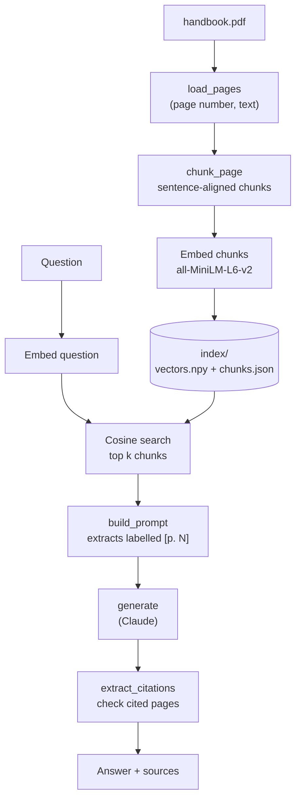

This project builds the smallest complete retrieval-augmented generation (RAG) system that is still honest about its sources: you give it a PDF, ask a question in plain English, and it answers using only what the PDF says, telling you which page each claim came from. Everything except the final model call runs on your own machine, and the whole pipeline is covered by tests that need no API key.

## Overview

A language model cannot read a 200-page PDF it has never seen, and pasting the whole file into every prompt is slow and expensive. The RAG answer is to do the reading in advance: split the document into small passages (*chunks*), turn each chunk into a list of numbers that captures its meaning (an *embedding*), and at question time fetch only the few chunks whose embeddings are closest to the question's. Those chunks, labelled with their page numbers, go into the prompt.

You will build a command-line tool, `pdfqa`, with three commands:

- `index` reads a PDF, chunks it, embeds the chunks and saves them to disk.
- `search` shows which chunks would be retrieved for a question. It needs no API key, which makes it the tool you debug with.
- `ask` retrieves, calls Claude and prints an answer with page citations that the program has checked.

The sample document is a four-page handbook for Meridian, the fictional company used throughout this course, but any text PDF works.

## Learning objectives

- Extract text from a PDF with pypdf while keeping each passage's page number.
- Split text into overlapping, sentence-aligned chunks and explain the size trade-off.
- Embed chunks locally and rank them by cosine similarity with a single NumPy matrix product.
- Build a grounded prompt that makes the model cite pages, and verify the citations in code.
- Structure a RAG program so that everything but the model call is testable offline.

## Requirements

- Python 3.10 or newer.
- About 500 MB of disk space: the embedding model is roughly 90 MB, and PyTorch, which runs it, is the rest.
- An Anthropic API key in the `ANTHROPIC_API_KEY` environment variable, needed only for the `ask` command.
- Helpful background: [Traditional RAG architecture](/learn/rag-architecture-fundamentals/traditional-rag-architecture), [PDF extraction](/learn/data-processing/pdf-extraction) and [Cosine similarity](/learn/embedding-mathematics/cosine-similarity).

## Technology stack

| Piece | Tool | Why |
| --- | --- | --- |
| PDF text extraction | pypdf | Pure Python, reads page by page, so page numbers come for free |
| Embeddings | Sentence Transformers, `all-MiniLM-L6-v2` | Small, runs on a laptop CPU, produces 384-dimensional vectors |
| Vector search | NumPy | A few hundred chunks need a matrix product, not a database |
| Generation | Claude through the Anthropic SDK | Writes the final answer from the retrieved extracts |
| Tests | pytest | Checks every stage with a fake embedder and a fake generator |
| Sample data | PyMuPDF | Only used to create the sample PDF |

## System architecture

There are two pipelines. *Indexing* runs once per document. *Answering* runs once per question and reuses the saved index.



Only the `generate` box talks to the network. Both it and the embedder are passed into the rest of the code as plain functions, so tests can swap in stand-ins.

## Folder structure

```text
pdf-question-answering/
├── requirements.txt
├── pytest.ini
├── make_sample_pdf.py      creates handbook.pdf
├── pdfqa/
│   ├── __init__.py         empty file
│   ├── ingest.py           PDF -> pages -> chunks
│   ├── index.py            embeddings, cosine search, save and load
│   ├── answer.py           prompt, model call, citation check
│   └── cli.py              the command line
└── tests/
    ├── conftest.py         fake embedder
    ├── test_ingest.py
    ├── test_index.py
    └── test_answer.py
```

## Setup

Create the folders and a virtual environment, then install the dependencies.

```bash
mkdir -p pdf-question-answering/pdfqa pdf-question-answering/tests
cd pdf-question-answering
touch pdfqa/__init__.py
python -m venv .venv
source .venv/bin/activate        # Windows: .venv\Scripts\activate
```

Save this as `requirements.txt`:

```text
pypdf
numpy
sentence-transformers
anthropic
pymupdf
pytest
```

And this as `pytest.ini`, which lets the tests import the `pdfqa` package from the project folder:

```text
[pytest]
pythonpath = .
testpaths = tests
```

```bash
pip install -r requirements.txt
export ANTHROPIC_API_KEY="your-key-here"   # only needed for the ask command
```

## Implementation

### `make_sample_pdf.py`

A script that writes a four-page PDF so that you have something to index. Skip it if you would rather use your own file.

```python
"""Create handbook.pdf, a four-page sample document to ask questions about."""
import sys

import pymupdf

PAGES = [
    ("Meridian Employee Handbook: Annual leave",
     "Every full-time employee receives 25 days of annual leave per calendar year, in addition to "
     "public holidays. Leave is booked through the HR portal and needs your manager's approval at "
     "least two weeks in advance. Up to 5 unused days carry over into the next year. Carried-over "
     "days must be used by 31 March, after which they are lost. Part-time employees receive leave "
     "in proportion to their contracted hours. If you fall ill during booked leave, tell your "
     "manager on the first day so the time can be recorded as sickness instead."),
    ("Remote work",
     "Employees may work remotely for up to 3 days a week, agreed with their manager. The remaining "
     "days are spent in the office so that teams overlap in person. Meridian provides a home-office "
     "equipment budget of 400 pounds for a desk, chair or monitor. Equipment bought with the budget "
     "belongs to the employee after two years of service. Remote workers must be reachable during "
     "their team's core hours. Working from another country for more than two weeks needs written "
     "approval from HR because of tax rules."),
    ("Expenses",
     "Expenses must be submitted within 30 days of the purchase. Any single item over 75 pounds "
     "needs a receipt, and claims without one are rejected. Submit claims in the finance system "
     "with the project code for the work they relate to. Approved claims are paid with the next "
     "monthly salary run. Alcohol is not reimbursed unless a director has approved a client event "
     "beforehand. Travel should be booked through the company travel tool, which applies the "
     "negotiated rates automatically."),
    ("IT security and support",
     "Passwords must be rotated every 90 days and may not repeat any of your last five passwords. "
     "The VPN is required whenever you connect from public Wi-Fi, such as a cafe, hotel or train. "
     "Laptops are replaced on a 3 year refresh cycle, and the old device must be returned for "
     "secure wiping. The support desk is open from 08:00 to 18:00 UK time on working days. Outside "
     "those hours, report lost or stolen devices to the emergency security line immediately. Never "
     "install software from outside the approved catalogue without a ticket."),
]


def main(out_path: str = "handbook.pdf") -> None:
    doc = pymupdf.open()
    for title, body in PAGES:
        page = doc.new_page()  # A4 by default
        page.insert_textbox(pymupdf.Rect(60, 60, 535, 100), title, fontsize=16)
        page.insert_textbox(pymupdf.Rect(60, 110, 535, 780), body, fontsize=11)
    doc.save(out_path)
    print(f"Wrote {out_path} ({len(PAGES)} pages)")


if __name__ == "__main__":
    main(*sys.argv[1:2])
```

Each tuple in `PAGES` becomes one page: `new_page()` adds an A4 page and `insert_textbox` wraps the text inside the rectangle you give it. One topic per page makes it easy to see whether a citation is right.

### `pdfqa/ingest.py`

This file turns a PDF into a list of `Chunk` objects.

```python
"""Load a PDF page by page and split each page into overlapping chunks."""
import re
from dataclasses import dataclass

from pypdf import PdfReader


@dataclass(frozen=True)
class Chunk:
    chunk_id: str  # for example "p2-c1": page 2, second chunk
    page: int      # 1-based page number, used for citations
    text: str


def load_pages(pdf_path: str) -> list[tuple[int, str]]:
    """Return (page_number, text) for every page that contains text."""
    reader = PdfReader(pdf_path)
    pages = []
    for number, page in enumerate(reader.pages, start=1):
        text = " ".join((page.extract_text() or "").split())
        if text:
            pages.append((number, text))
    return pages


_SENTENCE_END = re.compile(r"(?<=[.!?])\s+")


def chunk_page(page: int, text: str, max_chars: int = 400, overlap: int = 1) -> list[Chunk]:
    """Pack whole sentences into chunks of at most max_chars characters.

    Each new chunk starts with the last `overlap` sentences of the previous one.
    """
    sentences = [s for s in _SENTENCE_END.split(text) if s]
    groups: list[list[str]] = []
    current: list[str] = []
    for sentence in sentences:
        too_long = len(" ".join(current + [sentence])) > max_chars
        if current and too_long:
            groups.append(current)
            current = current[-overlap:] if overlap else []
        current.append(sentence)
    if current:
        groups.append(current)
    return [Chunk(f"p{page}-c{i}", page, " ".join(g)) for i, g in enumerate(groups)]


def chunk_pdf(pdf_path: str, max_chars: int = 400, overlap: int = 1) -> list[Chunk]:
    chunks = []
    for page, text in load_pages(pdf_path):
        chunks.extend(chunk_page(page, text, max_chars, overlap))
    return chunks
```

The important lines:

- `enumerate(reader.pages, start=1)` is where page numbers come from. They are attached at the moment of extraction and never separated from the text again; a citation is only as trustworthy as this bookkeeping.
- `" ".join(text.split())` collapses every run of whitespace into one space. PDFs store positioned lines, not paragraphs, so extracted text is full of line breaks that mean nothing.
- `page.extract_text() or ""` and `if text:` skip pages with no text layer, such as scanned images.
- `_SENTENCE_END` splits *after* a full stop, question mark or exclamation mark using a look-behind, so the punctuation stays with its sentence.
- In `chunk_page`, sentences are added to `current` until the next one would push the chunk past `max_chars`. The finished chunk is stored, and the new chunk starts with the last `overlap` sentences of the old one. That repeated sentence is the [chunk overlap](/learn/chunking-fundamentals/chunk-overlap): a fact that depends on the previous sentence still has it nearby.
- Chunks never cross a page boundary. That costs a little context at page breaks and buys an exact page number for every chunk.

### `pdfqa/index.py`

Embedding, searching, saving and loading.

```python
"""Embed chunks and search them with cosine similarity in NumPy."""
import json
from dataclasses import asdict
from pathlib import Path
from typing import Callable

import numpy as np

from pdfqa.ingest import Chunk

MODEL_NAME = "sentence-transformers/all-MiniLM-L6-v2"
Embedder = Callable[[list[str]], np.ndarray]  # texts -> (n, d) unit-length vectors


def local_embedder(model_name: str = MODEL_NAME) -> Embedder:
    from sentence_transformers import SentenceTransformer  # slow import, so do it lazily

    model = SentenceTransformer(model_name)
    return lambda texts: model.encode(texts, normalize_embeddings=True)


class VectorIndex:
    def __init__(self, chunks: list[Chunk], vectors: np.ndarray):
        if len(chunks) != len(vectors):
            raise ValueError("need exactly one vector per chunk")
        self.chunks = chunks
        self.vectors = np.asarray(vectors, dtype=np.float32)

    @classmethod
    def build(cls, chunks: list[Chunk], embed: Embedder) -> "VectorIndex":
        return cls(chunks, embed([c.text for c in chunks]))

    def search(self, query: str, embed: Embedder, k: int = 4) -> list[tuple[Chunk, float]]:
        query_vector = embed([query])[0]
        scores = self.vectors @ query_vector  # cosine similarity: all vectors are unit length
        top = np.argsort(-scores)[:k]
        return [(self.chunks[i], float(scores[i])) for i in top]

    def save(self, folder: str) -> None:
        path = Path(folder)
        path.mkdir(parents=True, exist_ok=True)
        np.save(path / "vectors.npy", self.vectors)
        chunks = [asdict(c) for c in self.chunks]
        (path / "chunks.json").write_text(json.dumps(chunks, indent=2), encoding="utf-8")

    @classmethod
    def load(cls, folder: str) -> "VectorIndex":
        path = Path(folder)
        records = json.loads((path / "chunks.json").read_text(encoding="utf-8"))
        return cls([Chunk(**r) for r in records], np.load(path / "vectors.npy"))
```

The important lines:

- `Embedder` is just a type name for "a function from a list of texts to a matrix of vectors". `local_embedder` returns such a function backed by the real model; the tests pass a different one.
- `normalize_embeddings=True` scales every vector to length 1. For unit-length vectors, cosine similarity equals the dot product, so `self.vectors @ query_vector` computes the similarity between the question and every chunk in one step. The result has one score per chunk.
- `np.argsort(-scores)[:k]` sorts positions from highest score to lowest and keeps the first `k`.
- `save` writes two files: the vectors as a NumPy array and the chunks as readable JSON. Row `i` of the array belongs to item `i` of the list, which is why the constructor refuses mismatched lengths.

### `pdfqa/answer.py`

The prompt, the model call and the citation check.

```python
"""Build the grounded prompt, call the model and check the citations."""
import re
from dataclasses import dataclass
from typing import Callable

from pdfqa.index import Embedder, VectorIndex
from pdfqa.ingest import Chunk

SYSTEM = (
    "You answer questions about a PDF using only the numbered page extracts provided. "
    "After every claim, cite the page it came from in the form [p. 3]. "
    "If the extracts do not contain the answer, say you don't know."
)
Generator = Callable[[str], str]  # prompt -> answer text


def build_prompt(question: str, hits: list[tuple[Chunk, float]]) -> str:
    extracts = "\n\n".join(f"[p. {chunk.page}] {chunk.text}" for chunk, _ in hits)
    return f"Page extracts:\n\n{extracts}\n\nQuestion: {question}"


def generate(prompt: str) -> str:
    """The only function in the project that needs an API key."""
    import anthropic

    client = anthropic.Anthropic()  # reads ANTHROPIC_API_KEY from the environment
    response = client.messages.create(
        model="claude-opus-5-5",
        max_tokens=1024,
        system=SYSTEM,
        messages=[{"role": "user", "content": prompt}],
    )
    return "".join(block.text for block in response.content if block.type == "text")


_CITATION = re.compile(r"\[p\.\s*(\d+)\]")


def extract_citations(answer: str, hits: list[tuple[Chunk, float]]) -> tuple[list[int], list[int]]:
    """Return (pages cited that were retrieved, pages cited that were NOT retrieved)."""
    cited = sorted({int(n) for n in _CITATION.findall(answer)})
    retrieved = {chunk.page for chunk, _ in hits}
    return [p for p in cited if p in retrieved], [p for p in cited if p not in retrieved]


@dataclass
class Answer:
    text: str
    cited_pages: list[int]
    unsupported_pages: list[int]
    hits: list[tuple[Chunk, float]]


def answer_question(
    question: str, index: VectorIndex, embed: Embedder, generate: Generator = generate, k: int = 4
) -> Answer:
    hits = index.search(question, embed, k)
    text = generate(build_prompt(question, hits))
    cited, unsupported = extract_citations(text, hits)
    return Answer(text, cited, unsupported, hits)
```

The important lines:

- `SYSTEM` gives the three instructions every grounded prompt needs: use only the extracts, cite in a fixed format, and admit when the answer is missing. See [Citation instructions](/learn/prompt-engineering-for-rag/citation-instructions) for why a fixed format matters.
- `build_prompt` prefixes each extract with `[p. N]`, the same marker the model is told to cite with. It is a pure function, so a test can assert exactly what the model will see.
- `generate` is the only place the Anthropic SDK is used. The import sits inside the function so that nothing else in the project needs the package or a key.
- `extract_citations` finds every `[p. N]` in the answer and compares it with the pages that were actually retrieved. A cited page that was not in the prompt cannot have come from the context, so it is reported as unsupported rather than silently trusted.
- `answer_question` takes `generate` as a parameter with the real function as its default. That one parameter is what makes the whole flow testable.

### `pdfqa/cli.py`

```python
"""Command line: index a PDF, search it, or ask a question."""
import argparse

from pdfqa.answer import answer_question
from pdfqa.index import VectorIndex, local_embedder
from pdfqa.ingest import chunk_pdf


def main(argv: list[str] | None = None) -> None:
    parser = argparse.ArgumentParser(prog="pdfqa", description="Ask questions about a PDF.")
    parser.add_argument("--index-dir", default="index", help="where the index is stored")
    commands = parser.add_subparsers(dest="command", required=True)
    index_cmd = commands.add_parser("index", help="chunk and embed a PDF")
    index_cmd.add_argument("pdf")
    for name, text in [("search", "show the best chunks (no API key)"), ("ask", "answer with citations")]:
        cmd = commands.add_parser(name, help=text)
        cmd.add_argument("question")
        cmd.add_argument("-k", type=int, default=4, help="number of chunks to retrieve")
    args = parser.parse_args(argv)

    embed = local_embedder()
    if args.command == "index":
        chunks = chunk_pdf(args.pdf)
        VectorIndex.build(chunks, embed).save(args.index_dir)
        pages = len({c.page for c in chunks})
        print(f"Indexed {len(chunks)} chunks from {pages} pages into {args.index_dir}/")
        return

    index = VectorIndex.load(args.index_dir)
    if args.command == "search":
        for chunk, score in index.search(args.question, embed, args.k):
            print(f"{score:.3f}  p. {chunk.page}  {chunk.text[:90]}...")
        return

    answer = answer_question(args.question, index, embed, k=args.k)
    print(answer.text)
    print("\nSources: " + ", ".join(f"p. {p}" for p in answer.cited_pages))
    if answer.unsupported_pages:
        print(f"Warning: the answer cites pages that were not retrieved: {answer.unsupported_pages}")


if __name__ == "__main__":
    main()
```

`--index-dir` is defined on the main parser, so it goes before the command name. `search` and `ask` share the same arguments, which is why they are created in a loop. Notice that `search` returns before any model call: it is safe to run without a key.

## Running it

Create the sample PDF and index it. The first run downloads the embedding model.

```bash
python make_sample_pdf.py
python -m pdfqa.cli index handbook.pdf
```

```output
Wrote handbook.pdf (4 pages)
Indexed 8 chunks from 4 pages into index/
```

Check retrieval before spending any tokens:

```bash
python -m pdfqa.cli search "How many unused leave days can I carry over, and by when must I use them?" -k 3
```

```output
0.591  p. 1  Carried-over days must be used by 31 March, after which they are lost. Part-time employees...
0.571  p. 1  Meridian Employee Handbook: Annual leave Every full-time employee receives 25 days of annu...
0.365  p. 4  IT security and support Passwords must be rotated every 90 days and may not repeat any of ...
```

The first column is the cosine similarity. Both page 1 chunks score far above the third result, which is unrelated: it is there only because you asked for three.

Now ask:

```bash
python -m pdfqa.cli ask "How many unused leave days can I carry over, and by when must I use them?"
```

This step calls Claude, so the wording varies from run to run. An illustrative answer looks like this:

```output
You can carry over up to 5 unused days into the next year [p. 1]. Carried-over days must be used by 31 March, after which they are lost [p. 1].

Sources: p. 1
```

## Testing

The tests replace the embedding model with a small deterministic function, so the suite runs in well under a second with no downloads. Save this as `tests/conftest.py`:

```python
import re
import zlib

import numpy as np
import pytest


def fake_embed(texts: list[str]) -> np.ndarray:
    """A deterministic stand-in for the embedding model: hashed bag of words."""
    vectors = np.zeros((len(texts), 256), dtype=np.float32)
    for row, text in enumerate(texts):
        for word in re.findall(r"[a-z0-9]+", text.lower()):
            vectors[row, zlib.crc32(word.encode()) % 256] += 1.0
    norms = np.linalg.norm(vectors, axis=1, keepdims=True)
    return vectors / np.maximum(norms, 1e-9)


@pytest.fixture
def embed():
    return fake_embed
```

`fake_embed` counts words into 256 buckets and normalises the result. Texts that share words get similar vectors, which is enough to test ranking logic. `zlib.crc32` is used instead of Python's `hash` because `hash` gives different values for strings in every process.

`tests/test_ingest.py`:

```python
import pytest

from pdfqa.ingest import chunk_page, chunk_pdf, load_pages

TEXT = "One two three. Four five six. Seven eight nine. Ten eleven twelve."


def test_chunks_respect_the_size_limit_and_keep_whole_sentences():
    chunks = chunk_page(3, TEXT, max_chars=40, overlap=0)
    assert [c.text for c in chunks] == ["One two three. Four five six.", "Seven eight nine. Ten eleven twelve."]
    assert all(len(c.text) <= 40 for c in chunks)


def test_overlap_repeats_the_last_sentence():
    chunks = chunk_page(3, TEXT, max_chars=40, overlap=1)
    assert chunks[1].text.startswith("Four five six.")


def test_chunks_carry_page_number_and_unique_ids():
    chunks = chunk_page(7, TEXT, max_chars=40)
    assert {c.page for c in chunks} == {7}
    assert len({c.chunk_id for c in chunks}) == len(chunks)
    assert chunks[0].chunk_id == "p7-c0"


def test_an_overlong_sentence_becomes_its_own_chunk():
    chunks = chunk_page(1, "Short one. " + "word " * 30 + "end.", max_chars=40, overlap=0)
    assert chunks[0].text == "Short one."
    assert len(chunks) == 2


def test_load_pages_reads_a_real_pdf(tmp_path):
    pytest.importorskip("pymupdf")
    from make_sample_pdf import main

    pdf = tmp_path / "handbook.pdf"
    main(str(pdf))
    pages = load_pages(str(pdf))
    assert [number for number, _ in pages] == [1, 2, 3, 4]
    assert "25 days of annual leave" in pages[0][1]
    assert all(c.page in {1, 2, 3, 4} for c in chunk_pdf(str(pdf)))
```

`tests/test_index.py`:

```python
import numpy as np
import pytest

from pdfqa.index import VectorIndex
from pdfqa.ingest import Chunk

CHUNKS = [
    Chunk("p1-c0", 1, "Employees receive 25 days of annual leave each year."),
    Chunk("p2-c0", 2, "The home-office equipment budget is 400 pounds."),
    Chunk("p3-c0", 3, "Expenses must be submitted within 30 days."),
]


def test_search_ranks_the_matching_chunk_first(embed):
    index = VectorIndex.build(CHUNKS, embed)
    hits = index.search("how many days of annual leave", embed, k=2)
    assert len(hits) == 2
    assert hits[0][0].page == 1
    assert hits[0][1] >= hits[1][1]


def test_scores_are_cosine_similarities(embed):
    index = VectorIndex.build(CHUNKS, embed)
    chunk, score = index.search(CHUNKS[2].text, embed, k=1)[0]
    assert chunk.chunk_id == "p3-c0"
    assert score == pytest.approx(1.0, abs=1e-5)  # identical text, identical direction


def test_save_and_load_round_trip(tmp_path, embed):
    index = VectorIndex.build(CHUNKS, embed)
    index.save(str(tmp_path / "idx"))
    loaded = VectorIndex.load(str(tmp_path / "idx"))
    assert loaded.chunks == CHUNKS
    assert np.allclose(loaded.vectors, index.vectors)


def test_mismatched_lengths_are_rejected():
    with pytest.raises(ValueError):
        VectorIndex(CHUNKS, np.zeros((2, 4)))
```

`tests/test_answer.py`:

```python
from pdfqa.answer import answer_question, build_prompt, extract_citations
from pdfqa.index import VectorIndex
from pdfqa.ingest import Chunk

CHUNKS = [
    Chunk("p1-c0", 1, "Employees receive 25 days of annual leave each year."),
    Chunk("p3-c0", 3, "Expenses must be submitted within 30 days."),
]
HITS = [(CHUNKS[0], 0.71), (CHUNKS[1], 0.22)]


def test_prompt_labels_every_extract_with_its_page():
    prompt = build_prompt("How much leave?", HITS)
    assert "[p. 1] Employees receive 25 days" in prompt
    assert "[p. 3] Expenses must be submitted" in prompt
    assert prompt.endswith("Question: How much leave?")


def test_citations_are_split_into_supported_and_unsupported():
    cited, unsupported = extract_citations("25 days [p. 1]. Also [p.1] and [p. 9].", HITS)
    assert cited == [1]
    assert unsupported == [9]


def test_answer_question_uses_the_generator_and_reports_sources(embed):
    seen = []

    def fake_generate(prompt: str) -> str:
        seen.append(prompt)
        return "You get 25 days of annual leave [p. 1]."

    index = VectorIndex.build(CHUNKS, embed)
    answer = answer_question("How many days of annual leave?", index, embed, fake_generate, k=1)
    assert answer.text.endswith("[p. 1].")
    assert answer.cited_pages == [1]
    assert answer.unsupported_pages == []
    assert "annual leave" in seen[0] and "Expenses" not in seen[0]  # k=1: only the best chunk
```

The last test is the pattern to remember: `fake_generate` records the prompt it was given and returns a canned answer, so the test can check both what was sent to the model and what the program did with the reply.

```bash
python -m pytest -v
```

```output
tests/test_answer.py::test_prompt_labels_every_extract_with_its_page PASSED [  8%]
tests/test_answer.py::test_citations_are_split_into_supported_and_unsupported PASSED [ 16%]
tests/test_answer.py::test_answer_question_uses_the_generator_and_reports_sources PASSED [ 25%]
tests/test_index.py::test_search_ranks_the_matching_chunk_first PASSED   [ 33%]
tests/test_index.py::test_scores_are_cosine_similarities PASSED          [ 41%]
tests/test_index.py::test_save_and_load_round_trip PASSED                [ 50%]
tests/test_index.py::test_mismatched_lengths_are_rejected PASSED         [ 58%]
tests/test_ingest.py::test_chunks_respect_the_size_limit_and_keep_whole_sentences PASSED [ 66%]
tests/test_ingest.py::test_overlap_repeats_the_last_sentence PASSED      [ 75%]
tests/test_ingest.py::test_chunks_carry_page_number_and_unique_ids PASSED [ 83%]
tests/test_ingest.py::test_an_overlong_sentence_becomes_its_own_chunk PASSED [ 91%]
tests/test_ingest.py::test_load_pages_reads_a_real_pdf PASSED            [100%]

============================== 12 passed in 0.07s ==============================
```

## Expected results

With the real embedding model, the right page should be the top result for each of these questions:

```bash
python -m pdfqa.cli search "Do I need a receipt for a 90 pound train ticket?" -k 3
python -m pdfqa.cli search "When is the support desk open?" -k 3
```

```output
0.316  p. 3  Expenses Expenses must be submitted within 30 days of the purchase. Any single item over 7...
0.260  p. 3  Alcohol is not reimbursed unless a director has approved a client event beforehand. Travel...
0.188  p. 2  Equipment bought with the budget belongs to the employee after two years of service. Remot...
0.681  p. 4  The support desk is open from 08:00 to 18:00 UK time on working days. Outside those hours,...
0.417  p. 4  IT security and support Passwords must be rotated every 90 days and may not repeat any of ...
0.291  p. 1  Carried-over days must be used by 31 March, after which they are lost. Part-time employees...
```

Two things are worth noticing. First, the receipt question retrieves the right chunk with a score of only 0.316, while the support desk question scores 0.681. Scores are not comparable between questions: a question phrased differently from the document ("90 pound train ticket" against "any single item over 75 pounds") scores lower even when retrieval is correct. Second, the receipt question needs reasoning, not just lookup: the model must compare 90 with 75. Retrieval's job is only to put the rule in front of it.

Ask something the handbook does not cover, such as the parental leave policy, and a well-behaved answer says it does not know and cites nothing.

## Common problems

- **`TypeError: "Could not resolve authentication method..."`** when running `ask`. `ANTHROPIC_API_KEY` is not set in this terminal. Export it and try again. `index` and `search` never need it.
- **`Indexed 0 chunks from 0 pages`.** The PDF has no text layer; it is probably a scan. pypdf does not do optical character recognition. See [OCR](/learn/advanced-document-parsing/ocr).
- **`ModuleNotFoundError: No module named 'pdfqa'`.** Run commands from the project folder, with `python -m pdfqa.cli`, not `python pdfqa/cli.py`.
- **`FileNotFoundError: ... index/chunks.json`.** You ran `search` or `ask` before `index`, or from a different folder.
- **Words glued together or oddly spaced in chunks.** Text extraction depends on how the PDF was produced. Multi-column pages and tables are the usual culprits; a layout-aware parser such as [PyMuPDF](/learn/advanced-document-parsing/pymupdf) often does better.
- **The answer cites a page that was not retrieved.** The program prints a warning. Treat the claim as unverified and inspect the output of `search` for that question.
- **The first run seems to hang.** It is downloading the embedding model. Later runs load it from the local cache.

## Possible improvements

- **Refuse on weak retrieval.** Skip the model call when the best score is below a threshold. The [knowledge base chatbot project](/projects/knowledge-base-chatbot) does exactly this.
- **Several PDFs.** Add a `source` field to `Chunk` and cite as `[handbook.pdf, p. 3]`.
- **Token-based chunk sizes.** Characters are a rough proxy; see [Token-based chunking](/learn/chunking-fundamentals/token-based-chunking).
- **Quote checking.** Ask the model to quote the sentence that supports each claim and verify that the quote appears in the cited chunk.
- **Hybrid retrieval.** Exact terms such as product codes are better served by keyword search; the [hybrid search project](/projects/hybrid-search-rag) combines both.
- **Streaming.** Print the answer as it is generated using the SDK's `client.messages.stream`.
- **A retrieval test set.** Write twenty question and page pairs and measure how often the right page is in the top three, so that changes to chunk size are judged by numbers.
