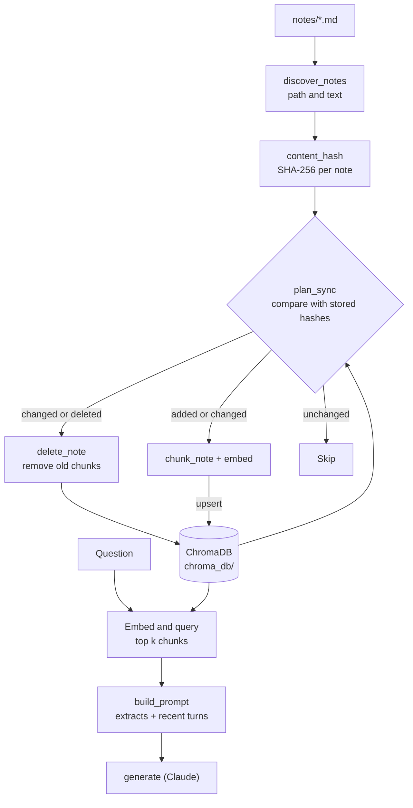

Notes are only useful if you can find things in them. This project builds a chatbot over a folder of Markdown notes: it indexes the notes into ChromaDB, a vector database that keeps its data on disk, and answers questions with the name of the note each fact came from. The interesting engineering is in the word *persistent*: the index survives restarts, and when you edit, add or delete a note, only that note is re-indexed.

## Overview

The [PDF question-answering project](/projects/pdf-question-answering) indexed one file that never changed. Notes change every day, and re-embedding hundreds of files each time you start the program would be slow and wasteful. So this project adds two ideas:

- **A persistent vector store.** ChromaDB writes vectors, texts and metadata to a folder. The next run opens that folder instead of starting from nothing.
- **Change detection.** Each note's text is reduced to a short fingerprint, a *content hash*. The hash is stored alongside the note's chunks. On every start the program compares the hashes on disk with the hashes in the index and sorts notes into four groups: added, changed, deleted and unchanged. Only the first three cost any work.

Chunking follows the notes' own structure: one chunk per Markdown heading section.

## Learning objectives

- Split Markdown into chunks along its headings and keep the heading as metadata.
- Use ChromaDB's `PersistentClient`, `upsert`, `query` and `delete` with embeddings you compute yourself.
- Detect added, changed and deleted files with content hashes and re-index only those.
- Explain why a changed document's old chunks must be deleted before the new ones are added.
- Test synchronisation logic against an in-memory stand-in for the database.

## Requirements

- **Python 3.10 to 3.12.** ChromaDB depends on compiled packages that are published for specific Python versions, usually some time after a new Python is released. On a Python that is too new, `pip` may fail to build it or may quietly install a years-old release that crashes on import (see Common problems). If that happens, create the virtual environment with an older interpreter, for example `python3.12 -m venv .venv`.
- An Anthropic API key in `ANTHROPIC_API_KEY`, needed only for generated answers.
- Helpful background: [ChromaDB](/learn/vector-database-ecosystem/chromadb), [Incremental ingestion](/learn/understanding-document-ingestion/incremental-ingestion) and [Heading-based chunking](/learn/advanced-chunking-strategies/heading-based-chunking).

> [!NOTE]
> How this tutorial was checked: note discovery, hashing, chunking, the sync logic, prompt building and the chat flow were all run, with the real embedding model, and are covered by the tests below. ChromaDB itself could not be installed on the Python 3.15 machine used for checking, so `ChromaStore` (about 40 lines) is written against ChromaDB's documented API and was exercised only through a stand-in with the same methods. If a ChromaDB call misbehaves on your version, that class is the one place to look.

## Technology stack

| Piece | Tool | Why |
| --- | --- | --- |
| Vector store | ChromaDB | Runs inside your Python process, persists to a folder, filters by metadata |
| Embeddings | Sentence Transformers, `all-MiniLM-L6-v2` | Local and free; your notes never leave your machine at indexing time |
| Generation | Claude through the Anthropic SDK | Writes the answer from the retrieved extracts |
| Change detection | `hashlib.sha256` | Standard library; identical text always gives an identical hash |
| Tests | pytest | Run the whole flow with fakes: no database, model or key |

ChromaDB can embed text for you with a built-in model. This project computes embeddings itself and passes them in, so that you can see every step and so that the embedding model is an explicit choice rather than a default.

## System architecture



## Folder structure

```text
personal-notes-chatbot/
├── requirements.txt
├── pytest.ini
├── make_sample_notes.py    creates notes/
├── notes/                  your Markdown files
├── chroma_db/              created by ChromaDB on first run
├── notesbot/
│   ├── __init__.py         empty file
│   ├── notes.py            discovery, hashing, chunking
│   ├── store.py            the ChromaDB wrapper
│   ├── sync.py             change detection
│   └── chat.py             prompt, model call, chat loop
└── tests/
    ├── conftest.py         fake embedder and in-memory store
    ├── test_notes.py
    ├── test_sync.py
    └── test_chat.py
```

## Setup

```bash
mkdir -p personal-notes-chatbot/notesbot personal-notes-chatbot/tests
cd personal-notes-chatbot
touch notesbot/__init__.py
python -m venv .venv
source .venv/bin/activate        # Windows: .venv\Scripts\activate
```

`requirements.txt`:

```text
chromadb
sentence-transformers
anthropic
pytest
```

`pytest.ini`:

```text
[pytest]
pythonpath = .
testpaths = tests
```

```bash
pip install -r requirements.txt
export ANTHROPIC_API_KEY="your-key-here"   # only needed for generated answers
```

## Implementation

### `make_sample_notes.py`

Four short notes written by an imaginary Meridian employee. Use your own notes folder instead if you have one.

```python
"""Create a small notes/ folder to chat with."""
from pathlib import Path

NOTES = {
    "work/leave.md": """# Leave

## Allowance
Meridian gives 25 days of annual leave. Up to 5 unused days carry over and must be used by 31 March.

## My plans
Booked 14 to 18 July for the Lake District. Still have to book the days around Christmas.
""",
    "work/expenses.md": """# Expenses

Submit within 30 days of buying. Anything over £75 needs a receipt.

## Outstanding
- Train to the Leeds client workshop, £62, not yet submitted.
- Conference ticket, £180, receipt is in my email.
""",
    "work/it-setup.md": """# IT setup

## Passwords and VPN
Password rotation is every 90 days. VPN is required on public Wi-Fi.

## Hardware
Laptop refresh cycle is 3 years; mine is due next spring.
Support desk hours are 08:00 to 18:00 UK time.
""",
    "projects/askmeridian.md": """# AskMeridian ideas

## Retrieval
Try heading-based chunks for the IT runbooks, because each runbook step has its own heading.

## Open questions
Who owns the handbook export? Ask Priya in the platform team.
""",
}

for name, text in NOTES.items():
    path = Path("notes") / name
    path.parent.mkdir(parents=True, exist_ok=True)
    path.write_text(text, encoding="utf-8")
print(f"Wrote {len(NOTES)} notes to notes/")
```

### `notesbot/notes.py`

```python
"""Find Markdown notes, fingerprint them and split them into chunks by heading."""
import hashlib
import re
from dataclasses import dataclass
from pathlib import Path


@dataclass(frozen=True)
class NoteChunk:
    chunk_id: str  # for example "work/leave.md#1"
    path: str      # note path relative to the notes folder
    heading: str
    text: str


@dataclass(frozen=True)
class Hit:
    chunk: NoteChunk
    score: float  # cosine similarity, higher is better


def discover_notes(folder: str) -> dict[str, str]:
    """Return {relative path: text} for every non-empty .md file under folder."""
    root = Path(folder)
    notes = {}
    for file in sorted(root.rglob("*.md")):
        text = file.read_text(encoding="utf-8")
        if text.strip():
            notes[file.relative_to(root).as_posix()] = text
    return notes


def content_hash(text: str) -> str:
    return hashlib.sha256(text.encode("utf-8")).hexdigest()


_HEADING = re.compile(r"^#{1,6}\s+(.*)$")


def _pack(paragraphs: list[str], max_chars: int) -> list[str]:
    """Join paragraphs into pieces of at most max_chars (a longer paragraph stands alone)."""
    pieces: list[str] = []
    for paragraph in paragraphs:
        if pieces and len(pieces[-1]) + len(paragraph) + 2 <= max_chars:
            pieces[-1] += "\n\n" + paragraph
        else:
            pieces.append(paragraph)
    return pieces


def chunk_note(path: str, text: str, max_chars: int = 800) -> list[NoteChunk]:
    """One chunk per heading section; long sections are split at blank lines."""
    sections: list[tuple[str, list[str]]] = [("", [])]
    for line in text.splitlines():
        match = _HEADING.match(line)
        if match:
            sections.append((match.group(1).strip(), []))
        else:
            sections[-1][1].append(line)

    chunks: list[NoteChunk] = []
    for heading, lines in sections:
        paragraphs = [p.strip() for p in "\n".join(lines).split("\n\n") if p.strip()]
        for piece in _pack(paragraphs, max_chars):
            body = f"{heading}\n{piece}" if heading else piece
            chunks.append(NoteChunk(f"{path}#{len(chunks)}", path, heading, body))
    return chunks
```

The important lines:

- `discover_notes` uses `rglob("*.md")` to walk sub-folders and stores each path *relative to the notes folder* with forward slashes (`as_posix`). That relative path is the note's identity in the index, so moving the whole folder does not invalidate anything.
- `content_hash` returns the SHA-256 digest of the text. Change one character and the digest changes completely; leave the text alone and it never changes. File modification times are a weaker signal: they change when a file is copied or synced even if its content is identical.
- `chunk_note` walks the lines once. A heading line starts a new section; any other line joins the current one. The first section has an empty heading and catches text that appears before any heading.
- The heading is prepended to the chunk text (`f"{heading}\n{piece}"`). A section called "Outstanding" that lists two purchases is far easier to retrieve, and for the model to interpret, with its heading attached.
- `chunk_id` is the note path plus a counter, such as `work/leave.md#1`. Identifiers must be unique across the whole collection.

### `notesbot/store.py`

```python
"""A thin wrapper around a persistent ChromaDB collection."""
import numpy as np

from notesbot.notes import Hit, NoteChunk


class ChromaStore:
    def __init__(self, db_path: str = "chroma_db", collection: str = "notes"):
        import chromadb  # imported here so the rest of the project works without it

        self.client = chromadb.PersistentClient(path=db_path)
        self.collection = self.client.get_or_create_collection(
            name=collection, metadata={"hnsw:space": "cosine"}
        )

    def indexed_hashes(self) -> dict[str, str]:
        """Return {note path: content hash} for every note currently in the index."""
        stored = self.collection.get(include=["metadatas"])
        return {meta["path"]: meta["hash"] for meta in stored["metadatas"]}

    def delete_note(self, path: str) -> None:
        self.collection.delete(where={"path": path})

    def add_chunks(self, chunks: list[NoteChunk], vectors: np.ndarray, note_hash: str) -> None:
        self.collection.upsert(
            ids=[c.chunk_id for c in chunks],
            embeddings=np.asarray(vectors).tolist(),
            documents=[c.text for c in chunks],
            metadatas=[{"path": c.path, "heading": c.heading, "hash": note_hash} for c in chunks],
        )

    def query(self, vector: np.ndarray, k: int = 4) -> list[Hit]:
        count = self.collection.count()
        if count == 0:
            return []
        result = self.collection.query(
            query_embeddings=[np.asarray(vector).tolist()],
            n_results=min(k, count),
            include=["documents", "metadatas", "distances"],
        )
        rows = zip(result["ids"][0], result["documents"][0], result["metadatas"][0], result["distances"][0])
        return [
            Hit(NoteChunk(chunk_id, meta["path"], meta["heading"], text), 1.0 - distance)
            for chunk_id, text, meta, distance in rows
        ]
```

The important lines:

- `PersistentClient(path=...)` opens the database folder, creating it if needed. `get_or_create_collection` does the same for a named collection, so the first run and the hundredth use the same code.
- `metadata={"hnsw:space": "cosine"}` asks for cosine distance. ChromaDB's default is squared Euclidean distance, and the setting is fixed when the collection is created.
- `indexed_hashes` fetches only metadata, not documents or vectors, and builds the `{path: hash}` map that change detection needs. Every chunk of a note carries the same hash, so later chunks simply overwrite the same entry.
- `delete(where={"path": path})` removes every chunk whose metadata matches: all chunks of one note in one call.
- `upsert` inserts new ids and overwrites existing ones, so re-running after a crash halfway through a sync does no harm.
- `query` returns lists of lists, one inner list per query vector; `[0]` picks the results for our single query. ChromaDB reports cosine *distance*, which is one minus cosine similarity, so `1.0 - distance` converts back to a score where higher is better. `min(k, count)` avoids asking for more results than exist.

### `notesbot/sync.py`

```python
"""Bring the index in step with the notes folder, touching only what changed."""
from dataclasses import dataclass, field

from notesbot.notes import chunk_note, content_hash, discover_notes


@dataclass
class SyncPlan:
    added: list[str] = field(default_factory=list)
    changed: list[str] = field(default_factory=list)
    deleted: list[str] = field(default_factory=list)
    unchanged: list[str] = field(default_factory=list)

    def summary(self) -> str:
        return (
            f"{len(self.added)} added, {len(self.changed)} changed, "
            f"{len(self.deleted)} deleted, {len(self.unchanged)} unchanged"
        )


def plan_sync(on_disk: dict[str, str], indexed: dict[str, str]) -> SyncPlan:
    """Compare {path: hash} on disk with {path: hash} in the index."""
    plan = SyncPlan()
    for path, digest in sorted(on_disk.items()):
        if path not in indexed:
            plan.added.append(path)
        elif indexed[path] != digest:
            plan.changed.append(path)
        else:
            plan.unchanged.append(path)
    plan.deleted = sorted(set(indexed) - set(on_disk))
    return plan


def sync(folder: str, store, embed, max_chars: int = 800) -> SyncPlan:
    notes = discover_notes(folder)
    hashes = {path: content_hash(text) for path, text in notes.items()}
    plan = plan_sync(hashes, store.indexed_hashes())
    for path in plan.deleted + plan.changed:
        store.delete_note(path)  # remove every old chunk before re-adding
    for path in plan.added + plan.changed:
        chunks = chunk_note(path, notes[path], max_chars)
        if chunks:
            store.add_chunks(chunks, embed([c.text for c in chunks]), hashes[path])
    return plan
```

The important lines:

- `plan_sync` is a pure function of two dictionaries. It touches no files and no database, which makes the core of the project trivially testable.
- In `sync`, old chunks are deleted *before* the new ones are added. Suppose a note had five sections and you cut it to two. Upserting alone would overwrite chunks `#0` and `#1` and leave `#2` to `#4` in the index, answering questions from text you deleted. This stale-chunk bug is the most common mistake in incremental indexing.
- `store` and `embed` are parameters. `sync` needs only an object with the four `ChromaStore` methods; the tests pass a list-backed one.

### `notesbot/chat.py`

```python
"""The chat loop: sync the index, then retrieve and answer each question."""
import argparse

from notesbot.notes import Hit
from notesbot.sync import sync

SYSTEM = (
    "You are an assistant for the user's personal notes. Answer only from the note extracts "
    "provided. Cite the note each fact came from in square brackets, like [work/leave.md]. "
    "If the notes do not contain the answer, say so."
)
MODEL_NAME = "sentence-transformers/all-MiniLM-L6-v2"


def local_embedder():
    from sentence_transformers import SentenceTransformer

    model = SentenceTransformer(MODEL_NAME)
    return lambda texts: model.encode(texts, normalize_embeddings=True)


def build_prompt(question: str, hits: list[Hit], history: list[tuple[str, str]]) -> str:
    extracts = "\n\n".join(f"[{hit.chunk.path}]\n{hit.chunk.text}" for hit in hits)
    past = "".join(f"User: {q}\nAssistant: {a}\n" for q, a in history[-3:])
    conversation = f"Conversation so far:\n{past}\n" if past else ""
    return f"Note extracts:\n\n{extracts}\n\n{conversation}Question: {question}"


def generate(prompt: str) -> str:
    """The only function that needs an API key."""
    import anthropic

    client = anthropic.Anthropic()  # reads ANTHROPIC_API_KEY from the environment
    response = client.messages.create(
        model="claude-opus-5-5",
        max_tokens=1024,
        system=SYSTEM,
        messages=[{"role": "user", "content": prompt}],
    )
    return "".join(block.text for block in response.content if block.type == "text")


def reply(question, store, embed, generate=generate, history=None, k: int = 4) -> tuple[str, list[Hit]]:
    history = history if history is not None else []
    hits = store.query(embed([question])[0], k)
    answer = generate(build_prompt(question, hits, history))
    history.append((question, answer))
    return answer, hits


def main() -> None:
    parser = argparse.ArgumentParser(description="Chat with a folder of Markdown notes.")
    parser.add_argument("folder")
    parser.add_argument("--db", default="chroma_db", help="where ChromaDB keeps its files")
    parser.add_argument("--retrieval-only", action="store_true", help="show matches, skip the model")
    args = parser.parse_args()

    from notesbot.store import ChromaStore

    store, embed = ChromaStore(args.db), local_embedder()
    print("Synced:", sync(args.folder, store, embed).summary())
    history: list[tuple[str, str]] = []
    while True:
        try:
            question = input("you> ").strip()
        except EOFError:
            break
        if question == "/quit":
            break
        if question == "/sync":
            print("Synced:", sync(args.folder, store, embed).summary())
        elif question and args.retrieval_only:
            for hit in store.query(embed([question])[0]):
                print(f"{hit.score:.3f}  {hit.chunk.path}  ({hit.chunk.heading})")
        elif question:
            answer, _ = reply(question, store, embed, history=history)
            print(answer, "\n")


if __name__ == "__main__":
    main()
```

The important lines:

- `build_prompt` labels each extract with its note path, the same marker the system prompt tells the model to cite.
- `history[-3:]` keeps the last three exchanges in the prompt so the model can resolve "it" and "that". Retrieval still uses only the current question; the [knowledge base chatbot project](/projects/knowledge-base-chatbot) improves on that.
- `generate` is the only function that touches the Anthropic SDK, and `reply` receives it as a parameter.
- `main` syncs on start-up and again whenever you type `/sync`, so you can edit a note in another window and pick up the change without restarting. `--retrieval-only` prints the matched chunks instead of calling the model.

## Running it

```bash
python make_sample_notes.py
python -m notesbot.chat notes --retrieval-only
```

Type a few questions, then `/quit`:

```output
Wrote 4 notes to notes/
Synced: 4 added, 0 changed, 0 deleted, 0 unchanged
you> How many leave days can I carry over?
0.662  work/leave.md  (Allowance)
0.293  work/leave.md  (My plans)
0.250  work/it-setup.md  (Hardware)
0.247  work/it-setup.md  (Passwords and VPN)
you> When is my laptop due for replacement?
0.682  work/it-setup.md  (Hardware)
0.314  work/expenses.md  (Expenses)
0.210  work/leave.md  (My plans)
0.206  work/it-setup.md  (Passwords and VPN)
you> Who should I ask about the handbook export?
0.741  projects/askmeridian.md  (Open questions)
0.239  projects/askmeridian.md  (Retrieval)
0.231  work/expenses.md  (Outstanding)
0.190  work/expenses.md  (Expenses)
you> /quit
```

Each line is a cosine similarity, the note and the section heading. The correct section wins clearly each time. Start the program again and nothing is re-embedded:

```output
Synced: 0 added, 0 changed, 0 deleted, 4 unchanged
```

Now change the folder: append a section to one note, delete another and create a third.

```bash
printf '\n## Reading\nFinish the BM25 chapter before the retrieval workshop.\n' >> notes/projects/askmeridian.md
rm notes/work/expenses.md
printf 'Remote work: up to 3 days a week. The home-office equipment budget is £400.\n' > notes/work/remote.md
python -m notesbot.chat notes --retrieval-only
```

```output
Synced: 1 added, 1 changed, 1 deleted, 2 unchanged
you> What is the home-office budget?
0.529  work/remote.md  ()
0.209  work/leave.md  (Allowance)
0.205  work/leave.md  (My plans)
0.134  projects/askmeridian.md  (Open questions)
you> Which expenses have I not submitted yet?
0.239  work/leave.md  (My plans)
0.217  work/leave.md  (Allowance)
0.202  work/remote.md  ()
0.199  projects/askmeridian.md  (Open questions)
you> /quit
```

The new note is found immediately, and the deleted expenses note no longer appears: the best match for the expenses question is now an unrelated chunk scoring 0.239. (Before the deletion, `work/expenses.md` was the top result for the same question at 0.556.)

Without `--retrieval-only` the program calls Claude. The wording will vary; an illustrative exchange looks like this:

```output
you> How many leave days can I carry over?
You can carry over up to 5 unused days, and they must be used by 31 March [work/leave.md].

you> And how many do I get in total?
25 days of annual leave [work/leave.md].
```

## Testing

`tests/conftest.py` provides the two fakes: a word-counting embedder and `MemoryStore`, a list-backed class with the same four methods as `ChromaStore`.

```python
import re
import zlib

import numpy as np
import pytest

from notesbot.notes import Hit


def fake_embed(texts: list[str]) -> np.ndarray:
    """Deterministic stand-in for the embedding model: hashed bag of words."""
    vectors = np.zeros((len(texts), 256), dtype=np.float32)
    for row, text in enumerate(texts):
        for word in re.findall(r"[a-z0-9]+", text.lower()):
            vectors[row, zlib.crc32(word.encode()) % 256] += 1.0
    return vectors / np.maximum(np.linalg.norm(vectors, axis=1, keepdims=True), 1e-9)


class MemoryStore:
    """Has the same four methods as ChromaStore, but keeps everything in a list."""

    def __init__(self):
        self.rows = []  # (chunk, vector, note_hash)
        self.embedded = 0  # how many chunks were ever added

    def indexed_hashes(self):
        return {chunk.path: digest for chunk, _, digest in self.rows}

    def delete_note(self, path):
        self.rows = [row for row in self.rows if row[0].path != path]

    def add_chunks(self, chunks, vectors, note_hash):
        self.embedded += len(chunks)
        self.rows += [(c, v, note_hash) for c, v in zip(chunks, vectors)]

    def query(self, vector, k=4):
        hits = [Hit(chunk, float(v @ vector)) for chunk, v, _ in self.rows]
        return sorted(hits, key=lambda hit: -hit.score)[:k]


@pytest.fixture
def embed():
    return fake_embed


@pytest.fixture
def store():
    return MemoryStore()


@pytest.fixture
def notes_dir(tmp_path):
    (tmp_path / "work").mkdir()
    (tmp_path / "work" / "leave.md").write_text("# Leave\n\nAnnual leave is 25 days.\n", encoding="utf-8")
    (tmp_path / "vpn.md").write_text("# VPN\n\nVPN is required on public Wi-Fi.\n", encoding="utf-8")
    return tmp_path
```

`tests/test_notes.py`:

```python
from notesbot.notes import chunk_note, content_hash, discover_notes

NOTE = "Intro line.\n\n# Leave\n\n## Allowance\n25 days.\n\n## Plans\nJuly trip.\n\nChristmas.\n"


def test_discover_finds_nested_markdown_only(notes_dir):
    (notes_dir / "todo.txt").write_text("not a note", encoding="utf-8")
    (notes_dir / "empty.md").write_text("  \n", encoding="utf-8")
    assert sorted(discover_notes(str(notes_dir))) == ["vpn.md", "work/leave.md"]


def test_hash_changes_only_when_content_changes():
    assert content_hash("a") == content_hash("a")
    assert content_hash("a") != content_hash("a ")


def test_one_chunk_per_heading_section_with_the_heading_in_the_text():
    chunks = chunk_note("work/leave.md", NOTE)
    assert [c.heading for c in chunks] == ["", "Allowance", "Plans"]
    assert chunks[1].text == "Allowance\n25 days."
    assert [c.chunk_id for c in chunks] == ["work/leave.md#0", "work/leave.md#1", "work/leave.md#2"]


def test_long_sections_are_split_at_blank_lines():
    chunks = chunk_note("n.md", NOTE, max_chars=12)
    assert [c.text for c in chunks][-2:] == ["Plans\nJuly trip.", "Plans\nChristmas."]
```

`tests/test_sync.py`:

```python
from notesbot.sync import plan_sync, sync


def test_plan_sorts_notes_into_four_groups():
    plan = plan_sync(on_disk={"a.md": "1", "b.md": "2", "c.md": "3"}, indexed={"b.md": "2", "c.md": "old", "d.md": "4"})
    assert (plan.added, plan.changed, plan.deleted, plan.unchanged) == (["a.md"], ["c.md"], ["d.md"], ["b.md"])


def test_second_sync_embeds_nothing(notes_dir, store, embed):
    assert sync(str(notes_dir), store, embed).added == ["vpn.md", "work/leave.md"]
    embedded = store.embedded
    plan = sync(str(notes_dir), store, embed)
    assert plan.unchanged == ["vpn.md", "work/leave.md"]
    assert store.embedded == embedded


def test_edit_replaces_old_chunks_and_delete_removes_them(notes_dir, store, embed):
    sync(str(notes_dir), store, embed)
    (notes_dir / "work" / "leave.md").write_text("# Leave\n\nCarry over 5 days.\n", encoding="utf-8")
    (notes_dir / "vpn.md").unlink()
    plan = sync(str(notes_dir), store, embed)
    assert (plan.changed, plan.deleted) == (["work/leave.md"], ["vpn.md"])
    texts = [chunk.text for chunk, _, _ in store.rows]
    assert texts == ["Leave\nCarry over 5 days."]
```

`test_second_sync_embeds_nothing` proves the point of the project: the counter of embedded chunks does not move on the second run. `test_edit_replaces_old_chunks_and_delete_removes_them` guards against the stale-chunk bug.

`tests/test_chat.py`:

```python
from notesbot.chat import build_prompt, reply
from notesbot.sync import sync


def test_reply_retrieves_then_calls_the_generator(notes_dir, store, embed):
    sync(str(notes_dir), store, embed)
    prompts = []

    def fake_generate(prompt):
        prompts.append(prompt)
        return "25 days [work/leave.md]."

    history = []
    answer, hits = reply("How many days of annual leave?", store, embed, fake_generate, history, k=1)
    assert answer == "25 days [work/leave.md]."
    assert hits[0].chunk.path == "work/leave.md"
    assert "[work/leave.md]\nLeave\nAnnual leave is 25 days." in prompts[0]
    assert history == [("How many days of annual leave?", answer)]


def test_prompt_includes_only_the_last_three_turns():
    history = [(f"q{i}", f"a{i}") for i in range(5)]
    prompt = build_prompt("next?", [], history)
    assert "q1" not in prompt and "User: q2\nAssistant: a2" in prompt
    assert prompt.endswith("Question: next?")
```

```bash
python -m pytest -v
```

```output
tests/test_chat.py::test_reply_retrieves_then_calls_the_generator PASSED [ 11%]
tests/test_chat.py::test_prompt_includes_only_the_last_three_turns PASSED [ 22%]
tests/test_notes.py::test_discover_finds_nested_markdown_only PASSED     [ 33%]
tests/test_notes.py::test_hash_changes_only_when_content_changes PASSED  [ 44%]
tests/test_notes.py::test_one_chunk_per_heading_section_with_the_heading_in_the_text PASSED [ 55%]
tests/test_notes.py::test_long_sections_are_split_at_blank_lines PASSED  [ 66%]
tests/test_sync.py::test_plan_sorts_notes_into_four_groups PASSED        [ 77%]
tests/test_sync.py::test_second_sync_embeds_nothing PASSED               [ 88%]
tests/test_sync.py::test_edit_replaces_old_chunks_and_delete_removes_them PASSED [100%]

============================== 9 passed in 0.02s ===============================
```

These tests do not exercise ChromaDB. Once it is installed, the session in "Running it" is the integration test: the three `Synced:` lines must match.

## Expected results

- First run: every note is reported as added and a `chroma_db/` folder appears.
- Second run with no edits: everything is unchanged, and start-up takes only as long as loading the embedding model.
- After an edit, a deletion and a new file: exactly one changed, one deleted and one added.
- Retrieval puts the right note and section first for questions that the notes answer, with a clear gap to the second result. Scores from ChromaDB can differ from those above in the last decimal place.
- A question the notes cannot answer still returns four chunks, all with low scores. Whether the chatbot then admits ignorance depends on the model following the system prompt.

## Common problems

- **`pydantic.errors.PydanticImportError: BaseSettings has been moved to the pydantic-settings package`** on `import chromadb`. `pip` installed a very old ChromaDB release because no current one supports your Python version. Recreate the virtual environment with Python 3.10 to 3.12 and reinstall.
- **`pip install chromadb` fails while building a dependency.** Same cause, same fix.
- **Every note is "changed" on every run.** Something rewrites the files between runs, such as an editor that updates a timestamp inside the note. Hash only the part of the text you index.
- **Scores look wrong or negative after changing the distance setting.** The distance metric is fixed when a collection is created. Delete the `chroma_db/` folder and re-sync.
- **You switched embedding model and results are nonsense, or ChromaDB reports a dimension mismatch.** Vectors from different models are not comparable. Delete `chroma_db/` and re-index.
- **A `#` comment inside a fenced code block starts a new chunk.** The heading detector works line by line and does not know about code fences. See [Markdown chunking](/learn/advanced-chunking-strategies/markdown-chunking) for a parser-based approach.
- **`TypeError: "Could not resolve authentication method..."`.** `ANTHROPIC_API_KEY` is not set. Use `--retrieval-only` or export the key.

## Possible improvements

- **Refuse on low scores**, as the [knowledge base chatbot project](/projects/knowledge-base-chatbot) does, instead of relying on the prompt alone.
- **Watch the folder** with the `watchdog` package and sync on every save rather than on demand.
- **Chunk-level change detection.** Hash each section rather than each note, so that editing one section of a long note re-embeds only that section.
- **Metadata filters.** Store the top-level folder as metadata and pass a `where` filter to `query` to search only `work/` notes.
- **Heading paths.** Record the full trail ("Leave > My plans") so that nested sections keep their context.
- **Front matter and tags.** Parse YAML front matter into metadata and exclude it from the hashed text.
- **Show sources.** Print the retrieved note paths under each answer and check that every cited path was actually retrieved.
