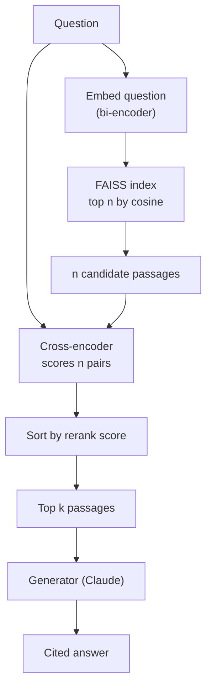

A vector index answers "which passages are about the same thing as this question?" quickly, but it compares two vectors that were computed separately, so it often ranks a passage on the right topic above the passage that actually contains the answer. A **reranker** is a second model that reads the question and each candidate passage together and re-scores them. In this project you add that second stage to a FAISS retriever and measure what it buys and what it costs.

The retrieval, reranking, evaluation and tests below were all run; the tables are from that run. Only the final Claude call was not, because no API key was available.

## Overview

The corpus is 20 paragraph-length passages from the handbook of the fictional company Meridian. Each passage holds three related facts, as real handbook paragraphs do. That matters: when a passage covers three things, its single embedding is a blend of all three, and a question about one of them may sit closer to some other passage.

The pipeline has two stages:

1. **First stage.** Embed the question with `all-MiniLM-L6-v2` and fetch the top *n* passages from a FAISS index.
2. **Second stage.** Score each (question, passage) pair with a cross-encoder and keep the best *k*.

An evaluation script runs 30 labelled questions through the pipeline with and without the second stage and reports precision@1, precision@3, MRR and latency, for several values of *n* and for two rerankers: `BAAI/bge-reranker-base` (the default, 278 million parameters) and the much smaller `cross-encoder/ms-marco-MiniLM-L-6-v2`.

## Learning objectives

- Build an exact FAISS index over normalised embeddings and query it.
- Score query-passage pairs with a `sentence-transformers` `CrossEncoder`.
- Combine both into a two-stage pipeline whose stages can be timed and tested separately.
- Measure precision@k and latency before and after reranking, and for different candidate counts.
- Decide from measurements, not from model size, which reranker to deploy.

## Requirements

- Python 3.10 or later; no GPU.
- About 1.3 GB of disk for the model downloads: 90 MB for the embedder, 1.1 GB for the BGE reranker, 90 MB for the small reranker.
- An Anthropic API key only if you want a generated answer.
- Background: [Why reranking is needed](/learn/reranking-fundamentals/why-reranking-is-needed), [Cross-encoders](/learn/reranking-fundamentals/cross-encoders), [Two-stage retrieval](/learn/advanced-retrieval-optimisation/two-stage-retrieval) and [Precision@K](/learn/retrieval-evaluation/precision-k).

## Technology stack

| Piece | Choice | Why |
| --- | --- | --- |
| Embeddings | `sentence-transformers/all-MiniLM-L6-v2` | A bi-encoder: each text is embedded on its own, so documents are embedded once, ahead of time |
| First-stage index | FAISS `IndexFlatIP` | Exact search; no approximation to confuse the measurement |
| Reranker | `BAAI/bge-reranker-base` through `CrossEncoder` | The listed model; swap it with one environment variable |
| Generation | Claude through the Anthropic SDK | Isolated in one class |
| Tests | pytest with fake models | The suite needs no downloads |

## System architecture



The first stage costs one small model call plus a vector search, whatever the size of *n*. The second stage costs one forward pass of a larger model **per candidate**. That asymmetry is the whole design: use the cheap model to cut thousands of passages down to a handful, and spend the expensive model only on those.

## Folder structure

```text
reranking-powered-rag/
├── requirements.txt
├── evaluate.py
├── ask.py
├── data/
│   ├── corpus.jsonl
│   └── eval.jsonl
├── app/
│   ├── __init__.py
│   ├── corpus.py
│   ├── first_stage.py
│   ├── rerank.py
│   ├── pipeline.py
│   ├── metrics.py
│   └── generate.py
└── tests/
    ├── __init__.py
    ├── conftest.py
    └── test_pipeline.py
```

`tests/__init__.py` is empty. `app/__init__.py` is not; see below.

## Setup

```bash
mkdir reranking-powered-rag && cd reranking-powered-rag
python -m venv .venv && source .venv/bin/activate
mkdir app data tests && touch tests/__init__.py
```

Create `requirements.txt`:

```text
sentence-transformers>=3.0
faiss-cpu>=1.8
numpy>=1.26
anthropic>=0.80
pytest>=8.0
```

```bash
pip install -r requirements.txt
```

## Implementation

### data/corpus.jsonl

```json
{"id": "leave-entitlement", "text": "Full-time staff receive 25 days of annual leave each year, in addition to public holidays. Part-time staff receive leave pro rata, so someone working 3 days a week receives 15 days. The leave year runs from 1 January to 31 December."}
{"id": "leave-carry-over", "text": "Up to 5 unused days of annual leave carry over into the next year and must be used by 31 March. Leave that is neither taken nor carried over is lost. It is not paid out, except when you leave Meridian."}
{"id": "leave-booking", "text": "Annual leave is requested in PeopleHub and needs line-manager approval at least 2 weeks before the first day off. Requests for more than 10 consecutive working days also need approval from a director. Approved leave appears in the team calendar automatically."}
{"id": "leave-buying", "text": "Staff may buy up to 5 extra days of annual leave each January through salary sacrifice. The cost is spread over 12 months of pay. Bought days cannot be carried over."}
{"id": "sickness", "text": "If you are unwell, tell your line manager before 09:30 and record the absence in PeopleHub. A fit note from a doctor is needed after 7 calendar days. Sick pay is full salary for the first 20 working days in a year."}
{"id": "remote-days", "text": "Staff may work remotely up to 3 days a week, on days agreed with their line manager. Remote staff must be reachable by chat and phone during core hours, 10:00 to 16:00 UK time. New joiners work from the office for their first 2 weeks."}
{"id": "remote-equipment", "text": "Meridian provides a home-office equipment budget of £400 for a desk, chair or monitor. Equipment bought with the budget remains Meridian property and is returned when you leave. The budget can be claimed once every 3 years."}
{"id": "remote-abroad", "text": "Working remotely from another country for more than 10 working days needs approval from People Operations. Approval takes up to 4 weeks because tax and insurance are checked. Shorter stays need only your line manager's agreement."}
{"id": "office-desks", "text": "On office days, desks are booked in DeskBook up to 14 days ahead. A desk not occupied by 10:30 is released to others. Lockers are assigned for a quarter at a time."}
{"id": "expense-deadline", "text": "Expenses must be submitted within 30 days of the purchase. A claim submitted later is paid only with written approval from the Finance Director. Claims are made in the finance portal."}
{"id": "expense-receipts", "text": "Any expense over £75 needs a receipt attached. Smaller amounts need only a description. A photograph of the receipt is acceptable."}
{"id": "expense-payment", "text": "Expenses approved by the 15th of the month are reimbursed with that month's salary. Later approvals are paid the following month. Reimbursements appear as a separate line on your payslip."}
{"id": "expense-meals", "text": "Meals while travelling on business are reimbursed up to £35 a day. Alcohol is not reimbursed, except for client entertainment approved in advance by a director. Tips of up to 10% may be claimed."}
{"id": "travel-booking", "text": "Rail and flights are booked through the TravelDesk portal. Standard class applies to journeys under 4 hours. Hotels are capped at £140 a night, or £190 in London."}
{"id": "password-rules", "text": "Passwords must be rotated every 90 days. They must be at least 14 characters long and must not repeat any of your last 10 passwords. A password manager is provided to all staff."}
{"id": "account-lockout", "text": "After 5 failed sign-in attempts an account is locked for 15 minutes. A forgotten password is reset in Self Service. The support desk can also reset it after checking your identity."}
{"id": "vpn", "text": "The VPN is required whenever you connect from public Wi-Fi, such as in a café, hotel or airport. A VPN session ends after 12 hours and needs multi-factor authentication to reconnect. The VPN is not needed on the office network."}
{"id": "laptop-refresh", "text": "Laptops are replaced on a 3-year refresh cycle. After the refresh, staff may buy their old laptop for £50 once it has been wiped. Monitors and docks are replaced only when they fail."}
{"id": "laptop-faults", "text": "A laptop that is damaged or will not start is swapped for a loan device within 1 working day. A lost or stolen laptop must be reported to the support desk within 1 hour so that it can be wiped remotely. Accidental damage is not charged to staff."}
{"id": "support-desk", "text": "The IT support desk is open 08:00 to 18:00 UK time, Monday to Friday. Outside those hours, urgent incidents go to the on-call engineer on extension 5000. Non-urgent tickets are answered within 1 working day."}
```

### data/eval.jsonl

Thirty questions, each labelled with the one passage that answers it. Several are deliberately about the second or third sentence of a passage ("Who signs off a three-week holiday?"), which is where a blended embedding is weakest.

```json
{"query": "How many days of holiday does a full-time employee get?", "relevant": ["leave-entitlement"]}
{"query": "I work three days a week, what is my holiday allowance?", "relevant": ["leave-entitlement"]}
{"query": "When does the holiday year start?", "relevant": ["leave-entitlement"]}
{"query": "How many leave days can I take into next year?", "relevant": ["leave-carry-over"]}
{"query": "Will I be paid for holiday I did not use?", "relevant": ["leave-carry-over"]}
{"query": "How far ahead must I ask for time off?", "relevant": ["leave-booking"]}
{"query": "Who signs off a three-week holiday?", "relevant": ["leave-booking"]}
{"query": "Can I purchase additional holiday?", "relevant": ["leave-buying"]}
{"query": "Do I need a doctor's note for two days off with a cold?", "relevant": ["sickness"]}
{"query": "How long do I get full pay when I am ill?", "relevant": ["sickness"]}
{"query": "How many days a week can I work from home?", "relevant": ["remote-days"]}
{"query": "What hours must I be online when working from home?", "relevant": ["remote-days"]}
{"query": "Who owns the chair I bought with my home-office allowance?", "relevant": ["remote-equipment"]}
{"query": "Can I work from Spain for a month?", "relevant": ["remote-abroad"]}
{"query": "What happens if I arrive late to the desk I reserved?", "relevant": ["office-desks"]}
{"query": "How late can I file an expense claim?", "relevant": ["expense-deadline"]}
{"query": "Do I need a receipt for a £50 taxi?", "relevant": ["expense-receipts"]}
{"query": "When will I get my expense money back?", "relevant": ["expense-payment"]}
{"query": "Can I claim for wine at a team dinner?", "relevant": ["expense-meals"]}
{"query": "What is the limit for food on a business trip?", "relevant": ["expense-meals"]}
{"query": "How much can I spend on a hotel in London?", "relevant": ["travel-booking"]}
{"query": "How long does my password have to be?", "relevant": ["password-rules"]}
{"query": "I typed my password wrong too many times", "relevant": ["account-lockout"]}
{"query": "I cannot remember my password", "relevant": ["account-lockout"]}
{"query": "Do I need the VPN at the airport?", "relevant": ["vpn"]}
{"query": "Why did my VPN drop overnight?", "relevant": ["vpn"]}
{"query": "Can I keep my old laptop?", "relevant": ["laptop-refresh"]}
{"query": "My laptop screen is cracked", "relevant": ["laptop-faults"]}
{"query": "My laptop was taken from my bag on the train", "relevant": ["laptop-faults"]}
{"query": "The helpdesk is closed and I have an emergency", "relevant": ["support-desk"]}
```

### app/\_\_init\_\_.py

```python
"""Reranking-powered RAG.

faiss-cpu and PyTorch each bundle their own copy of the OpenMP threading
runtime. On macOS the two copies can collide and kill the process ("OMP: Error
#15", or a segmentation fault the first time PyTorch runs after a FAISS search).
Limiting OpenMP to one thread, before either library is imported, avoids it.
"""
import os

os.environ.setdefault("OMP_NUM_THREADS", "1")
```

This file exists because of a crash met while building the project on macOS. With the line removed, `evaluate.py` died with a segmentation fault on the first rerank and the test suite aborted with `OMP: Error #15`. `setdefault` means a value you export yourself still wins. On a machine where the crash does not occur you can delete the line and let PyTorch use every core; the latency figures below were measured with it in place.

### app/corpus.py

```python
"""Documents and the labelled evaluation queries, both stored as JSON Lines."""
import json
from dataclasses import dataclass
from pathlib import Path


@dataclass(frozen=True)
class Doc:
    id: str
    text: str


def read_jsonl(path: str | Path) -> list[dict]:
    lines = Path(path).read_text(encoding="utf-8").splitlines()
    return [json.loads(line) for line in lines if line.strip()]


def load_corpus(path: str | Path) -> list[Doc]:
    return [Doc(**row) for row in read_jsonl(path)]
```

### app/first_stage.py

```python
"""First stage: a bi-encoder and an exact FAISS index. Fast, approximate about meaning."""
from typing import Protocol

import faiss
import numpy as np

from app.corpus import Doc


class Embedder(Protocol):
    def encode(self, texts: list[str]) -> np.ndarray:
        """One L2-normalised row per text."""
        ...


class MiniLMEmbedder:
    def __init__(self, name: str = "sentence-transformers/all-MiniLM-L6-v2"):
        from sentence_transformers import SentenceTransformer

        self._model = SentenceTransformer(name)

    def encode(self, texts: list[str]) -> np.ndarray:
        return self._model.encode(texts, normalize_embeddings=True)


class FaissIndex:
    def __init__(self, docs: list[Doc], embedder: Embedder):
        self.docs = docs
        self.embedder = embedder
        vectors = np.asarray(embedder.encode([d.text for d in docs]), dtype=np.float32)
        self.index = faiss.IndexFlatIP(vectors.shape[1])  # inner product = cosine on unit vectors
        self.index.add(vectors)

    def search(self, query: str, n: int) -> list[tuple[Doc, float]]:
        """Return the n most similar documents with their cosine similarity, best first."""
        vector = np.asarray(self.embedder.encode([query]), dtype=np.float32)
        scores, positions = self.index.search(vector, min(n, len(self.docs)))
        return [(self.docs[int(i)], float(s)) for i, s in zip(positions[0], scores[0])]
```

- `IndexFlatIP` compares the query with every stored vector by inner product. Because the embeddings are normalised to length 1, inner product equals cosine similarity. A flat index is exact, so any ranking mistakes in the evaluation belong to the embedding model, not to an approximate index.
- FAISS wants `float32` arrays of shape `(rows, dimensions)`, hence the explicit `np.asarray(..., dtype=np.float32)`.
- `min(n, len(self.docs))` matters: asked for more results than it holds, FAISS pads the answer with position `-1`, which Python would silently read as "the last document".

### app/rerank.py

```python
"""Second stage: a cross-encoder that reads the query and one document together."""
import os
from typing import Protocol

DEFAULT_MODEL = "BAAI/bge-reranker-base"


class Reranker(Protocol):
    def score(self, query: str, texts: list[str]) -> list[float]:
        """One relevance score per text. Higher means more relevant."""
        ...


class CrossEncoderReranker:
    def __init__(self, name: str | None = None, device: str = "cpu", batch_size: int = 16):
        from sentence_transformers import CrossEncoder

        self.name = name or os.environ.get("RERANKER_MODEL", DEFAULT_MODEL)
        self.batch_size = batch_size
        self._model = CrossEncoder(self.name, device=device, max_length=512)

    def score(self, query: str, texts: list[str]) -> list[float]:
        if not texts:
            return []
        pairs = [(query, text) for text in texts]
        return [float(s) for s in self._model.predict(pairs, batch_size=self.batch_size)]
```

- `CrossEncoder.predict` takes a list of `(query, passage)` pairs and returns one score per pair. For these two models the scores come back between 0 and 1, but they are only meaningful for *ordering* candidates of one query; do not compare them across models.
- `max_length=512` truncates long pairs to the model's limit. Passages longer than that are scored on their beginning only, one more reason to chunk sensibly.
- `Reranker` is a protocol with a single method, so a test can pass any object with a `score` method.

### app/pipeline.py

```python
"""Retrieve many candidates cheaply, then let the reranker choose the few to keep."""
import time
from dataclasses import dataclass

from app.corpus import Doc
from app.first_stage import FaissIndex
from app.rerank import Reranker


@dataclass(frozen=True)
class Result:
    doc: Doc
    retrieval_rank: int          # position in the first-stage list, starting at 1
    retrieval_score: float       # cosine similarity
    rerank_score: float | None   # None when the reranker was not used


@dataclass(frozen=True)
class Timing:
    retrieve_ms: float
    rerank_ms: float

    @property
    def total_ms(self) -> float:
        return self.retrieve_ms + self.rerank_ms


class TwoStagePipeline:
    def __init__(self, index: FaissIndex, reranker: Reranker | None = None, candidates: int = 10):
        self.index = index
        self.reranker = reranker
        self.candidates = candidates

    def search(self, query: str, k: int = 3, rerank: bool = True) -> tuple[list[Result], Timing]:
        use_reranker = rerank and self.reranker is not None
        start = time.perf_counter()
        found = self.index.search(query, self.candidates if use_reranker else k)
        retrieve_ms = (time.perf_counter() - start) * 1000

        results = [Result(doc, rank, score, None) for rank, (doc, score) in enumerate(found, start=1)]
        if not use_reranker:
            return results[:k], Timing(retrieve_ms, 0.0)

        start = time.perf_counter()
        scores = self.reranker.score(query, [r.doc.text for r in results])
        rerank_ms = (time.perf_counter() - start) * 1000

        rescored = [Result(r.doc, r.retrieval_rank, r.retrieval_score, s) for r, s in zip(results, scores)]
        # Sort by the reranker's score; fall back to first-stage order when scores tie.
        rescored.sort(key=lambda r: (-r.rerank_score, r.retrieval_rank))
        return rescored[:k], Timing(retrieve_ms, rerank_ms)
```

- When reranking, the first stage fetches `candidates` passages, not `k`. The reranker can only reorder what it is given: a relevant passage ranked eleventh by FAISS is lost when `candidates` is 10.
- Each `Result` keeps its first-stage rank and score beside the rerank score, so you can always see what the second stage changed.
- The two stages are timed separately with `time.perf_counter`, a clock meant for measuring intervals.
- The sort key breaks ties by first-stage rank, so equal scores give a stable order.

### app/metrics.py

```python
"""Ranking metrics for one query."""


def precision_at_k(retrieved: list[str], relevant: set[str], k: int) -> float:
    """Fraction of the top k results that are relevant. Missing results count as wrong."""
    if k <= 0:
        raise ValueError("k must be positive")
    return len([doc_id for doc_id in retrieved[:k] if doc_id in relevant]) / k


def reciprocal_rank(retrieved: list[str], relevant: set[str]) -> float:
    for rank, doc_id in enumerate(retrieved, start=1):
        if doc_id in relevant:
            return 1.0 / rank
    return 0.0
```

Precision@k is the fraction of the top *k* results that are relevant. Every question here has exactly one relevant passage, so precision@1 is simply "was the first result right?", and precision@3 cannot exceed $1/3 \approx 0.333$.

### app/generate.py

```python
"""The only module that calls a language model."""
from typing import Protocol

from app.pipeline import Result

SYSTEM = (
    "You are AskMeridian, Meridian's internal assistant. Answer only from the sources. "
    "Cite source ids in square brackets. If the answer is not there, say you don't know."
)


def build_prompt(question: str, results: list[Result]) -> str:
    sources = "\n".join(f"[{r.doc.id}] {r.doc.text}" for r in results)
    return f"Sources:\n{sources}\n\nQuestion: {question}"


class Generator(Protocol):
    def generate(self, question: str, results: list[Result]) -> str: ...


class ClaudeGenerator:
    def __init__(self, model: str = "claude-opus-5-5"):
        import anthropic

        self.client = anthropic.Anthropic()  # reads ANTHROPIC_API_KEY from the environment
        self.model = model

    def generate(self, question: str, results: list[Result]) -> str:
        response = self.client.messages.create(
            model=self.model,
            max_tokens=1024,
            system=SYSTEM,
            messages=[{"role": "user", "content": build_prompt(question, results)}],
        )
        return "".join(block.text for block in response.content if block.type == "text")
```

The only module that imports `anthropic`. Nothing else in the project, including the evaluation, needs a key.

### evaluate.py

```python
"""Measure precision and latency with and without the reranker."""
import statistics
from pathlib import Path

from app.corpus import load_corpus, read_jsonl
from app.first_stage import FaissIndex, MiniLMEmbedder
from app.metrics import precision_at_k, reciprocal_rank
from app.pipeline import TwoStagePipeline
from app.rerank import CrossEncoderReranker

ROOT = Path(__file__).resolve().parent


def run(pipeline: TwoStagePipeline, queries: list[dict], rerank: bool) -> dict[str, float]:
    p1, p3, rr, latencies = [], [], [], []
    for q in queries:
        results, timing = pipeline.search(q["query"], k=3, rerank=rerank)
        ids = [r.doc.id for r in results]
        relevant = set(q["relevant"])
        p1.append(precision_at_k(ids, relevant, 1))
        p3.append(precision_at_k(ids, relevant, 3))
        rr.append(reciprocal_rank(ids, relevant))
        latencies.append(timing.total_ms)
    return {
        "p@1": statistics.mean(p1),
        "p@3": statistics.mean(p3),
        "mrr@3": statistics.mean(rr),
        "median_ms": statistics.median(latencies),
        "max_ms": max(latencies),
    }


def main() -> None:
    docs = load_corpus(ROOT / "data" / "corpus.jsonl")
    queries = read_jsonl(ROOT / "data" / "eval.jsonl")
    index = FaissIndex(docs, MiniLMEmbedder())
    reranker = CrossEncoderReranker()
    print(f"{len(docs)} documents, {len(queries)} queries, reranker: {reranker.name}\n")

    reranker.score("warm-up", ["warm-up"])      # the first call pays one-off start-up costs
    index.search("warm-up", 1)

    print(f"{'pipeline':<26}{'P@1':>7}{'P@3':>7}{'MRR@3':>7}{'median ms':>11}{'max ms':>9}")
    rows = [("FAISS only", TwoStagePipeline(index), False)]
    for n in (5, 10, 20):
        rows.append((f"FAISS top {n} + reranker", TwoStagePipeline(index, reranker, candidates=n), True))
    for label, pipeline, rerank in rows:
        m = run(pipeline, queries, rerank)
        print(f"{label:<26}{m['p@1']:>7.3f}{m['p@3']:>7.3f}{m['mrr@3']:>7.3f}"
              f"{m['median_ms']:>11.1f}{m['max_ms']:>9.1f}")


if __name__ == "__main__":
    main()
```

The warm-up calls matter for honest timing: the first call to a PyTorch model is slower than the rest. The script reports the median as the typical latency and the maximum as a view of the tail.

### ask.py

```python
"""Ask one question: show the ranking before and after reranking, then answer."""
import os
import sys

from app.corpus import load_corpus
from app.first_stage import FaissIndex, MiniLMEmbedder
from app.generate import ClaudeGenerator
from app.pipeline import TwoStagePipeline
from app.rerank import CrossEncoderReranker


def main() -> None:
    question = " ".join(sys.argv[1:]) or "Can I keep my old laptop?"
    index = FaissIndex(load_corpus("data/corpus.jsonl"), MiniLMEmbedder())
    pipeline = TwoStagePipeline(index, CrossEncoderReranker(), candidates=10)

    before, _ = pipeline.search(question, k=3, rerank=False)
    after, timing = pipeline.search(question, k=3)

    print(f"Question: {question}\n\nFAISS only:")
    for r in before:
        print(f"  {r.retrieval_rank}. {r.doc.id:<18} cosine {r.retrieval_score:.3f}")
    print("\nAfter reranking the top 10:")
    for position, r in enumerate(after, start=1):
        print(f"  {position}. {r.doc.id:<18} rerank {r.rerank_score:.3f}  (was {r.retrieval_rank})")
    print(f"\nretrieve {timing.retrieve_ms:.1f} ms, rerank {timing.rerank_ms:.1f} ms")

    if os.environ.get("ANTHROPIC_API_KEY"):
        print("\n" + ClaudeGenerator().generate(question, after))
    else:
        print("\nSet ANTHROPIC_API_KEY to generate an answer from these sources.")


if __name__ == "__main__":
    main()
```

### tests/conftest.py

```python
"""Fakes that stand in for the two neural models, so the suite needs no downloads."""
import zlib

import numpy as np
import pytest

from app.corpus import Doc
from app.first_stage import FaissIndex

DOCS = [
    Doc("leave", "Staff receive 25 days of annual leave each year."),
    Doc("carry", "Unused annual leave days carry over until 31 March."),
    Doc("vpn", "The VPN is required on public Wi-Fi."),
    Doc("laptop", "Laptops are replaced every 3 years."),
]


class FakeEmbedder:
    """Bag of words hashed into 64 buckets, then normalised."""

    def encode(self, texts: list[str]) -> np.ndarray:
        out = np.zeros((len(texts), 64), dtype=np.float32)
        for row, text in enumerate(texts):
            for word in text.lower().replace(".", " ").replace("?", " ").split():
                out[row, zlib.crc32(word.encode()) % 64] += 1.0
        norms = np.linalg.norm(out, axis=1, keepdims=True)
        return out / np.where(norms == 0, 1.0, norms)


class FakeReranker:
    """Scores a text 1.0 if it contains the magic word, else 0.0. Records what it saw."""

    def __init__(self, magic: str):
        self.magic = magic
        self.seen: list[list[str]] = []

    def score(self, query: str, texts: list[str]) -> list[float]:
        self.seen.append(texts)
        return [1.0 if self.magic in text else 0.0 for text in texts]


@pytest.fixture
def index() -> FaissIndex:
    return FaissIndex(DOCS, FakeEmbedder())
```

`FakeReranker` is deliberately crude: one magic word decides the score. That makes each test's expected outcome obvious, and its `seen` list lets a test check exactly what the pipeline passed to the second stage.

### tests/test_pipeline.py

```python
import pytest

from app.generate import build_prompt
from app.metrics import precision_at_k, reciprocal_rank
from app.pipeline import TwoStagePipeline
from tests.conftest import FakeReranker


def test_first_stage_ranks_by_similarity(index):
    found = index.search("25 days of annual leave each year", n=2)
    assert [doc.id for doc, _ in found] == ["leave", "carry"]
    assert found[0][1] > found[1][1]


def test_first_stage_never_returns_more_than_the_corpus(index):
    assert len(index.search("anything", n=50)) == 4


def test_without_a_reranker_the_first_stage_order_is_kept(index):
    results, timing = TwoStagePipeline(index).search("25 days of annual leave each year", k=2)
    assert [r.doc.id for r in results] == ["leave", "carry"]
    assert all(r.rerank_score is None for r in results)
    assert timing.rerank_ms == 0.0


def test_reranker_promotes_a_lower_ranked_document(index):
    reranker = FakeReranker(magic="31 March")
    results, timing = TwoStagePipeline(index, reranker, candidates=4).search(
        "25 days of annual leave each year", k=1
    )
    assert results[0].doc.id == "carry"
    assert results[0].retrieval_rank == 2      # the first stage had it second
    assert results[0].rerank_score == 1.0
    assert timing.total_ms == timing.retrieve_ms + timing.rerank_ms


def test_reranker_only_sees_the_candidates(index):
    reranker = FakeReranker(magic="VPN")
    TwoStagePipeline(index, reranker, candidates=2).search("25 days of annual leave each year", k=1)
    assert len(reranker.seen) == 1 and len(reranker.seen[0]) == 2


def test_a_document_outside_the_candidates_cannot_be_rescued(index):
    reranker = FakeReranker(magic="VPN")
    results, _ = TwoStagePipeline(index, reranker, candidates=2).search(
        "25 days of annual leave each year", k=2
    )
    assert "vpn" not in [r.doc.id for r in results]


def test_tied_rerank_scores_keep_first_stage_order(index):
    reranker = FakeReranker(magic="no document contains this")
    results, _ = TwoStagePipeline(index, reranker, candidates=4).search(
        "25 days of annual leave each year", k=4
    )
    assert [r.retrieval_rank for r in results] == [1, 2, 3, 4]


def test_rerank_false_skips_the_reranker(index):
    reranker = FakeReranker(magic="VPN")
    TwoStagePipeline(index, reranker).search("annual leave", k=2, rerank=False)
    assert reranker.seen == []


def test_precision_at_k():
    assert precision_at_k(["a", "b", "c"], {"a", "c"}, 3) == pytest.approx(2 / 3)
    assert precision_at_k(["a"], {"a"}, 3) == pytest.approx(1 / 3)   # missing results count as wrong
    with pytest.raises(ValueError):
        precision_at_k(["a"], {"a"}, 0)


def test_reciprocal_rank():
    assert reciprocal_rank(["x", "a"], {"a"}) == 0.5
    assert reciprocal_rank(["x"], {"a"}) == 0.0


def test_prompt_contains_source_ids(index):
    results, _ = TwoStagePipeline(index).search("VPN on public Wi-Fi", k=1)
    prompt = build_prompt("Do I need the VPN?", results)
    assert "[vpn] The VPN is required on public Wi-Fi." in prompt
    assert prompt.endswith("Question: Do I need the VPN?")
```

## Running it

```bash
python ask.py "Who signs off a three-week holiday?"
```

```output
Question: Who signs off a three-week holiday?

FAISS only:
  1. leave-entitlement  cosine 0.431
  2. leave-buying       cosine 0.413
  3. leave-carry-over   cosine 0.387

After reranking the top 10:
  1. leave-booking      rerank 0.306  (was 4)
  2. leave-carry-over   rerank 0.003  (was 3)
  3. leave-buying       rerank 0.001  (was 2)

retrieve 8.1 ms, rerank 141.3 ms

Set ANTHROPIC_API_KEY to generate an answer from these sources.
```

The answer ("requests for more than 10 consecutive working days also need approval from a director") is the second sentence of `leave-booking`. FAISS found three passages about leave and ranked the right one fourth, outside a top 3. The cross-encoder, reading question and passage together, moved it to first place and scored everything else near zero. The price is visible on the last line: 141 ms of reranking against 8 ms of retrieval.

With `ANTHROPIC_API_KEY` set, the script also prints a generated answer. That step was not run here; the text will vary, but it looks like this (illustrative):

```text
A holiday of three weeks is more than 10 consecutive working days, so it needs approval from a director as well as your line manager [leave-booking].
```

Now the evaluation:

```bash
python evaluate.py
```

```output
20 documents, 30 queries, reranker: BAAI/bge-reranker-base

pipeline                      P@1    P@3  MRR@3  median ms   max ms
FAISS only                  0.800  0.322  0.878        4.4     13.2
FAISS top 5 + reranker      0.867  0.333  0.933       74.6     96.2
FAISS top 10 + reranker     0.867  0.333  0.933      130.1    156.2
FAISS top 20 + reranker     0.867  0.333  0.933      245.8    302.1
```

And with the small reranker:

```bash
RERANKER_MODEL=cross-encoder/ms-marco-MiniLM-L-6-v2 python evaluate.py
```

```output
20 documents, 30 queries, reranker: cross-encoder/ms-marco-MiniLM-L-6-v2

pipeline                      P@1    P@3  MRR@3  median ms   max ms
FAISS only                  0.800  0.322  0.878        5.3     11.9
FAISS top 5 + reranker      0.900  0.333  0.950       18.7     24.5
FAISS top 10 + reranker     0.900  0.333  0.950       31.2     35.4
FAISS top 20 + reranker     0.900  0.333  0.950       55.6     60.6
```

Both runs were on an Apple M5 laptop CPU with one OpenMP thread. The quality columns are deterministic and should match yours exactly; the timings depend on your hardware and will not.

## Testing

```bash
python -m pytest -q
```

```output
...........                                                              [100%]
11 passed in 0.01s
```

The suite uses the real FAISS index and the real pipeline code, with a fake embedder and a fake reranker, so it loads no models. It pins down the behaviour that is easy to get wrong: the reranker sees exactly `candidates` passages, a passage outside the candidates cannot be rescued, ties keep first-stage order, and `rerank=False` never touches the second model. Whether the *real* models rank well is not a unit-test question; that is what `evaluate.py` is for.

## Expected results

**Precision.** FAISS alone put the right passage first for 24 of 30 questions (0.800). The BGE reranker raised that to 26 (0.867) and the small MiniLM reranker to 27 (0.900). With either reranker, the right passage was in the top 3 for every question (precision@3 at its ceiling of 0.333), where FAISS alone missed one.

**It is not a pure gain.** Looking at individual questions for the BGE run: it fixed four that FAISS had wrong and broke two that FAISS had right ("How many days a week can I work from home?" went to the annual-leave passage, which is also about "days"). Two questions stayed wrong. A reranker is a second opinion, not an oracle.

**Candidate count.** Going from 5 to 20 candidates changed nothing here, because with 20 short passages the right one was always in the first five. On a real corpus the first stage is far less reliable, and the candidate count becomes the main dial: too low and the answer never reaches the reranker, too high and you pay for it in latency.

**Latency.** Reranking cost scales with the number of candidates: roughly 12 ms per passage for BGE-base on this machine (245.8 ms for 20) against under 3 ms for the six-layer MiniLM model. The first stage, at about 5 ms, is almost free by comparison.

**The bigger model did not win.** On this set the small reranker was both more accurate and about four times faster. An earlier version of this corpus, with one-sentence documents, was starker still: there FAISS alone scored a precision@1 of 0.880 and the BGE reranker lowered it to 0.680. None of this says BGE is a poor model; it is a multilingual model evaluated on 30 English questions, and with a sample this small one question is worth 0.033. It does say that you should measure candidates on your own data before choosing.

## Common problems

- **Segmentation fault or `OMP: Error #15: Initializing libomp.dylib, but found libomp.dylib already initialized`.** Two OpenMP runtimes in one process; see `app/__init__.py`. Make sure nothing imports `faiss` or `torch` before the `app` package is imported.
- **Reranking makes results worse.** It happens, as shown above. Check that you pass the raw passage text (not an id or a truncated preview), that query and passage are in the order `(query, passage)`, and then compare models on your evaluation set.
- **The right passage never appears, with or without reranking.** It is not among the candidates. Print the first-stage rank of the relevant passage for failing questions; if it is beyond `candidates`, raise that or improve the first stage, for example with [hybrid search](/projects/hybrid-search-rag).
- **Reranking is too slow.** Lower `candidates`, use a smaller model, raise `batch_size`, or move the cross-encoder to a GPU by passing `device="cuda"`. Latency grows with passage length as well as count.
- **The first run seems to hang.** It is downloading 1.1 GB. Set `RERANKER_MODEL=cross-encoder/ms-marco-MiniLM-L-6-v2` to start with the 90 MB model.

## Possible improvements

- **Drop low-scoring passages.** In the example above, everything but the top passage scored near zero. A threshold on the rerank score would send one passage to the generator instead of three; see [Retrieval thresholding](/learn/advanced-retrieval-optimisation/retrieval-thresholding) and calibrate the threshold per model.
- **Evaluate on more data.** Thirty questions cannot separate two rerankers reliably. Grow the set and add a metric that uses graded relevance, such as [NDCG](/learn/retrieval-evaluation/ndcg).
- **Rerank a hybrid candidate list.** Feed the cross-encoder the fused output of dense and BM25 retrieval, so that the candidates are better before the expensive stage starts.
- **Switch to an approximate index** such as HNSW when the corpus outgrows exact search, and re-measure: the reranker then also has to make up for index recall.
- **Compare with other rerankers**, for example [BGE rerankers](/learn/reranking-models/bge-rerankers) of other sizes or a hosted API, using the same `Reranker` protocol.
- **Cache rerank scores** for repeated (question, passage) pairs if the same questions recur.
